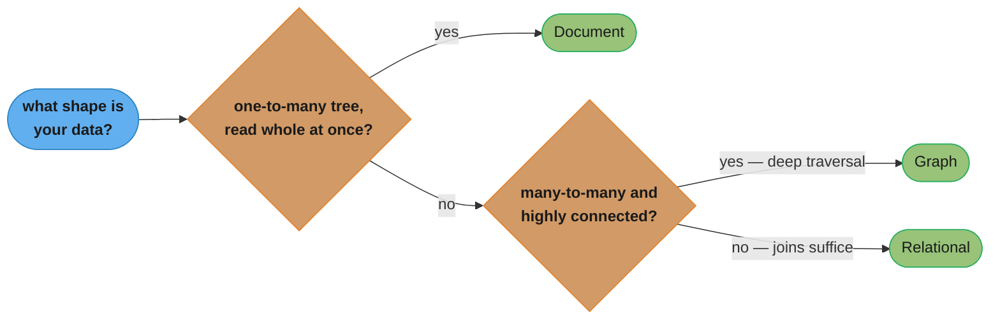
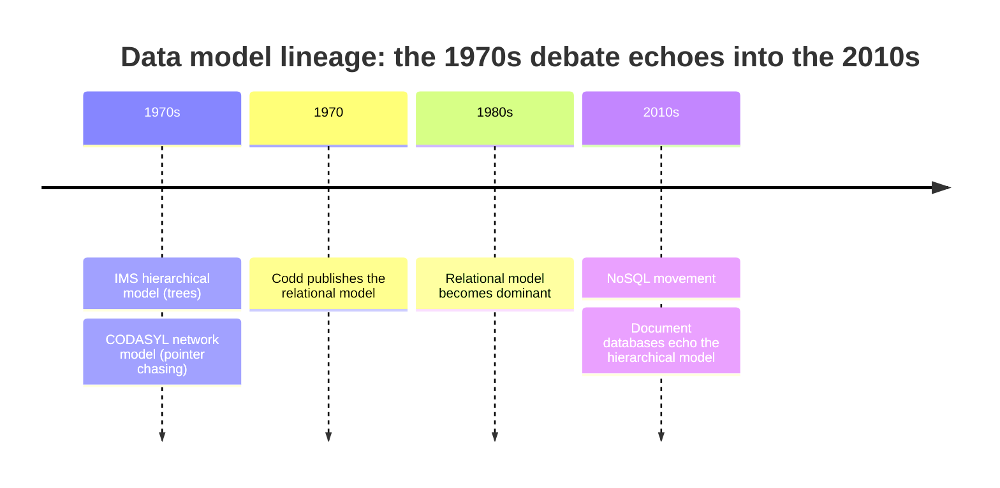
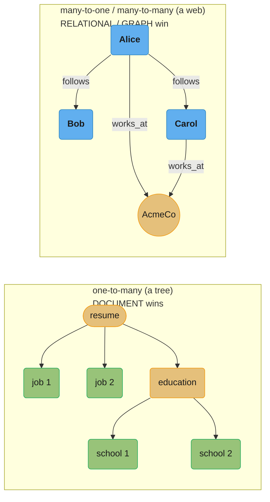
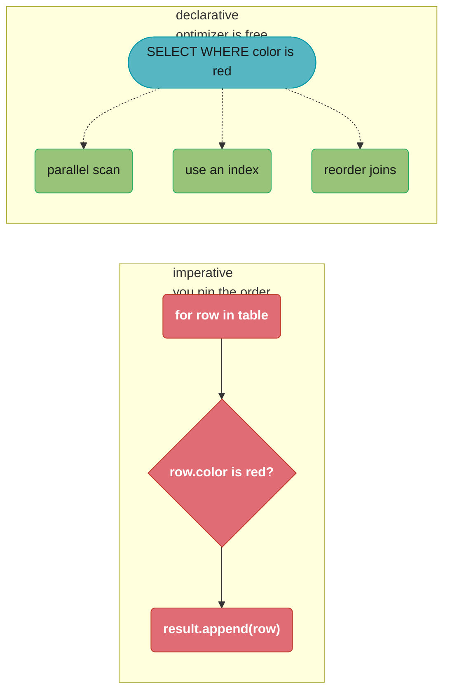

# Chapter 2: Data Models and Query Languages

> Part I — Foundations of Data Systems · DDIA (Kleppmann, 1st ed., O'Reilly 2017) · builds on Ch 1, leads to Ch 3 (storage)

## Chapter Map

Data models are the most important layer of abstraction: each layer hides the complexity of
the one below by offering a clean model. This chapter compares the three dominant models —
**relational**, **document**, and **graph** — and the query languages that go with them. The
recurring theme: there is no universal best model; the right one depends on the
*relationships* in your data.

**TL;DR:**
- **Relational** wins for many-to-one and many-to-many relationships and joins.
- **Document** wins for one-to-many tree-shaped data with locality and schema flexibility,
  but handles joins poorly.
- **Graph** wins when many-to-many relationships are the norm and highly connected.
- Declarative query languages (SQL, Cypher, SPARQL) beat imperative because the engine — not
  you — chooses the execution strategy and can parallelize.



Caption: the chapter's TL;DR redrawn as a decision path — tree-shaped, read-mostly-whole data
goes to documents; everything else hinges on whether many-to-many connectivity needs
variable-depth traversal (graph) or a bounded number of joins suffices (relational).

## The Big Question

> "How should I shape my data — and does the shape of the *relationships* in my domain
> dictate which database family I should reach for?"

Analogy: choosing a data model is like choosing a natural language — each can express most
things, but each makes some thoughts easy and others awkward. Tree-shaped data feels natural
in a document; a web of relationships feels natural in a graph; tabular, normalized data
feels natural in the relational model.

---

## 2.1 Relational Model Versus Document Model

### The birth of NoSQL

The relational model (Codd, 1970; dominant since the 1980s) organizes data into *relations*
(tables) of *tuples* (rows). "NoSQL" is, in Kleppmann's own description, an unfortunate name
— it was originally intended simply as a catchy Twitter hashtag for a 2009 meetup on
open-source, distributed, non-relational databases (organized by Johan Oskarsson in the Bay
Area), and it has since been retroactively reinterpreted as "Not Only SQL." Several driving
forces pushed adoption of the databases that ended up under that hashtag:

- A need for **greater scalability** than relational databases can easily achieve, including
  very large datasets or very high write throughput.
- A widespread preference for **free and open source software** over commercial database
  products.
- Specialized **query operations** that are not well supported by the relational model.
- Frustration with the **restrictiveness** of relational schemas, and a desire for a more
  dynamic and expressive data model.

Different applications have different priorities, and the best choice of technology depends
on the situation — Kleppmann's expectation, borne out through the rest of the chapter, is that
relational databases will continue to be used alongside a broad variety of non-relational
datastores for the foreseeable future — an idea sometimes called **polyglot persistence**.

### The object-relational mismatch

Application code is objects; relational tables are rows. The awkward translation layer
between them is the **impedance mismatch**, partially papered over by ORMs (Hibernate,
ActiveRecord), which reduce the amount of boilerplate for this translation layer but can't
completely hide the differences between the two models.

Kleppmann's worked example is a LinkedIn-style résumé (his term: a "profile"). A person's
`user_id`, name, and email fit fine in a single relational row, but the résumé also has
several one-to-many relationships that a single row can't represent directly: the person may
have had several jobs (`positions`), several periods of education, and several pieces of
contact information (phone numbers, social-media handles). Traditionally, relational schemas
represent these one-to-many relationships one of three ways: put `positions`, `education`,
and `contact_info` in separate tables with a foreign key back to the `users` table; encode
them into a single column of the `users` table using a structured datatype the database
supports (XML, JSON, or a comma-separated list, if the database allows querying inside it);
or, in older systems with no support for structured datatypes, encode the list as text and
leave the application responsible for interpreting its structure — losing the ability to
query inside that field with the database's own query language. For a résumé, which is
mostly a self-contained document, this is exactly the shape a JSON document represents
directly: the tree of one-to-many relationships becomes one nested document —

```json
{
  "user_id":     251,
  "first_name":  "Bill",
  "last_name":   "Gates",
  "summary":     "Co-chair of the Bill & Melinda Gates Foundation.",
  "positions": [
    {"job_title": "Co-chair", "organization": "Bill & Melinda Gates Foundation"},
    {"job_title": "Co-founder, Chairman", "organization": "Microsoft"}
  ],
  "education": [
    {"school_name": "Harvard University", "start": 1973, "end": 1975}
  ],
  "contact_info": {"blog": "gatesnotes.com", "twitter": "@BillGates"}
}
```

— instead of multiple joined tables. JSON representation has better locality than the
multi-table schema, since you don't need multiple queries to fetch a résumé; you need only a
single query to the `users` table, or a single read if the `contact_info` and other fields
are embedded in the document. The relationship between the résumé document and the `user_id`
is explicit; it's a **one-to-many** relationship from the user to these items, which can be
represented with a tree structure — and the JSON representation makes this tree structure
explicit.

### Many-to-one and many-to-many relationships

The catch: real data has many-to-*one* relationships (many people live in one region; many
people have the same industry). The résumé example above also has fields like `region_id`
and `industry_id` that reference standardized lists of geographic regions and industries.
Kleppmann lays out why an ID, rather than the plain text "Greater Seattle Area", is preferred
for these:

- **Consistent style/spelling** across all the records that share the value.
- **Avoiding ambiguity** — e.g. if there are several cities with the same name.
- **Ease of updating** — the text is stored in only one place, so it's easy to update across
  the board even if it's shown to users in several places in the application; if the text is
  duplicated, all copies of redundant data need to be updated.
- **Localization support** — when the system is translated into other languages, the
  standardized lists can be localized, so the region and industry can be displayed in the
  reader's language.
- **Better search** — e.g. a search for people who work in the field defined for the industry
  is far easier if that field is encoded as an ID than if the industry appears as free text
  in every résumé, where it could be phrased in various ways.

Whether you store an ID or a text string is a **duplication** question: when you use an ID,
the information that is meaningful to humans (the region's name) is stored in only one place,
and everything that refers to it uses an ID (which only has meaning within the database).
When the human-meaningful information is duplicated, all the copies need to be updated, which
incurs write overhead and risks inconsistencies (some copies updated but not others). Removing
such duplication is the key idea behind **normalization** in databases. But normalizing data
requires many-to-one relationships, which don't fit nicely into the document model. In
relational databases it's normal to refer to rows in other tables by ID, because joins are
easy; document databases typically either don't support joins at all, or the join support is
weak, meaning any subsequent code to resolve the reference has to be written in the
application, effectively performing the join client-side (which can be worthwhile if the
data is not highly interconnected, but the workload gets more complicated as more relations
need to be traversed). Document databases handle one-to-many (trees) well but **joins
weakly** — you either denormalize (and accept update anomalies) or emulate joins in
application code. As features grow, data tends to become more interconnected (many-to-many),
which favors the relational/graph models.

### Decoding "handles joins weakly"

This chapter is mostly qualitative — it argues about *shape*, not formulas. But "emulate joins
in application code" hides a cost model worth writing down, because it is the one number that
turns a modelling opinion into an outage:

```
app-side join latency  =  (1 + N) x RTT          "N+1 queries"
engine-side join       =  1 x RTT + join_cost
```

**Put simply.** "A join done in the database is one round trip; the same join done in your
application is one round trip per row you got back."

| Symbol | What it is |
|--------|------------|
| `N` | Rows returned by the first query — each one needs its referenced document fetched |
| `RTT` | Round-trip time to the database. Network-bound, and it does not get faster with scale |
| `1 +` | The initial query that discovers which `N` documents you now have to go get |
| `join_cost` | In-engine hash/merge join. CPU-bound, no network per row, and parallelizable |

**Walk one example.** A list page showing 200 people and each person's region name:

```
  App-side emulation, 0.5 ms RTT on a warm local network:
    1 query for the 200 people                        0.5 ms
    200 follow-up lookups x 0.5 ms                  100.0 ms
    -------------------------------------------------------
    total                                           100.5 ms

  Single SQL join:
    1 round trip                                      0.5 ms
    hash join over 200 rows                           1.5 ms
    -------------------------------------------------------
    total                                             2.0 ms

  slowdown  =  100.5 / 2.0  =  50.2x
```

The `N` is why the chapter says joins get *worse* as features grow: the term scales with result
size, so the design that felt fine on a 10-row prototype (5.5 ms) is 50x slower on a 200-row
page, and the fix is not an index — it is a different data model.

**The denormalization alternative, also as arithmetic.** Store the region *name* in every
person document and the read becomes one query with zero follow-ups. The cost moves to writes:
if 1,000 people share a region, renaming that region is **1 write** normalized and **1,000
writes** denormalized, and any failure partway through leaves the two spellings coexisting.
That is precisely the "update anomaly" the section names — the ID indirection is buying write
consistency with read latency.

### Historical echo: the network and hierarchical models

The 1970s debate repeats. IMS's **hierarchical model** (trees, like JSON documents) worked
well for one-to-many relationships but made many-to-many relationships difficult, and didn't
support joins. Developers had to decide whether to duplicate (denormalize) data or manually
resolve references from one record to another. These problems from the 1960s and '70s were
strikingly similar to the problems document databases are running into today.

Various solutions were proposed to solve the limitations of the hierarchical model; the two
most notable were the **relational model** (SQL, eventually dominant) and the **network model
(CODASYL)** — which for a while looked like it would win. In the network model, a record could
have multiple parents, unlike the tree structure of the hierarchical model, so many-to-many
relationships could be represented. But the links between records were not foreign keys — they
were more like pointers in a programming language (stored on disk, though). The only way of
accessing a record was to follow a path called an **access path** from a root record along
these chains of links. In the simplest case, an access path could be like traversing a linked
list: start at the head of the list and look at one record at a time until you find the one
you want. But in a world of many-to-many relationships, several different paths can lead to
the same record, and a programmer working with the network model had to keep track of these
different access paths in their head — essentially writing a query meant writing code to
traverse a path through the data. This made querying and updating the database complicated
and inflexible; if you didn't have a path to the data you wanted, you were in trouble. A
query in CODASYL was performed by moving a cursor through the database by iterating over a
list of records; if a record had multiple parents (as required for many-to-many
relationships) the application code had to keep track of all the various relationships,
resembling navigating around an n-dimensional data space.

The **relational model**, by contrast, lays out all the data in the open: a relation (table)
is simply a collection of tuples (rows), and that's it — there are no labyrinthine nested
structures, no complicated access paths to follow. You can read any or all of the rows in a
table, filtering out particular rows using arbitrary conditions, and you can read using any
column, or multiple columns, as the query condition. In a relational database, the **query
optimizer** automatically decides which parts of the query to execute in which order, and
which indexes to use — those "access paths" are, in effect, chosen automatically rather than
having to be hardcoded by the application developer. If you want to query your data in new
ways, you can just declare a new index, and queries will automatically use whichever indexes
are most appropriate. The relational model thus made it much easier to add new features to
applications — the query optimizer figures out an efficient path through the data, without
the application developer needing to worry about it, and it doesn't need to be changed if you
add new fields or types of records to your database.

Document databases are, in a sense, the hierarchical model reborn — storing nested records
(one-to-many relationships) within their parent record rather than in a separate table — but
when it comes to representing many-to-many relationships, document and relational databases
are not fundamentally different: the related item is referenced by a unique identifier, which
is called a **foreign key** in the relational model and a **document reference** in the
document model. That identifier is resolved at read time by using a join or follow-up
queries, and how it is resolved is not fundamentally different between the two models — the
same weakness that pushed developers away from CODASYL toward the relational model is what
pushes highly-interconnected data away from a pure document model today.



Caption: the hierarchical and document models rhyme four decades apart — trees, same
many-to-many weakness both times — while CODASYL's network model lost outright and left no
modern heir; the relational model, unbroken since Codd's 1970 paper, is what both eras had to
route around.

The rhyme is worth sitting with because it cuts against a common assumption — that document
databases are simply "newer, so better." The tree-shaped one-to-many strength and the
many-to-many weakness are the *same* structural property showing up twice, forty years apart,
under different marketing. Neither era's engineers were wrong about what trees are good for;
what changed between IMS and MongoDB is packaging (JSON instead of a proprietary on-disk
format) and audience (any application developer instead of specialized IBM mainframe
operators), not the underlying tradeoff.

### Relational vs document today

Kleppmann weighs the two models on four axes the industry actually argues about, and each
one cuts a different way.

#### Which model leads to simpler application code

If your data has a document-like structure (a tree with one-to-many relationships that is
usually loaded and displayed as a unit — a résumé, a blog post with comments, a product
listing), the document model is a good fit: you get to load and store the whole thing in one
request instead of mapping it, field by field, onto a set of normalized tables. The
relational technique for representing this — *shredding* — splits the résumé into a `users`
table plus `positions` and `education` tables, then requires either multiple queries (one per
table) or a messy multi-way join to reassemble it, and the application code has to do the
assembly the document model gave you for free. The document model's schema flexibility can
be an advantage here too: if the application changes what a résumé is allowed to contain, a
document store lets you write the new shape immediately, whereas the relational schema-on-
write approach can slow such changes down with explicit schema migrations. But the document
model is a poor fit the moment the data has many-to-many relationships — if your résumé needs
to reference the *same* organization or school record other résumés also reference (so that,
say, a company rename updates every résumé at once), you're back to needing something
join-like, and the document model does not make that code simpler; it moves the join into
your application, by hand, without an optimizer's help.

#### Schema flexibility, in practice

Most document databases, and relational databases that support JSON columns, do not enforce
a schema on the data they store — the *reader* of the data, not the database, interprets it.
Kleppmann's term for this is schema-on-read: it is akin to dynamic (runtime) type checking in
programming languages, as opposed to static (compile-time) type checking on schema-on-write.
The schema-on-read approach is advantageous if the items in a collection don't all have the
same structure — there are many different types of objects, and it's not practical to have a
separate table per type — or if the structure of the data is determined by external systems
over which you have no control and which may change at any time. Concretely: adding a field
to every document going forward simply means new documents carry it and old ones don't; a
relational schema-on-write change instead means running an explicit migration, which is fast
in modern databases like PostgreSQL or MySQL (an `ALTER TABLE` that just changes metadata,
executing in milliseconds) but historically slower or entirely locking in others.

#### Data locality for queries

A document is usually stored as a single contiguous string — JSON, XML, or a binary encoding
like MongoDB's BSON. If your application often needs to access the entire document (to render
a page, say), there's a performance advantage to this storage locality: rather than performing
multiple index lookups as a relational schema would require, a single query can retrieve the
entire résumé document. If data is split across multiple tables, multiple index lookups are
required to retrieve it all, which may require more disk seeks and take more time. The
locality advantage only applies if you need large parts of the document at the same time — the
database typically needs to load the entire document even if you access only a small portion
of it, which is wasteful for large documents, and updates to a document usually need to rewrite
the entire document (only modifications that don't change the encoded size can easily be
performed in place). It is therefore recommended to keep documents fairly small and avoid
writes that increase the size of a document — these performance limitations significantly
reduce the set of situations in which the locality advantage is actually useful.

#### Convergence of document and relational databases

Most relational database systems (other than MySQL) have supported XML since the mid-2000s,
including functions to make local modifications and the ability to index and query inside an
XML document — which allows applications to use data models very similar to what they would
use if they were using a document database. PostgreSQL since 9.3, MySQL since 5.7, and IBM
DB2 since 10.5 also have a similar level of support for JSON documents. Given the popularity
of JSON for web APIs, other relational databases are likely to follow their lead and add JSON
support too. On the document database side, RethinkDB supports relational-like joins in its
query language, and some MongoDB drivers automatically resolve document references (an
effective client-side join, though slower than a database-performed join). It seems likely
that document and relational databases will continue to converge, and that is a good thing:
the ability to combine the two data models in a single tool serves an application's needs
better than either model alone.

### Decoding the locality caveat

"Keep documents small" is the chapter's practical rule, and it follows from two facts stated
just above: the database loads the *whole* document even for one field, and updates typically
rewrite the whole document. Written as ratios:

```
read waste            =  doc_bytes x (1 - fraction_needed)
write amplification   =  doc_bytes / changed_bytes
```

**The idea behind it.** "Locality is a discount you only collect if you actually wanted most
of the document — otherwise it is a surcharge, and on writes it is always a surcharge."

| Symbol | What it is |
|--------|------------|
| `doc_bytes` | Size of the whole document. The unit the storage engine reads and rewrites |
| `fraction_needed` | Share of the document the query actually uses. The break-even variable |
| `changed_bytes` | What the update really modified — one field, usually tiny |
| `doc_bytes / changed_bytes` | Physical bytes written per useful byte. Grows linearly with doc size |

**Walk one example.** Reading one field, then updating one field:

```
  READ -- a 100 KB document, engine loads all 100,000 B regardless:
    need 100% of it   ->  wasted      0 B     locality is a pure win
    need  50% of it   ->  wasted 50,000 B     break-even-ish
    need  10% of it   ->  wasted 90,000 B     you are paying 10x for one field
    need   2% of it   ->  wasted 98,000 B     you are paying 50x

  WRITE -- change one 50-byte field:
      4 KB document   ->  rewrite      4,000 B   ->  WA =    80x
    100 KB document   ->  rewrite    100,000 B   ->  WA = 2,000x
      1 MB document   ->  rewrite  1,000,000 B   ->  WA = 20,000x
```

The write column is why the rule is "keep documents small" rather than "keep documents
focused": read waste is bounded by how much you over-fetch, but write amplification is
unbounded in document size and is paid on *every* update to *any* field. A résumé that grows an
append-only activity log is the classic failure — the document creeps from 4 KB to 1 MB, and
the cost of touching one field silently rises 250-fold.

### Schema-on-read vs schema-on-write

Document DBs are often called "schemaless," but more precisely they use **schema-on-read**
(structure is interpreted when data is read — like dynamic typing) versus the relational
**schema-on-write** (schema enforced at write time — like static typing). Schema-on-read
shines when items are heterogeneous or the structure comes from external systems you don't
control. Schema-on-write shines when you want guarantees and the structure is uniform.
Changing a field's shape: in a document DB you just start writing the new shape and handle
both at read time; in a relational DB you run a migration (`ALTER TABLE`, possibly a slow
`UPDATE`).

## 2.2 Query Languages for Data

### Declarative versus imperative

An **imperative** language (most programming languages, CODASYL navigation) tells the machine
*how* to do something, step by step. A **declarative** language (SQL, relational algebra)
specifies *what* result you want and lets the engine decide *how*. Declarative wins because:
it hides engine internals (the optimizer can change the execution plan without app changes);
it's more concise; and crucially it leaves room for **automatic parallelization** across
cores/machines, because you didn't pin a sequential order of operations. Kleppmann's CSS/DOM
analogy: declarative CSS selectors let the browser optimize rendering; doing the same in
imperative JavaScript would be verbose, brittle, and unparallelizable.

### Declarative queries on the web

Kleppmann makes the declarative-vs-imperative case concrete with a browser example, because
it's one every web developer has lived through. Say you want to highlight every `<li>` tag
that is a direct child of an `<ul>` tag with a class of `selected`, and you're also using
Firefox/Chrome/IE9's `document.getElementsBySelector()`. The **imperative** approach walks
the tree by hand: find every `<ul>` element, for each one find its child `<li>` elements,
check each one's parent has class `selected`, and if so call `element.setAttribute()` to
change its styling. The equivalent **declarative** CSS is one line:

```css
li.selected > p {
    background-color: blue;
}
```

The huge advantage of the declarative approach is that if the underlying data changes — say
an element is inserted or removed from the DOM — CSS and XSL automatically notice and apply
the new styling as needed, without the application needing to do anything. The imperative
code has to explicitly re-run its detection and update logic whenever the tree changes, and
a browser can also implement `getElementsBySelector()` (or the modern `querySelectorAll()`)
using far more efficient code than a naive implementation would, because the *declarative*
form gives the browser's rendering engine freedom to optimize (build indexes over the DOM,
choose which nodes to inspect) exactly the way a query optimizer does for SQL. If it were
implemented in JavaScript in a naive, imperative way, it would typically be much slower than
writing the equivalent code directly in a language like C, which is closer to the internal
data structures the browser uses. This is the same argument, restated for a domain with no
database in sight: declarative wins whenever the engine underneath can exploit knowledge the
application-level code doesn't have and shouldn't need to have.

### MapReduce querying

**MapReduce** (popularized by Google) is a programming model for bulk processing across
many machines — a midpoint between declarative and imperative. You supply two pure
(side-effect-free) functions, `map` and `reduce`; the framework handles distribution. MongoDB
offered MapReduce for aggregation, but its declarative **aggregation pipeline** later proved
easier for most queries. The lesson: even where you must drop to imperative snippets for
custom logic, a declarative wrapper is preferable for the common cases.

## 2.3 Graph-Like Data Models

When many-to-many relationships dominate and data is highly connected (social graphs, the web,
road networks), a **graph** is the natural model. Vertices (nodes) + edges (relationships).
Two well-known graph models:

### Property graphs (and Cypher)

Each **vertex** has an ID, a set of outgoing/incoming edges, and a collection of
key-value properties. Each **edge** has an ID, a tail/head vertex, a label (relationship
type), and properties. This is very flexible: any vertex can connect to any other; you
traverse by following edges in either direction; you can mix many relationship types in one
graph — which is what makes a graph model good for evolving applications, since new kinds of
relationships can be added without a schema migration on existing data.

Kleppmann shows that a property graph can itself be represented in a relational schema — a
`vertices` table and an `edges` table, each with a `properties` column for the arbitrary
key-value data:

```sql
CREATE TABLE vertices (
    vertex_id   integer PRIMARY KEY,
    properties  json
);

CREATE TABLE edges (
    edge_id     integer PRIMARY KEY,
    tail_vertex integer REFERENCES vertices (vertex_id),
    head_vertex integer REFERENCES vertices (vertex_id),
    label       text,
    properties  json
);

CREATE INDEX edges_tails ON edges (tail_vertex);
CREATE INDEX edges_heads ON edges (head_vertex);
```

Every edge has a tail and a head vertex, so both directions of a relationship can be found
quickly by indexing on `tail_vertex` and `head_vertex` separately. This is the schema the
recursive SQL query later in this section is written against; it's also the concrete
illustration of the section's headline claim — a graph is just vertices and edges with
properties, and you can bolt that structure onto a relational database if you don't want to
adopt a dedicated graph engine, at the cost of writing the traversal logic yourself instead
of getting it from a purpose-built query language. **Cypher** (Neo4j's declarative language)
expresses traversals like
"find people who emigrated from the US to Europe" as a pattern of nodes and edges; the engine
finds matching paths regardless of length. The same query in SQL needs **recursive common
table expressions** (`WITH RECURSIVE`) and is far more verbose, because the number of joins
is not fixed in advance — exactly where SQL is awkward and graph queries shine.

### Decoding "the number of joins is not fixed in advance"

The comparison the chapter makes is between a query whose *text length* depends on traversal
depth and one whose does not:

```
SQL joins written  =  d          (d = traversal depth, must be known when you write the query)
vertices visited   ~  b^d        (b = average out-degree, the branching factor of the graph)
```

**Stated plainly.** "In SQL you must know the depth before you write the query; in Cypher you
only have to know the pattern, and the engine walks as deep as the data goes."

| Symbol | What it is |
|--------|------------|
| `d` | Hops from the start vertex. In SQL this is a hand-written join per hop |
| `b` | Average out-degree — how many edges leave a typical vertex |
| `b^d` | Frontier size after `d` hops. The work the engine does, in either language |
| `WITH RECURSIVE` | SQL's escape hatch: expresses unbounded `d` at the cost of much verbosity |

**Walk one example.** A social graph with average out-degree 50:

```
        depth d    SQL joins to write    frontier ~ 50^d
          1                1                        50
          2                2                     2,500
          3                3                   125,000
          4                4                 6,250,000
```

Two separate things grow here, and conflating them is the classic interview trap. The **left
column** is a *language* problem: Cypher's pattern is the same text at every depth, SQL's is
not, and at unknown depth SQL needs `WITH RECURSIVE`. The **right column** is a *work* problem
that no query language escapes — a graph database traversing 4 hops still touches millions of
vertices. Graph models win on expressiveness and on locality of the edge pointers, not by
making `b^d` smaller.

### The same traversal, in Cypher and in SQL

Kleppmann walks one concrete query in both languages to make the verbosity gap tangible: find
the names of all people who emigrated from the United States to Europe, using a graph where
`Person` and `Location` vertices are connected by `BORN_IN` and `LIVES_IN` edges. In Cypher:

```cypher
MATCH
  (person) -[:BORN_IN]->  () -[:WITHIN*0..]-> (us:Location {name:'United States'}),
  (person) -[:LIVES_IN]-> () -[:WITHIN*0..]-> (eu:Location {name:'Europe'})
RETURN person.name
```

The `[:WITHIN*0..]` syntax means "follow a `WITHIN` edge zero or more times" — the pattern
matches a person born in a place that is within the US at any level of nesting (city, state,
country) and now living in a place within Europe. The equivalent in standard SQL needs a
recursive common table expression to express "zero or more" hops, because a plain `JOIN`
chain has a length fixed at write time:

```sql
WITH RECURSIVE
  in_usa(vertex_id) AS (
      SELECT vertex_id FROM vertices WHERE properties->>'name' = 'United States'
    UNION
      SELECT edges.tail_vertex FROM edges
      JOIN in_usa ON edges.head_vertex = in_usa.vertex_id
      WHERE edges.label = 'within'
  ),
  in_europe(vertex_id) AS ( /* same shape, seeded from 'Europe' */
      SELECT vertex_id FROM vertices WHERE properties->>'name' = 'Europe'
    UNION
      SELECT edges.tail_vertex FROM edges
      JOIN in_europe ON edges.head_vertex = in_europe.vertex_id
      WHERE edges.label = 'within'
  )
SELECT vertices.properties->>'name'
FROM vertices
JOIN edges ON vertices.vertex_id = edges.tail_vertex
JOIN in_usa    ON edges.head_vertex = in_usa.vertex_id    AND edges.label = 'born_in'
JOIN in_europe ON EXISTS ( /* the person also lives somewhere in_europe */
  SELECT 1 FROM edges e2
  WHERE e2.tail_vertex = vertices.vertex_id AND e2.label = 'lives_in'
    AND e2.head_vertex IN (SELECT vertex_id FROM in_europe)
);
```

Four lines of Cypher against roughly twenty of recursive SQL, for the same result — and the
SQL is, in Kleppmann's own assessment, "comparatively awkward." The gap is not a quirk of
syntax; it's exactly the `WITH RECURSIVE` cost from the decoding box above made concrete:
Cypher's pattern-match syntax was designed around unbounded-depth traversal from the start,
while SQL's was designed around fixed-shape joins and had recursion retrofitted on top.

### Triple-stores and SPARQL

The **triple-store** model expresses everything as three-part statements:
*(subject, predicate, object)* — e.g. *(Jim, likes, bananas)* or *(Lucy, age, 33)*. The
object is either a value (a property) or another vertex (an edge). This underlies the
**Semantic Web** and **RDF**. **SPARQL** is the declarative query language for triple-stores
(predates and inspired Cypher). Triples are a compact, uniform way to encode a property graph.

### Datalog

**Datalog** is an older (1980s) foundation: data as facts `predicate(subject, object)`, and
queries as **rules** that derive new predicates from existing ones, *recursively*. Rules
compose and can refer to one another, which makes complex queries built up from small pieces.
The book's own "born in the US, living in Europe" example again, this time as Datalog rules:

```
within_recursive(Location, Name) :- name(Location, Name).      /* base case */
within_recursive(Location, Name) :- within(Location, Via),     /* recursive case */
                                     within_recursive(Via, Name).

migrated(Name, BornIn, LivingIn) :- name(Person, Name),
                                     born_in(Person, BornLoc),
                                     within_recursive(BornLoc, BornIn),
                                     lives_in(Person, LivingLoc),
                                     within_recursive(LivingLoc, LivingIn).

?- migrated(Who, 'United States', 'Europe').
```

The rule `within_recursive` is defined in terms of itself — a location is `within` a named
region either directly, or by being `within` some intermediate place that is itself
recursively `within` that region — which is exactly the "zero or more hops" idea Cypher
expresses with `[:WITHIN*0..]` and SQL expresses with `WITH RECURSIVE`, but here it is a
reusable, named building block that other rules (like `migrated`) simply call. It's less
convenient for one-off ad hoc queries but powerful for sophisticated, reusable query logic,
and it underlies systems like Datomic and Cascalog.

---

## Visual Intuition





Caption: the two load-bearing ideas of the chapter — relationship shape picks the model, and
declarative queries hand the engine the freedom to optimize and parallelize.

---

## Key Concepts Glossary

- **Data model** — the abstraction defining how data is structured and queried.
- **Relational model** — data as relations (tables) of tuples (rows); joins resolve refs.
- **Document model** — self-contained nested documents (JSON/BSON/XML); trees.
- **NoSQL** — umbrella for non-relational stores driven by scale, OSS, specialized queries,
  and schema flexibility.
- **Polyglot persistence** — using multiple datastore types in one application.
- **Impedance mismatch (object-relational)** — friction translating app objects to rows.
- **Locality** — storing related data physically together for single-read access.
- **Normalization** — storing each fact once and referencing it by ID to avoid duplication.
- **Denormalization** — duplicating data for read speed, at the cost of update anomalies.
- **One-to-many / many-to-one / many-to-many** — the relationship cardinalities that drive
  model choice.
- **Schema-on-read** — structure interpreted at read time (dynamic typing analogy).
- **Schema-on-write** — structure enforced at write time (static typing analogy).
- **Declarative query** — specifies the result (SQL, Cypher, SPARQL); engine picks the plan.
- **Imperative query** — specifies the steps; pins execution order.
- **MapReduce** — bulk-processing model using pure map and reduce functions.
- **Aggregation pipeline** — MongoDB's declarative alternative to MapReduce.
- **Property graph** — vertices and edges, each with labels and key-value properties.
- **Cypher** — declarative query language for property graphs (Neo4j).
- **Triple-store** — data as (subject, predicate, object) statements; RDF; queried by SPARQL.
- **Datalog** — rule-based, recursive query foundation; composable derived predicates.
- **Recursive CTE (`WITH RECURSIVE`)** — SQL's way to express variable-length graph traversal.
- **Access path** — in the CODASYL network model, the pointer chain a program had to follow
  by hand to reach a record; superseded by the query optimizer choosing paths automatically.
- **Shredding** — decomposing a tree-shaped document into normalized relational tables.
- **Foreign key** — the relational model's identifier for a referenced row; a document
  database's equivalent is a **document reference**, resolved the same way at read time.

---

## Tradeoffs & Decision Tables

| | Relational | Document | Graph |
|---|---|---|---|
| Best relationship shape | Many-to-one, many-to-many | One-to-many (trees) | Many-to-many, highly connected |
| Joins | Strong, optimizer-chosen | Weak (app-side or denormalize) | Native traversal |
| Schema | Schema-on-write | Schema-on-read | Flexible per vertex/edge |
| Locality | Per-row | Whole document in one read | Per vertex |
| Typical use | OLTP, reporting, anything tabular | Self-contained docs, catalogs | Social, fraud, recommendations, networks |

| | Schema-on-read | Schema-on-write |
|---|---|---|
| Analogy | Dynamic typing | Static typing |
| Best when | Heterogeneous items; external structure | Uniform structure; want guarantees |
| Change a field | Write new shape, branch at read | Migration (`ALTER TABLE` / `UPDATE`) |

| | Declarative (SQL/Cypher) | Imperative (app loop/CODASYL) |
|---|---|---|
| Specifies | What result | How, step by step |
| Optimization | Engine chooses plan | Fixed by you |
| Parallelizable | Yes (no pinned order) | Hard (order is pinned) |

---

## Common Pitfalls / War Stories

- **Denormalizing into documents, then drowning in update anomalies.** Embedding a region
  *name* in every user document means renaming the region requires rewriting millions of
  documents — and any you miss are now inconsistent. Use an ID and resolve it; accept the
  join.
- **Modeling many-to-many in a document store.** Order items referencing products, products
  referencing categories, categories referencing… you end up emulating joins in application
  code, which is slow and error-prone. This is the historical hierarchical-model weakness
  resurfacing; reach for relational or graph instead.
- **Giant documents.** Because most document DBs load and rewrite the *whole* document, a
  multi-megabyte document makes every small update expensive and every read wasteful. Keep
  documents bounded; locality is a benefit only when you usually need the whole thing.
- **Writing variable-depth traversals in SQL without recursion.** "Friends of friends of
  friends" with a fixed number of joins breaks the moment depth varies; you need
  `WITH RECURSIVE` (verbose) or, better, a graph database with Cypher.
- **Believing "schemaless" means no schema.** There is always an implicit schema — it's just
  enforced by your application at read time. Undocumented schema-on-read becomes a minefield
  of "which version of this document am I looking at?"

---

## Real-World Systems Referenced

Oracle/DB2/SQL Server/PostgreSQL/MySQL (relational), MongoDB/RethinkDB/CouchDB/Espresso
(document), IMS (hierarchical), CODASYL (network), Neo4j/Titan/InfiniteGraph (property
graphs), Datomic/AllegroGraph (triple-stores/RDF), Datomic/Cascalog (Datalog), Hibernate/
ActiveRecord (ORMs), Google MapReduce, CSS/XSL (declarative analogy).

---

## Summary

Data models shape how you think about a problem. The relational, document, and graph models
each fit a different *relationship shape*: documents for one-to-many trees (with locality and
schema flexibility but weak joins), relational for many-to-one and many-to-many (joins
resolved by an optimizer), and graphs for highly connected many-to-many data (native
traversal via Cypher/SPARQL/Datalog). The schemaless/schema debate is really schema-on-read
(dynamic) vs schema-on-write (static). Declarative query languages beat imperative ones
because they let the engine choose and parallelize the execution plan — the same reason the
relational model defeated the navigational CODASYL model decades ago. The history rhymes:
document databases reprise the hierarchical model's strengths and its many-to-many weakness.

---

## Interview Questions

**Q: When would you choose a document database over a relational one, and what is the main thing you give up?**
**Short:** Choose documents for self-contained one-to-many trees; give up strong support for joins and many-to-many data.
Choose a document database when your data is a self-contained tree of one-to-many relationships (a résumé, a product with its variants) that you usually read all at once — you gain locality, schema flexibility, and a closer match to application objects. What you give up is good support for joins and many-to-many relationships; resolving references means denormalizing (risking update anomalies) or emulating joins in application code. As data grows more interconnected, that weakness dominates.

**Q: What is the object-relational impedance mismatch, and how does the document model reduce it?**
It's the awkward translation between application objects (nested, with collections) and the flat rows/columns of the relational model, usually bridged by an ORM. The document model reduces it for tree-shaped data because a nested JSON document mirrors the object's structure directly — a person with many jobs and schools is one document, not several joined tables. It does not eliminate the mismatch for many-to-many data, where you still need references.

**Q: Explain schema-on-read versus schema-on-write and give a scenario favoring each.**
**Short:** Schema-on-read is dynamic-typing-like and suits heterogeneous data; schema-on-write is static-typing-like and suits uniform data.
Schema-on-read interprets structure when data is read (like dynamic typing) and suits heterogeneous data or data whose structure is dictated by external systems you don't control — e.g. ingesting varied third-party events. Schema-on-write enforces structure at write time (like static typing) and suits uniform data where you want guarantees and the ability to reason about every row — e.g. a financial ledger. The distinction reframes "schemaless" as "schema enforced later," because there's always an implicit schema.

**Q: Why did the relational model win over the navigational CODASYL/network model, and how does that history apply to document databases?**
**Short:** Kleppmann argues the relational model won because a query optimizer replaced hand-navigated pointer chains.
The relational model laid data out plainly and let a query optimizer choose access paths automatically, whereas CODASYL forced programmers to hand-navigate pointer chains, which was rigid and broke whenever the data layout changed. Document databases echo the older hierarchical model: great for tree-shaped one-to-many data, weak at many-to-many — so the same limitation that hurt hierarchical databases resurfaces, and many-to-many data again pushes you toward relational or graph models.

**Q: Why are declarative query languages generally preferable to imperative ones?**
**Short:** A declarative query states the result, not the steps, so the engine is free to optimize and parallelize it.
Because a declarative query states *what* result you want, not *how* to compute it, the engine is free to choose the best execution plan, change it as data/indexes evolve without touching app code, and parallelize across cores and machines since no sequential order is pinned. Imperative code fixes the order and hides intent, so the engine can't safely optimize or parallelize it. SQL's declarativeness is precisely what lets the same query keep working as the optimizer and storage improve.

**Q: When is a graph model clearly better than a relational one, and why is the equivalent SQL awkward?**
A graph model is clearly better when many-to-many relationships dominate and you traverse variable-length paths (social networks, fraud rings, routing). The equivalent SQL is awkward because the number of joins isn't known in advance — "people connected to X within N hops" needs recursive CTEs (`WITH RECURSIVE`), which are verbose and hard to read, whereas Cypher expresses the same as a concise node-edge pattern the engine matches at any path length.

**Q: Describe the property-graph model's components.**
A property graph has vertices and edges. Each vertex carries a unique ID, a set of outgoing and incoming edges, and a collection of key-value properties. Each edge carries a unique ID, its tail (start) and head (end) vertices, a label naming the relationship type, and its own key-value properties. This structure lets any vertex connect to any other and lets multiple relationship types coexist in one graph, which is what makes traversal so flexible.

**Q: What is a triple-store, and how does it relate to a property graph?**
A triple-store represents all data as three-part statements: (subject, predicate, object), such as (Lucy, age, 33) or (Lucy, marriedTo, Alain). When the object is a primitive value the triple is a property; when it's another subject the triple is an edge. This is essentially a compact, uniform encoding of a property graph and underlies RDF and the Semantic Web, queried with SPARQL.

**Q: What problem does locality solve in document databases, and when does it backfire?**
Locality means a document's related data is stored physically together, so loading it takes one read instead of multiple joins — great when you typically need most of the document at once. It backfires for large documents because the database generally loads the *entire* document even to read one field, and updates usually rewrite the whole document, so big documents make reads wasteful and writes expensive. The guidance is to keep documents reasonably small.

**Q: Why does normalization require joins, and what's the tradeoff against denormalization?**
Normalization stores each fact once and references it by ID (so a region name lives in one row), which means resolving the human-readable value requires a join back to that row. Denormalization duplicates the value into many records to avoid the join, speeding reads but creating update anomalies — changing the value means finding and rewriting every copy, and missing one causes inconsistency. The choice trades read simplicity against write consistency.

**Q: What is MapReduce as a query mechanism, and why did MongoDB add a declarative aggregation pipeline alongside it?**
MapReduce is a bulk-processing model where you supply pure `map` and `reduce` functions and the framework distributes the work across machines — a middle ground between declarative and imperative. MongoDB initially exposed MapReduce for aggregation but added the declarative aggregation pipeline because, for most queries, expressing intent declaratively is more concise and lets the engine optimize, reserving imperative functions for genuinely custom logic.

**Q: What is Datalog and what makes it powerful for complex queries?**
Datalog stores data as simple facts (`predicate(subject, object)`) and expresses queries as rules that derive new predicates from existing ones, including recursively. Its power is composability: you build complex queries from small, named, reusable rules that can reference each other, which scales to sophisticated logic better than writing one giant query. It's less convenient for quick one-offs but excellent for reusable analytical logic, and it underlies systems like Datomic.

**Q: What does "polyglot persistence" mean and why is it the likely future?**
**Short:** Polyglot persistence is running several datastore types together, each for the workload it fits best.
Polyglot persistence is using several different datastore types within one application, each for the workload it fits — a relational DB for transactions, a document store for catalogs, a graph DB for recommendations, a search index for full-text. It's the likely future because no single model is best for every relationship shape and access pattern, and the models are converging (relational DBs gaining JSON, document DBs gaining references) rather than one winning outright.

**Q: Why does data tend to become more interconnected over a system's lifetime, and what does that imply for model choice?**
**Short:** As features accumulate, once-independent entities acquire references, pushing one-to-many trees toward many-to-many webs.
As features accumulate, entities that started independent acquire references to each other — users gain followers, posts gain tags, products gain related-product links — so one-to-many trees evolve into many-to-many webs. This implies that a document model chosen early for its simplicity may need to give way to relational or graph models as relationships proliferate, so it's worth anticipating which relationships will grow rather than optimizing only for today's shape.

**Q: How do relational and document databases converge, and why does that matter for choosing one?**
They converge because relational databases have added JSON/XML column types and document-like nested storage, while document databases have added references and join-like lookups. This matters because the choice is less binary than it appears: you can get document-style flexibility inside PostgreSQL or relational-style references inside MongoDB, so you should choose based on which model is *primary* for your dominant access pattern rather than assuming you must forgo the other's features entirely.

**Q: What is the CSS/browser example, and what does it prove about declarative languages that has nothing to do with databases?**
**Short:** CSS declares "what" to style and lets the browser optimize; the same argument holds without any database in sight.
Kleppmann contrasts imperative JavaScript that walks the DOM by hand — find every `<ul>`, then its `<li>` children, then check each one's class — with one line of declarative CSS (`li.selected > p { background-color: blue; }`) that achieves the same highlighting. The declarative form lets the browser's rendering engine pick an efficient implementation, and it automatically re-applies itself when the DOM changes, with no application code re-running any detection logic. The point is that "declarative beats imperative" isn't a database-specific claim — it's a general argument about giving an engine freedom to exploit internal knowledge the calling code doesn't have.

**Q: Walk through why the SQL recursive-CTE version of a graph traversal is so much longer than the equivalent Cypher.**
**Short:** SQL needs one `WITH RECURSIVE` clause per unbounded-depth relationship it walks; Cypher needs one arrow.
For "who emigrated from the US to Europe," the SQL needs two separate recursive common table expressions — one walking `within` edges up from the US, one walking them up from Europe — each built from a base case plus a `UNION` step that repeatedly follows one more edge, and then a final query joining a person's `born_in` and `lives_in` edges against both recursive sets. Cypher expresses the same "zero or more `WITHIN` hops" with `[:WITHIN*0..]` inside a single pattern. The difference isn't stylistic — SQL's join syntax was designed for a fixed number of tables named in the query, and recursion was retrofitted on top of it, while Cypher's pattern-matching syntax was designed around unbounded traversal from the outset.

**Q: What is "shredding" a document, and why does the document model avoid it?**
**Short:** Shredding splits one document into normalized tables; the document model instead stores the tree as one unit.
Shredding is the relational technique of decomposing a tree-shaped record — a résumé with several jobs and schools — into a `users` table plus separate `positions` and `education` tables linked by foreign keys, so that reassembling one résumé requires either several queries or a multi-way join. The document model instead stores the whole tree as a single self-contained document, so the application can load and store it as one unit that matches the in-memory object structure. The tradeoff Kleppmann names is that shredding buys you support for many-to-many references the un-shredded document does not get for free.

**Q: Why is a relational schema migration in a modern database usually fast, contrary to its reputation for rigidity?**
**Short:** In PostgreSQL or MySQL, adding a column is typically a metadata-only change that runs in milliseconds.
Kleppmann notes that most relational databases execute an `ALTER TABLE` statement in a few milliseconds, because it only changes metadata (the new column is filled with `NULL`s and read lazily) rather than rewriting the whole table — the exception is older MySQL versions, where `ALTER TABLE` copies the entire table, which can mean minutes or hours of downtime for a large table. So the common claim that relational schemas are rigid and document schemas are flexible somewhat overstates the relational side's actual cost, at least on modern engines; the real distinction is *when* the schema is checked, not how expensive it is to change.

**Q: What data does RethinkDB or a MongoDB driver borrow from the relational model, and what does that say about where these models are headed?**
**Short:** RethinkDB supports relational-style joins and some MongoDB drivers auto-resolve document references, evidence of convergence.
RethinkDB's query language supports join-like operations across collections, and some MongoDB drivers automatically resolve document references for you — effectively performing a client-side join, though slower than one the database engine performs itself, since it typically means an additional network round trip and lacks the optimizations a database's own join implementation has. Kleppmann reads this, together with relational databases adding JSON/XML column support, as evidence that document and relational databases are converging rather than one model displacing the other, which is why he expects future databases to combine both models in a single tool.

---

## Cross-links in this repo

- [database/schema_design_and_normalization/ — normal forms, JSONB, multi-tenancy](../../../database/schema_design_and_normalization/schema_design_and_normalization.md)
- [database/document_databases/ — MongoDB internals, embedding vs referencing](../../../database/document_databases/document_databases.md)
- [database/graph_databases/ — Neo4j, index-free adjacency, Cypher](../../../database/graph_databases/graph_databases.md)
- [database/sql_query_optimization/ — how the declarative optimizer chooses a plan](../../../database/sql_query_optimization/sql_query_optimization.md)

## Further Reading

- Kleppmann, DDIA Ch 2 — original text and references.
- Codd, "A Relational Model of Data for Large Shared Data Banks," 1970 — the founding paper.
- Robinson, Webber & Eifrem, *Graph Databases* — property graphs and Cypher in depth.
