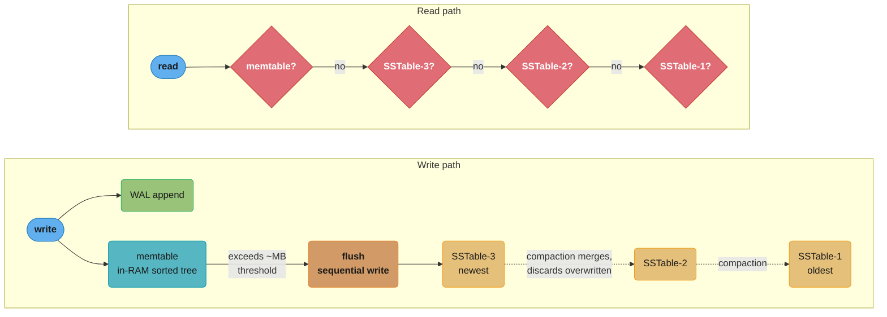
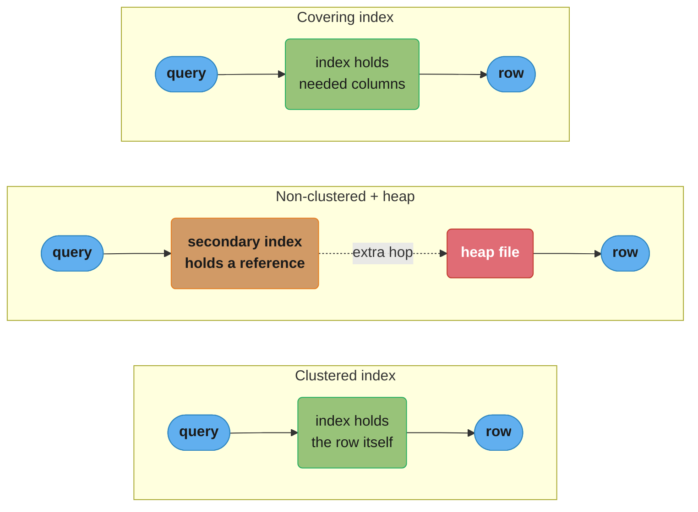
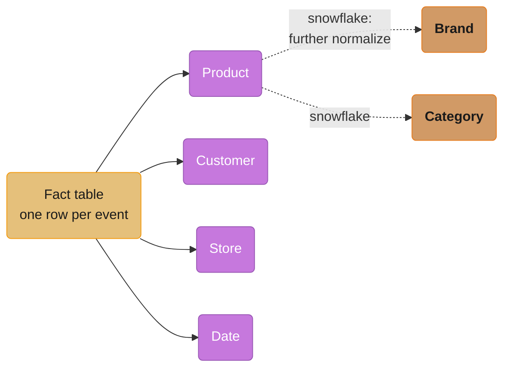
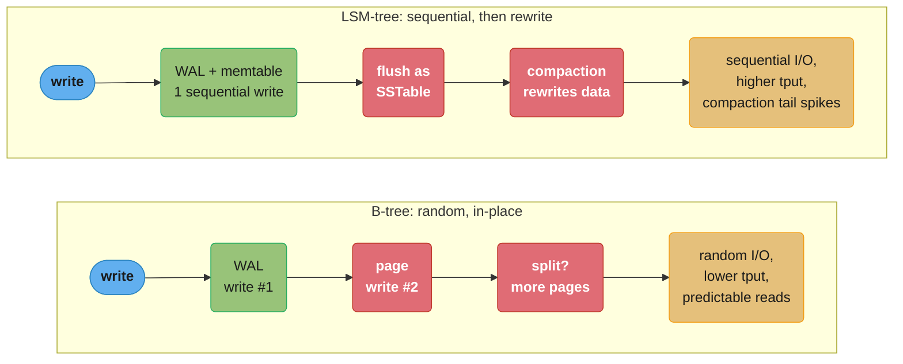

# Chapter 3: Storage and Retrieval

> Part I — Foundations of Data Systems · DDIA (Kleppmann, 1st ed., O'Reilly 2017) · builds on Ch 2, leads to Ch 4

## Chapter Map

This chapter opens the database's hood: how, on the level of bytes on disk, a database stores
data and finds it again. It splits storage engines into two families optimized for two
workloads — **OLTP** (transaction processing: many small point reads/writes) and **OLAP**
(analytics: scan-and-aggregate over huge datasets) — and within OLTP contrasts the two great
index structures, **LSM-trees** and **B-trees**.

**TL;DR:**
- **Log-structured (LSM-tree)** storage: append-only, sequential writes, compaction; great
  write throughput. **Page-oriented (B-tree)** storage: in-place updates, the relational
  default; great read latency.
- An index speeds reads but slows writes — every index is a cost on every write.
- **OLTP vs OLAP** are fundamentally different; analytics moved to separate **data
  warehouses** with **column-oriented storage**, which compresses and scans far faster.

## The Big Question

> "Why is a database fast at finding one row but slow to scan a billion — and how do
> different engines (Postgres vs Cassandra vs a data warehouse) make opposite tradeoffs to
> win at different jobs?"

Analogy: the world's simplest database is `echo "$key,$value" >> db` for writes and `grep`
for reads. Writes are blazing (sequential append) but reads are O(n) (scan everything). An
**index** is the additional structure you build to make reads fast — and the entire chapter
is about which index structure to pay for, given your workload.

---

## 3.1 Data Structures That Power Your Database

### Hash indexes

The simplest index for a log-structured store: keep an in-memory hash map from key to the
**byte offset** in the data file. Write = append to file + update the hash map; read = look up
the offset, seek, read. Bitcask (Riak's engine) works exactly this way: extremely fast
reads/writes as long as all keys fit in RAM, and is well suited to situations where the value
for each key is updated frequently — there may be many writes during the lifetime of a key,
but there aren't too many distinct keys, so all of them fit in memory. To bound disk usage,
break the log into **segments** — close a segment file once it reaches a certain size, and
make subsequent writes to a new segment file — and run **compaction** — throw away duplicate
keys, keeping only the latest value per key — then merge segments, which can be done in a
background thread while still serving reads and writes from the old segment files, and after
the merge is complete, switching reads to use the new merged segment and deleting the old ones.

Making this real requires resolving several practical issues the naive description glosses
over:

- **File format.** A binary format that encodes the length of the string in bytes, followed by
  the raw string (no need for escaping), is faster and simpler than a text format like CSV.
- **Deleting records.** To delete a key, append a special deletion record to the data file —
  often called a **tombstone**. When log segments are merged, the tombstone tells the merging
  process to discard any previous value for the deleted key.
- **Crash recovery.** If the database is restarted, the in-memory hash maps are lost, and in
  principle you could restore each segment's map by reading the entire segment file from
  beginning to end — but that could take a long time on a large database, making server
  restarts painful. Bitcask speeds up recovery by storing a snapshot of each segment's hash
  map on disk, which can be loaded into memory more quickly.
- **Partially written records.** The database may crash at any time, including halfway through
  appending a record to the log. Bitcask files include checksums, allowing corrupted parts of
  the log to be detected and ignored.
- **Concurrency control.** As writes are appended to the log in a strictly sequential order, a
  common implementation is to have only one writer thread — data file segments are append-only
  and otherwise immutable, so they can be read concurrently by multiple threads.

An append-only design turns out to be good for several reasons: appending and segment merging
are sequential write operations, which are generally much faster than random writes,
especially on magnetic spinning-disk hard drives and, to a lesser extent, on SSDs too;
concurrency and crash recovery are much simpler if segment files are append-only or immutable
— for example, you don't have to worry about a crash happening while a value was being
overwritten, leaving a file with a mix of the old and new value spliced together; and merging
old segments avoids the problem of data files getting fragmented over time.

**Limits of the hash-table index.** The hash table must fit in memory, so if you have a very
large number of keys, keeping all of them in memory could use too much RAM — you could in
principle maintain a hash map on disk, but a disk-based hash map is difficult to make perform
well: it requires a lot of random access I/O, is expensive to grow when it becomes full, and
hash collisions require fiddly logic. And **range queries are not efficient** — you can't
easily scan over all keys between, say, `kitty00000` and `kitty99999`, because that means
looking up each key individually in the hash map, one point lookup at a time, rather than
being able to jump straight to the range's start and scan sequentially.

### SSTables and LSM-trees

Improve the log by requiring each segment's key-value pairs to be **sorted by key** — a
**Sorted String Table (SSTable)**. Three wins: (1) merging segments is a cheap mergesort-style
scan; (2) you no longer need every key in memory — a **sparse** in-memory index (one key per
few KB) suffices, and you scan the small gap between known offsets; (3) you can compress blocks
between sparse-index entries, saving disk and I/O.

### Decoding the index-memory arithmetic

The hash index and the sparse index differ by one number — how many entries you must hold in
RAM:

```
hash index RAM  =  n_keys x (key bytes + offset bytes + map overhead)
sparse index    =  segment_bytes / block_bytes   entries
```

**In plain terms.** "A hash index charges you RAM per *key*; a sparse index charges you RAM
per *block*, and then makes you scan the block."

That single swap is what lifts the "all keys must fit in memory" ceiling. Sorting the segment
is what makes it legal: because keys are ordered, an unknown key still lands between two known
offsets, so scanning the gap always finds it or proves it absent.

| Symbol | What it is |
|--------|------------|
| `n_keys` | Number of distinct live keys. The hash index scales with this, and only this |
| `offset bytes` | The byte position in the segment file the key's value starts at |
| `map overhead` | Buckets, pointers, and per-entry headers the hash map itself costs |
| `block_bytes` | Size of the compressed chunk between two sparse-index entries (a few KB) |
| `segment_bytes / block_bytes` | Entry count. Bigger blocks = less RAM, more bytes scanned |

**Walk one example.** A 1 GB segment of 100-byte records, 4 KB blocks:

```
  Bitcask-style hash index -- every key in RAM, ~50 B per entry:
      100,000,000 keys   ->    5.0 GB RAM
    1,000,000,000 keys   ->   50.0 GB RAM      <- the hard ceiling Bitcask hits

  SSTable sparse index -- 1 GB segment, one key per 4 KB block:
    entries    = 1,000,000,000 / 4,096          =    244,140
    at 24 B/entry (16-byte key + 8-byte offset) =      5.9 MB RAM
    a DENSE index over the same segment
      = 10,000,000 records x 24 B               =    240.0 MB RAM
    ratio                                       =       41x fewer entries

  What the sparseness costs you per lookup:
    scan one 4 KB block = 4,096 / 100 = 40 records, in RAM, after a single seek
```

Trading 240 MB of RAM for 5.9 MB plus a 40-record in-memory scan is the whole reason LSM
engines index terabytes on commodity nodes while Bitcask cannot. **Compaction is the other
half of the deal:** three 1 GB segments in which every key was written three times merge down
to 1 GB, reclaiming 66.7% of the disk — and because all three inputs are sorted, the merge is
a linear streaming scan with no extra memory, not a sort.

How to keep writes sorted when they arrive in random order? Buffer them in an in-memory
balanced tree (red-black/AVL), called a **memtable**. When it exceeds a threshold (a few MB),
write it out as a new SSTable segment (already sorted). Reads check the memtable, then the
newest segment, then older ones. A background process runs **compaction + merging**. This is a
**Log-Structured Merge-tree (LSM-tree)** — the basis of LevelDB, RocksDB, Cassandra, HBase,
Lucene.

**LSM-tree write/read path:**



Writes fan out to the WAL for durability and the in-RAM memtable; once the memtable exceeds
its threshold (a few MB) it flushes as a new sorted SSTable, and background compaction merges
older segments. Reads check the memtable first, then each SSTable from newest to oldest — a
missing key must check every level, which is exactly why Bloom filters exist.

- **Crash recovery:** the memtable is volatile, so each write also appends to an unsorted
  **write-ahead log (WAL)** on disk; replay it after a crash.
- **Bloom filters:** a probabilistic set membership structure that answers "key definitely
  NOT here" cheaply, so reads skip SSTables that can't contain the key — critical because a
  *missing* key would otherwise check every level.
- **Compaction strategies:** *size-tiered* (newer/smaller SSTables merged into older/larger;
  HBase, Cassandra) vs *leveled* (key range split into smaller SSTables organized in levels;
  LevelDB, RocksDB). Leveled uses less disk; size-tiered does less write work.

### Decoding the Bloom filter false-positive rate

A Bloom filter is a bit array plus `k` hash functions. Insert = set `k` bits; query = check
those `k` bits. All set means "probably here"; any clear bit means "definitely not here." The
probability of a false "probably" is:

```
p = (1 - e^(-k*n/m))^k                optimal k = (m/n) * ln 2

  m = bits in the filter      n = keys inserted      k = hash functions
```

**What this actually says.** "After `n` insertions each bit has some chance of already being
set; `p` is the chance that all `k` bits a stranger key happens to probe are set by accident."

The ratio `m/n` — bits *per key* — is the only knob that really matters. `n` and `m` never
appear alone, only as `m/n`, which is why the accuracy of a Bloom filter is independent of how
many keys you store and depends purely on how many bits per key you are willing to buy.

| Symbol | What it is |
|--------|------------|
| `m/n` | Bits allocated per key. The budget knob; sets the whole accuracy curve |
| `k` | Hash functions per key. Too few and bits are under-used; too many and the array saturates |
| `k*n/m` | Expected number of times each bit gets set across all insertions |
| `e^(-k*n/m)` | Probability one given bit is still **clear** after all insertions |
| `1 - e^(-k*n/m)` | Probability one given bit is set |
| `(...)^k` | All `k` probed bits set by coincidence — a false positive |
| `ln 2` | 0.693. Comes from the optimum being "the array is exactly half full" |

**Walk one example.** The standard 10-bits-per-key configuration:

```
  m/n = 10 bits/key   ->   optimal k = 10 x ln 2 = 6.93   ->   use k = 7

    k =  4    p = 1.181%
    k =  5    p = 0.943%
    k =  6    p = 0.844%
    k =  7    p = 0.819%    <- minimum, exactly where k_opt predicted
    k =  8    p = 0.846%
    k = 11    p = 1.165%    <- worse than k=4: the array has saturated

  Memory cost -- 10 bits/key = 1.25 bytes/key:
        100,000,000 keys    ->    125 MB
      1,000,000,000 keys    ->   1.25 GB

  Buying more bits (k re-optimized at each budget):
    m/n =  8  (1.00 B/key), k =  6   ->   2.158%
    m/n = 10  (1.25 B/key), k =  7   ->   0.819%
    m/n = 16  (2.00 B/key), k = 11   ->   0.046%
```

Doubling from 1.25 to 2.00 bytes per key cuts the false-positive rate roughly 18-fold — the
curve is exponential in `m/n`, so small memory increases buy large accuracy gains, until they
don't.

**What that buys on the read path.** A key that does not exist must be checked against every
level. With 6 SSTable levels and no filter, that is 6 disk probes for a guaranteed
disappointment. At `p = 0.819%`, the expected number of probes that actually touch disk is
`6 x 0.00819 = 0.049` — about one wasted disk read per 20 missing-key lookups. That is why the
"cache miss storm" pitfall below is catastrophic *only* when Bloom filters are absent.

**Why there are no false negatives.** If a key was inserted, its `k` bits were set, and bits
are never cleared — so a clear bit is proof of absence. The asymmetry is what makes the filter
safe to use as a skip decision: a false positive costs one wasted disk read, while a false
negative would silently lose data. Deletions break this, which is why LSM engines rebuild the
filter on compaction rather than unsetting bits.

### B-trees

The most widely used index (every major relational DB, plus many non-relational). B-trees keep
keys sorted (fast range queries) but organize the file into fixed-size **pages/blocks** (4–16
KB), read or written one page at a time — mirroring the underlying hardware. Each page contains
keys and **references to child pages**; the **branching factor** (references per page) is
typically several hundred, so a tree of just 3–4 levels can index a huge dataset (4 KB pages,
branching factor 500 ⇒ 4 levels = 256 TB).

### Decoding B-tree height: why 3-4 levels covers a billion rows

```
fanout  =  usable_page_bytes / internal_entry_bytes
height  =  log_fanout(leaf_pages) + 1                  rows = leaf_pages x rows_per_leaf
```

**Read it like this.** "Each level down multiplies your reach by the fanout, so capacity grows
*exponentially* in height and height grows only *logarithmically* in data — one more level
means 500 times more data, not 500 more bytes."

| Symbol | What it is |
|--------|------------|
| `usable_page_bytes` | The 4-16 KB page minus its header; the fixed I/O unit the disk gives you |
| `internal_entry_bytes` | One key plus one child pointer. Tiny (8-22 B) — no row data lives here |
| `fanout` | Child references per internal page. The book's "branching factor," in the hundreds |
| `leaf_pages` | Pages at the bottom, the only ones holding actual rows |
| `rows_per_leaf` | `page_bytes / row_bytes`. Small (8-40), because rows are fat |
| `log_fanout(...)` | "How many times do I multiply by the fanout to reach that many pages" |

**Walk one example.** Start from the page, derive the fanout, then climb:

```
  An internal-node entry is key + child pointer, so it is TINY:
     8-byte key + 6-byte pointer = 14 B   ->  4096 / 14  = 292 refs per page
    16-byte key + 6-byte pointer = 22 B   ->  4096 / 22  = 186 refs per page
    the book's round 500 refs             ->  4096 / 500 = 8.2 B per entry

  Reach with fanout 500 -- pages addressable after N branching steps:
    1 step                       500
    2 steps                  250,000
    3 steps              125,000,000
    4 steps           62,500,000,000

  Leaf pages hold ROWS, not pointers, so they are wide, not deep:
    500-byte rows  ->  4096 / 500 =  8 rows per leaf page
    100-byte rows  ->  4096 / 100 = 40 rows per leaf page

  A 4-level tree (root + 2 internal levels + leaves) => 500^3 = 125,000,000 leaves
      x  8 rows/leaf   =  1,000,000,000 rows     <- a billion rows in 4 page reads
      x  4 KB/page     =        512 GB of leaf data

  Same tree at the more realistic fanouts:
    fanout 292, 4 levels ->  24,897,088 leaves x  8 rows =   199,176,704 rows
    fanout 186, 4 levels ->   6,434,856 leaves x  8 rows =    51,478,848 rows
    fanout 186, 4 levels ->   6,434,856 leaves x 40 rows =   257,394,240 rows
```

**Note on the book's 256 TB figure.** The chapter states "4 KB pages, branching factor 500 ⇒
4 levels = 256 TB." That result requires `500^4 = 62,500,000,000` leaf pages
(`62.5e9 x 4 KB = 256 TB`), i.e. four branching *steps* below the root — which by the
root-counted convention used above is a five-level page tree. Counting four *levels of pages*
(root + 2 internal + leaves) gives `500^3 x 4 KB = 512 GB`. The book's number is reproduced
here as written; the discrepancy is purely in whether "level" counts pages or branching steps,
not in the arithmetic.

**Why the tree can never get tall.** To force a fifth level you must exhaust the fourth, which
means multiplying by 500 again: from a billion rows to 500 billion. Real B-trees essentially
live at height 3-4 forever. This also explains the read-latency claim in the comparison below
— the root and first internal level are a handful of pages, permanently resident in the buffer
cache, so a "4-level lookup" is typically 3 RAM hits and exactly **one** disk read.

Updates are **in place**: find the page, change the value, write the page back. Inserts may
**split** a full page into two. The depth stays O(log n) and balanced. Crash safety relies on a
WAL (**redo log**): the split-a-page operation touches multiple pages, and a crash mid-split
would corrupt the tree, so the WAL lets recovery finish or undo it. Concurrency needs
**latches** (lightweight locks) on pages.

### B-tree optimizations

Because B-trees have been around so much longer than LSM-trees, there have been many
optimizations developed over the years, of which Kleppmann names several:

- **Copy-on-write instead of a WAL.** Instead of overwriting pages in place and maintaining a
  WAL for crash recovery, some databases (LMDB) use a copy-on-write scheme: a modified page is
  written to a different location, and a new version of the parent pages in the tree is
  created, pointing at the new location. This is also useful for concurrency control, since
  readers can continue using an old version of the tree without needing latches.
- **Abbreviating keys.** Rather than storing the entire key, you can save space in pages by
  abbreviating the key — especially in pages higher up the tree, where all you need is enough
  information to act as boundaries between key ranges. Packing more keys into a page allows the
  tree to have a higher branching factor, and thus fewer levels.
- **Sequential leaf layout.** Many B-tree implementations try to lay out the tree so that leaf
  pages appear in sequential order on disk, but it's difficult to maintain that order as the
  tree grows — by contrast, since LSM-trees rewrite large segments of storage during merging,
  it's easier for them to keep sequential keys close together on disk.
- **Sibling pointers.** Additional pointers have been added to the tree — for example, each
  leaf page may have references to its sibling pages to its left and right, which allows
  scanning keys in order without jumping back to parent pages.
- **Fractal-tree variants.** B-tree variants such as fractal trees borrow some log-structured
  ideas to reduce disk seeks, blurring the once-sharp line between the two families the rest
  of this section draws.

### Comparing B-trees and LSM-trees

The defining difference is **where the work goes**:

- **LSM-trees: faster writes.** All writes are sequential appends (memtable flush + WAL),
  which is much faster than B-tree random in-place page writes — especially on spinning disks
  and friendlier to SSD wear.
- **B-trees: faster/more predictable reads.** A read follows one path down the tree; an LSM
  read may have to check the memtable plus several SSTable levels (mitigated by Bloom filters).
- **Write amplification:** one logical write causes multiple physical writes. B-trees write
  every piece of data at least twice (WAL + page, more on splits). LSM-trees rewrite data
  repeatedly during compaction. High write amplification limits write throughput and wears
  SSDs. LSM generally sustains *higher* write throughput because writes are sequential and
  compaction can be tuned.
- **Space:** LSM-trees compress better (no per-page fragmentation; better packing), so lower
  disk footprint. B-trees leave pages partially empty after splits (fragmentation).
- **LSM downside — compaction interference:** compaction competes with foreground reads/writes
  for disk I/O, so at high write volume LSM can show *worse and less predictable* tail latency.
  And if compaction can't keep up, unmerged segments accumulate and reads slow down — you must
  monitor it.
- **B-tree advantage — transactions:** each key exists in exactly one place in a B-tree, which
  makes locking ranges for transaction isolation natural (LSM has the same key across levels).

### Decoding write amplification

```
WA  =  physical bytes written to disk / logical bytes the application wrote

  B-tree :  WA = (WAL record + whole dirty page [+ pages created by a split]) / row bytes
  LSM    :  WA ~ 1 (WAL) + 1 (memtable flush) + T x L
              T = size ratio between adjacent levels    L = leveled compaction steps
```

**What the formula is telling you.** "Neither engine writes your 100 bytes and stops — the
B-tree rounds your write up to a whole page *right now*, and the LSM writes it cheaply now
then rewrites it once per level *later*."

| Symbol | What it is |
|--------|------------|
| `row bytes` | What the application actually changed. The denominator, and it is small |
| `whole dirty page` | The B-tree's unit of I/O. Change 1 byte, write 4,096 |
| `WAL record` | The durability copy — this is the "at least twice" in the bullet above |
| `T` | Size ratio between levels, typically 10. Each level is 10x the one above |
| `L` | Number of levels a byte must be rewritten through before it settles |
| `T x L` | Each byte is rewritten ~T times per level it descends, across L levels |

**Walk one example.** One 100-byte row update, 4 KB pages, both engines:

```
  B-TREE -- updating a 100-byte row that lives inside a 4 KB page:
    WAL record  (row + ~64 B header)                        164 B
    the whole dirty page, rewritten                       4,096 B
    ------------------------------------------------------------
    total                                                 4,260 B   ->  WA =  42.6x
    with full-page WAL images (Postgres default)          8,192 B   ->  WA =  81.9x
    if the insert splits the page (2 pages + their WAL)  16,384 B   ->  WA = 163.8x

  LSM LEVELED -- 1 TB dataset, base level 256 MB, size ratio T = 10:
    level sizes    0.26 GB -> 2.6 GB -> 25.6 GB -> 256 GB -> 2,560 GB
    compaction steps below the base level                       L = 4
    WA = 1 (WAL) + 1 (flush) + T x L = 1 + 1 + 40           =  42x
    per 100-byte row that is                                  4,200 B written
```

The two land in almost the same place (42.6x vs 42x) — which is the point. **Write
amplification is not what separates them; the *shape* of the writes is.** The B-tree's 4,260
bytes are a random 4 KB page write happening synchronously on the user's write path. The LSM's
4,200 bytes are one small sequential append now, plus large sequential rewrites later, on a
background thread. Same bytes, but sequential throughput on an SSD is several times random
throughput, and the deferred work is exactly what makes LSM tail latency spike when compaction
falls behind.

**Why "at least twice" is doing so much work in that bullet.** Counting *records*, a B-tree
writes your data twice: WAL plus page. Counting *bytes* — which is what the disk and the SSD's
wear counter care about — a small row costs 42x, and a split costs 164x. Interviewers who ask
"what's the write amplification of a B-tree?" are testing whether you answer 2 (records) or
tens-to-hundreds (bytes). Tuning `T` is the LSM knob: raising `T` from 10 to 20 halves the
number of levels but doubles the per-level rewrite, which is the size-tiered vs leveled
tradeoff from Section 3.1 restated as arithmetic.

### Other indexing structures

- **Secondary indexes:** indexes on non-primary-key columns; values aren't unique, so the
  index entry points to a list of matching rows (or appends a row identifier). Essential for
  joins and filtering. Both B-trees and LSM-trees can host them.
- **Storing values in the index:** the index value can be the *row itself* (a **clustered
  index** — MySQL InnoDB stores rows in the primary-key B-tree) or a *reference* to the row in
  a separate **heap file** (the indirection avoids duplicating data across multiple secondary
  indexes). A **covering index** stores *some* columns in the index so common queries are
  answered from the index alone, without touching the heap.

**Clustered vs non-clustered vs covering index — where the extra hop happens:**



A clustered index stores the row itself, so a lookup is one hop; a non-clustered (secondary)
index stores only a reference, adding a second hop into the heap file to fetch the row; a
covering index answers the query from the index's own columns, skipping the heap entirely.

- **Multi-column / concatenated indexes:** combine fields (e.g. `(lastname, firstname)`) for
  multi-field queries. For geospatial/multi-dimensional data, specialized structures like
  **R-trees** (and space-filling-curve tricks) handle "within this lat/long box."
- **Fuzzy indexes & full-text search:** Lucene allows searching for words within an edit
  distance, using an in-memory finite-state automaton over the term dictionary — similar in
  spirit to a trie.
- **Keeping everything in memory:** **in-memory databases** (Redis, Memcached, VoltDB,
  MemSQL) avoid disk-format overhead. Their speed comes less from "no disk reads" (the OS
  caches disk anyway) and more from *not having to encode data into a disk-friendly form*.
  Some offer durability via a log/snapshots or replication. In-memory designs can also offer
  data models hard to do on disk (Redis's priority queues, sets).

## 3.2 Transaction Processing or Analytics?

Two access patterns diverged into two kinds of systems:

| | OLTP (online transaction processing) | OLAP (online analytic processing) |
|---|---|---|
| Read pattern | Small number of records by key | Aggregate over millions of records |
| Write pattern | Random-access, low-latency from user input | Bulk import (ETL) or event stream |
| Used by | End users via web app | Analyst / business intelligence |
| Data size | GB–TB | TB–PB |
| Bottleneck | Disk seek time | Disk bandwidth |

Originally the same database served both. As datasets grew, companies stopped running
analytics on the OLTP database (expensive ad-hoc queries hurt latency-sensitive transactions)
and built a separate **data warehouse**: a read-only copy of data from all OLTP systems,
loaded via **ETL** (Extract–Transform–Load), optimized for analytic queries.

**Stars and snowflakes (schemas for analytics).** Warehouses commonly use a **star schema**: a
central **fact table** (one row per event — a sale, a click) surrounded by **dimension tables**
(who, what, where, when, how — product, customer, store, date). It's called a star because the
fact table is in the middle with dimensions radiating out. A **snowflake schema** further
normalizes dimensions into sub-dimensions (more normalized, more joins, less common). Fact
tables are enormous (trillions of rows, petabytes), and a typical query touches only a few of
their many columns.

**Star schema fan-out (and the snowflake extension):**



A star schema is literally shaped like its name: the fact table sits at the center with
dimension tables (product, customer, store, date) radiating outward, one join away. A
snowflake schema takes it further, normalizing a dimension like product into sub-dimensions
(brand, category) — more normalized and more joins, which is why it's less common in practice.

## 3.3 Column-Oriented Storage

The key insight for analytics: a fact table may have 100+ columns, but a query touches 4–5,
yet **row-oriented** storage forces the engine to load every column of every row off disk.
**Column-oriented storage** stores all values of *one column* together (column by column
instead of row by row), so a query reads only the columns it needs — slashing disk I/O.

### Column compression

Values within a column are similar, so they compress extremely well. **Bitmap encoding** of a
column with few distinct values relative to the number of rows (e.g. `country`, `product_id`)
turns it into one bitmap per distinct value — bit *i* set means row *i* has that value. If the
number of distinct values is small (say, a few hundred) compared to the number of rows, the
bitmaps can be further compressed with **run-length encoding**: since a query like `WHERE
product_sk IN (30, 68, 69)` (Kleppmann's example) tends to produce long runs of consecutive 0s
or 1s within a bitmap, run-length encoding — storing "0 repeated N times" rather than N
individual zero bits — makes the bitmap even more compact, and it can be much faster than
formats that don't have run-length encoding, sometimes fitting the compressed bitmap for a
column in L1 cache. These techniques let you support fast `WHERE product_id IN (...)` queries
by loading the relevant bitmaps and computing their bitwise `OR`, with no row scan at all.

### Memory bandwidth and vectorized processing

For data warehouse queries that need to scan over millions of rows, a big bottleneck is the
bandwidth for getting data from disk into memory — but that's not the only bottleneck. Once
data is in memory, developers of analytic databases also want to make efficient use of the
bandwidth between memory and CPU cache, avoid branch mispredictions and bubbles in the CPU
instruction processing pipeline, and use SIMD (single instruction, multi-data) instructions in
modern CPUs. Besides reducing the volume of data loaded from disk, column-oriented storage
also uses CPU cycles more efficiently: the query engine can take a chunk of compressed
column data that fits comfortably in the CPU's L1 cache and iterate through it in a tight
loop (i.e. with no function calls). A CPU can execute such a loop much faster than code that
requires a lot of function calls and conditions for each record being processed, since each
of those involves branch mispredictions and bubbles in the pipeline. Column compression
allows more rows from a column to fit in the same amount of L1 cache — and operators such as
the bitwise `AND` and `OR` described above can be designed to operate directly on such chunks
of compressed column data. This technique is known as **vectorized processing**.

### Sort order in column storage

You can sort the rows of a column store (consistently across all columns) by a chosen key —
even though the data is stored column-wise, rows still need to be sorted in the same order
across all columns, or the values within one row could get mixed up. The database
administrator can choose the columns by which the table should be sorted, using their
knowledge of common queries. If queries often target date ranges, such as the previous
month, it might make sense to make `date_key` the first sort key; then the query optimizer
can scan only the rows from the last month, which is much faster than scanning all rows.
Sorting also helps compression: if the primary sort column has many distinct values, but
there are runs of the same value adjacent to each other, then a secondary sort column will
be mostly sorted too, and long runs of repeated values compress well — the second-lowest
sort key can still have long runs of identical values, whereas an unsorted column with
random ordering would not.

**Several different sort orders.** A single sort order limits you to fast scans only when a
query happens to filter on a prefix of that sort key. **C-Store**, and its commercialized
descendant **Vertica**, use a different approach: since a column store doesn't have a single
row that needs to move together, different replicas of the data can be stored sorted in
different ways, so that when processing a query, the query optimizer can select the version
of the table that best fits the query pattern. Having multiple sort orders in a column-
oriented store is a bit similar to having multiple secondary indexes in a row-oriented store
— but the row-oriented store keeps every row in one place and requires an index pointing back
to it, whereas the column store doesn't need that at all, because the different sort orders
each hold a full redundant copy of the data.
- **Writing to column storage:** in-place updates are hard (inserting a row means rewriting all
  columns). The solution is **LSM-style**: buffer writes in an in-memory row store, then merge
  into the column files in bulk — same idea as the LSM-tree memtable.
- **Aggregation: materialized views and data cubes.** Because the same aggregates are computed
  repeatedly, warehouses cache them in **materialized views** (a precomputed, on-disk query
  result that's refreshed when data changes) and **data cubes / OLAP cubes** (a grid of
  aggregates summarized along multiple dimensions). These make common rollups instant but make
  the data less flexible to query in new ways.

---

## Visual Intuition

```
ROW-ORIENTED vs COLUMN-ORIENTED (an analytics query reads 3 of 100 columns)

  ROW STORE on disk:                COLUMN STORE on disk:
  [r1: c1 c2 c3 ... c100]           col1: [r1 r2 r3 ... rN]   ← query reads ONLY
  [r2: c1 c2 c3 ... c100]           col2: [r1 r2 r3 ... rN]      col1, col7, col23
  [r3: c1 c2 c3 ... c100]           col3: [r1 r2 r3 ... rN]      and skips the other 97
   ...                               ...
  query must read ALL 100 cols      col100:[r1 r2 r3 ... rN]   ← 97% less disk I/O,
  of every row, then discard 97                                   and each column compresses
```

**Write amplification — where each engine pays:**



Caption: column orientation wins analytics by reading only needed columns and compressing
them; LSM vs B-tree is fundamentally a choice of *where* to pay write-amplification cost and
whether you want write throughput (LSM) or read predictability (B-tree).

---

## Key Concepts Glossary

- **Log (append-only)** — sequential write file; basis of log-structured engines.
- **Hash index** — in-memory map key → byte offset in the data file (Bitcask).
- **Segment / compaction** — splitting the log into files and merging out overwritten keys.
- **SSTable (Sorted String Table)** — a segment with keys sorted; enables sparse index +
  cheap merge + block compression.
- **Memtable** — in-memory sorted structure buffering writes before flush.
- **LSM-tree** — Log-Structured Merge-tree: memtable + SSTables + compaction (LevelDB,
  RocksDB, Cassandra, HBase, Lucene).
- **Write-ahead log (WAL) / redo log** — durable log for crash recovery.
- **Bloom filter** — probabilistic structure answering "definitely not present" cheaply.
- **Compaction strategy** — size-tiered vs leveled.
- **B-tree** — page-oriented, in-place, balanced tree; the relational default.
- **Page / block** — fixed-size unit (4–16 KB) of B-tree I/O.
- **Branching factor** — child references per B-tree page (hundreds).
- **Page split** — splitting a full page into two on insert.
- **Latch** — lightweight lock protecting a page under concurrency.
- **Write amplification** — physical writes per logical write.
- **Secondary index** — index on a non-key column; entries point to row(s).
- **Clustered index** — index that stores the row itself (InnoDB primary key).
- **Heap file** — separate file holding rows, referenced by indexes.
- **Covering index** — index storing some columns so queries skip the heap.
- **R-tree** — index for multi-dimensional/geospatial data.
- **In-memory database** — keeps the dataset in RAM (Redis, VoltDB).
- **OLTP / OLAP** — transaction processing vs analytic processing.
- **Data warehouse / ETL** — separate analytics store loaded by Extract-Transform-Load.
- **Star schema / fact table / dimension table** — analytics modeling pattern.
- **Snowflake schema** — star schema with further-normalized dimensions.
- **Column-oriented storage** — values stored column-by-column.
- **Bitmap encoding** — compressing low-cardinality columns into per-value bitmaps.
- **Materialized view / data cube** — precomputed, cached aggregates.
- **Tombstone** — a special deletion marker appended to a log-structured store; tells merges
  to discard the deleted key's earlier values.
- **Copy-on-write** — a B-tree update strategy that writes modified pages to a new location
  instead of overwriting in place, avoiding the need for a separate WAL.
- **Run-length encoding** — compressing a repeated run of identical values into one count
  instead of storing each occurrence, effective on the long runs bitmap-encoded columns have.
- **Vectorized processing** — evaluating operators over cache-resident chunks of compressed
  column data in a tight loop, avoiding per-record function-call and branch overhead.

---

## Tradeoffs & Decision Tables

| | LSM-tree | B-tree |
|---|---|---|
| Writes | Sequential, high throughput | Random in-place, lower throughput |
| Reads | Check memtable + N SSTables (Bloom filters help) | One path, predictable |
| Write amplification | Compaction rewrites | WAL + page (+ splits) |
| Disk footprint | Lower (better compression) | Higher (page fragmentation) |
| Tail latency | Can spike during compaction | More predictable |
| Transactions/locking | Key across levels (harder) | Key in one place (natural) |
| Examples | RocksDB, Cassandra, HBase, Lucene | InnoDB, PostgreSQL, most RDBMS |

| | OLTP store | OLAP warehouse |
|---|---|---|
| Storage layout | Row-oriented | Column-oriented |
| Query | Point lookups by key | Scan + aggregate |
| Bottleneck | Disk seeks | Disk bandwidth |
| Schema | Normalized | Star / snowflake |
| Example | PostgreSQL, MySQL | Redshift, BigQuery, Vertica, ClickHouse |

---

## Common Pitfalls / War Stories

- **Adding indexes for every query.** Each secondary index must be updated on every write,
  so over-indexing turns a fast write path into a slow one. Indexes are a read optimization
  paid for by writes; add them deliberately.
- **LSM compaction falling behind.** Under sustained heavy writes, if compaction can't keep
  pace, unmerged SSTables pile up, reads must check more segments, and latency degrades —
  often a silent, creeping outage. Monitor compaction backlog and pending-compaction bytes.
- **Range queries on a hash index.** Hash indexes give O(1) point lookups but cannot scan a
  key range at all; choosing a hash-only engine for a workload that needs ranges (time-series,
  pagination) is a dead end. Use a sorted structure (SSTable/B-tree).
- **Running analytics on the OLTP database.** A heavy ad-hoc aggregate scan competes with
  latency-sensitive transactions, spiking user-facing p99. This is exactly why warehouses
  exist; replicate to a column store for analytics instead.
- **Row store for analytics.** Storing a 100-column fact table row-oriented forces every query
  to read all 100 columns even when it needs 4 — 25× wasted I/O. Use column storage for
  scan-heavy analytic workloads.
- **A missing-key read storm in LSM without Bloom filters.** Looking up keys that don't exist
  forces a check of *every* SSTable level; without Bloom filters this is catastrophically slow
  for not-found lookups (e.g. cache-miss patterns).

---

## Real-World Systems Referenced

Bitcask/Riak (hash index), LevelDB, RocksDB, Cassandra, HBase, Lucene/Elasticsearch (LSM),
PostgreSQL, MySQL InnoDB, Oracle, SQL Server (B-tree), Redis, Memcached, VoltDB, MemSQL,
Oracle TimesTen (in-memory), Teradata, Vertica/C-Store, Amazon Redshift, Google BigQuery,
Apache Parquet/ORC, ClickHouse (warehouse/columnar), Apache Hive/Spark/Impala (SQL-on-Hadoop).

---

## Summary

Storage engines split by workload. For OLTP, two index families dominate: **log-structured
(LSM-trees)** — append-only sequential writes, memtable + SSTables + compaction + Bloom
filters, optimized for write throughput; and **page-oriented (B-trees)** — in-place updates in
fixed pages with a high branching factor, optimized for read predictability and natural
transaction locking. Both rely on a WAL for crash recovery, and every index trades faster
reads for slower writes (write amplification). Secondary, clustered, covering, multi-column,
geospatial, fuzzy, and in-memory indexes are variations on these themes. For analytics, OLTP
and OLAP diverged: analytics moved to **data warehouses** loaded by ETL, modeled as **star/
snowflake schemas**, and stored **column-oriented** — reading only needed columns, compressing
aggressively (bitmap encoding), sorting for compression and range scans, buffering writes
LSM-style, and caching results in **materialized views and data cubes**.

---

## Interview Questions

**Q: What is the fundamental tradeoff between LSM-trees and B-trees?**
LSM-trees optimize writes and B-trees optimize reads. LSM-trees turn all writes into sequential appends (memtable flush plus WAL) and defer cleanup to background compaction, giving very high write throughput; reads may have to consult the memtable plus several SSTable levels. B-trees update pages in place with random I/O, giving lower write throughput but a single, predictable read path down the tree. So you pick LSM for write-heavy workloads and B-trees for read-heavy or latency-sensitive ones.

**Q: What is write amplification, and how does it differ between the two engine families?**
Write amplification is the number of physical writes caused by one logical write, and it limits sustainable write throughput while wearing out SSDs. B-trees write each datum at least twice — once to the WAL and once to the page — plus extra writes when pages split. LSM-trees write once sequentially but then rewrite the same data repeatedly during compaction as segments merge. Both pay it; LSM usually still sustains higher write throughput because its writes are sequential and its compaction is tunable.

**Q: Why does an LSM-tree need Bloom filters, especially for keys that don't exist?**
**Short:** Without a Bloom filter, a lookup for a missing key must check every SSTable level in turn.
Because an LSM read that misses the memtable must check SSTable segments from newest to oldest, and a key that doesn't exist anywhere forces it to check *every* segment before concluding "not found" — extremely slow under not-found-heavy patterns like cache misses. A Bloom filter is a compact probabilistic structure that answers "this key is definitely not in this SSTable" cheaply, letting the read skip segments that can't contain the key and avoid the full scan.

**Q: Why are all writes in a log-structured store appends, and why is that fast?**
Appending writes the data to the end of a file (and to the WAL) sequentially, never seeking to overwrite existing data in place. Sequential writes are dramatically faster than random writes on spinning disks and are also gentler on SSDs (fewer erase cycles, less wear). The cost is deferred: overwritten and deleted values accumulate until background compaction reclaims the space.

**Q: What does compaction do in an LSM-tree, and what happens if it can't keep up?**
Compaction merges SSTable segments, discarding overwritten and deleted keys so that only the latest value per key survives, which bounds disk usage and keeps read paths short. If compaction falls behind sustained heavy writes, unmerged segments accumulate, so reads must scan more segments and latency degrades; eventually disk fills. This makes compaction backlog a critical metric to monitor, and it's why LSM tail latency can spike when compaction competes with foreground I/O.

**Q: Why do B-trees keep a write-ahead log if they update pages in place?**
Because some operations touch multiple pages — most importantly a page split, which splits one full page into two and updates the parent. A crash partway through would leave the tree corrupted (a dangling or orphaned page). The WAL (redo log) records the intended changes before they're applied so that recovery after a crash can replay the log to complete or roll back the multi-page operation and restore a consistent tree.

**Q: How can a B-tree with 4 KB pages index a 256 TB dataset in only four levels?**
Because each page holds a large number of child references — the branching factor — typically several hundred. With a branching factor of 500, one level addresses 500 pages, two levels 500², three levels 500³, and four levels 500⁴ pages; at 4 KB per page that's on the order of hundreds of terabytes. The high branching factor keeps the tree shallow, so a lookup follows only about four page reads regardless of dataset size.

**Q: What is a clustered index versus a heap file with a non-clustered index?**
A clustered index stores the actual row data *within* the index structure ordered by the index key — MySQL InnoDB stores rows in the primary-key B-tree, so a primary-key lookup returns the row directly. The alternative stores rows in a separate heap file and has the index hold a reference (pointer) into the heap; this avoids duplicating row data across multiple secondary indexes but adds an indirection hop. Clustered indexes speed reads on the clustering key but make secondary-index lookups go through it.

**Q: What is a covering index and what problem does it solve?**
A covering index stores some of a row's columns directly in the index, so a query that needs only those columns is answered entirely from the index without reading the row from the heap or clustered store. It solves the extra-I/O problem of index-then-fetch: the second lookup into the table is eliminated. The cost is a larger index and more write overhead, so it's worth it for hot queries on a stable set of columns.

**Q: Why do analytic workloads use column-oriented storage instead of row-oriented?**
Analytic queries typically aggregate over millions of rows but touch only a handful of a fact table's many columns. Row-oriented storage forces the engine to read every column of every row off disk and then discard the unneeded ones, wasting most of the I/O. Column-oriented storage keeps each column's values together, so the query reads only the columns it references — often a 90%+ reduction in disk I/O — and the similar values within a column compress extremely well.

**Q: How does bitmap encoding compress a column, and why is it good for analytics?**
For a column with few distinct values (like country or product category), bitmap encoding stores one bitmap per distinct value, where bit *i* indicates whether row *i* has that value. These bitmaps are tiny and often further run-length compressed. They make filters like `WHERE product_id IN (30, 68, 69)` fast: load those three bitmaps and OR them together to get all matching rows, with no row scan — a perfect fit for analytic filtering on low-cardinality columns.

**Q: How do you write to a column store given that in-place row inserts are hard?**
You use the same trick as LSM-trees: buffer incoming writes in an in-memory row-oriented structure (a sorted store), and periodically merge that buffer into the on-disk column files in bulk. Queries read both the in-memory buffer and the column files and combine the results. This keeps writes cheap and amortized while preserving the column files' read efficiency, which is why systems like Vertica adopt an LSM-style write path.

**Q: What are a star schema and a snowflake schema, and how do they differ?**
A star schema centers on a large fact table (one row per event, like a sale) with foreign keys radiating out to dimension tables describing the who/what/where/when (product, customer, store, date) — drawn as a star. A snowflake schema goes further and normalizes those dimensions into sub-dimension tables (e.g. product → brand and category tables), which reduces redundancy but adds joins. Star is more common in warehouses because it's simpler and analysts find it easier to query.

**Q: Why did OLTP and OLAP split into separate systems instead of sharing one database?**
Because their access patterns conflict: OLTP needs low-latency point reads/writes from user requests, while OLAP runs heavy ad-hoc scan-and-aggregate queries over huge datasets. Running analytics on the OLTP database makes those expensive scans compete for resources and spike user-facing latency. So companies extract data into a separate read-only data warehouse via ETL, optimized (column storage, star schemas) for analytics without endangering the transactional system.

**Q: What actually makes in-memory databases fast, given that the OS already caches disk pages?**
The main speedup is *not* avoiding disk reads — the OS page cache already serves hot data from RAM in disk-backed databases. It's that an in-memory database avoids the overhead of encoding/decoding its in-memory data structures into a disk-friendly byte format. It can also offer data models that are awkward on disk, like Redis's sets and priority queues. Durability is added separately via append-only logs, periodic snapshots, or replication to other nodes.

**Q: What is a materialized view (or data cube), and what is its tradeoff?**
**Short:** A materialized view precomputes a query result on disk, trading write-time cost and rigidity for instant reads.
A materialized view is a precomputed, on-disk copy of a query's result (often an aggregate) that is refreshed when underlying data changes, so repeated queries read the cached result instantly instead of recomputing it; a data cube generalizes this to a grid of aggregates summarized along several dimensions at once. The tradeoff is flexibility: the cube/view answers the precomputed rollups very fast but can't easily answer queries that need a dimension it didn't materialize, and it adds maintenance cost on writes.

**Q: How does a Bitcask-style hash index handle deletes and crash recovery?**
**Short:** Deletes append a tombstone record; crash recovery replays or loads a saved snapshot of each segment's hash map.
Deleting a key means appending a special deletion marker called a **tombstone** to the log, rather than removing anything in place; when segments are later merged, the tombstone tells the merge process to drop any earlier value for that key. Crash recovery could in principle rebuild each segment's in-memory hash map by replaying the segment file from start to end, but that's slow on a large database, so Bitcask instead persists a snapshot of each segment's hash map on disk and loads that snapshot back into memory on restart, which is much faster than a full replay.

**Q: Why is a single-writer-thread design a natural fit for a log-structured hash index?**
**Short:** Because writes are strictly sequential appends, one writer thread avoids coordinating concurrent appenders.
Since data file segments are append-only and otherwise immutable, writes only ever happen at the end of the current segment in a fixed order, so a single writer thread can perform them without needing to coordinate with other writers over where in the file to write next. Multiple reader threads can safely read the immutable, already-written parts of the segments concurrently, because nothing there ever changes underneath them — only the newest segment being actively appended to needs any care.

**Q: Name two of the B-tree optimizations the book describes beyond the basic write-ahead log and latches.**
**Short:** Copy-on-write pages avoid a WAL, and abbreviated keys raise the branching factor.
Kleppmann lists several: using a copy-on-write scheme (write a modified page to a new location and update parent pointers, as LMDB does) instead of a WAL, which also helps concurrency because readers can keep using an old tree version without latches; abbreviating keys, especially in upper-level pages where only enough information to bound a key range is needed, which packs more entries per page and raises the branching factor; laying out leaf pages sequentially on disk where possible; and adding sibling pointers so a range scan can move left-to-right across leaves without climbing back up to a parent page.

**Q: What is run-length encoding, and why does it pair so well with bitmap-encoded columns?**
**Short:** Run-length encoding stores a repeated run as one count instead of many bits, shrinking already-sparse bitmaps further.
Run-length encoding compresses a bitmap by storing "0 repeated N times" instead of N individual zero bits, which is effective because a bitmap built from a low-cardinality column tends to have long runs of consecutive identical bits — most rows do *not* have a given `product_id`, so the bitmap for that value is mostly zeros. Compressing those runs can shrink a column's bitmaps enough that they fit in the CPU's L1 cache, which is also what makes vectorized bitwise `AND`/`OR` operations over them fast.

**Q: What is vectorized processing, and what CPU-level problem does it solve that reducing disk I/O alone does not?**
**Short:** Vectorized processing runs tight loops over cache-resident compressed column chunks, avoiding per-record branch mispredictions.
Even after column storage cuts disk I/O by reading only needed columns, a query engine that calls a function and evaluates conditions for every individual record pays a cost in branch mispredictions and pipeline bubbles on the CPU. Vectorized processing instead takes a chunk of compressed column data that fits in L1 cache and iterates over it in a tight loop with no per-record function calls, letting operators like bitwise `AND`/`OR` run directly over the compressed chunks — using the CPU's cache and instruction pipeline far more efficiently than a naive row-at-a-time evaluator.

---

## Cross-links in this repo

- [database/storage_engines_internals/ — B+tree, LSM-tree, WAL, buffer pool in production depth](../../../database/storage_engines_internals/storage_engines_internals.md)
- [database/indexing_deep_dive/ — covering, partial, composite, GIN, BRIN indexes](../../../database/indexing_deep_dive/indexing_deep_dive.md)
- [database/time_series_databases/ — columnar + LSM in ClickHouse, Gorilla compression](../../../database/time_series_databases/time_series_databases.md)
- [database/in_memory_databases/ — Redis vs Memcached, durability modes](../../../database/in_memory_databases/in_memory_databases.md)

## Further Reading

- Kleppmann, DDIA Ch 3 — original text and references.
- O'Neil et al., "The Log-Structured Merge-Tree (LSM-Tree)," 1996 — the founding LSM paper.
- Stonebraker et al., "C-Store: A Column-oriented DBMS," VLDB 2005 — column-store foundations.
