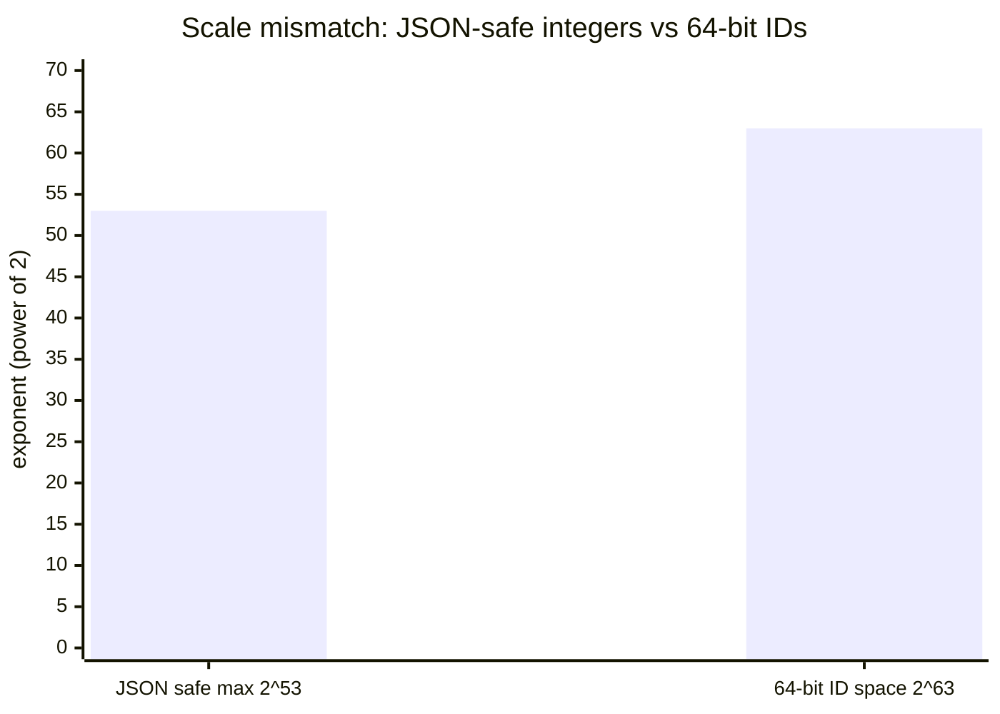
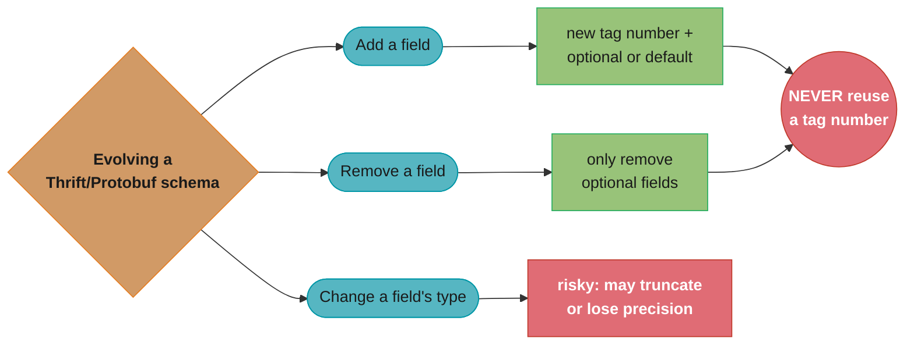
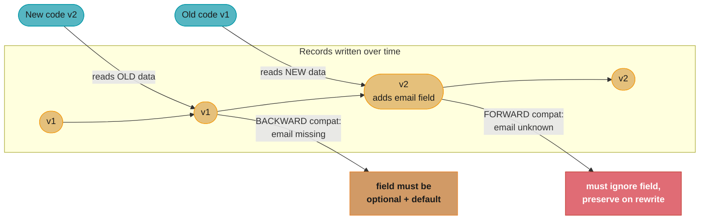
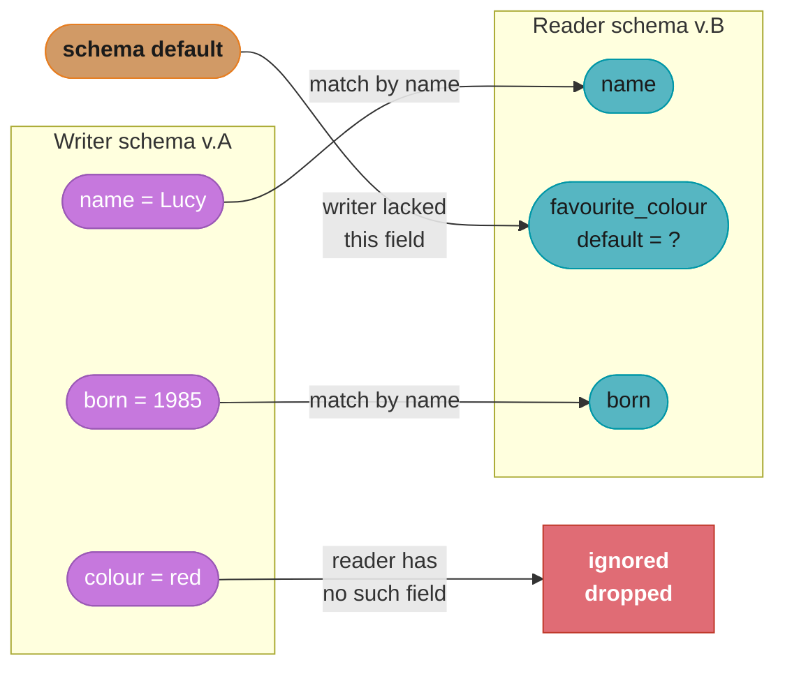

# Chapter 4: Encoding and Evolution

> Part I — Foundations of Data Systems · DDIA (Kleppmann, 1st ed., O'Reilly 2017) · builds on Ch 1–3, closes Part I, leads to Part II

## Chapter Map

Applications change, so the data they read and write changes shape over time. This chapter is
about **evolvability at the data level**: how to encode data so that old and new versions of
code can coexist during a rolling deployment, talking to each other and to data written years
apart. The two big ideas are **encoding formats** (how to turn in-memory objects into bytes)
and **dataflow modes** (how those bytes travel between processes).

**TL;DR:**
- Code changes roll out gradually, so you need **backward compatibility** (new code reads old
  data) AND **forward compatibility** (old code reads new data) simultaneously.
- Binary schema-based formats (**Protocol Buffers, Thrift, Avro**) give compact size, schema
  documentation, and rule-based evolution — far better than JSON/XML for internal use.
- Data flows three ways — **through databases**, **through services (REST/RPC)**, and
  **through asynchronous message queues** — and each must handle version skew.

## The Big Question

> "I'm deploying a new version of my code while the old version is still running and old data
> still sits in the database. How do I change the data's shape without a coordinated, big-bang,
> everyone-stops-at-once deployment?"

Analogy: think of encoding as translating between two languages — the rich in-memory language
of objects/structs/pointers and the flat language of bytes on a wire or disk. Pointers are
meaningless to another process, so encoding must serialize the *content*. The trick is
designing that translation so the dictionary can change on one side without breaking the other.

---

## 4.1 Formats for Encoding Data

Two representations of data: **in memory** (objects, structs, lists, hash maps, pointers —
optimized for CPU access) and **a byte sequence** (for files or network — self-contained, no
pointers). Converting in-memory → bytes is **encoding** (serialization, marshalling); the
reverse is **decoding** (parsing, deserialization, unmarshalling).

### Language-specific formats

Java's `Serializable`, Python's `pickle`, Ruby's `Marshal`. Convenient — these libraries allow
in-memory objects to be saved and restored with minimal additional code, in one line — but
deeply flawed:

- **Tied to one language.** The encoding is often tied to a particular programming language,
  and reading the data in another language is very difficult. If you use such an encoding, you
  are committing to your current programming language for a long time, and precluding
  integrating your systems with those of other organizations (which may use different
  languages).
- **A security hole, by design, not by accident.** In order to restore data in the same
  object types, the decoding process needs to be able to instantiate arbitrary classes — this
  is frequently a source of security problems: if an attacker can get an application to decode
  an arbitrary byte sequence, they can instantiate arbitrary classes, which typically allows
  them to do terrible things like remotely execute arbitrary code. Kleppmann notes that
  security holes of this kind have been found in Java, Ruby, and PHP's built-in serialization
  libraries, among others.
- **Versioning and efficiency are afterthoughts.** These encoding libraries often have poor
  support for forward and backward compatibility — it's usually bolted on later, if at all.
  Efficiency (CPU time and encoded size) is also often an afterthought: Java's built-in
  serialization is notorious for its bad performance and bloated encoding.

For these reasons it's generally a bad idea to use a language's built-in encoding for anything
other than very transient purposes — the most transient use Kleppmann has in mind is data that
never leaves the process that created it and never needs to be understood by any future
version of that same process.

### JSON, XML, and CSV (textual formats)

Standardized, human-readable, widely supported — good for *interfaces between organizations*.
But they have real problems: ambiguity around **numbers** (XML/CSV can't distinguish a number
from a string; JSON can't distinguish integers from floats and loses precision on integers
> 2^53, biting Twitter's 64-bit tweet IDs); **no native binary** (must Base64-encode, +33%
size); optional/complicated schema support; CSV has no schema and is fragile. They're verbose.

**Schema support, such as it is.** XML has widely used schema languages, **XML Schema**, that
are quite powerful, and many tools are built upon them — but a lot of software that uses XML
doesn't bother with schemas at all, and instead relies on ad hoc rules for encoding data items
(for example, parsing an XML string as a date-formatted field) that live only in code and
documentation, not in the format. JSON's schema support is comparatively young — **JSON
Schema** exists but is not as widely used, and applications that use JSON without a schema are
common. Because the ability to parse data correctly without a schema is contentious, and
schemas can be useful documentation as well as enabling validation, this chapter treats these
formats' schema support as an under-used escape hatch rather than a solved problem — an
application can add schema validation to JSON or XML the way you'd add it anywhere else, but
nothing about the format forces you to.

Despite the flaws, they're "good enough" as a lingua franca and dominate public APIs.



Caption: JSON can represent integers exactly only up to 2^53 (about 9 quadrillion), but a 64-bit
ID space reaches 2^63 (about 9.2 quintillion) — 10 extra bits, a 1,024x gap. Any ID above 2^53
silently loses precision when parsed as a JSON number, which is exactly why Twitter had to return
tweet IDs as both a number and a string.

### Decoding the 2^53 limit

JSON has no integer type — a number is an IEEE 754 double, which spends 52 bits on the
significand plus one implied leading bit:

```
  exactly representable integers = every integer in [-2^53, 2^53]
  ID space of a 64-bit signed ID = up to 2^63
  gap = 2^63 / 2^53 = 2^(63-53) = 2^10
```

**In plain terms.** "A JSON number can count one-by-one only up to about nine quadrillion;
past that it starts skipping, and it skips silently." Nothing errors — the parser returns a
number, just not the one that was sent, which is why this bug reaches production.

| Symbol | What it is |
|--------|------------|
| `2^53` | Largest integer a double can represent exactly, and the last one with no gaps below it |
| `2^63` | Size of a signed 64-bit ID space, what Twitter's snowflake IDs actually use |
| `2^(63-53)` | The gap, expressed as bits: 10 bits of ID space a JSON number cannot address |
| significand | The 52 stored mantissa bits (+1 implied) that set where exact counting stops |

**Walk one example.** The exact boundary, and what happens one step past it:

```
  2^53 = 9,007,199,254,740,992      last integer with every predecessor exact
  2^63 = 9,223,372,036,854,775,808  top of a 64-bit ID space
  ratio = 1,024x                     = 2^10, ten bits of unreachable IDs

  ID 9,007,199,254,740,993  -> parsed as double -> 9,007,199,254,740,992   off by 1
  ID 9,007,199,254,740,995  -> parsed as double -> 9,007,199,254,740,996   off by 1
```

Above `2^53` doubles can only land on even integers, so odd IDs round to a neighbour — and two
different tweets can collapse onto the same ID. The workaround in the text follows directly:
ship the ID as a *string* as well, because a string has no numeric representation to round.

### Decoding the Base64 33% tax

The other textual-format cost in the text has an exact formula. Base64 re-slices bytes into
6-bit groups and pads the output to a multiple of 4 characters:

```
  3 bytes = 24 bits = 4 groups of 6 bits = 4 output characters

  encoded_bytes = ceil(n / 3) x 4
  overhead      = encoded_bytes / n - 1  ->  4/3 - 1 = 33.33%
```

**The idea behind it.** "You are re-packing 8-bit bytes into 6-bit printable characters, and
6/8 of a byte per character means you need four characters to carry three bytes." The 33% is
not an implementation detail you can tune away — it is forced by the ratio of the two widths.

| Symbol | What it is |
|--------|------------|
| `n` | Size of the raw binary payload in bytes |
| `3 -> 4` | The fixed unit: three input bytes always become four output characters |
| `ceil(n / 3)` | Number of 3-byte groups, rounded up — the final partial group is padded |
| `4/3` | The expansion ratio. Multiply any payload size by this to get the encoded size |
| overhead | The `+33%` the chapter cites, i.e. `4/3 - 1` |

**Walk one example.** Small payloads first, then a realistic one:

```
      n bytes    ceil(n/3) x 4   encoded    added      overhead
            3      1 x 4 =  4          4       +1        33.33%
            6      2 x 4 =  8          8       +2        33.33%
        1,000    334 x 4 = 1,336   1,336     +336        33.60%   (padding on the last group)
    1,048,576  349,526 x 4     1,398,104  +349,528       33.33%   (1 MiB image in JSON)
```

The 1,000-byte row is slightly *worse* than 33.33% because 1,000 is not a multiple of 3, so the
last group is padded — the overhead is exactly 33.33% only when `n` divides by 3. Embedding a
1 MiB image in a JSON document therefore costs an extra 349,528 bytes on every transfer, which
is the concrete reason the chapter treats "no native binary support" as a real cost rather than
an inconvenience.

### Binary encoding

For internal data (within one organization), binary formats win on **size** and **speed**.
Naive binary JSON (MessagePack, BSON) shrinks things a little but still ships every field name
in every message. Kleppmann walks a concrete example — the record

```json
{
    "userName": "Martin",
    "favoriteNumber": 1337,
    "interests": ["daydreaming", "hacking"]
}
```

encoded as text costs 81 bytes. Encoded in **MessagePack** it costs 66 bytes: each value is
prefixed with a type/length byte instead of surrounding punctuation — `0x83` says "an object
with 3 fields follows," `0xa8` says "an 8-byte string follows" (the field name `userName`),
`0xa6` says "a 6-byte string follows" (`Martin`), `0xcd` plus two bytes encodes the number
1337, and so on for the array. That's roughly a 19% saving — real, but modest, because every
field name (`userName`, `favoriteNumber`, `interests`) is still spelled out in full on every
single record. The big win comes from a **schema**: if both sides already know the field
names and their order from a schema, the encoding never needs to repeat them at all.

### Thrift and Protocol Buffers

Both (Thrift from Facebook, Protocol Buffers from Google) require a **schema / IDL** declaring
fields with **field tags (numbers)** and types. Code generation produces classes in your
language. The encoded bytes reference fields by their **tag number, not their name**, so they're
compact. Evolution rules:

- **Add a field:** give it a new tag number. Old code reading new data ignores unknown tags
  (forward compatible). New code reading old data sees the field is missing — so **new fields
  must be optional or have a default** (backward compatible).
- **Never reuse a tag number**, and you can't make a field `required` if old data lacks it.
- **Remove a field:** only remove optional fields, and never reuse their tag number.
- **Change a type:** risky — may lose precision or truncate (e.g. 32-bit → 64-bit int: new code
  reading old data is fine, old code reading new data truncates).



Caption: the three schema-change operations funnel into their own compatibility rule, and adding
or removing a field both answer to the same non-negotiable constraint — a retired tag number is
never reused, since that would let new code misread old bytes under the wrong field.

### Decoding the field-tag encoding

Continue the same `{"userName": "Martin", "favoriteNumber": 1337, "interests": [...]}` example
through a Thrift/Protobuf-style encoder, and the source of the compactness becomes literal
bytes on the page rather than an abstract claim. Each field is encoded as
*(field tag, type, length if needed, value)* — never the field's name:

```
  field           tag   wire type      bytes on the wire
  userName         1    length-delim   [tag+type byte][length byte][ 6 bytes "Martin" ]
  favoriteNumber   2    varint         [tag+type byte][   varint-encoded 1337        ]
  interests        3    length-delim   [tag+type byte][ nested length-delim entries  ]
```

**What the scheme buys you.** "A JSON encoder must write `"userName":` — 11 bytes of a field
name plus punctuation — before it can write the 6-byte value `"Martin"`. A tag-based encoder
writes one byte (the tag+type) before the value: the *name* of every field, in every message,
of every request your service has ever handled, is paid for exactly once — in the schema file
checked into source control, not on the wire."

| Symbol | What it is |
|--------|------------|
| `tag` | Small integer (1, 2, 3, …) identifying the field; assigned once in the schema, forever |
| `type` | 3-4 bits packed alongside the tag saying how to interpret the following bytes |
| `length-delim` | For strings/bytes/nested messages: a length prefix, then that many raw bytes |
| `varint` | For integers: a variable-length encoding, small numbers cost fewer bytes than large ones |

**Why the schema is load-bearing, not optional documentation.** Without the schema mapping
`1 -> userName`, `2 -> favoriteNumber`, `3 -> interests`, the byte string
`[0x0a][0x06]Martin[0x10]...` is meaningless noise — a decoder that doesn't have the schema
cannot even tell where one field ends and the next begins reliably, let alone what to call
them. This is precisely why field tags, once assigned, can never be reused: the tag *is* the
only pointer back to a field's name and type, and every historical byte on disk was written
against that pointer.

### Avro

Apache Avro (born for Hadoop) also uses a schema but takes a different approach: the encoded
bytes contain **no field tags and no type annotations at all** — just concatenated values. This
is the most compact, but it means the reader *must* know the exact schema used to write the
data. Avro's elegant solution: distinguish the **writer's schema** (used to encode) from the
**reader's schema** (the version the consumer expects). They need not be identical — Avro
**resolves** them by matching fields *by name*, filling in defaults for fields the reader has
but the writer didn't, and ignoring fields the writer had but the reader doesn't.

Avro's schema evolution rules follow directly from name-based resolution rather than tag
numbers: to keep things backward and forward compatible, you may only add or remove a field
that has a **default value** — if you add a field that has no default, new readers wouldn't
be able to read data written by old writers, so it would break backward compatibility; if you
were to remove a field that did *not* have a default value, old readers wouldn't be able to
read data written by new writers, breaking forward compatibility. Changing the datatype of a
field is possible, provided Avro can convert the type. Changing the name of a field is
possible but a little tricky: it can be handled by adding **aliases** for the old field names,
so a reader's schema using an alias can still match a writer's schema using the original name
— this is backward compatible but not forward compatible (old readers, unaware of the new
name, won't recognize it). Union types (allowing a field to hold a value of several possible
types) may only add a new type by first including it as a possibility — since it wasn't there
before, old readers just won't know how to handle it, so introducing a union member is only
forward compatible, not backward compatible. In contrast to Thrift and Protobuf's tag-number
scheme, Avro has **no** tag numbers at all — fields are always identified by name, both when
resolving a reader against a writer and when adding/removing/renaming fields.

How does the reader learn the writer's schema? Depends on context — this is arguably the
most important question in using Avro: a **large file with lots of records** (Hadoop's typical
use case) includes the writer's schema once at the beginning of the file, so both the schema
and the records it describes are self-contained; a **database with individually written
records** (which may be written at various points in time with various writer schemas) can't
just include the writer's schema at the start of every single record, since it may be much
bigger than the encoded record — the solution is to include a **version number** at the start
of every encoded record, and keep a list of schema versions in a database or a **schema
registry** that a reader can fetch by version number before decoding a record; **sending
records over a network connection** — two processes communicating over a bidirectional
network connection can negotiate the schema version on connection setup and then use that
schema for the lifetime of the connection, which is what the Avro RPC protocol does.

Avro's killer feature: because matching is by name and schemas are first-class rather than
hardcoded into generated application code, it supports **dynamically generated schemas** far
more gracefully than Thrift/Protobuf's manually assigned tag numbers do. If an application
wants to encode a relational database table as Avro records, it can generate an Avro schema
straight from the table's column definitions (name and type per column) and use that to
export the database's contents — and if the database schema changes (a column is added,
removed, or renamed), a new Avro schema can be generated from the updated table definition
mechanically, with no manual work to assign the new schema its own field tags, which is
exactly the manual step Thrift/Protobuf's evolution rules require every time.

### The merits of schemas

Kleppmann's closing argument for this section is that binary encodings based on schemas are
also a viable option, in addition to the properties already discussed. Compared to the
"schemaless" JSON/XML approach, schema-based binary formats have several nice properties:

- **They can be much more compact than the various "binary JSON" variants** (MessagePack,
  BSON, and similar), since they can omit field names from the encoded data entirely —
  Section 4.1's byte-by-byte comparison of the same record across text, MessagePack, and a
  tag-based encoder is this claim made concrete.
- **The schema is a valuable form of documentation**, and because it is required for decoding,
  you can be sure it is up to date, unlike hand-maintained documentation, which easily diverges
  from reality.
- **Keeping a database of schemas allows you to check forward and backward compatibility of
  schema changes**, before anything is deployed — a **schema registry** is the mechanism for
  this, and it turns a class of production incident (a breaking schema change shipped without
  anyone noticing) into a build-time or deploy-time check instead.
- **For users of statically typed programming languages, the ability to generate code from the
  schema is useful**, since it enables type checking at compile time — the generated classes
  make an entire category of "I typo'd a field name" or "I passed a string where an int was
  expected" bug impossible rather than merely detectable.

In summary, schema evolution allows the same kind of flexibility as schemaless/schema-on-read
JSON databases provide (Chapter 2's document-model discussion), while also providing better
guarantees about your data and better tooling around it — the schema-on-write discipline, but
with the evolvability schema-on-read was supposed to have a monopoly on.

## 4.2 Modes of Dataflow

Who encodes and who decodes? Three modes, each needing forward+backward compatibility.

### Dataflow through databases

The process writing to the database encodes; a process reading later decodes. Because of
rolling upgrades, the **reader may be older than the writer**, so backward AND forward
compatibility are both needed *within a single database*. A subtle, dangerous bug: an old
version of the app reads a record, doesn't understand a new field a newer version added, and
**rewrites the record, silently dropping the unknown field**. Encoders must preserve unknown
fields through a decode-modify-encode cycle. Also note **"data outlives code"**: you deploy new
code in minutes, but the data in the database may be five years old — the database effectively
contains every version of your schema ever written. Migrations (rewriting all rows) are
expensive, so most databases allow the schema to evolve and old rows to keep their old shape.

This is a case where the encoding used for storage also determines the encoding used for
dataflow between processes, and it's a much larger version of the schema-on-read versus
schema-on-write question raised in Chapter 2: a database that enforces a schema on write, and
one that leaves the schema implicit and interprets it on read, are both really answering the
same question this chapter asks — what happens when the reader's assumptions about a record's
shape don't match the writer's? — just at different points in the record's life. Migrations
that rewrite every row into a new shape are one way to resolve that mismatch outright, but
they carry the same cost problem Chapter 3 raised about rewriting a large table: relational
databases generally allow simple schema changes, such as adding a new column with a `NULL`
default value, without rewriting existing data, but if an old row is read and the database
notices the value is missing, it fills in the `NULL` at read time — LinkedIn's Espresso
storage system uses Avro for storage, allowing it to use Avro's schema evolution rules; in
this case, the schema evolution has to happen not at the level of any particular record, but
at the level of the whole database, similar to how a rolling code deployment gradually
replaces one version of a service with another.

#### Decoding why "both directions at once" is not optional

Count the reader/writer pairings a rolling upgrade actually produces rather than the ones you
tested:

```
  combinations = (code versions running) x (data versions on disk)
               = 2 x 2 = 4

  same-version pairs   = 2      (v1 reads v1 data, v2 reads v2 data)  -- what you tested
  version-skew pairs   = 4 - 2 = 2
      v2 code reads v1 data  ->  BACKWARD compatibility
      v1 code reads v2 data  ->  FORWARD  compatibility
```

**What the formula is telling you.** "Two versions in flight do not give you two cases to
handle, they give you four — and the two you did not think about are exactly the two that need
compatibility rules." Forward and backward are not alternatives to pick between; they are the
two off-diagonal cells of the same square.

| Symbol | What it is |
|--------|------------|
| code versions | Application builds running simultaneously during the rollout — normally 2 |
| data versions | Record shapes present in the store. Never fewer than the code versions, usually far more |
| same-version pairs | The diagonal: `k` cases where reader and writer agree. Trivially fine |
| version-skew pairs | The off-diagonal: `k^2 - k` cases requiring a compatibility guarantee |

**Walk one example.** The square for a two-version rollout, then what widening it costs:

```
                      data written by v1     data written by v2
    v1 code reads          same version      FORWARD  (must ignore + preserve unknown field)
    v2 code reads          BACKWARD          same version

  k = 2 versions  ->  2^2 - 2 =  2 skew cases
  k = 3 versions  ->  3^2 - 3 =  6 skew cases
  k = 4 versions  ->  4^2 - 4 = 12 skew cases
```

And each of the chapter's three dataflow modes carries both directions independently, so a
system using databases, services, and a message broker owes `3 x 2 = 6` separate compatibility
guarantees. The "data outlives code" point makes the data-version axis worse than the table
suggests: code versions collapse to 2 within minutes of a deploy, while the database may hold
records in every shape written over five years, so `k` on the data side never shrinks on its own.

### Dataflow through services: REST and RPC

A client encodes a request; a server decodes it, processes, encodes a response; the client
decodes that. **SOA / microservices**: services are deployed independently, so a server and its
clients run different versions at the same time — compatibility across versions is mandatory,
and the idea is that each service should be independently deployable and evolvable, which
requires it to be possible to make changes to services independently, without having to
coordinate with other teams.

### REST versus SOAP

- **REST** is not a protocol but a *design philosophy* built on the principles of HTTP:
  emphasizing simple data formats, using URLs for identifying resources, and using HTTP
  features for cache control, authentication, and content type negotiation. REST has been
  gaining popularity compared to SOAP, at least in the context of cross-organizational service
  integration, and is often associated with microservices. An API designed according to the
  principles of REST is called **RESTful**.
- **SOAP** is an XML-based protocol for making network API requests, most commonly used over
  HTTP but designed to be independent of it, and avoids using most HTTP features. Instead it
  comes with a sprawling and complex multitude of related standards (the *web service
  framework*, known as **WS-\***) that add various features. The API of a SOAP web service is
  described using an XML-based language, the **Web Services Description Language (WSDL)**,
  which enables code generation so a client can access a remote service using local classes
  and method calls — useful, but only works well if client and server use the same version of
  WSDL, so it's not designed for evolvability.

### The problems with RPC and its data encoding

**RPC (Remote Procedure Call)** models, going back to the 1970s, tries to make a request to a
remote network service look the same as calling a local function within the same process — an
appealing idea at first, but Kleppmann stresses the approach is **fundamentally flawed**: a
local call always either returns a result, throws an exception, or never returns (infinite
loop or process crash); a network request has an additional possible outcome — it may
time out, and you don't know its result, because the response might have been lost anywhere
along the way. If you retry a timed-out request, the action might actually get performed
twice, unless you build a mechanism for **idempotence** (an operation safe to apply more than
once — see the Q&A below). A local call either returns quickly (bounded by CPU speed) or not
at all, whereas a network request has wildly variable latency depending on load and the
network. A local call can pass references (pointers) to objects in local memory, but a remote
call must serialize all parameters into a sequence of bytes that can be sent over the network
— fine for primitives, but problematic for large objects. And the client and service may be
implemented in different programming languages, so the RPC framework must translate datatypes
across languages, which can produce ugly results since not all languages have the same types.

For all these reasons, Kleppmann concludes there's no point trying to make a remote service
look too much like a local object in your programming language, because it's a fundamentally
different thing. Part of the appeal of REST is that it doesn't try to hide the fact that it's
a network protocol — though this doesn't seem to stop people from building RPC libraries on
top of REST either. **Current directions for RPC** mostly acknowledge these differences rather
than pretend they don't exist: **Thrift and Avro** come with RPC support built in; **gRPC** is
an RPC implementation using Protocol Buffers; **Finagle** also uses Thrift; and **Rest.li**
uses JSON over HTTP. This new generation of RPC frameworks is more explicit about the fact
that a remote request is different from a local function call — for example, Finagle and
Rest.li use **futures (promises)** to encapsulate asynchronous actions that may fail, and
some frameworks provide **service discovery**, allowing a client to find out at which IP
address and port number a particular service can be found. RPC frameworks built on top of
custom binary protocols like Thrift, gRPC, and Avro's own RPC support can achieve better
performance than something generic like JSON over REST, but a RESTful API has other
significant advantages: it's good for experimentation and debugging (you can hit it with a
browser or `curl`), it's supported by all mainstream programming languages and platforms, and
there's a vast ecosystem of tools available (servers, caches, load balancers, proxies,
firewalls, monitoring, debugging, testing) — for these reasons REST seems to be the
predominant style for public APIs, and the main use of binary encodings via RPC is for
requests between services owned by the same organization, typically within the same
datacenter.

### Message-passing dataflow (asynchronous)

A middle ground: like RPC, a client sends a message to another process; like databases, it goes
through an intermediary — a **message broker / message queue** (RabbitMQ, ActiveMQ, Kafka,
NATS) — instead of sending the message directly over a network connection. Using a message
broker has several advantages compared to direct RPC: it **buffers** if the recipient is
unavailable or overloaded (acting as a buffer and thus improving system reliability); it can
automatically **redeliver** messages to a process that crashed, preventing messages from being
lost; it avoids the sender needing to know the IP address and port number of the recipient
(particularly useful in a cloud deployment where individual machines may come and go); it
allows one message to be sent to **several** recipients; and it logically **decouples** the
sender from the recipient — the sender just publishes messages and doesn't care who consumes
them.

The communication generally happens one way: a sender normally doesn't wait for the message to
be delivered, but simply sends it and then forgets about it (this is called *asynchronous*
because the sender doesn't wait for the message to be processed). It's possible to receive a
response, but that would require using a separate channel. This asynchronous nature of message
brokers is what makes them more reliable than doing an RPC directly, since a message broker can
absorb a temporary outage of the recipient rather than the request simply failing. The
downside, of course, is that the broker generally doesn't enforce any particular data model —
a message is just a sequence of bytes with some metadata, so any encoding format can be used,
and if the producer and consumer's schema versions can drift independently (because the broker
doesn't validate the payload), the same forward and backward compatibility properties as
databases and RPC apply here too.

Some message brokers even use a schema registry (Confluent's for Kafka is one example) so that
producers and consumers can check compatibility of a schema change before it's rolled out —
exactly the same mechanism a schema-registry-backed Avro or Protobuf pipeline uses elsewhere in
this chapter, applied here to the broker's topics.

**Distributed actor frameworks.** The **actor model** is a programming model for concurrency in
a single process: rather than dealing directly with threads (and the associated problems of
race conditions, locking, and deadlock), logic is encapsulated in **actors**. Each actor
typically represents one client or entity, may have some local state (not shared with any
other actor), and communicates with other actors by sending and receiving asynchronous
messages — message delivery is not guaranteed, so an actor may need to resend a message if it
suspects the recipient never got it. Since actors are a programming model, not a networking
one, a **distributed actor framework** integrates a message broker and the actor programming
model into a single framework, allowing the same message-passing mechanism to be used both
within one process and between different nodes — location transparency works better in this
context than in RPC, because the actor model already assumes messages may be lost even within
a single process. But there's a catch: with distributed actor frameworks, the guarantee "an
actor processes only one message at a time" is a single-process property that a rolling
upgrade can break across the cluster, because a newer-version actor node and an older-version
node may send incompatible message encodings to each other. Kleppmann names three examples —
**Akka** (uses Java's built-in serialization by default, which doesn't provide forward or
backward compatibility, so a rolling upgrade needs a compatible encoding like Protocol Buffers
substituted in), **Erlang OTP** (surprisingly hard to change record schemas, a feature that is
often used only for hot code upgrades within a single running system), and **Orleans**
(Microsoft's framework, which by default uses a custom binary encoding that does not support
rolling upgrade deployments at all, so a new cluster needs to be deployed alongside the old one
and traffic gradually moved from one to the other). In every case, the underlying lesson is the
same as the rest of the chapter: message-passing between distributed actors is dataflow through
messages, and it needs the same forward/backward compatibility discipline as any other mode.

---

## Visual Intuition





Caption: the chapter's core mechanic — evolution works only if old and new code stay mutually
compatible, and Avro achieves it by reconciling a writer schema against a reader schema by name.

The two diagrams are really the same picture at different distances. The first shows *why*
compatibility is needed — a rolling deploy puts two code versions against a spread of data
versions, so both directions of the arrow (new code reading old data, old code reading new
data) are live simultaneously, not sequential stages you pass through one at a time. The
second shows *one concrete mechanism* that satisfies that requirement: Avro's name-based
resolution is one specific answer to the general problem the first diagram poses, and
Thrift/Protobuf's tag-based rules (covered earlier in this chapter) are a different specific
answer to the exact same problem — the reader arrow and the writer arrow never touch a field
by any means other than the one contract (tag number, or field name) both sides agreed to
honor.

---

## Key Concepts Glossary

- **Encoding (serialization, marshalling)** — in-memory object → byte sequence.
- **Decoding (parsing, deserialization, unmarshalling)** — bytes → in-memory object.
- **Backward compatibility** — new code can read data written by old code.
- **Forward compatibility** — old code can read data written by new code.
- **Field tag** — numeric field identifier in Thrift/Protobuf encodings (not the name).
- **IDL (Interface Definition Language)** — the schema declaration for Thrift/Protobuf/gRPC.
- **Writer's schema / reader's schema** — Avro's pair; reconciled by name + defaults.
- **Schema evolution** — changing a schema while preserving compatibility.
- **Default value (Avro)** — the value Avro's evolution rule requires on any field you add or
  remove, so a reader missing that field on one side of a schema change has something to use.
- **Alias (Avro)** — an old field name kept alongside a renamed field so a reader's schema
  using the alias can still resolve against a writer's schema using the original name.
- **Schema registry** — central store of schema versions; checks compatibility pre-deploy.
- **Data outlives code** — the database holds every historical schema version of your data.
- **REST** — resource-oriented design philosophy over HTTP.
- **SOAP** — heavyweight XML-based RPC protocol with WSDL.
- **RPC (Remote Procedure Call)** — makes a network call look like a local function call
  (leaky abstraction).
- **Idempotence** — an operation safe to apply more than once (needed to retry RPCs safely).
- **Message broker / queue** — async intermediary buffering and routing messages (Kafka,
  RabbitMQ).
- **Actor model** — concurrency as message-passing actors; distributed across nodes by a
  framework.
- **WSDL (Web Services Description Language)** — SOAP's XML-based API description language;
  enables client code generation but couples client and server to one WSDL version.
- **Futures / promises** — a handle representing an asynchronous, possibly-failing action;
  used by modern RPC frameworks (Finagle, Rest.li) to make remote-call failure explicit.
- **Service discovery** — a mechanism letting a client find which host/port a service
  currently runs at, rather than hardcoding an address.
- **XML Schema / JSON Schema** — optional schema languages for XML and JSON respectively;
  powerful but frequently unused, unlike a binary format's mandatory schema.
- **Location transparency** — the actor model's illusion that sending a message to a local
  actor and a remote actor looks the same; still requires message-format compatibility
  across a rolling upgrade.

---

## Tradeoffs & Decision Tables

| Format | Size | Schema | Cross-language | Best for |
|--------|------|--------|----------------|----------|
| Language-specific (pickle, Java ser.) | medium | implicit | No | Nothing durable (security + lock-in) |
| JSON / XML / CSV | large (text) | optional/weak | Yes | Public APIs, cross-org interfaces |
| Thrift / Protobuf | small | required (tags) | Yes | Internal RPC + storage, static schemas |
| Avro | smallest | required (by name) | Yes | Dynamically generated schemas, big data files |

| Dataflow mode | Coupling | Failure handling | Compatibility need |
|---------------|----------|------------------|--------------------|
| Through database | Time-decoupled (writer then reader) | Reader may be older | Backward + forward |
| Service REST/RPC | Synchronous, request/response | Timeouts, retries (need idempotence) | Across versions both directions |
| Message broker | Async, fully decoupled | Buffer, redeliver, fan-out | Backward + forward |

| RPC framework | Encoding | Notable feature |
|---------------|----------|------------------|
| gRPC | Protocol Buffers | Streaming, widely adopted outside the originating organization |
| Thrift / Avro RPC | Thrift / Avro | RPC support built into the same library as the encoding |
| Finagle | Thrift | Futures (promises) for asynchronous, failure-aware calls |
| Rest.li | JSON over HTTP | REST-flavored, still explicit about being a network call |

---

## Common Pitfalls / War Stories

- **The silent field-drop bug.** Old code reads a record that a newer version augmented with a
  field, doesn't know the field, and on rewrite *drops* it. Data is silently lost during normal
  operation. Encoders/ORMs must preserve unknown fields through a decode-modify-re-encode cycle.
- **Making a new field `required` in Protobuf/Thrift.** Old data lacks it, so new code can't
  decode old records — instant backward-incompatibility. New fields must be optional or carry a
  default. Likewise, never reuse a retired field's tag number.
- **JSON integer precision.** Numbers above 2^53 lose precision in JSON's float representation;
  Twitter had to return tweet IDs as both a number and a string because 64-bit IDs broke
  JavaScript consumers. Don't put large integers in JSON unquoted.
- **Treating RPC like a local call.** Assuming a remote call either succeeds or throws ignores
  the "succeeded but the response was lost" case. Retrying a non-idempotent RPC (charge a card,
  send money) after a timeout double-applies it. Make remote operations idempotent.
- **Big-bang schema migrations.** Rewriting every row to a new shape on a huge table is slow,
  locks tables, and risks downtime. Prefer schema-on-read evolution: let old rows keep their
  shape and handle both versions in code, migrating lazily.
- **Forgetting messages need compatibility too.** Brokers don't enforce schemas, so during a
  rolling upgrade a v2 producer can enqueue messages a still-running v1 consumer must tolerate
  (and vice versa). Apply the same forward/backward rules to queue payloads.
- **Trusting SOAP/WSDL code generation to survive a service change.** Because the generated
  client classes are tied to one WSDL version, updating the service without regenerating and
  redeploying every client's generated code silently reintroduces the version-skew problems
  the rest of the chapter is about solving — WSDL's convenience is real, but only within a
  single, fixed version.
- **Deploying an Akka rolling upgrade on the default (Java) serializer.** Because Java's
  built-in serialization gives no compatibility guarantees, an in-flight rolling upgrade of an
  Akka cluster can start dropping or misreading messages the moment old and new nodes coexist;
  the fix is to swap in a schema-based encoding like Protocol Buffers before attempting a
  rolling upgrade at all, not after the first incident.

---

## Real-World Systems Referenced

Java Serializable, Python pickle, Ruby Marshal (language-specific); JSON, XML, CSV, Protocol
Buffers (Google), Apache Thrift (Facebook), Apache Avro + Hadoop (formats); REST, SOAP/WSDL,
gRPC, Finagle, Rest.li (services and RPC frameworks); Confluent Schema Registry; RabbitMQ,
ActiveMQ, Apache Kafka, NATS, Amazon SQS (brokers); Akka, Erlang/OTP, Microsoft Orleans (actor
frameworks); Twitter's 64-bit-ID JSON workaround; MessagePack, BSON (binary JSON variants).

---

## Summary

Because code is deployed gradually and data outlives code, encodings must support **backward
compatibility** (new code reads old data) and **forward compatibility** (old code reads new
data) at the same time. Language-specific serialization is convenient but unsafe and
non-portable; JSON/XML/CSV are the cross-organization lingua franca despite ambiguity and
verbosity; and schema-based binary formats — **Thrift/Protocol Buffers** (field tags) and
**Avro** (writer vs reader schema, matched by name) — give compactness, documentation,
compatibility-checking, and disciplined evolution rules for internal data. Data then flows three
ways: through **databases** (where readers may be older than writers and unknown fields must be
preserved), through **services** via REST or the leaky-abstraction RPC (timeouts demand
idempotence), and through **asynchronous message brokers** and the actor model (decoupling,
buffering, redelivery, fan-out). Every mode needs version-skew tolerance. REST and SOAP take
opposite stances on how much a network call should resemble a local one — SOAP's WSDL-driven
code generation leans into the illusion at the cost of evolvability, while REST leans away from
it, which is part of why REST has become the dominant style for public, cross-organizational
APIs while binary RPC frameworks remain mostly an internal, same-datacenter tool. Whatever the
mode, the chapter's single unifying idea is that rolling upgrades put two code versions and
many data versions in flight simultaneously, so backward and forward compatibility are not
optional hardening — they are the ordinary, permanent condition any data-intensive system
operates under.

---

## Interview Questions

**Q: What are forward and backward compatibility, and why do you need both at once?**
Backward compatibility means new code can read data written by old code; forward compatibility means old code can read data written by new code. You need both simultaneously because deployments are rolling — for a window of time, old and new versions of your application run side by side, reading and writing the same database and queues. New code must understand the historical data, and old code must tolerate (and not corrupt) data written by the newer code it hasn't been updated to fully understand.

**Q: How do Protocol Buffers and Thrift achieve schema evolution, and what are the rules?**
They encode fields by numeric tag rather than by name, so the schema maps tags to field names and types out of band. To add a field you assign it a brand-new tag; old readers ignore unknown tags (forward compatible), and the field must be optional or have a default so new readers can handle old data lacking it (backward compatible). The rules: never reuse a tag number, never make a new field required, and only remove optional fields — never reusing their tags.

**Q: How does Avro differ from Protobuf/Thrift, and what is its key advantage?**
Avro's encoded bytes contain no field tags or type annotations at all — just concatenated values — so the reader must know the schema used to write the data. It separates the writer's schema (used to encode) from the reader's schema (what the consumer expects) and reconciles them by matching fields by *name*, filling defaults for missing fields and ignoring extra ones. Its key advantage is friendliness to dynamically generated schemas, like auto-deriving a schema from a database table, because there are no manually assigned tag numbers to coordinate.

**Q: Why does Avro distinguish the writer's schema from the reader's schema?**
Because the data may have been written by a different (often older or newer) version of the code than the one reading it, and Avro's tagless encoding gives no way to interpret the bytes without the exact writing schema. By carrying or referencing the writer's schema and resolving it against the reader's expected schema by field name, Avro lets the two versions differ yet still communicate — defaults cover fields the reader added, and fields the writer included but the reader dropped are skipped.

**Q: What is the "silent field drop" bug when data flows through a database?**
**Short:** Old code that reads then rewrites a record can silently discard a newer field it doesn't recognize.
It happens when an older version of the application reads a record that a newer version augmented with a field the old code doesn't know about, then writes the record back — and in doing so discards the unrecognized field, silently losing data during normal operation. The fix is for the encoding/decoding layer to preserve unknown fields through a decode-modify-re-encode cycle so that fields a given code version doesn't understand survive a round trip untouched.

**Q: Why does the book say "data outlives code," and what does that imply for migrations?**
**Short:** Code deploys in minutes, but a database can hold rows written under years of past schema versions.
Because you can deploy new code across a fleet in minutes, but the data already sitting in the database may be years old and was written by many past schema versions — so the database effectively contains every version of your schema you've ever used. This implies you should avoid big-bang migrations that rewrite every row (slow, lock-heavy, risky) and instead let the schema evolve so old rows keep their shape, handling multiple versions at read time and migrating lazily.

**Q: Why are language-specific serialization formats (pickle, Java Serializable) discouraged?**
**Short:** They lock data to one language and let decoding instantiate arbitrary classes, a security hole.
They lock data to a single language so other systems can't read it; they're a security risk because decoding can instantiate arbitrary classes, enabling remote code execution on untrusted input; and they typically neglect versioning and efficiency, encoding bulky representations with poor evolution support. They're acceptable only for the most transient, same-process, same-version use — never for data persisted or sent across a network or time.

**Q: What problems do JSON, XML, and CSV have despite their popularity?**
They're verbose and have ambiguous data types: XML and CSV can't reliably distinguish a number from a string, and JSON can't distinguish integers from floats and loses precision on integers above 2^53. They have no native binary support, forcing Base64 (a ~33% size increase), and their schema support is optional or weak (CSV has none). They persist because they're human-readable and universally supported, making them a solid lingua franca for interfaces between organizations.

**Q: Why is RPC's "make a remote call look like a local call" considered a leaky abstraction?**
Because a network call has failure modes a local call never does: it can be lost or delayed unpredictably, and it can time out *after* the server already executed it, leaving the caller unsure whether it happened. Latency varies enormously, all arguments must be serialized, and large objects become problematic across languages. A local function call either returns a value or throws; pretending the network behaves the same way hides exactly the cases that cause production bugs.

**Q: Given RPC timeouts, why is idempotence important?**
**Short:** A timed-out RPC's outcome is unknown, so safe retries require the operation to be idempotent.
Because when an RPC times out, the caller doesn't know whether the operation executed or not, so the safe response is to retry — but retrying a non-idempotent operation (charge a credit card, transfer money) applies it twice. Designing operations to be idempotent (safe to apply repeatedly, e.g. via a unique request ID the server deduplicates) lets the client retry freely after a timeout without risking double execution, which is essential for reliable service-to-service communication.

**Q: What advantages does asynchronous message-passing offer over direct RPC?**
**Short:** A broker buffers, redelivers, decouples sender from receiver, and can fan a message out to many consumers.
A message broker buffers messages when the recipient is unavailable or overloaded (improving reliability and smoothing load spikes), can redeliver to a consumer that crashed (preventing loss), decouples sender from receiver so the sender needn't know the recipient's address or wait for a response, and lets one message fan out to multiple consumers. The cost is that it's one-way and asynchronous, so request/response patterns need extra work, and payloads still require forward/backward compatibility since brokers don't enforce schemas.

**Q: What benefits do schemas provide beyond compact encoding?**
**Short:** A schema doubles as always-current documentation and lets a registry catch breaking changes before deploy.
A schema is valuable, always-current documentation of the data's structure; a schema registry lets you check forward/backward compatibility of a proposed change *before* deploying it, catching breaking changes early; and in statically typed languages, code generation from the schema gives compile-time type checking. In effect, schemas deliver the guarantees of schema-on-write while still permitting disciplined evolution, which is why they're preferred for internal data over schemaless JSON.

**Q: How does data flow "through a database" create a compatibility requirement that services don't?**
**Short:** A database separates writer and reader in time, so one store can hold many schema versions at once.
When data flows through a database, the writer and reader are separated in *time*, not just space — a record written today may be read months later by code that has since changed, and during rolling upgrades a reader process may actually be older than the writer. So a single database simultaneously holds records in many schema versions, requiring both forward and backward compatibility within one datastore, plus care to preserve unknown fields. Services exchange data live, so the version skew is bounded to currently running instances.

**Q: Why does Kleppmann say there's "no point trying to make a remote service look too much like a local object," and what does he suggest instead?**
**Short:** Kleppmann argues a remote call is fundamentally different from a local one, so REST's honesty about being a network protocol is a virtue.
The list of ways a network call can fail or behave unlike a local call — timeouts with an unknown outcome, wildly variable latency, mandatory serialization of arguments, cross-language type translation — means the differences aren't incidental friction to be smoothed over; they're the actual shape of the problem. Trying to hide them behind an API that looks like ordinary function calls just relocates the bugs to where nobody is looking for them. Kleppmann's suggestion is closer to what REST already does: don't hide that it's a network protocol, and design the interface so failure modes are visible and handled explicitly rather than papered over.

**Q: What is the actor model, and how does it relate to message compatibility?**
The actor model structures concurrency as independent actors that hold local state and communicate only by sending each other asynchronous messages, avoiding shared-memory locking. A distributed actor framework (Akka, Erlang/OTP, Orleans) transparently routes those messages across nodes, so it doubles as a programming and a distribution model. Because actors exchange encoded messages and the system undergoes rolling upgrades, those messages need the same forward/backward compatibility as any other dataflow.

**Q: When would you choose a textual format like JSON over a binary schema format like Avro or Protobuf?**
**Short:** Choose JSON for cross-organization or public APIs; choose a binary schema format for internal, high-volume traffic.
Choose JSON when the interface crosses organizational boundaries or targets a broad, uncontrolled set of consumers (public web APIs), where human readability, universal tooling, and no need to distribute schemas outweigh size and type-safety concerns. Choose a binary schema format for internal, high-volume, performance-sensitive dataflows where you control both ends, can manage schemas centrally, and want compactness, evolution rules, and type checking — the typical microservice-to-microservice or data-pipeline case.

**Q: What must be true of a field for Avro to allow adding or removing it while staying both forward and backward compatible?**
**Short:** The field must carry a default value — Avro's compatible add/remove rule turns on that, not on tag numbers.
The field must have a **default value**. Adding a field without a default breaks backward compatibility, because new readers using a reader's schema that requires the field would have nothing to fill it with when decoding data an old writer produced without it. Removing a field that lacks a default breaks forward compatibility, because old readers expecting that field would have nothing to read when decoding data a new writer produced without it. Because Avro resolves purely by field name rather than by a manually assigned tag number, this default-value rule — not a tag-numbering convention — is what carries the entire weight of Avro's evolution story.

**Q: Why must you never reuse a field tag number in Protobuf/Thrift, and what's the analogous Avro concern?**
Reusing a retired tag number means old data encoded with that tag for the *old* field will be misinterpreted by new code as the *new* field of that tag, silently corrupting reads. The analogous Avro concern is that since resolution is by field *name*, renaming a field breaks matching unless you use aliases — so you add an alias mapping the new name to the old so the reader can still reconcile data written under the previous name. Both are about preserving the identity link between historical bytes and current code.

**Q: MessagePack only shrinks the "userName"/"favoriteNumber"/"interests" example from 81 to 66 bytes. Why isn't that saving bigger, and what would make it bigger?**
**Short:** MessagePack still spells out every field name in full on every record; only a schema removes that cost.
MessagePack replaces JSON's punctuation and quoting with type/length-prefixed bytes (an object-with-3-fields byte, then a string-length byte before each key and value), which is a real but modest win because every field name — `userName`, `favoriteNumber`, `interests` — is still written out in full in every single encoded record. What would make the saving much larger is a schema both sides already know: if the reader and writer agree in advance on field names, types, and order, the encoding never has to spell out the field names at all, which is exactly the leap Thrift, Protobuf, and Avro make.

**Q: Why does Kleppmann say SOAP's WSDL-based code generation is "not designed for evolvability"?**
**Short:** Kleppmann argues SOAP's WSDL-generated client code only works cleanly when client and server share one WSDL version.
WSDL lets a client access a remote SOAP service using local classes and method calls generated from the service's XML description, which is convenient when it works — but that code generation is tightly coupled to one specific version of the WSDL document. If the service's WSDL changes, the generated client code has to be regenerated and redeployed in step, which is exactly the tight coupling this chapter's whole discussion of compatibility is trying to avoid; REST's looser, less code-generation-driven style is one reason it has displaced SOAP for cross-organizational integration.

**Q: Name two "current directions for RPC" the book cites, and what they add on top of plain remote procedure calls.**
**Short:** gRPC (Protobuf-based) and Finagle/Rest.li use futures and service discovery, admitting a remote call differs from a local one.
gRPC is an RPC implementation built on Protocol Buffers; Thrift and Avro ship their own RPC support; Finagle also builds on Thrift; and Rest.li uses JSON over HTTP. What distinguishes this generation from the RPC frameworks of the 1970s–90s is that they no longer pretend a remote call is a local one: Finagle and Rest.li use futures (promises) to represent an asynchronous action that may fail, and some of these frameworks provide service discovery, letting a client find which IP address and port a service currently lives at rather than hardcoding it.

**Q: Why can Akka's default encoding and Microsoft Orleans's default encoding both break a rolling upgrade of a distributed actor cluster?**
**Short:** Akka defaults to Java serialization (no compatibility guarantees) and Orleans's custom binary format doesn't support rolling upgrades at all.
Akka uses Java's built-in serialization by default, which provides no forward or backward compatibility guarantees, so a team running Akka across a rolling upgrade needs to substitute in a compatible encoding like Protocol Buffers instead. Orleans's default custom binary encoding doesn't support rolling upgrade deployment at all, so upgrading an Orleans cluster requires standing up a new cluster on the new version and gradually moving traffic over, rather than upgrading nodes of one cluster in place — in both cases the actor model's promise of location-transparent messaging still runs into the same forward/backward compatibility problem as every other dataflow mode in this chapter.

---

## Cross-links in this repo

- [backend/ — API design, REST vs RPC, microservices versioning](../../../backend/CLAUDE.md)
- [java/grpc_protobuf/ — Protocol Buffers and gRPC in practice](../../../java/grpc_protobuf/grpc_protobuf.md)
- [database/database_migrations_zero_downtime/ — expand-contract, evolving schemas safely](../../../database/database_migrations_zero_downtime/database_migrations_zero_downtime.md)
- [database/distributed_transactions/ — outbox pattern, idempotency keys](../../../database/distributed_transactions/distributed_transactions.md)

## Further Reading

- Kleppmann, DDIA Ch 4 — original text and references.
- "Protocol Buffers" and "Apache Avro" official specifications — the evolution rules in detail.
- Waldo et al., "A Note on Distributed Computing," 1994 — the classic argument that local and
  remote calls are fundamentally different (the RPC critique's intellectual root).
