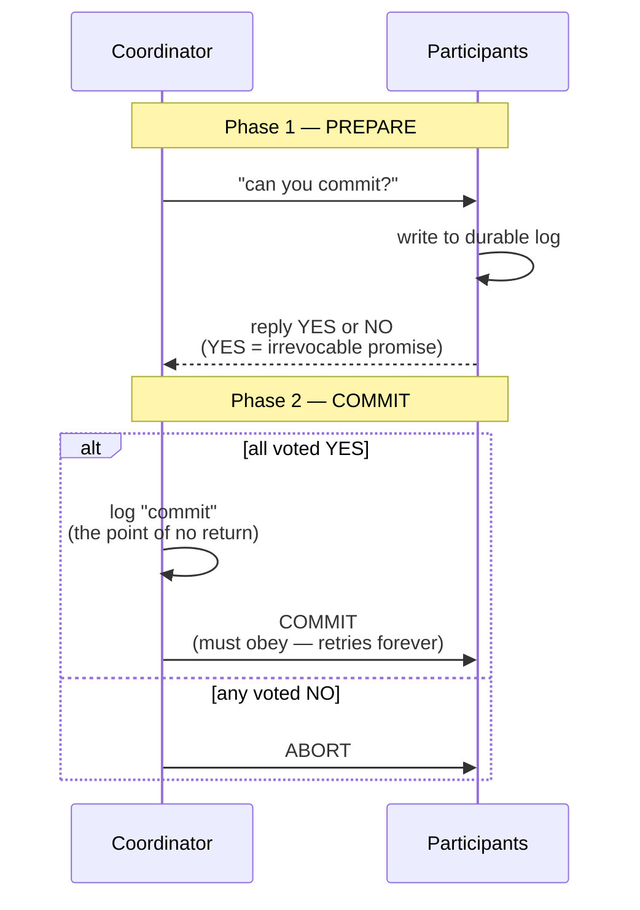
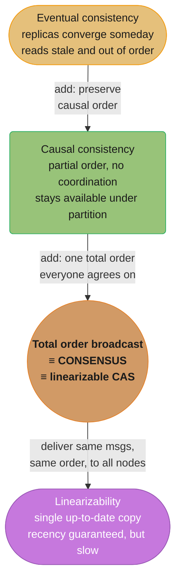
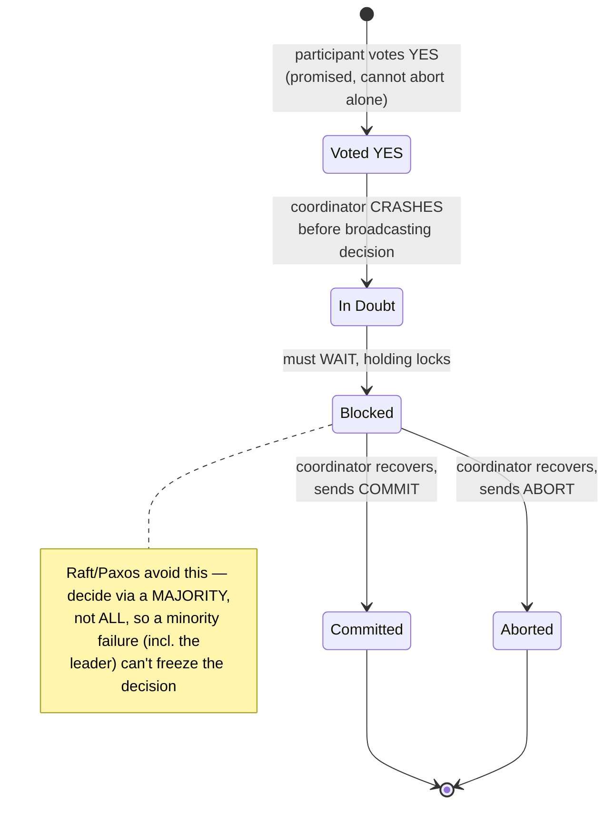
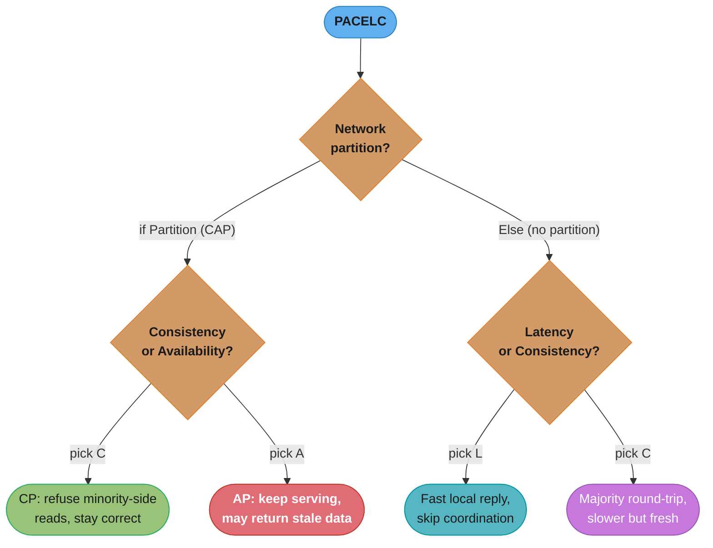
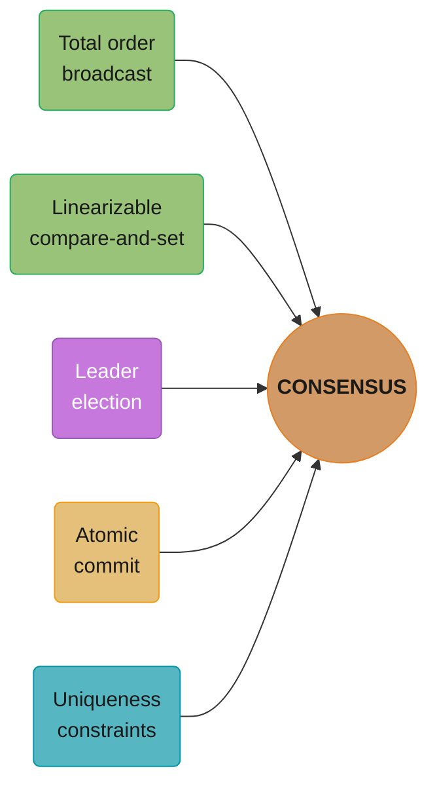

# Chapter 9: Consistency and Consensus

> Part II — Distributed Data · DDIA (Kleppmann, 1st ed., O'Reilly 2017) · the climax of Part II; builds on Ch 5–8, leads to Part III

## Chapter Map

Chapter 8 tore down every certainty; this chapter rebuilds. Given unreliable networks, clocks,
and processes, what *strong guarantees* can a system still provide, and how? It climbs from the
strongest single-object guarantee (**linearizability**), through **ordering and causality**, to
the deepest problem in distributed systems — **consensus**, getting nodes to agree on something
(a leader, a commit decision, a value) despite failures. The punchline: a surprising number of
problems (leader election, atomic commit, uniqueness constraints, lock services) are all
**equivalent to consensus**, and consensus is solvable, but only with a majority and at a cost.

**TL;DR:**
- **Linearizability** = behave as if there's a single, up-to-date copy of the data (one global
  order, every read sees the latest write). Strong but costly; CAP says it sacrifices availability
  under partitions.
- **Causality** (a weaker ordering) is often enough and *can* be preserved without the cost of
  total ordering, using logical clocks / Lamport timestamps.
- **Total order broadcast** (deliver the same messages to every node in the same order) is
  equivalent to consensus and to building a linearizable system.
- **Consensus** (Paxos/Raft/Zab) lets nodes agree despite faults; **2PC** is atomic commit but
  blocks on coordinator failure; **ZooKeeper/etcd** package consensus as a service.

## The Big Question

> "After Chapter 8 convinced me nothing is reliable — how can a group of flaky machines ever
> *agree* on a single fact, like who the leader is or whether a transaction committed, and what
> does that agreement cost me?"

Analogy: consensus is a committee trying to ratify one decision while members randomly fall
asleep, messages get lost, and nobody's watch agrees. The remarkable result is that they *can*
reliably agree — as long as a majority stays awake — and that "electing a chair," "ratifying a
vote," and "agreeing the meeting happened" turn out to be the *same* problem underneath.

---

## 9.1 Consistency Guarantees

Replicated systems offer a spectrum of consistency models, and it's vital not to confuse them.
**Eventual consistency** (Ch 5) is the weakest useful guarantee: stop writing, and *eventually*
all replicas converge — but it says nothing about *when*, and reads may return stale or
out-of-order data in the meantime, which is a constant source of subtle bugs. This chapter moves
up to **stronger** guarantees that are easier to use correctly but cost more in performance and
fault tolerance. (Note: distributed *consistency* models are about timing/ordering of replicas —
a different axis from the "C" in ACID, and different from the consistency of an isolation level.)

The chapter's shape follows directly from that spectrum: it climbs the ladder from the weakest
guarantee to the strongest one that is still achievable, showing at each rung both what you gain
and what it costs. **Linearizability** (9.2) sits at the top of the *single-object* guarantees —
the strongest thing you can say about one register or one key. **Ordering guarantees** (9.3) then
step back down to ask what weaker, cheaper guarantee is enough for most purposes, landing on
causal consistency, before climbing back up via total order broadcast to something equivalent to
linearizability again. **Consensus** (9.4) is where the chapter reveals that the top of the ladder
and the hardest multi-node coordination problems are, underneath, all the same problem — so the
chapter's real arc is not "three separate topics" but one problem examined from three angles.

## 9.2 Linearizability

**Linearizability** (a.k.a. atomic consistency, strong consistency, immediate consistency,
external consistency) is the strongest single-object guarantee: make the system *behave as if
there were only one copy of the data*, and all operations on it are atomic. Once a write
completes (or any read sees the new value), **all** subsequent reads must see that value or a
later one — the data appears to flip from old to new at a single instant, and time never goes
backward. It's a **recency guarantee**: a read is guaranteed to return the *most recent* committed
value, not a stale one.

**Linearizability ≠ serializability.** Serializability (Ch 7) is an *isolation* property about
*transactions* (multiple objects) being equivalent to *some* serial order. Linearizability is a
*recency* property about *single-object* reads/writes seeing the latest value in *real-time*
order. A system can provide both (strict serializability, e.g. 2PL or actual serial execution),
but they're distinct.

### A worked example: what concurrent reads must never do

Kleppmann walks through a small timeline to pin down what "behaves like a single copy" actually
forbids. Client A writes `x` from its old value to a new one; while that write is in flight,
several other clients — call them B, C, D — issue reads of `x` that overlap the write in real
time. A non-linearizable system can let those reads return the old or the new value in almost
any combination, because "eventually consistent" only promises convergence, not a moment when
the flip happens. Linearizability is the much stronger promise that there **is** a single instant
at which `x` flips from old to new, and that instant is consistent for every client:

- Any read that starts **after** the write has completed must see the new value — no exceptions.
- A read that overlaps the write in time may legitimately return either the old or the new value
  (the write hasn't necessarily "landed" yet from that read's perspective).
- The one thing that must **never** happen: once *any* client's read has returned the new value,
  a **later** read — by that same client or a different one — is not allowed to return the old
  value again. Time is not allowed to run backward.

That last bullet is the crux, and it's what makes linearizability strictly stronger than a
"read-your-own-writes" style guarantee: it isn't only about a client seeing its own write, it's
that once the new value has been observed by *anyone*, the system may never again present the old
value to *anyone*. A system that satisfies the first two bullets but violates the third is not
linearizable, even if every individual client's own view looks locally sane — which is precisely
why linearizability bugs are so easy to miss in testing (each client, tested alone, looks fine)
and so damaging in production (two clients compared against each other reveal the violation).

### Relying on linearizability

Some things break without it:

- **Locking and leader election** — a lock service must be linearizable so all nodes agree on who
  holds the lock / who is leader (ZooKeeper, etcd use consensus to provide this).
- **Uniqueness constraints** — a unique username/email, no double-booking, no negative balance:
  enforcing "only one wins" needs linearizability (it's essentially a lock per value).
- **Cross-channel timing dependencies** — the classic bug: a service writes a file to storage and
  *then* enqueues a "resize this image" message; if the message-fetch races ahead of the
  not-yet-replicated file, the resizer reads stale/missing data. Two communication channels
  (queue + storage) create a recency requirement only linearizability satisfies.

### Implementing and the cost of linearizability (CAP)

- Single-leader replication *can* be linearizable (read from the leader); but async followers
  aren't, and a wrongly-promoted leader (split brain) breaks it. Consensus protocols *are*
  linearizable. Leaderless quorums (w+r>n) are surprisingly **not** linearizable in general
  (concurrent reads/writes, last-write-wins, network delays violate recency).
- **The CAP theorem, properly stated:** when a network **partition** occurs, you must choose
  between **consistency (linearizability)** and **availability**. A *linearizable* (CP) system
  refuses requests on the minority side (becomes unavailable) to avoid returning stale data; an
  *available* (AP) system keeps serving but may return stale/conflicting data. CAP is narrow
  (only about linearizability vs total availability, only during partitions) and is widely
  misused — but the core tradeoff is real. Kleppmann goes further: because the "partition" CAP
  talks about is only one narrow kind of fault, and because CAP says nothing about *latency* or
  about any consistency model other than linearizability, he argues that CAP has become mostly of
  **historical interest** as a design tool — useful for warning newcomers that consistency and
  availability trade off at all, but too blunt to guide an actual architecture decision. The more
  useful move is to reason directly about which of Ch 5's replication approaches you need and what
  each one actually promises, rather than trying to place a system on the CAP triangle.
- **The deeper cost — even without partitions:** linearizability is **slow**. Every read/write
  must coordinate (network round-trips to a majority), so latency is bounded below by network
  delay; this is unavoidable, which is why many systems deliberately give it up for speed (the
  PACELC framing: *if Partition then C-or-A, Else Latency-or-Consistency*). Most systems choose to
  drop linearizability for performance, not just for availability.

### Linearizability and multi-core memory

The book draws a deliberate analogy to hardware to make the performance cost concrete: even a
single multi-core CPU, where every core is physically wired to the same RAM, does not give you
linearizable memory access by default. Each core has its own cache and store buffer, so a write
issued on one core is not automatically, instantly visible to a read on another core — the CPU
reorders and delays memory operations for performance, the same way a replicated database does.
Getting a truly linearizable view of memory across cores requires an explicit **memory barrier**
(fence) instruction, which is expensive precisely because it forces the cores to synchronize,
mirroring the network round-trip a distributed system pays for a linearizable read. The point
Kleppmann draws from it: if even hardware sitting centimeters apart on the same die finds strict
consistency too costly to provide by default, it should be unsurprising that machines separated
by a real network — with latencies orders of magnitude larger — very rarely choose to provide it
either.

### Decoding what linearizability actually costs

"Linearizability is slow" is vague until you count round trips. A read has to prove it is not
stale, and the only proof available is hearing from a majority *right now*:

```
read latency = (round trips required) x RTT
```

**Stated plainly.** "A stale read is free because you just answer from local memory; a fresh read
costs at least one full network round trip, because that is the minimum time it takes to find out
whether anyone else changed the value while you weren't looking."

| Symbol | What it is |
|--------|------------|
| `RTT` | Round-trip time to a majority of replicas — the floor set by the speed of light and queueing |
| local read | Answer from this replica's own copy. Zero network hops, possibly stale |
| quorum-confirmed read | Leader asks a majority "am I still leader?" before answering. 1 RTT |
| log-entry read | Push the read through the consensus log as an entry. 2 RTT (propose, then commit) |

**Walk one example.** The same read, priced at three deployment scales:

```
  deployment              RTT       local    1-RTT confirmed    2-RTT through the log
  same rack             0.5 ms     0.0 ms       0.5 ms               1.0 ms
  same datacenter       1   ms     0.0 ms       1   ms               2   ms
  cross-region        100   ms     0.0 ms     100   ms             200   ms

  serial reads per second on one key, cross-region:
    local                 unbounded (no network)
    1-RTT confirmed       1000 / 100  =  10 /s
    2-RTT through log     1000 / 200  =   5 /s
```

Inside one datacenter the linearizable read costs 1 ms instead of 0 — annoying but survivable.
Stretch the same protocol across regions and the identical code path costs 100 ms, a 100x
slowdown, and a single hot key tops out around 10 reads/second. Nothing in the algorithm changed;
only `RTT` did. This is the chapter's point that latency is "bounded below by network delay" and
unavoidable — and it is why systems ship lease-based leader reads, which trade a bounded clock
assumption for the right to answer locally.

## 9.3 Ordering Guarantees

Ordering, linearizability, and consensus turn out to be deeply connected — this section works its
way from the loosest ordering (causality) up to the strongest (total order broadcast), and shows
that the strongest one is, again, just consensus wearing a different hat.

### Ordering and causality

**Causality** imposes a *partial* order, not a total one: some pairs of events are causally
related — one could only have happened because of the other, so their order matters and every
observer must agree on it (the question must precede the answer; a row must be created before it
can be updated; a message must be sent before it is received) — while other pairs are
**concurrent**, meaning neither could have influenced the other, so there is no "correct" order
between them and different observers are free to see them in different orders. A partial order is
weaker than a total order specifically because it leaves some pairs — the concurrent ones —
genuinely unordered, whereas a total order (like the integers, or linearizability's single
timeline) can always compare any two elements.

A system that preserves causal order for every causally-related pair, while placing no
requirement on concurrent pairs, is **causally consistent**. Kleppmann states this precisely: causal
consistency is **the strongest consistency model that does not slow a system down due to network
delays, and that remains available in the face of network partitions** — it is, in effect, the
best you can do without paying linearizability's coordination tax. **Causal consistency vs.
linearizability**, side by side:

| | Causal consistency | Linearizability |
|---|---|---|
| Orders | Only causally-related pairs (partial order) | Every pair of operations (total, real-time order) |
| Concurrent operations | May be seen in different orders by different nodes | Must still be placed in one global order |
| Coordination needed | Track causal dependencies (cheap, local) | Majority round-trip per operation (expensive) |
| Availability under partition | Stays available on both sides | Minority side becomes unavailable (CP) |
| Relationship | **Implied by** linearizability | **Implies** causal consistency |

Linearizability *implies* causal consistency — a single global total order trivially preserves
every causal relationship nested inside it — but the implication only runs one way: a system can
be causally consistent without being anywhere close to linearizable, since it is free to let
concurrent writes on different nodes be observed in different orders. That gap is exactly the
budget causal consistency spends to stay cheap and available, and it is why the book presents it
as the "sweet spot" for applications that need more than eventual consistency's "no guarantee at
all" but do not need — and cannot afford — linearizability's global recency promise.

### Sequence number ordering

To track causality cheaply without coordinating on every operation, attach a **sequence number**
or **logical-clock timestamp** to each operation, chosen so that comparing two timestamps tells
you their relative order, and so that this order is *consistent with causality* (if operation A
causally precedes operation B, A's timestamp must be smaller). A single-leader replication log
(Ch 5) gives you this for free: the leader assigns operations to log positions in the order it
processes them, and that position **is** the sequence number — no extra machinery required, which
is one more reason single-leader designs are so popular.

Without a single leader to hand out positions, naive schemes break causality. A per-node counter
that each node increments independently and stamps on its own writes does **not** produce an order
consistent with causality, because two nodes' counters advance independently — node 2's operation
number 4 might have happened long after node 1's operation number 400, so comparing raw counters
tells you nothing about which one causally came first. The fix is the **Lamport timestamp**: each
node keeps a counter and a node ID, and every operation carries the pair `(counter, node-id)`.
Whenever a node processes an operation — whether generating its own or receiving one from another
node — it sets its counter to `max(local counter, incoming counter) + 1`; ties on the counter value
are broken by node ID. This simple rule guarantees that if operation A causally happened-before
operation B (directly, or transitively through a chain of messages), A's Lamport timestamp is
strictly less than B's — the *causal order is embedded in the numeric order*, even though the
nodes never coordinated directly.

**Why Lamport timestamps are insufficient for uniqueness constraints.** Their order is only
knowable *after the fact*, once every relevant operation has been collected and compared — Lamport
timestamps have no notion of "done, nothing earlier can still arrive." Concretely: two nodes each
receive a request to register the same username at roughly the same real-world instant. Node 1
assigns its attempt Lamport timestamp `(4, node1)`, node 2 assigns its attempt `(7, node2)`. If all
you had were these two numbers, you might declare `(4, node1)` the winner — but you cannot safely
do that *at the moment node 1 processes its request*, because some third node might still be about
to process a *third* concurrent registration attempt that will turn out to have a Lamport
timestamp of `(2, node3)`, lower than both. A Lamport-timestamp order can only be finalized once you
know no more operations with a smaller timestamp are still in flight — and in an asynchronous
network, you can never be sure of that in real time. For a decision you need to act on *now* — "is
this registration accepted?" — you need something that hands back a definite, final answer at the
moment you ask, which is exactly what total order broadcast provides.

### Total order broadcast

**Total order broadcast** (also called atomic broadcast) is the protocol that supplies that
missing "definite answer now." It is usually described as a protocol for exchanging messages
between nodes, and is defined by exactly **two safety properties**, both of which must hold for
every node that hasn't crashed:

1. **Reliable delivery** — no messages are lost: if a message is delivered to one node, it is
   eventually delivered to every node.
2. **Totally ordered delivery** — messages are delivered to every node in the **same order**;
   if message X is delivered before message Y at one node, then X is delivered before Y at every
   node that delivers both. (This is a *safety* property only — it says nothing about *when*
   delivery happens, which is why total order broadcast can still stall entirely during a network
   partition, the same way consensus does.)

Together these two properties are exactly what you need to build a **replicated state machine**:
if every replica applies the same sequence of operations, delivered in the same order, then every
replica ends up in the same state, deterministically — which is the mechanism underneath both
single-leader replication (the leader's replication log is a total order broadcast of writes to
its followers) and every consensus-based system in this chapter.

**Implementing linearizable storage using total order broadcast.** Because total order broadcast
delivers messages in the same fixed order everywhere, you can build a linearizable
compare-and-set (or atomic increment) register on top of it: to attempt an operation on a key, you
broadcast a message describing the attempted operation (not its result) through total order
broadcast. Every node — including the one that originated the request — processes the stream of
delivered messages *in delivery order* and applies each one deterministically to its local copy of
the register (e.g. "accept this CAS only if the current value still matches the expected old
value"). Because every node processes the identical sequence in the identical order, they all
reach the identical decision about whether any given operation succeeded — the log's delivery
order **is** the linearization point. A node learns the outcome of its own request only once its
message comes back around through the log, which is the price of this construction: it turns a
request into a round trip through the log rather than a direct local operation.

**Implementing total order broadcast using linearizability (the converse).** The equivalence runs
both ways. If you already have a linearizable register with an atomic increment-and-get
operation, you can build total order broadcast from it: for every message you want to broadcast,
first use the linearizable register to obtain the next sequence number (an atomic increment,
guaranteed to hand out a unique, gapless, totally ordered integer to each caller), attach that
number to the message, and send the message to all nodes. Each receiving node buffers incoming
messages and only delivers them in strict sequence-number order — holding back message 42 if
message 41 hasn't arrived yet — which reconstructs a single total order out of messages that may
have arrived over the network in any order. Because each direction can be built from the other,
**total order broadcast, a linearizable compare-and-set register, and consensus are all the same
problem** — solve any one and you have effectively solved all three.

## 9.4 Distributed Transactions and Consensus

**Consensus**: get several nodes to **agree on one value** (or decision), satisfying: *uniform
agreement* (no two nodes decide differently), *integrity* (no node decides twice), *validity* (the
decided value was proposed by some node), and *termination* (every non-crashed node eventually
decides — the liveness property, which requires a majority to be up). The **FLP result** proves
consensus is impossible in a *purely asynchronous* model with even one faulty node — but this is
circumvented in practice because real systems are *partially synchronous* and can use timeouts (and
randomness), so consensus *is* achievable.

### Atomic commit and two-phase commit (2PC)

The simplest "consensus-like" problem: a transaction spanning multiple nodes/partitions must
**commit on all or abort on all** (atomic commit) — you can't have it commit on one partition and
abort on another. **Two-phase commit (2PC)** solves this with a **coordinator**:

**Two-Phase Commit (2PC)**



Caption: the coordinator drives two synchronous rounds — a PREPARE vote that must be unanimous,
then an irrevocable COMMIT/ABORT broadcast; the crash failure mode this creates is diagrammed
separately below in Visual Intuition.

The fatal flaw: if the **coordinator crashes** after participants voted YES but before sending the
decision, participants are stuck **in doubt** — they promised to commit and may not abort, but they
don't know the decision, so they **block**, holding locks, until the coordinator recovers. 2PC is
therefore *blocking* and the coordinator is a single point of failure.

### Exactly-once message processing

2PC's second classic use case, alongside a transaction that spans multiple database partitions, is
coordinating a **database write together with a message queue** so that a message is processed
**exactly once** even if the consumer crashes partway through handling it. Without atomic commit,
you get one of two failure modes: commit the database write but crash before acknowledging the
message, so the broker redelivers it and you process it twice; or acknowledge the message but crash
before the database write commits, so the effect is silently lost. Enrolling both the message
broker and the database in a single 2PC transaction — so the "process message" and "commit the
database change" either both happen or neither does — is exactly the atomic commit problem this
chapter opened with, just with a queue standing in as one of the participants.

**XA transactions** are the standard, widely-implemented protocol for exactly this — coordinating
2PC across heterogeneous systems (relational databases, message brokers) that were not written to
know about each other. XA works by inserting a library into the application process that
intercepts the driver calls to each participating resource and mediates their communication with a
separate **transaction coordinator** process, which drives the prepare/commit protocol. XA
transactions inherit every problem 2PC has and add operational ones on top: the coordinator's own
log becomes a new durability requirement and a new single point of failure, since if it is not
itself made highly available it becomes the weakest link in every transaction that uses it; many
databases disable useful internal optimizations while an XA transaction is in the prepared state,
because they must hold locks and cannot know how long the coordinator will take to decide; and
in-doubt transactions left behind by a coordinator crash frequently require a database
administrator to manually inspect and heuristically resolve them, since the participant genuinely
cannot know whether to commit or abort on its own.

**Three-phase commit (3PC)** was proposed as a non-blocking alternative — adding an extra round so
that participants could safely decide the outcome themselves even if the coordinator fails, instead
of being stuck in doubt. The catch is that 3PC's non-blocking guarantee only holds under an
assumption of **bounded network delay and bounded response times** — every message is assumed to
arrive within some known maximum time, and every node is assumed to respond within some known
maximum time. Real networks provide neither guarantee (Ch 8's unbounded delays and process pauses
apply just as much here), so 3PC does not actually solve the problem on realistic networks and is
rarely used in practice. The path that *did* prove practical was not patching 2PC further but
replacing "all participants" with "a majority" — which is exactly what fault-tolerant consensus
does next.

### Fault-tolerant consensus

Real consensus algorithms — **Paxos** (and Multi-Paxos), **Raft**, **Zab** (ZooKeeper), and
Viewstamped Replication — fix 2PC's blocking by using a **majority** instead of requiring *all*
nodes, so they tolerate the failure of a minority and don't block on a single coordinator. They
work by electing a leader for an **epoch / term / ballot number** (a monotonically increasing number,
like a fencing token), and a value is decided only if a **majority** votes for it within the leader's
epoch — overlapping quorums between epochs guarantee that a newer leader learns of any value an older
leader may have decided. This is essentially **two rounds of voting**: one to elect the leader, one
to vote on the proposal — and the epoch numbers prevent a stale leader from causing a split-brain
decision. Consensus has limits: it needs a majority alive to make progress (a partition that loses
the majority halts it — safety preserved, liveness lost); it's sensitive to network delays (frequent
leader elections under a flaky network can stall progress); and the number of nodes is usually fixed
(dynamic membership reconfiguration is complex).

#### Decoding quorum size and fault tolerance

"Majority" has an exact definition, and so does the number of failures it survives:

```
quorum size       q = floor(n / 2) + 1
failures survived f = floor((n - 1) / 2)
```

**The idea behind it.** "Any two majorities of the same group must share at least one member, and
that shared member is the one who remembers what the previous leader decided — which is the entire
reason consensus is safe across leader changes."

The `+ 1` is not decoration. Exactly half is *not* a quorum: with `n = 4`, two groups of two can
form without overlapping, both believe they are authoritative, and you get the split-brain the
epoch numbers were meant to prevent. Requiring one more than half guarantees the overlap.

| Symbol | What it is |
|--------|------------|
| `n` | Total nodes in the consensus group (usually fixed at configuration time) |
| `q` | Nodes that must agree before a value is decided |
| `f` | Nodes that may fail while the remaining ones can still form a quorum |
| `floor(...)` | Round down — you cannot have a fractional node |

**Walk one example.** Every cluster size from 3 to 7:

```
  n     q = floor(n/2)+1     f = floor((n-1)/2)     survivors needed     verdict
  3          2                     1                      2              standard minimum
  4          3                     1                      3              wasteful
  5          3                     2                      3              standard
  6          4                     2                      4              wasteful
  7          4                     3                      4              high tolerance
```

Compare `n = 3` and `n = 4`. Both tolerate exactly **1** failure. But `n = 4` needs 3 nodes to
agree on every decision instead of 2, so it costs you an extra machine, an extra vote on the
critical path, and a *higher* probability that some quorum member is slow — while buying zero
extra fault tolerance. That is why real deployments are 3, 5, or 7 nodes and never 4 or 6: fault
tolerance only increases on the odd steps.

#### Decoding the round-trip count

The chapter describes consensus as "two rounds of voting". Those rounds are literal network
round trips, and each one costs a fixed number of messages:

```
messages per round = 2(n - 1)          (proposer -> n-1 peers, then n-1 replies back)
single-decree Paxos = 2 rounds         prepare/promise, then accept/accepted
Multi-Paxos / Raft steady state = 1 round   (round 1 amortized away by leader election)
```

**What it means.** "Round one buys you the right to propose; round two records what you proposed.
If you keep the right to propose across many decisions, you only pay for round one once — and
every decision after that costs a single round trip."

| Symbol | What it is |
|--------|------------|
| `n - 1` | Peers the proposer talks to — everyone except itself, since it counts its own vote locally |
| `2(n - 1)` | One outbound message and one reply per peer, for one round |
| prepare/promise | Round 1: claim an epoch/ballot and learn any value a previous leader may have decided |
| accept/accepted | Round 2: get a majority to durably record the proposed value |

**Walk one example.** Message counts and latency for one decision, at `RTT = 1 ms`:

```
  n     msgs per round     single-decree Paxos      Multi-Paxos / Raft steady state
             2(n-1)         2 rounds / 2 RTT             1 round / 1 RTT
  3            4            8 msgs,  2 ms                4 msgs,  1 ms
  5            8           16 msgs,  2 ms                8 msgs,  1 ms
  7           12           24 msgs,  2 ms               12 msgs,  1 ms
```

Two things fall out. First, latency does **not** grow with `n` — the proposer fans out in
parallel and waits for the fastest majority, so a 7-node group commits in the same 2 RTT as a
3-node group. What grows is *message volume*, linearly: 24 messages per decision at `n = 7`
versus 8 at `n = 3`. Second, the leader election in "elect a leader for an epoch" is exactly the
prepare/promise round, hoisted out of the loop. A stable leader running a million decisions pays
that round once and then commits each entry in 1 RTT — which is why Multi-Paxos and Raft are
usable in production and single-decree Paxos, run fresh per value, is not.

**What breaks without round one.** Skip prepare/promise and a newly elected leader has no way to
learn about a value a previous leader might already have gotten a majority to accept. It would
propose something different for the same slot, a second majority would accept it, and two nodes
would decide differently — a direct violation of uniform agreement. Round one exists purely so the
overlapping-quorum member can say "careful, the last epoch already accepted this."

### Membership and coordination services

You rarely implement consensus yourself; you use **ZooKeeper** or **etcd**, which package it as a
service exposing a small, linearizable, fault-tolerant key-value store. They provide the primitives
the whole chapter built toward: **linearizable atomic operations** (a compare-and-set for locks/
leader election, including **fencing tokens** via the monotonically increasing zxid/version),
**total ordering of operations**, **failure detection** (ephemeral nodes tied to client sessions —
when a client's session dies, its locks auto-release), and **change notifications** (watches).
Applications use them for **leader election**, **service discovery**, **membership** (which nodes are
alive), and **partition/work assignment** (which node owns which shard — recall Ch 6 routing). They
let ordinary applications outsource the hardest distributed-systems problems to a small, carefully
built consensus core.

**Service discovery** — letting a client find which network addresses currently run a given
service — does not, strictly speaking, *need* consensus at all: which instances exist can be
tracked with much simpler mechanisms, such as DNS or a plain configuration file pushed to every
node. Kleppmann notes ZooKeeper-style services end up used for it anyway, mostly because a system
that already runs ZooKeeper or etcd for leader election and locking has the coordination service
sitting right there, so it is the path of least resistance to register service instances in the
same place rather than stand up a second piece of infrastructure. **Membership**, by contrast — the
question of exactly which nodes are currently considered live participants in the cluster, which
matters for quorum-sensitive decisions — genuinely benefits from the same ephemeral-node mechanism
that backs locks: a node's membership entry disappears automatically the moment its session times
out, giving the rest of the cluster a consistent, low-latency view of who is actually still there,
without every node needing to run its own failure-detection gossip.

**Why not use a plain database for a lock?** An ordinary database gives you atomic single-row
updates, which looks superficially like it could implement a lock via a `compare-and-set` on a
"lock owner" column. What it is missing is the cluster of features this section built toward:
**fencing tokens** that are guaranteed to increase monotonically and are cheap to check on every
downstream write, **sessions** that automatically expire and release a lock if the holder
disappears (a plain row update needs a separate, hand-rolled heartbeat/TTL mechanism, exactly the
kind of ad hoc protocol Ch 8 warned is easy to get subtly wrong), and **watches** that push a
change notification the instant the lock is released, instead of forcing every waiter to poll.
ZooKeeper and etcd bundle all three atop a genuinely linearizable, consensus-backed store; a
general-purpose database can be pressed into approximating one or two of them, but reproducing all
three correctly is, again, most of the way to reinventing consensus by hand.

---

## Visual Intuition

**The Consistency / Ordering / Consensus Ladder**



**Why 2PC Blocks** — the in-doubt window the coordinator owns



Caption: the chapter's arc made visible — climb only as high as you need (causal is often enough),
and recognize that total order broadcast, consensus, and a linearizable CAS register are the *same*
problem, packaged for you by ZooKeeper/etcd.

**CAP vs PACELC: the Nested Decision**



Caption: PACELC's full formula made visible — *if* a network Partition is happening, CAP's
tradeoff applies (Consistency vs Availability); *Else*, in normal operation, the same shape of
tradeoff persists as Latency vs Consistency, because linearizability's majority round-trip is
slow whether or not anything has failed.

**The Chapter's Climax: Five Problems, One Underlying Consensus**



Caption: the chapter's central insight — total order broadcast, a linearizable compare-and-set
register, leader election, atomic commit, and uniqueness constraints all reduce to the same
problem; solve consensus once (ZooKeeper/etcd) and every one of these comes for free.

---

## Key Concepts Glossary

- **Eventual consistency** — replicas converge if writes stop; no recency or ordering guarantee.
- **Linearizability (atomic/strong/immediate consistency)** — behave as one up-to-date copy;
  recency guarantee; real-time total order.
- **Recency guarantee** — a read returns the latest committed value, not a stale one.
- **Serializability vs linearizability** — transaction isolation (multi-object) vs single-object
  recency; distinct.
- **Cross-channel (timing) dependency** — two channels (e.g. queue + storage) create a recency
  requirement.
- **CAP theorem** — under a partition, choose linearizable-Consistency or Availability.
- **PACELC** — Partition→C/A, Else→Latency/Consistency (linearizability is slow even without
  partitions).
- **Causality** — partial order of causally related events; concurrent events unordered.
- **Causal consistency** — preserves causal order; strongest model achievable without coordination.
- **Sequence number / logical clock** — counter defining an order consistent with causality.
- **Lamport timestamp** — `(counter, node-id)`; total order consistent with causality; only orders
  after the fact.
- **Total order broadcast (atomic broadcast)** — reliable delivery to all nodes in identical order.
- **Replicated state machine** — same ops in same order on every replica ⇒ identical replicas.
- **Consensus** — nodes agree on one value (agreement, integrity, validity, termination).
- **FLP result** — consensus impossible in a purely asynchronous model with one faulty node
  (circumvented via partial synchrony/timeouts).
- **Atomic commit** — a transaction commits on all participants or aborts on all.
- **Two-phase commit (2PC)** — coordinator-based atomic commit; blocks if coordinator crashes.
- **In doubt / blocking** — participant has voted YES but doesn't know the decision; holds locks.
- **XA transactions** — standard 2PC across heterogeneous systems.
- **Three-phase commit (3PC)** — non-blocking alternative to 2PC; needs bounded delay/response
  times to work, which real networks don't provide, so rarely used.
- **Exactly-once message processing** — 2PC applied to a queue consume + database write together,
  so a message is neither lost nor double-processed.
- **Paxos / Raft / Zab / VSR** — fault-tolerant consensus algorithms (majority-based).
- **Epoch / term / ballot number** — monotonically increasing leader generation; prevents
  split-brain.
- **ZooKeeper / etcd** — consensus packaged as a linearizable coordination service.
- **Ephemeral node / watch** — session-tied key (auto-release on death) / change notification.
- **Service discovery vs. membership** — finding instances (doesn't need consensus, e.g. DNS) vs.
  tracking who is currently alive (benefits from ephemeral-node semantics).
- **Memory barrier (fence)** — the CPU-hardware analogue of a linearizable coordination point;
  the book's illustration that even multi-core memory sacrifices strict consistency by default.

---

## Tradeoffs & Decision Tables

| Model | Guarantee | Coordination cost | Under partition |
|-------|-----------|-------------------|-----------------|
| Eventual | Converges someday | None | Stays available, stale reads |
| Causal | Preserves cause→effect | Low (logical clocks) | Stays available |
| Linearizable | Single up-to-date copy | High (majority round-trips) | Unavailable on minority side (CP) |

| | 2PC | 3PC | Fault-tolerant consensus (Raft/Paxos) |
|---|---|---|---|
| Needs to proceed | ALL participants | ALL participants | A MAJORITY |
| Coordinator failure | Blocks (in-doubt, locks held) | Non-blocking, *if* delay is bounded | Tolerated (re-elect leader) |
| Real-network viability | Used (XA), with known pain | Rarely used — the bound doesn't hold | Standard for new systems |
| Use | Cross-system atomic commit (XA) | Largely theoretical | Leader election, linearizable store |

| ZooKeeper/etcd primitive | Used for |
|--------------------------|----------|
| Linearizable CAS + fencing token | Distributed locks, leader election |
| Total ordering | Replicated logs, sequence numbers |
| Ephemeral nodes + sessions | Failure detection, membership |
| Watches | Service discovery, config change notification |

| | Total order broadcast | Linearizable CAS register |
|---|---|---|
| Given the other, build this by | applying the delivered log deterministically at every node | assigning each message a sequence number via atomic increment, then delivering in order |
| Cost of the construction | round trip through the log to learn your own outcome | buffering out-of-order messages until gaps fill |

---

## Common Pitfalls / War Stories

- **2PC in-doubt transactions freezing the system.** A coordinator crash (or a lost commit message)
  leaves participants holding locks indefinitely, blocking other transactions on those rows;
  recovering often requires manual operator intervention to heuristically commit/abort. Prefer
  consensus-backed designs or sagas (Part III) for long-lived cross-service workflows.
- **Assuming leaderless quorums (w+r>n) are linearizable.** They are not in general — concurrent
  operations, last-write-wins, and network delays violate recency. Building a lock or
  uniqueness constraint on a plain Dynamo-style quorum will silently allow two winners.
- **Using wall-clock timestamps to order events instead of logical clocks.** As Ch 8 showed, clock
  skew misorders causally related events and loses data; use Lamport timestamps / version vectors /
  a leader log to capture causality, not `currentTimeMillis`.
- **The cross-channel staleness bug.** Writing data to storage and then sending a message that
  references it, where the message arrives before the data has replicated — the consumer reads
  missing/stale data. Either make the storage read linearizable, or carry the data in the message,
  or wait for replication before publishing.
- **Expecting consensus to make progress without a majority.** A partition that isolates the
  majority halts the consensus group (by design — safety over liveness); systems that "work around"
  this by letting a minority proceed reintroduce split-brain. Size clusters (odd numbers: 3, 5) so a
  majority survives expected failures.
- **Frequent leader elections under a flaky network.** If timeouts are too tight, transient
  slowness triggers repeated re-elections, and the group spends its time electing leaders instead of
  doing work — a liveness collapse. Tune election timeouts above normal network jitter.
- **Reinventing consensus.** Hand-rolling leader election with timestamps and ad-hoc locking almost
  always produces a subtly broken protocol (split brain, lost decisions). Use ZooKeeper/etcd; this
  is the explicit recommendation.
- **Trusting a Lamport timestamp for a real-time decision.** Because Lamport order is only known
  after the fact, using it to decide "did this request win the race for a unique value" *now*
  silently admits a second winner once a lower-numbered concurrent operation shows up later. Route
  the decision through total order broadcast (or a linearizable CAS) instead.
- **Adopting 3PC to fix 2PC's blocking.** 3PC's non-blocking property depends on a bounded-delay
  network that doesn't exist in practice, so it doesn't actually deliver what it promises outside
  that assumption. Reach for majority-based fault-tolerant consensus instead of a fancier commit
  protocol.
- **Standing up a second coordination system when ZooKeeper/etcd is already running.** Since
  service discovery doesn't strictly need consensus, teams sometimes build a bespoke discovery
  mechanism alongside an existing ZooKeeper/etcd deployment used for locking — duplicating
  operational surface area for no real benefit, when registering instances in the store already in
  use is simpler.

---

## Real-World Systems Referenced

Google Spanner (linearizable via TrueTime), ZooKeeper (Zab) and etcd (Raft), Apache Kafka
(total-order log per partition), Paxos/Multi-Paxos (Google Chubby, Megastore), Raft (etcd,
CockroachDB, Consul), Viewstamped Replication, XA / JTA two-phase commit across databases and
message brokers, VoltDB and others using replicated state machines, HBase/Kafka/SolrCloud (ZooKeeper
for coordination).

---

## Summary

After Chapter 8's catalog of failures, this chapter shows what strong guarantees remain achievable.
**Linearizability** makes a replicated system behave as if it had a single, up-to-date copy — a
recency guarantee needed for locks, leader election, and uniqueness constraints — but it's distinct
from serializability, it's slow (every operation needs majority round-trips), and the **CAP theorem**
says it must sacrifice availability during a network partition (PACELC adds: it sacrifices latency
even without one). Often you don't need it: **causal consistency** preserves the cause→effect partial
order, is achievable cheaply with **Lamport timestamps**, and stays available under partitions.
**Total order broadcast** — delivering the same messages in the same order to every node — is what
powers replicated state machines, and it's **equivalent to consensus**. **Consensus** (nodes agreeing
on one value) underlies atomic commit, leader election, and uniqueness; **2PC** solves atomic commit
but *blocks* when its coordinator fails, whereas **fault-tolerant consensus** (Paxos, Raft, Zab) uses
a **majority** and epoch numbers to tolerate minority failures. In practice you don't build consensus
yourself — you delegate to **ZooKeeper/etcd**, which expose a small linearizable store providing
locks, fencing tokens, membership, and ordering for everyone else.

---

## Interview Questions

**Q: What is linearizability, in one precise sentence, and why is it called a recency guarantee?**
**Short:** Linearizability makes replicas behave as one up-to-date copy, so once a write completes every later read must see it.
Linearizability means the system behaves as if there were a single copy of the data on which every operation is atomic and instantaneous, so once a write completes, every subsequent read returns that value or a later one. It's called a recency guarantee because it forbids stale reads: a read is guaranteed to see the most recent committed value in real-time order, with the data appearing to switch from old to new at one instant that all clients agree on.

**Q: How does linearizability differ from serializability?**
**Short:** Serializability is transaction isolation across multiple objects; linearizability is single-object real-time recency.
Serializability is an isolation property about *transactions* (which may touch multiple objects): it guarantees the outcome is equivalent to *some* serial execution of those transactions, but says nothing about real-time recency. Linearizability is a recency property about individual *single-object* reads and writes: it guarantees each sees the latest value in real-time order, but doesn't bundle multiple operations into a transaction. A system can provide both (strict serializability), but they answer different questions — "did transactions appear to run one at a time?" versus "did this read see the freshest value?".

**Q: State the CAP theorem precisely and explain why it's often misused.**
**Short:** Under a network partition, CAP forces a choice between linearizable consistency and availability, nothing more.
CAP states that when a network partition occurs, a system must choose between linearizable consistency and availability: a consistent (CP) system rejects requests on the minority side to avoid stale data, while an available (AP) system keeps serving but may return stale or conflicting data. It's misused because people read it as "pick two of three" all the time, but it only concerns linearizability versus *total* availability, and only *during* a partition — it says nothing about normal operation, other consistency models, or the latency cost, which is why PACELC extends it.

**Q: What does PACELC add to CAP?**
**Short:** PACELC adds that even without a partition, linearizable systems still trade latency against consistency.
PACELC captures that the tradeoff isn't only about partitions: *if* there's a Partition, you trade Availability against Consistency (the CAP part), but *Else* (in normal operation) you still trade Latency against Consistency. The key insight is that linearizability is inherently slow even when nothing is broken, because every operation must coordinate with a majority of nodes over the network, so the round-trip latency is unavoidable. Many systems give up linearizability purely for speed, not just for partition-time availability.

**Q: Why are leaderless quorum reads/writes (w + r > n) not linearizable?**
**Short:** Quorum overlap guarantees intersection with a recent write, not real-time recency, so stale reads can still occur.
Because the quorum overlap guarantees a read *intersects* a recent write's replicas, but it doesn't guarantee real-time recency: concurrent reads and writes can interleave so two reads happening at nearly the same time see different values (one new, one old), last-write-wins can discard the genuinely latest write due to clock skew, and variable network delays mean a read might reach replicas before a write has propagated to its quorum. So quorums give strong-ish freshness but violate the strict recency and single-order requirements of linearizability.

**Q: What is causality, and why is causal consistency often preferable to linearizability?**
**Short:** Causal consistency preserves cause-before-effect ordering via cheap logical clocks without linearizability's coordination cost or availability loss.
Causality is a *partial* order: it requires that causally related events keep their order (the question before the answer, a row created before it's updated) while leaving truly concurrent, unrelated events unordered. Causal consistency is preferable when you don't need full recency because it's the strongest model achievable *without* the coordination cost of linearizability and *without* becoming unavailable during a network partition — you can preserve cause→effect using cheap logical clocks while still serving requests on both sides of a partition.

**Q: What are Lamport timestamps, and what is their key limitation?**
**Short:** A Lamport timestamp (counter, node-id) orders operations causally, but only after every one is collected.
A Lamport timestamp is a pair (counter, node-id): each node keeps a counter it increments per operation and bumps to at least any larger value it observes, with the node-id breaking ties, producing a total order consistent with causality. Their key limitation is that they only establish the order *after the fact*, once all operations are collected — they can't tell you *in the moment* whether an operation is, say, the first to claim a username, because a smaller-numbered operation might still be in flight and arrive later. For real-time decisions you need total order broadcast.

**Q: What is total order broadcast, and why is it so important?**
**Short:** Total order broadcast delivers messages to every node reliably and in the same order, the basis of replicated state machines.
Total order broadcast (atomic broadcast) is a protocol that delivers messages to all nodes reliably (none lost) and in exactly the same order on every node. It's important because it directly implements a replicated state machine — if every replica applies the same operations in the same order, they all stay identical — which is the foundation of consensus-based replication and single-leader logs. Critically, it's *equivalent* to consensus and to a linearizable compare-and-set register, so solving any one solves the others.

**Q: Define the consensus problem and its four properties.**
**Short:** Consensus requires agreement, integrity, validity, and termination — termination is what makes it hard by demanding progress despite failures.
Consensus is getting several nodes to agree on a single value. Its properties are: uniform agreement (no two nodes decide differently), integrity (no node decides more than once), validity (the decided value was actually proposed by some node, ruling out trivial constant answers), and termination (every node that doesn't crash eventually decides — the liveness property). Termination is what makes consensus hard and is why it requires a majority of nodes to be available to make progress.

**Q: What is the FLP result, and why doesn't it stop us from building consensus systems?**
**Short:** FLP proves consensus is unsolvable in a purely asynchronous model with even one faulty node.
The FLP result proves that consensus is impossible to guarantee in a *purely asynchronous* system (no timing assumptions, no clocks) if even a single node may fail, because you can't distinguish a crashed node from an infinitely slow one. It doesn't stop real systems because real networks are *partially synchronous* — usually timely — so algorithms can use timeouts (and sometimes randomness) to make progress in practice, sidestepping the impossibility while still guaranteeing safety even when the timing assumptions are temporarily violated.

**Q: How does two-phase commit work, and what is its fatal flaw?**
**Short:** In 2PC participants vote to prepare then the coordinator broadcasts commit or abort, but a coordinator crash after votes leaves participants blocked in doubt.
In phase one (prepare), a coordinator asks all participants if they can commit; each writes the transaction durably and votes yes or no, where a "yes" is an irrevocable promise it can no longer abort on its own. In phase two, if all voted yes the coordinator logs and broadcasts "commit" (the point of no return); if any voted no it broadcasts "abort." The fatal flaw is that if the coordinator crashes after participants vote yes but before broadcasting the decision, those participants are stuck "in doubt" — they've promised to commit but don't know whether to — so they block, holding locks, until the coordinator recovers.

**Q: Why is two-phase commit called a blocking protocol, and how does fault-tolerant consensus avoid that?**
**Short:** 2PC needs all participants and one coordinator; fault-tolerant consensus needs only a majority and can re-elect its leader.
2PC blocks because it requires *all* participants to act and gives the coordinator sole authority over the decision: any single failure (especially the coordinator's) during the in-doubt window freezes participants indefinitely while they hold locks. Fault-tolerant consensus algorithms (Paxos, Raft, Zab) avoid this by deciding based on a *majority* rather than unanimity, and by being able to elect a new leader: a minority failure — including the current leader's — doesn't halt the group, because the surviving majority can continue and a new leader, identified by a higher epoch number, takes over safely.

**Q: What role do epoch/term/ballot numbers play in consensus algorithms?**
**Short:** Monotonically increasing epoch numbers fence each leadership generation so overlapping quorums let a new leader learn prior commitments safely.
They are monotonically increasing numbers identifying each leadership generation, functioning like fencing tokens. Within a single epoch there's at most one leader, and a value is decided only if a majority votes for it in that epoch; when a leader is suspected dead, a new election produces a *higher* epoch number. Because quorums from different epochs overlap, a new leader is guaranteed to learn of any value an older leader might have committed, and proposals tagged with stale (lower) epoch numbers are rejected — preventing a deposed leader from causing a conflicting decision (split brain).

**Q: What problems are equivalent to consensus?**
**Short:** Total order broadcast, linearizable compare-and-set, leader election, atomic commit, and uniqueness constraints are all equivalent to consensus.
Total order broadcast, a linearizable compare-and-set (or atomic increment) register, leader election, atomic commit, and uniqueness constraints all reduce to consensus — you can build each from the others. This equivalence is a central insight of the chapter: a wide range of seemingly different distributed-systems problems are the *same* underlying problem, which is why a single well-built consensus implementation (packaged as ZooKeeper or etcd) can serve so many use cases like locks, leader election, and membership.

**Q: What does ZooKeeper (or etcd) provide, and why use it instead of rolling your own?**
**Short:** ZooKeeper/etcd package consensus into a linearizable store with locks, ordering, failure detection, and watches.
ZooKeeper/etcd expose a small, fault-tolerant, *linearizable* key-value store built on a consensus protocol, offering linearizable atomic operations (compare-and-set for locks and leader election, with monotonically increasing version numbers usable as fencing tokens), total ordering of operations, failure detection via ephemeral nodes tied to client sessions (locks auto-release when a client dies), and watches for change notifications. You use it instead of rolling your own because consensus is extremely easy to get subtly wrong — hand-built leader election and locking routinely produce split-brain or lost decisions — so you delegate the hardest part to a small, battle-tested core.

**Q: Give an example of a cross-channel timing dependency that requires linearizability.**
**Short:** A worker reading an uploaded image before its replica catches up can produce a broken thumbnail, needing a linearizable read across channels.
A media service writes an uploaded full-size image to blob storage and then enqueues a "generate thumbnail" message referencing it. If the message-processing worker fetches the image before the write has propagated to the replica it reads from, it sees a missing or stale image and produces a wrong or failed thumbnail. The two communication channels — the message queue and the storage system — together create a recency requirement that only a linearizable read of the storage (or carrying the image data in the message, or waiting for replication) can satisfy.

**Q: Why must a consensus system have a majority alive, and what happens during a partition that loses the majority?**
**Short:** Overlapping quorums keep decisions consistent across leader changes, so consensus needs a live majority to proceed.
A majority is required because overlapping quorums are how the protocol guarantees that any two decisions are consistent and that a new leader learns prior commitments — without a majority, two disjoint groups could each "decide" and diverge. During a partition that isolates the majority, the consensus group deliberately *halts* progress on the minority side (and even the majority side may pause briefly during re-election), preserving safety at the cost of liveness; it will not let a minority proceed, because doing so would risk split-brain. This is why such clusters are sized as odd numbers (3, 5) so a majority survives expected failures.

**Q: In the book's worked example, what must never happen to concurrent reads of a linearizable value?**
**Short:** Once any read returns a linearizable value's new state, no later real-time read may return the old state again.
Around a write that changes a value from old to new, other clients' reads may overlap the write and are free to return either the old or the new value while it's genuinely in flight — linearizability doesn't require every overlapping read to instantly see the new value. What it forbids absolutely is time running backward: once *any* client's read has returned the new value, no *later* read — by that client or any other — may ever again return the old value. A system can satisfy this for every client tested in isolation and still violate it once two clients' observations are compared against each other, which is why linearizability bugs are so easy to miss in testing and so damaging once found in production.

**Q: What are XA transactions, and what operational costs do they impose beyond 2PC's blocking?**
**Short:** XA is the standard cross-system 2PC; its own coordinator becomes a new durability requirement and failure point.
XA is the standard protocol for running 2PC across heterogeneous systems — typically a relational database plus a message broker — via a library that intercepts each participant's driver calls and mediates them through a separate transaction coordinator process. Beyond inheriting 2PC's blocking, XA adds real operational costs: the coordinator's own log must itself be durable and highly available or it becomes the weakest link in every transaction; participating databases often disable useful internal optimizations while a transaction sits in the prepared state, since they must hold locks without knowing how long the coordinator will take to decide; and in-doubt transactions left behind by a coordinator crash frequently require a DBA to manually inspect and heuristically resolve them.

**Q: How do total order broadcast and a linearizable register implement each other?**
**Short:** Total order broadcast and a linearizable compare-and-set register can each be built from the other.
Given total order broadcast, you can build a linearizable compare-and-set register by broadcasting each attempted operation as a message and having every node apply the delivered stream in identical order, deterministically deciding success or failure the same way everywhere — the log's delivery order becomes the linearization point. Given a linearizable register with an atomic increment-and-get, you can build total order broadcast the other way: use the register to hand out a unique, gapless sequence number to each message before sending it, then have every receiving node buffer and deliver messages strictly in sequence-number order. Because each can be constructed from the other, they are, along with consensus itself, the same underlying problem.

---

## Cross-links in this repo

- [database/consistency_models_and_consensus/ — linearizability, Raft, Paxos, CRDTs, fencing tokens](../../../database/consistency_models_and_consensus/consistency_models_and_consensus.md)
- [database/distributed_transactions/ — 2PC, Saga, outbox, idempotency, XA](../../../database/distributed_transactions/distributed_transactions.md)
- [database/newsql_and_distributed_sql/ — Spanner TrueTime, CockroachDB Raft, global ACID](../../../database/newsql_and_distributed_sql/newsql_and_distributed_sql.md)
- [hld/ — CAP/PACELC and coordination services in the interview framework](../../../hld/README.md)

## Further Reading

- Kleppmann, DDIA Ch 9 — original text and references.
- Lamport, "The Part-Time Parliament" (Paxos), 1998; Ongaro & Ousterhout, "In Search of an
  Understandable Consensus Algorithm" (Raft), 2014.
- Fischer, Lynch & Paterson, "Impossibility of Distributed Consensus with One Faulty Process"
  (FLP), 1985.
- Gilbert & Lynch, "Brewer's Conjecture and the Feasibility of Consistent, Available,
  Partition-Tolerant Web Services" (the CAP proof), 2002.
