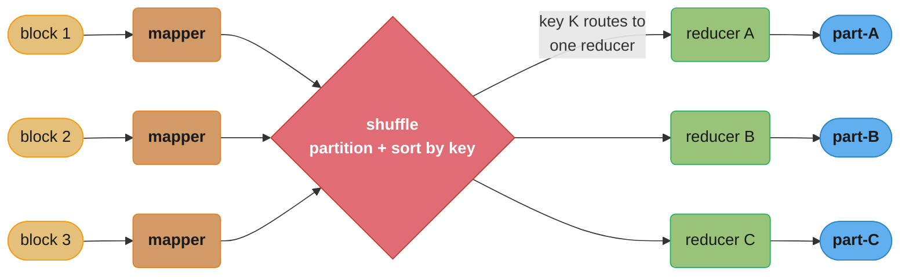
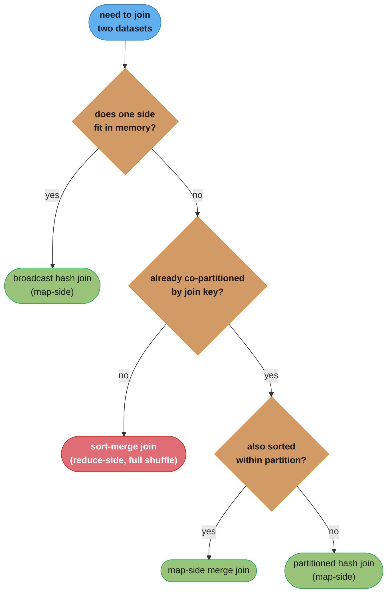
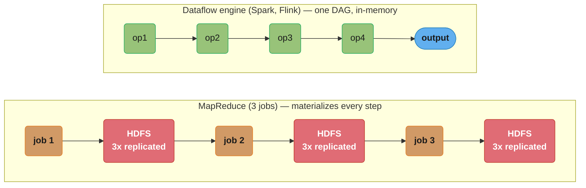
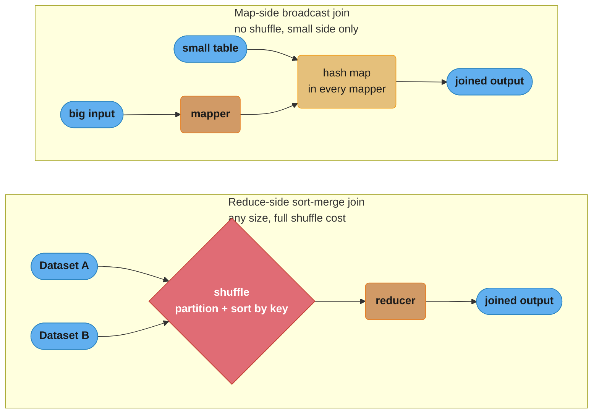

# Chapter 10: Batch Processing

> Part III — Derived Data · DDIA (Kleppmann, 1st ed., O'Reilly 2017) · opens Part III, leads to Ch 11 (stream processing)

## Chapter Map

Part III is about **derived data**: systems that take data from one place and transform it into
another (indexes, caches, recommendations, reports). Chapter 10 covers the **batch** style:
process a large, *bounded* dataset all at once and produce an output, with no response to a user
waiting — throughput, not latency, is the metric. Kleppmann starts with humble **Unix tools** to
extract the design philosophy, then scales that philosophy up to **MapReduce** and its successors
(**dataflow engines** like Spark and Flink).

**TL;DR:**
- Batch jobs read **bounded** input and write derived output; success is measured by
  **throughput** and the job is **deterministic and re-runnable** (retry on failure).
- The **Unix philosophy** — small tools, uniform interface (lines of text), composition via pipes,
  immutable inputs — is the intellectual blueprint for MapReduce.
- **MapReduce** runs map and reduce functions across a distributed filesystem (HDFS), bringing
  computation to the data and tolerating faults by retrying individual tasks.
- **Joins** in batch are done by sort-merge (reduce-side) or by broadcast/partitioned hash
  (map-side); **dataflow engines** (Spark, Tez, Flink) generalize MapReduce, keeping data in
  memory and avoiding materializing every intermediate step.

## The Big Question

> "I have an enormous pile of accumulated data — all of yesterday's logs, the whole user table —
> and I want to crunch it into something useful (a search index, a recommendation model, a report)
> reliably across hundreds of machines, where machines *will* fail mid-job. How?"

Analogy: batch processing is an industrial assembly line versus a barista. The barista (online
service) makes one coffee per waiting customer (low latency, one request). The assembly line
(batch job) runs overnight, transforming a warehouse of raw material into finished goods as fast as
possible (high throughput, no one waiting) — and if one station jams, you just re-run that station's
work, because the raw material is still there, untouched.

---

## 10.1 Batch Processing with Unix Tools

Kleppmann derives big-data principles from a simple task: find the most popular pages in a web
server log. A chain of standard tools — `cat log | awk '{print $7}' | sort | uniq -c | sort -rn |
head` — solves it. Two lessons emerge:


Caption: `cat log | awk '{print $7}' | sort | uniq -c | sort -rn | head` composes six single-purpose
tools purely through pipes — every stage reads lines of text on stdin and writes lines of text on
stdout, so no tool knows or cares what feeds it or what it feeds.

**The uniform interface.** Unix tools all speak the same data format: a **file = a sequence of
lines / bytes**. Because every tool reads lines from stdin and writes lines to stdout, *any* tool
can feed *any* other. This uniform interface is what makes arbitrary composition possible.

**Separation of logic and wiring.** A program reads stdin and writes stdout; it doesn't know or care
where the input comes from or where the output goes (`|` to another tool, `>` to a file, a terminal).
This **loose coupling** (the Unix philosophy: do one thing well, expect output to become another
program's input, compose small tools) lets you build pipelines from reusable pieces.

A crucial property: **immutable inputs**. A Unix pipeline doesn't modify its input file, so you can
re-run it as many times as you like with different flags — experiment freely, and recover from a
mistake by re-running. The downside of Unix tools: they run on a single machine, so they don't scale
to data that exceeds one machine — which is exactly what MapReduce fixes while keeping the philosophy.

### The chapter's four design principles, and why each carries over to MapReduce

Kleppmann pulls four properties out of the log-analysis example that make Unix tools composable, and
each one reappears, unchanged in spirit, once the same philosophy is scaled up to MapReduce:

| Principle | What it means for a Unix tool | What it becomes in MapReduce |
|---|---|---|
| Uniform interface | Every tool reads a sequence of lines/bytes from stdin, writes the same to stdout | Every mapper/reducer reads and writes a sequence of key-value pairs |
| Separation of logic from wiring | A program doesn't know or care where its input came from or where its output goes | A mapper/reducer doesn't know which machine its input block lives on or which machine runs next |
| Transparency / friendliness to experimentation | You can redirect or inspect any intermediate stage without touching the rest of the pipeline | You can inspect a job's intermediate output on the distributed filesystem, or stop the workflow at any stage |
| Doing one thing well | `sort` only sorts, `uniq` only deduplicates counted lines — each tool stays small and reliable | A mapper only maps and a reducer only reduces; the framework owns partitioning, sorting, and scheduling |

**Transparency is easy to skim past, so it deserves a concrete example.** Take the log-analysis
pipeline from the top of this section — `cat log | awk '{print $7}' | sort | uniq -c | sort -rn |
head` — and suppose the final ranking looks wrong. Because every stage's output is just lines of text,
you can inspect any intermediate point by simply stopping the pipe there: `cat log | awk '{print $7}'
| sort | uniq -c | less` shows the raw (URL, count) pairs *before* the final sort, with nothing about
the later stages changed or even re-run. A monolithic program computing the same answer in one pass
gives no such window — you would have to add logging or attach a debugger to see any intermediate
value. This "free" inspection at every pipe is a direct consequence of the uniform interface: because
the format never changes between stages, every stage boundary doubles as a place to look.

## 10.2 MapReduce and Distributed Filesystems

**MapReduce** is "Unix tools at the scale of thousands of machines." Like a Unix tool, a MapReduce
job reads input and produces output without modifying the input and with no side effects. But instead
of stdin/stdout, it reads from and writes to a **distributed filesystem** — **HDFS** (Hadoop
Distributed File System), an open-source reimplementation of the Google File System. HDFS is
**shared-nothing**: files are split into blocks replicated across many machines' local disks, with a
central NameNode tracking block locations — giving cheap, scalable, fault-tolerant storage on
commodity hardware.

### MapReduce job execution

You provide two callbacks (echoing Unix `awk`):

- **Mapper:** called once per input record; extracts a key and value from it. It's stateless across
  records (independent), which is what allows parallelism.
- **Reducer:** the framework collects all values sharing the same key and calls the reducer once per
  key with that collection, producing the output.

The magic step between them is the framework's, not yours: **the shuffle**. After mapping, the
framework **partitions** mapper output by key and **sorts** each partition, then sends all values
for a given key to the same reducer (across the network) — so each reducer sees its keys' values
together and in sorted order. This sort is the heart of MapReduce.


Caption: the shuffle is the framework's own step — partition every mapper's output by key, sort
each partition, and route all of a key's values to one reducer; the scheduler also runs each mapper
on the node already holding its input block ("bring computation to the data") so only the smaller
mapper output crosses the network.

**Bringing computation to the data:** the scheduler tries to run each mapper on a machine that
already stores a replica of that input block, so the (large) input doesn't cross the network — only
the (smaller) mapper output does. Workflows of MapReduce jobs are chained (one job's output is the
next's input), commonly orchestrated by tools like Oozie, Airflow, Luigi.

### Fault tolerance at the level of a single task

At the scale MapReduce runs — thousands of machines, jobs lasting hours — Kleppmann treats worker and
disk failures as a near-certainty within any given job's runtime rather than an edge case, and the unit
of retry is deliberately small. If a mapper or reducer task fails (a machine crashes, a disk dies
mid-read), the scheduler simply reschedules that one task on another machine, re-reading its input
block from a surviving replica; every other task that already completed is left untouched. This is only
safe because of two properties the chapter has already established: the input is **immutable** (so
re-reading it produces the same bytes) and a task is **deterministic** (so re-running it produces the
same output) — together they make a retried task indistinguishable from one that succeeded on the
first attempt. If a task keeps failing (for example, a bug that crashes on one particular input
record), MapReduce eventually gives up and fails the whole job, since retrying cannot fix a
deterministic bug. This per-task granularity — retry the one failed piece, not the whole computation —
is the mechanical basis for the "MPP databases abort the whole query, MapReduce retries one task"
contrast the chapter draws later against distributed databases.

### Decoding batch throughput: how long does a job actually take?

"Throughput, not latency" is a slogan until you attach the arithmetic to it. For a scan-bound
MapReduce job — the common case, since the map phase reads every input block exactly once — the
wall-clock time is governed by one division:

```
  job time  =  total input bytes / (machines x per-machine scan rate)
```

**In plain terms.** "A batch cluster is one enormous disk; its read speed is the sum of every
machine's read speed, and the job takes as long as it takes to read the pile once."

This is why batch scaling feels so unlike online-service scaling. There is no per-request overhead to
amortize and no queue to keep short — you are simply buying disk bandwidth, and doubling the machines
halves the clock.

| Symbol | What it is |
|--------|------------|
| total input bytes | The bounded dataset. Known before the job starts — that is what "bounded" buys you |
| machines | How many nodes hold a replica and can run a mapper locally |
| per-machine scan rate | Sustained local-disk sequential read, roughly 100 MB/s on commodity spinning disks |
| the product | Aggregate scan rate — the cluster's effective single-disk speed |
| job time | Wall clock, assuming the map phase dominates and nothing is skewed |

**Walk one example.** 100 TB of yesterday's logs on a 1000-machine HDFS cluster, 100 MB/s per disk:

```
  aggregate scan rate = 1000 machines x 100 MB/s
                      = 100,000 MB/s  =  100 GB/s

  job time = 100 TB / 100 GB/s
           = 100,000 GB / 100 GB/s
           = 1,000 s   =  16.7 minutes

  same 100 TB on ONE machine:
           = 100,000 GB / 0.1 GB/s
           = 1,000,000 s  =  11.6 days     <- the Unix-pipeline ceiling from 10.1
```

Sixteen minutes versus eleven and a half days is the entire argument for MapReduce over the shell
pipeline. And the scaling is linear in both directions: 500 machines gives 33.3 minutes, 2000
machines gives 8.3 minutes. Nothing about the job changes — only how many disks are spinning.

**Why "bring computation to the data" is in this formula and not beside it.** The `per-machine scan
rate` term is a *local disk* number only if the mapper runs on a node that already holds the block.
Schedule mappers randomly instead and every byte of the 100 TB crosses the network first; on a
12.5 GB/s (100 Gbit/s) cross-rack fabric that alone is 8,000 s = 2.2 hours, turning a 16.7-minute job
into a network-bound one an order of magnitude slower. Data locality is not an optimization here, it
is what keeps the division honest.

### Reduce-side joins and grouping

To **join** two datasets (e.g. user activity events with the user profile table) in MapReduce:

- **Sort-merge join (reduce-side):** mappers emit records from *both* datasets keyed by the join key
  (user ID); the shuffle brings all records for a given user — the profile *and* all their events —
  to the same reducer, in sorted order (arrange for the profile to arrive first), and the reducer
  joins them. Robust and general; works regardless of data size, but pays the full shuffle cost.
- **Handling skew (hot keys):** a celebrity user with millions of events sends them all to one
  reducer — a **hot-spot straggler** that delays the whole job. Mitigations (skewed/sharded joins)
  spread a hot key's records across multiple reducers.

### GROUP BY uses exactly the same mechanism as a join

Kleppmann's point here is that grouping records by a key — to run an aggregation over each group, e.g.
counting events per user per day, or finding the maximum value per key — is **mechanically identical**
to a reduce-side join. In both cases the shuffle partitions and sorts records by a key so that
everything sharing that key arrives at one reducer, and the reducer iterates over the group; the only
difference is what the reducer *does* with the group once it has it (join two datasets together, versus
fold a single group down to a summary value). A MapReduce framework that already implements grouping
has almost everything it needs to implement a join, and vice versa — the shuffle itself doesn't know or
care whether the job ahead of it is about to join or aggregate.

One practical consequence follows directly: **grouping suffers the same hot-key skew a join does.** A
`GROUP BY user_id` has the same straggler risk as a join on `user_id` — a disproportionately active
user's group overwhelms one reducer — so the skewed/sharded mitigation above applies unchanged: split
the hot key's group across several reducers and combine their partial results in a second pass.

### Map-side joins

When you can avoid the shuffle, joins get much faster — done entirely in the mapper:

- **Broadcast hash join:** if one dataset is small enough to fit in memory, load it into a hash table
  in *every* mapper and join each large-dataset record against it as it's read. No reducer, no
  shuffle.
- **Partitioned hash join:** if both datasets are already partitioned the same way by the join key
  (e.g. both into 100 partitions by user ID mod 100), a mapper only needs to join partition *i* of
  one against partition *i* of the other.
- **Map-side merge join:** if the inputs are also sorted within each partition, merge them directly.


Caption: the join strategy reduces to three questions — does a side fit in memory (broadcast hash),
are both sides already co-partitioned by key (partitioned hash), and are they also sorted within
partition (map-side merge) — falling back to the general but full-shuffle sort-merge (reduce-side)
join only when none of those hold.

### Decoding join cost: shuffle bytes versus broadcast bytes

The decision tree above hides a single comparison of two byte counts. Write `A` for the large side,
`B` for the small side, and `N` for the number of machines:

```
  sort-merge (reduce-side) network bytes  =  A + B          (both sides shuffled, once)
  broadcast hash (map-side) network bytes =  B x N          (small side copied to every node)
```

**What this actually says.** "Shuffling moves each row once no matter how big the cluster; broadcasting
moves the small table once *per machine*. Pick whichever side you'd rather pay for."

Notice what each formula does *not* depend on. Sort-merge cost is independent of `N` — adding machines
speeds the job up without moving more bytes. Broadcast cost is independent of `A` — the giant side
never crosses the network at all. That asymmetry is the whole reason both strategies exist.

| Symbol | What it is |
|--------|------------|
| `A` | Bytes in the large dataset (the activity events) |
| `B` | Bytes in the small dataset (the user profile table) |
| `N` | Number of machines, i.e. how many mapper hash tables you must fill |
| `A + B` | Sort-merge's bill: every record of both sides crosses the network exactly once |
| `B x N` | Broadcast's bill: one full copy of the small side per node, large side stays put |
| memory for `B` | The hard precondition — `B` must fit in a single mapper's heap, or broadcast is off the table |

**Walk one example.** Joining 10 TB of activity events against a 100 MB profile table, 1000 machines:

```
                            bytes over the network
  sort-merge   A + B  = 10 TB + 100 MB   = 10.0001 TB
  broadcast    B x N  = 100 MB x 1000    =    100 GB

  ratio = 10.0001 TB / 100 GB = 100x less data moved by broadcast

  at a 12.5 GB/s (100 Gbit/s) cross-rack fabric:
    sort-merge  10.0001 TB / 12.5 GB/s =  800 s   = 13.3 min of pure shuffle
    broadcast      100 GB / 12.5 GB/s  =    8 s
```

**Where the two curves cross.** Broadcast is not free — grow the small side and `B x N` climbs fast:

```
  B x N  <  A + B          broadcast wins
  B(N - 1) < A
  B < A / (N - 1)

  A = 10 TB, N = 1000  ->  B < 10 TB / 999  =  10.01 GB

  B =   100 MB  ->  broadcast   100 GB  vs shuffle 10.00 TB   broadcast wins by 100x
  B = 10.01 GB  ->  broadcast 10.01 TB  vs shuffle 10.01 TB   dead heat
  B =    20 GB  ->  broadcast 20.00 TB  vs shuffle 10.02 TB   shuffle wins, 2x cheaper
```

So on a 1000-node cluster a 20 GB "small" table is already the wrong choice for broadcast even though
20 GB fits comfortably in memory. "Does it fit in RAM?" is the *precondition*; `B < A/(N-1)` is the
actual decision — and it gets stricter as the cluster grows. This is exactly the calculation a query
optimizer (Hive, Spark SQL) is making for you when it picks a join strategy from table statistics.

### Decoding skew: why one hot key sets the whole job's clock

A reduce phase finishes when its *slowest* reducer finishes, so the job's time is set by the largest
partition, not the average one:

```
  job time  ~  max records on any reducer / reducer rate
  uniform case:  records / R          (R = number of reducers)
  skewed case:   f x records          (f = the hot key's share of all records)

  inflation factor = (f x records) / (records / R) = f x R
```

**Read it like this.** "Skew multiplies your job time by the hot key's share times the reducer count —
so on a 1000-reducer job, a key holding just 5% of the rows makes the job 50x longer."

| Symbol | What it is |
|--------|------------|
| `records` | Total rows flowing into the reduce phase |
| `R` | Number of reducers, i.e. how many ways the work was meant to split |
| `f` | Fraction of all records carrying the single hottest join key |
| `f x records` | What the unlucky reducer actually receives |
| `records / R` | What every reducer *should* have received |
| `f x R` | The inflation factor — note it grows with `R`, so adding reducers does not help |

**Walk one example.** 10 billion activity records, 1000 reducers, one celebrity at 5% of all events:

```
  uniform per reducer   = 10,000,000,000 / 1000        =  10,000,000 records
  celebrity's reducer   = 0.05 x 10,000,000,000        = 500,000,000 records
  the other 999 share   = 9,500,000,000 / 999          =   9,509,510 records

  inflation = 500,000,000 / 10,000,000 = 50x

  at 200,000 records/s per reducer:
    999 reducers finish in  9,509,510 / 200,000 =   47.5 s
    the hot reducer takes 500,000,000 / 200,000 = 2,500 s = 41.7 minutes

  999 machines sit idle for 41 minutes waiting on one.
```

Even a 1% hot key gives `0.01 x 1000 = 10x` inflation. The cruel term is `f x R`: throwing more
reducers at a skewed job raises the inflation factor, because the *uniform* baseline shrinks while the
hot key's load does not move at all. Only splitting the hot key itself (a skewed/sharded join that
scatters that one key across many reducers and replicates the other side to match) changes `f`.

### The output of batch workflows

Kleppmann's framing is that **the output of a batch process is often not a human-readable report but
another kind of structure** — batch jobs build derived datasets that some other system then serves.
Three concrete cases from the chapter:

- **Search indexes.** This was the original motivating use case for MapReduce at Google: building the
  company's own **proprietary full-text index of the web**, at a scale no single machine could handle,
  by having mappers process a subset of documents and reducers merge the resulting postings. Separately
  — an unrelated system, not the engine behind Google's index — **Lucene/Solr can also build their
  index files (segments) as the output of a batch job**: a batch process computes the postings and
  writes immutable segment files, which the search server then loads.
- **Key-value stores as batch output.** Machine-learning classifiers and other derived data are often
  served through a **read-only key-value store built by a batch job** — the chapter's example is
  Voldemort's read-only stores, where the job writes immutable database files and the serving system
  atomically switches over to the new files once the build finishes. Building the files offline and
  loading them in one atomic swap avoids the batch job hammering a live database with millions of
  individual writes, and it keeps the previous version fully queryable until the switch — a cheap,
  natural way to roll back a bad build.
- **The general shape.** In every case the batch job's role stops at *producing* a derived dataset; a
  separate system (a search server, a key-value store, a recommendation service) is responsible for
  *serving* reads against it. This separation — the write path is batch, the read path is a
  purpose-built serving system — is what Part III of the book calls **derived data**, and it recurs
  with streams in Chapter 11.

### Comparing Hadoop to distributed databases (MPP)

Hadoop (HDFS + MapReduce) and a massively parallel processing (MPP) SQL database both distribute a
computation across many machines, but the chapter draws out real differences in philosophy.

**Diversity of storage.** An MPP database requires data to be modeled and loaded into the database's
own tables — schema-on-write — before anything can be queried. HDFS just stores files: whatever bytes
you write, in whatever format, become readable to any later job, with structure imposed by whichever
job reads them ("schema-on-read"). Kleppmann cites Bobby Johnson and Joseph Adler's **"sushi principle": raw data is
better than cooked data** — keeping raw, unprocessed input around means you can always write a new job
to reinterpret it as requirements change, whereas data that has already been transformed and loaded
into a fixed schema has lost whatever the loading step discarded.

**Diversity of processing models.** An MPP database is a single integrated product — one vendor's
storage engine coupled to one query language (SQL) and one execution engine, chosen for you. HDFS
deliberately decouples storage from processing: MapReduce is a comparatively low-level programming
model sitting *beneath* many different higher-level processing styles (SQL-like queries through Hive,
graph algorithms, machine-learning pipelines, or hand-written code), all operating over the same
underlying files — the way many small Unix tools can all operate over the same plain-text file format.
That openness is what let Hadoop absorb new processing paradigms (graph processing, ML) over time
without a rewrite, in a way a single-vendor MPP engine cannot.

**Designing for frequent faults.** The two kinds of system also assume different failure rates. Hadoop
is built on the assumption that, at the scale of thousands of commodity machines running for hours, task
and node failures are a routine, expected occurrence — so MapReduce tolerates a task dying mid-job by
simply re-running that one task, using its disk-backed intermediate state to avoid redoing already
finished work. MPP databases mostly assume a query either completes or the whole query aborts and is
retried from scratch on any node failure — workable for them because their queries are usually much
shorter-running than a multi-hour batch job, so the cost of restarting one is smaller.

## 10.3 Beyond MapReduce

MapReduce is robust but has real inefficiencies, which spawned successors.

**MapReduce's problems.** Every job **materializes** its full output to the distributed filesystem
before the next job can start — so a workflow of N jobs writes and re-reads all intermediate data N
times (slow, and replicated 3× each time). Jobs run strictly sequentially (job N+1 can't start until
job N's output is fully written), and mappers are often redundant (just re-reading what a previous
reducer wrote). The repeated sort and disk I/O dominate.

### Decoding the two multiplications behind "MapReduce is slow"

Both of MapReduce's inefficiencies are multiplications that nobody writes down:

```
  shuffle fragments     =  M x R                       (M mappers, R reducers)
  workflow I/O bytes    =  N x S x (3 writes + 1 read) (N jobs, S bytes per step, 3x replication)
```

**What it means.** "Every mapper owes every reducer a piece, so the shuffle is a full M-by-R grid of
fragments; and every job in the chain writes its whole output to disk three times before the next job
is allowed to read it back once."

| Symbol | What it is |
|--------|------------|
| `M` | Number of mappers, roughly one per input block |
| `R` | Number of reducers, i.e. the partition count you chose |
| `M x R` | Shuffle fragments — each mapper partitions its output R ways, so every pair (m, r) is a transfer |
| `N` | Jobs in the chained workflow |
| `S` | Bytes of intermediate output a single job produces |
| `3 writes` | HDFS replication factor — materialized intermediate data is durably replicated like real data |
| `1 read` | The next job reading it straight back, often just to re-emit it |

**Walk one example.** A 1000-mapper, 1000-reducer job inside a 10-job workflow moving 10 TB a step:

```
  shuffle fragments = 1000 x 1000 = 1,000,000 open transfers/files for ONE job

  raise the partition count to 10,000 reducers to fight skew:
                    = 1000 x 10,000 = 10,000,000       <- 10x the fragments, same data

  workflow I/O, N = 10 jobs at S = 10 TB per step:
    written = 10 x 10 TB x 3 = 300 TB
    read    = 10 x 10 TB x 1 = 100 TB
    total   =                  400 TB of disk and network traffic

  the actual useful data in flight was 10 TB.  Amplification: 40x.
```

That `M x R` grid is why raising the partition count is never free — it is the cost side of the skew
fix above, and it is why shuffle-file counts, not CPU, are what usually falls over first. And that
40x amplification is precisely the term a dataflow engine deletes: keep the 10 TB in memory between
operators and the `N x S x 4` disappears, leaving one pass.

**Dataflow engines** (Spark, Tez, Flink) fix this by modeling the whole workflow as **one job** — a
**directed acyclic graph (DAG)** of **operators** — instead of independent map/reduce steps. They:
keep intermediate state **in memory or local disk** instead of always writing to HDFS (no forced
materialization between steps); avoid unnecessary sorts and redundant mappers; and schedule operators
flexibly. This makes them often much faster than MapReduce for the same workflow, especially
iterative ones.

### Materialization of intermediate state: full write-to-disk versus pipelining

The chapter frames MapReduce's forced materialization and a dataflow engine's alternative as two ends
of a real tradeoff, not simply "materializing is wrong":

| | Full materialization (MapReduce) | Pipelining (dataflow engines) |
|---|---|---|
| Where intermediate output lives | Written to the distributed filesystem, replicated | Kept in memory, spilling to local disk if it doesn't fit |
| Fault recovery | Simple — re-read the already-written output | Needs lineage tracking, or must recompute from an earlier point |
| Handling of very large intermediate results | Safe — disk has effectively unlimited capacity | Riskier — can exhaust memory and force a spill or a failure |
| Speed between steps | Slow — every step pays a full disk write and read | Fast — operators can hand off data without a round trip to disk |
| Downstream consumers | Any later job can independently read the materialized output | Consumers are generally part of the same DAG execution |

So the dataflow engine's win is not free: it trades the *safety and simplicity* of "the last completed
step's output is durably sitting on disk, ready for anything to read" for *speed*, and it must recover
that safety another way — which is exactly what lineage-based recomputation (below) provides. A
dataflow engine still materializes when a genuinely huge intermediate result would not fit in memory,
or when an operator boundary is a deliberate checkpoint; the difference from MapReduce is that
materialization becomes a choice the engine or the programmer makes, not something forced between
every single step.

**Fault tolerance in dataflow engines.** Since they don't materialize every intermediate result, they
can't just re-read it after a failure. Spark uses **RDDs (Resilient Distributed Datasets)** that
track **lineage** — the deterministic sequence of operations used to produce data — so a lost
partition is **recomputed** from its inputs by replaying the operations. This requires the operators
to be **deterministic** (same input ⇒ same output); nondeterminism (random numbers, wall-clock time,
iteration order) breaks recomputation and must be avoided or fixed (e.g. seed the RNG).

**Graphs and iterative processing.** Some algorithms (PageRank, shortest paths, ML training) iterate
until convergence — repeating the same computation, propagating values along graph edges, until they
stabilize. MapReduce is poor at this (each iteration is a separate job re-reading all data). The
**Pregel / bulk synchronous parallel (BSP)** model handles it: vertices send messages to each other
along edges across a series of supersteps, with state kept in memory between iterations (Apache Giraph,
Spark GraphX).

### The Pregel model, one superstep at a time

The chapter's answer to "MapReduce re-reads everything every iteration" is Pregel/BSP, and its
mechanics are worth spelling out because the word "superstep" alone doesn't convey the loop:

1. The graph (vertices and edges) is partitioned across machines and held **in memory** for the whole
   job — it is loaded once, not re-read from the distributed filesystem on every iteration.
2. Computation proceeds as a series of **supersteps**. In superstep *i*, every vertex processes the
   messages sent to it during superstep *i − 1*, updates its own state, and may send new messages to
   its neighbors along outgoing edges, to be delivered at the *start* of superstep *i + 1*.
3. A superstep is a synchronization barrier: the framework waits until every vertex has finished
   superstep *i* before any vertex begins superstep *i + 1* — the "bulk synchronous" in the name, all
   vertices marching through the same superstep number in lockstep.
4. A vertex with no more work to do can vote to **halt**; it wakes up again only if it receives a new
   message in a later superstep. The whole computation terminates once every vertex has halted and no
   messages remain in flight.

For **PageRank**, a vertex is a page, an edge is a link, and the message passed along each edge each
superstep is a fraction of the sending page's current rank — so rank propagates one hop per superstep
and the graph's ranks converge over a bounded number of supersteps, with the graph itself never
re-read from disk after the first load. Apache Giraph and Spark GraphX are the chapter's named
implementations of this model.

**High-level APIs.** Writing raw map/reduce code is tedious, so higher-level languages and libraries
emerged — **Pig, Hive, Cascading, Spark DataFrames/SQL** — that let you express joins and aggregations
declaratively and compile down to the underlying engine, often with a **query optimizer** choosing
join strategies (broadcast vs partitioned hash, etc.). This brings the declarative-vs-imperative
advantage (Ch 2) back to batch processing.

### High-level APIs and languages, and what they buy you

Writing raw mapper/reducer classes by hand for every job is repetitive and error-prone, so an ecosystem
of higher-level languages and libraries grew on top of MapReduce and, later, the dataflow engines:
**Pig** (a dataflow scripting language), **Hive** (SQL-like queries over Hadoop data), **Cascading**
and **Crunch** (Java/Scala APIs assembling pipelines out of reusable operators), and the
dataframe-style APIs built into Spark, Flink, and Tez themselves. What they share is letting the
programmer describe *what* result is wanted — a join, a filter, a grouped aggregation — declaratively,
or as composable high-level operators, rather than hand-writing the mapper and reducer that implement
it underneath.

The payoff the chapter emphasizes is that the engine can then act like a **query optimizer**: given a
declarative join or aggregation, it can pick the physical execution strategy — broadcast hash join
versus partitioned join versus sort-merge join, how many reducers to use — from statistics about the
data, the same freedom a relational query planner has (Chapter 2's declarative-versus-imperative
distinction, arriving in the batch world). A hand-written MapReduce job locks in its join strategy at
the time it's written; a declarative pipeline lets the engine change strategy as data sizes change,
with nothing rewritten by hand.

---

## Visual Intuition


Caption: MapReduce writes every job's full output to HDFS (replicated 3x) before the next job can
start, so a 3-job workflow pays three disk-and-network round-trips; a dataflow engine keeps
intermediate state in memory as one DAG and, on failure, recomputes a lost partition from recorded
lineage instead of re-reading disk (this requires deterministic operators).



Caption: the chapter's two engineering levers — eliminate forced materialization (dataflow engines)
and eliminate the shuffle when a join's small side fits in memory (map-side joins).

---

## Key Concepts Glossary

- **Batch processing** — transforming a large, *bounded* dataset all at once; optimizes throughput.
- **Bounded input** — input of known, finite size (contrast: unbounded streams, Ch 11).
- **Derived data** — data computed from a source (index, cache, model, report).
- **Unix philosophy** — small composable tools, uniform interface, immutable inputs, loose coupling.
- **Uniform interface** — every tool reads/writes the same format (lines of text / bytes).
- **MapReduce** — distributed batch model of map + reduce functions over a distributed filesystem.
- **HDFS / GFS** — shared-nothing distributed filesystem; blocks replicated across local disks.
- **Mapper** — extracts (key, value) from each input record; stateless, parallel.
- **Reducer** — receives all values for a key (sorted); produces output.
- **Shuffle** — the framework's partition-by-key + sort + transfer between map and reduce.
- **Bringing computation to the data** — run mappers where the input block already lives.
- **Sort-merge (reduce-side) join** — join via the shuffle bringing both sides' records together.
- **Broadcast hash join (map-side)** — load a small dataset into memory in every mapper.
- **Partitioned hash join / map-side merge join** — join co-partitioned (and sorted) inputs.
- **Skew / hot key straggler** — a heavy key overloading one reducer and delaying the job.
- **Materialization** — writing a step's full intermediate output to durable storage.
- **Dataflow engine** — Spark/Tez/Flink: a DAG of operators avoiding forced materialization.
- **RDD / lineage** — Spark's recompute-on-failure mechanism via recorded deterministic ops.
- **Determinism** — same input ⇒ same output; required for lineage recomputation.
- **Pregel / bulk synchronous parallel (BSP)** — iterative graph-processing model (Giraph, GraphX).
- **High-level API** — Pig, Hive, Cascading, Spark SQL/DataFrames; declarative over the engine.

---

## Tradeoffs & Decision Tables

| | Batch (Ch 10) | Online service | Stream (Ch 11) |
|---|---|---|---|
| Input | Bounded, known size | One request | Unbounded, never-ending |
| Metric | Throughput | Response time | Throughput + low latency |
| Output | Derived dataset | Response to user | Continuously updated derived data |

| | MapReduce | Dataflow engine (Spark/Flink) |
|---|---|---|
| Intermediate state | Materialized to HDFS each step | In memory / local disk |
| Speed | Slower (repeated disk I/O, sorts) | Faster, esp. iterative |
| Fault tolerance | Re-read materialized output | Recompute from lineage (needs determinism) |
| Model | Independent map/reduce jobs | One DAG of operators |

| Join strategy | Use when | Cost |
|---------------|----------|------|
| Sort-merge (reduce-side) | Any sizes; general | Full shuffle + sort |
| Broadcast hash (map-side) | One side fits in memory | No shuffle |
| Partitioned hash (map-side) | Both co-partitioned by key | No cross-partition shuffle |

| | MapReduce / dataflow | MPP SQL database |
|---|---|---|
| Code | Arbitrary (any language, ML) | SQL queries |
| Data | Any format (schema-on-read) | Loaded into schema (schema-on-write) |
| Fault tolerance | Per-task retry | Whole query aborts on node failure |

| | Hadoop (HDFS + MapReduce) | MPP SQL database |
|---|---|---|
| Storage model | Any file format; structure imposed at read time | Data loaded into the vendor's tables first |
| Processing models over that storage | Many, coexisting (Hive SQL, graph engines, ML libraries, hand-written code) | One, chosen by the vendor (SQL only) |
| Failure assumption | Frequent, at cluster scale; expected during a job | Rare within a single query's shorter runtime |
| Raw-data philosophy | Johnson and Adler's "sushi principle" — keep raw data, reinterpret later | Loading discards whatever the schema doesn't model |

---

## Common Pitfalls / War Stories

- **Nondeterministic operators breaking dataflow fault tolerance.** Spark/Flink recompute lost data
  from lineage, which only works if operators are deterministic. Using `rand()`, wall-clock time, or
  relying on undefined ordering means a recomputed partition differs from the original — corrupting
  results or duplicating effects. Seed RNGs and avoid clock/order dependence.
- **Hot-key skew creating a straggler.** A single very common join key (a celebrity user) routes
  millions of records to one reducer, which runs long after all others finish, dragging out the whole
  job. Detect skew and use a skewed/sharded join that splits the hot key across reducers.
- **Forgetting batch input must be immutable.** The whole re-runnability guarantee — retry a failed
  task, re-run a whole job after a bug — depends on inputs not changing under you. Mutating the input
  store mid-job (or pointing at live, changing data) destroys determinism and makes retries unsafe.
- **Materialization overhead in long MapReduce chains.** A 10-job workflow writes and re-reads (and
  3×-replicates) all intermediate data ten times; the disk and network I/O dominate runtime. Collapse
  it into one dataflow-engine DAG to keep intermediates in memory.
- **Bulk-writing derived data straight into the live serving database.** Having a batch job do
  millions of individual writes/updates against the production database overloads it and can corrupt
  on partial failure. Instead build the read-only output files offline and atomically load/swap them
  into the serving store.
- **Using MapReduce for iterative algorithms.** Running PageRank or ML training as a chain of
  MapReduce jobs re-reads the entire dataset every iteration — crippling for hundreds of iterations.
  Use a BSP/graph engine (Giraph, GraphX) or an in-memory dataflow engine that keeps state across
  iterations.
- **Broadcasting a "small" table that has outgrown a single mapper's memory.** A broadcast hash join
  loads the small side into a hash table in every mapper; as that table grows, at some point it no
  longer fits comfortably in a mapper's heap, causing memory pressure or an outright task failure.
  Check the small side's actual size against available mapper memory before choosing broadcast, and
  fall back to a partitioned or sort-merge join once it no longer clears that bar.
- **Watching joins for hot keys but not GROUP BY.** Because grouping and joining share the same
  shuffle machinery, a `GROUP BY` on a low-cardinality or celebrity-heavy key skews exactly like a
  join on that key does — a team that only instruments join stages for skew gets blindsided by a slow
  aggregation instead, since the straggler shows up in a stage nobody was watching.
- **Debugging only the final output instead of the intermediate stages.** Because both Unix pipelines
  and MapReduce workflows produce inspectable intermediate results at every stage, jumping straight to
  "why is the final answer wrong" throws away the fastest diagnostic tool available. Checking each
  stage's output in order — as if piping the workflow through `less` one step at a time — usually
  isolates the bad step far faster than reasoning about the whole pipeline at once.

---

## Real-World Systems Referenced

Unix and GNU coreutils (awk, sort, uniq), Google MapReduce and GFS, Apache Hadoop and HDFS, Apache
Spark (RDDs, DataFrames), Apache Tez, Apache Flink (batch mode), Apache Hive, Apache Pig, Cascading,
Apache Crunch, Apache Giraph and Spark GraphX (Pregel/BSP), workflow schedulers Oozie/Airflow/Luigi,
Lucene/Solr (batch-built index segments), Voldemort's read-only stores (batch-built key-value output),
Bobby Johnson and Joseph Adler's "sushi principle" (raw data is better than cooked data), and the contrast class of MPP
databases (Teradata, Vertica, Impala).

---

## Summary

Batch processing transforms a large, *bounded* input into derived output, optimizing throughput
rather than latency, and is designed to be deterministic and re-runnable so failures are handled by
retrying. The **Unix philosophy** — small tools with a uniform line-based interface, immutable
inputs, and composition through pipes — is the conceptual ancestor of big-data tooling.
**MapReduce** scales that philosophy across thousands of machines: stateless **mappers** extract
(key, value) pairs, the framework's **shuffle** partitions and sorts by key, and **reducers** process
each key's grouped values, all reading/writing a shared-nothing distributed filesystem (**HDFS**)
with computation brought to the data and fault tolerance via per-task retry. **Joins** are done by
sort-merge (reduce-side, general but shuffle-heavy) or by broadcast/partitioned hash (map-side, fast
when a side fits in memory or inputs are co-partitioned), with hot-key **skew** the main hazard.
MapReduce's forced **materialization** of every intermediate step makes it slow, so **dataflow
engines** (Spark, Tez, Flink) model the whole workflow as one in-memory DAG, recovering from failures
by **recomputing from lineage** (requiring determinism), handle **iterative/graph** workloads with the
Pregel/BSP model, and expose declarative **high-level APIs** (Hive, Pig, Spark SQL).

---

## Interview Questions

**Q: What distinguishes batch processing from online services and stream processing?**
**Short:** Batch processes bounded input for throughput with no one waiting; online services optimize latency; streaming handles unbounded input with low latency.
Batch processing reads a large, *bounded* input of known size and produces derived output, with no user waiting, so success is measured by throughput (how much data per unit time) rather than response time. Online services handle one request at a time and are judged by latency. Stream processing (Chapter 11) is the middle ground: it consumes *unbounded*, never-ending input and produces continuously updated output with low latency. Batch's bounded, no-one-waiting nature is what lets it prioritize throughput and rely on re-running jobs to handle failures.

**Q: How does the Unix philosophy foreshadow MapReduce?**
**Short:** MapReduce scales Unix's small tools, uniform interface, and immutable inputs to thousands of machines.

The Unix philosophy builds complex behavior from small tools that each do one thing well, connected through a uniform interface (every tool reads and writes sequences of lines/bytes) and composed via pipes, treating inputs as immutable. MapReduce scales exactly these ideas: a job reads input and writes output without modifying the input or causing side effects, mappers and reducers are small composable functions, and jobs chain into workflows. The key inheritance is loose coupling and immutable inputs, which together make jobs re-runnable and fault-tolerant.

**Q: What is the shuffle in MapReduce, and why is it the heart of the model?**
**Short:** The shuffle partitions, sorts, and transfers mapper output by key so each reducer sees all values for its keys grouped together.
The shuffle is the framework-managed step between map and reduce that partitions every mapper's output by key, sorts each partition, and transfers all values for a given key across the network to a single reducer. It's the heart of the model because it's what guarantees a reducer sees *all* values for its keys, grouped and sorted — which is what makes grouping, aggregation, and joins possible. The programmer writes only map and reduce; the shuffle (and its sort) is the expensive, defining machinery MapReduce provides.

**Q: What does "bringing computation to the data" mean and why does it matter?**
**Short:** MapReduce schedules mapper tasks on machines already holding their input block, avoiding network transfer of the larger raw data.
It means the scheduler tries to run each mapper task on a machine that already stores a replica of the input block that task will read, rather than shipping the input across the network to wherever there's a free CPU. It matters because the input data is large while the program is small, so moving the computation to the data avoids saturating the network with bulk data transfer — only the smaller mapper *output* needs to be shuffled. This locality optimization is central to MapReduce's scalability on commodity clusters.

**Q: Compare reduce-side and map-side joins.**
**Short:** Reduce-side joins shuffle both datasets by key; map-side joins skip the shuffle when one side is small or co-partitioned.

A reduce-side (sort-merge) join has mappers emit records from both datasets keyed by the join key; the shuffle brings all records for a key to one reducer in sorted order, which joins them — it works for any data sizes but pays the full shuffle and sort cost. A map-side join avoids the shuffle entirely: a broadcast hash join loads a small dataset into an in-memory hash table in every mapper and probes it per record, while a partitioned hash join exploits inputs already co-partitioned by the join key so each mapper joins matching partitions. Map-side is much faster but requires a small side or pre-partitioned inputs.

**Q: What is hot-key skew in a join, and how do you mitigate it?**
**Short:** Hot-key skew routes far more records to one reducer, which becomes the job's straggler; sharded joins split that key's load.

Hot-key skew is when one join key has vastly more records than others — a celebrity user with millions of events — so all of them are shuffled to a single reducer, which becomes a straggler running long after every other reducer has finished, dragging out the whole job's completion time. Mitigations (skewed or sharded joins) detect the hot key and split its records across multiple reducers, replicating the matching record from the other (small) side to each of those reducers so the work is parallelized rather than bottlenecked on one node.

**Q: Why is MapReduce's forced materialization a performance problem, and how do dataflow engines fix it?**
**Short:** MapReduce materializes every step to replicated disk; dataflow engines keep a DAG's state in memory instead.

MapReduce writes each job's complete output to the distributed filesystem (replicated three times) before the next job can read it, so a workflow of N jobs passes all intermediate data through disk and network N times, and jobs must run strictly sequentially. Dataflow engines (Spark, Tez, Flink) model the entire workflow as one DAG of operators and keep intermediate state in memory or local disk instead of materializing to HDFS between steps, also skipping unnecessary sorts and redundant mappers — making them substantially faster, especially for iterative workloads.

**Q: How does Spark achieve fault tolerance without materializing every intermediate result?**
**Short:** Spark's RDDs record deterministic lineage, so a lost partition is recomputed by replaying its recorded operations instead of reading a saved copy.
Spark represents data as RDDs (Resilient Distributed Datasets) that record their *lineage* — the exact, deterministic sequence of operations that produced them from their inputs. When a partition is lost to a machine failure, Spark doesn't need a saved copy; it recomputes that partition by replaying the recorded operations on the (still available or itself recomputable) input data. This trades recomputation cost for avoiding the heavy materialization MapReduce does, but it depends critically on the operators being deterministic.

**Q: Why must dataflow operators be deterministic, and what breaks determinism?**
**Short:** Recomputing lost data from lineage requires identical output each time; random seeds or clock reads break that.

Because fault recovery works by recomputing lost data from lineage, a recomputed partition must produce *exactly* the same result as the original — otherwise downstream results become inconsistent or effects get duplicated. Determinism is broken by anything that can differ between runs: random number generators without a fixed seed, reading the wall-clock time, relying on hash-map iteration order or the order in which records happen to arrive, or non-idempotent external side effects. Such sources must be eliminated or made reproducible (e.g. seeding the RNG) for lineage-based recovery to be correct.

**Q: Why is plain MapReduce poor for iterative algorithms like PageRank, and what's the alternative?**
**Short:** MapReduce re-reads the whole dataset each iteration; Pregel/BSP keeps graph state in memory across supersteps.

Iterative algorithms repeat the same computation many times until convergence, but MapReduce treats each iteration as an independent job that must read the entire dataset from HDFS, recompute, and write it all back — so hundreds of iterations mean hundreds of full-dataset disk round-trips, which is crippling. The alternative is the Pregel / bulk synchronous parallel (BSP) model (Apache Giraph, Spark GraphX), where vertices keep state in memory across supersteps and send messages to each other along graph edges, so each iteration only propagates updates rather than re-reading and re-writing everything.

**Q: How do batch processing (MapReduce/dataflow) and MPP SQL databases differ in philosophy?**
**Short:** MapReduce offers arbitrary code and per-task retries; MPP databases offer fast fixed-schema SQL but abort a query on any node failure.

MapReduce-style systems give you freedom and resilience: you can run arbitrary code in any language over data in any format (schema-on-read, good for messy semi-structured data and machine learning), and fault tolerance is fine-grained — a failed task is retried without restarting the whole job. MPP SQL databases require data to be loaded into a fixed schema first (schema-on-write) and only run SQL, and they typically abort an entire query if a node fails; in return they're often faster for the structured analytic queries they're designed for. It's a flexibility-and-fault-tolerance versus speed-and-structure tradeoff.

**Q: What kinds of output do batch workflows typically produce, and why build them offline?**
**Short:** Batch jobs build derived outputs like search indexes and ML models offline, then atomically load them, avoiding overload on live serving databases.
Batch jobs produce derived data: search indexes (e.g. Lucene segments), read-only key-value snapshots to bulk-load into serving databases, recommendation results, and trained machine-learning models. They're built offline because generating this derived data involves huge numbers of writes that would overload a live serving database and risk inconsistency on partial failure; instead the job writes immutable output files in one place and the serving layer atomically loads or swaps them in, keeping the production system stable and the operation re-runnable.

**Q: Why are immutable inputs so important to batch processing?**
**Short:** Immutable inputs make batch jobs safely re-runnable, since retries and fixes always start from the same well-defined starting data.
Immutable inputs are what make batch jobs safely re-runnable, which is the foundation of batch fault tolerance and experimentation. Because a job never modifies its input, you can retry a failed task, re-run the entire job after fixing a bug, or run it again with different parameters, always getting a well-defined result from the same starting data. If inputs could change underneath a running job, retries would be non-deterministic and a partial failure could leave the system in an unrecoverable, inconsistent state — so immutability underpins the whole model's reliability.

**Q: What roles do high-level APIs like Hive, Pig, and Spark SQL play?**
**Short:** They let engineers express batch computations declaratively, letting the engine's optimizer choose the efficient physical execution plan.
They let engineers express batch computations — joins, filters, aggregations — declaratively instead of hand-writing low-level map and reduce functions, then compile that down to the underlying execution engine. Crucially, they include query optimizers that automatically choose execution strategies, such as whether to use a broadcast hash join or a partitioned join based on data sizes, bringing the declarative-versus-imperative advantages from Chapter 2 to batch processing: more concise code, and the engine — not the programmer — picking the efficient physical plan.

**Q: What is HDFS, and what design choices make it suitable for batch processing?**
**Short:** HDFS replicates file blocks across commodity disks and colocates mappers with the blocks they read.

HDFS (the Hadoop Distributed File System, modeled on Google's GFS) is a shared-nothing distributed filesystem that splits files into large blocks and replicates each block across the local disks of many commodity machines, with a central NameNode tracking block locations. These choices suit batch processing because they provide cheap, massively scalable, fault-tolerant storage (lost replicas are re-replicated automatically), and block placement enables "bringing computation to the data" by scheduling tasks where their input already resides. It favors high-throughput sequential scans of huge files over low-latency random access.

**Q: How is a workflow of multiple MapReduce jobs constructed and managed?**
**Short:** Chained MapReduce jobs pass HDFS output to the next job's input, orchestrated by schedulers like Oozie, Airflow, or Luigi.
Complex computations rarely fit in a single map-and-reduce pass, so they're built as a *workflow*: the output directory of one job on HDFS becomes the input of the next, chaining jobs together. Because there's no built-in notion of a multi-job pipeline in basic MapReduce, scheduling tools like Oozie, Airflow, and Luigi orchestrate the dependencies — deciding when each job can start (after its inputs are fully written), handling retries, and managing the overall DAG of jobs — which is one of the awkwardnesses that dataflow engines later eliminated by representing the whole workflow as a single job.

**Q: What does "transparency" mean as a Unix design principle, and how does it carry over to MapReduce?**
**Short:** Transparency means any pipeline stage's output can be inspected without altering the rest of the pipeline.

Transparency means that because every Unix tool reads and writes the same uniform line-based format, you can stop a pipeline at any stage and redirect or view its intermediate output without touching the tools before or after it — there's no hidden internal state to dig for, the intermediate result is just more lines of text. The same property survives in MapReduce: because each job's intermediate output between stages is itself just data sitting on the distributed filesystem (or, in a dataflow engine, addressable state in the DAG), you can inspect a workflow's midpoint or stop it after any single step to sanity-check it, exactly the way you'd pipe a Unix command chain into `less` partway through. The practical payoff is debugging by inspection rather than by adding instrumentation: a wrong final answer can be tracked down by looking at progressively earlier stages until the bad one is found.

**Q: Why does the book say GROUP BY and a join use the same underlying mechanism in MapReduce?**
**Short:** Both rely on the shuffle grouping same-key records at one reducer before the reducer processes them.

Both operations depend on the identical machinery: the shuffle partitions and sorts records by a key so that everything sharing that key ends up at the same reducer, and the reducer then iterates over that grouped collection. A join's reducer combines two datasets' records sharing a key; a GROUP BY's reducer folds one dataset's records sharing a key down to an aggregate — the grouping step itself doesn't know or care which of the two it's about to do. One direct consequence is that GROUP BY inherits the same hot-key skew risk a join has (a `GROUP BY user_id` on a celebrity account overloads one reducer exactly like a join on that key would), so the same skewed/sharded mitigation applies to both.

**Q: What is the "sushi principle" and why does it favor Hadoop's schema-on-read approach?**
**Short:** Kleppmann cites Johnson and Adler's "sushi principle" — raw data is better than cooked data — favouring HDFS's schema-on-read.

Kleppmann cites Bobby Johnson and Joseph Adler's "sushi principle" — raw data is better than cooked data (Strata+Hadoop World, 2015) — to explain why HDFS's habit of storing files in whatever format they arrive, with structure imposed only when a job reads them, is valuable compared to an MPP database's schema-on-write requirement. Keeping the original, unprocessed data around means a new job can always be written to reinterpret it a different way as requirements change; data that has already been transformed and loaded into a database's fixed schema has permanently lost whatever information the loading process happened to discard. This is why Hadoop's tolerance for messy, semi-structured, or evolving data formats is treated as a feature of the storage model, not just a byproduct of being schema-less.

**Q: What are the tradeoffs between fully materializing intermediate state to disk and pipelining it in memory?**
**Short:** Materializing to disk is safe and simple to recover but slow; pipelining in memory is fast but memory-limited.

Full materialization — writing every step's complete output to the (replicated) distributed filesystem, as MapReduce does — makes fault recovery simple, since a later job can just re-read what's already durably sitting on disk, and it safely handles intermediate results too large to fit in memory. Pipelining — keeping intermediate state in memory and handing it directly to the next operator, as dataflow engines prefer — is much faster because it skips the disk round-trip between every step, but it gives up that simple recovery story (a lost partition can't just be re-read, it must be recomputed or tracked another way) and it requires enough memory to hold the intermediate data, spilling to local disk or failing outright if it doesn't fit. Neither approach is strictly better: a dataflow engine still falls back to materializing when an intermediate result is genuinely too large to pipeline.

**Q: How does a superstep work in the Pregel/bulk synchronous parallel (BSP) model?**
**Short:** Each superstep processes prior messages, updates vertex state, sends new messages, then all vertices barrier-sync.

In superstep *i*, every vertex processes whatever messages were sent to it during superstep *i − 1*, updates its own state based on them, and may send new messages along its outgoing edges to its neighbors, which are delivered at the start of superstep *i + 1*. The framework enforces a synchronization barrier between supersteps — no vertex begins superstep *i + 1* until every vertex has finished superstep *i* — which is what "bulk synchronous" refers to: all vertices advance through the same superstep number in lockstep, and the whole graph stays resident in memory across the entire sequence rather than being re-read each round. A vertex that has nothing left to do can vote to halt and is only woken again if a later message arrives; the computation as a whole terminates once every vertex has halted with no messages still in flight, which is how PageRank's per-page rank values are propagated one hop per superstep until they converge.

---

## Cross-links in this repo

- [devops/ — data pipelines, workflow orchestration, cluster scheduling](../../../devops/README.md)
- [database/time_series_databases/ — columnar analytics that batch jobs feed](../../../database/time_series_databases/time_series_databases.md)
- [ml/ — batch feature pipelines and offline model training (derived data)](../../../ml/README.md)
- [book/.../03_storage_and_retrieval/ — column storage and the OLAP side batch feeds](../03_storage_and_retrieval/03_storage_and_retrieval.md)

## Further Reading

- Kleppmann, DDIA Ch 10 — original text and references.
- Dean & Ghemawat, "MapReduce: Simplified Data Processing on Large Clusters," OSDI 2004.
- Zaharia et al., "Resilient Distributed Datasets," NSDI 2012 — Spark's lineage-based fault tolerance.
- Malewicz et al., "Pregel: A System for Large-Scale Graph Processing," SIGMOD 2010.
