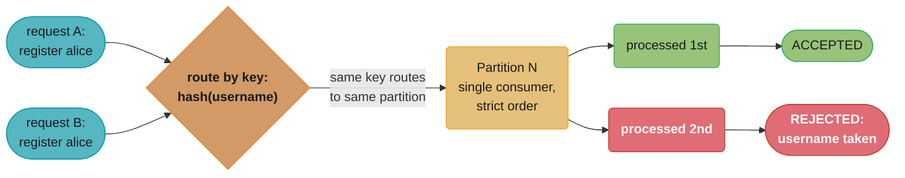
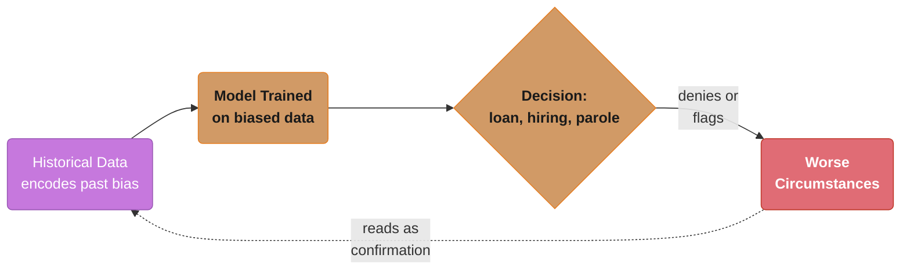
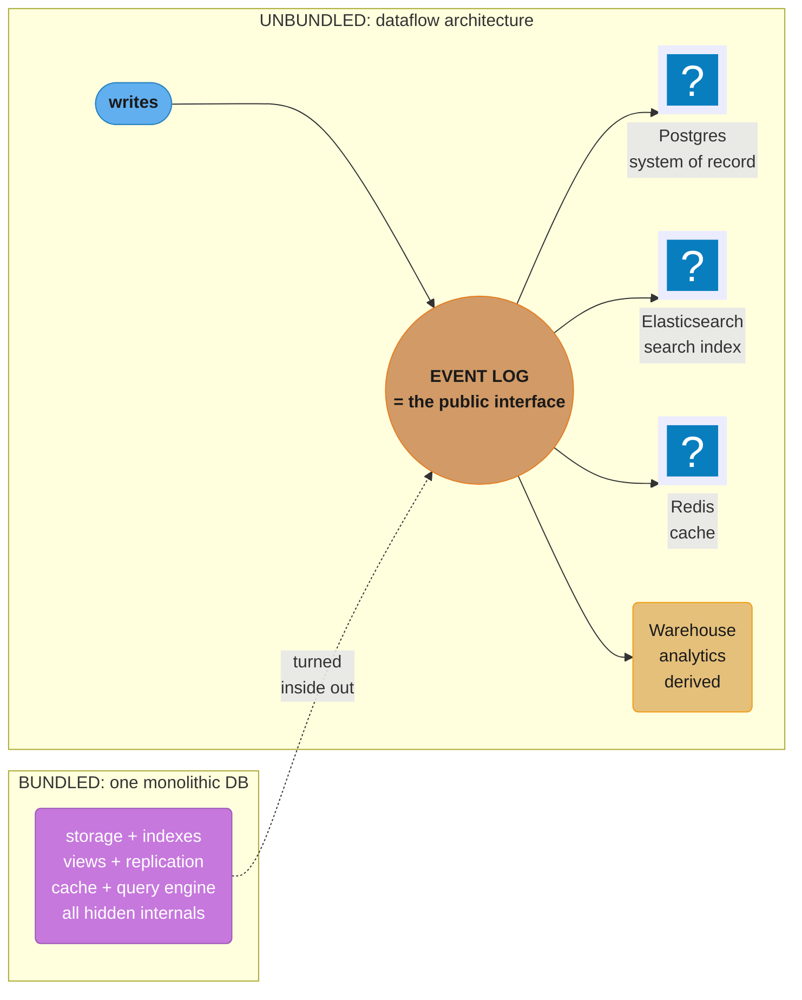
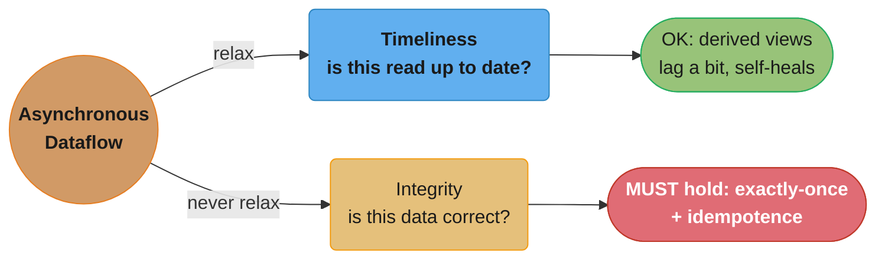

# Chapter 12: The Future of Data Systems

> Part III — Derived Data · DDIA (Kleppmann, 1st ed., O'Reilly 2017) · the synthesis chapter; builds on all of Ch 1–11

## Chapter Map

The closing chapter is Kleppmann's synthesis and opinion piece. Having shown that no single tool
does everything (Ch 1) and that all derived data is a materialized view of an event log (Ch 11), he
argues for a future where applications are built by **composing** specialized systems through
**dataflow**, treats the whole architecture as an **unbundled database**, confronts what
**correctness** actually requires in such systems, and ends — unusually for a technical book — on the
**ethics** of building data systems that increasingly shape people's lives.

**TL;DR:**
- **Data integration:** no tool fits all needs, so combine specialized tools, using **batch and
  stream processing** to keep all the derived datasets in sync from a common event log.
- **Unbundling the database:** compose the pieces a database does internally (storage, indexes,
  materialized views, replication) as separate systems wired together by dataflow — the database
  "turned inside out."
- **Aiming for correctness:** distributed correctness needs the **end-to-end argument** —
  application-level idempotence and integrity checks (exactly-once via dedup, "trust but verify"
  auditing) — not just lower-layer guarantees.
- **Doing the right thing:** with great data power come real harms (biased predictions, surveillance,
  loss of privacy and consent); engineers are responsible for the systems they build.

## The Big Question

> "I've learned all these techniques in isolation. How do they fit together into a coherent
> architecture for the next decade — and what's my responsibility for what that architecture *does*
> to people?"

Analogy: a modern data system is less like a single appliance and more like a city's plumbing — many
specialized pipes and reservoirs (databases, indexes, caches, queues) connected so water (data) flows
reliably to where it's needed. Chapter 12 is the city planner's view: how to lay the pipes
(dataflow), how to think of the whole network as one system (unbundling), how to guarantee the water
is clean (correctness), and the recognition that the plumbing now carries things powerful enough to
help or harm the people downstream (ethics).

---

## 12.1 Data Integration

The recurring reality: for any given problem there are several tools, each good at *some* access
patterns, and most non-trivial applications must **combine** them — a database of record, a search
index for full-text, a cache for hot reads, a warehouse for analytics, maybe a recommendation engine.
The integration challenge is keeping all these copies of (overlapping) data **consistent** as it
changes.

**Combining specialized tools by deriving data.** The answer, built up through Part III, is to pick
one authoritative source (the system of record / event log) and **derive** every other dataset from
it via batch and stream processing. This gives a clear **dataflow**: writes go to the log, and every
derived system (index, cache, warehouse) updates by consuming that log in order. The alternative —
applications doing scattered **dual writes** to each store — is fragile (races, partial failures) and
should be replaced by ordered derivation from a single source.

**Batch and stream processing unified.** Batch (bounded, reprocess everything) and stream (unbounded,
process incrementally) are increasingly two ends of one spectrum, not separate worlds: the same
derivation logic should ideally run both ways. **Stream processing** keeps derived data fresh with low
latency; **batch (re)processing** rebuilds derived datasets from scratch — essential for fixing bugs,
adopting new schemas, or creating brand-new views by replaying the full history. The ability to
**reprocess** existing data is what lets a system *evolve*: you can maintain the old derived view while
gradually building a new one from the same log, then switch over — schema migration without downtime,
at the architecture level. (This is the lambda-architecture idea — run batch and stream in parallel —
which Kleppmann notes is being simplified as engines unify the two.)

### Decoding "reprocess the whole history": the catch-up formula

This chapter is mostly argument rather than arithmetic, but "maintain the old view while building the
new one from the same log, then switch over" hides one calculation that decides whether the migration
is a week or a decade. The new view starts at the beginning of the log while new events keep arriving,
so it is a chase:

```
  catch-up time  =  H / (r - 1)

  H = the history you must replay, measured in units of live time (e.g. "2 years of log")
  r = replay speed as a multiple of the live event rate
```

**What the formula is telling you.** "You only close the gap with the speed you have *left over* after
keeping up with today's traffic — so what matters is not how fast you can replay, but how much faster
than real time."

| Symbol | What it is |
|--------|------------|
| `H` | Length of retained history to replay — the log's retention, in wall-clock terms |
| `r` | Replay throughput ÷ live produce rate. `r = 10` means you chew ten days of log per day |
| `r - 1` | The surplus. One unit is consumed just staying level with incoming events |
| `H / (r - 1)` | Wall-clock time until the new derived view is current and you can cut over |

**Walk one example.** Two years of retained event log, building a brand-new search index from scratch:

```
  H = 730 days

    r =  1   ->  surplus 0    ->  never catches up (moves exactly as fast as time)
    r =  2   ->  surplus 1    ->  730 / 1  =  730 days
    r = 10   ->  surplus 9    ->  730 / 9  =   81 days
    r = 50   ->  surplus 49   ->  730 / 49 =   15 days
```

The shape is the same denominator that governs consumer lag in Chapter 11, and it carries the same
warning: the difference between `r = 2` and `r = 10` is not 5x, it is 730 days versus 81. It is also
the quiet argument for why reprocessing is done with a *batch* engine reading the log's cold storage
rather than a stream processor — batch buys you a large `r` by throwing a thousand machines at a
bounded input (Chapter 10's scan-rate arithmetic), which is exactly what makes "rebuild any derived
view from the log" a practical operation rather than a slogan.

### Reasoning about dataflows

Once you know which writes are the original inputs and which are derived, Kleppmann argues
you can reason about a complex system the way you'd reason about a spreadsheet's formulas:
trace each derived cell back to the cells it depends on. In an application with many caches,
indexes, and materialized views, this means asking, for any piece of data, "what is it
derived from, and by what process?" — rather than treating every store as independently
writable and hoping they stay consistent by convention. The payoff isn't just conceptual
clarity: it's operational. When a derived store goes wrong, ordered dataflow tells you
exactly how to fix it — reprocess it from the source — where dual writes leave you needing
an ad hoc repair, because you can no longer tell which store's account of events is right.

### Derived data vs. distributed transactions

Kleppmann frames these as two competing philosophies for the same underlying problem:
keeping several pieces of derived state consistent with each other. Distributed
transactions (Chapter 9's atomic commit / two-phase commit) decide the order of operations
*synchronously*, using locking and mutual exclusion at commit time — every participant
blocks until everyone agrees before any of them can proceed. Derived-data systems decide
order *asynchronously*, via a log: events are appended once, in a defined order, and every
downstream consumer replays them in that same order at its own pace, with no participant
blocking on another. His stated preference, at scale, is for log-based derivation, because
it sidesteps the availability and performance costs that Chapter 9 showed atomic commit
protocols impose — no participant blocks waiting on a coordinator, and a slow or failed
consumer simply falls behind rather than stalling the whole system. The tradeoff is real:
log-based derivation buys this by relaxing timeliness (a reader of a derived view may
briefly see stale data), while distributed transactions buy strict, immediate consistency
at the cost of coordination overhead and reduced availability under partition.

### The limits of total ordering

A single global total order over every event in a system requires every event to pass
through one place to be sequenced — a single leader, a single partition, a single log.
Kleppmann is explicit that this doesn't scale past what one machine can handle: throughput
is capped by whatever single node assigns the order, no matter how large the rest of the
system's cluster is. As a result, he notes that real large-scale systems typically only
maintain a total order *within a partition*, not globally — a partitioned log orders
messages within one partition but makes no promise about how events from different
partitions interleave, for exactly this reason. Anything that genuinely needs a global
order (Chapter 9's consensus-based total order broadcast) accepts the throughput ceiling
that comes with it; everything else has to make do with partitioned, only-locally-ordered
logs.

### Ordering events to capture causality

Once there's no single global log, capturing *causal* dependencies between events from
different partitions or streams becomes genuinely hard — knowing that event B happened
because of event A, when A and B were appended to different partitions with no shared
clock between them. Kleppmann discusses techniques such as attaching logical timestamps
(in the spirit of Chapter 9's Lamport-clock-style counters) to events, or explicitly
recording "this event depends on that one" markers, so a consumer can reconstruct the
causal order even without a shared physical clock or a single global sequence. He is
candid, though, that this remains only partially solved in practice: most systems either
accept weaker guarantees (process events roughly in arrival order and tolerate the rare
causality violation) or restrict cross-partition causal dependencies to cases the
application can reason about specifically, rather than offering a general-purpose answer.

## 12.2 Unbundling Databases

A database bundles several features internally: durable storage, secondary indexes, materialized
views, replication, caching, a query language. Kleppmann's central architectural vision is to
**unbundle** these — to build a system where those features are provided by *separate*, specialized
components wired together by **dataflow / event logs**, rather than all locked inside one monolithic
database. He calls it turning the **database inside out**: the replication log (usually a hidden
internal detail) becomes the public, primary interface, and indexes/caches/views become explicit,
independently-managed derived systems subscribing to it.

**Composing data storage technologies.** The log-based approach makes the whole architecture analogous
to the internals of a single database, but at the scale of an organization: the **event log is the
"transaction log,"** and each derived store is like a database **index** kept in sync — except they're
separate products (Postgres + Elasticsearch + Redis + a warehouse) chosen for their strengths and
connected by CDC/streams. This is a **federation** of storage technologies that, together, behave like
one coherent database.

**Designing applications around dataflow.** In this model, application code becomes the **derivation
functions** that transform one dataset into another (the map/reduce/stream operators) — the wiring
between systems — while the systems themselves handle storage and serving. Reads and writes are
separated: **writes** append to the log; **reads** are served by whichever derived view is optimized
for that query (echoing event sourcing and CQRS — Command Query Responsibility Segregation, where the
write model and read models are deliberately different).

**Observing derived state.** Even the **read path** can be seen as a dataflow: a materialized view is
write-time precomputation; a query is read-time computation; and there's a spectrum between them
(precompute everything vs compute on demand). Kleppmann extends this to the client: a user's screen is
itself a derived view of server state, and technologies that **push** updates (subscribing to a stream
of changes rather than polling) extend the write-side dataflow all the way to the end user's device,
making the UI a live, continuously-updated view of the log.

### The "meta-database of everything"

Kleppmann's framing scales the composing-technologies idea up to the level of an entire
organization. Zoom out far enough, and all of an organization's specialized data systems —
kept in sync with each other by CDC and event streams — together form one giant,
distributed "database," even though no single product implements it. Its primary keys (a
user ID, an order ID) are used to look values up across systems the way a foreign key looks
up a row inside a single RDBMS, and its consistency is maintained by the log propagating
changes in order, rather than by cross-system transactions. Nobody administers this
meta-database directly — it emerges from the sum of the organization's derivation pipelines
— but Kleppmann argues it is the honest description of what a modern, decomposed data
architecture actually is.

### Making unbundling work

For the meta-database picture to hold together, Kleppmann is specific about what has to be
true. First, derivation has to be order-preserving and log-based, not dual writes —
Section 12.1's argument applies here at the level of an entire architecture, not just one
pair of stores. Second, each component needs to expose enough of its own guarantees (what
ordering it preserves, how far behind it can lag) for the rest of the system to reason
about it, or the organization needs to explicitly track which service owns writes to which
piece of data, so two components never race to be the authoritative source for the same
fact. Skipping either of these reintroduces the exact races and silent divergence that dual
writes cause inside a single application, just at a larger scale and with more teams
involved.

### Unbundled vs. integrated systems

Kleppmann does not present unbundling as a free win. An integrated system — a traditional
RDBMS providing storage, indexing, and transactions inside one product — is easier to
operate for common needs, because it has a single, thoroughly-tested consistency story that
one team's ACID guarantees cover end to end. Unbundling trades that away for flexibility:
each component can be chosen, tuned, and scaled independently for its specific access
pattern, but the burden of orchestrating consistency across components — deciding ordering,
handling partial failures, reasoning about a lagging consumer — moves onto the application
or platform team. He's candid that this is substantially harder to get right in practice
than relying on one vendor's tested transaction manager, and that the payoff
(specialization, independent scaling) has to be worth that cost for a given application.

### What's missing

As of the book's writing, Kleppmann notes the tooling for unbundling is still immature.
There is no single, widely-used "meta-database" system that makes composing derived stores
as easy as a single RDBMS makes composing tables within it — no standard way to declare
"this index derives from that table" the way you'd declare a foreign key, and no
off-the-shelf tool that manages the whole derivation graph, monitors lag across it, or
handles reprocessing uniformly. Organizations that unbundle end up building this
coordination themselves, out of CDC connectors, stream processors, and operational
discipline, rather than getting it from a product.

### Stream processors and services

Kleppmann contrasts two different ways a service can get the data it needs. The
traditional request/response model has a service synchronously call other services over the
network each time it needs something, waiting on the response before it can proceed. The
dataflow model instead has the service subscribe to a stream of the data it depends on and
maintain its own local, continuously-updated copy, computed ahead of time rather than
fetched on demand. He argues the tradeoff is real: the dataflow model gives up some
freshness (the local copy can lag the source) but gains much better fault isolation, since a
downstream outage in the source service no longer blocks the request path, and it avoids the
latency and availability cost of a synchronous cross-service call on every request.

### Multi-partition data processing

Some requests need to combine data spanning multiple partitions — a query that can't be
answered by any single partition alone. Kleppmann discusses routing or joining such a
request through dataflow-style infrastructure rather than handling it inside a single
partition's logic, treating the multi-partition read the way a stream-processing job treats
a multi-stream join. This leads him to a more speculative idea he calls "reads are events
too": since writes are already represented as events flowing through a log, a *read*
request could in principle be represented the same way — as an event that flows through the
same dataflow infrastructure and is answered by whatever state that infrastructure has
accumulated. Framed this way, subscribing to a value and being pushed its updates becomes
symmetric with issuing a one-off, point-in-time read; both are just different ways of
consuming the same underlying stream of state.

## 12.3 Aiming for Correctness

In a loosely-coupled dataflow architecture, you can't rely on a single database's ACID transaction to
guarantee correctness across many systems — so how do you stay correct?

**The end-to-end argument.** A classic systems principle: a guarantee (like exactly-once delivery or
deduplication) is only truly correct if enforced at the **application level**, end to end — lower-layer
mechanisms (TCP retransmission, a database's internal retries) help but cannot fully substitute,
because they don't understand the application's notion of a duplicate or a valid operation. Example:
TCP deduplicates *packets*, but if a user clicks "pay" twice or a request is retried after a timeout,
only an application-level **idempotency key / unique request ID** can recognize and suppress the
*business* duplicate. Correctness must be designed at the boundary where the meaning lives.

### Decoding the end-to-end argument: why lower layers multiply to nothing

The usual mental model of layered reliability is that each layer catches some fraction of the errors,
so the survivors are the product of what each layer misses:

```
  residual errors  =  incoming errors x m_TCP x m_DB x m_app
                      (m = the fraction each layer fails to catch)
```

**In plain terms.** "That product only shrinks if every factor is below one — and for an
application-level duplicate, every lower layer's factor is exactly 1.0, so the whole chain collapses
to whatever the top layer does."

| Symbol | What it is |
|--------|------------|
| incoming errors | Business-level duplicates: the user's second click, the client's retry after a timeout |
| `m_TCP` | Fraction TCP fails to suppress. TCP dedupes *packets*, so for business duplicates this is 1.0 |
| `m_DB` | Same for the database's internal retries — a legitimate second INSERT is not a duplicate to it |
| `m_app` | The idempotency key / unique request ID. The only factor that can be less than 1 |
| residual | What actually reaches the ledger and charges the customer twice |

**Walk one example.** A payments service at 1,000,000 requests/day with a 0.1% client retry rate:

```
  incoming business duplicates = 1,000,000 x 0.001 = 1,000 per day

  with TCP + DB retries but no idempotency key:
     1,000 x 1.0 (TCP) x 1.0 (DB) x 1.0 (app) = 1,000 double charges/day
     at $50 average       ->  $50,000/day wrongly charged
     over one 90-day quarter -> 90,000 double charges,  $4,500,000

  add ONE application-level idempotency key (m_app -> ~0):
     1,000 x 1.0 x 1.0 x ~0  =  ~0 double charges/day
```

Two things are worth noticing. First, the two "reliable" layers contribute literally nothing — this is
the end-to-end argument's actual content, not a caveat to it. Second, no amount of hardening TCP or
the database moves the number, because the *meaning* of "duplicate" does not exist at those layers.
Correctness has to be enforced where the definition lives, and here that is a single unique request ID
generated by the client and checked once at the application boundary.

**Enforcing constraints.** Uniqueness (one username), no-double-spend, and similar constraints are
exactly the consensus-flavored problems of Chapter 9. In a log-based system you can enforce them by
routing all operations on the same constrained value to the **same log partition** and processing them
**in order** by a single consumer — turning a distributed-uniqueness problem into a local, sequential
decision (the first request for a username in the ordered log wins; later ones are rejected). This is
how you get strong constraints without a global distributed transaction.

**Enforcing Uniqueness Without a Distributed Transaction**



Caption: two concurrent requests for the same key hash to the same partition, where a single consumer
processes them strictly in order — turning Chapter 9's distributed-uniqueness problem into a local,
sequential accept/reject decision.

### Operation identifiers

The idempotency key described above is a special case of a more general technique Kleppmann
calls an operation identifier: attaching a unique, client-generated ID to any operation
whose effect must not be repeated, and having the server-side handler check that ID against
previously-processed ones before applying the effect. The identifier has to be generated by
the party that might retry — typically the client — because only the client knows whether a
given attempt is a fresh operation or a retry of one it already sent; a server-generated ID
would just be reissued on every retry and defeat the purpose. This is the same mechanism
whether the "operation" is a payment, a message send, or a write to a derived view, which is
why Kleppmann treats it as a general building block rather than a payments-specific trick.

### Multi-partition request processing

Some operations must atomically affect data that lives on more than one partition — the
canonical example is transferring value between two accounts that happen to be on different
partitions. Kleppmann's answer avoids cross-partition locking, and the coordination cost
that comes with it, by decomposing the request into a sequence of stages, each routed
through its own partitioned log: a "debit requested" event goes to the sender's partition,
is processed there, and emits a follow-on event that the recipient's partition consumes to
apply the credit, with a compensating step if a later stage fails. This resembles what's now
commonly called a saga-style workflow — the operation's atomicity is achieved by a sequence
of locally-atomic, ordered steps communicating via logs, rather than by a single distributed
transaction spanning both partitions at once.

**Timeliness and integrity.** Kleppmann splits "consistency" into two needs that are often conflated:
**timeliness** (a read sees recent data — being *up to date*; staleness here is temporary and
self-correcting) and **integrity** (data is correct and not corrupted/contradictory — no lost or
duplicated updates; violations here are *permanent* and far worse). Dataflow systems often *relax
timeliness* (derived views lag a little) but must *never sacrifice integrity*. The good news:
exactly-once processing on a replayable log, with idempotent operations, preserves integrity even
while timeliness is eventual — so you can build correct systems on asynchronous dataflow.

### Decoding why integrity outranks timeliness: bounded versus accumulating

The reason Kleppmann is willing to trade one and not the other is that the two errors behave
completely differently over time:

```
  timeliness error(t)  <=  replication lag        (bounded, and self-erasing)
  integrity error(t)    =  violation rate x t     (unbounded, and permanent)
```

**What this actually says.** "Staleness is a debt that pays itself off the moment the stream catches
up; a corrupted or lost update is a debt that compounds forever, because nothing in the system is
looking for it."

| Symbol | What it is |
|--------|------------|
| replication lag | How far a derived view trails the log — Chapter 11's consumer lag, in seconds |
| timeliness error | How wrong a read can be. Capped by the lag, and gone once the event arrives |
| violation rate | Lost or duplicated updates per unit time, from a non-idempotent write path |
| `x t` | The term that makes integrity different — nothing removes past violations |
| integrity error | Total permanent corruption accumulated since the bug shipped |

**Walk one example.** A derived view running 2 seconds behind, next to a write path that silently
double-applies 1,000 updates per day:

```
                        after 1 day     after 90 days     self-corrects?
  timeliness error       <= 2 s            <= 2 s              yes
  integrity error         1,000           90,000              no

  the staleness is identical on day 90; the corruption is 90x worse
  and every one of those 90,000 records is still wrong today.
```

That flat row versus that climbing row is the whole design rule. It is also why "trust, but verify"
is the paragraph that follows: since integrity violations never announce themselves and never decay,
the only defence is to keep recomputing derived views from the immutable log and comparing — turning
a silent, accumulating error into a detected one.

**Trust, but verify.** Don't blindly trust that storage and transmission are perfect — disks corrupt
data silently, software has bugs, "durable" isn't absolute. Build systems that **audit** themselves:
continuously check integrity (checksums, reconciling derived views against the source by reprocessing,
end-to-end verification) so corruption is *detected* rather than silently propagated. An immutable
event log makes this auditing natural — you can always recompute a derived view and compare.

### Designing for auditability

Kleppmann connects auditability directly back to the immutable, append-only, event-sourced
data models discussed earlier in the book (Ch 11). Because every change is recorded as an
event and nothing is overwritten, you can always recompute any derived state from scratch by
replaying the log, and compare the result against what's currently being served — turning
"is this data still correct?" into a checkable question rather than an assumption. It also
gives you a trace: for any piece of derived state, you can walk back through exactly which
sequence of events produced it, which matters both for debugging silent corruption and for
explaining a decision after the fact.

### Tools for auditable data systems

Kleppmann notes this was still a nascent area of tooling as of the book's writing.
Cryptographic auditing techniques (append-only, tamper-evident logs) existed for narrow use
cases but weren't yet widely applied to general application data, and there was no standard,
off-the-shelf tooling for continuously checking a derived view against its source event log
at scale — organizations that wanted this built it themselves, the same gap he describes for
unbundling tooling generally in Section 12.2.

### Correctness of dataflow systems: loosely interpreted constraints

Not every business "constraint" needs the strict, real-time atomicity that a database's ACID
transaction provides, and Kleppmann argues many don't: an account balance that dips briefly
negative before a correcting transaction lands is often perfectly acceptable, provided the
system detects it quickly and compensates — the temporary violation causes no real harm if
it's corrected before anyone acts on the wrong number. This is different in kind from a
genuine integrity violation, like money appearing from nowhere or a payment being both
applied and lost, which is never acceptable no matter how quickly it's noticed. Recognizing
which of a system's "constraints" are really this loosely-interpretable kind — tolerable if
corrected — versus which are true integrity requirements is, in his view, what lets an
architecture relax synchronous coordination without becoming unsafe.

### Coordination-avoiding data systems

Kleppmann's broader claim is that a system can provide strong integrity guarantees —
exactly-once processing, no lost or duplicated data — while relaxing timeliness, and that
doing so removes the need for synchronous cross-node coordination on the common path.
Decoupling integrity from immediacy is, in his framing, what makes highly available,
loosely-coupled, asynchronous dataflow architectures viable at all: if strong integrity
required strong timeliness, every operation would need the kind of synchronous agreement
Chapter 9 shows is expensive and availability-limiting. Because integrity and timeliness are
separable, a coordination-avoiding system can stay available and fast on the common path
while still guaranteeing, eventually and asynchronously, that nothing is lost or corrupted.

### The end-to-end argument, in general

Beyond exactly-once semantics, Kleppmann applies the same end-to-end reasoning to integrity
checks like checksums. TCP's checksum catches corruption introduced on the wire, but it says
nothing about corruption introduced above the transport layer — a bug in application code, a
bad disk sector, a faulty memory chip — so relying on TCP's checksum alone as "the" integrity
check is a category error: it protects one specific layer, not the application's actual
end-to-end guarantee. His conclusion generalizes past any one mechanism: whatever
correctness property the application actually needs — no duplicate charge, no corrupted
record, no lost update — has to be checked at the application's own boundary in addition to
whatever lower-layer protocols provide, because a lower layer can only catch the failures
that occur within its own layer.

## 12.4 Doing the Right Thing

The book closes on **ethics**, arguing engineers are responsible for the consequences of the systems
they build, not just their technical correctness.

- **Predictive analytics and bias.** Algorithms increasingly make consequential decisions (credit,
  insurance, hiring, policing, parole). They can **encode and amplify existing bias** — a model trained
  on biased historical data perpetuates that discrimination at scale and with a false veneer of
  objectivity, creating self-reinforcing feedback loops (deny a loan → worse circumstances → "confirms"
  the model). "The algorithm decided" is not an absolution of responsibility.
- **Privacy, surveillance, and consent.** Mass data collection is **surveillance**, even when framed as
  "personalization" or "improving the service." Users rarely give meaningful informed **consent**
  (terms-of-service no one reads; data used for purposes never disclosed; data sold or breached). The
  data being collected is about *people*, and treating it as a neutral resource ("data is the new oil")
  ignores the power asymmetry and the harm of breaches and misuse.
- **Accountability and a call to responsibility.** Data has inertia — once collected, it persists, gets
  combined, and is repurposed beyond the original intent. Kleppmann urges engineers to practice **data
  minimization** (collect only what's needed), be honest about what's collected and why, build in
  deletion and security, and take ethical responsibility rather than hiding behind "we just build the
  tools." Just because something *can* be built doesn't mean it *should* be.

### Responsibility and accountability

Kleppmann raises, explicitly as an open question, who is accountable when an automated
decision causes harm and no single person made that specific decision — the model did,
trained on data nobody individually chose to encode as biased, deployed by a team that
didn't write the specific rule that hurt someone. He argues this diffusion of responsibility
is itself a problem: it's easier for an organization to say "the algorithm decided" than to
own a decision a human made explicitly, even though the model's behavior is still a
consequence of choices — what data to train on, what objective to optimize, what to deploy —
that people did make. His position is that this diffusion doesn't dissolve responsibility, it
just makes it easier to evade, and that the engineers who build these systems share in it.

### Feedback loops

Beyond a model simply reproducing bias present in its training data, Kleppmann describes how
a model's own predictions can feed back into the data used to retrain it, amplifying the
original bias over successive cycles. His example is predictive policing: a model that
predicts more crime in a given neighborhood sends more patrols there; more patrols record
more arrests in that neighborhood, independent of whether the underlying crime rate is
actually higher than elsewhere; those additional recorded arrests become training data that
"confirms" the model's original prediction, further increasing predicted risk for that
neighborhood next cycle. The loop is self-reinforcing and hard to detect from inside the
system, because at every step the model's output looks like it's being validated by the
data — when the data is partly an artifact of the model's own prior output.

### Data as assets and power

Kleppmann observes that personal data has become a valuable commercial asset — "data is the
new oil" is the phrase he's skeptical of — and a source of organizational power for whoever
holds it, which creates a structural incentive to collect more than any specific product
feature actually requires. Because collecting data is cheap relative to its potential future
value, and because there's rarely a countervailing cost charged to the collector for
over-collecting, the incentive gradient points toward hoarding by default rather than
minimization — which is precisely what motivates his call for deliberate data minimization
as a practice, rather than expecting it to emerge naturally from market incentives.

### Remembering the industrial revolution

Kleppmann draws an explicit historical analogy: industrial pollution was, for decades, an
externalized cost — harm borne by the public and the environment while the polluting
companies captured the benefit — and it took a long time for society to develop the
regulatory response that internalized that cost. He argues data collection's harms are being
externalized in a structurally similar way today: the organization collecting data captures
the value, while the risks — breach, misuse, loss of privacy, algorithmic harm — fall on the
individuals the data is about, who had little say in the collection. His point in raising the
analogy is not that the two harms are identical, but that recognizing and regulating this
kind of externality historically took decades, and he expects, or at least worries, the same
lag applies here.

### Legislation and self-regulation

Kleppmann's closing argument is that voluntary self-regulation by the companies collecting
data is not sufficient on its own, and that legislation has a necessary role to play — the
same conclusion the industrial-pollution analogy points toward, since voluntary restraint
didn't resolve that externality either. He's candid, though, that as of the book's writing
this remains an open societal question he does not claim to fully resolve: what specific
legislation, enforced how, is left unanswered, and he frames the chapter's ending as a call
for engineers to take the question seriously and act on data minimization and transparency
themselves, rather than as a policy prescription.

**The Bias Feedback Loop**



Caption: a model trained on biased historical data denies or flags people, whose resulting worse
circumstances then look like confirmation the model was right — a self-reinforcing loop that entrenches
discrimination under a veneer of objectivity.

---

## Visual Intuition

**The Database, Turned Inside Out**



**Timeliness vs. Integrity**



Caption: the architectural thesis (the database inside out) and the correctness rule (eventual
timeliness is fine; broken integrity is not) — the two ideas that tie all of Part III together.

---

## Key Concepts Glossary

- **Data integration** — keeping multiple specialized stores consistent as data changes.
- **Derivation / derived dataset** — computing one dataset from an authoritative source.
- **Dataflow** — wiring systems together so changes propagate from a source log to derived stores.
- **Dual writes** — application writing to several stores directly (fragile; to be avoided).
- **Reprocessing** — rebuilding a derived dataset from the full history (enables schema evolution).
- **Lambda architecture** — running batch and stream paths in parallel (being unified away).
- **Unbundling the database** — providing a database's features as separate composed systems.
- **Database inside out** — making the (normally hidden) log the primary public interface.
- **Federation** — combining heterogeneous storage technologies to behave as one system.
- **Derivation function** — application code transforming one dataset into another.
- **CQRS (Command Query Responsibility Segregation)** — separate write model and read models.
- **Materialized view vs query** — write-time vs read-time computation (a spectrum).
- **End-to-end argument** — correctness guarantees must be enforced at the application level.
- **Idempotency key / unique request ID** — application-level dedup of business operations.
- **Constraint enforcement via ordered log** — route to one partition + process in order.
- **Timeliness** — being up to date (temporary, self-correcting if violated).
- **Integrity** — being correct/uncorrupted (permanent damage if violated; must be preserved).
- **Trust but verify / auditing** — continuously check integrity rather than assume perfection.
- **Predictive analytics bias** — models encoding and amplifying historical discrimination.
- **Surveillance / consent / data minimization** — the ethics of collecting data about people.
- **Total order (global vs. partitioned)** — a single global order needs one sequencing point and
  doesn't scale; real systems typically order only within a partition.
- **Causal ordering** — capturing "this event depends on that one" across partitions via logical
  timestamps or explicit markers; only partially solved for cross-partition streams.
- **Meta-database of everything** — an organization's federated derived stores, kept in sync by logs,
  behaving together as one giant database with no single implementing product.
- **Operation identifier** — a unique, client-generated ID attached to an operation so a retried
  delivery doesn't produce a retried effect (the general form of an idempotency key).
- **Multi-partition request processing** — decomposing an operation spanning several partitions into
  ordered stages routed through per-partition logs, instead of cross-partition locking.
- **Loosely interpreted constraint** — a business rule (e.g. a balance briefly negative) that tolerates
  temporary violation if corrected quickly, distinct from a true integrity violation.
- **Coordination-avoiding data system** — one that preserves integrity while relaxing timeliness, so it
  needs no synchronous cross-node coordination on the common path.
- **Feedback loop (predictive models)** — a model's own predictions shaping the future data it is
  retrained on, amplifying its original bias over successive cycles.

---

## Tradeoffs & Decision Tables

| | Bundled (monolithic DB) | Unbundled (dataflow) |
|---|---|---|
| Features | All inside one system | Composed specialized systems |
| Source of truth | The database | The event log |
| Flexibility | Limited to one tool's strengths | Best tool per access pattern |
| Complexity | Lower (one system) | Higher (integration, ordering) |
| Evolvability | Schema migrations | Reprocess log into new views |

| | Timeliness | Integrity |
|---|---|---|
| Question | Up to date? | Correct / uncorrupted? |
| Violation | Temporary staleness | Permanent corruption |
| In async dataflow | Acceptable to relax | Must always preserve |

| Correctness need | Lower-layer help | Required end-to-end mechanism |
|------------------|------------------|------------------------------|
| No duplicate operation | TCP dedups packets | Idempotency key / request ID |
| Uniqueness constraint | — | Ordered single-partition processing |
| Detect corruption | Disk/network checksums | Application auditing / reprocessing |

| | Distributed transaction (2PC) | Derived data (log-based) |
|---|---|---|
| Ordering decided | Synchronously, by locking at commit time | Asynchronously, by the log's append order |
| Availability under partition | Degrades — participants block on the coordinator | Preserved — a lagging consumer just falls behind |
| Kleppmann's stated preference | Only where global synchronous agreement is unavoidable | At scale, generally preferred |

---

## Common Pitfalls / War Stories

- **Dual writes instead of derivation.** Application code writing the same change to the database and
  the search index (and the cache, and the warehouse) drifts into permanent inconsistency under races
  and partial failures. Derive every secondary store from one ordered log (CDC/streams) instead.
- **Relying on lower layers for application-level correctness.** Assuming TCP, or a database's internal
  retries, gives you exactly-once *business* semantics — then a retried "pay" request double-charges
  because no layer below the application understands what a duplicate *payment* is. Add idempotency keys
  at the application boundary.
- **Conflating timeliness and integrity.** Teams panic over slightly stale derived views (a timeliness
  issue that self-heals) while under-investing in integrity (lost/duplicated updates that corrupt data
  permanently). Relax timeliness deliberately; never compromise integrity.
- **Trusting "durable" storage blindly.** Disks bit-rot, "fsync" lies on some hardware, replication can
  propagate corruption. Without auditing, silent corruption spreads to every derived view. Build
  continuous integrity checks and use the immutable log to recompute-and-compare.
- **Inability to reprocess.** If your architecture can't rebuild derived data from history (non-
  replayable broker, no retained log), you can't fix a processing bug retroactively or migrate to a new
  schema without a painful, error-prone ad-hoc backfill. Retain the log; design for reprocessing.
- **Ethical abdication.** Shipping a biased predictive model or an over-collecting data pipeline and
  rationalizing "the algorithm decided" or "we just build the tools." Kleppmann's explicit warning:
  engineers bear responsibility; practice data minimization, transparency, and consent.
- **Maintaining a lambda architecture's two codepaths by hand.** Running the same derivation logic in a
  separate batch framework and a separate stream framework, then discovering their outputs disagree at
  the merge boundary, is exactly the operational burden Kleppmann criticizes it for. Prefer a dataflow
  engine that treats batch as a bounded special case of streaming so one codebase covers both.
- **Unbundling without tracked ownership.** Composing several specialized stores without either exposing
  each one's ordering/lag guarantees or explicitly assigning which service owns writes to which data
  reintroduces dual-write-style races, just distributed across more teams and harder to trace.

---

## Real-World Systems Referenced

Apache Kafka (the unifying log), CDC tooling (Debezium, Kafka Connect), Apache Samza/Kafka Streams/
Flink (dataflow derivation), Elasticsearch/Postgres/Redis/data warehouses (federated specialized
stores), the lambda architecture (Storm + Hadoop), CQRS/event-sourcing frameworks, Datomic
(read-as-of, immutable history); the broader discussion cites predictive-analytics, credit-scoring,
and surveillance systems as cautionary cases rather than products to emulate.

---

## Summary

The final chapter synthesizes the whole book into an architectural vision and an ethical charge.
Because **no single tool fits every need**, applications must integrate specialized systems — and the
clean way is to designate one authoritative **event log** and **derive** every other dataset (search
index, cache, warehouse) from it via **batch and stream processing**, replacing fragile dual writes;
the ability to **reprocess** history is what lets the architecture evolve and adopt new schemas.
Kleppmann frames this as **unbundling the database** — turning it "inside out" so the replication log
becomes the public interface and indexes/views/caches become explicit, independently-managed derived
systems, with application code acting as the **derivation functions** wiring them together and reads
served by whichever view fits the query (CQRS). Correctness in such loosely-coupled systems comes from
the **end-to-end argument** (enforce idempotence and constraints at the application level, e.g. via
unique request IDs and ordered single-partition processing), from distinguishing **timeliness**
(relaxable, self-healing) from **integrity** (must always be preserved), and from **auditing** ("trust
but verify") rather than assuming storage is perfect. Finally, Kleppmann insists engineers are
**ethically responsible** for what their systems do — confronting algorithmic bias, surveillance, and
the erosion of privacy and consent — because just because a system *can* be built does not mean it
*should* be.

---

## Interview Questions

**Q: What does "unbundling the database" mean?**
**Short:** Kleppmann argues the database should be unbundled — the replication log becomes the public interface.
It means taking the features a database normally provides internally — durable storage, secondary indexes, materialized views, replication, caching — and providing them as *separate*, specialized systems wired together by dataflow (event logs / change streams), instead of locking them inside one monolithic database. Kleppmann calls it turning the database "inside out": the replication log, normally a hidden implementation detail, becomes the primary public interface, and each index, cache, or view becomes an explicit derived system that subscribes to that log and is kept in sync — a federation of best-of-breed tools behaving together like one coherent database.

**Q: Why does the book advocate deriving data from a single log instead of dual writes?**
**Short:** Kleppmann argues single-log derivation avoids the races and partial failures that dual writes cause.
Because keeping multiple stores (database, search index, cache, warehouse) consistent by having the application write to each one directly is fragile: the writes aren't atomic, so they can race (applied in different orders to different stores) or partially fail (one succeeds, another doesn't), causing permanent, hard-to-detect divergence. Deriving from a single authoritative log means all changes flow through one ordered stream, and every derived store applies the same changes in the same order, so they converge — and any derived store can be rebuilt from the log if it gets out of sync.

**Q: What is the end-to-end argument, and how does it apply to exactly-once processing?**
The end-to-end argument states that a correctness guarantee is only truly achieved if it's enforced at the application level, end to end, because lower layers don't understand the application's semantics. Applied to exactly-once: TCP can deduplicate *packets* and a database can retry internally, but neither knows what a duplicate *business operation* is — so a user double-clicking "pay" or a client retrying after a timeout will double-charge unless the application itself recognizes the duplicate via an idempotency key or unique request ID. Real exactly-once must be designed at the boundary where the operation's meaning lives.

**Q: Distinguish timeliness from integrity, and explain which one asynchronous dataflow may relax.**
Timeliness is whether a read reflects recent writes — being up to date; if violated, the staleness is temporary and self-corrects as derived views catch up. Integrity is whether the data is correct and uncorrupted — no lost or duplicated updates, no contradictions; if violated, the damage is permanent and far more serious. Asynchronous dataflow architectures routinely *relax timeliness* (derived views lag slightly behind the source) but must *never* relax integrity. The encouraging result is that exactly-once processing on a replayable log with idempotent operations preserves integrity even while timeliness is only eventual.

**Q: How can you enforce a uniqueness constraint in a log-based dataflow system without a distributed transaction?**
By routing all operations that touch the same constrained value to the *same* log partition and having a single consumer process that partition's events *in order*. This converts a distributed agreement problem into a local, sequential decision: the consumer sees requests for a given username one at a time in a defined order, grants the first, and rejects every later one — achieving the consensus-like guarantee of uniqueness without a global distributed transaction. It works because ordering within a partition plus single-threaded processing gives a total order over all decisions about that value.

**Q: Why does the book end on ethics, and what is its central argument there?**
Because data systems increasingly make or inform consequential decisions about people — credit, insurance, hiring, policing — so their design has real human impact beyond technical correctness. The central argument is that engineers are responsible for the consequences of what they build: predictive models can encode and amplify historical bias under a false veneer of objectivity; mass data collection is surveillance that users rarely meaningfully consent to; and "the algorithm decided" or "we just build the tools" is not an absolution. Kleppmann urges data minimization, transparency, consent, and the recognition that something being buildable doesn't make it ethical to build.

**Q: How do batch and stream processing relate in the book's vision of data integration?**
**Short:** Kleppmann treats batch and stream as one spectrum, unified by their shared ability to reprocess history.
They're presented as two ends of one spectrum rather than separate worlds: stream processing keeps derived data fresh with low latency by handling events incrementally, while batch processing rebuilds derived datasets from the full history. Ideally the same derivation logic runs both ways. The crucial shared capability is *reprocessing* — replaying historical data — which lets you fix a bug, adopt a new schema, or build an entirely new derived view by reprocessing the log, all while keeping the old view running until you switch over. This is what makes the architecture evolvable (and simplifies the older lambda architecture as engines unify the two paths).

**Q: What is CQRS, and how does it fit the unbundling vision?**
**Short:** CQRS separates writes to a log from reads served by derived views — unbundling's split, at application scale.
CQRS (Command Query Responsibility Segregation) separates the write model from the read model: writes (commands) are handled one way — appended to an event log — while reads (queries) are served by separate, possibly multiple, read-optimized views derived from that log. It fits unbundling perfectly because the unbundled architecture *is* this separation at scale: writes append to the log, and any number of derived stores (a relational view, a search index, a cache) materialize the read side, each optimized for its query pattern. It frees the read and write sides to use entirely different data models and storage technologies.

**Q: What does "trust, but verify" mean for data systems, and why is auditing important?**
**Short:** Kleppmann argues systems should continuously audit themselves rather than assume storage is perfect.
It means you should not blindly assume that storage and transmission are perfect — disks silently corrupt data, "durable" writes can be lost on some hardware, and software has bugs — so systems should continuously check their own integrity rather than trust the lower layers. Auditing (checksums, reconciling derived views against the source by reprocessing, end-to-end verification) ensures corruption is *detected* instead of silently propagating into every derived dataset. An immutable, replayable event log makes auditing natural: you can always recompute a derived view from the log and compare it against the live one to catch drift or corruption.

**Q: How can algorithmic decision-making encode and amplify bias?**
**Short:** Kleppmann warns models trained on biased data reproduce and entrench that bias via feedback loops.
A model trained on historical data learns the patterns in that data, including the discriminatory ones — so if past lending, hiring, or policing decisions were biased, the model reproduces that bias at scale while appearing objective and data-driven. Worse, it can create self-reinforcing feedback loops: denying someone a loan worsens their circumstances, which the model then reads as "confirmation" it was right, entrenching the discrimination. The veneer of mathematical neutrality makes the bias harder to challenge than an obviously prejudiced human decision, which is why Kleppmann insists "the algorithm decided" doesn't remove human responsibility.

**Q: Why does the book treat the user's screen as part of the dataflow?**
**Short:** Kleppmann treats the screen as a derived view, extending push-based dataflow to the end user's device.
Because a user interface displays a view of server-side state, which makes it just another *derived* view in the same sense as a cache or a materialized view — and the spectrum from precomputed materialized views to on-demand queries extends all the way to the client. Technologies that *push* changes to the device (subscribing to a stream of updates rather than polling) extend the write-side dataflow end to end, so the screen becomes a live, continuously-updated materialization of the event log. This reframes "real-time UI" as the natural endpoint of the same derivation pipeline that keeps indexes and caches fresh.

**Q: What role does reprocessing play in evolving a system's schema or derived views?**
**Short:** Kleppmann recommends reprocessing the log into a new view rather than migrating data in place.
Reprocessing — replaying the full event-log history through new derivation logic — lets you build a new derived dataset (a differently-structured index, a new materialized view, a migrated schema) from scratch while the existing view keeps serving traffic. Once the new view is fully built and validated, you switch reads over to it and retire the old one, achieving a schema migration with no downtime and no risky in-place mutation. This is only possible if the log is retained and replayable, which is why the book emphasizes durable, replayable logs as the foundation of an evolvable architecture.

**Q: What is data minimization, and why does the book recommend it?**
**Short:** Kleppmann recommends collecting only data that's genuinely needed, since stored data is a lasting liability.
Data minimization is the practice of collecting and retaining only the data actually needed for a clear purpose, rather than hoarding everything "in case it's useful later." The book recommends it because data has inertia — once collected it persists, gets combined with other datasets, and is repurposed far beyond the original intent, while every stored record is a liability that can be breached, misused, or turned into surveillance. Minimizing collection reduces the potential for harm, limits the blast radius of breaches, and respects that the data is about real people who didn't consent to open-ended use.

**Q: How is an unbundled architecture analogous to the internals of a single database?**
In a single database, a write goes to the transaction/replication log, and internal indexes and materialized views are kept in sync with that log automatically. The unbundled architecture does exactly this but at organizational scale and with separate products: the **event log** plays the role of the transaction log, and each external derived store (Elasticsearch as a "secondary index," Redis as a "cache," a warehouse as an "analytical view") is kept in sync by consuming the log via CDC/streams. So the whole heterogeneous system behaves like one big database whose components you assembled from the best tool for each job.

**Q: Why is the ability to relax timeliness while preserving integrity such a powerful result?**
**Short:** Kleppmann argues relaxing timeliness while preserving integrity enables scalable, correct async systems.
Because it means you can build correct systems on top of asynchronous, loosely-coupled dataflow — which is far more scalable, available, and partition-tolerant than synchronous distributed transactions — without giving up the guarantee that actually matters most. Strong, synchronous coordination (linearizability, distributed transactions) is expensive and fragile, but most applications can tolerate derived views being a little behind (relaxed timeliness) as long as no data is ever lost, duplicated, or corrupted (preserved integrity). Exactly-once processing with idempotence on a replayable log delivers exactly that combination, so you get scalability and correctness together.

**Q: What does Kleppmann criticize about the lambda architecture?**
**Short:** Kleppmann argues the lambda architecture forces maintaining the same logic twice, in two different frameworks.
He criticizes it for running the same computation twice — once in a batch layer for accuracy and once in a stream/speed layer for low latency — which means maintaining equivalent processing logic in two different frameworks with different APIs, bug surfaces, and performance characteristics. Beyond the operational burden, merging the batch and stream outputs correctly is itself hard to get right, since edge cases at the boundary between "already covered by a batch run" and "only in the speed layer" are easy to get wrong. He favors newer approaches that treat batch as a bounded special case of streaming, so one codebase and one set of semantics can serve both needs.

**Q: What does Kleppmann mean by the "meta-database of everything"?**
**Short:** Kleppmann frames an organization's federated derived stores as one giant database kept in sync by logs, not transactions.
He means that, zoomed out far enough, all of an organization's specialized data systems — kept in sync with each other by CDC and event streams — together form one giant, distributed "database," even though no single product implements it. Its primary keys are used to look values up across systems the way a foreign key looks up a row inside a single RDBMS, and its consistency comes from the log propagating changes in order, rather than from cross-system transactions. Nobody administers this meta-database directly; it emerges from the sum of the organization's derivation pipelines, which is why Kleppmann calls it the honest description of what a decomposed data architecture actually is.

**Q: Why does the book say a single global total order of events doesn't scale, and what do real systems do instead?**
**Short:** Kleppmann notes a global total order requires all events to pass through one place, so real systems order only within a partition.
A single global total order requires every event to pass through one place to be sequenced, and throughput is then capped by whatever single node assigns that order, no matter how large the rest of the cluster is. As a result, real large-scale systems typically only maintain a total order within a partition, not globally — a partitioned log guarantees order for events in the same partition but makes no promise about how events from different partitions interleave. Anything that genuinely needs a global order accepts the throughput ceiling that comes with it; everything else works with partitioned, only-locally-ordered logs instead.

**Q: How does the book suggest handling a request that must atomically affect data on more than one partition, without cross-partition locking?**
**Short:** Kleppmann describes decomposing the request into stages routed through partitioned logs, saga-style, instead of locking.
It decomposes the request into a sequence of stages, each routed through its own partitioned log — for a transfer between accounts on different partitions, a "debit requested" event goes to the sender's partition and is processed there, then emits a follow-on event that the recipient's partition consumes to apply the credit, with a compensating step if a later stage fails. This achieves the operation's atomicity through a sequence of locally-atomic, ordered steps communicating via logs, rather than through a single distributed transaction spanning both partitions at once. It avoids cross-partition locking and the coordination cost that comes with it.

**Q: Why does the book argue that not every business "constraint" needs strict, real-time atomic enforcement?**
**Short:** Kleppmann argues many constraints tolerate brief violation, like a balance dipping negative before correction.
Kleppmann argues many constraints don't need the strict, real-time atomicity a database's ACID transaction provides: an account balance that dips briefly negative before a correcting transaction lands is often perfectly acceptable, provided the system detects it quickly and compensates, because the temporary violation causes no real harm if corrected before anyone acts on the wrong number. This is different in kind from a genuine integrity violation, like money appearing from nowhere or a payment being both applied and lost, which is never acceptable no matter how quickly it's noticed. Recognizing which constraints are loosely-interpretable this way, versus which are true integrity requirements, is what lets an architecture relax synchronous coordination without becoming unsafe.

---

## Cross-links in this repo

- [book/.../11_stream_processing/ — the event log, CDC, and event sourcing this chapter builds on](../11_stream_processing/11_stream_processing.md)
- [database/distributed_transactions/ — outbox, idempotency, sagas (end-to-end correctness in practice)](../../../database/distributed_transactions/distributed_transactions.md)
- [hld/ — composing systems and CQRS/event-sourcing in the interview framework](../../../hld/README.md)
- [llm/ — modern derived-data and retrieval systems built on these foundations](../../../llm/README.md)

## Further Reading

- Kleppmann, DDIA Ch 12 — original text and references.
- Saltzer, Reed & Clark, "End-to-End Arguments in System Design," 1984 — the correctness principle.
- Kreps, "Questioning the Lambda Architecture," 2014 — unifying batch and stream.
- Cathy O'Neil, *Weapons of Math Destruction*, 2016 — algorithmic bias and accountability.
