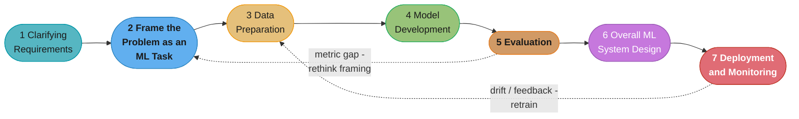
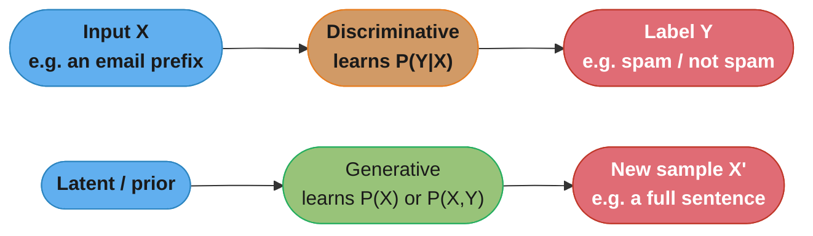

# Chapter 1: Introduction and Overview

> Ch 1 of 11 · Generative AI System Design Interview (Aminian & Sheng, ByteByteGo, 2024) · opens the book, defines the 7-step framework every later chapter (Ch 2-11) instantiates

## Chapter Map

Before any worked design, the authors ground two things: what makes generative AI different
from the discriminative ML most system-design interview prep already covers, and the
**7-step framework** that turns a one-line GenAI prompt ("design Gmail Smart Compose")
into an ordered 45-minute conversation. The chapter opens with a compact tour of why GenAI
became practical when it did — data, model capacity, and compute, tied together by the
scaling laws — then closes with the framework that every one of the book's ten worked
chapters reuses verbatim as its section skeleton.

**TL;DR:**
- **Discriminative models learn P(Y|X)** (classify or predict a label given input);
  **generative models learn P(X) or P(X,Y)** (produce new instances of X). GenAI is the
  application of the second family — VAEs, GANs, diffusion models, and autoregressive
  transformers — at a scale that makes the output pass for human-made text, images,
  audio, or video.
- GenAI became powerful because three curves moved together: **data** (self-supervised
  pretraining on unlabeled internet-scale corpora removes the labeling bottleneck),
  **model capacity** (parameter count and FLOP count both climbed by orders of magnitude),
  and **compute** (specialized accelerators plus distributed training made billion- and
  trillion-parameter runs tractable). The **scaling laws** describe how loss falls
  predictably as you spend more of all three.
- The **7-step framework** — Clarifying Requirements, Framing the Problem as an ML Task,
  Data Preparation, Model Development, Evaluation, Overall ML System Design, Deployment
  and Monitoring — is a checklist and a talking order, not a rigid pipeline; you loop back
  constantly, especially between Evaluation and Framing.
- GenAI carries risks a purely discriminative system doesn't: **hallucination**,
  **misuse** (deepfakes, phishing, misinformation), **bias** baked into internet-scale
  training data, and a genuinely large **environmental cost** to train the largest models.
  Naming these unprompted is expected of a senior candidate.

## The Big Question

> "The interviewer says 'design a system like ChatGPT' or 'design an image generator.' The
> model itself — a transformer, a diffusion model — is only one component. What is the
> repeatable structure that lets me reason about *any* generative system, from a training
> corpus that doesn't exist yet down to the latency budget for a single user's request?"

Analogy: if a discriminative-ML interview is "diagnose the patient" (here is labeled data,
predict the label), a GenAI interview is "teach the patient to compose novel, coherent
sentences of their own" — the model isn't matching an answer key, it is producing new
content that has to be *judged*, not merely scored, which is why the book's Evaluation step
carries far more weight here than in a classification interview. The 7-step framework is
the fixed checklist that keeps that harder judgment call from turning into an unstructured
ramble.

---

## 1.1 GenAI Overview

Before the framework, the chapter grounds the vocabulary the rest of the book assumes.

### AI, ML, and the discriminative/generative split

**Artificial intelligence (AI)** is a branch of computer science focused on building
systems that perform tasks normally requiring human intelligence — reasoning, planning,
problem-solving. **Machine learning (ML)** is the subset of AI that learns from data via
algorithms rather than encoding rules by hand. Within ML, models split into two families
by what they learn:

- **Discriminative models** learn the conditional probability **P(Y|X)** — given an input,
  predict a label or a value. Logistic regression, SVMs, decision trees, k-nearest
  neighbors, and most "classic" supervised neural networks are discriminative; their job is
  to draw a boundary between classes or fit a regression surface.
- **Generative models** learn the (joint or marginal) probability distribution **P(X)** or
  **P(X, Y)** — the shape of the data itself — so they can *sample* new instances from it.
  Classical generative models include Naive Bayes, Gaussian mixture models (GMMs), hidden
  Markov models (HMMs), and Boltzmann machines. The modern generation the book is about —
  **variational autoencoders (VAEs)**, **generative adversarial networks (GANs)**,
  **diffusion models**, and **autoregressive transformers** — model that same distribution
  at a scale and fidelity that makes the samples usable as a product: an email
  continuation, a translated sentence, a caption, an image, a video.

### Why GenAI is becoming so powerful

Three factors moved together and each is worth naming explicitly in an interview, because
each maps onto a concrete design lever later in the framework.

**Data.** Self-supervised learning is the unlock — it trains directly on unlabeled text,
image, audio, and video pulled from the internet, sidestepping the cost of hand-labeling
that gated earlier supervised approaches. The scale involved is now enormous: Meta's Llama
3 was trained on roughly **15 trillion tokens** (about 50 terabytes of text), and Google's
Flamingo was trained on roughly **1.8 billion image-text pairs**. A dataset that size could
never be hand-labeled; self-supervision is what makes using it possible at all.

**Model capacity.** Capacity is measured two ways: **parameter count** and **FLOP count**
(floating-point operations, a proxy for computational complexity). Parameter counts across
well-known models: Google's PaLM at 540 billion, GPT-3 at 175 billion, Flamingo at 80
billion, Llama 3 at 405 billion, and the (much smaller, image-focused) Imagen at roughly 2
billion. The spread illustrates that "bigger" isn't a single axis — a text model and an
image model can differ by two orders of magnitude in parameter count for very different
reasons.

**Compute.** Training at this scale is expensive in both dollars and hardware-years: the
book cites GPT-4's training cost at **more than $100 million**. A single Nvidia H100 GPU
delivers up to roughly **60 teraflops per second** (60 TFLOP/s) at the precision typically
used for training; PaLM-2 was trained using on the order of **10^22 FLOPs**, which the book
notes would take a single H100 GPU on the order of **5.5 years** to deliver alone — the
reason **distributed training** (Ch 1.4 revisits this, and every worked chapter with a
large model) splits that workload across hundreds or thousands of machines running in
parallel.

### Scaling laws

Two results anchor the "why bigger works" argument. OpenAI's 2020 scaling-law work showed
that model loss falls in a **predictable power-law trend** as you increase data, parameters,
or compute — performance improvement is not a matter of luck, it's a curve you can forecast
and budget against. DeepMind's 2022 Chinchilla-line work (published as "Training
Compute-Optimal Large Language Models") found that many existing large models were
**undertrained relative to their size** — for a fixed compute budget, **the amount of
training data should scale roughly linearly with model size** to reach the optimal point on
that curve, rather than making the model as large as possible and training it on whatever
data happens to be available. In an interview, citing this is how you defend a specific
token-count-to-parameter-count ratio rather than picking model size out of the air.

### GenAI risks and limitations

The chapter is explicit that these are not footnotes — a senior answer raises them
unprompted, because several later chapters (harmful content, personalization, and every
"Overall ML System Design" step) design directly against them.

- **Ethical concerns** — bias, intellectual-property exposure, misinformation, and misuse
  of generated content can cause real societal harm; these are properties of the output, not
  edge cases.
- **Environmental impact** — the compute required to train frontier-scale models consumes
  substantial energy and produces real carbon emissions; this is a legitimate design
  constraint, not just a corporate-responsibility talking point.
- **Model limitations** — GenAI models often lack true understanding, which shows up as
  inaccuracies on complex reasoning tasks and as **hallucination** (confidently generating
  content that is false or unsupported). Every worked chapter in this book has to design
  *around* this, not assume it away.
- **Security risks** — GenAI capability is directly reusable for harm: deepfakes for
  blackmail or political manipulation, automated phishing at scale, and adversarial
  exploits against other systems.

---

## 1.2 A Framework for ML System Design Interviews

The chapter's payoff: a seven-step structure, restated as the section skeleton of every
worked chapter from Ch 2 onward. It is presented as a checklist for the conversation, not a
waterfall you execute once — you loop back to earlier steps as later ones reveal gaps
(evaluation surfacing a framing mistake is the most common loop).



Caption: the same seven boxes reappear as `## N.1` through `## N.7` in every worked chapter
of this book; the dotted arrows are the two loops a senior answer names out loud — an
evaluation gap sending you back to re-frame the ML objective, and production drift sending
you back to data and retraining.

### Step 1 — Clarifying Requirements

Split into **functional requirements** (what the system should do — its core capabilities)
and **non-functional requirements** (how it performs — latency, throughput, fairness,
security, scalability). The questions to ask, in the order that matters:

- What is the **business objective**, and what does the system actually need to do?
- What **features** does it support — which user-facing capabilities are in scope?
- What **data** exists — sources, size, and whether it's already labeled?
- What **compute** is available, and where does inference run (cloud vs. on-device)?
- What **scale** — how many users, how fast is it growing?
- What is the **performance** target — the speed-versus-quality tradeoff the product is
  willing to make?

### Step 2 — Framing the Problem as an ML Task

Two sub-steps. First, **specify the system's input and output** — state the data
modalities precisely (a chatbot's input is a text query, its output is a text response; an
image generator's input is a text prompt, its output is a raster image). Second, **choose a
suitable ML approach**: decide discriminative vs. generative based on what the output
actually is, identify the task type (classification, regression, or a specific generation
modality), and select a candidate algorithm weighing its ability to handle the input
modality, its efficiency, and the quality bar the product needs. Talking points here include
whether one unified model or several specialized models should handle different modalities,
and how much headroom the choice leaves for scaling and future features.

### Step 3 — Data Preparation

Data splits into **structured** (tabular — categorical, numerical, ordinal) and
**unstructured** (text, images, video, audio with no fixed schema) — GenAI systems live
almost entirely in the unstructured half. For unstructured data at GenAI scale:

- **Collection** needs volumes far past what hand-labeling can produce (Llama 3's 15
  trillion tokens, again), which is why **synthetic data** — using an existing model to
  generate training data for another model — is increasingly common. It buys diversity and
  scalability, at the cost of quality concerns, representation gaps, and a risk of drifting
  from the true real-world distribution the model will actually be used on.
- **Cleaning** typically covers harm detection (filtering harmful content), low-quality
  detection, deduplication, and NSFW filtering — each is its own pipeline stage at this
  scale, not a single "clean the data" step.
- **Efficiency** at scale means distributed storage (HDFS, Amazon S3) with columnar formats
  (Parquet, ORC) for the raw corpus, sharding and indexing (Apache Lucene, Elasticsearch)
  for retrieval, and pre-loading/caching to keep training pipelines fed.

### Step 4 — Model Development

Three sub-steps: **architecture**, **training**, and **sampling**.

Architecture discussion means laying out multiple *plausible* architectures and comparing
them, not asserting one — for a diffusion model, for instance, a **U-Net** is a natural fit
because its output must match the input image's spatial size. Where the architecture is a
transformer, the chapter walks self-attention explicitly: project the input embedding into
Query, Key, and Value vectors via learned weight matrices, then

```
Attention(Q, K, V) = softmax(Q K^T / sqrt(d_K)) V
```

where the `1 / sqrt(d_K)` scaling factor keeps the dot products from growing too large
before the softmax (an unscaled dot product grows with the embedding dimension and pushes
softmax into a near one-hot, gradient-starved regime). **Multi-head attention** runs several
independent Q/K/V projections in parallel and concatenates the results through an output
weight matrix, letting different heads attend to different kinds of relationships in the
same sequence.

Training methodology depends on the model family: diffusion models denoise gradually,
GANs train through adversarial competition between a generator and a discriminator, and
LLMs typically go through three stages — **pretraining** on broad, unlabeled data to learn
general patterns; **supervised fine-tuning** to adapt the pretrained model to the specific
task; and an **alignment** stage. Training data composition shifts across those stages too:
pretraining draws on broad public corpora such as Common Crawl, while alignment uses much
smaller, expert-annotated, carefully curated data. The **ML objective and loss function**
follow directly from the task — an LLM's pretraining objective is next-token prediction, a
VAE's objective is reconstructing the input; the loss function measures how far the model's
predictions are from that target.

Training efficiency techniques recur throughout the book's model-development sections:
- **Gradient checkpointing** — save only a subset of activations during the forward pass
  and recompute the rest during the backward pass, trading extra compute for lower memory.
- **Mixed precision training** — use 16-bit (half-precision) floats for most of the
  computation and 32-bit (single-precision) where numerical stability requires it, speeding
  training and cutting memory.
- **Data parallelism** — split the dataset across devices, each holding a full copy of the
  model; gradient updates can be applied synchronously (wait for all workers each step) or
  asynchronously (apply updates as they arrive, at some cost to convergence stability).
- **Model parallelism** — split the *model itself* across devices when it's too large for
  one device's memory: **pipeline parallelism** splits layers across devices and pipelines
  computation through them; **tensor parallelism** splits the operations *within* a single
  layer (column-wise or row-wise) across devices.
- **Hybrid parallelism** combines data and model parallelism; advanced implementations
  include **ZeRO** (Zero Redundancy Optimizer) and **FSDP** (Fully Sharded Data Parallel),
  which shard optimizer state, gradients, and parameters across devices to cut per-device
  memory further.

Sampling is the final sub-step — how the trained model actually produces output at
inference time. For text generation the standard menu is **greedy search** (always pick the
highest-probability next token — fast, deterministic, but prone to repetitive or bland
output), **beam search** (track several candidate continuations at once — more coherent,
but narrows diversity and costs more compute), and **stochastic / top-k / nucleus sampling**
(sample from a truncated probability distribution — more diverse and natural, less
deterministic). Every worked chapter that generates text picks and defends one of these.

### Step 5 — Evaluation

Splits into **offline** and **online** evaluation, and the book is explicit that generative
outputs need fundamentally different metrics than discriminative ones.

Discriminative models keep the familiar toolkit: precision, recall, F1, accuracy, and the
confusion matrix for classification; MSE, MAE, RMSE for regression. Generative models need
task-specific metrics because "how close is this to the label" doesn't apply to open-ended
output:

| Modality | Offline metrics |
|---|---|
| Text generation | Perplexity, BLEU, METEOR, ROUGE, CIDEr |
| Image generation | FID, Inception Score (IS), KID, SWD, PPL, LPIPS |
| Text-to-video | FVD, CLIPScore, FID, LPIPS, KID |

Online evaluation ties back to the business objective from Step 1: click-through rate,
conversion rate, latency (inference time), engagement rate, revenue per user, churn rate,
user satisfaction, user retention, completion rate. Talking points the chapter flags:
evaluating bias, evaluating robustness and security against adversarial attacks, and using
human evaluation (surveys, A/B testing, expert review) while being aware that human raters
introduce their own subjectivity that has to be actively mitigated (calibration, multiple
raters, clear rubrics).

### Step 6 — Overall ML System Design

The step that doesn't exist in a purely discriminative-ML framework: once the core model
works, a shippable GenAI product needs surrounding components — preprocessing and
post-processing stages, content filtering and safety mechanisms, upscaling or
quality-enhancement models layered on the base generator, and NSFW/harm filters on the
output path. Discussion points: how these components interact, how safety and content
moderation get built in rather than bolted on, how user feedback loops feed continuous
learning, how load balancers and distributed inference deliver the scale from Step 1, and
how privacy, bias auditing, and resistance to adversarial attacks or model tampering get
designed in from the start rather than patched later.

### Step 7 — Deployment and Monitoring

The book treats this step as broad and *not specific to GenAI* — the production concerns of
tracking, measuring, and logging metrics to catch failures early are general MLOps
practice, and the chapter points readers to dedicated references for depth rather than
re-deriving standard deployment/monitoring practice from scratch. What is GenAI-specific
(model drift from a moving internet distribution, prompt-injection-style attacks, output
safety regressions) gets covered per-chapter where it actually matters to that system,
rather than generically here.

> The chapter closes by noting that not every engineer is expected to be an expert across
> the whole GenAI life cycle — different roles emphasize different steps (infrastructure,
> monitoring, model development), and the framework's job is to make sure you can speak to
> all seven credibly, not that you must be equally deep in each one.

---

## Beyond the book — how this landscape moved after 2024

> This section is disclosed exactly as the repo's `book/` rule requires: nothing here is
> presented as something Aminian and Sheng wrote. The book's own numbers (GPT-4 training
> cost, Llama 3's 15T tokens, PaLM's 540B parameters) are reported above exactly as the
> 2024 text states them, and are not updated below.

The 2024 landscape the chapter describes — GPT-4, Llama 3, PaLM/PaLM-2, Flamingo — was the
frontier at publication. Two shifts worth naming for a 2026 reader, without touching the
numbers above: **reasoning-centric post-training** (extended chain-of-thought and
reinforcement-learning-based refinement, popularized by OpenAI's o-series and DeepSeek-R1
in the 2024-2025 window) added an inference-time compute axis the scaling laws above don't
capture — spending more compute *per query* at serving time, not only more compute during
training, became a competitive lever. And **context windows** grew from the roughly
32K-128K tokens typical of 2024 flagship models toward the 1M+-token windows now common in
frontier models, which changes several of this book's later design tradeoffs (notably how
much a RAG pipeline in Ch 6 needs to compress into retrieved context versus simply
stuffing more of it in directly). See
[llm/reasoning_models/](../../../llm/reasoning_models/reasoning_models.md) and
[llm/context_windows_and_long_context/](../../../llm/context_windows_and_long_context/context_windows_and_long_context.md)
for the repo's own current treatment of both.

---

## Visual Intuition

### Discriminative vs. generative — what each family learns



Caption: a discriminative model consumes an input and returns a judgment about it; a
generative model consumes a much thinner signal (a latent vector, a prompt, nothing at
all) and produces an entirely new, high-dimensional artifact — which is why Step 5
(Evaluation) needs a different metric family for each.

### The three curves behind "why GenAI now"

```
  relative scale (log-ish, illustrative of the chapter's own examples)

  data          |                                    * Llama 3: ~15T tokens
                |                          * Flamingo: ~1.8B pairs
                |________________________________________________

  parameters    |                                    * Llama 3: 405B
                |                          * PaLM: 540B
                |              * GPT-3: 175B
                |    * Imagen: ~2B
                |________________________________________________

  compute       |                                    * GPT-4 training: >$100M
                |              * PaLM-2: ~10^22 FLOPs (~5.5 GPU-years on one H100)
                |________________________________________________
```

Caption: the chapter's own worked numbers, laid out on three separate axes rather than one
combined score — the point being that "bigger" is never a single knob: a text model and an
image model can lead on completely different axes (Llama 3 leads on tokens and parameters;
GPT-4's headline number is training cost) and a design conversation should name which axis
it's actually stressing.

### Self-attention, one query at a time (ASCII)

```
  sequence:      the    cat    sat    on    the    mat
  position:       0      1      2     3      4      5

  for query position 2 ("sat"):
    Q  = W_Q . embed("sat")
    K_i = W_K . embed(token_i)     for every i in the sequence
    V_i = W_V . embed(token_i)

    score_i   = (Q . K_i) / sqrt(d_K)          one number per position
    weight_i  = softmax(score_i)  across all i  weights sum to 1.0
    output    = sum_i( weight_i * V_i )         weighted blend of every V

  the 1/sqrt(d_K) term keeps score_i from growing with d_K and
  saturating softmax into a near one-hot, gradient-starved output
```

Caption: attention answers "how much should position 2 borrow from every other position"
purely through the Q/K dot product — the scaling factor is not a stylistic choice, it is
what keeps the softmax gradient alive as the embedding dimension grows, which is why every
transformer variant in this book keeps it.

---

## Key Concepts Glossary

- **Artificial intelligence (AI)** — building systems that perform tasks normally requiring
  human intelligence (reasoning, planning, problem-solving).
- **Machine learning (ML)** — the subset of AI that learns from data via algorithms rather
  than hand-coded rules.
- **Discriminative model** — learns P(Y|X); classifies or predicts a label from an input.
- **Generative model** — learns P(X) or P(X,Y); samples new instances of the data itself.
- **Variational autoencoder (VAE)** — a generative model that learns a compressed latent
  distribution and decodes samples from it.
- **Generative adversarial network (GAN)** — a generative model trained via a generator
  competing against a discriminator.
- **Diffusion model** — a generative model that learns to reverse a gradual noising process.
- **Autoregressive model** — a generative model that predicts each output element
  conditioned on the ones already generated.
- **Self-supervised learning** — training on unlabeled data using a task derived from the
  data itself (e.g., predict the next token), avoiding manual labeling.
- **Parameter count** — the number of learned weights in a model; one axis of model
  capacity.
- **FLOP count** — floating-point operations required; a compute-complexity proxy and the
  second axis of model capacity.
- **Scaling laws** — the empirical, power-law-shaped relationship between loss and the
  amount of data, parameters, or compute spent.
- **Compute-optimal training** — training with the data-to-parameter ratio (per the
  Chinchilla-line findings) that minimizes loss for a fixed compute budget.
- **Distributed training** — splitting a training workload across many machines running in
  parallel.
- **Hallucination** — a generative model confidently producing content that is false or
  unsupported by its input or training data.
- **Functional requirements** — what a system should do; its core capabilities.
- **Non-functional requirements** — how a system performs: latency, throughput, fairness,
  security, scalability.
- **ML objective** — the specific, measurable target a model is trained to optimize (e.g.,
  next-token prediction, reconstruction).
- **Loss function** — the function measuring how far a model's predictions are from the ML
  objective's target.
- **Gradient checkpointing** — recomputing activations during the backward pass instead of
  storing all of them, trading compute for memory.
- **Mixed precision training** — using both 16-bit and 32-bit floats during training to
  speed it up and reduce memory use.
- **Data parallelism** — splitting the dataset across devices, each holding a full model
  copy.
- **Model parallelism** — splitting the model itself across devices when it doesn't fit on
  one.
- **Pipeline parallelism** — a model-parallelism variant that splits layers across devices
  and pipelines computation through them.
- **Tensor parallelism** — a model-parallelism variant that splits operations within one
  layer across devices.
- **Hybrid parallelism** — combining data and model parallelism.
- **ZeRO (Zero Redundancy Optimizer)** — a hybrid-parallelism technique that shards
  optimizer state, gradients, and parameters across devices.
- **FSDP (Fully Sharded Data Parallel)** — PyTorch's implementation of a ZeRO-style fully
  sharded training strategy.
- **Greedy search** — decoding by always choosing the single highest-probability next
  token.
- **Beam search** — decoding by tracking several candidate continuations at once and
  keeping the best-scoring ones.
- **Stochastic sampling** — decoding by sampling from the (possibly truncated) next-token
  probability distribution.
- **Perplexity** — an offline text-generation metric measuring how well a model predicts a
  held-out sequence; lower is better.
- **BLEU / METEOR / ROUGE / CIDEr** — n-gram-overlap-family offline metrics for text
  generation, translation, and captioning.
- **FID / Inception Score (IS) / KID / SWD / PPL / LPIPS** — offline metrics for image
  generation quality, diversity, and perceptual similarity.
- **FVD / CLIPScore** — offline metrics extending image-generation evaluation to video and
  to text-image alignment.
- **Overall ML system design** — the framework's sixth step: the components around the
  core model (pre/post-processing, safety filters, upscaling) needed to ship a real
  product.

---

## Tradeoffs & Decision Tables

| | Discriminative models | Generative models |
|---|---|---|
| What's learned | P(Y \| X) | P(X) or P(X, Y) |
| Output | A label or value | A new instance of the data |
| Classic examples | Logistic regression, SVM, decision tree | Naive Bayes, GMM, HMM |
| Modern examples | Most classification/regression NNs | VAE, GAN, diffusion, autoregressive transformer |
| Offline evaluation | Confusion-matrix metrics (P/R/F1/accuracy) | Task-specific (BLEU/ROUGE/CIDEr, FID/IS, FVD) |

| Decoding method | Coherence | Diversity | Compute cost |
|---|---|---|---|
| Greedy search | Can be repetitive/bland | Lowest | Cheapest |
| Beam search | High | Limited by beam width | Moderate-high (scales with beam count) |
| Stochastic / top-k / nucleus | Variable | Highest | Cheap, tunable |

| Parallelism strategy | Splits | Fits when |
|---|---|---|
| Data parallelism | The dataset, across full model copies | Model fits on one device; dataset is large |
| Pipeline parallelism | Model layers, across devices | Model too large for one device; layers pipeline well |
| Tensor parallelism | Operations within one layer | A single layer itself is too large for one device |
| Hybrid (ZeRO / FSDP) | Data + model, with sharded state | Very large models trained at scale |

---

## Common Pitfalls / War Stories

- **Treating "bigger model" as a single knob.** The chapter's own numbers show parameter
  count, token count, and compute cost moving independently across models (Imagen at ~2B
  parameters vs. Llama 3 at 405B) — a candidate who says "just scale it up" without naming
  *which* axis is stressed (data, parameters, or compute) is missing the point of the
  scaling-law section.
- **Reusing discriminative metrics on generative output.** Applying accuracy or F1 to an
  open-ended text or image generation task is a category error — there is no single correct
  label to compare against, which is exactly why Step 5 needs a dedicated metric family per
  modality.
- **Skipping Step 6 entirely.** Candidates who go straight from "here's my transformer" to
  "here's how I'd deploy it" skip the safety filters, content moderation, and
  post-processing layers that make a raw generative model into a shippable product — this
  step is where a GenAI design differs most from a classic ML-system design.
- **Ignoring the offline/online evaluation gap when human raters are involved.** Because
  GenAI evaluation leans more heavily on human judgment than discriminative ML does, rater
  disagreement and subjectivity is a real production risk (inconsistent labels feeding
  back into training or A/B decisions) that has to be actively mitigated with rubrics and
  multiple raters, not assumed away.
- **Presenting undertrained models as a capacity problem.** The Chinchilla-line finding is
  specifically that many large models were undertrained *relative to their size* — throwing
  more parameters at a fixed, small dataset does not fix that; the fix is more data scaled
  to match, which is a data-pipeline problem, not an architecture problem.

---

## Real-World Systems Referenced

**Named models and their reported scale:** Meta Llama 3 (~15 trillion tokens, ~50 TB, 405B
parameters), Google PaLM (540B parameters), OpenAI GPT-3 (175B parameters), Google DeepMind
Flamingo (80B parameters, ~1.8 billion image-text pairs), Google Imagen (~2B parameters),
OpenAI GPT-4 (training cost cited at >$100 million), Google PaLM-2 (~10^22 FLOPs training
compute). **Hardware:** Nvidia H100 GPU (~60 TFLOP/s). **Storage/retrieval tooling named
for data-preparation infrastructure:** Hadoop Distributed File System (HDFS), Amazon S3,
Apache Parquet, ORC, Apache Lucene, Elasticsearch. **Research referenced:** OpenAI's 2020
scaling-laws paper; DeepMind's 2022 compute-optimal ("Chinchilla") training paper.

---

## Summary

GenAI is the application of **generative** modeling (P(X) or P(X,Y), sampled to produce new
content) rather than **discriminative** modeling (P(Y|X), a label given an input), realized
at a scale that became possible only once three factors moved together: internet-scale
**self-supervised data**, growing **model capacity** (parameters and FLOPs), and **compute**
delivered by specialized hardware and distributed training — a relationship the **scaling
laws** describe predictably, and which the Chinchilla-line finding refined by showing data
should scale with model size, not lag behind it. That capability carries real risk —
hallucination, bias, misuse, and environmental cost — that a senior design answer names
without prompting. The chapter's lasting contribution is the **7-step framework** —
Clarifying Requirements, Framing the Problem as an ML Task, Data Preparation, Model
Development, Evaluation, Overall ML System Design, Deployment and Monitoring — which every
subsequent chapter in the book instantiates as its own section skeleton, looping back from
Evaluation to Framing and from Monitoring to Data Preparation as the design matures.

---

## Interview Questions

**Q: What is the core distinction between a discriminative and a generative model, and why does it matter for GenAI specifically?**
**Short:** Discriminative learns P(Y\|X) to label input; generative learns P(X) to sample new data.
A discriminative model learns the conditional probability of a label given an input and is used to classify or predict; a generative model learns the distribution of the data itself (P(X) or P(X, Y)) so it can sample entirely new instances from that distribution. GenAI is specifically the generative half — VAEs, GANs, diffusion models, and autoregressive transformers — because the product being built (an email continuation, a translated sentence, an image) is a new artifact rather than a label, which is also why GenAI systems need a different evaluation toolkit than a discriminative classifier does.

**Q: Why couldn't GenAI at today's scale have existed without self-supervised learning?**
**Short:** Self-supervision trains on unlabeled internet data, removing the hand-labeling bottleneck.
Training corpora at the scale the book cites — Llama 3's roughly 15 trillion tokens, Flamingo's roughly 1.8 billion image-text pairs — could never be hand-labeled at any feasible cost or timeline; self-supervised learning derives its training signal directly from the unlabeled data (predict the next token, reconstruct a masked region), which is what makes internet-scale pretraining economically possible in the first place. This is why the chapter treats data, not architecture, as the first of the three enabling factors.

**Q: What do the 2020 OpenAI scaling laws and the 2022 DeepMind (Chinchilla-line) findings each establish, and how do they differ?**
**Short:** OpenAI showed loss falls predictably with scale; DeepMind showed data should scale with model size.
The 2020 OpenAI research established that model performance improves in a predictable power-law trend as you increase data, parameters, or compute — the improvement is forecastable, not a matter of luck. The 2022 DeepMind work went further and found that many existing large models were undertrained relative to their parameter count, and that for a fixed compute budget the amount of training data should scale roughly linearly with model size to reach the compute-optimal point — meaning a candidate defending a specific token-to-parameter ratio should cite this second result, not just "bigger is better."

**Q: Why does the chapter list environmental impact as a GenAI risk rather than treating it purely as a business-side concern?**
**Short:** Training frontier models consumes substantial energy and produces real carbon emissions.
The high computational power required to train large generative models translates directly into substantial energy consumption and carbon emissions, which the book treats as a genuine engineering-relevant risk category alongside bias, misuse, and hallucination — not a separate corporate-responsibility topic. Raising it unprompted in a design interview, alongside a concrete lever like model compression or a smaller distilled model where quality allows, is one of the signals of seniority the framework rewards.

**Q: What is hallucination, and why is it categorically different from a discriminative model simply being wrong?**
**Short:** Hallucination is confident, fabricated output with no basis in the input or training data.
Hallucination is a generative model producing content that is false or unsupported, delivered with the same fluency and confidence as correct output — unlike a discriminative model's wrong prediction, which is a single mislabeled point you can catch with a held-out accuracy metric, a hallucination is an entire fabricated artifact (a fake citation, an invented fact, a wrong translation stated as fact) that standard offline metrics like BLEU or perplexity do not reliably catch, which is why every worked design chapter in this book has to design explicit mitigations around it rather than treating it as ordinary model error.

**Q: Walk through why the attention formula includes 1/sqrt(d_K) rather than just softmax(QK^T)V.**
**Short:** It keeps the dot product's magnitude from growing with dimension and saturating softmax.
The raw dot product Q·K grows in expected magnitude as the embedding dimension d_K increases, since it's a sum of d_K roughly-independent terms; without the 1/sqrt(d_K) scaling factor, that growing magnitude pushes the softmax into an extremely peaked, near one-hot distribution where gradients vanish for all but the single largest score. Dividing by sqrt(d_K) keeps the pre-softmax scores in a range where the softmax stays well-behaved and gradients remain informative during training, which is why every transformer variant in this book — Smart Compose, translation, captioning, and RAG's retriever encoders alike — keeps the scaling term.

**Q: What's the difference between data parallelism and model parallelism, and when do you need the latter?**
**Short:** Data parallelism splits the dataset across full model copies; model parallelism splits the model itself.
Data parallelism replicates the entire model on every device and splits the training data across them, synchronizing gradients each step — the default choice whenever the model fits comfortably on a single device's memory. Model parallelism becomes necessary only when the model itself is too large to fit on one device, splitting either its layers across devices in a pipeline (pipeline parallelism) or the operations within a single layer across devices (tensor parallelism); large modern LLMs typically need both forms combined with data parallelism (hybrid parallelism, via techniques like ZeRO or FSDP) to train at all.

**Q: Why does greedy search often produce worse output than beam search or sampling, given that it always picks the "best" next token?**
**Short:** Greedy search is locally optimal per token but can miss a better sequence overall.
Greedy search maximizes the probability of each individual next token in isolation, but the single highest-probability token at one step can lead the sequence into a lower-probability region overall, while a slightly lower-probability token might have opened onto a much better continuation — beam search addresses this by tracking multiple candidate sequences in parallel and keeping the best-scoring ones over the whole generated span, at the cost of narrowing output diversity and using more compute proportional to the beam width.

**Q: How do you decide, at the framing step, whether a GenAI system needs one unified model or several specialized ones across modalities?**
**Short:** Weigh a unified model's shared representation against a specialized model's per-modality quality.
The framework's Step 2 explicitly raises this as a talking point: a single model spanning modalities shares a representation and simplifies the system, but often trades away peak quality on any one modality compared to a model specialized for it, and couples modalities together so a change to one risks regressing another; the decision should weigh the product's actual modality mix, the quality bar per modality, and how much future flexibility the system needs to add new modalities later.

**Q: Why do generative models need entirely different offline metrics per modality (BLEU for text, FID for images, FVD for video) instead of one general-purpose metric?**
**Short:** Each modality's notion of "good output" is structurally different and needs a matching metric.
Text generation quality is measured through n-gram or semantic overlap with reference text (BLEU, METEOR, ROUGE, CIDEr) because there's a reference string to compare against; image generation has no single reference to overlap with, so it's measured through distributional distance between real and generated image features (FID) or classifier-based quality/diversity scores (Inception Score); video extends the same distributional idea across time (FVD) and adds prompt-alignment scoring (CLIPScore). There is no metric that transfers across all three, which is why Step 5 in every worked chapter starts by naming the modality-appropriate metric family before picking a specific number.

**Q: What distinguishes the book's Step 6 (Overall ML System Design) from Step 4 (Model Development), and why does GenAI need a distinct step here that a classic ML framework might fold into deployment?**
**Short:** Step 6 covers the components around the model — safety, filtering, scaling — the model alone can't cover.
Step 4 covers the model itself: its architecture, training, and sampling strategy. Step 6 covers everything a shippable product needs *around* that model — pre- and post-processing pipelines, content-filtering and safety mechanisms, upscaling or quality-enhancement stages, and NSFW/harm filters on the output — because a raw generative model's output is not automatically safe or well-formed to serve directly to users, unlike a discriminative classifier's single label. GenAI's higher-stakes, more open-ended output is exactly why this step earns its own place in the framework rather than being folded into a generic deployment discussion.

**Q: Why does the framework treat Step 7 (Deployment and Monitoring) as "broad and not GenAI-specific," and what should a candidate still say about it?**
**Short:** Standard MLOps monitoring applies broadly; GenAI specifics belong in earlier, model-specific steps.
The book notes that production tracking, metric logging, and failure detection at deployment time are general MLOps practice that applies across ML systems, not something unique to generative models — so it doesn't re-derive that practice from scratch here. A strong answer still names what's specifically worth watching for a generative system (input/output distribution drift as the internet-scale data distribution moves, safety-filter bypass rates, hallucination rate on a monitored sample) rather than reciting generic latency/throughput dashboards and calling it done.

**Q: What's the practical difference between synthetic training data's benefits and its risks, as the chapter frames it?**
**Short:** Synthetic data improves diversity and scale but risks quality loss and drift from real distributions.
Using an existing GenAI model to generate training data for another model increases data diversity and scales past what real-world collection alone can provide, but it carries real risk: quality concerns (the generating model's own errors propagate into the new training set), representation issues (gaps in the generating model's coverage become gaps in the synthetic set too), and a drift away from the true real-world data distribution the trained model will actually be used against. A design answer should treat synthetic data as a supplement with a monitored mix ratio, not a wholesale replacement for real data.

**Q: Why is human evaluation both necessary and risky for GenAI systems, according to the framework's Evaluation step?**
**Short:** Human judgment catches quality automated metrics miss but introduces rater subjectivity.
Automated offline metrics like BLEU or FID are proxies that can diverge from what actually matters to a user (fluent but factually wrong text can score well on perplexity), so human evaluation — surveys, A/B tests, expert review — is often necessary to judge genuinely open-ended generative output. The risk is that human raters disagree with each other and bring their own subjectivity into the judgment, which the chapter flags as something to actively mitigate through clear rubrics and multiple independent raters rather than trusting a single reviewer's judgment as ground truth.

**Q: A candidate proposes a 10-billion-parameter model trained on a 1-billion-token dataset. What should you probe, based on this chapter?**
**Short:** Probe whether the data-to-parameter ratio matches compute-optimal scaling, not just "is it big enough."
The Chinchilla-line finding says training data should scale roughly linearly with parameter count to reach the compute-optimal point on the loss curve — a 10B-parameter model trained on only 1B tokens is very likely severely undertrained relative to its size, wasting most of its capacity, regardless of how large the parameter count sounds. The right follow-up question is what token budget the design actually allocates relative to its parameter count, not whether the parameter count alone sounds impressive.

**Q: How does the framework expect you to use the "loop back" arrows between steps in an interview, rather than treating the seven steps as a strict sequence?**
**Short:** Loop from Evaluation back to Framing, and from Monitoring back to Data, as gaps surface.
The framework is explicitly a checklist and a talking order, not a rigid one-pass pipeline: when offline or online evaluation in Step 5 reveals the ML objective was framed wrong (optimizing clicks when the business actually needs relevant content, for instance), the correct move is to loop back to Step 2 and re-frame, and when production monitoring in Step 7 detects data drift, the correct move is to loop back to Step 3 and retrain on fresher data. Narrating these loops explicitly, rather than walking the seven steps once and stopping, is part of what signals systems-level thinking to the interviewer.

---

## Cross-links in this repo

- [llm/foundations_and_architecture/ — the transformer and self-attention this chapter's formula introduces](../../../llm/foundations_and_architecture/foundations_and_architecture.md)
- [llm/foundations_and_architecture/attention_mechanisms.md — multi-head attention in full depth](../../../llm/foundations_and_architecture/attention_mechanisms.md)
- [llm/pre_training/ — pretraining corpora, objectives, and scale at the level this chapter sketches](../../../llm/pre_training/pre_training.md)
- [llm/training_infrastructure/ — data/model/pipeline/tensor parallelism, ZeRO, FSDP in depth](../../../llm/training_infrastructure/training_infrastructure.md)
- [llm/inference_and_decoding/ — greedy/beam/sampling decoding strategies in depth](../../../llm/inference_and_decoding/inference_and_decoding.md)
- [llm/evaluation_and_benchmarks/ — the offline metric families (BLEU/ROUGE/FID/etc.) this chapter surveys](../../../llm/evaluation_and_benchmarks/evaluation_and_benchmarks.md)
- [llm/synthetic_data_generation/ — synthetic training data's benefits/risks in depth](../../../llm/synthetic_data_generation/synthetic_data_generation.md)
- [llm/alignment_and_rlhf/ — the alignment training stage this chapter names](../../../llm/alignment_and_rlhf/alignment_and_rlhf.md)
- [llm/guardrails_and_content_safety/ — the Step 6 safety/filtering components in depth](../../../llm/guardrails_and_content_safety/guardrails_and_content_safety.md)
- [ml/ml_system_design/ — the discriminative-ML equivalent of this chapter's framework](../../../ml/ml_system_design/ml_system_design.md)
- Sibling book: [MLSDI Ch 1 — the discriminative-ML 7-step framework this chapter's step 6 diverges from](../../machine_learning_system_design_interview/01_introduction_and_overview/01_introduction_and_overview.md)
- Sibling chapters in this book: [Ch 2 Gmail Smart Compose](../02_gmail_smart_compose/02_gmail_smart_compose.md) · [Ch 6 Retrieval-Augmented Generation](../06_retrieval_augmented_generation/06_retrieval_augmented_generation.md)

## Further Reading

- Kaplan et al., "Scaling Laws for Neural Language Models," OpenAI, 2020 — the power-law
  scaling result this chapter cites.
- Hoffmann et al., "Training Compute-Optimal Large Language Models," DeepMind, 2022 — the
  "Chinchilla" compute-optimal / data-scaling result.
- Vaswani et al., "Attention Is All You Need," NeurIPS 2017 — the self-attention formula
  this chapter walks through.
- Touvron et al., "The Llama 3 Herd of Models," Meta, 2024 — source of the ~15T-token,
  405B-parameter figures cited.
- Alayrac et al., "Flamingo: a Visual Language Model for Few-Shot Learning," DeepMind, 2022.
- Chowdhery et al., "PaLM: Scaling Language Modeling with Pathways," Google, 2022.
