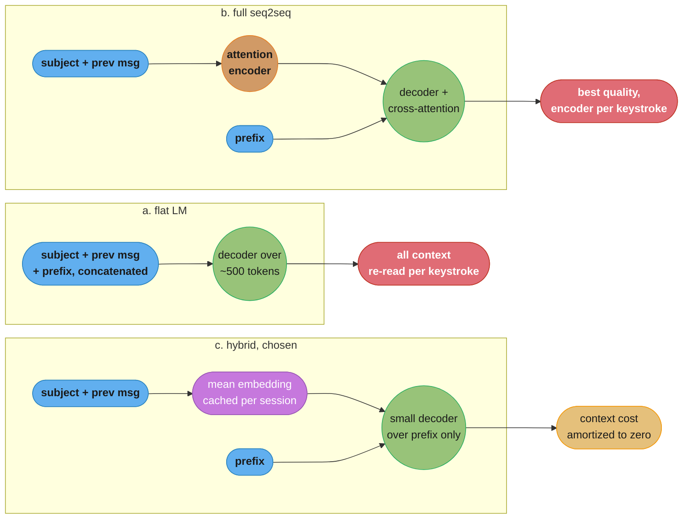

# Chapter 2: Gmail Smart Compose

> Ch 2 of 11 · Generative AI System Design Interview (Aminian & Sheng, ByteByteGo, 2024) · builds on Ch 1 — the 7-step framework, leads to Ch 3 — Google Translate

## Chapter Map

This is the book's first worked design, and the authors choose it deliberately: Smart Compose
is the smallest possible generative product. It generates a handful of words, it has no
open-ended chat surface, and its output is thrown away the moment the user keeps typing. That
minimalism is exactly what makes it a good first chapter, because with the modelling problem
kept simple, everything hard about the system is *operational*. The suggestion has to appear
inside a latency budget measured in tens of milliseconds, on every keystroke, for hundreds of
millions of users, trained on the most privacy-sensitive corpus a company can own — its users'
private email. The chapter's real lesson is that in generative products the model is rarely the
binding constraint; the serving budget and the data policy are, and they reach back and change
the model you are allowed to pick.

**TL;DR:**
- Smart Compose is framed as **language modelling / sequence completion**: given the prefix the
  user has typed plus surrounding context (subject line, previous message in the thread, time
  of day, locale), predict the next few words as a single inline suggestion.
- The **latency budget is the architectural constraint**. A suggestion that arrives after the
  user has typed past it is worse than no suggestion at all, so the design is pushed away from
  a full seq2seq encoder-decoder that re-encodes context on every keystroke and toward a
  **hybrid**: a cheap, cacheable context encoding fed into a small language-model decoder that
  only ever runs over the prefix.
- Generation uses **beam search with early termination** and a **confidence threshold that
  gates whether to suggest at all** — the chapter treats "show nothing" as a first-class,
  frequently-correct output, which is a different posture from every later chapter in the book.
- Evaluation runs on two tracks that disagree: **offline** log perplexity and **ExactMatch@N**,
  and **online** acceptance rate, characters saved, and latency percentiles — with the chapter
  insisting that a model that improves perplexity can still lose the A/B test.
- **Privacy shapes data preparation, not just deployment.** The training corpus is user email;
  nobody may read it, so cleaning is fully automated, rare strings are filtered out so the model
  cannot memorize any one person's text, and the model must be audited for regurgitation before
  it ships.

## The Big Question

> The user is typing. You have roughly the gap between two keystrokes — under a tenth of a
> second, including the network round trip — to read their half-finished sentence, understand
> the thread it belongs to, generate a continuation, decide whether it is good enough to show,
> and render it. And the data that would make the suggestion good is the one dataset you are
> least allowed to touch. What do you build?

Analogy: think of a courtroom stenographer who has learned, over years with the same judge,
to anticipate the end of a sentence a beat before it is spoken. The value is entirely in the
timing. A stenographer who anticipates correctly but a full second late has produced no value —
the words were already said. And one who guesses confidently and wrongly is actively worse than
one who waits, because now the transcript has to be corrected. Smart Compose lives in that same
narrow band: *right, and early, and quiet when unsure.* Every design decision in this chapter is
downstream of that three-part demand, and the chapter's characteristic move is to reject the
higher-quality model whenever it cannot be made early enough.

---

## 2.1 Clarifying Requirements

The chapter opens the way every chapter in the book opens — narrowing an ambiguous prompt into a
specified system before proposing anything.

- **What exactly is the input and output?** Input is the **prefix** the user has typed in the
  compose box, plus available **context**: the subject line, the body of the message being
  replied to, the recipient list, and the date and time. Output is a **short continuation** —
  typically a few words up to a short phrase — rendered inline as greyed-out text that the user
  accepts with a single keystroke (Tab) or dismisses by simply continuing to type.
- **Is this the same thing as Smart Reply?** No, and the distinction is worth drawing out loud.
  **Smart Reply** picks from a small set of complete, pre-generated canned responses ("Sounds
  good, thanks!") and is closer to a retrieval or classification problem over a fixed response
  set. **Smart Compose** generates *arbitrary* continuations of an *arbitrary* user-authored
  prefix, which makes it genuinely generative and gives it an unbounded output space.
- **What is the latency budget?** This is the requirement that dominates everything else. The
  suggestion has to be on screen before the user's next keystroke would overwrite it. The
  chapter's working budget is an end-to-end target on the order of **100 milliseconds**, of
  which the network round trip, request handling, and client rendering consume a large share —
  leaving the model itself only **tens of milliseconds**. A late suggestion is not a degraded
  suggestion; it is a defect, because it appears under text the user has already typed and
  causes visible flicker.
- **What scale?** Hundreds of millions of users, and a request is issued as the user types
  (debounced, not literally per character). The per-request cost therefore has to be a tiny
  fraction of a cent, which rules out anything that runs a large model over a long context on
  every request.
- **What is the quality bar, and is partial coverage acceptable?** Yes — and this is the
  chapter's most useful early insight. The system is allowed, and expected, to **suggest
  nothing** most of the time. The product optimizes **precision over recall**: a wrong
  suggestion costs the user attention and trust on every keystroke it appears, while a missing
  suggestion costs almost nothing because the user was going to type the words anyway.
- **What are the privacy constraints?** The natural training corpus is user email, which is
  among the most sensitive data a company holds. The constraint the chapter sets: **no human
  ever reads the training data**, all preprocessing is automated, and the trained model must
  not be able to reproduce any individual user's private text — not to that user, and
  emphatically not to any other user.
- **What about safety and fairness?** Suggestions are put into the user's own mouth, under
  their own name, and so carry a different failure cost than a chatbot's reply. The system must
  not complete a prefix with offensive language, and must not encode gender or other demographic
  assumptions into its completions (the canonical example being a professional title completing
  to a gendered pronoun).
- **Which languages?** The chapter scopes the first version to a single language (English) and
  treats multilingual expansion as a follow-on, since language identification and per-language
  models multiply both the training and the serving footprint.

**Functional summary:** given a typed prefix and its surrounding email context, return a short,
high-confidence continuation within tens of milliseconds, or return nothing — trained on private
mail without any human ever reading it, and without the model memorizing any of it.

---

## 2.2 Framing the Problem as an ML Task

### Defining the ML objective

The task is **next-token prediction over the user's own composition**: given a token sequence
`x_1 … x_t` (the prefix, conditioned on context) predict `x_{t+1}`, then `x_{t+2}`, and so on
until the model decides to stop. Formally the model estimates

```
P(x_{t+1}, x_{t+2}, ..., x_{t+k} | x_1 ... x_t, context)
```

and the training objective is the standard language-modelling one: maximize the log-likelihood
of the true continuation, equivalently minimize cross-entropy over the vocabulary at every
position. This is the same objective that Ch 4's chatbot is pretrained with, at a radically
different scale — which is part of why the book puts Smart Compose first. The mechanism is the
simplest one in the whole book, so the chapter can spend its length on everything around it.

Two things make the framing less trivial than "it's just a language model":

- **The output length is not fixed.** The model must decide *how much* to suggest. Two words is
  often ideal; a whole sentence is usually presumptuous and wrong.
- **There is a decision layer on top of the generation.** Even a perfectly generated
  continuation should sometimes not be shown. That gating decision is part of the ML task, not
  an afterthought — it is where the precision-over-recall requirement from §2.1 is actually
  implemented.

### Choosing the ML approach — three candidate framings

The chapter compares three architectures and rejects two of them on latency grounds, which is
the template the rest of the book reuses.

**(a) Pure language model over a concatenated sequence.** Flatten everything — subject,
previous message, prefix — into one token sequence and run a single decoder-only language model
over it. Simplest possible design, one model, one forward pass. The problem is cost: the
concatenated sequence is dominated by context that can run to hundreds of tokens, and the model
has to process all of it on every request even though only the last few tokens changed.

**(b) Full sequence-to-sequence with attention.** An encoder consumes the context (subject and
previous message), a decoder consumes the prefix and generates the continuation, with attention
letting the decoder look back at the encoded context. This is the highest-quality framing —
attention over the encoded context is genuinely better at picking up thread-specific detail than
any cheaper summary of it. It is also the most expensive: the encoder runs over the full context
and the decoder runs autoregressively on top, and the naive implementation re-runs both on
every keystroke.

**(c) The hybrid — cheap context encoding plus a prefix-only decoder.** Encode the auxiliary
context with something extremely cheap, such as an **averaged (bag-of-words) embedding** of the
subject line and the previous message, and feed that fixed-size vector into the language-model
decoder as an additional input alongside the prefix. The decoder then only ever runs over the
prefix, which is short. This is the chapter's pick, and the reason is arithmetic rather than
taste: the context vector does not change while the user is typing a single message, so it can
be computed once per compose session and cached, and the per-keystroke work collapses to a
short decoder run.

The tradeoff being accepted is real and should be named in an interview: bag-of-words averaging
discards word order and cannot attend to a specific phrase in the previous message the way an
attention-based encoder can. The chapter's position is that for a two-to-five-word suggestion,
the coarse topical signal a bag-of-words context vector carries ("this thread is about
scheduling a meeting") recovers most of the achievable benefit, and the rest of the quality is
not worth an order of magnitude of latency.

### Input and output, formalized

- **Context encoder** `E_c`: maps subject text and previous-message text to a fixed-length
  vector `c` (computed once per session, cached).
- **Decoder LM** `P(x_{t+1} | x_1..x_t, c)`: a small recurrent or transformer decoder producing
  a distribution over the subword vocabulary at each step.
- **Search**: beam search over the decoder, producing candidate continuations with scores.
- **Gate**: a threshold on the length-normalized score of the best candidate, deciding whether
  anything is shown at all.

---

## 2.3 Data Preparation

### Data engineering — the corpus

The training corpus is user email, and specifically **sent mail** rather than received mail.
This distinction matters more than it sounds: the model's job is to predict what *this user*
is about to write, and received mail is written by other people in other registers, including
an enormous volume of machine-generated text. Training on received mail teaches the model to
write like a receipt.

The pipeline runs entirely without human inspection, which forces every cleaning heuristic to
be automatic and conservative.

### Data engineering — cleaning

- **Strip the quoted reply chain.** A reply typically carries the entire prior thread quoted
  below it. Left in, the same text is duplicated across every message in a thread and the corpus
  over-weights it enormously.
- **Strip signatures, disclaimers, and boilerplate.** Legal footers ("This message is
  confidential...") repeat identically across millions of messages and would be learned as
  extremely high-probability continuations — the model would happily start suggesting a legal
  disclaimer mid-sentence.
- **Remove machine-generated mail.** Receipts, newsletters, notifications, and automated alerts
  dominate raw email volume. They are filtered by sender heuristics and by structural signals
  (heavy HTML, templated layout).
- **Strip HTML and normalize whitespace**, so the model learns language rather than markup.
- **Language identification**, keeping only the target language for a single-language model.
- **Deduplicate.** Templated messages sent to many recipients would otherwise be learned as if
  many independent people had chosen those exact words.

### Data engineering — the privacy filters

These are the steps that do not appear in an ordinary language-modelling pipeline, and the
chapter treats them as mandatory rather than best-effort.

- **Rare-string removal.** Any n-gram that appears in fewer than a threshold number of *distinct
  users* is dropped from the training data. This is the practical defense against memorization:
  a string that only one person ever wrote — a home address, a password reset link, an
  unusual name — cannot be learned as a pattern if it is not in the training set at least a
  minimum number of independent times. The threshold is the privacy dial, and raising it costs
  coverage of legitimately rare-but-useful vocabulary.
- **PII scrubbing.** Pattern-based removal or replacement of email addresses, phone numbers,
  card-like number sequences, and URLs with placeholder tokens.
- **No human review at any stage.** Because nobody can eyeball a sample, quality assurance on
  the corpus has to be done with aggregate statistics — token distributions, per-locale volume,
  length histograms — rather than with the usual "read a hundred examples" sanity check. This is
  a genuine loss and the chapter is honest about it.

### Feature engineering

- **Subword tokenization.** A subword vocabulary (on the order of tens of thousands of pieces)
  keeps the softmax layer small enough to run inside the latency budget while still handling
  names and rare words by decomposition rather than mapping them all to a single unknown token.
  The vocabulary size directly buys or costs latency, because the output projection is over
  the whole vocabulary at every decoding step.
- **Contextual features beyond the text**, each cheap to compute and each carrying real signal:
  - **Subject line** — the strongest single topical signal available.
  - **Previous message body** — what is being replied to.
  - **Date and time of day** — "Good morning" versus "Good evening" is fully determined by it,
    and getting it wrong is a visible, slightly embarrassing failure.
  - **Locale** — spelling and idiom conventions.
  - **Recipient signal** — coarse formality cues (an external recipient shifts register), used
    carefully, since anything derived from a specific recipient risks leaking relationship data.

### Splitting the data

The split has to be **by user and by time**, not randomly by message. A random split puts the
same user's messages on both sides, and because people reuse their own phrasings heavily, the
model can score well on a held-out message simply by having memorized that user's habits from
their other messages in training. That inflates every offline metric and predicts nothing about
a new user's experience.

---

## 2.4 Model Development

### Model selection — walking the ladder

The chapter builds up through the candidate families, and the interesting part is that it
rejects each one on a specific, quantified constraint rather than on general quality.

- **N-gram language model.** Extremely fast — a hash lookup — and trivially personalizable per
  user. But it has no notion of context beyond the last few tokens, cannot generalize to unseen
  phrasings, and its table size explodes with order. Useful as a baseline and, notably, useful
  later as the *personalization* component layered on top of a neural model.
- **RNN / LSTM language model.** Compact, and crucially its per-step cost is constant with
  respect to the prefix length once state is carried forward — a property that matters when the
  prefix grows as the user types. This is the classic fit for this problem shape.
- **Transformer decoder.** Higher quality and parallel over positions during training, but
  attention is quadratic in sequence length at inference unless a key/value cache is maintained,
  and the model sizes that make transformers clearly better are also the sizes that break the
  budget.
- **Full seq2seq with attention over the context.** Best quality, rejected on the encoder cost
  established in §2.2.

The design that survives is a **small decoder conditioned on a cached context vector**, trained
from scratch on the cleaned corpus, with every latency lever pulled.

### The broken design, and the fix

The naive architecture is worth writing out because it is what most candidates propose first
and it fails by roughly an order of magnitude.

**Broken:**

```
on every keystroke:
    tokens = tokenize(subject + previous_message + prefix)   # ~300-600 tokens
    h      = transformer_encoder(tokens)                     # full pass, every keystroke
    out    = beam_search(decoder, h, beam=8, max_len=20)     # 20 sequential steps x 8 beams
    return out
```

Two independent problems. First, the encoder re-processes several hundred tokens of context
that **did not change** since the previous keystroke — pure repeated work, and it dominates the
forward pass. Second, beam search with a wide beam and a long maximum length runs many
sequential decoder steps, and sequential steps cannot be parallelized away; twenty steps at even
2 ms each is 40 ms of pure decoding before the network round trip is counted.

**Fixed:**

```
on compose-session start (once):
    c = mean_embedding(subject) + mean_embedding(previous_message)   # cached for the session

on every keystroke (debounced):
    out, score = beam_search(decoder, prefix_tokens, c,
                             beam=3, max_len=10, early_stop=True)
    if score < TRIGGER_THRESHOLD:
        return NOTHING            # suggesting nothing is a valid, common answer
    return out
```

The context encoding moved out of the per-keystroke path entirely, the beam narrowed, the
maximum length shortened to match what the product actually displays, and the confidence gate
was added so the system can decline. Each change is small; together they are the difference
between a design that ships and one that does not.

### Decoding — beam search with early termination

Greedy decoding is the cheapest option but produces bland, sometimes locally-wrong continuations,
because the single highest-probability first token can lead into a poor phrase. Beam search
tracks the top `b` partial candidates at every step and keeps the best-scoring complete
sequences, which materially improves the phrasing of multi-word suggestions.

Two modifications are load-bearing here:

- **Length normalization.** Raw sequence log-probability is a sum of negative terms, so it falls
  monotonically with length and an unnormalized beam search systematically prefers the shortest
  candidate. Dividing by length (or a length penalty function of it) makes a four-word
  suggestion comparable against a two-word one.
- **Early termination.** Stop expanding as soon as the best beam's normalized score drops below
  the trigger threshold, since the suggestion will be discarded anyway — there is no point
  spending decoder steps completing a candidate that will not be shown. In practice this saves
  most of the decode cost on the majority of requests, precisely because most requests correctly
  produce no suggestion. Beam width stays small (3 to 5); wider beams buy diminishing quality
  and cost linearly more.

### The trigger threshold — the precision dial

The gate is a single scalar and it is the most product-visible knob in the entire system.

| Threshold | Trigger rate (how often a suggestion appears) | Acceptance rate (of those shown) | User experience |
|---|---|---|---|
| Low | High | Low | Constant flickering suggestions, most of them wrong; users disable the feature |
| Tuned | Moderate | High | Suggestions feel prescient because they only appear when the model is confident |
| High | Very low | Very high | Technically excellent, but the feature rarely does anything |

The chapter's point is that acceptance rate on its own is not the objective — you can drive it
arbitrarily high by never suggesting anything. The threshold is tuned against the *product* of
coverage and acceptance, which is what characters-saved actually measures.

### Model compression and serving efficiency

Everything here exists to buy back milliseconds:

- **Quantization** — running weights and activations at 8-bit integer precision instead of
  32-bit float, cutting memory bandwidth (which is the real bottleneck for a small model) and
  taking advantage of integer paths on the serving hardware.
- **Distillation** — training a small student model to match a larger teacher's output
  distribution, retaining more quality than training the small model from scratch would.
- **Vocabulary and softmax reduction** — the output projection over the full vocabulary runs at
  every decoding step, so it is a direct latency term, not a fixed cost.
- **Accelerator serving with dynamic batching** — batching concurrent requests from different
  users into one forward pass, with a batching window short enough (single-digit milliseconds)
  that waiting for a batch does not itself blow the budget.

### Personalization

Fine-tuning a separate model per user is impossible at hundreds of millions of users — the
storage alone is prohibitive, and the training cost is absurd. The chapter's approach is
**lightweight adaptation layered on a shared global model**:

- Maintain a small **per-user n-gram model** built from that user's own sent mail, and
  **interpolate** its next-token distribution with the global model's, with an interpolation
  weight that grows as the user accumulates data.
- Keep the personal component small and stored on the user's own partition, which also keeps the
  privacy story clean: one user's personal model is never an input to another user's request.

This gets most of the benefit — a user's own recurring phrasings, their colleagues' names, their
team's jargon — at negligible marginal cost per user, without any per-user training run.

### Fairness in suggested completions

Because the suggestion is inserted into text the user will send under their own name, a biased
completion is attributed to the user, not to the system. The chapter treats this as an explicit
design requirement:

- **Counterfactual evaluation sets** — pairs of prefixes differing only in a demographic term,
  checked for divergent completions (a professional title completing to a gendered pronoun is
  the canonical case).
- **Suppression rather than correction** — the practical mitigation is to simply not suggest in
  the risky construction at all. Because "suggest nothing" is already a supported output, this
  costs almost nothing operationally, which is a nice illustration of how §2.1's
  precision-over-recall stance pays off in a place it was not designed for.
- **Blocklists on the generated span**, catching offensive or profane completions before they
  reach the client.

---

## 2.5 Evaluation

### Offline metrics

**Log perplexity** is the training-time metric — the exponentiated average negative
log-likelihood the model assigns to held-out text, where lower is better. It is the right thing
to optimize during training and the wrong thing to judge the product by, for a specific reason
the chapter draws out: perplexity averages over *every* token in the held-out set, including the
vast majority of positions where the system would never trigger a suggestion. A model can lower
perplexity by getting better at predicting the middle of long sentences it will never be asked
about.

**ExactMatch@N** is the product-shaped offline metric: for a held-out message, take a prefix,
generate the top-N candidate continuations, and score a hit if any of them exactly matches the
next N words the user actually wrote. It is deliberately strict — a near-miss counts as a
miss — which mirrors the product, where a suggestion the user has to edit is a suggestion they
would rather not have seen. Reporting it at a couple of values (`ExactMatch@1` for "did we get
it exactly right", and a small N for "was it in the candidate set") tells you whether the
problem is the model's ranking or the model's knowledge.

**Latency percentiles are an offline metric here, not just an ops dashboard.** Because a model
that misses the budget is unshippable regardless of its quality scores, p50, p95, and p99
decode latency are reported alongside perplexity as part of the model's own evaluation, and a
model that improves ExactMatch while regressing p99 is not an improvement.

### Online metrics

- **Acceptance rate** — of the suggestions actually shown, the fraction the user accepted.
  The headline quality signal, and, as noted, gameable on its own by suppressing coverage.
- **Trigger rate / coverage** — how often a suggestion is shown at all. Always read together
  with acceptance rate; either alone is meaningless.
- **Characters saved** — the product's actual value metric, roughly (accepted suggestions) ×
  (characters per accepted suggestion). This is the number that combines coverage and quality
  into one, and it is the one A/B tests are decided on.
- **Latency percentiles in production**, per region, since the network component of the budget
  varies far more by geography than the model component does.
- **Deletion-after-acceptance** — the essential guard metric. A user who accepts a suggestion
  and then immediately deletes it registers as a success under acceptance rate but is actually
  a false positive that cost them time. Without this metric, a model that produces plausible-
  looking-but-wrong suggestions can win an A/B test on acceptance rate alone.
- **Feature disable rate** — users turning Smart Compose off entirely is the loudest possible
  signal that the trigger threshold is too low.

### Human and fairness evaluation

Automated metrics cannot see whether a suggestion is *appropriate*, so a human evaluation track
rates sampled suggestions on helpfulness and on register match — but on a corpus of synthetic or
consented emails, not on real user mail, because §2.1's no-human-reads-the-data constraint
applies to evaluation exactly as it applies to training. The counterfactual fairness set from
§2.4 is run as a gate on every candidate model, not as a periodic audit.

---

## 2.6 Overall ML System Design

The end-to-end system is small by the standards of later chapters, and every component in it
exists to defend the latency budget.

- **Client.** Debounces keystrokes so a request is issued after a brief typing pause rather than
  on every character, cancels in-flight requests when the user types past them, and renders the
  returned continuation as inline ghost text. The client also enforces its own timeout: if the
  response has not arrived within the budget, it renders nothing and drops the late response
  when it eventually lands. **A stale suggestion is never displayed.**
- **Serving frontend.** Authenticates, resolves the compose session, and looks up the cached
  context vector for that session — computing it on a cache miss, which happens once when the
  compose window opens.
- **Model server.** Runs on accelerators with dynamic batching across concurrent users' requests,
  executes the beam search with early termination, and applies the trigger threshold.
- **Post-filters.** Before the suggestion leaves the server: a profanity and safety blocklist; a
  check that the suggestion does not merely repeat text already in the prefix; and a
  regurgitation check against the memorization canaries described in §2.7.
- **Caching.** Two distinct layers with very different keys:
  - the **per-session context cache**, keyed on the compose session, holding the encoded context
    vector;
  - a **common-prefix suggestion cache**, keyed on a hash of the prefix plus locale, for
    high-frequency generic openings ("Thanks for your ..." → "email"). This is a genuine hit-rate
    win because email openings are extremely repetitive across users, but the key must never
    include anything user-identifying, and the cache must be scoped so that a suggestion derived
    from one user's context can never be served to another.
- **Fallback path.** On model-server timeout or error the response is simply "no suggestion" —
  the degraded mode of this product is the product with the feature switched off, which is
  entirely acceptable and requires no special handling on the client.

### Scale estimation — a worked example

Suppose 100 million daily active users, each composing 10 messages per day, and the debounced
client issues roughly 20 suggestion requests per composed message.

```
requests/day  = 100e6 users x 10 messages x 20 requests  = 2e10  = 20 billion/day
average QPS   = 2e10 / 86,400                            ~ 231,000 QPS
peak QPS      = ~3x average (business-hours concentration) ~ 700,000 QPS
```

At 700,000 QPS with a 20 ms model budget, a single accelerator serving batches of 64 requests
every 20 ms delivers roughly 3,200 requests/second, so the model tier needs on the order of
**220 accelerators at peak** before redundancy and headroom — a number that is only tolerable
because the model is small. Doubling the model size does not double the cost of one request; it
doubles the size of the entire serving fleet. That arithmetic is the whole reason the chapter
spent §2.4 on compression, and it is the number to put on the whiteboard when an interviewer
asks why you did not simply use a bigger model.

The **cache hit rate matters at exactly the same leverage**. If the common-prefix cache absorbs
30% of requests, the accelerator fleet shrinks by roughly 30% — comparable in impact to a major
model compression effort, for far less work.

---

## 2.7 Deployment and Monitoring

- **Staged rollout with A/B testing.** New models ship to a small traffic percentage first,
  evaluated on characters saved and deletion-after-acceptance rather than on offline metrics,
  because the chapter's whole evaluation section exists to make the point that those two can
  disagree. Latency percentiles are a rollback trigger in their own right.
- **Threshold tuning is a deployment activity, not a training one.** The trigger threshold can
  be adjusted without retraining anything, which makes it the fastest lever available when
  suggestion quality is reported as poor — and it should be tuned per locale, since acceptance
  behaviour varies by language and by writing culture.
- **Monitoring by segment, not just in aggregate.** Acceptance rate, trigger rate, and latency
  are all tracked per locale, per client platform (web, mobile, desktop), and per region.
  Aggregates hide the case where a model improves overall while collapsing for one language.
- **Language drift.** Email language moves — new product names, new company jargon, new
  abbreviations — and a static model degrades slowly and invisibly, because nothing errors; the
  trigger rate simply drifts down as the model becomes less confident about text it has not
  seen. Periodic retraining on a rolling recent window is the answer, with the trigger rate
  itself monitored as the early-warning signal.
- **Memorization auditing.** The chapter treats this as a standing production check rather than
  a one-time validation: **canary strings** — unique, synthetic phrases — are deliberately
  planted in the training corpus at controlled frequencies, and the deployed model is
  periodically probed to see whether it can be induced to emit them. If a canary planted at a
  frequency below the rare-string threshold can be extracted, the privacy filters in §2.3 are
  not doing their job and the model does not ship.
- **The feedback-loop trap.** Accepted suggestions are the most tempting training signal
  available — they are free, abundant, and labelled by the user's own click. Training on them
  naively creates a self-reinforcing loop: the model is retrained on its own outputs, which
  narrows its distribution toward whatever it already suggests confidently, which raises
  acceptance rate on those suggestions and lowers coverage everywhere else. The chapter's
  guidance is to treat acceptance data as an *evaluation* signal and to keep the training corpus
  anchored in organically written mail, mixing accepted-suggestion data in at a monitored,
  bounded ratio if at all.

---

## Beyond the book — assisted writing after 2024

> This section is the summarizer's addition, disclosed as the repo requires. The chapter above
> describes a small, purpose-trained language model serving inline completions under a
> tens-of-milliseconds budget, with n-gram interpolation for personalization. It does not
> describe large-language-model-based drafting assistants, on-device inference, speculative
> decoding, or formal differential-privacy guarantees — everything in this section is later
> material, not Aminian and Sheng's.

The inline-completion product the chapter designs now sits alongside a second, structurally
different feature in the same compose window: **full-draft generation from an instruction**
("write a polite decline to this meeting"), served by a general-purpose large language model.
The two have almost nothing in common as systems. Inline completion is latency-bound and
runs continuously without being asked; instruction-driven drafting is explicitly invoked, is
allowed to take a second or more, streams its output, and is priced per invocation rather than
per keystroke. A 2026 design answer should say plainly that these are two products sharing a
text box, and that collapsing them into one model is a mistake in both directions — the small
model cannot follow instructions, and the large model cannot meet the keystroke budget.

Three other shifts are worth naming. **On-device inference** for the completion model has become
practical as small models and mobile accelerators improved, and it changes the budget arithmetic
in the chapter completely: the network round trip that consumed most of the 100 ms disappears,
the serving fleet disappears with it, and the privacy story becomes structurally stronger
because the prefix never leaves the device. **Speculative decoding** — running a tiny draft
model and verifying its guesses in a single pass of a larger one — directly attacks the
sequential-decoding cost that §2.4's beam-width and length limits were working around.
And the privacy filters the chapter describes as heuristics (rare-string thresholds, PII
scrubbing) are increasingly supplemented by **formal differential privacy** during training and
by **federated learning** for personalization, which give a stated privacy budget rather than
an empirical argument that memorization was not observed. The chapter's canary-probing audit
remains good practice under all of these; it is the verification step, not the guarantee.

---

## Visual Intuition

### The request path and where the milliseconds go

```mermaid
flowchart LR
    classDef io      fill:#61afef,stroke:#2e86c1,color:#1a1a1a,font-weight:bold
    classDef frozen  fill:#c678dd,stroke:#9b59b6,color:#fff
    classDef train   fill:#98c379,stroke:#27ae60,color:#1a1a1a
    classDef mathOp  fill:#d19a66,stroke:#e67e22,color:#1a1a1a,font-weight:bold
    classDef lossN   fill:#e06c75,stroke:#c0392b,color:#fff,font-weight:bold
    classDef req     fill:#56b6c2,stroke:#0097a7,color:#1a1a1a
    classDef base    fill:#e5c07b,stroke:#f39c12,color:#1a1a1a

    K(["keystroke<br/>debounced"]) --> FE(["serving<br/>frontend"])
    FE --> CC{"session context<br/>cache hit?"}
    CC -->|"hit: vector c"| MS(("model server<br/>batched decode"))
    CC -->|"miss: encode once"| ENC(["bag-of-words<br/>context encoder"])
    ENC --> MS
    MS --> BS(["beam search<br/>b=3, early stop"])
    BS --> GATE{"score above<br/>threshold?"}
    GATE -->|"no"| NONE(["return nothing"])
    GATE -->|"yes"| FILT(["safety and<br/>repeat filters"])
    FILT --> UI(["inline ghost text"])

    class K io
    class FE req
    class CC base
    class ENC frozen
    class MS train
    class BS mathOp
    class GATE lossN
    class NONE base
    class FILT req
    class UI io
```



Caption: the context encoder sits *outside* the per-keystroke path — it runs once per compose
session — and the confidence gate sits *inside* it, which is why "return nothing" is the cheapest
path through the system rather than a special case bolted on.

### Three framings, and why the hybrid wins on cost



Caption: all three framings see the same information; they differ only in *when* the context is
paid for. Only the hybrid pays for it once per compose session rather than once per keystroke,
which is the entire argument for accepting a weaker context representation.

### The latency budget ledger

```
  end-to-end budget: ~100 ms from keystroke pause to ghost text on screen

  client debounce           |####                    |   ~10 ms   (tunable, product choice)
  network round trip        |##############          |   ~40 ms   (geography-dependent)
  frontend + cache lookup   |##                      |    ~5 ms
  MODEL: batching wait      |###                     |    ~8 ms   <- batch window
  MODEL: beam decode        |#####                   |   ~20 ms   <- the only ML knob
  filters + serialization   |##                      |    ~5 ms
  client render             |###                     |   ~10 ms
                            +------------------------+
                            0                      100 ms

  the model owns ~28 of ~100 ms.  doubling model size does not cost 100%
  of the budget - it costs 20% of it, and 100% of the serving fleet.
```

Caption: the reason a bigger model is rejected is not that it would blow the user-visible budget
outright, but that the model is a minority share of latency and a majority share of *cost* — the
fleet arithmetic in §2.6, not the millisecond arithmetic here, is what actually binds.

### Beam search with early termination

```
  prefix: "Thanks for the"

  step 1        step 2            step 3            normalized score
  ------        ------            ------            ----------------
  update  ----> "update."         (EOS)              -0.41   <- kept
          \---> "update on"  ---> "the"              -0.88
  quick   ----> "quick call"      (EOS)              -0.63
  info    ----> "info"       X  pruned, beam=3 keeps only top 3
  reply   ----> ...          X  pruned

  early termination: once the best normalized score falls below the
  trigger threshold (say -1.20), stop expanding entirely - the result
  will not be shown, so further decoder steps are wasted work.

  length normalization: without dividing by length, "update." (2 tokens)
  always outscores "update on the" (4 tokens) purely because a sum of
  negative log-probabilities only ever gets more negative.
```

Caption: the two modifications that turn textbook beam search into a product component — length
normalization so multi-word suggestions can compete at all, and early termination so the
common case (no suggestion) is also the cheapest case.

---

## Key Concepts Glossary

- **Smart Compose** — inline generation of a short continuation of text the user is currently
  typing, rendered as accept-or-ignore ghost text.
- **Smart Reply** — the sibling feature that offers a small set of complete canned responses;
  a selection problem over a fixed response set, not open-ended generation.
- **Prefix** — the text the user has typed so far in the compose box; the model's primary
  conditioning input.
- **Context (auxiliary features)** — subject line, previous message body, recipient, date/time,
  and locale; everything conditioning the suggestion other than the prefix itself.
- **Language modelling / sequence completion** — predicting the next token given the preceding
  ones; the chapter's ML framing.
- **Sequence-to-sequence (seq2seq)** — an encoder-decoder architecture where one sequence is
  encoded and another generated from it; rejected here on serving cost.
- **Hybrid context encoding** — feeding a cheap fixed-size summary of the context (a
  bag-of-words mean embedding) into a decoder that runs over the prefix only.
- **Bag-of-words embedding** — averaging word embeddings into one vector, discarding word order
  in exchange for a very cheap, cacheable representation.
- **Trigger threshold** — the confidence score below which no suggestion is shown; the system's
  precision-versus-coverage dial.
- **Trigger rate / coverage** — the fraction of requests that produce a visible suggestion.
- **Beam search** — decoding by expanding the top `b` partial candidates at each step rather
  than committing to the single best token.
- **Length normalization** — dividing a candidate's log-probability by its length so longer
  candidates are not automatically penalized.
- **Early termination** — abandoning beam expansion once the best candidate cannot clear the
  trigger threshold, saving the decode steps entirely.
- **Log perplexity** — the average negative log-likelihood assigned to held-out text; the
  training-time quality metric, lower is better.
- **ExactMatch@N** — the fraction of held-out prefixes for which one of the top-N generated
  continuations exactly matches the user's actual next words.
- **Acceptance rate** — of the suggestions shown, the fraction the user accepted.
- **Characters saved** — the product's value metric: accepted suggestions multiplied by their
  length, combining coverage and quality into one number.
- **Deletion-after-acceptance** — the guard metric counting suggestions the user accepted and
  then immediately removed; a false positive that acceptance rate alone scores as a success.
- **Rare-string filtering** — dropping from the training corpus any string appearing in fewer
  than a threshold number of distinct users, as a defense against memorization.
- **Memorization / regurgitation** — a model reproducing a verbatim training string, which for
  a corpus of private email is a data leak rather than a quality issue.
- **Canary string** — a unique synthetic phrase planted in training data at a controlled
  frequency, later probed for to test whether memorization defenses are working.
- **Quantization** — running a model at reduced numeric precision (e.g. 8-bit integer) to cut
  memory bandwidth and latency.
- **Distillation** — training a small student model to match a larger teacher's outputs,
  retaining more quality than training the small model directly.
- **Dynamic batching** — grouping concurrent requests from different users into a single forward
  pass, within a bounded waiting window.
- **Debouncing** — issuing a request only after a brief pause in typing rather than on every
  keystroke, cutting request volume dramatically.
- **Per-user interpolation** — blending a small per-user n-gram model's predictions with the
  shared global model's, as cheap personalization without per-user training.
- **Counterfactual fairness set** — paired evaluation prompts differing only in a demographic
  term, used to detect divergent completions.

---

## Tradeoffs & Decision Tables

### Architecture choice under the latency budget

| Framing | Context quality | Per-keystroke cost | Cacheable context | Verdict |
|---|---|---|---|---|
| Flat LM over concatenated text | Good | High — re-reads all context | No | Rejected: repeated work |
| Full seq2seq with attention | Best | Highest — encoder + decoder | No (attention needs the encoder states live) | Rejected: budget |
| Hybrid (mean-embedding context + prefix decoder) | Adequate — topical, not phrase-level | Low — decoder over prefix only | Yes — once per session | **Chosen** |
| N-gram only | None | Lowest | n/a | Baseline; reused for personalization |

### Decoding strategy

| Strategy | Suggestion quality | Cost | Fit here |
|---|---|---|---|
| Greedy | Bland, occasionally locally wrong | Cheapest | Viable fallback under load |
| Beam search, b=3-5, length-normalized | Best phrasing for short spans | Moderate, `b` × steps | **Chosen**, with early termination |
| Wide beam, b=10+ | Marginal gain over b=5 | Linear in `b` | Not worth it for 2-5 word outputs |
| Stochastic / top-k sampling | Diverse, unpredictable | Cheap | Wrong for this product — the user wants the *expected* words, not a creative one |

### Metric pairs that must be read together

| Metric | What it hides on its own | Read alongside |
|---|---|---|
| Acceptance rate | Suppressed coverage (never suggest, never be wrong) | Trigger rate |
| Trigger rate | Low-quality spam suggestions | Acceptance rate |
| Log perplexity | Improvements at positions the system never triggers on | ExactMatch@N |
| ExactMatch@N | Latency regressions | p95 / p99 decode latency |
| Characters saved | Suggestions accepted then deleted | Deletion-after-acceptance |

### Personalization approaches

| Approach | Quality gain | Cost at 100M+ users | Verdict |
|---|---|---|---|
| Per-user model fine-tune | Highest | Prohibitive — storage and training per user | Not viable |
| Per-user n-gram interpolated with global model | Solid — names, jargon, recurring phrasings | Tiny per user | **Chosen** |
| Per-user embedding conditioning the shared model | Moderate | Small, but needs retraining to introduce | Reasonable alternative |
| No personalization | None | Zero | Loses the feature's most distinctive value |

---

## Common Pitfalls / War Stories

- **Re-encoding unchanged context on every keystroke.** The single most common design error in
  this problem, and it costs an order of magnitude. The subject line and the quoted previous
  message do not change while the user types — computing their representation once per compose
  session and caching it is the difference between a shippable and an unshippable design.
- **Optimizing acceptance rate alone.** Acceptance rate rises monotonically as the trigger
  threshold rises, all the way to a threshold so high that the feature never fires and
  acceptance rate is 100%. Teams that set acceptance rate as the sole objective have shipped
  models that quietly stopped suggesting anything and reported a metric win.
- **Random train/test splits on user email.** Splitting by message rather than by user puts the
  same person's writing on both sides of the split, and because people reuse their own phrasings
  heavily, offline metrics inflate substantially and predict nothing about a new user.
- **Leaving quoted reply chains in the corpus.** Every message in a long thread carries the whole
  thread quoted beneath it, so the same paragraphs appear dozens of times and the model learns
  them as extremely high-probability text — which surfaces as the model trying to complete a
  sentence with someone else's earlier paragraph.
- **Training on machine-generated mail.** Receipts, notifications, and newsletters dominate raw
  email volume. Without filtering them, the model's dominant register is templated
  system-generated English, and its suggestions read like a shipping confirmation.
- **Rendering a late response.** A suggestion that arrives after the user has typed past its
  insertion point causes text to flicker and shift under the cursor. The fix is a hard client
  timeout with the late response *discarded*, not displayed — degrading to "no suggestion" is
  free, and displaying a stale one is not.
- **Treating memorization as a training-time concern only.** The rare-string filter is an
  empirical defense, not a proof. Without canary probing on the deployed model, nobody finds out
  the filter has been silently misconfigured until a user reports seeing text they did not write.
- **Retraining on accepted suggestions.** The most available feedback signal is also the one that
  closes a loop: the model retrained on its own accepted outputs narrows toward what it already
  suggests, coverage decays everywhere else, and the degradation is invisible in acceptance rate
  because acceptance rate is exactly what the loop optimizes.
- **Ignoring per-locale segmentation in monitoring.** A model change that improves the aggregate
  can collapse trigger rate in one language, and the aggregate — dominated by the largest
  locale — will never show it.

---

## Real-World Systems Referenced

**Products:** Gmail Smart Compose (the chapter's subject) and Gmail Smart Reply (the contrasting
canned-response feature). **Model families named in the design discussion:** n-gram language
models, RNN/LSTM language models, sequence-to-sequence models with attention, and transformer
decoders. **Serving infrastructure:** accelerator-backed model serving with dynamic batching,
model quantization and distillation as the compression techniques applied. **Techniques named
for the metrics:** log perplexity and ExactMatch@N offline, acceptance rate and characters saved
online. **Published system for further reading:** Google's own description of the production
Smart Compose system (Chen et al., KDD 2019), which is where the hybrid bag-of-words-context
design and its latency targets are documented in detail.

---

## Summary

Smart Compose is the book's deliberately small first design, and its lesson is that in a
generative product the model is frequently not the hard part. The ML framing is plain
language modelling — predict the next few tokens given the prefix and the surrounding email
context — but the tens-of-milliseconds latency budget rejects the two obvious architectures
(a flat language model over concatenated context, and a full seq2seq with attention over an
encoded context) purely on the cost of re-processing unchanged context on every keystroke.
The design that survives is a hybrid: a cheap bag-of-words context vector computed once per
compose session and cached, feeding a small decoder that runs only over the prefix, decoded with
a narrow length-normalized beam search that terminates early, behind a confidence threshold that
lets the system decline to suggest — which it does most of the time, by design, because
precision matters more than coverage when the output appears under the user's own cursor.
Because the corpus is private email, data preparation carries privacy filters that a normal
language-modelling pipeline does not have — rare-string removal so no individual's text can be
memorized, automated cleaning because no human may read the data — and deployment carries a
standing memorization audit with planted canary strings. Evaluation runs on two tracks that
genuinely disagree: log perplexity and ExactMatch@N offline, acceptance rate, coverage,
characters saved, and deletion-after-acceptance online, with the chapter insisting that no one
of these means anything read alone. Chapter 3 keeps the sequence-generation framing and removes
the extreme latency constraint, which is exactly what lets translation reach for the
encoder-decoder architecture this chapter had to turn down.

---

## Interview Questions

**Q: Why does the extreme latency budget push Smart Compose away from a full seq2seq encoder-decoder architecture?**
**Short:** A seq2seq encoder re-processes hundreds of unchanged context tokens on every keystroke.
The context that a seq2seq encoder would consume — the subject line and the previous message in the thread — does not change while the user types, so re-encoding it on every keystroke is repeated work that dominates the forward pass and blows a budget measured in tens of milliseconds. The chapter's hybrid instead summarizes that context into a cheap fixed-size vector once per compose session, caches it, and runs only a small decoder over the prefix per request. The tradeoff accepted is a coarser, order-free context representation, on the argument that a two-to-five-word suggestion needs topical signal rather than phrase-level attention.

**Q: Why is "suggest nothing" treated as a first-class output rather than an error case?**
**Short:** A wrong suggestion costs user trust on every keystroke, while a missing one costs almost nothing.
The user was going to type the words regardless, so a suppressed suggestion loses only the keystrokes it would have saved, whereas a wrong suggestion demands attention, may be accepted and then deleted, and at high frequency causes users to disable the feature entirely. That asymmetry is why the system optimizes precision over recall and implements a confidence gate that declines on the majority of requests. It also makes the cheapest path through the system the most common one, since early termination abandons decoding as soon as the score cannot clear the threshold.

**Q: What goes wrong if you optimize acceptance rate as the single online metric?**
**Short:** Acceptance rate rises as coverage falls, so a model that suggests almost nothing wins.
Raising the trigger threshold monotonically increases the fraction of shown suggestions that are accepted, right up to a threshold where the feature effectively never fires and acceptance rate approaches 100% while delivering zero value. Acceptance rate must therefore always be read alongside trigger rate, and the metric the A/B test is actually decided on is characters saved, which multiplies quality by coverage. A third metric, deletion-after-acceptance, is needed on top, because a plausible-but-wrong suggestion the user accepts and then removes counts as a success under acceptance rate alone.

**Q: Why is log perplexity a poor product metric for Smart Compose even though it is the right training objective?**
**Short:** Perplexity averages over every token, including positions where the system would never suggest.
Log perplexity scores the model's prediction at every position in held-out text, but the product only ever generates at positions where its confidence clears the trigger threshold — so a model can lower perplexity by improving on the long middles of sentences it will never be asked to complete. ExactMatch@N is the product-shaped complement: it takes a prefix, generates the top-N continuations, and requires an exact match against what the user actually typed next. The chapter's practical guidance is to train on perplexity and to gate ship decisions on ExactMatch@N and on the online metrics.

**Q: How does the system train on private user email without a human ever reading it?**
**Short:** All cleaning is automated, and rare strings appearing in too few users are filtered out.
The pipeline strips quoted reply chains, signatures, machine-generated mail, and HTML using automated heuristics, then applies the privacy-specific filter that no ordinary language-modelling pipeline has: any string appearing in fewer than a threshold number of distinct users is dropped, so nothing unique to one person survives into the training set to be memorized. The cost is that corpus quality assurance has to rely on aggregate statistics rather than the usual practice of reading a sample. The defense is empirical rather than a formal guarantee, which is why the chapter pairs it with canary probing on the deployed model.

**Q: What is a canary string and why must the memorization audit run against the deployed model?**
**Short:** A planted unique phrase probed for after training, testing whether the privacy filters actually held.
A canary is a synthetic, unique phrase deliberately inserted into the training corpus at a controlled frequency below the rare-string threshold, so that if the deployed model can be prompted into emitting it, the filters demonstrably failed to prevent memorization. The audit has to run against the model rather than against the corpus because the rare-string filter is a heuristic and a misconfiguration in it produces no error, no failing test, and no user-visible symptom until someone sees text they did not write. Running it periodically rather than once catches regressions introduced by pipeline or model changes.

**Q: Why must the train/test split be by user rather than randomly by message?**
**Short:** People reuse their own phrasings, so a random split lets the model memorize its way to good scores.
A random message-level split puts the same user's messages on both sides, and because individuals reuse characteristic greetings, sign-offs, and turns of phrase heavily, the model can score well on a held-out message by having learned that specific user's habits from their other messages in training. Every offline metric inflates, and none of the inflation transfers to a new user, who is the actual population the product serves. Splitting by user and by time is what makes the offline number predictive of the A/B test.

**Q: Why does beam search here need length normalization, and what happens without it?**
**Short:** Raw log-probability only gets more negative with length, so short candidates always win.
A sequence's score is a sum of negative log-probabilities, so every additional token makes the total worse regardless of how good that token is — an unnormalized beam search therefore systematically prefers the shortest candidate and the system degrades toward one-word suggestions. Dividing by length, or applying a length penalty function, makes a four-word candidate comparable against a two-word one. This matters more here than in most decoding settings because the whole product value is characters saved, which is directly proportional to suggestion length.

**Q: What does early termination in beam search save, and why is it especially effective in this system?**
**Short:** It abandons decoding once the best score cannot clear the trigger threshold, the common case here.
Once the top beam's length-normalized score falls below the threshold that would gate the suggestion, every further decoder step is spent completing a candidate that will be discarded — so the search stops immediately. It is unusually effective in Smart Compose because the confidence gate is deliberately set high enough that most requests correctly produce no suggestion, which means the cheapest code path is also the most frequently taken one. Sequential decoder steps cannot be parallelized away, so removing them is one of the few genuinely large latency levers available.

**Q: How do you personalize suggestions for hundreds of millions of users without training a model per user?**
**Short:** Interpolate a small per-user n-gram model with the shared global model's predictions.
Per-user fine-tuning is impossible at that scale on storage and training cost alone, so the chapter layers a lightweight per-user n-gram model, built from that user's own sent mail, on top of the shared global model, blending the two next-token distributions with a weight that grows as the user accumulates data. This captures exactly what personalization is worth here — recurring phrasings, colleagues' names, team jargon — at negligible marginal cost per user. Keeping the personal component on the user's own partition also keeps the privacy story clean, since one user's personal model never enters another user's request path.

**Q: Where do the caching layers sit in this system, and what must the cache key never contain?**
**Short:** A per-session context cache and a common-prefix suggestion cache keyed on prefix hash plus locale.
The per-session cache holds the encoded context vector for one compose session, which is what removes context encoding from the per-keystroke path. The second layer caches suggestions for very high-frequency generic openings across all users, keyed on a hash of the prefix and locale — a real hit-rate win because email openings are extremely repetitive. The key must never include anything user-identifying, and the cache must be scoped so a suggestion derived from one user's context can never be returned to another, which is why only prefix-only, context-free suggestions are eligible for it.

**Q: A late suggestion arrives after the user has typed past its insertion point. What should the client do?**
**Short:** Discard it — a stale suggestion causes text to flicker and shift, which is worse than none.
The client enforces its own timeout independent of the server, renders nothing when the budget expires, and drops the late response when it eventually lands rather than displaying it under text the user has already written. This is safe precisely because the product's degraded mode is the product with the feature off, which needs no special handling and no error message. Cancelling in-flight requests when the user keeps typing also reclaims serving capacity that would otherwise be spent generating suggestions nobody will see.

**Q: Why does the chapter say doubling the model size costs 20% of the latency budget but 100% of the serving fleet?**
**Short:** The model is a minority of end-to-end latency but essentially all of the compute cost.
Of a roughly 100 ms end-to-end budget, the network round trip, client debounce, and rendering consume the majority, leaving the model perhaps a quarter of it — so a larger model degrades the user-visible latency noticeably but not catastrophically. Compute cost has no such buffer: at hundreds of thousands of peak QPS the accelerator fleet is sized directly by per-request model cost, so doubling the model doubles the fleet. That arithmetic, not the millisecond arithmetic, is the real reason the chapter spends a whole subsection on quantization, distillation, and vocabulary size.

**Q: Why is fairness in suggested completions a sharper problem than in a chatbot's replies?**
**Short:** The suggestion is inserted into text the user sends under their own name, so bias is attributed to them.
A chatbot's biased output is visibly the system's; a Smart Compose suggestion the user accepts becomes a sentence they authored and signed, which shifts both the harm and the attribution onto the user. The mitigations are therefore conservative: counterfactual evaluation sets of prefixes differing only in a demographic term, gating every candidate model, and suppression rather than correction in risky constructions. Suppression is nearly free here because "suggest nothing" is already a supported, common output, which is a good illustration of how a requirement set for one reason pays off elsewhere.

**Q: Why is training on accepted suggestions dangerous, given that it is the most abundant labelled signal available?**
**Short:** It closes a feedback loop — the model retrains on its own output and narrows toward what it already says.
Accepted suggestions are free and user-labelled, which makes them irresistible as training data, but they are drawn entirely from the model's own high-confidence output distribution. Retraining on them concentrates the model further on what it already suggests confidently, coverage decays for everything else, and the decay is invisible in acceptance rate because acceptance rate is precisely the quantity the loop is optimizing. The guidance is to use acceptance data as an evaluation signal, keep the training corpus anchored in organically written mail, and bound any mixed-in ratio explicitly.

**Q: Why filter machine-generated mail and quoted reply chains out of the training corpus?**
**Short:** They dominate raw email volume and teach the model to write like a receipt or to repeat threads.
Receipts, newsletters, and notifications make up a large share of raw email volume, so a model trained on unfiltered mail learns templated system-generated English as its dominant register and suggests text that reads like a shipping confirmation. Quoted reply chains duplicate the same paragraphs across every message in a thread, which the model learns as extremely high-probability text and then tries to insert mid-sentence. Both filters are structural, run automatically, and matter more here than they would in a general language-modelling corpus because the model is small and therefore easily dominated by whatever is most frequent.

**Q: What is the difference between Smart Compose and Smart Reply as ML problems?**
**Short:** Smart Reply selects from a fixed set of canned responses, Smart Compose generates open-ended continuations.
Smart Reply picks among a small, pre-generated set of complete responses, which makes it closer to a retrieval or classification problem over a bounded response space, with a correspondingly bounded safety surface since every candidate can be reviewed in advance. Smart Compose generates arbitrary continuations of an arbitrary user-authored prefix, so its output space is unbounded, it needs a real language model, and every suggestion must pass safety and repetition filters at request time. Confusing the two in an interview leads to proposing a retrieval architecture for a genuinely generative problem.

**Q: What monitoring signal warns you that language drift is degrading the model, given that nothing errors?**
**Short:** A slowly falling trigger rate — the model grows less confident on vocabulary it has not seen.
Language drift in email is continuous — new product names, new jargon, new abbreviations — and a static model does not fail loudly on it; it simply assigns lower probability to unfamiliar text, so fewer requests clear the confidence gate and the trigger rate drifts down while acceptance rate on the shrinking set of suggestions may even look fine. Watching trigger rate per locale, rather than aggregate acceptance rate, is what surfaces this early. The remedy is periodic retraining on a rolling recent window rather than treating the model as a fixed artifact.

---

## Cross-links in this repo

- [ml/natural_language_processing/language_modeling.md](../../../ml/natural_language_processing/language_modeling.md) — n-gram and neural language modelling, the chapter's core ML framing, in depth.
- [ml/natural_language_processing/attention_and_seq2seq.md](../../../ml/natural_language_processing/attention_and_seq2seq.md) — the encoder-decoder-with-attention architecture this chapter rejects on latency grounds and Ch 3 adopts.
- [ml/natural_language_processing/nlp_evaluation_and_metrics.md](../../../ml/natural_language_processing/nlp_evaluation_and_metrics.md) — perplexity and the text-generation metric family beyond ExactMatch@N.
- [ml/recurrent_neural_networks/recurrent_neural_networks.md](../../../ml/recurrent_neural_networks/recurrent_neural_networks.md) — the RNN/LSTM decoder family whose constant per-step cost fits this problem shape.
- [llm/tokenization_and_embeddings/tokenization_and_embeddings.md](../../../llm/tokenization_and_embeddings/tokenization_and_embeddings.md) — subword vocabularies and why vocabulary size is a direct latency term.
- [llm/inference_and_decoding/sampling_and_decoding_strategies.md](../../../llm/inference_and_decoding/sampling_and_decoding_strategies.md) — beam search, length normalization, and the full decoding menu.
- [llm/inference_and_decoding/speculative_decoding.md](../../../llm/inference_and_decoding/speculative_decoding.md) — the post-2024 attack on sequential decoding cost noted in Beyond the book.
- [llm/llm_caching/llm_caching.md](../../../llm/llm_caching/llm_caching.md) — cache-key design and the correctness hazards of sharing generated output across users.
- [llm/token_economics_and_cost_optimization/token_economics_and_cost_optimization.md](../../../llm/token_economics_and_cost_optimization/token_economics_and_cost_optimization.md) — the fleet-cost arithmetic behind §2.6's capacity estimate.
- [ml/model_serving_and_inference/model_serving_and_inference.md](../../../ml/model_serving_and_inference/model_serving_and_inference.md) — dynamic batching, quantization, and distillation as serving techniques.
- [ml/privacy_preserving_ml/privacy_preserving_ml.md](../../../ml/privacy_preserving_ml/privacy_preserving_ml.md) — memorization, differential privacy, and federated learning in depth.
- [ml/monitoring_and_drift_detection/monitoring_and_drift_detection.md](../../../ml/monitoring_and_drift_detection/monitoring_and_drift_detection.md) — drift detection and the feedback-loop failure mode from §2.7.
- [ml/ml_system_design/ml_system_design.md](../../../ml/ml_system_design/ml_system_design.md) — the general ML system design framework this chapter instantiates.
- Sibling chapters: [Ch 1 — Introduction and Overview](../01_introduction_and_overview/01_introduction_and_overview.md) (the 7-step framework) · [Ch 3 — Google Translate](../03_google_translate/03_google_translate.md) (the same sequence-generation framing with the latency constraint relaxed) · [Ch 4 — ChatGPT: Personal Assistant Chatbot](../04_chatgpt_personal_assistant_chatbot/04_chatgpt_personal_assistant_chatbot.md) (the same next-token objective at a scale this chapter's budget forbids).

## Further Reading

- Chen et al., "Gmail Smart Compose: Real-Time Assisted Writing," KDD 2019 — Google's own
  description of the production system, including the hybrid context-encoding design and its
  latency targets.
- Kannan et al., "Smart Reply: Automated Response Suggestion for Email," KDD 2016 — the
  contrasting canned-response feature.
- Sutskever, Vinyals, and Le, "Sequence to Sequence Learning with Neural Networks," NeurIPS
  2014 — the encoder-decoder framing this chapter weighs and declines.
- Bahdanau, Cho, and Bengio, "Neural Machine Translation by Jointly Learning to Align and
  Translate," ICLR 2015 — attention, taken up properly in Ch 3.
- Wu et al., "Google's Neural Machine Translation System," 2016 — length normalization and
  production beam-search practice.
- Carlini et al., "The Secret Sharer: Evaluating and Testing Unintended Memorization in Neural
  Networks," USENIX Security 2019 — canary strings and memorization measurement.
- Hinton, Vinyals, and Dean, "Distilling the Knowledge in a Neural Network," 2015 — the
  distillation technique used for serving compression.
- Aminian & Sheng, *Generative AI System Design Interview* (ByteByteGo, 2024), Ch 2 — original
  text.
