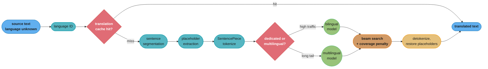
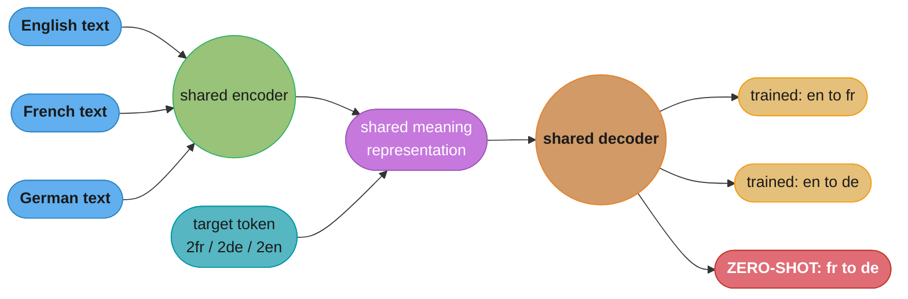

# Chapter 3: Google Translate

> Ch 3 of 11 · Generative AI System Design Interview (Aminian & Sheng, ByteByteGo, 2024) · builds on Ch 2 — Gmail Smart Compose, leads to Ch 4 — ChatGPT: Personal Assistant Chatbot

## Chapter Map

Chapter 2 generated text conditioned on text the same user had just written, under a latency
budget so tight that it dictated the architecture. This chapter keeps the sequence-generation
framing and relaxes that budget — a translation may take a few hundred milliseconds — which is
exactly what lets the design finally reach for the encoder-decoder-with-attention architecture
Smart Compose had to turn down. In exchange, three problems appear that Smart Compose never
had. There is now a **source sequence that must be fully consumed and fully expressed**, so
omitting or duplicating content is a correctness failure rather than a style choice. There are
**thousands of language pairs**, which makes one-model-per-pair combinatorially impossible.
And there is a **reference translation**, which makes supervised training possible and
simultaneously invites a whole family of automatic metrics that the chapter spends considerable
effort explaining you should not trust too far.

**TL;DR:**
- Translation is framed as **sequence-to-sequence** learning — a conditional language model
  `P(target | source)` — trained on **parallel corpora** of aligned sentence pairs, which are
  mined, aligned, and cleaned rather than simply collected.
- The architecture's history is the chapter's teaching device: a plain RNN encoder-decoder
  squeezes the whole source through **one fixed-length vector** and degrades badly on long
  sentences; **attention** removes that bottleneck by letting the decoder look back at every
  encoder state; the **transformer** replaces recurrence with attention throughout.
- **Subword tokenization (BPE / SentencePiece) with a shared multilingual vocabulary** is what
  makes one model serve many languages: prepend a target-language token to the source and a
  single model handles hundreds of pairs, including **zero-shot** pairs it was never trained on.
- **Low-resource pairs are the real problem**, and **back-translation** is the chapter's main
  answer — train a reverse model, run it over abundant monolingual target text, and use the
  synthetic pairs, deliberately placing the noise on the source side where the encoder tolerates
  it.
- **BLEU is the standard metric and the chapter is explicit about its weaknesses** — no recall,
  no credit for synonyms, tokenization-sensitive, weak at the sentence level — so it is reported
  alongside **chrF**, learned metrics in the COMET/BLEURT family, and genuine human evaluation.

## The Big Question

> A hundred languages is not a hundred problems, it is nearly ten thousand — every ordered pair
> is its own translation direction, and for most of those pairs no aligned training data exists
> at all. You cannot train ten thousand models, you cannot collect ten thousand corpora, and for
> a pair like Icelandic-to-Swahili you may not be able to find a thousand honest sentence pairs
> anywhere. How do you build one system that translates between all of them, and how do you know
> whether any given direction is any good?

Analogy: a phrase-book translator matches fragments against a table and stitches the results
together — which is roughly what statistical machine translation did, and it produces output
that is locally plausible and globally incoherent. A fluent bilingual speaker does something
categorically different: they read the whole sentence, build an internal representation of what
it *means*, and then say that meaning in the other language, restructuring word order and
grammar freely because the representation was never tied to the source's surface form. Neural
machine translation is the second thing. And the multilingual version of it is the observation
that a person who speaks five languages does not maintain twenty separate translation tables in
their head — they have one shared understanding of meaning, and a choice of which language to
speak it in. That shared representation is exactly what a single multilingual model learns, and
it is why the model can translate a pair it never saw an example of.

---

## 3.1 Clarifying Requirements

- **What is the input and output?** Input is text in a source language, optionally with the
  source language declared by the user. Output is text with the same meaning in a specified
  target language. The chapter scopes to **text-to-text** translation and treats speech
  translation, image (OCR) translation, and real-time conversation modes as adjacent products
  built on top of this core.
- **Is the source language known?** Often not — a user pastes text without saying what it is,
  or a web page's declared language is wrong. So **language identification** is a first-class
  component of the system, not an assumption, and it must handle short inputs (a two-word
  query is genuinely ambiguous between several languages) and mixed-language input.
- **How many languages, and therefore how many directions?** This is the requirement that
  shapes the architecture. With `N` languages there are `N × (N-1)` ordered directions —
  100 languages gives 9,900 directions, and 200 gives 39,800. Training and serving one model
  per direction is impossible on both training cost and serving footprint, so the design is
  pushed toward **multilingual models** before any modelling detail is discussed.
- **What is the latency budget?** Far more forgiving than Ch 2's. Interactive text translation
  targets a few hundred milliseconds end-to-end, which comfortably accommodates an encoder pass
  and an autoregressive decode. Document and web-page translation is effectively batch and can
  spend seconds. This relaxation is what unlocks the architecture Smart Compose could not afford.
- **What is the quality bar?** Two axes the chapter separates and keeps separate:
  **adequacy** (is the source's meaning fully and correctly conveyed?) and **fluency** (does the
  output read like natural target-language text?). They trade off — a literal word-by-word
  rendering maximizes adequacy and destroys fluency, and a fluent paraphrase can quietly drop
  a clause.
- **What scale?** Billions of translation requests per day across text, web pages, and
  documents, with a heavily skewed distribution: a handful of directions (English to and from
  the major world languages) carry the overwhelming majority of traffic, while the long tail of
  low-resource directions carries very little traffic and has very little training data.
- **What are the known-hard inputs?** Named entities and numbers that must survive unchanged;
  URLs, email addresses, and code that must not be translated at all; **code-switched** text
  that mixes two languages in one sentence; slang and newly coined terms; and formality and
  grammatical-gender choices that the source language may not specify but the target language
  demands.

**Functional summary:** given text of possibly-unknown language and a target language, return an
adequate and fluent translation in a few hundred milliseconds, across hundreds of directions
including ones with almost no training data, without mangling entities, markup, or numbers.

---

## 3.2 Framing the Problem as an ML Task

### Defining the ML objective

Translation is **conditional sequence generation**. Given a source token sequence
`x = x_1 … x_n`, produce a target sequence `y = y_1 … y_m`, modelling

```
P(y | x) = prod_{t=1..m} P(y_t | y_1 ... y_{t-1}, x)
```

which is read as: each target token is predicted from everything already generated *and* from
the entire source. Training maximizes the log-likelihood of the reference translation, token by
token, with the model shown the true previous tokens rather than its own predictions
(**teacher forcing**) — which is fast and stable, and which introduces the **exposure bias**
the chapter names: at inference the model conditions on its own possibly-wrong output, a regime
it never saw during training, which is part of why an early error can cascade.

Two structural differences from Ch 2 are worth stating explicitly in an interview:

- **There is a reference.** Smart Compose had no ground truth for "the right suggestion";
  translation has a human translation to compare against, so training is genuinely supervised
  and automatic evaluation is possible at all.
- **The source must be fully consumed.** A dropped clause is a defect, not a stylistic choice.
  This gives rise to failure modes with no analogue in the previous chapter — **under-translation**
  (content silently omitted) and **over-translation** (content repeated) — and to the coverage
  mechanisms in §3.4 that exist specifically to police them.

### Statistical machine translation, and why the field left it

The chapter positions neural MT against what preceded it. **Phrase-based statistical machine
translation (SMT)** decomposed the problem into separately-trained pieces: a **translation
model** (a phrase table of source fragments mapped to target fragments with probabilities,
extracted from word alignments), a **language model** over the target language scoring fluency,
and a **reordering model** handling word-order differences, all combined by a decoder searching
for the highest-scoring combination.

The failure is structural rather than incidental. Each component is trained on its own objective,
so nothing optimizes translation quality end to end; phrase tables generalize poorly to phrasings
they never saw; and long-range reordering — the kind that a subject-object-verb language demands
against a subject-verb-object one — is beyond what a local reordering model can express. Neural
MT replaces all of it with a single network trained end to end on the actual objective, which is
both the quality argument and the simplicity argument.

### Choosing the ML approach — sequence-to-sequence

The pick is a **neural encoder-decoder**: an encoder builds a representation of the source, a
decoder generates the target from it autoregressively. §3.4 walks the three generations of this
architecture. The framing decision that matters most at this step is not RNN-versus-transformer
but **how many models**:

- **One model per direction.** Best per-pair quality for the highest-resource directions,
  impossible at `N × (N-1)` scale, and it gives a low-resource direction nothing but its own
  scarce data.
- **One model per source or target language** (many-to-one, one-to-many). A middle ground that
  shares some capacity.
- **One multilingual model for all directions.** A single shared encoder, decoder, and
  vocabulary, with the desired output language signalled by a **target-language token prepended
  to the source** (for example `<2fr>`). Low-resource directions borrow representation from
  high-resource ones, and the model can translate directions it never saw training data for.

The chapter's design takes the multilingual route for the long tail and keeps dedicated,
optimized models for the highest-traffic directions — a split that serves quality where traffic
justifies it and coverage everywhere else.

---

## 3.3 Data Preparation

### What a parallel corpus is, and where it comes from

The training data is **parallel text**: sentence pairs that are translations of each other.
Unlike Ch 2's corpus, this cannot be scraped and used — it must be *constructed*, and the
construction is most of the work.

Sources the chapter draws on:

- **Institutional proceedings** — parliamentary and international-organization records
  published in many official languages, professionally translated and already
  document-aligned. High quality, formal register, limited domain and limited language coverage.
- **Public parallel corpus collections** aggregating many such sources across many pairs.
- **Web-mined parallel data** — by far the largest volume and the lowest average quality.
  Multilingual websites publish the same page in several languages, and mining them is what
  produces training data for pairs no institution has ever covered.
- **Monolingual text in the target language**, which is not parallel at all but becomes
  training data through back-translation (below) — and which exists in vastly greater quantity
  than parallel text for every language.

### Mining and alignment

Turning crawled multilingual pages into sentence pairs is a pipeline, and each stage drops data:

1. **Document pairing.** Identify which pages on a site are translations of each other, using
   URL structure (`/en/` versus `/de/`), page structure similarity, and cross-links.
2. **Sentence segmentation.** Split both documents into sentences — non-trivial for languages
   without terminal punctuation conventions matching the source's.
3. **Sentence alignment.** Match source sentences to target sentences. Classical aligners exploit
   the strong correlation between the lengths of a sentence and its translation, combined with
   lexical anchors (numbers, names, dictionary matches). Modern aligners embed both sides into a
   shared multilingual sentence-embedding space and align on cosine similarity, which handles
   one-to-many and many-to-one alignments and reordered content that a length-based aligner
   cannot.
4. **Pair filtering.** Score each candidate pair and drop the weak ones.

### Cleaning — the filters that matter

- **Length-ratio filtering.** A source sentence of 8 words paired with a target of 60 is almost
  certainly a misalignment, whatever the aligner scored it. Ratio bounds are set per language
  pair, because the natural expansion ratio genuinely differs between languages.
- **Language identification on both sides.** Mined pairs are full of cases where the "translated"
  page was never translated and both sides are the same language, or one side is a third
  language entirely.
- **Deduplication.** Boilerplate — cookie notices, navigation menus, legal footers — is
  identical across thousands of mined pages and would dominate the corpus by frequency.
- **Removing machine-translated content.** This is the filter the chapter singles out as
  uniquely important and uniquely easy to skip. A large and growing share of multilingual web
  content was produced by machine translation, so a naive crawl feeds a model its own (or a
  competitor's) output back as ground truth. The model then learns to reproduce MT artifacts as
  if they were how humans write, and the errors compound with every retraining cycle. Detection
  relies on MT-output classifiers and on site-level heuristics, and it is imperfect — which is
  an argument for weighting high-confidence human-translated sources more heavily rather than
  relying on the filter alone.
- **Noise-aware weighting.** Rather than a hard keep-or-drop decision, pairs are scored and the
  score is used to weight their contribution to training, so a moderately noisy pair contributes
  something without contaminating the signal.

### Low-resource pairs and back-translation

For most of the `N × (N-1)` directions, mined parallel data is thin or absent. The chapter's
primary technique is **back-translation**:

```
1. Train a reverse model:  target -> source   (on whatever real parallel data exists)
2. Take abundant MONOLINGUAL text in the TARGET language
3. Run the reverse model over it to produce SYNTHETIC source sentences
4. Train the forward model on (synthetic source, real target) pairs, mixed with real pairs
```

The direction is the whole trick, and it is a common interview question. The synthetic,
error-containing text ends up on the **source** side, where the encoder simply has to build a
representation from imperfect input — a robustness burden it tolerates well. The **target**
side stays real, human-written, fluent text, which is what the decoder learns to produce. Doing
it the other way round — synthesizing the target — would train the decoder to imitate machine
output and would bake the reverse model's errors into the forward model's fluency. The mixing
ratio of synthetic to real data is tuned, since too much synthetic data drowns the real signal.

Two complementary techniques the chapter names:

- **Transfer through multilingual training.** A low-resource direction improves simply by being
  trained alongside related high-resource directions in one model, because it inherits shared
  representations from languages with similar structure or script.
- **Pivoting.** Translating through a bridge language (`is → en → sw`) when no direct data
  exists. It works, and it compounds errors from two decodes and doubles latency, which is why
  a multilingual model's zero-shot direct translation is preferred where it is good enough.

### Tokenization and the shared vocabulary

Word-level vocabularies fail at translation for a specific reason: to cover many languages,
including morphologically rich ones that inflect a single lemma into dozens of forms, the
vocabulary would have to be enormous, and everything outside it becomes an unknown token that
the model can neither understand nor produce.

**Subword tokenization** solves it by splitting text into frequent sub-word pieces.
**Byte-pair encoding (BPE)** starts from characters and repeatedly merges the most frequent
adjacent pair, building up a vocabulary of the pieces that actually occur; a common word ends up
as a single token, a rare one decomposes into several. **SentencePiece** implements BPE and a
unigram-language-model alternative directly over raw text, treating whitespace as just another
character — which is what makes it work for Chinese, Japanese, and Thai, where there are no
spaces to pre-tokenize on, and what makes tokenization reversible without language-specific
detokenization rules.

The multilingual design uses a **single shared vocabulary across all languages**, typically
much larger than a bilingual one (on the order of a hundred thousand-plus pieces rather than
tens of thousands). Sharing is what enables cross-lingual transfer at all: languages with
common script and shared cognates literally share tokens, so a representation learned from a
high-resource language is directly reusable. The cost is that the vocabulary is a fixed budget
divided among all languages, so each individual language gets coarser segmentation than a
dedicated vocabulary would give it — a low-resource language with a distinctive script can end
up fragmented into many tokens per word, which inflates both its sequence lengths and its
serving cost.

### Balancing the language distribution

Training data volume across languages spans several orders of magnitude. Sampled proportionally,
the highest-resource directions dominate every batch and the long tail learns almost nothing.
The fix is **temperature sampling** over the language distribution: sample language `l` with
probability proportional to `p_l^(1/T)`, where `T = 1` is proportional sampling and larger `T`
flattens toward uniform. Raising `T` up-samples low-resource languages and improves them, at
some cost to the high-resource directions that now see relatively less of their own data. The
chapter's framing is that this single scalar is where the product decides how much
high-resource quality it is willing to spend on long-tail coverage.

---

## 3.4 Model Development

### The architecture ladder, and the bottleneck that drove it

**Generation 1 — RNN encoder-decoder.** The encoder reads the source token by token, updating a
hidden state, and its final hidden state — one fixed-length vector — is handed to the decoder as
the entire representation of the source. Elegant, and structurally broken:

```
Broken: the fixed-length context bottleneck

  source (40 tokens)  -> [ RNN encoder ] -> c   (one 512-d vector)
                                             |
                                             v
                                        [ RNN decoder ] -> target

  every word, every clause, every named entity in a 40-word sentence
  must survive compression into the SAME 512 numbers that a 5-word
  sentence gets.  translation quality degrades sharply as source length
  grows, and the degradation is worst exactly at the START of the target,
  which is generated furthest from where the encoder read the source's end.
```

**Generation 2 — attention.** Instead of one vector, the encoder emits one hidden state **per
source token**, and at every decoding step the decoder computes a distribution over those states
and takes a weighted sum:

```
score_i   = align(decoder_state_t, encoder_state_i)     for every source position i
alpha_i   = softmax(score_i)                            weights sum to 1
context_t = sum_i alpha_i * encoder_state_i             a DIFFERENT context per output step
```

The bottleneck disappears — the decoder has direct access to every source position and chooses
what to look at as it goes. As a side effect the attention weights `alpha` form a soft
**alignment** between source and target words, which is both interpretable and directly useful:
it is how formatting and markup get carried across in §3.6.

**Generation 3 — the transformer.** Replace recurrence entirely. The encoder uses **self-attention**
so every source token attends to every other; the decoder uses **masked self-attention** over the
tokens generated so far plus **cross-attention** into the encoder output. Training parallelizes
across all positions rather than stepping sequentially, which is the reason transformers made
much larger MT models trainable. Decoding remains sequential — one token at a time — so the
transformer's training speedup does not translate into an inference speedup, which is the fact
that drives every serving optimization in §3.6.

### Multilingual models and zero-shot translation

The multilingual model is architecturally ordinary — a standard transformer encoder-decoder —
and made multilingual by two conventions: a **shared subword vocabulary** across all languages,
and a **target-language token prepended to the source sequence** telling the decoder which
language to emit.

The striking consequence is **zero-shot translation**. Train on `en↔fr` and `en↔de` and the model
can translate `fr→de` having never seen a single French-German pair, because the encoder has
learned to map both French and German into a shared, largely language-agnostic representation of
meaning and the decoder has learned to render that representation into whichever language the
target token requests. Zero-shot quality sits below a properly supervised direction, and it has
a characteristic failure mode worth naming: **off-target translation**, where the model ignores
the target token and emits the wrong language entirely — usually English, because English
dominates the training mix. Mitigations are more balanced sampling, a small amount of
zero-shot-direction data generated by back-translation, and monitoring emitted-language identity
in production (§3.7).

### The transfer-interference tradeoff

Adding languages to one model has two opposing effects, and the chapter insists on naming both:

- **Transfer** — low-resource languages improve, sometimes dramatically, by borrowing
  representations from high-resource relatives.
- **Interference** — high-resource languages get *worse*, because a fixed parameter budget is now
  divided among more languages and the model is forced to compromise between conflicting
  patterns.

The tradeoff is real and it is a capacity problem, so the levers are capacity-shaped: scale the
model until interference recedes; add **language-specific adapters** (small per-language modules
inserted into a shared backbone, trained per language while the backbone stays fixed); or use
**sparsely-gated mixture-of-experts** layers so that different languages can route to different
experts and stop competing for the same weights. This is also the honest answer to why the
highest-traffic directions keep dedicated models: for them, interference is a cost with no
compensating transfer benefit.

### Decoding

- **Beam search**, typically with a beam width of 4 to 8 — wider than Ch 2's, because a full
  sentence has far more room for an early local choice to be globally wrong, and the latency
  budget can absorb it. Beyond about 8 the quality curve flattens and can even invert, a
  well-known and counter-intuitive result: very wide beams find high-probability but degenerate
  outputs, notably empty or truncated translations, because the model assigns suspiciously high
  probability to stopping early.
- **Length normalization**, dividing by a function of length, for the same reason as Ch 2 —
  otherwise every additional token lowers the score and the model systematically truncates.
- **Coverage penalty.** The direct fix for under- and over-translation: accumulate the attention
  mass each source position has received, and penalize candidates that leave a source position
  largely unattended (dropped content) or attend to one repeatedly (duplicated content). This
  has no counterpart in Smart Compose, where nothing had to be fully consumed.
- **Constrained decoding** for terminology and do-not-translate spans, forcing a required target
  term or preserving a token verbatim. This is how a glossary requirement — a company's product
  names, a legal term of art — is honoured without retraining.

### Handling what subwords cannot

Numbers, URLs, email addresses, and code fragments must pass through unchanged, and a subword
model that has to *generate* a 14-digit number token by token will eventually get a digit wrong.
The production answer is to detect these spans before the encoder, replace them with placeholder
tokens, translate, and substitute the originals back afterwards using the attention alignment to
find where each placeholder landed. Named entities are handled more softly, since some genuinely
should be translated (city names with established exonyms) and some must not be (personal names).

---

## 3.5 Evaluation

### BLEU — mechanism, and a worked example

**BLEU (Bilingual Evaluation Understudy)** is the field's standard automatic metric, and the
chapter walks its mechanics before criticizing it.

```
BLEU = BP * exp( sum_{n=1..4} w_n * log p_n )

  p_n = modified n-gram precision: of the candidate's n-grams, the fraction
        also in the reference, with each reference n-gram counted at most as
        many times as it appears there (this "clipping" is what stops a
        candidate scoring 1.0 by repeating one correct word)
  w_n = weights, conventionally 1/4 each for n = 1..4
  BP  = brevity penalty = 1 if c > r, else exp(1 - r/c)
        where c = candidate length, r = reference length
```

Two design decisions are doing real work. The **geometric mean** across n-gram orders means a
zero at any order zeroes the whole score, so a candidate with perfect word choice and no correct
4-gram scores nothing — BLEU insists on some local word order being right. The **brevity
penalty** exists because precision alone rewards saying less: a one-word candidate that happens
to appear in the reference has perfect 1-gram precision, so without BP the metric's optimum is
near-silence. BLEU has **no recall term at all**, and BP is the entire, rather crude,
compensation for that.

```
  reference:  "the cat is on the mat"
  candidate:  "the cat is on mat"

  1-grams:  the(2) cat is on mat        -> matched 5 of 5   p_1 = 5/5 = 1.00
  2-grams:  "the cat" "cat is" "is on" "on mat"
            "on mat" is NOT in the reference ("on the")     p_2 = 3/4 = 0.75
  3-grams:  "the cat is" "cat is on" "is on mat"            p_3 = 2/3 = 0.67
  4-grams:  "the cat is on" "cat is on mat"                 p_4 = 1/2 = 0.50

  c = 5, r = 6  ->  BP = exp(1 - 6/5) = exp(-0.2) = 0.819

  BLEU = 0.819 * exp( (ln1.00 + ln0.75 + ln0.67 + ln0.50) / 4 ) ~ 0.59

  one dropped article costs ~40% of the score.  a synonym substitution
  ("feline" for "cat") would cost far more, because it breaks EVERY n-gram
  that contains it - at all four orders at once.
```

### What BLEU cannot see

The chapter is unusually direct about this, and it is the most quotable part of the chapter in
an interview:

- **No credit for synonyms or paraphrase.** A correct translation using different words scores
  near zero. Since translation legitimately admits many correct outputs, BLEU penalizes exactly
  the diversity the task allows.
- **No recall.** BLEU measures how much of the candidate is in the reference, never how much of
  the reference made it into the candidate; the brevity penalty is a length-based proxy that a
  wordy candidate can satisfy while omitting the actual content.
- **Tokenization sensitivity.** BLEU is computed over tokens, so different tokenization of the
  same text yields different scores — which historically made published numbers incomparable
  until standardized implementations (the sacreBLEU convention of reporting a fixed tokenization
  signature alongside the score) fixed the reporting.
- **Weak at the sentence level.** BLEU is a corpus-level statistic; on a single sentence, with
  very few 4-grams to average over, it is extremely noisy and should not be used to judge
  individual outputs.
- **Not comparable across languages.** A BLEU of 30 into a morphologically rich language and a
  BLEU of 30 into English do not mean the same thing, because the metric's difficulty depends
  on how much surface variation the target language permits.
- **Poor discrimination at high quality.** As systems approach human quality, BLEU's correlation
  with human judgment weakens badly — precisely in the regime where the decisions matter most.

### The other metrics

- **chrF** — an F-score over **character** n-grams rather than word n-grams. Because it has a
  recall term and works at character granularity, it degrades gracefully under morphological
  variation and works for languages without whitespace word boundaries, both of which are BLEU's
  weakest points.
- **METEOR** — matches on stems and synonyms as well as exact tokens, and weights recall more
  heavily than precision. Better human correlation than BLEU, at the cost of needing
  language-specific resources (stemmers, synonym dictionaries), which limits its coverage.
- **Learned / neural metrics (the COMET and BLEURT family)** — a model trained by regression on
  human quality judgments, scoring a translation from the source, the candidate, and (usually)
  the reference. Correlation with human judgment is substantially better than BLEU's, especially
  at high quality. The costs are real: you need a model to evaluate a model, the scores are not
  comparable across metric versions, and the metric itself has training-data biases and can be
  optimized against.
- **Human evaluation** remains the ground truth. **Direct assessment** has raters score adequacy
  and fluency on a scale. **Side-by-side ranking** compares two systems, which is easier for
  raters and enough to make a ship decision. **MQM-style error annotation** has professional
  linguists mark individual errors by category (accuracy, fluency, terminology, style) and
  severity, producing a weighted error score — expensive, slow, and by far the most actionable,
  because it says *what* is wrong rather than only *how much*.

### Online evaluation

- **Usage and retention** per direction — the coarsest signal that a direction is useful.
- **Post-edit distance** where translations are edited by users or professionals: how much
  editing the output needed is a direct measure of practical quality.
- **User-reported errors and correction submissions**, which are heavily biased toward
  catastrophic failures and therefore an excellent detector for exactly those.
- **Copy rate and dwell time** on translated web pages, as proxies for whether the translation
  was usable.
- **A/B tests** run per direction, because a model change is very often positive for some
  directions and negative for others.

---

## 3.6 Overall ML System Design

### The serving path

A translation request runs through more non-model stages than one might expect, and most
production quality complaints trace to them rather than to the model.

1. **Language identification**, if the source language is not declared. Short inputs are
   genuinely ambiguous, so the detector returns a distribution and low confidence can trigger a
   user-visible prompt rather than a silent guess.
2. **Segmentation** into sentences, since the models are trained on sentence pairs and a whole
   document exceeds any practical sequence length. Segmentation errors propagate: a sentence
   split at the wrong place produces two fragments that each translate poorly.
3. **Placeholder extraction** — URLs, emails, numbers, code, and any markup are lifted out and
   replaced with placeholder tokens.
4. **Tokenization** with the shared SentencePiece model.
5. **Routing** — which model serves this direction? A dedicated high-quality model for
   high-traffic directions, the multilingual model for the long tail, and possibly a smaller
   distilled model for latency-sensitive or high-volume surfaces.
6. **Batched autoregressive decoding** with beam search, length normalization, and coverage
   penalty.
7. **Detokenization, recasing, and placeholder restoration**, using attention alignment to place
   each preserved span correctly.
8. **Reassembly** of the segmented sentences into the original document or page structure.

### Web page and document translation

Translating a web page is not translating its text — it is translating the text *while keeping
the markup valid and correctly placed*. The text inside a tag pair must come out inside the
corresponding tag pair even when word order has completely inverted between source and target,
and the tags themselves must never be translated or reordered into invalid nesting. The standard
approach lifts inline markup into placeholders, translates, and re-inserts using the attention
alignment to decide where each tag now belongs. Getting this wrong produces the classic symptom
of a page where the bold span covers the wrong three words.

### Caching — the highest-leverage component

Translation request traffic is extremely repetitive: popular web pages are translated by many
users, and short common phrases recur constantly. An exact-match **translation cache**, keyed on
(normalized source text, source language, target language, model version), absorbs a very large
fraction of traffic at essentially zero cost. The model version must be in the key, or a model
rollout silently continues serving the previous model's output indefinitely. Longer-lived
**translation memory** — storing approved translations of specific segments — additionally lets
an enterprise pin terminology and reuse professionally-translated segments verbatim.

### Scale estimation — a worked example

Suppose 1 billion translation requests per day, averaging 3 sentences of about 25 tokens each.

```
requests/day     = 1e9
average QPS      = 1e9 / 86,400                        ~ 11,600 QPS
peak QPS         = ~3x average                         ~ 35,000 QPS
sentences/sec at peak = 35,000 x 3                     ~ 105,000 sentences/sec

with a 70% cache hit rate, only 30% reach a model:     ~ 31,500 sentences/sec

decode cost: ~30 output tokens, sequential, at ~2 ms per step
             on a batched accelerator                  ~ 60 ms per sentence
one accelerator at batch 64                            ~ 1,000 sentences/sec
model fleet needed                                     ~ 32 accelerators
```

The cache is doing more work than any model optimization in that arithmetic: without it the fleet
is roughly 105 accelerators rather than 32. The chapter's point is that in translation — unlike
in an open-ended chatbot, where identical requests are rare — exact-match caching is a first-order
architectural component, not an optimization to add later.

### Quality tiering

Not every request deserves the same model. Interactive typing-as-you-go translation can use a
small distilled model, since the user is watching output change anyway; a document upload can
use the full model with a wider beam; and a professional translation workflow can afford
generating multiple candidates and reranking them with a quality-estimation model. Serving one
model to all surfaces either overspends on the cheap cases or underserves the expensive ones.

---

## 3.7 Deployment and Monitoring

- **Monitor quality per direction, never in aggregate.** A single model serves hundreds of
  directions, and a change that raises the average can devastate one of them — the
  transfer-interference tradeoff in §3.4 guarantees that regressions are *directional*. The
  release gate is a per-direction evaluation suite, with high-traffic directions blocking a
  rollout outright.
- **Quality estimation without a reference.** In production there is no reference translation,
  so run-time quality assessment uses a **quality-estimation (QE) model** that scores a
  translation from the source and the output alone. Low-confidence translations can be flagged
  to the user, routed to a larger model, or suppressed in favour of showing the original.
- **Watch for the catastrophic failure modes specifically**, because each is invisible to an
  average-quality metric:
  - **Hallucinated translation** — fluent, confident output largely unrelated to the source,
    triggered by out-of-distribution or very short input. It is far more damaging than clumsy
    output because it gives the user no signal that anything went wrong.
  - **Repetition loops** — the decoder emitting the same phrase until the length limit, a
    classic degenerate beam-search outcome.
  - **Empty or truncated output**, which very wide beams actively encourage.
  - **Off-target language** — a multilingual model emitting a language other than the one
    requested, most common on zero-shot directions. Detect it by running language ID on the
    model's own output and alerting on the mismatch rate per direction.
- **Drift.** New named entities, product names, slang, and event-specific vocabulary appear
  continuously, and a static model handles them by transliteration or by mistranslation. A
  rolling retrain plus a fast path for glossary injection (§3.4's constrained decoding) covers
  both timescales.
- **Guard against the MT-contamination feedback loop.** The system's own output is published to
  the web, crawled by the next data-mining cycle, and fed back in as training data. Without the
  MT-detection filters from §3.3, quality drifts toward the model's own current errors and the
  degradation is self-reinforcing and slow enough to miss.
- **Code-switched and mixed-language input** should be detected rather than forced through a
  single-source-language path, and monitored as its own segment, since it is precisely the input
  that language identification is worst at and that users report most often.

---

## Beyond the book — translation after 2024

> Disclosed as the repo requires: the chapter above describes dedicated neural MT — a trained
> encoder-decoder, multilingual models with a target-language token, back-translation, and
> BLEU-centred evaluation. It does not describe general-purpose large language models used as
> translators, document-level and context-aware translation as a product, or the displacement of
> BLEU by learned metrics as the field's default. All of that is later material and none of it
> is Aminian and Sheng's.

The largest shift is that **general-purpose LLMs are now competitive with, and on many
directions better than, dedicated NMT systems** — particularly on the things dedicated NMT is
structurally worst at: document-level coherence, register and formality control, ambiguous
pronoun resolution requiring world knowledge, and following an explicit instruction ("translate
this formally, keep the product names in English"). The tradeoffs invert the chapter's own
arithmetic: an LLM is far more expensive per token and far slower than a small dedicated MT
model, so the production pattern that has emerged is hybrid — a fast dedicated model for the
high-volume path, an LLM for the quality-sensitive path or for reranking the dedicated model's
candidates. Cascading the two is also how the chapter's own quality-estimation idea gets
operationalized: use QE to decide which requests are worth escalating.

Two smaller shifts. **Document-level context** has become a product expectation rather than a
research topic — translating a sentence with the preceding paragraph in the model's context
resolves pronoun and terminology consistency problems that sentence-level MT cannot address in
principle, which retires a chunk of §3.6's segmentation reasoning. And in evaluation, **BLEU has
largely been displaced as the primary reported metric** in the research community in favour of
learned metrics in the COMET family, following successive metrics-shared-task findings that BLEU
correlates poorly with human judgment at modern quality levels. BLEU survives as a cheap,
reference-free-of-model-dependencies regression check — which is a good reason to keep the
chapter's explanation of exactly what it does and does not measure.

---

## Visual Intuition

### The serving path — where the non-model stages sit



Caption: the model is one box among nine, and the cache sits in front of everything — at a 70%
hit rate it is worth more than any decoding optimization downstream of it.

### The attention alignment grid — what replaced the fixed-length vector

```
  attention weights alpha[target_position][source_position]
  (French source, English target; darker = more weight)

                    le    chat   noir   dort
                   ----- ------ ------ ------
      the         | .91  | .05  | .02  | .02 |
      black       | .03  | .06  | .88  | .03 |
      cat         | .04  | .87  | .06  | .03 |
      sleeps      | .02  | .04  | .03  | .91 |
                   ----- ------ ------ ------

  read a ROW: "which source words did I look at to produce this target word"
  every row sums to 1.0 - it is a softmax over source positions

  note the CROSSING: "black" (row 2) attends to "noir" (column 3) while
  "cat" (row 3) attends to "chat" (column 2).  French puts the adjective
  after the noun, English before it, and attention expresses that
  reordering for free - a phrase-based system needed an explicit
  reordering model to do the same thing, and a fixed-vector RNN had
  nowhere to express it at all
```

Caption: attention is a per-output-step, learned soft alignment over the source, which is both
the fix for the fixed-length bottleneck and the byproduct that makes markup and placeholder
restoration possible in §3.6.

### Multilingual training and the zero-shot direction



Caption: the shared representation is what makes `fr→de` possible with no French-German data —
and it is also what makes off-target output possible, since nothing but the target token stops
the decoder emitting the language it saw most.

### Back-translation, and why the direction matters

```
  goal: improve  is -> sw  (Icelandic to Swahili), very little parallel data

  step 1   train the REVERSE model on what real data exists
             sw -> is                                    (weak, but usable)

  step 2   take abundant MONOLINGUAL Swahili text        (millions of sentences)

  step 3   run it through the reverse model
             real Swahili  --[sw->is model]-->  SYNTHETIC Icelandic

  step 4   train the forward model on the pair, flipped:
             SYNTHETIC Icelandic  ->  REAL Swahili
             ^^^^^^^^^                ^^^^
             noise on the             fluent human text
             SOURCE side              on the TARGET side
             (encoder tolerates       (decoder learns to
              imperfect input)         produce real language)

  doing it the other way round - synthesizing the TARGET - would train the
  decoder to imitate machine output, baking the reverse model's errors
  into the forward model's fluency.  same data, opposite result.
```

Caption: back-translation is not "generate more data", it is "generate data whose noise lands on
the side of the model that can absorb it" — which is why the question "which side is synthetic?"
is the one that separates a real understanding of the technique from a memorized name.

---

## Key Concepts Glossary

- **Neural machine translation (NMT)** — translation by a single end-to-end neural network
  trained on the translation objective directly.
- **Statistical machine translation (SMT)** — the preceding paradigm combining separately-trained
  phrase-table, language, and reordering models.
- **Phrase table** — SMT's learned mapping of source fragments to target fragments with
  probabilities.
- **Sequence-to-sequence (seq2seq)** — an encoder-decoder model mapping one variable-length
  sequence to another.
- **Encoder / decoder** — the component building a representation of the source, and the
  component autoregressively generating the target from it.
- **Teacher forcing** — training the decoder on the true previous target tokens rather than its
  own predictions.
- **Exposure bias** — the train/inference mismatch caused by teacher forcing: at inference the
  model conditions on its own possibly-wrong output.
- **Fixed-length context bottleneck** — the plain RNN encoder-decoder's flaw of compressing any
  source sentence into one vector, degrading badly with length.
- **Attention** — computing, at each decoding step, a softmax-weighted sum over all encoder
  states, giving the decoder direct access to every source position.
- **Alignment** — the correspondence between source and target words, learned implicitly as
  attention weights and used for markup and placeholder restoration.
- **Cross-attention** — the transformer decoder's attention into the encoder's output.
- **Self-attention** — attention of a sequence over itself, used in both encoder and decoder.
- **Parallel corpus** — a collection of sentence pairs that are translations of each other; the
  supervised training data for MT.
- **Sentence alignment** — matching source sentences to their translations within paired
  documents, by length statistics, lexical anchors, or multilingual sentence embeddings.
- **Length-ratio filtering** — dropping candidate pairs whose source and target lengths differ
  implausibly, as a misalignment detector.
- **MT contamination** — machine-translated text in a crawled corpus, which teaches a model its
  own errors as ground truth.
- **Back-translation** — generating synthetic source sentences from real monolingual target text
  using a reverse model, placing the noise on the source side.
- **Pivoting** — translating through a bridge language when no direct data or model exists,
  compounding errors from two decodes.
- **Byte-pair encoding (BPE)** — subword tokenization built by repeatedly merging the most
  frequent adjacent symbol pair.
- **SentencePiece** — a tokenizer operating directly on raw text with whitespace as an ordinary
  character, making it reversible and usable for languages without word spacing.
- **Shared multilingual vocabulary** — one subword vocabulary across all languages, enabling
  cross-lingual transfer at the cost of coarser segmentation per language.
- **Target-language token** — a token prepended to the source telling a multilingual decoder
  which language to emit.
- **Zero-shot translation** — translating a direction the model was never trained on, enabled by
  the shared representation.
- **Off-target translation** — a multilingual model emitting a language other than the one
  requested; the characteristic zero-shot failure.
- **Transfer / interference** — the opposing effects of multilingual training: low-resource
  languages gain, high-resource languages lose, at fixed capacity.
- **Language-specific adapters** — small per-language modules inserted into a shared backbone to
  reduce interference.
- **Temperature sampling over languages** — sampling language `l` with probability proportional
  to `p_l^(1/T)` to up-weight low-resource languages.
- **Beam search** — decoding by expanding the top `b` partial hypotheses at each step.
- **Length normalization** — dividing a hypothesis score by a function of its length so longer
  outputs are not systematically penalized.
- **Coverage penalty** — penalizing hypotheses that leave source positions unattended or attend
  to them repeatedly; the direct fix for under- and over-translation.
- **Under-translation / over-translation** — source content silently omitted, or duplicated, in
  the output.
- **Constrained decoding** — forcing required target terms or preserving verbatim spans during
  generation, used for glossaries and do-not-translate content.
- **Adequacy / fluency** — the two quality axes: is the meaning fully conveyed, and does the
  output read naturally.
- **BLEU** — the standard automatic metric: clipped n-gram precision at orders 1-4, geometric
  mean, times a brevity penalty.
- **Brevity penalty** — BLEU's length-based compensation for having no recall term.
- **chrF** — character n-gram F-score, with a recall term, robust for morphologically rich and
  unspaced languages.
- **METEOR** — a metric matching stems and synonyms and weighting recall, needing
  language-specific resources.
- **COMET / BLEURT (learned metrics)** — models trained by regression on human quality judgments,
  correlating better with humans than BLEU.
- **MQM error annotation** — professional annotation of individual errors by category and
  severity, producing a weighted error score.
- **Quality estimation (QE)** — scoring a translation's quality at run time from source and
  output alone, with no reference available.
- **Translation memory** — a store of approved translations of specific segments, reused verbatim
  for consistency.
- **Hallucinated translation** — fluent, confident output largely unrelated to the source.
- **Code-switching** — mixing two or more languages within a single utterance.

---

## Tradeoffs & Decision Tables

### How many models for N languages

| Approach | Directions covered | Quality on high-resource | Quality on low-resource | Feasible at N=100? |
|---|---|---|---|---|
| One bilingual model per direction | All, if you can train 9,900 | Best | Poor — only its own scarce data | No |
| Many-to-one / one-to-many | A slice at a time | Good | Some transfer | Partially |
| One multilingual model | All, including zero-shot | Reduced by interference | Best — transfer from relatives | **Yes** |
| Multilingual + dedicated models for top traffic | All | Best on top directions | Best on tail | **Chapter's design** |

### Architecture generations

| Architecture | Handles long sentences | Training parallelism | Inference | Gives alignment |
|---|---|---|---|---|
| RNN encoder-decoder | Poorly — fixed-vector bottleneck | Sequential | Sequential | No |
| RNN + attention | Well | Sequential | Sequential | Yes, explicitly |
| Transformer | Well | Fully parallel over positions | Still sequential decode | Yes, via cross-attention |

### Evaluation metric comparison

| Metric | Has recall | Credits synonyms | Needs a reference | Needs a model | Correlates at high quality |
|---|---|---|---|---|---|
| BLEU | No (brevity penalty only) | No | Yes | No | Weakly |
| chrF | Yes | Partially, via characters | Yes | No | Better than BLEU |
| METEOR | Yes, weighted | Yes, with resources | Yes | No | Better than BLEU |
| COMET / BLEURT family | Implicitly | Yes | Usually | Yes | Best of the automatic metrics |
| Human (MQM) | n/a | n/a | No | No | Ground truth, expensive and slow |

### Low-resource techniques

| Technique | What it needs | Gain | Cost / risk |
|---|---|---|---|
| Back-translation | Monolingual target text + a reverse model | Large | Reverse model's errors enter the source side; mixing ratio must be tuned |
| Multilingual transfer | Related high-resource languages in the same model | Moderate to large | Interference on the high-resource directions |
| Pivoting through a bridge language | Two trained directions | Works where nothing else does | Compounded errors, doubled latency |
| Temperature up-sampling | Nothing but a config change | Moderate | Directly costs high-resource quality |

### Beam width

| Beam | Quality | Cost | Note |
|---|---|---|---|
| 1 (greedy) | Noticeably worse on full sentences | Cheapest | Viable for a distilled interactive tier |
| 4-8 | Best in practice | Linear in beam | **Production default** |
| 20+ | Often *worse* | Expensive | Finds degenerate high-probability outputs — empty or truncated translations |

---

## Common Pitfalls / War Stories

- **Back-translating in the wrong direction.** Synthesizing the *target* side instead of the
  source trains the decoder to imitate machine output, so the forward model inherits the reverse
  model's errors as fluency habits. The technique's entire value comes from the noise landing on
  the encoder's side, where it acts as robustness training instead.
- **Training on crawled web data without MT detection.** A large share of multilingual web
  content is machine-translated, so the corpus feeds the model its own output back as ground
  truth, and the errors reinforce with every retraining cycle. The degradation is slow, uniform,
  and nearly invisible to aggregate metrics.
- **Judging a model change on aggregate BLEU across all directions.** A multilingual model's
  regressions are directional by construction — the transfer-interference tradeoff guarantees
  some directions lose when others gain — so an average that improves can hide a collapse in a
  major direction. Per-direction gating is not optional.
- **Reporting BLEU without a fixed tokenization.** BLEU is computed over tokens, so two
  implementations tokenizing differently produce different numbers for identical output, and
  cross-paper comparisons that ignore this have historically been meaningless.
- **Using BLEU at the sentence level.** BLEU is a corpus statistic; on one sentence there are too
  few 4-grams for the geometric mean to be stable, and a single-sentence BLEU comparison is
  mostly noise.
- **Setting the beam width very wide to buy quality.** Past roughly 8, quality flattens and often
  degrades, because wider search finds high-probability degenerate outputs — notably empty or
  truncated translations — that a narrower beam never reaches.
- **Translating markup as text.** Passing raw HTML through the model produces mangled tags,
  invalid nesting, and translated attribute values. Markup must be lifted to placeholders and
  restored via alignment.
- **Omitting the model version from the translation cache key.** A rollout then serves the
  previous model's output indefinitely for every cached segment, and the A/B test measures
  nothing.
- **Treating hallucinated translations as ordinary quality loss.** Fluent output unrelated to the
  source is worse than clumsy output, because the user gets no signal that anything went wrong.
  It needs its own detection — quality estimation, source-target semantic similarity — rather
  than being averaged into a corpus metric.
- **Trusting language identification on short input.** A two-word query is genuinely ambiguous
  between several languages, and a confidently wrong detection sends the text through the wrong
  model entirely, producing output that looks like a model failure but is a routing failure.

---

## Real-World Systems Referenced

**Systems and paradigms:** Google Translate (the chapter's subject), phrase-based statistical
machine translation as the preceding paradigm, and neural machine translation with attention and
transformer architectures. **Tokenization:** byte-pair encoding (BPE) and SentencePiece.
**Multilingual modelling:** shared-vocabulary multilingual encoder-decoders with a
target-language token, and zero-shot translation as their emergent property. **Data sources:**
parliamentary and international-organization proceedings, aggregated public parallel corpora,
and web-mined parallel data. **Metrics:** BLEU, chrF, METEOR, and the learned-metric family
(COMET, BLEURT), alongside human direct assessment and MQM error annotation. **Techniques:**
back-translation, pivoting, temperature-based language sampling, coverage penalty, and
constrained decoding for terminology.

---

## Summary

Translation is the book's first chapter with a real reference to train against, and the chapter
uses that to walk the architecture's history as an argument rather than a chronology: a plain
RNN encoder-decoder forces every source sentence through one fixed-length vector and collapses on
long input; attention removes the bottleneck by giving the decoder a learned, per-step soft
alignment over every source position; the transformer replaces recurrence with attention
throughout and makes much larger models trainable, without making decoding any less sequential.
The combinatorial problem — `N × (N-1)` directions — is solved not by more models but by one
multilingual model with a shared subword vocabulary and a target-language token, which buys
zero-shot coverage of directions that have no data at all, at the price of interference on the
high-resource directions and a characteristic off-target failure mode. Data preparation is where
most of the work actually lives: parallel corpora are mined, aligned, and filtered rather than
collected, machine-translated content has to be actively excluded or the model learns its own
errors, and the long tail is carried by back-translation, whose entire value depends on putting
the synthetic text on the source side where the encoder can absorb it. Evaluation is where the
chapter is most useful and most skeptical: BLEU's clipped n-gram precision and brevity penalty
are explained precisely so that its blindness to synonyms, its missing recall term, and its poor
discrimination at high quality can be named, with chrF, learned metrics, and human MQM annotation
filling the gaps. Chapter 4 keeps the autoregressive decoder and drops the source sequence
entirely, replacing the reference translation with something far harder to score: a human
preference.

---

## Interview Questions

**Q: What problem does attention solve that a plain RNN encoder-decoder cannot, and why does it get worse with sentence length?**
**Short:** It removes the fixed-length context bottleneck by giving the decoder access to every encoder state.
A plain RNN encoder compresses the entire source into a single fixed-length hidden state, so a forty-word sentence must fit into exactly the same vector a five-word sentence gets, and translation quality degrades sharply as source length grows because information is simply lost in that compression. Attention emits one encoder state per source token and lets the decoder compute a softmax-weighted sum over all of them at every output step, so it has direct access to any source position it needs. A useful side effect is that the attention weights form a soft alignment between source and target words, which production systems reuse to restore markup and placeholders correctly.

**Q: In back-translation, which side of the synthetic pair is machine-generated, and why does the direction matter so much?**
**Short:** The source side is synthetic — noise lands on the encoder, while the decoder trains on real fluent text.
You train a reverse target-to-source model, run it over abundant monolingual target-language text, and use the resulting (synthetic source, real target) pairs. Putting the machine-generated text on the source side means the encoder has to build representations from imperfect input, which it tolerates well and which acts as robustness training, while the decoder only ever learns to produce genuine human-written target language. Synthesizing the target instead would teach the decoder to imitate machine output, baking the reverse model's errors permanently into the forward model's fluency — same data, opposite outcome.

**Q: How does one model translate a language pair it has never seen training data for?**
**Short:** A shared multilingual vocabulary and encoder map all languages into one representation the decoder renders from.
A multilingual model uses a single shared subword vocabulary and a shared encoder-decoder, with a target-language token prepended to the source telling the decoder which language to emit — so the encoder learns to map French and German into a largely language-agnostic representation of meaning and the decoder learns to render that representation into whichever language is requested. Training only on English-French and English-German therefore yields usable French-German output without a single French-German pair, which is zero-shot translation. Quality sits below a supervised direction, and the characteristic failure is off-target output where the model ignores the target token and emits English instead.

**Q: What is BLEU actually measuring, and name three things it cannot see.**
**Short:** Clipped n-gram precision at orders 1-4, geometric-meaned, times a brevity penalty — with no recall term.
BLEU computes what fraction of the candidate's n-grams at orders one through four appear in the reference, with each reference n-gram counted at most as often as it occurs there, takes the geometric mean across orders, and multiplies by a brevity penalty that punishes candidates shorter than the reference. It cannot see synonyms or valid paraphrase, since a correct translation using different words breaks every n-gram containing them; it has no recall term at all, so content dropped from the reference is only crudely penalized through length; and it is a corpus-level statistic that is far too noisy to judge a single sentence. It is also tokenization-sensitive and correlates poorly with human judgment precisely at high quality levels, which is why chrF, learned metrics, and human evaluation are reported alongside it.

**Q: Why does adding more languages to a multilingual model sometimes make the high-resource directions worse?**
**Short:** Transfer helps low-resource languages while interference hurts high-resource ones at fixed capacity.
A fixed parameter budget is divided among every language in the model, so as languages are added the model is forced to compromise between conflicting patterns and the directions that had plenty of data on their own lose the capacity they were using — that is interference. The same sharing is what lets low-resource languages borrow representations from high-resource relatives, which is transfer, and the two effects run in opposite directions simultaneously. The levers are capacity-shaped: scale the model, add language-specific adapters into a shared backbone, or use sparsely-gated mixture-of-experts so languages route to different parameters instead of competing for the same ones.

**Q: Why is a very wide beam sometimes worse than a beam of 5?**
**Short:** Wider search finds high-probability degenerate outputs such as empty or truncated translations.
Beam search maximizes model probability, and beyond a moderate width it starts finding hypotheses the model scores highly for the wrong reason — most notoriously very short or empty translations, because models assign suspiciously high probability to stopping early. So quality rises with beam width up to roughly 4 to 8 and then flattens and can invert, while cost grows linearly the whole way. Length normalization mitigates part of this by making longer hypotheses competitive, and a coverage penalty mitigates the rest by penalizing hypotheses that leave source content unattended.

**Q: What is MT contamination in training data, and why is it self-reinforcing?**
**Short:** Machine-translated web text mined as training data teaches the model its own errors as ground truth.
A large and growing share of multilingual web content was produced by machine translation, so crawling for parallel data harvests MT output and presents it to the model as human reference text — the model then learns to reproduce MT artifacts as if they were how people write. Because the system's own published output is crawled in the next data cycle, the loop closes and each retraining amplifies the previous generation's errors. The defenses are MT-output classifiers, site-level heuristics, and weighting high-confidence human-translated sources far more heavily rather than trusting the filter alone.

**Q: Why do production translation systems use subword tokenization instead of words, and what does SentencePiece add over plain BPE?**
**Short:** Subwords bound the vocabulary and eliminate unknown tokens; SentencePiece works on raw text with no word spacing.
A word-level vocabulary covering many languages, including morphologically rich ones that inflect a lemma into dozens of forms, would be impractically large, and everything outside it becomes an unknown token the model can neither read nor produce. Byte-pair encoding builds a bounded vocabulary of frequent sub-word pieces, so common words are single tokens and rare ones decompose. SentencePiece operates directly over raw text treating whitespace as an ordinary character, which makes it work for Chinese, Japanese, and Thai where there are no spaces to pre-tokenize on, and makes detokenization exactly reversible without language-specific rules.

**Q: What are under-translation and over-translation, and what mechanism addresses them at decode time?**
**Short:** Content silently dropped or duplicated in the output, addressed by a coverage penalty over attention mass.
Because a translation must fully consume and fully express its source, a dropped clause (under-translation) or a repeated phrase (over-translation) is a correctness failure rather than a stylistic one, and neither shows up as a low-probability sequence to the model. The coverage penalty accumulates how much attention mass each source position has received across the decode and penalizes hypotheses that leave a position largely unattended or attend to it repeatedly. This has no analogue in a system like Smart Compose, where nothing had to be fully consumed, which is why the mechanism first appears in this chapter.

**Q: Why does caching matter more in translation than in an open-ended chatbot?**
**Short:** Translation requests repeat heavily — popular pages and common phrases — so exact-match hits are frequent.
Many users translate the same popular web pages and the same short common phrases, so an exact-match cache keyed on normalized source text plus the language pair absorbs a very large fraction of traffic at essentially zero compute. At a 70% hit rate the model fleet shrinks to roughly a third of its uncached size, which is a bigger win than any realistic decoding optimization. The key must include the model version, or a rollout will silently keep serving the previous model's output for every cached segment and the A/B test will measure nothing.

**Q: How would you monitor quality for a single multilingual model serving hundreds of directions?**
**Short:** Per-direction evaluation suites, because a multilingual model's regressions are directional by construction.
The transfer-interference tradeoff guarantees that a change improving the average can devastate an individual direction, so an aggregate metric is structurally incapable of gating a release safely — high-traffic directions need their own blocking evaluations. In production, where no reference exists, a quality-estimation model scores translations from source and output alone, letting low-confidence results be flagged, escalated to a larger model, or suppressed. Alongside that, catastrophic failure modes need dedicated detectors: run language identification on the model's own output to catch off-target translation, and watch for repetition loops and empty output separately from any average score.

**Q: What is a hallucinated translation, and why is it more damaging than a merely clumsy one?**
**Short:** Fluent, confident output largely unrelated to the source, giving the user no signal that anything failed.
Hallucination in translation is output that reads perfectly well in the target language but does not correspond to the source, typically triggered by out-of-distribution, very short, or noisy input. A clumsy translation announces itself — the user sees awkward phrasing and reads carefully — while a hallucination is indistinguishable from a good translation to anyone who cannot read the source, which is exactly the user the product serves. It therefore needs its own detection through quality estimation or source-target semantic similarity, rather than being averaged into a corpus metric where a small number of catastrophic outputs disappear.

**Q: Why is sentence alignment a hard step, and what happens if it is done badly?**
**Short:** Misaligned pairs teach the model that unrelated sentences are translations of each other.
Paired multilingual documents rarely align sentence-for-sentence: one source sentence may correspond to two target sentences, content may be reordered, and one side may include material the other omits entirely. Classical aligners exploit the strong correlation between a sentence's length and its translation's plus lexical anchors like numbers and names, while modern aligners embed both sides into a shared multilingual sentence space and align on similarity, handling one-to-many cases and reordering. Bad alignment is worse than missing data, because the model is actively trained on false correspondences — which is why length-ratio filtering and both-sides language identification run afterwards as a second net.

**Q: How does temperature sampling over languages work, and what is the cost of raising the temperature?**
**Short:** Sample language l proportional to p_l^(1/T) — higher T up-samples low-resource languages at high-resource expense.
Training data volume across languages spans orders of magnitude, so proportional sampling means the highest-resource directions dominate every batch and the long tail sees almost nothing. Sampling language `l` with probability proportional to `p_l^(1/T)` flattens the distribution as `T` grows, giving low-resource languages a much larger share of training steps than their data volume alone would justify. The cost is direct and unavoidable: the high-resource directions now see relatively less of their own data and get worse, so this single scalar is where the product decides how much high-resource quality it will spend to buy long-tail coverage.

**Q: Why must URLs, numbers, and code be extracted before translation rather than translated?**
**Short:** A subword model generating a long digit string token by token will eventually get a digit wrong.
Content that must survive byte-identical — URLs, email addresses, numbers, code fragments — has no business passing through an autoregressive decoder, which generates it piece by piece and has a nonzero error rate at every step, so a fourteen-digit account number will occasionally come out altered. The production pattern lifts these spans out before the encoder, replaces them with placeholder tokens, translates, and substitutes the originals back afterwards, using the attention alignment to find where each placeholder landed in the output. Named entities are treated more softly, since some genuinely should be translated where an established exonym exists and personal names must not be.

**Q: What does teacher forcing buy during training, and what does it cost at inference?**
**Short:** It makes training fast and stable, at the price of exposure bias — the model never sees its own errors.
Teacher forcing feeds the decoder the true previous target tokens rather than its own predictions, so every position can be trained in parallel against a correct prefix and training converges quickly and stably. At inference the model must condition on what it actually generated, including any mistakes, which is a regime it never encountered during training — that mismatch is exposure bias, and it is part of why a single early error can cascade through the rest of a sentence. Beam search partly compensates by keeping alternative prefixes alive, which is one reason MT uses a wider beam than a short-suggestion product like Smart Compose does.

**Q: Why is chrF often preferred over BLEU for morphologically rich languages?**
**Short:** chrF scores character n-grams and includes recall, so it gives partial credit for near-miss word forms.
BLEU matches whole tokens, so an inflected form that differs from the reference by one suffix scores as a complete miss and simultaneously breaks every word n-gram containing it — which penalizes morphologically rich languages far more harshly than the actual quality difference warrants. chrF computes an F-score over character n-grams instead, so a near-miss word form still earns most of its character overlap, and the F-score gives it a genuine recall term that BLEU lacks entirely. It also works for languages with no whitespace word boundaries, where word-level tokenization is itself a modelling decision that would distort the metric.

**Q: The interviewer asks why you would not just use one model per language pair for the top 20 languages. What do you say?**
**Short:** You would, and the chapter's design does — dedicated models for high traffic, multilingual for the long tail.
Dedicated bilingual models genuinely give the best quality on high-resource directions, because they suffer no interference from other languages competing for capacity and gain no transfer they need. The reason the design is not *only* bilingual models is combinatorial: twenty languages is 380 directions, one hundred is 9,900, and the long tail is exactly where data is thinnest and multilingual transfer helps most. So the production answer is a split — optimized dedicated models where traffic and data justify the training and serving cost, and one multilingual model covering everything else including zero-shot directions.

---

## Cross-links in this repo

- [ml/natural_language_processing/attention_and_seq2seq.md](../../../ml/natural_language_processing/attention_and_seq2seq.md) — the encoder-decoder and attention mechanics this chapter's architecture ladder walks through.
- [ml/natural_language_processing/natural_language_processing.md](../../../ml/natural_language_processing/natural_language_processing.md) — the broader NLP toolkit this chapter's pipeline stages draw on.
- [ml/natural_language_processing/nlp_evaluation_and_metrics.md](../../../ml/natural_language_processing/nlp_evaluation_and_metrics.md) — BLEU, chrF, METEOR and the text-generation metric family in depth.
- [ml/natural_language_processing/tokenization_deep_dive.md](../../../ml/natural_language_processing/tokenization_deep_dive.md) — BPE, SentencePiece, and subword vocabulary construction.
- [ml/recurrent_neural_networks/recurrent_neural_networks.md](../../../ml/recurrent_neural_networks/recurrent_neural_networks.md) — the RNN encoder-decoder generation and its fixed-vector bottleneck.
- [llm/foundations_and_architecture/foundations_and_architecture.md](../../../llm/foundations_and_architecture/foundations_and_architecture.md) — the transformer, self-attention, and cross-attention this chapter's third generation adopts.
- [llm/tokenization_and_embeddings/tokenization_and_embeddings.md](../../../llm/tokenization_and_embeddings/tokenization_and_embeddings.md) — shared multilingual vocabularies and the per-language segmentation cost.
- [llm/inference_and_decoding/sampling_and_decoding_strategies.md](../../../llm/inference_and_decoding/sampling_and_decoding_strategies.md) — beam search, length normalization, and degenerate-output behaviour at wide beams.
- [llm/inference_and_decoding/constrained_decoding_and_structured_outputs.md](../../../llm/inference_and_decoding/constrained_decoding_and_structured_outputs.md) — the constrained-decoding machinery behind glossary and do-not-translate enforcement.
- [llm/evaluation_and_benchmarks/evaluation_and_benchmarks.md](../../../llm/evaluation_and_benchmarks/evaluation_and_benchmarks.md) — learned metrics, human evaluation protocols, and the limits of automatic scoring.
- [llm/llm_caching/llm_caching.md](../../../llm/llm_caching/llm_caching.md) — cache-key design, including why the model version belongs in the key.
- [ml/model_serving_and_inference/model_serving_and_inference.md](../../../ml/model_serving_and_inference/model_serving_and_inference.md) — batched accelerator serving and distillation for the interactive tier.
- [ml/monitoring_and_drift_detection/monitoring_and_drift_detection.md](../../../ml/monitoring_and_drift_detection/monitoring_and_drift_detection.md) — per-segment monitoring and the self-reinforcing feedback loop from §3.7.
- [ml/model_evaluation_and_selection/model_evaluation_and_selection.md](../../../ml/model_evaluation_and_selection/model_evaluation_and_selection.md) — offline/online evaluation methodology and per-segment gating.
- [llm/case_studies/design_real_time_translation.md](../../../llm/case_studies/design_real_time_translation.md) — a full production-depth translation platform case study, including the speech path this chapter scopes out.
- Sibling chapters: [Ch 2 — Gmail Smart Compose](../02_gmail_smart_compose/02_gmail_smart_compose.md) (the same autoregressive decoding under a budget that forbids this architecture) · [Ch 4 — ChatGPT: Personal Assistant Chatbot](../04_chatgpt_personal_assistant_chatbot/04_chatgpt_personal_assistant_chatbot.md) (drops the source sequence and the reference, replacing the metric with human preference).

## Further Reading

- Sutskever, Vinyals, and Le, "Sequence to Sequence Learning with Neural Networks," NeurIPS
  2014 — the RNN encoder-decoder and its fixed-length context vector.
- Bahdanau, Cho, and Bengio, "Neural Machine Translation by Jointly Learning to Align and
  Translate," ICLR 2015 — the attention mechanism that removed the bottleneck.
- Vaswani et al., "Attention Is All You Need," NeurIPS 2017 — the transformer.
- Wu et al., "Google's Neural Machine Translation System: Bridging the Gap between Human and
  Machine Translation," 2016 — length normalization, coverage penalty, and production practice.
- Johnson et al., "Google's Multilingual Neural Machine Translation System: Enabling Zero-Shot
  Translation," TACL 2017 — the target-language token and zero-shot translation.
- Sennrich, Haddow, and Birch, "Neural Machine Translation of Rare Words with Subword Units,"
  ACL 2016 — byte-pair encoding for MT.
- Sennrich, Haddow, and Birch, "Improving Neural Machine Translation Models with Monolingual
  Data," ACL 2016 — back-translation.
- Kudo and Richardson, "SentencePiece: A Simple and Language Independent Subword Tokenizer and
  Detokenizer for Neural Text Processing," EMNLP 2018.
- Papineni et al., "BLEU: a Method for Automatic Evaluation of Machine Translation," ACL 2002 —
  the metric and its brevity penalty.
- Popović, "chrF: character n-gram F-score for automatic MT evaluation," WMT 2015.
- Rei et al., "COMET: A Neural Framework for MT Evaluation," EMNLP 2020 — learned metrics.
- Freitag et al., "Experts, Errors, and Context: A Large-Scale Study of Human Evaluation for
  Machine Translation," TACL 2021 — MQM error annotation.
- Aminian & Sheng, *Generative AI System Design Interview* (ByteByteGo, 2024), Ch 3 — original
  text.
