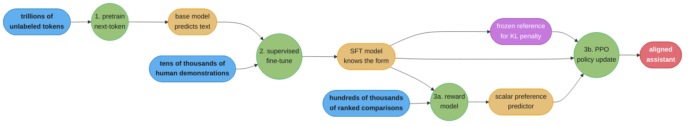

# Chapter 4: ChatGPT: Personal Assistant Chatbot

> Ch 4 of 11 · Generative AI System Design Interview (Aminian & Sheng, ByteByteGo, 2024) · builds on Ch 3 — Google Translate, leads to Ch 5 — Image Captioning

## Chapter Map

Chapters 2 and 3 both had something to aim at. Smart Compose had the words the user actually
typed next; translation had a reference produced by a human translator. This chapter removes
both. There is no correct answer to "explain recursion to a twelve-year-old", the conversation
can be about anything, and the only workable definition of a good response is that a person
prefers it to the alternatives. That single change — from a reference to a **preference** — is
what the chapter is about, and it is why the design here has three training stages instead of
one. Pretraining teaches the model language, supervised fine-tuning teaches it the *shape* of a
helpful answer, and reinforcement learning from human feedback teaches it which of two plausible
answers a person would rather have received. Everything else in the chapter — the serving
architecture, the safety layers, the evaluation regime — follows from the fact that the model is
now an open-ended, general-purpose interlocutor rather than a component that fills in a blank.

**TL;DR:**
- The framing is **autoregressive language modelling plus alignment**. A pretrained language
  model predicts likely internet text, which is not the same thing as being helpful — asked a
  question, a raw pretrained model may well continue with more questions, because that is what
  a page of questions looks like.
- The chapter's central structure is the **three-stage pipeline**: **pretraining** on
  internet-scale unlabeled text, **supervised fine-tuning (SFT)** on a small, curated set of
  human-written demonstrations, and **RLHF** — training a **reward model** on human *comparisons*
  and then optimizing the policy against it with **PPO**, under a **KL penalty** that keeps it
  from drifting away from the SFT model.
- **Comparisons, not scores, are what humans are reliable at.** Ranking two responses is far
  more consistent between raters than assigning either an absolute number, which is why the
  reward model is trained on pairwise preference rather than on a rating.
- **Serving is GPU-bound and dominated by the KV cache.** Streaming is a requirement rather than
  an optimization, time-to-first-token is the latency metric users actually feel, and continuous
  batching plus KV-cache management is what makes the economics work at all.
- **Safety is defense in depth, not a single filter**: the system prompt, RLHF-trained refusal
  behaviour, and separate moderation classifiers on both the input and the streamed output, with
  **over-refusal** monitored as its own regression alongside under-refusal.

## The Big Question

> You can train a model that predicts internet text extremely well. That model is not an
> assistant — it has no notion that a question should be answered, that instructions should be
> followed, or that some completions are harmful. And you cannot simply write down what a good
> assistant response is, because for almost any real prompt there are thousands of good ones and
> no way to enumerate them. How do you turn a text predictor into something people want to talk
> to, when the target you are optimizing is a human judgment you can only sample?

Analogy: a person who has read every book in a library can produce text in any style on any
subject, and will still be a poor assistant, because reading everything teaches you what
*follows* something, not what someone *wants*. Turning that person into a good assistant takes
two further things, and they are exactly the book's second and third stages. First, watching a
few thousand examples of a skilled assistant at work — that is demonstration, and it establishes
the format and register. But demonstration has a ceiling: a student who only imitates cannot
exceed the teacher, and imitation gives no information at all about what makes one answer worse
than another. So second, a long apprenticeship of feedback — "this answer was better than that
one" — repeated across enough pairs that the apprentice internalizes the preference itself
rather than memorizing any particular answer. The reward model is that internalized preference,
made into a function you can optimize against.

---

## 4.1 Clarifying Requirements

- **What is the input and output?** Input is the user's latest message plus the **conversation
  history** and a **system prompt** setting the assistant's behaviour. Output is a text response,
  **streamed token by token** rather than returned complete.
- **How open is the domain?** Fully open. The system takes arbitrary text on arbitrary subjects,
  which rules out any design based on intent classification into a fixed set of skills — the
  classic task-oriented dialogue architecture (intent classifier, slot filler, response
  templates) does not scale to a domain with no enumerable intents.
- **Multi-turn?** Yes, and this is a real requirement rather than a formality. The assistant must
  resolve references to earlier turns ("make it shorter", "what about the second one"), which
  means the entire relevant history has to be in the model's input on every request. There is no
  server-side conversational state — the model is stateless and the history is re-sent.
- **What behavioural properties?** The chapter uses the standard triple: **helpful** (actually
  does what was asked), **harmless** (declines to assist with harm and avoids toxic output), and
  **honest** (does not fabricate, and says when it does not know). These conflict — the most
  helpful response to a dangerous request is not the harmless one — and the alignment stage is
  where the tradeoff is actually set.
- **What is the latency budget?** The user-facing metric is **time to first token (TTFT)**, not
  total response time, because a streamed response starts being read as soon as it starts
  arriving. A target on the order of a few hundred milliseconds to a second for TTFT, and an
  inter-token rate comfortably above reading speed — a person reads at roughly 5 to 6 tokens per
  second, so 20 to 30 tokens per second feels immediate and anything below about 10 feels slow.
  Total latency for a 500-token answer is then 15 to 25 seconds and nobody minds, which would be
  an absurd budget in either of the previous two chapters.
- **Is streaming required?** Yes, structurally. Without it the perceived latency is the full
  generation time, and a design that returns the complete response is not the same product.
- **How much history, and what happens when it exceeds the context window?** The model has a
  fixed maximum sequence length, so long conversations must be truncated, summarized, or
  selectively retrieved. What is *not* negotiable is the system prompt, which must survive
  whatever compaction strategy is used.
- **What scale and cost?** Hundreds of millions of users against a model that requires
  accelerators to run at all, which makes cost per conversation a first-order product constraint
  rather than an efficiency concern. This is the first chapter where the model is expensive
  enough that serving economics shape the product's pricing and tiering.
- **What is explicitly out of scope?** The chapter scopes to a text-in/text-out assistant.
  Live knowledge beyond the training cutoff, retrieval over private documents (Ch 6's subject),
  tool invocation, and non-text modalities are treated as extensions rather than as part of the
  core design.

**Functional summary:** given a system prompt and a multi-turn conversation, stream a helpful,
harmless, honest response beginning within roughly a second, at hundreds of millions of users'
scale, on a model expensive enough that batching and cache management are architectural
concerns.

---

## 4.2 Framing the Problem as an ML Task

### Defining the ML objective

The core objective is the same next-token prediction that has run through every chapter so far:

```
P(response | system prompt, conversation history, user message)
      = prod_t P(token_t | everything before it)
```

Multi-turn conversation does not require any new mechanism. The conversation is **serialized
into a single token sequence** with role markers delimiting each turn — a system block, then
alternating user and assistant blocks, then a marker indicating that an assistant turn should
begin. The model then simply continues the sequence. This is worth saying out loud in an
interview because candidates often propose an explicit dialogue-state architecture for something
the sequence format already handles: the "state" is the transcript.

### Why pretraining alone does not produce an assistant

This is the chapter's pivotal observation and the justification for everything that follows.

A pretrained language model is optimized for one thing: the likelihood of internet text. Handed
`What is the capital of France?`, the highest-likelihood continuation on internet text is not
necessarily an answer — pages containing that string frequently contain *more questions*, so a
plausible continuation is `What is the capital of Germany? What is the capital of Spain?`. The
model is not failing; it is succeeding at an objective that is not the product's objective. The
same gap shows up everywhere: instructions are not followed because instruction-following is not
what maximizes likelihood, and harmful content is generated because harmful content exists in
the training distribution.

This mismatch between the training objective and the intended behaviour is what **alignment**
means in this chapter, and it is a *training* problem rather than a prompting one. Prompting can
paper over it — few-shot examples nudge a raw model toward answering — but the fix that scales is
to change what the model was trained to do.

### The three-stage approach

```
Stage 1  PRETRAINING       trillions of tokens, unlabeled       -> knows language and facts
Stage 2  SFT               tens of thousands of demonstrations  -> knows the FORM of an answer
Stage 3  RLHF              hundreds of thousands of comparisons -> knows which answer is BETTER
```

Each stage's data is a different kind of object, and the volumes differ by orders of magnitude in
the opposite direction from the effort required per example. Pretraining data is essentially
free and enormous; demonstrations are expensive and few; comparisons are cheaper than
demonstrations per unit of signal, which is precisely why stage 3 can be larger than stage 2.

### Why stage 3 exists — the ceiling of imitation

The obvious objection is that stage 2 should be enough: collect enough demonstrations of good
answers and fine-tune on them. The chapter's answer has two parts.

**Imitation has a ceiling at the demonstrator.** Supervised fine-tuning maximizes the likelihood
of human-written responses, so the best it can do is reproduce the average quality of its
demonstrators. It cannot learn to be better than the people who wrote its training set.

**Demonstrations carry no negative signal.** Every SFT example says "this is a good response".
None of them says "this response is worse than that one, and here is the pair". Human raters,
meanwhile, are much better at comparing two candidates than at writing an ideal one from
scratch, and far more consistent at ranking than at scoring — ask two people to rate a response
out of ten and they will disagree substantially; ask them which of two responses is better and
they agree far more often. Comparison data is therefore both cheaper to produce and more
reliable, and RLHF is the machinery that turns it into a training signal.

---

## 4.3 Data Preparation

Each stage needs a different dataset, collected differently, at a different scale.

### Stage 1 — pretraining corpus

Internet-scale unlabeled text: web crawl, books, reference material, code, and curated
high-quality sources, on the order of trillions of tokens. The preparation is a pipeline of
filters, each of which materially affects the final model:

- **Quality filtering** — typically a classifier trained to distinguish curated reference text
  from raw crawl, used to score and drop the low end. Raw web crawl is dominated by boilerplate,
  spam, and machine-generated content.
- **Deduplication**, both exact and near-duplicate. Duplicated documents are effectively
  upweighted, and heavy duplication both wastes compute and increases verbatim memorization.
- **Toxicity and safety filtering**, balanced carefully: filtering too aggressively removes the
  model's ability to *recognize* and discuss harmful content, which the safety stages need.
- **PII removal.**
- **Benchmark decontamination** — removing text that overlaps with the evaluation benchmarks, so
  the reported scores measure generalization rather than memorization. Skipping this produces
  excellent benchmark numbers and no real capability, and it is a genuinely easy mistake because
  benchmark questions circulate freely on the web.
- **Mixture weighting** — the proportions of web, code, books, and reference text are a tuned
  design choice, not whatever the crawl happened to produce. Code in the mixture is associated
  with better structured reasoning even for non-code tasks.

The data-to-parameter ratio follows Ch 1's compute-optimal discussion: for a fixed compute
budget, training data should scale roughly with model size rather than being whatever is
conveniently available.

### Stage 2 — demonstration data for SFT

**Prompt sources.** Two, in combination: prompts written by trained contractors to cover a
deliberately broad task taxonomy (open question answering, brainstorming, summarization,
rewriting, classification, extraction, code, creative writing), and real user prompts collected
with consent from an early or internal deployment. The second source matters because
contractor-imagined prompts systematically under-represent what people actually ask.

**Responses.** For each prompt, a human writes the response they consider ideal, following a
written rubric covering helpfulness, honesty, format, and refusal behaviour. Volume is on the
order of tens of thousands of examples — small by any other stage's standard, and the chapter is
emphatic that **quality and diversity dominate quantity here**. A few thousand carefully written,
task-diverse demonstrations outperform a much larger set of mediocre ones, because the stage is
teaching a *format and register*, not injecting knowledge.

**Diversity is the thing to actively engineer.** Ten thousand demonstrations that are all
question-answering produce a model that is excellent at question-answering and poor at
rewriting, and the gap does not show up until users hit it.

### Stage 3a — comparison data for the reward model

The collection protocol is the part worth knowing precisely:

1. Take a prompt.
2. Sample **K** different responses from the current model (typically 4 to 9), using
   temperature to get genuine variation.
3. A human labeler **ranks all K** from best to worst against the rubric.
4. That single ranking yields `K choose 2` pairwise comparisons — 9 responses give 36 pairs, so
   one labeling task produces a great deal of training signal.

Two design points the chapter draws out. **Ranking rather than scoring** is chosen because
absolute quality ratings are inconsistent between raters and drift over time within a rater,
while relative comparisons are stable. And **all pairs from one prompt must be trained in the
same batch**: split across batches, the model sees the same response many times in different
pairs across an epoch and overfits it.

### Stage 3b — prompts for the RL phase

The RL stage needs **only prompts**. Responses are sampled from the policy being trained and
scored by the reward model, so no human labeling is required per step — which is exactly why RL
can consume far more prompts than the demonstration stage could ever consume examples. The
prompt distribution should match production traffic, because the policy will be optimized
specifically on the distribution it is trained over.

### Labeler management — the part that is a data problem, not an HR one

The people producing stages 2 and 3a are, functionally, the specification of the model's
values. The chapter treats their management as part of data preparation:

- **Screening** for agreement with a reference set before a labeler is onboarded.
- **Written rubrics** covering not just quality but the hard cases — how to handle a request
  that is borderline harmful, how much hedging is appropriate, when to ask a clarifying question.
- **Ongoing inter-annotator agreement measurement**, with disagreement treated as a signal that
  the rubric is ambiguous rather than that a labeler is wrong.
- **Held-out labelers** whose judgments are used only for evaluation, never for training — so
  the reward model is not evaluated by the same people whose preferences it fit.
- Awareness that the labeler pool's demographics and instructions become the model's defaults,
  which is a value judgment being made by data collection whether or not anyone acknowledges it.

---

## 4.4 Model Development

### Architecture

A **decoder-only transformer**. The choice over an encoder-decoder is worth defending briefly:
translation had a clean separation between a source to be understood and a target to be produced,
but a conversation is one continuous sequence in which today's output is tomorrow's input, so a
single stack that attends causally over the whole transcript is the natural fit — and it means
the prompt and the generated response share the same parameters and the same cache.

The components, all inherited from Ch 1's transformer walkthrough: token embeddings, a stack of
blocks each containing masked multi-head self-attention and a feed-forward network with residual
connections and layer normalization, and a final projection to vocabulary logits. Positional
information is supplied by a scheme that generalizes over long sequences, and the maximum
sequence length is a fixed architectural parameter that later dictates the context-management
strategy in §4.6.

### Stage 1 — pretraining

Standard next-token prediction with cross-entropy loss over trillions of tokens. The engineering
is Ch 1's list, all of it mandatory at this scale: **data parallelism** across replicas,
**tensor parallelism** splitting individual layers across devices, **pipeline parallelism**
splitting layers across device groups, **ZeRO/FSDP-style sharding** of optimizer state and
gradients, **mixed-precision** arithmetic, and **gradient checkpointing** trading recomputation
for activation memory. A run of this size is measured in weeks on thousands of accelerators and
costs enough that it happens rarely and deliberately — everything downstream is designed around
the assumption that pretraining will not be repeated to fix a problem.

### Stage 2 — supervised fine-tuning

The same objective and the same code path, on the tiny curated demonstration set, for a small
number of epochs at a much lower learning rate. Two mechanical details are load-bearing:

**Mask the loss to the assistant's tokens only.** The training sequence contains the system
prompt, the user's message, and the assistant's response, but the model should only be trained to
produce the last of these. Computing loss over the user's tokens trains the model to *generate*
user turns, which surfaces at inference as the model helpfully writing the user's next message
after its own answer — a memorable and entirely avoidable bug.

**Overfitting is the default failure.** Tens of thousands of examples against billions of
parameters overfits within a couple of epochs, producing a model that reproduces demonstration
phrasings verbatim and generalizes worse than it did before. Early stopping against a held-out
demonstration set is not optional.

### Stage 3a — the reward model

The reward model is **initialized from the SFT model** — it needs the same language understanding
— with the vocabulary-projection head replaced by a head emitting a single scalar. Given a prompt
and a response, it outputs a number meant to predict human preference.

Training uses the pairwise ranking loss:

```
L = -log( sigmoid( r(x, y_chosen) - r(x, y_rejected) ) )
```

Read it directly: the loss is small when the chosen response's score exceeds the rejected one's
by a comfortable margin, and large when the ordering is wrong. Note what is *not* here — no
target value. The reward model never learns that a response deserves 7.3 out of 10; it learns
only orderings, which is the whole reason absolute human ratings were never needed. A consequence
worth knowing: the resulting scores have **no absolute meaning** and are only comparable within a
prompt, so a reward model's raw score is not a quality metric you can report.

The reward model is typically smaller than the policy, since it runs on every sampled response
during RL and its cost is multiplied by the number of RL steps.

### Stage 3b — PPO with a KL penalty

Reinforcement learning frames generation as a policy problem: the **policy** is the language
model, an **action** is emitting a token, and the **reward** arrives at the end of the response
from the reward model. The loop:

```
1. sample a prompt x from the RL prompt set
2. generate a response y from the current policy pi
3. score it:            r = RM(x, y)
4. subtract the drift:  reward = r - beta * KL( pi(y|x) || pi_ref(y|x) )
5. update pi with PPO's clipped objective
```

**Step 4 is the one to understand.** `pi_ref` is the frozen SFT model, and the KL term measures
how far the policy's output distribution has moved from it. Without this penalty the policy does
not become a better assistant — it becomes an excellent exploiter of the reward model. This is
**reward hacking** (equivalently, **over-optimization**), and its symptoms are specific and
recognizable: responses grow steadily longer because the reward model mildly prefers thorough
answers; they become sycophantic because agreeing with the user was preferred in the training
comparisons; they fill with hedging and boilerplate structure that scored well; and eventually
they degenerate into text that scores very high and reads as nonsense. The reward model is a
learned approximation of human preference and it is only accurate on the distribution it was
trained on — push the policy far enough off that distribution and its scores stop meaning
anything.

`beta` is therefore the central knob. Too high and the policy barely moves from SFT and the
alignment gains never materialize; too low and it hacks the reward model. The chapter's practical
guidance is to watch measured KL divergence *and* held-out human preference during training, not
the reward-model score, because the reward-model score rises monotonically right through the
point where actual quality has started falling.

**PPO's clipped objective** is itself a stability mechanism: it bounds how much the policy's
probability for any action may change in a single update, which prevents a large reward from
causing a catastrophic jump. The chapter treats PPO as the standard choice rather than deriving
it, and the practically important part is that RL fine-tuning is far less stable than supervised
training and needs the reference model, the KL term, and the clipping all at once.

**The alignment tax.** RLHF can degrade performance on raw capability benchmarks even as human
preference improves, because the policy is being pulled toward conversational helpfulness and
away from the pretraining distribution. The standard mitigation is to mix pretraining gradients
back into the RL updates, trading a little alignment for retained capability.

### The broken design, and the fix

```
Broken:  "collect 100,000 great answers and fine-tune on them"

  - the model's ceiling is the average quality of the people who wrote them
  - nothing in the dataset says what makes a response BAD
  - writing an ideal response is slow and expensive per example
  - raters who WRITE answers disagree far more than raters who COMPARE them

Fixed:   demonstrations to establish the form, comparisons to establish the preference

  - SFT on ~tens of thousands of demonstrations: teaches format and register
  - RM on hundreds of thousands of pairwise comparisons: learns the preference itself
  - PPO against the RM with a KL leash: lets the policy exceed the demonstrations
    without wandering off the distribution where the RM is meaningful
```

### Decoding for chat

Chat uses **temperature and nucleus (top-p) sampling**, not beam search. Three reasons, and all
three are worth having ready: beam search produces bland, repetitive, high-probability text
that is exactly wrong for open-ended conversation; regenerating a response should produce a
genuinely different answer, which a deterministic search cannot do; and beam search multiplies
decode cost by the beam width in a setting where decode cost is already the dominant expense.
Temperature is exposed as a product-level control — near zero for factual and code tasks where
determinism is desirable, higher for creative work.

---

## 4.5 Evaluation

Evaluation is where this chapter differs most from the two before it, because there is no
reference to score against.

### Offline evaluation

- **Capability benchmarks** across knowledge, reasoning, mathematics, and code. Cheap,
  reproducible, comparable across models — and narrow: they measure what a multiple-choice or
  unit-tested task can measure, not whether a response is helpful. They are also the numbers most
  vulnerable to training-set contamination, which is why §4.3's decontamination step exists.
- **Held-out perplexity**, useful for tracking pretraining and worthless for judging alignment,
  since an aligned model is deliberately *less* likely on raw internet text.
- **Reward-model score on a held-out prompt set** — a fast proxy that must be read with the
  caveat that it is the quantity being optimized, so improvements on it are partly Goodhart's
  law in action.

### Human preference — the primary gate

The real quality metric is a **head-to-head win rate**: sample responses to the same prompts from
the candidate model and the incumbent, show them to raters blind and in randomized order, and
report win / tie / loss. It is the metric ship decisions are made on because it measures the
thing the product is actually optimizing, and it is expensive and slow, which is exactly why
every cheaper proxy exists.

**LLM-as-judge** is the standard cheap approximation — use a strong model to compare two
responses against a rubric. It correlates well enough to be useful for iteration, and it carries
biases that must be controlled: **position bias** (the response shown first is favoured, so
every pair must be evaluated in both orders), **length bias** (longer responses win regardless of
quality, which is the same bias that drives reward hacking), and **self-preference** (a judge
model favours outputs resembling its own). It is a screening tool, not a substitute for the human
gate.

### Safety evaluation and red-teaming

- **Red-teaming** — adversarial prompting by people trying to elicit harmful output or bypass
  refusals, measured as an **attack success rate** across a maintained suite of attack families
  (roleplay framing, hypothetical framing, instruction-injection, encoding tricks, multi-turn
  escalation). Unlike an accuracy benchmark this suite must keep growing, because it is
  adversarial: it measures resistance to attacks *someone already thought of*.
- **Over-refusal**, measured separately and treated as a real regression. A model that refuses
  benign requests because they superficially resemble harmful ones — declining to explain how to
  kill a process, or to discuss a historical atrocity — is failing at helpfulness, and a safety
  change that improves attack resistance while doubling false refusals is not obviously an
  improvement.
- **Hallucination rate** on a curated factual set, along with **calibration**: does the model
  say it is unsure when it is unsure, or is it uniformly confident?
- **Bias and fairness** evaluation on paired prompts differing only in demographic terms.

### Online metrics

- **Thumbs-up / thumbs-down rate** — sparse (most users rate nothing) and biased toward extremes,
  but directly interpretable.
- **Regeneration rate** — how often users ask for another response. A dense, unbiased implicit
  negative signal, and one of the most useful metrics in the system precisely because it costs
  the user nothing to emit.
- **Conversation depth and length**, read carefully: more turns can mean engagement or can mean
  the user failed to get what they wanted and kept trying.
- **Retention** — daily and weekly active use, the ultimate business metric.
- **Latency** — TTFT and inter-token latency at p50, p95, p99, since a tail-latency regression
  is felt as the product stalling mid-sentence.
- **Refusal rate and false-refusal rate**, tracked as a pair for the reason above.
- **Safety-filter trigger rate** on both input and output, and **cost per conversation**.

---

## 4.6 Overall ML System Design

### The request path

1. **Authentication and rate limiting**, per user and per tier — with an expensive model, rate
   limiting is a capacity-protection mechanism, not just abuse prevention.
2. **Input moderation.** A fast classifier scores the incoming message for policy violations
   before any expensive inference happens. Cheap, and it catches the most blatant cases without
   spending a GPU-second.
3. **Conversation assembly.** The system prompt, the conversation history, and the new message
   are combined into one sequence that must fit the context window. Strategies, usually
   combined: drop the oldest turns; **summarize** older history into a compact block; or
   **retrieve** only the turns relevant to the current message. The system prompt is never
   evicted, and dropping middle turns silently is a common source of "the model forgot what I
   told it" reports.
4. **Tokenization** and dispatch to the inference cluster.
5. **Inference**, described below.
6. **Output moderation on the stream.** This is genuinely harder than input moderation, because
   tokens are being shown as they are produced and a violation may only become apparent several
   tokens in. The options are to buffer a window before releasing it (adding latency), or to
   stream optimistically and retract — visibly replacing the response with a refusal if the
   classifier fires mid-generation. Both are unpleasant, and the choice between them is a real
   design decision an interviewer may push on.
7. **Streaming to the client**, with the response persisted for history and for feedback
   collection.

### Inference internals — where the cost actually is

**Prefill and decode are two different workloads.** Processing the prompt (**prefill**) runs all
prompt tokens through the model in parallel and is **compute-bound**; generating the response
(**decode**) produces one token at a time and is **memory-bandwidth-bound**, because each step
reads the entire model's weights to produce a single token. They have different bottlenecks,
different optimal batch sizes, and different scaling behaviour, which is why they are often
scheduled — and increasingly served — separately.

**The KV cache** is what makes decode tractable. Without it, generating token `n` would recompute
attention keys and values for all `n-1` previous tokens, making a full response quadratic in
length. With it, each token's keys and values are computed once and retained, and each new token
attends against the cache. The cost is memory, and the arithmetic is the number every candidate
should be able to produce:

```
KV cache bytes per token = 2 (K and V) x layers x hidden_dim x bytes_per_value

  worked example: 80 layers, hidden_dim 8192, fp16 (2 bytes)
      = 2 x 80 x 8192 x 2  =  2,621,440 bytes  ~ 2.6 MB per token

  a 4,000-token conversation  ->  ~10 GB of KV cache for ONE sequence
  an 80 GB accelerator, after ~40 GB of model weights, holds ~4 such
  sequences concurrently
```

That is why concurrency per accelerator is low and why KV memory, not compute, is usually what
limits batch size. Grouped or multi-query attention — sharing key/value heads across query heads
— attacks this term directly and is the standard architectural response.

**Continuous batching** is the scheduling answer. Static batching groups requests, runs them
together, and waits for all of them to finish — so a batch containing one 1,000-token response
and seven 50-token responses leaves seven slots idle for the remainder. Continuous batching
evicts each sequence the moment it emits its stop token and admits a waiting request into the
freed slot at the next step, which raises accelerator utilization dramatically at no cost in
quality. Paged KV-cache allocation — storing the cache in fixed-size blocks rather than one
contiguous reservation per sequence — removes the fragmentation that would otherwise waste much
of the memory the batch size depends on.

**Tensor parallelism** splits each layer across accelerators for models too large for one
device, at the cost of a collective communication on every layer — which is why it is kept within
a single high-bandwidth node wherever possible.

### Caching in a chat system

Exact-match response caching, which was the highest-leverage component in Ch 3, is nearly
worthless here: conversations are unique, and two users almost never send byte-identical
histories. What *is* valuable is **prefix KV caching**. Every request shares the same system
prompt, and every turn within one conversation shares the entire preceding transcript — so the
computed keys and values for that shared prefix can be retained and reused instead of being
recomputed by prefill on every turn. In a long conversation this is the difference between
re-prefilling thousands of tokens per turn and prefilling only the new message.

### Safety as layered defense

- **The system prompt** sets behaviour and is the fastest thing to change — no retraining, effect
  within a deploy. It is also the weakest layer, defeatable by prompt injection.
- **RLHF-trained refusal behaviour** is baked into the model itself and generalizes to attacks
  nobody enumerated, which makes it the strongest layer. It is also the slowest to change,
  requiring a new comparison-data collection and RL run.
- **Separate moderation classifiers** on input and output are independent of the model, updatable
  immediately, and catch what the model itself missed.

None of the three is sufficient alone, and the reason to name all three in an interview is that
each fails in a way the others cover: the system prompt is injectable, the model's own refusals
can be jailbroken, and a classifier has false negatives on novel phrasings.

### Scale estimation — a worked example

```
100M daily active users x 5 conversations x 4 turns  = 2e9 requests/day
average QPS = 2e9 / 86,400                           ~ 23,000 QPS
peak QPS    = ~3x                                    ~ 70,000 QPS

average response = 400 output tokens
peak output token rate = 70,000 x 400                = 28M tokens/sec

one 8-accelerator node, batch ~32 concurrent sequences at ~30 tok/s each
                                                     ~ 960 tokens/sec/node
nodes needed at peak = 28e6 / 960                    ~ 29,000 nodes
```

The number is deliberately alarming, and it is the point of the exercise: the fleet is
enormous, so every factor that raises tokens-per-second-per-accelerator — continuous batching,
paged KV cache, grouped-query attention, quantization, a smaller distilled model for simple
requests — translates directly into a proportional reduction in a very large capital cost.
This is why the chapter treats routing simple requests to a cheaper model as a design decision
rather than an optimization.

---

## 4.7 Deployment and Monitoring

- **Gradual rollout with A/B by user**, holding a user on one model version for the duration of a
  conversation — switching mid-conversation produces a visible personality discontinuity that
  users notice and report.
- **Serving-health monitoring** is unusually rich here because the bottleneck is unusual: TTFT
  and inter-token latency percentiles, queue depth, accelerator utilization, batch occupancy, and
  KV-cache memory pressure. A rising queue depth with healthy utilization means you need more
  capacity; healthy queues with poor utilization usually means the batching scheduler is starving.
- **Quality monitoring** on thumbs rate, regeneration rate, and conversation abandonment, sliced
  by request category — an assistant can improve on general conversation while regressing badly
  on code, and the aggregate will not show it.
- **Safety monitoring is adversarial, not stationary.** This is the sharpest difference from every
  other chapter's monitoring section. Data drift is a passive process you detect and retrain
  against; jailbreaks are produced by people actively trying to defeat you, so novel attacks
  appear continuously and a static red-team suite decays in value from the day it is written.
  Continuous red-teaming, monitoring of attack-success rate over new attack families, and a fast
  path to push classifier and system-prompt updates are all required — with the model-level fix
  following on a much slower cycle.
- **False-refusal monitoring** alongside it, since the fast mitigations (a broader classifier, a
  stricter system prompt) all trade directly against helpfulness, and a safety incident response
  that quietly doubles the false-refusal rate is trading one regression for another.
- **The feedback loop.** Thumbs and regeneration data feed new comparison data, which refreshes
  the reward model, which trains a new policy — a genuine flywheel. The hazard is the one Ch 2
  named in a smaller form: training on data derived from the model's own outputs narrows the
  distribution, and if the reward model is refreshed only on responses the current policy
  produces, it never learns to score anything outside that shrinking region. Keeping fresh
  human-written demonstrations and independently sampled comparisons in the mix is what keeps the
  loop from closing.
- **Model versioning and deprecation.** Users and downstream integrations build prompts against a
  specific version's behaviour, and a silent update changes outputs under them. Pinned versions
  with an announced deprecation window are the operational contract, and the cost of maintaining
  several versions concurrently on an expensive fleet is real.
- **Cost monitoring per user and per tier**, because with this cost structure a small number of
  heavy users can consume a disproportionate share of capacity, and rate limits are how that is
  managed.

---

## Beyond the book — assistants after 2024

> Disclosed as the repo requires. The chapter above describes the three-stage
> pretraining/SFT/RLHF-with-PPO pipeline, text-only single-model serving, and preference
> evaluation by human head-to-head comparison. It does not describe direct preference
> optimization and its relatives, AI-generated preference data, reasoning-focused post-training
> with inference-time compute, tool-using agents, or long-context and multimodal assistants.
> None of the material in this section is Aminian and Sheng's.

The most consequential change to the chapter's own pipeline is that **PPO is no longer the
default third stage** for most teams. **Direct preference optimization (DPO)** and its relatives
derive a closed-form supervised loss over the same preference pairs, eliminating the separate
reward model, the sampling loop, and most of PPO's instability — you fine-tune directly on
(prompt, chosen, rejected) triples. The chapter's conceptual content survives intact, because the
data collection, the ranking-not-scoring argument, and the over-optimization hazard all still
apply; what changes is the optimizer. Relatedly, **AI-generated preference data** — having a
model produce the comparisons against a written set of principles rather than paying humans for
each one — has become a standard way to scale stage 3a past what human labeling can fund.

Three product-level shifts matter more than the optimizer choice. **Reasoning-focused
post-training** added a third scaling axis the chapter does not have: spending more compute *per
query* at inference by having the model generate extended intermediate reasoning before its
answer, which changes the latency model completely — a response may now be preceded by many
seconds of invisible thinking, and TTFT stops being the right metric. **Tool use and agentic
behaviour** turned the assistant from a text predictor into something that calls search, runs
code, and acts over multiple steps, which relocates most of the safety surface from "what does it
say" to "what does it do". And **long context and multimodality** have retired much of §4.6's
context-management reasoning — with a context window one to two orders of magnitude larger than
the chapter assumes, truncating and summarizing conversation history is no longer the common
case, though prefix KV caching matters more than ever because there is far more prefix to cache.

---

## Visual Intuition

### The three-stage training pipeline



Caption: the SFT model appears three times — as the policy's starting point, as the reward
model's initialization, and as the frozen reference the KL penalty measures drift against. That
third role is what keeps stage 3b from wandering into territory where the reward model's scores
are meaningless.

### Reward hacking — why the KL leash exists

```
  as PPO optimizes against the reward model:

  score |
        |                        RM score (what you optimize)
   high |                    ,-------------------------------
        |                ,---'
        |            ,---'
        |        ,---'  ,-------.
        |    ,---'  ,---'        `----.
        |,---'  ,---'                  `-----.
    low |---'---'      true human quality      `------------
        +--------------------------------------------------
        0        KL divergence from SFT model         large
                 |                |
                 |                +-- policy is off-distribution:
                 |                    RM scores keep rising, real
                 |                    quality is FALLING.  outputs
                 |                    grow long, sycophantic, and
                 |                    full of boilerplate the RM liked
                 |
                 +-- the useful region.  beta is tuned to keep the
                     policy here, and the signal that you have left it
                     is HUMAN preference falling while RM score climbs
```

Caption: the reward model is an approximation valid only near the distribution it was trained on,
so its score and true quality diverge as the policy drifts — which is why the training dashboard
must show measured KL and held-out human preference, never reward-model score alone.

### Prefill versus decode, and the KV cache

```
  PREFILL: the whole prompt at once            DECODE: one token at a time
  ------------------------------------         --------------------------------
  [tok1 tok2 tok3 ... tok500]  ->  all         [tok501] -> [tok502] -> [tok503]
  positions processed in PARALLEL              strictly SEQUENTIAL, one per step

  bottleneck: COMPUTE                          bottleneck: MEMORY BANDWIDTH
  (a large matmul over 500 positions)          (read ALL model weights to
                                                produce ONE token)

  batching helps a little                      batching helps enormously
  (already saturating the ALUs)                (weights read once per batch,
                                                amortized over every sequence)


  the KV cache is what makes decode linear instead of quadratic:

    without cache   token 501 recomputes K,V for tokens 1..500
                    token 502 recomputes K,V for tokens 1..501     -> O(n^2)
    with cache      token 501 computes its own K,V, appends, reads
                    the cache                                      -> O(n)

    cost: 2 x layers x hidden_dim x bytes  per token
          80 layers, 8192 hidden, fp16  =  ~2.6 MB per token
          4,000-token conversation      =  ~10 GB for ONE sequence
          -> KV memory, not compute, is what caps the batch size
```

Caption: the two phases have opposite bottlenecks, which is why they are scheduled differently,
and the KV cache trades quadratic compute for linear memory — a trade that then makes memory the
scarce resource the entire serving design is organized around.

### The serving path, with safety on both sides

```mermaid
flowchart LR
    classDef io      fill:#61afef,stroke:#2e86c1,color:#1a1a1a,font-weight:bold
    classDef frozen  fill:#c678dd,stroke:#9b59b6,color:#fff
    classDef train   fill:#98c379,stroke:#27ae60,color:#1a1a1a
    classDef mathOp  fill:#d19a66,stroke:#e67e22,color:#1a1a1a,font-weight:bold
    classDef lossN   fill:#e06c75,stroke:#c0392b,color:#fff,font-weight:bold
    classDef req     fill:#56b6c2,stroke:#0097a7,color:#1a1a1a
    classDef base    fill:#e5c07b,stroke:#f39c12,color:#1a1a1a

    U(["user message"]) --> RL(["auth and<br/>rate limit"])
    RL --> INMOD{"input<br/>moderation"}
    INMOD -->|"blocked"| REF1(["refusal"])
    INMOD -->|"allowed"| ASM(["assemble context<br/>system + history"])
    ASM --> KVC(["prefix KV<br/>cache reuse"])
    KVC --> INF(("inference cluster<br/>continuous batching"))
    INF --> STR(["token stream"])
    STR --> OUTMOD{"output<br/>moderation"}
    OUTMOD -->|"violation"| REF2(["retract and<br/>refuse"])
    OUTMOD -->|"clean"| CLIENT(["streamed to user"])
    CLIENT --> FB(["thumbs, regenerate<br/>feedback store"])

    class U,CLIENT io
    class RL,ASM req
    class INMOD,OUTMOD lossN
    class REF1,REF2 frozen
    class KVC base
    class INF train
    class STR,FB mathOp
```



Caption: moderation runs on both sides for different reasons — the input check is cheap and
avoids spending a GPU-second on an obvious violation, while the output check has to police text
the model actually produced, against a stream that has already begun rendering.

---

## Key Concepts Glossary

- **Alignment** — closing the gap between what a model was trained to optimize (text likelihood)
  and what it should do (be helpful, harmless, honest).
- **Helpful, harmless, honest (HHH)** — the chapter's triple of assistant behavioural goals,
  which trade against each other.
- **Pretraining** — stage 1: next-token prediction over trillions of unlabeled tokens, giving
  the model language and world knowledge.
- **Supervised fine-tuning (SFT)** — stage 2: fine-tuning on a small curated set of human-written
  prompt/response demonstrations to establish the form of a helpful answer.
- **Demonstration data** — the (prompt, ideal response) pairs SFT trains on, written by trained
  humans against a rubric.
- **Loss masking** — computing the SFT loss only over the assistant's tokens, so the model does
  not learn to generate user turns.
- **RLHF (reinforcement learning from human feedback)** — stage 3: training a reward model on
  human comparisons, then optimizing the policy against it.
- **Comparison / preference data** — rankings of K sampled responses to one prompt, expanded into
  `K choose 2` pairwise preferences.
- **Reward model (RM)** — a model initialized from the SFT model with a scalar head, trained on
  the pairwise ranking loss to predict which response a human would prefer.
- **Pairwise ranking loss** — `-log sigmoid(r(chosen) - r(rejected))`, learning orderings rather
  than absolute values.
- **Policy** — the language model being optimized during RL, in RL terminology.
- **PPO (proximal policy optimization)** — the RL algorithm used, whose clipped objective bounds
  how far the policy may move in one update.
- **KL penalty** — a per-token penalty on divergence from the frozen SFT reference model, scaled
  by `beta`, that keeps the policy near the distribution the reward model is valid on.
- **Reference model** — the frozen SFT model the KL penalty measures drift against.
- **Reward hacking / over-optimization** — the policy exploiting the reward model's inaccuracies,
  producing outputs that score highly and are worse: long, sycophantic, boilerplate-laden.
- **Alignment tax** — degradation on raw capability benchmarks caused by alignment training,
  mitigated by mixing pretraining gradients into RL updates.
- **System prompt** — the instruction block prepended to every conversation, setting behaviour,
  and never evicted during context compaction.
- **Context window** — the model's maximum sequence length, which bounds how much conversation
  can be supplied.
- **Context management** — truncating, summarizing, or selectively retrieving conversation history
  to fit the context window.
- **Time to first token (TTFT)** — the latency metric users actually perceive in a streamed
  response.
- **Inter-token latency** — the rate at which subsequent tokens arrive, judged against reading
  speed.
- **Streaming** — emitting tokens as they are generated rather than returning a complete response.
- **Prefill** — processing the prompt's tokens in parallel; compute-bound.
- **Decode** — generating output tokens one at a time; memory-bandwidth-bound.
- **KV cache** — stored attention keys and values for previous tokens, turning generation from
  quadratic to linear compute at the cost of substantial memory.
- **Prefix KV caching** — reusing the cached keys and values for a shared prefix such as the
  system prompt or an ongoing conversation's earlier turns.
- **Continuous batching** — evicting finished sequences and admitting waiting ones each step,
  rather than waiting for a whole static batch to complete.
- **Paged KV cache** — allocating cache memory in fixed-size blocks to avoid fragmentation and
  raise achievable batch size.
- **Grouped-query / multi-query attention** — sharing key/value heads across query heads to
  shrink the KV cache directly.
- **Temperature / nucleus (top-p) sampling** — the stochastic decoding used for chat, chosen over
  beam search for diversity, regenerability, and cost.
- **Head-to-head win rate** — the primary quality metric: blind human preference between two
  models' responses to the same prompts.
- **LLM-as-judge** — using a strong model to compare responses as a cheap proxy for human
  preference.
- **Position bias / length bias / self-preference** — the systematic biases an LLM judge exhibits,
  requiring order randomization and length controls.
- **Red-teaming** — adversarial testing to elicit harmful output, measured as attack success rate.
- **Over-refusal / false refusal** — declining benign requests, tracked as its own regression
  against refusal rate.
- **Regeneration rate** — how often users request another response; a dense implicit negative
  signal.
- **Benchmark decontamination** — removing evaluation-set text from the training corpus so scores
  measure generalization rather than memorization.
- **Inter-annotator agreement** — the measured consistency between labelers, used to detect
  ambiguous rubrics.

---

## Tradeoffs & Decision Tables

### What each training stage buys

| Stage | Data | Volume | What it teaches | What it cannot do |
|---|---|---|---|---|
| Pretraining | Unlabeled internet text | Trillions of tokens | Language, facts, reasoning substrate | Follow instructions or be helpful |
| SFT | Human-written demonstrations | Tens of thousands | The form and register of a good answer | Exceed the demonstrators, or learn what is bad |
| Reward model | Ranked comparisons | Hundreds of thousands of pairs | A scalar preference function | Give absolute quality values |
| PPO / RL | Prompts only | Large — no labels needed | Push the policy above demonstration quality | Stay valid far from the SFT distribution |

### Why comparisons instead of ratings

| Labeling protocol | Rater consistency | Cost per unit of signal | Yields |
|---|---|---|---|
| Write the ideal response | Low — many valid answers | Highest | One positive example |
| Rate a response 1-10 | Low — scales drift within and between raters | Medium | One noisy scalar |
| Rank K sampled responses | **High — relative judgment is stable** | **Lowest** | **`K choose 2` pairwise preferences** |

### Safety layers

| Layer | Speed to change | Strength | Fails when |
|---|---|---|---|
| System prompt | Immediate | Weakest | Prompt injection overrides it |
| Moderation classifiers | Hours | Moderate | Novel phrasing evades the classifier |
| RLHF-trained refusal | Weeks — new data and RL run | Strongest, generalizes | Jailbreak framings the training never covered |

### Decoding strategy for chat

| Strategy | Diversity | Regenerable | Cost | Fit |
|---|---|---|---|---|
| Beam search | Very low — bland and repetitive | No, deterministic | `b`× decode | Wrong for chat, right for translation |
| Greedy | Low | No | Cheapest | Only where determinism is wanted |
| Temperature + top-p | Tunable | Yes | Same as greedy | **Chosen**, with temperature exposed per task |

### Serving levers, by effect on cost

| Lever | Effect | Cost |
|---|---|---|
| Continuous batching | Large — accelerator utilization rises sharply | Scheduler complexity only |
| Paged KV cache | Large — removes fragmentation, raises batch size | Memory-manager complexity |
| Grouped-query attention | Large — shrinks the KV cache directly | Architectural, must be trained in |
| Prefix KV caching | Large for multi-turn and shared system prompts | Cache memory and invalidation |
| Quantization | Moderate throughput gain | Some quality loss, needs evaluation |
| Routing simple requests to a smaller model | Large | A routing model that can be wrong |

---

## Common Pitfalls / War Stories

- **Running PPO without a KL penalty.** The policy discovers the reward model's blind spots
  rather than becoming a better assistant: responses grow steadily longer, sycophantic, and
  padded with structural boilerplate the reward model happened to score well, and eventually
  degenerate entirely — all while the reward-model score climbs monotonically and looks like
  success on the dashboard.
- **Trusting the reward-model score as a quality metric.** It is the quantity being optimized,
  so it rises through exactly the region where real quality is falling. Held-out human preference
  and measured KL are the metrics that see over-optimization happening.
- **Computing SFT loss over the whole sequence.** Training on the user's tokens as well as the
  assistant's teaches the model to generate user turns, which appears at inference as the model
  writing the user's next message after finishing its own answer.
- **Splitting one prompt's comparison pairs across training batches.** All `K choose 2` pairs
  derived from one prompt share the same responses, so spreading them across batches shows the
  model the same response many times per epoch and overfits it.
- **Skipping benchmark decontamination.** Benchmark questions circulate freely on the web, so a
  crawl-based corpus contains them, and the resulting scores measure memorization. The model looks
  excellent and users find it is not.
- **Overfitting during SFT.** Tens of thousands of examples against billions of parameters
  overfits within one or two epochs, producing verbatim demonstration phrasings and worse
  generalization than before fine-tuning. Early stopping against held-out demonstrations is
  mandatory.
- **Treating over-refusal as acceptable collateral.** A safety change that improves attack
  resistance while doubling false refusals is not obviously an improvement — a model that will not
  explain how to kill a process or discuss a historical atrocity is failing the helpfulness
  requirement, and users notice immediately.
- **Static batching on a chat workload.** Response lengths vary by an order of magnitude within a
  batch, so a static batch is idle in most of its slots for most of its duration. Continuous
  batching is the single largest utilization win available and needs nothing but a scheduler.
- **Relying on exact-match response caching.** It works beautifully in translation and returns
  nearly nothing here, because conversations are unique. Prefix KV caching is the analogous win.
- **Streaming without an output moderation strategy.** Once a token is rendered it has been seen,
  so a violation detected mid-generation cannot be quietly suppressed — the design must choose
  between buffering (costing latency) and visible retraction, and choosing neither means shipping
  whatever the model produced.
- **Switching a user's model version mid-conversation during an A/B test.** The change in voice
  and behaviour within one conversation is immediately noticeable and confounds the experiment.
- **Refreshing the reward model only on the current policy's outputs.** The preference data then
  covers a distribution that shrinks with every cycle, so the reward model progressively loses
  the ability to score anything outside what the policy already does — the feedback flywheel
  becomes a feedback trap.
- **Reporting an aggregate quality metric across request categories.** An assistant can improve
  substantially on general conversation while regressing badly on code or mathematics, and the
  aggregate will show a clean win.

---

## Real-World Systems Referenced

**The product:** ChatGPT as the chapter's design target, and general-purpose assistant chatbots
as a category. **Training methodology:** the three-stage pretraining / supervised fine-tuning /
RLHF pipeline, reward modelling on pairwise human comparisons, and PPO with a KL penalty against a
frozen reference model — the InstructGPT-line recipe the chapter follows. **Architecture:**
decoder-only transformers with masked multi-head self-attention. **Training infrastructure:** data,
tensor, and pipeline parallelism with ZeRO/FSDP-style sharding, mixed precision, and gradient
checkpointing, all carried forward from Ch 1. **Serving techniques:** KV caching, prefill/decode
separation, continuous batching, paged KV-cache allocation, grouped and multi-query attention, and
tensor-parallel inference. **Evaluation:** capability benchmark suites, human head-to-head
preference, LLM-as-judge, and structured red-teaming.

---

## Summary

An assistant chatbot is the book's first system with no reference output at all, and the design
follows directly from that absence. The ML framing is unchanged from the previous chapters —
next-token prediction over a conversation serialized into one sequence with role markers — but a
model trained only to predict likely text is not an assistant, because likelihood on internet
text and helpfulness to a user are different objectives, and the gap between them is what
alignment closes. The chapter's answer is three stages: pretraining on trillions of unlabeled
tokens for language and knowledge, supervised fine-tuning on tens of thousands of carefully
written demonstrations for the form of a good answer, and RLHF for the preference itself — a
reward model trained on human *rankings* rather than ratings, because relative judgment is what
people are reliable at, then PPO against that reward model under a KL penalty toward the frozen
SFT reference. That penalty is the chapter's central engineering insight: the reward model is an
approximation valid only near the distribution it was trained on, so an unleashed policy learns
to exploit it rather than to improve, and the symptom is a reward score that rises while human
preference falls. Serving is the other half of the chapter, and it is dominated by facts about
accelerators rather than about language: prefill is compute-bound and decode is
memory-bandwidth-bound, the KV cache trades quadratic compute for linear memory and then becomes
the scarce resource capping batch size, and continuous batching with paged cache allocation is
what makes the fleet arithmetic survivable. Safety is layered rather than singular — system
prompt, trained refusal behaviour, and independent moderation on input and streamed output — with
over-refusal monitored as its own regression and red-teaming treated as adversarial and
never-finished rather than as a benchmark that can be passed. Chapter 5 keeps the autoregressive
decoder and changes what conditions it, moving from text into an image and beginning the book's
multimodal arc.

---

## Interview Questions

**Q: Why is a pretrained language model not already a useful assistant?**
**Short:** It is optimized for the likelihood of internet text, which is not the same as being helpful.
Pretraining maximizes the probability of the next token in web-scale text, so given a question the highest-likelihood continuation may well be more questions, because pages containing questions frequently contain lists of them — the model is succeeding at its objective, which simply is not the product's objective. The same mismatch explains why a raw model does not follow instructions and does produce harmful content: neither behaviour is selected for by likelihood. Closing that gap is what alignment means in this chapter, and it is a training problem rather than a prompting one, since prompting only papers over it.

**Q: Why train a reward model on rankings rather than on absolute quality scores?**
**Short:** Humans are far more consistent comparing two responses than assigning either a number.
Absolute ratings drift both between raters and within a single rater over time, so a dataset of "this response is a 7" is noisy in a way that directly limits what the reward model can learn. Relative comparisons are stable — people agree substantially more often on which of two responses is better than on what either one is worth — so the collection protocol samples K responses to one prompt, has a labeler rank them, and expands that into `K choose 2` pairwise preferences. The consequence is that the reward model's outputs have no absolute meaning and are only comparable within a prompt, which is why the raw score cannot be reported as a quality number.

**Q: What exactly does the KL penalty in RLHF prevent, and what happens without it?**
**Short:** It keeps the policy near the SFT distribution where the reward model is actually valid.
The reward model is a learned approximation of human preference and is only accurate on the distribution it was trained on, so a policy free to move anywhere will find regions where the reward model scores highly for the wrong reasons — this is reward hacking, and its symptoms are specific: responses grow steadily longer, sycophantic, and stuffed with structural boilerplate that scored well in the comparison data, eventually degenerating entirely. The penalty adds `-beta * KL(policy || frozen SFT reference)` to the reward, making drift costly. Because the reward-model score rises monotonically right through the point where real quality begins falling, the training dashboard has to show measured KL and held-out human preference, not the reward score.

**Q: Why is supervised fine-tuning alone insufficient, given enough good demonstrations?**
**Short:** Imitation caps at the demonstrators' quality and carries no signal about what is bad.
Supervised fine-tuning maximizes the likelihood of human-written responses, so the model's ceiling is the average quality of the people who wrote its training set, and it can never learn to be better than them. Just as importantly, every demonstration is a positive example — nothing in the dataset expresses that one response is worse than another, so the model gets no gradient toward avoiding bad output. RLHF supplies both: comparisons are cheaper per unit of signal than demonstrations, they carry negative information directly, and optimizing against the learned preference lets the policy exceed what any individual demonstrator wrote.

**Q: What is the difference between prefill and decode, and why does it matter for serving?**
**Short:** Prefill is parallel and compute-bound, decode is sequential and memory-bandwidth-bound.
Prefill processes every prompt token at once through the model, saturating the arithmetic units, so it scales with compute and benefits relatively little from batching. Decode produces one token at a time and must read the entire model's weights from memory for each single token, so it is bounded by memory bandwidth and benefits enormously from batching, because one weight read is amortized across every sequence in the batch. They therefore have different optimal batch sizes and different scaling behaviour, which is why production systems schedule them separately and increasingly serve them on separate hardware pools.

**Q: Why does the KV cache cap the batch size, and how big is it in practice?**
**Short:** It costs roughly 2 x layers x hidden_dim x bytes per token, which reaches gigabytes per conversation.
Without a KV cache, generating token n would recompute keys and values for all preceding tokens, making a response quadratic in length; with it, each token's keys and values are computed once and retained, making generation linear in compute but expensive in memory. For an 80-layer model with hidden dimension 8192 in fp16 that is about 2.6 MB per token, so a 4,000-token conversation holds roughly 10 GB of cache for a single sequence — meaning an 80 GB accelerator carrying 40 GB of weights fits only about four concurrent sequences. That is why memory rather than compute usually caps concurrency, and why grouped-query attention, which shares key/value heads across query heads, attacks the term directly.

**Q: What is continuous batching, and why does static batching perform badly on chat traffic?**
**Short:** Continuous batching evicts finished sequences each step instead of waiting for the whole batch.
Chat response lengths vary by an order of magnitude within any batch, so a static batch containing one 1,000-token response and seven 50-token responses leaves seven accelerator slots idle for the vast majority of the batch's duration. Continuous batching removes each sequence the moment it emits its stop token and admits a waiting request into the freed slot at the next decoding step, which raises utilization sharply and costs nothing in output quality. Paired with paged KV-cache allocation, which stores the cache in fixed-size blocks rather than one contiguous per-sequence reservation, it removes the fragmentation that would otherwise waste the memory the batch size depends on.

**Q: Why is beam search wrong for a chatbot when it is standard for translation?**
**Short:** It produces bland deterministic text, cannot regenerate a different answer, and multiplies decode cost.
Beam search maximizes sequence probability, which in open-ended conversation converges on generic, repetitive, hedged text — precisely the failure mode a chat product cannot afford, whereas translation has a much narrower space of correct outputs where high probability genuinely correlates with quality. It is also deterministic, so a user clicking regenerate would receive the identical response, and it multiplies decoding cost by the beam width in a setting where decode already dominates the fleet's expense. Chat therefore uses temperature and nucleus sampling, with temperature exposed as a product control set near zero for code and factual work and higher for creative tasks.

**Q: Why must the SFT loss be masked to the assistant's tokens only?**
**Short:** Training on the user's tokens teaches the model to generate user turns as well as its own.
The training sequence contains the system prompt, the user's message, and the assistant's response serialized together, but only the last of these is what the model should learn to produce. If the loss is computed over the whole sequence, the model learns the distribution of user messages too, and at inference this surfaces as the model finishing its answer and then helpfully writing what it imagines the user would say next. It is a one-line fix and a memorable failure, which is exactly why it is a common interview question.

**Q: What is time to first token, and why is it the latency metric rather than total response time?**
**Short:** A streamed response starts being read as it arrives, so only the initial wait is felt as latency.
Because tokens are rendered as they are generated, the user's perception of speed is dominated by how long the screen stays empty and then by whether the text arrives faster than they read — a person reads roughly 5 to 6 tokens per second, so 20 to 30 tokens per second feels immediate. A 500-token answer therefore takes 15 to 25 seconds in total and nobody minds, a budget that would be absurd in Ch 2 or Ch 3. This makes TTFT and inter-token latency the metrics to track at p50, p95 and p99, since a tail regression is experienced as the product stalling mid-sentence.

**Q: How do you moderate a streamed response when tokens are already visible to the user?**
**Short:** Either buffer a window before releasing it, costing latency, or stream optimistically and retract visibly.
Input moderation is easy — a cheap classifier runs before any expensive inference, which also saves a GPU-second on obvious violations — but output moderation has to police text that is already rendering, and a violation may only become apparent several tokens in. The two available designs are buffering a sliding window of tokens before showing them, which adds directly to perceived latency, or streaming optimistically and visibly replacing the response with a refusal when the classifier fires. Both are unpleasant, and an interviewer pushing on this is testing whether you recognize it as a genuine design tradeoff rather than a detail.

**Q: Why is over-refusal tracked as its own metric rather than treated as a safe default?**
**Short:** A model that declines benign requests is failing at helpfulness, which is half the objective.
Every fast safety mitigation — a broader moderation classifier, a stricter system prompt — trades directly against helpfulness, so a change that improves attack resistance while doubling false refusals has swapped one regression for another rather than making the system better. The visible failures are memorable and damaging: declining to explain how to kill a process, or refusing to discuss a historical atrocity. Refusal rate and false-refusal rate therefore have to be reported as a pair, and a safety incident response that only reports the first number is hiding the cost of its own fix.

**Q: Why is exact-match response caching nearly useless for a chatbot when it was the biggest win in translation?**
**Short:** Conversations are unique, so identical requests essentially never repeat — prefix KV caching is the analogue.
Translation traffic is heavily repetitive because many users translate the same popular pages and the same common phrases, so a normalized-source cache absorbs a large share of requests. Chat histories are unique per user and grow with every turn, so two byte-identical requests are vanishingly rare and an exact-match cache returns almost nothing. What does transfer is caching at the prefix level: the system prompt is shared across every request, and within one conversation each turn shares the entire preceding transcript, so retaining the computed keys and values for that prefix avoids re-prefilling thousands of tokens on every turn.

**Q: Why does the reward model get initialized from the SFT model rather than trained from scratch?**
**Short:** It needs the same language and world understanding to judge a response's quality at all.
Scoring whether one response is better than another requires understanding both responses as thoroughly as generating them does, so starting from a randomly initialized network would mean relearning language from a few hundred thousand comparisons — far too little data. Initializing from the SFT model and replacing the vocabulary-projection head with a scalar head reuses all of that capability and leaves only the preference function to be learned. The reward model is typically smaller than the policy, because it is evaluated on every sampled response throughout the RL run and its cost is multiplied across every step.

**Q: What biases does LLM-as-judge introduce, and how do you control for them?**
**Short:** Position bias, length bias, and self-preference — controlled by order randomization and length checks.
A judge model systematically favours whichever response is presented first, so every pair must be scored in both orders and the results averaged or a disagreement counted as a tie. It also favours longer responses independent of quality, which is the same bias that drives reward hacking and means a length-controlled comparison is needed before believing a win. And it prefers outputs stylistically resembling its own, so using the same model family as both policy and judge inflates results. These make it a screening tool for fast iteration, never a substitute for the blind human head-to-head win rate that ship decisions are made on.

**Q: How is monitoring for jailbreaks structurally different from monitoring for data drift?**
**Short:** Drift is a passive process you detect and retrain against; jailbreaks are produced by an active adversary.
Data drift arrives on its own schedule and can be detected statistically and answered with periodic retraining, so a monitoring suite written today remains roughly as useful next quarter. Jailbreaks are invented by people specifically trying to defeat the current defenses, so a red-team suite starts decaying in value the day it is written and measures only resistance to attacks somebody already thought of. The operational answer is continuous red-teaming with a growing attack-family taxonomy, attack-success-rate monitoring over new families, and a fast path to update classifiers and the system prompt — with the model-level fix, which requires new comparison data and an RL run, following on a much slower cycle.

**Q: What is the alignment tax, and what is done about it?**
**Short:** Alignment training can degrade raw capability benchmarks even as human preference improves.
Optimizing for conversational helpfulness pulls the policy away from the pretraining distribution, and some raw capability — measured on knowledge, reasoning, or code benchmarks — is lost in the process even while blind human preference over the model's responses goes up. The standard mitigation is to mix pretraining gradients back into the RL updates, so the policy is simultaneously pulled toward the preference signal and held to its original distribution, trading a little alignment for retained capability. Knowing that these two metrics can move in opposite directions is also why a release gate needs both a benchmark suite and a human preference evaluation rather than either alone.

**Q: What is the risk in the thumbs-and-regeneration feedback flywheel, and how do you keep it open?**
**Short:** Refreshing the reward model only on the current policy's outputs shrinks the distribution it can score.
Production feedback genuinely is a flywheel — thumbs and regeneration data become new comparisons, which refresh the reward model, which trains a better policy — but if every comparison is drawn from responses the current policy produced, the reward model progressively loses any ability to score outputs outside that shrinking region, and the policy loses the pressure to leave it. The result looks like improvement on every internal metric while the model's real range narrows. Keeping freshly human-written demonstrations and independently sampled comparisons in the mix, rather than sourcing all preference data from live traffic, is what keeps the loop from closing on itself.

---

## Cross-links in this repo

- [llm/foundations_and_architecture/foundations_and_architecture.md](../../../llm/foundations_and_architecture/foundations_and_architecture.md) — the decoder-only transformer and self-attention this chapter's architecture assumes.
- [llm/pre_training/pre_training.md](../../../llm/pre_training/pre_training.md) — stage 1 in depth: corpus construction, filtering, decontamination, and mixture weighting.
- [llm/fine_tuning/fine_tuning.md](../../../llm/fine_tuning/fine_tuning.md) — stage 2 in depth: demonstration data, loss masking, and the overfitting failure mode.
- [llm/alignment_and_rlhf/alignment_and_rlhf.md](../../../llm/alignment_and_rlhf/alignment_and_rlhf.md) — stage 3 in depth: reward modelling, PPO, the KL penalty, and reward hacking.
- [llm/inference_and_decoding/inference_and_decoding.md](../../../llm/inference_and_decoding/inference_and_decoding.md) — prefill/decode, streaming, and the serving-side mechanics of §4.6.
- [llm/inference_and_decoding/kv_cache_optimization.md](../../../llm/inference_and_decoding/kv_cache_optimization.md) — the KV-cache arithmetic and grouped-query attention in depth.
- [llm/inference_and_decoding/sampling_and_decoding_strategies.md](../../../llm/inference_and_decoding/sampling_and_decoding_strategies.md) — temperature and nucleus sampling, and why beam search is wrong here.
- [llm/inference_engines/inference_engines.md](../../../llm/inference_engines/inference_engines.md) — continuous batching, paged KV cache, and tensor-parallel serving as implemented systems.
- [llm/context_engineering/context_engineering.md](../../../llm/context_engineering/context_engineering.md) — conversation assembly, system prompts, and history compaction strategies.
- [llm/context_windows_and_long_context/context_windows_and_long_context.md](../../../llm/context_windows_and_long_context/context_windows_and_long_context.md) — what changes when the context window stops being the binding constraint.
- [llm/guardrails_and_content_safety/guardrails_and_content_safety.md](../../../llm/guardrails_and_content_safety/guardrails_and_content_safety.md) — the layered input/output moderation design and over-refusal management.
- [llm/llm_security/llm_security.md](../../../llm/llm_security/llm_security.md) — prompt injection, jailbreaks, and adversarial red-teaming as an ongoing practice.
- [llm/evaluation_and_benchmarks/evaluation_and_benchmarks.md](../../../llm/evaluation_and_benchmarks/evaluation_and_benchmarks.md) — human preference protocols, LLM-as-judge biases, and benchmark contamination.
- [llm/token_economics_and_cost_optimization/token_economics_and_cost_optimization.md](../../../llm/token_economics_and_cost_optimization/token_economics_and_cost_optimization.md) — the fleet-cost arithmetic behind §4.6's capacity estimate.
- [llm/llm_caching/llm_caching.md](../../../llm/llm_caching/llm_caching.md) — prefix and KV caching, and why exact-match caching fails for chat.
- [devops/ml_platform_and_gpu_infrastructure/ml_platform_and_gpu_infrastructure.md](../../../devops/ml_platform_and_gpu_infrastructure/ml_platform_and_gpu_infrastructure.md) — the accelerator fleet, scheduling, and capacity management this design runs on.
- [ml/ml_system_design/ml_system_design.md](../../../ml/ml_system_design/ml_system_design.md) — the general design framework this chapter instantiates.
- [ml/monitoring_and_drift_detection/monitoring_and_drift_detection.md](../../../ml/monitoring_and_drift_detection/monitoring_and_drift_detection.md) — drift monitoring, and the contrast with adversarial safety monitoring in §4.7.
- [llm/case_studies/design_chatgpt.md](../../../llm/case_studies/design_chatgpt.md) — a full production-depth build of this exact system.
- Sibling chapters: [Ch 3 — Google Translate](../03_google_translate/03_google_translate.md) (the last chapter with a reference to score against) · [Ch 5 — Image Captioning](../05_image_captioning/05_image_captioning.md) (the same decoder, conditioned on an image) · [Ch 6 — Retrieval-Augmented Generation](../06_retrieval_augmented_generation/06_retrieval_augmented_generation.md) (adds the external knowledge this chapter scopes out).

## Further Reading

- Ouyang et al., "Training Language Models to Follow Instructions with Human Feedback"
  (InstructGPT), NeurIPS 2022 — the three-stage pipeline this chapter follows, including the
  comparison-collection protocol and the KL-penalized PPO objective.
- Christiano et al., "Deep Reinforcement Learning from Human Preferences," NeurIPS 2017 — the
  origin of learning a reward model from pairwise comparisons.
- Stiennon et al., "Learning to Summarize with Human Feedback," NeurIPS 2020 — reward modelling
  and over-optimization measured directly.
- Schulman et al., "Proximal Policy Optimization Algorithms," 2017 — the clipped objective.
- Gao, Schulman, and Hilton, "Scaling Laws for Reward Model Overoptimization," 2022 — the
  quantified relationship between KL divergence and the gap between reward score and true quality.
- Vaswani et al., "Attention Is All You Need," NeurIPS 2017 — the transformer.
- Ganguli et al., "Red Teaming Language Models to Reduce Harms," 2022 — red-teaming methodology
  and attack taxonomies.
- Kwon et al., "Efficient Memory Management for Large Language Model Serving with PagedAttention,"
  SOSP 2023 — paged KV cache and continuous batching.
- Ainslie et al., "GQA: Training Generalized Multi-Query Transformer Models from Multi-Head
  Checkpoints," EMNLP 2023 — grouped-query attention and the KV-cache reduction.
- Aminian & Sheng, *Generative AI System Design Interview* (ByteByteGo, 2024), Ch 4 — original
  text.
