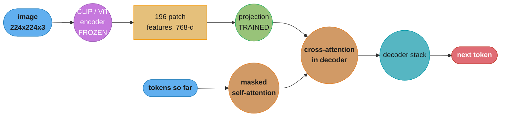
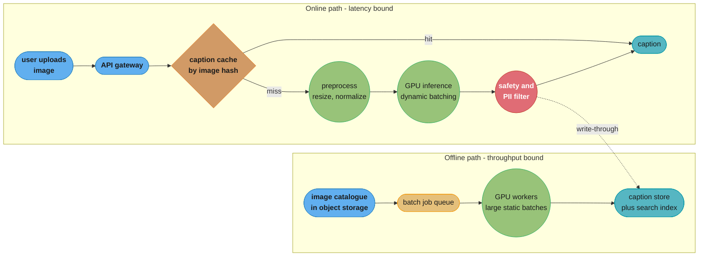
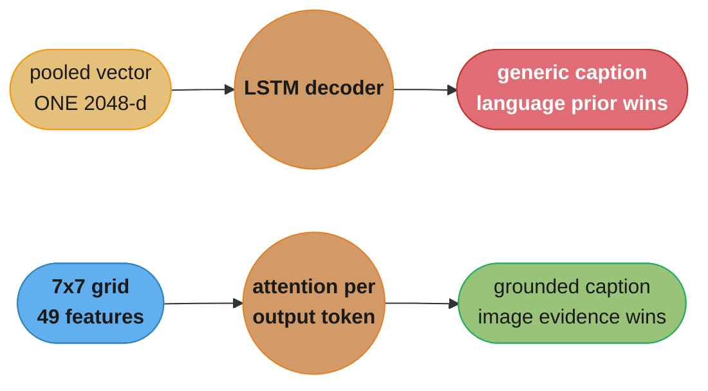
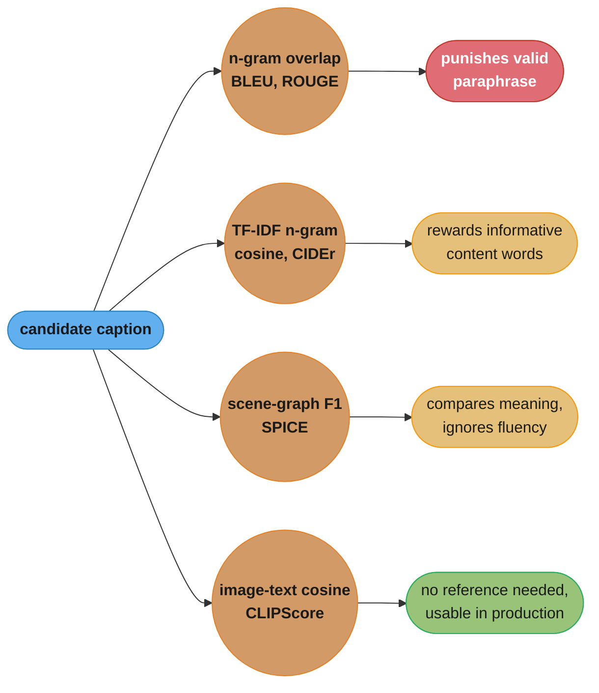

# Chapter 5: Image Captioning

> Ch 5 of 11 · Generative AI System Design Interview (Aminian & Sheng, ByteByteGo, 2024) · builds on Ch 4 — ChatGPT: Personal Assistant Chatbot, leads to Ch 6 — Retrieval-Augmented Generation

## Chapter Map

Chapters 2, 3 and 4 all shared one shape: text goes in, text comes out. Smart Compose
continues a sentence, Translate rewrites a sentence in another language, the chatbot answers
a message — in every case the encoder and the decoder speak the same modality, and the hard
parts were latency, alignment and safety rather than the input format itself. Chapter 5 is
where the book breaks that symmetry for the first time. The input is a raster image, a grid
of pixels with no tokens, no vocabulary and no sequential order that a language model can
consume. The output is still a sentence. The entire chapter is therefore about one question:
how do you make an autoregressive text decoder condition on something that is not text, and
how do you know whether the sentence it produced is any good when there are many correct
captions and no single reference to grade against.

The answer the chapter builds is an **encoder-decoder** with a modality bridge in the middle.
A vision encoder — a CNN in the classical formulation, a Vision Transformer in the modern
one — turns the image into a sequence of feature vectors that live in the same numeric space
the decoder's attention layers already know how to read. The decoder generates the caption
one token at a time, attending back into those image features through **cross-attention**.
That is the same conditional-generation machinery Ch 3's translation model used, with the
source-language encoder swapped for a vision encoder. Framing it that way is the single most
useful move in the interview, because it lets you reuse everything you already said about
beam search, teacher forcing and exposure bias in the previous chapters instead of inventing
a new vocabulary.

**TL;DR:**
- Image captioning is **conditional autoregressive text generation**: the model learns
  `P(caption | image)` token by token, exactly like translation, with the source sequence
  replaced by a sequence of image patch or region features.
- The architecture is an **encoder-decoder**: a CNN or ViT encoder produces image features, a
  projection layer maps them into the decoder's embedding dimension, and the decoder's
  **cross-attention** layers read those features while generating. Reusing a **CLIP-pretrained**
  encoder is the chapter's efficiency lever — the encoder already understands images in a
  text-aligned space, so far less caption data is needed to train the bridge.
- Data is **image-caption pairs**, and the two sources have opposite characteristics: **COCO
  Captions** is small, clean and carries **five independent human references per image**;
  web-crawled **alt-text** corpora such as Conceptual Captions are three to four orders of
  magnitude larger and far noisier, so the pipeline is a cleaning pipeline first and a
  training pipeline second.
- Evaluation is the chapter's sharpest teaching point: **BLEU, METEOR and ROUGE** were built
  for translation and reward n-gram overlap, which punishes a correct caption phrased
  differently from the references. **CIDEr** and **SPICE** were designed for captioning
  specifically, **CLIPScore** needs no reference at all, and none of them detect the failure
  that matters most in production — a fluent caption naming an object that is not in the
  image.
- The production system splits cleanly into an **offline batch indexing path** (caption a
  billion-image catalogue, throughput-bound, GPU-batching-friendly) and an **online request
  path** (caption one uploaded image now, latency-bound), and the two want different batch
  sizes, different decoding strategies and different hardware.

## The Big Question

> A language model generates the next token by attending over previous tokens. An image has
> no tokens. How do you feed a 224x224x3 array of pixels into a decoder that only knows how
> to read embeddings — and once it produces a sentence, how do you score that sentence when
> five different humans wrote five different, all-correct captions for the same photograph?

Analogy: think of a museum tour guide standing in front of a painting with a visually
impaired visitor. The guide does not read a label out loud; there is no label. The guide
looks at the canvas, decides which of the hundreds of things visible on it actually matter to
this listener, and speaks one sentence: "a woman in a red coat feeding pigeons on a snowy
bench." Everything the chapter designs is one of the two halves of that act. The vision
encoder is the guide's eye — it converts light into an internal representation of what is
there. The decoder is the guide's mouth — it turns that representation into fluent, ordered
language, choosing what to mention and what to leave out. And the evaluation problem is the
one every museum has: if you asked ten guides to describe the same painting you would get ten
different sentences, all of them right, and no way to declare one the answer key.

---

## 5.1 Clarifying Requirements

The book's first step is always to pin the scope down with the interviewer before proposing
architecture. For captioning, six questions do most of the work.

- **What is the business objective?** The chapter frames three distinct drivers, and they pull
  the design in different directions. **Accessibility** — generating alt text so a screen
  reader can describe an image to a visually impaired user — demands factual precision above
  all, because a wrong caption actively misinforms someone who cannot check it. **Search
  indexing** — turning an image catalogue into searchable text — demands coverage and recall
  of salient objects, and tolerates slightly clumsy phrasing. **Content understanding and
  moderation support** demands neither fluency nor beauty, only reliable object mentions.
  Naming which one you are optimizing for changes the evaluation metric you pick in §5.5.
- **One caption or several?** A single best caption is the default for alt text, where a
  screen reader will read exactly one sentence. Search indexing benefits from **multiple
  diverse candidates** per image, since more candidate phrasings mean more query terms that
  can match. This choice drives the decoding strategy directly: beam search with a single
  returned hypothesis versus nucleus sampling with n draws.
- **What language, and how many?** English-only is the chapter's default scope. Multilingual
  captioning is possible by swapping the decoder for a multilingual one, but it multiplies the
  data problem — captions in low-resource languages are far scarcer than English alt text —
  and it interacts with Ch 3's translation chapter, since one legitimate design is to caption
  in English and translate.
- **Caption length and style?** One sentence, roughly **10 to 15 words**, describing the main
  subject and its action, is the COCO-style convention the chapter assumes. Longer, paragraph
  length descriptions are a different product with a different training corpus.
- **What is the latency budget, and is the workload online or offline?** This is the question
  that most shapes §5.6. An interactive upload path wants a caption back in a few hundred
  milliseconds. A batch job captioning an existing catalogue of hundreds of millions of images
  has no per-image latency requirement at all, only a total throughput and cost target. Most
  real systems have both, and the chapter designs both paths.
- **What scale?** The chapter's worked figure is an image platform ingesting on the order of
  **100 million images per day** with an existing back catalogue in the billions — a scale at
  which the batch path dominates the cost model entirely and the per-image GPU cost, not the
  model's quality, is the binding constraint.
- **What are the safety and fairness constraints?** Captions describe people. A system that
  infers and states gender, age, ethnicity, or profession from appearance will be wrong often
  and harmfully. The chapter makes "what should the model refuse to assert about people" a
  requirements-time decision, not a post-hoc filter.

**Functional summary:** given an image, produce one (or n) fluent, factually grounded
English sentences of roughly 10-15 words describing its salient content, served both as a
low-latency online call and as a high-throughput offline batch job, without asserting
unverifiable attributes about the people depicted.

---

## 5.2 Framing the Problem as an ML Task

### Defining the ML objective

The system's input is an image; its output is a variable-length sequence of text tokens. That
makes this **conditional sequence generation**, and the training objective is the same
maximum-likelihood objective the book's text chapters used, with the image as the condition:

```
maximize  sum over t of  log P(y_t | y_1 ... y_{t-1}, I)
```

where `I` is the image and `y_1 ... y_T` are the caption's tokens. At training time the model
is fed the ground-truth prefix and asked to predict the next token — **teacher forcing** —
and the loss is token-level cross-entropy. At inference time it consumes its own previous
outputs instead, which is the origin of the **exposure bias** problem the chapter revisits in
§5.4.

### Why this is not classification

A tempting wrong framing, and one the chapter explicitly heads off, is to treat captioning as
multi-label classification: detect which of N object classes are present, then fill a
template ("a `<object>` on a `<object>`"). This fails for two reasons. First, the space of
useful captions is not enumerable — captions describe relationships, actions, attributes and
context ("about to catch"), not just object presence. Second, the interesting part of a
caption is exactly the part a fixed label set throws away: *which* of the visible objects
matters, and *how* they relate. Object detection is a genuinely useful upstream signal, and
some architectures use region proposals as encoder inputs, but it is not a substitute for
generation.

### Choosing the ML category — encoder-decoder generation

Framing the system as an encoder-decoder makes the design decisions fall out in order:

| Sub-decision | Options | What drives the pick |
|---|---|---|
| Vision encoder | CNN (ResNet), ViT, CLIP image tower | Available pretraining, input resolution, latency |
| Bridge | Global pooled vector, grid features, region features, learned query tokens | How much spatial detail the decoder needs |
| Text decoder | LSTM/GRU, Transformer decoder, a pretrained LLM | Fluency bar, data volume, serving cost |
| Conditioning mechanism | Initial hidden state, prefix embedding, cross-attention | Whether the decoder can look back at the image per token |

The chapter's recommended configuration is a **ViT or CLIP image encoder** producing a
sequence of patch features, a **linear projection** into the decoder's hidden dimension, and a
**Transformer decoder with cross-attention** into those features. The single most important
row in that table is the last one: conditioning through cross-attention, rather than by
stuffing a single pooled image vector into the decoder's first hidden state, is what lets the
decoder look at *different parts of the image* while generating different words — attending
to the dog's region while emitting "dog" and to the frisbee's region while emitting
"frisbee."

### Input and output, formalized

- **Input:** an RGB image, resized and normalized to a fixed encoder resolution (224x224 or
  336x336 are the chapter's typical figures).
- **Encoder output:** a sequence of feature vectors. A ViT-B/16 at 224x224 produces
  `(224/16)^2 = 196` patch tokens plus one class token, each of dimension 768.
- **Decoder output:** a token sequence terminated by an end-of-sequence token, detokenized
  into a caption string.

---

## 5.3 Data Preparation

### Data engineering — where image-caption pairs come from

Captioning is unusual among the book's chapters in that its two candidate data sources sit at
opposite extremes of the size-quality tradeoff, and a production pipeline uses both.

**Human-annotated caption datasets.** **MS COCO Captions** is the chapter's reference: roughly
**123,000 images** with **five independent human-written captions each**, about **600,000
captions** in total. Five references per image is not a detail — it is what makes the n-gram
metrics in §5.5 usable at all, because a candidate caption gets credit for matching any of
the five, which partially absorbs the fact that many phrasings are correct. Other named
human-annotated sets include **Flickr30k** (31,000 images, five captions each) and
**Visual Genome** (dense region-level descriptions rather than whole-image captions).

**Web-crawled alt-text corpora.** **Conceptual Captions (CC3M)** harvests roughly **3.3
million** image-alt-text pairs from the web and runs them through an automated cleaning and
normalization pipeline; **CC12M** relaxes the filters to reach about **12 million** pairs at
lower precision. **LAION**-scale corpora push this into the hundreds of millions to billions
by filtering web pairs on CLIP image-text similarity. These corpora are three to four orders
of magnitude larger than COCO and correspondingly noisier: alt text is often a filename, a
photographer credit, an SEO keyword stuffing, or a caption describing something adjacent to
the image rather than in it.

The chapter's guidance is the standard two-stage recipe: **pretrain on the large noisy
corpus** to learn broad visual-linguistic grounding, then **fine-tune on the small clean
corpus** to learn the target caption style and length. Trying to train only on COCO gives a
model with a narrow visual vocabulary; trying to train only on alt text gives a model that
writes alt text, complete with the filename artifacts.

### Data engineering — cleaning

Every stage below removes a specific, observed failure, and skipping any one of them shows up
directly in generated captions.

- **Non-descriptive text removal.** Drop alt-text values that are filenames
  (`IMG_20190312.jpg`), stock-photo boilerplate, watermark text, or pure keyword lists. A
  model trained without this filter will emit filenames as captions for images it finds
  unfamiliar, because "when uncertain, produce the most common caption shape" is a valid
  local optimum.
- **Length filtering.** Discard captions shorter than about three tokens (they carry no
  content) and longer than about 50 (they are usually article body text scraped by mistake).
- **Image-text relevance filtering.** Score each pair with a pretrained image-text model
  (CLIP similarity is the standard choice) and drop the bottom percentile. This is the single
  highest-leverage filter on a web corpus, because a mismatched pair does not merely add noise
  — it actively teaches the model to hallucinate.
- **Deduplication.** Perceptual hashing on images and near-duplicate detection on captions.
  Web crawls contain the same stock photo thousands of times, and duplicates both waste
  training compute and skew the learned caption distribution toward whatever the duplicated
  content happens to say.
- **Test-set leakage checks.** Deduplicate the *training* corpus against the evaluation set's
  images before training. A web crawl very plausibly contains COCO images, and if it does,
  reported CIDEr is measuring memorization.
- **NSFW and harmful-content filtering.** Both on the image side and on the caption side,
  since removing an unsafe image is not sufficient if the text corpus still teaches the
  vocabulary.
- **Licensing and consent review.** The chapter flags this as a real constraint on a
  production corpus rather than a legal footnote: crawled images carry uncertain rights, and
  images of identifiable people carry consent questions that a research benchmark can
  sidestep and a shipping product cannot.

### Data engineering — the multiple-reference structure

COCO's five-references-per-image structure has consequences that ripple through both training
and evaluation, and it is worth being explicit about which:

- **In training**, each (image, caption) pair is an independent example, so one image
  contributes five training rows. This is a mild form of augmentation: the model sees that the
  same image legitimately supports several different sentences, which discourages it from
  over-committing to one phrasing.
- **In evaluation**, all five references are used *together* to score one candidate. CIDEr
  and BLEU both compute overlap against the union of references, and CIDEr additionally
  weights n-grams by how informative they are across the corpus.
- **In splitting**, the split must be **by image**, never by caption. Splitting by caption
  puts four references of an image in train and the fifth in test, which leaks catastrophically.
  The commonly used **Karpathy split** of COCO (113,287 train / 5,000 validation / 5,000 test
  images) exists precisely so results are comparable across papers.

### Feature engineering — image preprocessing

- **Resize and center-crop** to the encoder's fixed input resolution. Aspect-ratio distortion
  matters more than it sounds: a model trained on square-cropped images and served
  letterboxed images at inference time sees a systematically different input distribution.
- **Normalize** pixel values with the encoder's own pretraining mean and standard deviation.
  Using ImageNet statistics with a CLIP encoder is a classic silent bug — nothing errors, the
  captions just get worse.
- **Augment** with random crops and horizontal flips during training. Color jitter is used
  sparingly, since a caption may name a color ("a red bus") and aggressive hue shifting turns
  a correct label into a wrong one.
- **Tokenize** captions with the decoder's tokenizer, lowercase and punctuation-normalize if
  matching the COCO convention, and cap sequence length at a fixed maximum for batching.

---

## 5.4 Model Development

### Model selection — the architectural ladder

The chapter walks four generations of captioning architecture, and the progression is worth
telling as a story because each step fixes a named weakness of the previous one.

#### 1. CNN encoder plus RNN decoder (the "Show and Tell" formulation)

The original formulation runs the image through a CNN (an ImageNet-pretrained ResNet or
Inception), takes the pooled feature vector from just before the classification head — a
single 2048-dimensional vector for ResNet-50 — and uses it to initialize the hidden state of
an LSTM decoder, which then generates the caption token by token.

The **broken part** is exactly that single vector. Everything the decoder will ever know
about the image has to fit into 2048 numbers produced once, before generation starts. The
decoder generating the tenth word has no way to look back at the image for a detail it did
not encode into that vector at step zero, and no way to focus on a particular region.
Symptomatically, these models produce fluent, plausible, generic captions — "a man riding a
horse on a beach" for an image of a man riding a *bicycle* on a beach — because the language
model's prior does more work than the image evidence.

#### 2. Attention over spatial features (the "Show, Attend and Tell" formulation)

The **fix** is to stop pooling. Instead of the CNN's final pooled vector, take the last
convolutional feature *map* — for ResNet at 224x224 input, a 7x7 grid of 2048-dimensional
vectors, i.e. 49 spatial features — and let the decoder compute an attention distribution
over those 49 locations at every generation step. The decoder emitting "frisbee" can put its
attention mass on the frisbee's grid cells. This is the same attention mechanism Ch 3
introduced for translation, applied over space instead of over source tokens, and it is the
step that turned captioning from "plausible sentence" into "sentence about this image."

#### 3. ViT encoder plus Transformer decoder with cross-attention

The modern formulation replaces both halves. A **Vision Transformer** splits the image into
fixed patches (16x16 pixels, giving 196 patches at 224x224 resolution), embeds each patch
linearly, adds positional embeddings, and runs them through transformer blocks — producing a
sequence of patch features that already look exactly like the token sequence a transformer
decoder is built to consume. The decoder is a standard Transformer decoder stack in which
each block has masked self-attention over the caption tokens generated so far, then
**cross-attention** into the encoder's patch features, then a feed-forward layer.

```python
# One decoder block, conditioning on image features. Shapes shown for a ViT-B/16 encoder.
# img_feats: (B, 197, 768)   B images, 196 patches + 1 class token
# tok_hidden: (B, T, 768)    caption tokens generated so far

h = tok_hidden + masked_self_attention(tok_hidden)        # what have I said so far
h = h + cross_attention(query=h, key=img_feats, value=img_feats)   # what is in the image
h = h + feed_forward(h)
logits = output_projection(h)                             # (B, T, vocab_size)
```

The cross-attention line is the whole chapter in one expression: the caption's current state
forms the queries, the image's patch features form the keys and values, and the resulting
attention distribution is literally "which part of the image is relevant to the word I am
about to produce."

#### 4. Pretrained, text-aligned encoders and end-to-end vision-language models

The chapter's efficiency argument is that you should not train the vision encoder from
scratch, and probably should not train it at all. A **CLIP** image tower has already been
trained on hundreds of millions of image-text pairs with a contrastive objective, so its
output space is *already aligned with language*. Freezing that encoder and training only a
small **projection layer** plus the decoder cuts the trainable parameter count by an order of
magnitude and dramatically reduces how much caption data is needed.

That pattern — frozen vision encoder, small trainable bridge, large language decoder — is the
skeleton of the end-to-end vision-language models the chapter names as the state of the art:
**BLIP** and **BLIP-2**, which introduce a small trainable **Q-Former** that distills the
encoder's many patch features down to a handful of learned query tokens before handing them
to a frozen LLM, and **Flamingo**, which interleaves gated cross-attention layers into a
frozen language model. The design lesson generalizes past captioning: when two large
pretrained models already exist on either side of a modality gap, train the bridge, not the
towers.



Caption: the frozen encoder supplies image features once per request, and cross-attention
lets every generated token query them independently — which is exactly the capability the
single-pooled-vector formulation lacked.

### Model training — objective, and the CIDEr-optimization wrinkle

Standard training is **teacher-forced cross-entropy**: feed the ground-truth caption prefix,
predict the next token, sum the log-losses. It is simple, parallelizable across the whole
sequence, and it has a known defect.

**Exposure bias.** During training the model only ever conditions on ground-truth prefixes.
During inference it conditions on its own generated prefixes, which will sometimes contain a
mistake it has never seen in training — and having no experience of recovering from its own
errors, it compounds them. The classic symptom is a caption that starts correctly and then
drifts into a fluent but unrelated continuation.

**The mismatch between training loss and evaluation metric.** Cross-entropy rewards matching
the reference token by token; CIDEr rewards matching informative n-grams against five
references. Optimizing one does not directly optimize the other. The chapter's named fix is
**self-critical sequence training (SCST)**, a reinforcement-learning method that samples a
caption, scores it with CIDEr directly, and uses the greedily decoded caption's CIDEr as the
baseline — so the gradient pushes up sampled captions that beat greedy decoding and pushes
down those that do not. It optimizes the metric you actually report and it also removes
exposure bias by construction, since the model is trained on its own samples. The cost is
that RL fine-tuning is unstable and slow, so the standard recipe is cross-entropy first to
convergence, then a shorter SCST phase.

### Sampling — decoding the caption

The decoding choice is a product decision, not a modeling one:

- **Greedy decoding** takes the argmax at each step. Fastest, one forward pass per token,
  reliably bland.
- **Beam search** with a beam of **3 to 5** is the chapter's default for a single returned
  caption. It searches several partial hypotheses in parallel and returns the highest total
  log-probability sequence, which reliably raises BLEU and CIDEr — at roughly `beam_width`
  times the decode compute. Beam search also has a known bias toward short outputs, which
  length normalization (dividing the sequence log-probability by length raised to a power
  alpha, typically 0.6-0.7) corrects.
- **Nucleus (top-p) sampling** with `p` around 0.9 is what you use when the requirement from
  §5.1 was *multiple diverse captions* for search indexing. Sample n times, deduplicate, index
  all of them. Diversity is the feature here, so beam search's convergence toward one modal
  phrasing is a bug rather than a benefit.

---

## 5.5 Evaluation

This is the chapter's densest section, because captioning has the same "many correct answers"
problem the book's generation chapters all share, but unlike face generation it *does* have
references — which makes the tempting-but-flawed reference-overlap metrics available.

### Offline metrics — the n-gram family, and why they are weak here

**BLEU** computes modified n-gram precision of the candidate against the references (typically
up to 4-grams, geometrically averaged) with a brevity penalty for short outputs. It was
designed for translation, where a source sentence has a fairly constrained space of correct
translations. Captions do not have that property. Consider an image and its references:

```
reference 1:  a man riding a wave on a surfboard
reference 2:  a surfer rides a large wave in the ocean
reference 3:  a person on a surfboard in the water
candidate  :  a surfer catching a big wave
```

The candidate is an excellent caption. Its 4-gram precision against those references is
essentially zero, and even its bigram precision is poor — "a surfer" matches reference 2 and
nothing else does. BLEU will score it far below a duller candidate like "a man on a
surfboard in the water," which is a near-copy of reference 3 and says less. That inversion —
rewarding lexical mimicry over descriptive quality — is the core reason the chapter treats
BLEU as a weak captioning metric even though it is universally reported.

**METEOR** softens this by matching on stems, synonyms and paraphrases rather than exact
tokens, and by weighting recall more heavily than precision. It correlates better with human
judgment than BLEU on captions, at the cost of needing language-specific resources (a
stemmer, a synonym database) and being slower to compute.

**ROUGE-L** measures the longest common subsequence between candidate and reference,
recall-oriented. It was built for summarization and is reported for captioning mostly by
convention; it shares BLEU's fundamental blindness to correct-but-differently-phrased output.

### Offline metrics — the captioning-specific family

**CIDEr (Consensus-based Image Description Evaluation)** is the chapter's primary metric, and
it is the one designed for this task. Its mechanism is worth stating precisely because "CIDEr
is like BLEU but for captions" is not an adequate interview answer:

1. Represent each caption (candidate and all references) as a vector of n-gram counts, for n
   from 1 to 4.
2. Weight each n-gram by its **TF-IDF** across the whole evaluation corpus. This is the key
   idea. An n-gram like "a man" appears in a large fraction of all captions and therefore
   carries almost no information, so IDF drives its weight near zero. An n-gram like "riding a
   unicycle" is rare and therefore highly informative, so it carries large weight.
3. Compute the cosine similarity between the candidate's TF-IDF vector and each reference's,
   average across references, and average across n-gram orders.

The consequence is that CIDEr gives credit for **the distinctive, informative content words**
a caption gets right, and effectively ignores the filler that every caption shares. A model
that games BLEU by producing common phrasings gains almost nothing on CIDEr, which is exactly
the behavior you want. Reported CIDEr on COCO is conventionally scaled by 10, which is why
published numbers look like 110 or 130 rather than 1.1 or 1.3.

**SPICE (Semantic Propositional Image Caption Evaluation)** takes a different route entirely:
it parses both candidate and references into **scene graphs** — tuples of objects, attributes
and relations, such as `(surfer)`, `(wave, large)`, `(surfer, riding, wave)` — and computes an
F1 score over the matched tuples. Because it compares meaning structures rather than word
sequences, it is nearly immune to paraphrase, and it can be broken out by tuple type to tell
you *what* the model gets wrong: objects right but relations wrong is a very different failure
from objects wrong. Its weakness is that it depends on a dependency parser, so parse errors
become metric errors, and it says nothing about fluency — a bag of correct tuples in
ungrammatical order scores well.

**CLIPScore** is the reference-free option. Embed the image with CLIP's image tower, embed
the candidate caption with CLIP's text tower, and take their cosine similarity (rescaled). It
needs **no reference captions at all**, which makes it the only metric on this list you can
compute on live production traffic where no human ever wrote a reference. That is a large
practical advantage for the monitoring in §5.7. Its weaknesses are that it inherits every
blind spot and bias of the CLIP model itself, and that it is a poor *absolute* score — it is
useful for comparing two models on the same images or for detecting drift, not for declaring
a quality bar.

### Human evaluation

The chapter is unambiguous that automated metrics are a proxy and human evaluation is the
ground truth. The practical protocol: sample a few hundred images, show raters the image and
the candidate caption, and collect ratings on separable axes rather than one overall score:

| Axis | Question asked of the rater | What it catches |
|---|---|---|
| Correctness | Does everything the caption asserts actually appear? | Hallucinated objects |
| Completeness | Does it mention the image's main subject? | Salience failures |
| Fluency | Is it grammatical, natural English? | Decoder degradation |
| Specificity | Is it informative, or generic filler? | Mode collapse toward "a man standing" |

Splitting correctness from fluency is what makes the results actionable: a model that is
fluent and wrong needs grounding work, while a model that is correct and clumsy needs decoding
or fine-tuning work, and a single 1-5 "quality" score cannot distinguish them.

### The failure no reference metric catches

**Object hallucination** — a fluent caption naming an object that is simply not in the image —
is the production failure that matters most for the accessibility use case, and every metric
above handles it badly. BLEU and CIDEr penalize it only through the n-grams it displaces.
CLIPScore penalizes it only weakly, since a caption that is 80% right still embeds close to
the image. The chapter's guidance is to measure it directly with a dedicated check: run an
object detector over the image, extract the object nouns from the caption, and count the
fraction of mentioned objects with no detection support. That ratio — the literature calls it
CHAIR — is a monitoring signal, not a training loss, and it belongs on the dashboard in §5.7.

---

## 5.6 Overall ML System Design

The system has two request paths with genuinely different requirements, and the chapter's
main design point is that trying to serve both from one configuration makes both worse.



Caption: the same model serves both paths, but the online path optimizes tail latency with a
cache and small dynamic batches while the offline path optimizes GPU utilization with large
static batches — and the online path writes through to the same caption store so an image is
never captioned twice.

### The online path

- **API gateway and validation.** Reject oversized files, unsupported formats and corrupt
  images before any GPU touches them. This is a trust boundary — image parsing libraries are
  a classic source of exploits, so decode happens in a sandboxed preprocessing service.
- **Caption cache keyed by image content hash.** Deduplication at serving time is enormously
  effective on a real platform, where the same meme, logo and stock photo are uploaded
  constantly. A perceptual hash rather than a byte hash catches re-encodes and minor crops as
  well, at the cost of occasional false merges.
- **Preprocessing service.** Decode, EXIF-rotate, resize, center-crop, normalize. Kept
  separate from the GPU service because it is CPU-bound and scales differently — collapsing
  them wastes GPU time on JPEG decoding.
- **GPU inference with dynamic batching.** The encoder pass is a single forward pass and
  batches beautifully. The decoder is autoregressive, so its cost scales with caption length,
  and a batch runs until its longest member finishes. A dynamic batching window of a few
  milliseconds trades a small fixed latency cost for a large throughput gain.
- **Safety and PII filtering** on the output text before it is returned, covering both the
  content policy and the §5.1 rule about not asserting demographic attributes of people.

### The offline path

The batch path is where the money is at the chapter's stated scale, and its design is a
throughput problem rather than a latency one: pull work from a queue in large chunks, use the
largest batch that fits GPU memory, run in half precision, and prefer greedy or small-beam
decoding since there is no user waiting but there are a hundred million images per day. The
outputs land in a caption store that also feeds the text search index, so a query for "dog
catching frisbee" can retrieve images whose only text is generated.

### Scale estimation

The chapter's worked numbers make the online/offline split concrete. Assume a ViT-B encoder
plus a 6-layer transformer decoder, half precision, on a modern datacenter GPU:

- **Encoder:** one forward pass over 197 tokens, roughly **5-10 ms** at batch size 1,
  amortizing to well under 1 ms per image at batch size 64.
- **Decoder:** roughly **12 tokens** at a few milliseconds per token with beam width 3,
  giving **30-60 ms** at batch size 1.
- **Online end to end:** on the order of **100 ms** including preprocessing, network and
  safety filtering — comfortably inside an interactive budget.
- **Offline throughput:** with large batches and greedy decoding, on the order of
  **200-500 images per second per GPU**. At **100 million images per day** that is roughly
  1,160 images per second sustained, so on the order of **3-6 GPUs** running continuously,
  plus headroom for the ingest burst pattern. This is the number that justifies caching and
  deduplication — a 30% duplicate rate is 30% of that GPU bill.

---

## 5.7 Deployment and Monitoring

- **Shadow deployment before rollout.** Run the candidate model on live traffic without
  serving its output, and compare its captions to the incumbent's on the same images. Because
  CLIPScore is reference-free, it can be computed on this shadow traffic directly, which makes
  it the practical online quality signal even though CIDEr is the offline one.
- **Object hallucination monitoring.** Track the CHAIR-style ratio described in §5.5 on a
  sampled slice of production traffic. This is the metric that protects the accessibility use
  case, and it is the one most likely to regress silently when a model is updated, because
  hallucination usually improves fluency scores rather than hurting them.
- **Out-of-distribution degradation.** A model trained on COCO and web photos degrades sharply
  on inputs its corpus barely contains: medical imagery, screenshots and UI captures, charts
  and diagrams, documents, satellite imagery, heavily stylized art. The failure mode is not an
  error — it is a confident, fluent, wrong caption, which is worse. Monitor the input
  distribution (an image-embedding drift detector over the encoder's own features is the cheap
  version) and route detected OOD categories to a fallback that returns no caption rather than
  a wrong one. For alt text specifically, no caption is strictly better than a false one.
- **Bias in descriptions of people.** The chapter treats this as a first-class monitoring
  concern. Two distinct failures: **attribute assertion**, where the model states gender, age,
  ethnicity or occupation inferred from appearance ("a nurse" for a woman in scrubs, "a
  doctor" for a man in the same scrubs), and **differential quality**, where captions of
  people from under-represented groups are shorter, vaguer or more error-prone. The first is
  addressed by training-data curation plus an output filter that rewrites asserted attributes
  into neutral terms; the second requires a demographically stratified evaluation set and
  per-slice CIDEr, since an aggregate metric averages the gap away.
- **Caption-length and diversity drift.** Track the distribution of caption lengths and the
  entropy of emitted vocabulary over time. A model drifting toward short, generic captions is
  degrading in a way that CIDEr can partially mask, and it is often the first visible symptom
  of a bad fine-tune or a decoding-parameter regression.
- **Feedback loop.** User edits to generated alt text are the highest-quality training signal
  the system can collect — a human correcting a caption produces exactly the (image, correct
  caption) pair the model was missing. Route those into the fine-tuning corpus, with review,
  and be careful not to create a self-training loop where the model's own uncorrected outputs
  become training data.

---

## Beyond the book — captioning after 2024

> This chapter summarizes the 2024 edition of *Generative AI System Design Interview*, whose
> reference design is a purpose-built encoder-decoder captioner evaluated with CIDEr and
> SPICE. It does not cover the shift toward general-purpose multimodal LLMs used as
> zero-shot captioners, nor the use of synthetic recaptioning to train image generators —
> both described below as separate, later material.

The most significant change since publication is that captioning has largely stopped being a
task you build a dedicated model for. General-purpose multimodal LLMs — the GPT-4o and
Gemini families commercially, the LLaVA and Qwen-VL lines in the open-weights world — caption
images competently with nothing but a prompt, and they do it with a controllability the
book's architecture cannot offer: you can ask for a one-line alt text, a paragraph-length
description, a caption that omits people, or a caption in a particular language, all from the
same model with no retraining. The book's encoder-bridge-decoder skeleton is still exactly
what is inside those models, which is why the chapter remains the right mental model, but the
build-versus-prompt decision has shifted decisively toward prompting for anything except very
high-volume batch workloads, where a small distilled captioner is still far cheaper per image.

A second development runs in the opposite direction and gives the chapter renewed relevance:
**synthetic recaptioning**. Text-to-image models (the book's own Ch 9) train on image-text
pairs, and web alt text turned out to be so noisy that the largest gains in that field came
not from better generators but from replacing the alt text with detailed captions produced by
a strong captioning model. That makes a high-throughput captioner an *infrastructure*
component for image generation rather than a user-facing product, and it makes the §5.6 batch
path — throughput per GPU dollar over billions of images — the dominant design consideration
rather than the secondary one the chapter presents it as.

Finally, evaluation has moved on. **LLM-as-judge** protocols, where a strong multimodal model
scores a candidate caption for correctness and completeness given the image, correlate better
with human judgment than CIDEr or SPICE and, like CLIPScore, need no references — though they
carry their own bias toward captions written in the judge's own style.

---

## Visual Intuition



Caption: the single-vector formulation forces every detail through one bottleneck computed
before generation starts, so the decoder falls back on its language prior; keeping the spatial
grid and attending into it per token is what makes the caption about *this* image.



Caption: the four metric families answer different questions, which is why the chapter reports
several — CIDEr for offline model selection, SPICE for diagnosing what kind of error, and
CLIPScore for live traffic where nobody wrote a reference.

```
Why CIDEr's IDF weighting changes the ranking

  corpus-wide n-gram frequency        IDF weight in CIDEr
  --------------------------------    -------------------
  "a"                     92%         ~0.00   ignored
  "a man"                 31%         ~0.05   nearly ignored
  "on a"                  28%         ~0.06   nearly ignored
  "riding a"               4%         ~0.40   counts
  "catching a frisbee"   0.08%        ~0.95   dominates the score

  candidate A: "a man on a bench"          <- 4 near-zero-weight n-grams, CIDEr ~ low
  candidate B: "a man catching a frisbee"  <- 1 high-weight n-gram, CIDEr ~ high

  BLEU treats every n-gram equally and can rank A above B whenever A
  happens to copy more reference filler. CIDEr cannot, because the filler
  carries almost no weight.
```

Caption: TF-IDF weighting is the entire difference between a metric that rewards saying
something specific and one that rewards sounding like the references.

---

## Key Concepts Glossary

- **Image captioning** — generating a natural-language description of an image's content.
- **Alt text** — the textual description of an image consumed by screen readers, the
  chapter's primary accessibility use case.
- **Encoder-decoder architecture** — a vision encoder turns the image into features, a text
  decoder generates the caption conditioned on them.
- **Cross-attention** — the decoder attends over the encoder's image features, with the
  caption state as queries and the image features as keys and values.
- **Teacher forcing** — training a decoder on ground-truth prefixes rather than its own
  outputs.
- **Exposure bias** — the train/inference mismatch caused by teacher forcing: the model never
  practices recovering from its own errors.
- **Show and Tell** — the CNN-plus-LSTM formulation that conditions on a single pooled image
  vector.
- **Show, Attend and Tell** — the formulation that keeps the CNN's spatial feature grid and
  attends over it per generated token.
- **Vision Transformer (ViT)** — an image encoder that splits an image into fixed patches and
  processes them as a token sequence.
- **Patch token** — one of the fixed-size image regions a ViT embeds; 196 of them at 224x224
  with 16x16 patches.
- **CLIP** — a contrastively trained image-text model whose image tower produces features
  already aligned with language.
- **Projection layer / bridge** — the small trainable module mapping encoder features into the
  decoder's embedding dimension.
- **Q-Former** — BLIP-2's small trainable module that distills many patch features into a few
  learned query tokens for a frozen LLM.
- **COCO Captions** — the chapter's reference dataset: about 123,000 images with five human
  captions each.
- **Karpathy split** — the conventional COCO train/validation/test image split that makes
  published numbers comparable.
- **Conceptual Captions (CC3M / CC12M)** — web-crawled, automatically cleaned alt-text corpora
  of roughly 3.3 million and 12 million pairs.
- **Multiple references** — several independent human captions for one image, used together
  when scoring a candidate.
- **BLEU** — modified n-gram precision with a brevity penalty; built for translation, weak on
  captions.
- **METEOR** — matching on stems, synonyms and paraphrases with recall weighted above
  precision.
- **ROUGE-L** — longest-common-subsequence recall, borrowed from summarization.
- **CIDEr** — TF-IDF-weighted n-gram cosine similarity against multiple references; the
  chapter's primary captioning metric.
- **SPICE** — F1 over scene-graph tuples (objects, attributes, relations) parsed from
  candidate and references.
- **CLIPScore** — reference-free cosine similarity between the CLIP embeddings of the image
  and the candidate caption.
- **Object hallucination** — a fluent caption naming an object not present in the image; the
  failure that reference metrics detect worst.
- **Self-critical sequence training (SCST)** — RL fine-tuning that optimizes CIDEr directly,
  using greedy decoding as the baseline.
- **Beam search** — decoding that tracks several partial hypotheses; the chapter's default at
  beam width 3-5 for a single caption.
- **Nucleus (top-p) sampling** — sampling from the smallest token set whose probability mass
  exceeds p; used when diverse captions are wanted.
- **Dynamic batching** — grouping inference requests arriving within a short window into one
  GPU batch.
- **Perceptual hash** — a content-derived image fingerprint stable under re-encoding and minor
  edits, used for deduplication and caching.

---

## Tradeoffs & Decision Tables

### Encoder choice

| Encoder | Pretraining | Spatial detail | Cost | When the chapter picks it |
|---|---|---|---|---|
| ResNet CNN | ImageNet classification | 7x7 grid | Low | Legacy baseline, tight compute budgets |
| ViT trained from scratch | None | 196 patches | Very high data need | Almost never for captioning alone |
| CLIP image tower (frozen) | 400M+ image-text pairs | 196 patches | Low marginal | **Default** — already text-aligned |
| Region features from a detector | Object detection | Per-object | High, two models | When object grounding must be explicit |

### Conditioning mechanism

| Mechanism | Decoder can re-look at image | Fidelity | Cost |
|---|---|---|---|
| Pooled vector as initial hidden state | No | Generic captions | Cheapest |
| Image features as a prefix in the token sequence | Yes, via self-attention | Good | Grows context length |
| Cross-attention layers | Yes, per token, per layer | **Best** | Extra parameters per block |

### Metric selection by use case

| Use case | Primary metric | Why |
|---|---|---|
| Offline model selection on COCO | CIDEr | Designed for captioning, multi-reference, IDF-weighted |
| Diagnosing error type | SPICE, broken out by tuple type | Separates object errors from relation errors |
| Live production monitoring | CLIPScore, CHAIR ratio | Reference-free, computable on real traffic |
| Accessibility quality gate | Human correctness rating | Only reliable detector of confident wrong captions |
| Comparing to published papers | BLEU-4 plus CIDEr | Convention, not merit |

### Decoding strategy by requirement

| Requirement | Strategy | Setting |
|---|---|---|
| One best caption, alt text | Beam search with length normalization | Beam 3-5, alpha 0.6-0.7 |
| n diverse captions for indexing | Nucleus sampling | p ~ 0.9, n draws, dedupe |
| Maximum batch throughput | Greedy | Batch as large as memory allows |

### Online versus offline serving

| Dimension | Online path | Offline path |
|---|---|---|
| Optimizes | p99 latency | Images per GPU-dollar |
| Batch size | Small, dynamic window | Largest that fits memory |
| Decoding | Beam search | Greedy or beam 2 |
| Cache | Essential, by perceptual hash | Dedupe before enqueue |
| Failure handling | Return no caption, degrade gracefully | Retry and dead-letter queue |

---

## Common Pitfalls / War Stories

- **Reporting BLEU-4 as the headline captioning number.** BLEU systematically prefers captions
  that copy reference phrasing over captions that say something specific and true, so a model
  tuned against it drifts toward generic output. Teams that optimized BLEU have shipped models
  that scored better and read worse, which is exactly why CIDEr and SPICE were designed.
- **Splitting the dataset by caption instead of by image.** With five captions per image, a
  caption-level random split puts four references of an image into training and the fifth into
  test. Test CIDEr looks superb and generalization is nonexistent. Always split by image, and
  use the Karpathy split if you intend to compare against published numbers.
- **Not deduplicating the web corpus against the evaluation set.** A billion-pair web crawl
  very plausibly contains COCO images with their captions. Reported metrics then measure
  memorization, and the gap only shows up after launch on genuinely novel images.
- **Trusting a pooled image vector to carry enough detail.** Systems built on the single-vector
  formulation produce fluent captions that describe a *plausible* image rather than the one
  supplied, and the failure is invisible in aggregate metrics because the captions are
  grammatical and topically close. It surfaces as user complaints about alt text describing
  the wrong thing.
- **Using ImageNet normalization statistics with a CLIP encoder.** Nothing errors. The encoder
  simply receives inputs from a slightly shifted distribution, all downstream quality drops a
  few points, and the cause is invisible in code review because both constants look correct in
  isolation.
- **Serving with the same batch configuration for interactive and batch traffic.** Large
  static batches destroy interactive p99 latency, and small dynamic batches waste most of the
  GPU on the catalogue job. The two paths need separate deployments even though they share a
  model artifact.
- **Shipping demographic attribute assertions in alt text.** A caption saying "a nurse" for a
  woman and "a doctor" for a man in identical scrubs is a fairness failure that no captioning
  metric reports, because both captions are fluent and plausibly reference-adjacent. It needs
  a dedicated stratified evaluation set and an output policy decided at requirements time.
- **Treating out-of-distribution inputs as an accuracy problem.** On a screenshot, a chart or a
  medical scan, a COCO-trained captioner does not fail loudly — it produces a confident,
  fluent, entirely wrong sentence. For accessibility, returning nothing is strictly better,
  which means OOD detection has to gate the output rather than merely log a warning.

---

## Real-World Systems Referenced

**Architectures:** Show and Tell (CNN plus LSTM), Show Attend and Tell (spatial attention),
Vision Transformer (ViT), CLIP, BLIP and BLIP-2 with the Q-Former bridge, Flamingo's gated
cross-attention into a frozen language model. **Datasets:** MS COCO Captions, Flickr30k,
Visual Genome, Conceptual Captions (CC3M and CC12M), LAION-scale web pairs. **Metrics and
tooling:** BLEU, METEOR, ROUGE-L, CIDEr, SPICE, CLIPScore, the COCO caption evaluation
toolkit. **Products the chapter frames this system as serving:** screen-reader alt text for
accessibility, image search indexing over catalogues with no human-written text, and
content-understanding pipelines feeding moderation and recommendation.

---

## Summary

Image captioning is the book's bridge from text-to-text systems into multimodal ones, and the
chapter's central move is to recognize that it is not a new problem at all — it is conditional
sequence generation with a vision encoder standing where Ch 3's source-language encoder stood.
The architectural story is one of progressively refusing to throw information away: a single
pooled CNN vector produces fluent captions driven mostly by the language prior, keeping the
spatial feature grid and attending over it per token grounds the caption in the actual image,
and swapping in a Transformer decoder with cross-attention over ViT or CLIP patch features
makes that grounding both stronger and cheaper to train, because a text-aligned pretrained
encoder means only the bridge needs learning. Data comes from two sources with opposite
properties — small, clean, five-reference COCO and enormous, noisy web alt text — and the
recipe is to pretrain on the noisy one and fine-tune on the clean one, with a cleaning
pipeline whose CLIP-similarity filter is the highest-leverage stage because a mismatched pair
does not merely add noise, it teaches hallucination. Evaluation is where the chapter is
sharpest: BLEU and ROUGE were built for tasks with constrained correct answers and punish
valid paraphrase, CIDEr's TF-IDF weighting fixes that by rewarding informative content words,
SPICE compares meaning structures rather than word sequences, CLIPScore needs no references
and is therefore the only metric usable on live traffic, and none of them reliably catch a
fluent caption naming an object that is not there — which for the accessibility use case is
the only failure that truly matters. In production the system splits into a latency-bound
online path with a perceptual-hash cache and a throughput-bound offline path that dominates
the cost model at catalogue scale, and monitoring watches hallucination rate, out-of-distribution
drift and per-slice fairness rather than a single quality number. Chapter 6 keeps the
grounding theme but changes the modality of the evidence: instead of grounding text in pixels,
it grounds text in retrieved documents.

---

## Interview Questions

**Q: Why is image captioning framed as conditional sequence generation rather than multi-label classification?**
**Short:** Captions describe relationships and salience, not just object presence, so a fixed label set discards the useful part.
The output is a variable-length sentence whose value lies in which objects are mentioned and how they relate to each other, and neither of those is expressible as membership in a fixed set of classes. A classification-plus-template design can name what is present but cannot say "about to catch," cannot choose which of twelve visible objects is the subject, and cannot produce natural word order. Object detection remains useful as an upstream signal or as a hallucination check, but the generation framing is what makes the task solvable at all.

**Q: What goes wrong when a captioning model conditions on a single pooled image vector?**
**Short:** Everything the decoder can ever know is fixed before generation starts, so the language prior dominates the image evidence.
In the CNN-plus-LSTM formulation the image is compressed into one 2048-dimensional vector used to initialize the decoder's hidden state, so a decoder emitting its tenth word has no mechanism to look back at the image for a detail that vector did not preserve. The observable symptom is fluent, generic captions that describe a plausible image rather than the supplied one — "a man riding a horse on a beach" for a man on a bicycle. Keeping the spatial feature grid and attending over it per generated token is the fix, and it is the step that turned captioning from plausible into grounded.

**Q: Why do BLEU and ROUGE work poorly as captioning metrics?**
**Short:** They reward n-gram overlap with the references, which punishes a correct caption phrased differently.
Both were designed for tasks where the space of correct outputs is narrow — translation and summarization — but an image supports many equally good captions with almost no lexical overlap between them. A candidate like "a surfer catching a big wave" can score near zero on 4-gram precision against references that all say "riding a wave on a surfboard," while a duller near-copy of one reference scores well. That inversion means optimizing BLEU pushes a model toward lexical mimicry and away from saying anything specific, which is why CIDEr and SPICE exist.

**Q: How does CIDEr actually work, and why is it better suited to captioning than BLEU?**
**Short:** CIDEr weights n-grams by TF-IDF before comparing, so informative content words dominate and shared filler is ignored.
It represents candidate and references as n-gram count vectors for n from 1 to 4, weights each n-gram by its TF-IDF across the evaluation corpus, and takes the cosine similarity averaged over references and n-gram orders. Because a phrase like "a man on a" appears in most captions its IDF weight is near zero, while a rare, informative phrase like "catching a frisbee" carries nearly all the weight. The practical consequence is that gaming the metric by copying common reference phrasing gains almost nothing, which is exactly the incentive a captioning metric should create.

**Q: What is object hallucination in captioning, and why do standard metrics fail to catch it?**
**Short:** It is a fluent caption naming an object absent from the image, and reference metrics penalize it only through displaced n-grams.
A caption that is 80 percent correct and invents one object stays close to the references in n-gram space and close to the image in CLIP space, so BLEU, CIDEr and CLIPScore all penalize it only weakly while a human immediately calls it wrong. For the accessibility use case it is the worst possible failure, because the user cannot verify it. The chapter's answer is to measure it directly: run an object detector, extract the caption's object nouns, and track the fraction of mentioned objects with no detection support as a dedicated production monitoring signal.

**Q: Why does the chapter recommend freezing a CLIP encoder and training only the bridge and decoder?**
**Short:** A CLIP image tower is already aligned with language, so far less caption data is needed to learn the mapping.
CLIP was trained contrastively on hundreds of millions of image-text pairs, which means its image features already occupy a space where semantically similar text embeds nearby — the modality gap the bridge has to cross is much smaller than it would be from a purely visual encoder. Freezing it cuts trainable parameters by roughly an order of magnitude, shrinks the caption-data requirement, and removes the risk of catastrophically degrading a good encoder during a small fine-tune. The general lesson is that when strong pretrained models exist on both sides of a modality gap, you train the bridge, not the towers.

**Q: How would you split a captioning dataset that has five captions per image, and what breaks if you get it wrong?**
**Short:** Split by image, never by caption — a caption-level split leaks four references of a test image into training.
With five human references per image, randomly splitting at the caption level almost guarantees that some captions of a test image appear in the training set, so the model is scored on an image it has already been taught to describe. Reported CIDEr comes out excellent and generalization to genuinely new images is unmeasured. The COCO convention is the Karpathy image-level split of 113,287 train, 5,000 validation and 5,000 test images, which also makes results comparable to published numbers.

**Q: What is exposure bias in a caption decoder, and how does self-critical sequence training address it?**
**Short:** Teacher forcing means the model never practices recovering from its own mistakes, and SCST trains on its own samples instead.
Under teacher forcing the decoder always conditions on the ground-truth prefix during training but on its own generated prefix at inference, so the first error puts it in a state it has never been trained on and errors compound into fluent drift. SCST samples a full caption, scores it with CIDEr directly, and uses the greedily decoded caption's CIDEr as a baseline, pushing up samples that beat greedy and down those that do not. This both removes the train/inference mismatch and optimizes the reported metric rather than a token-level proxy, at the cost of unstable RL training — so it is run as a short second phase after cross-entropy convergence.

**Q: Why does the chapter split the serving system into an online path and an offline batch path?**
**Short:** One optimizes tail latency with small dynamic batches, the other optimizes GPU cost with the largest batches memory allows.
An interactive upload needs a caption in roughly 100 milliseconds, which forces small batches, a short dynamic batching window and an aggressive content-hash cache. A catalogue job captioning 100 million images a day has no per-image deadline at all and is purely a cost problem, so it wants maximum batch size, half precision and greedy decoding. Running both from one configuration makes interactive p99 latency terrible and wastes most of the batch GPU, so they share a model artifact and nothing else.

**Q: What is CLIPScore, and why is it the metric you can actually run in production?**
**Short:** It is the cosine similarity between the CLIP embeddings of the image and the caption, and it needs no reference caption.
Every other metric in the chapter requires human-written references, which do not exist for live traffic, so they can only be computed on a held-out benchmark that gradually stops resembling production. CLIPScore embeds the image and the generated caption with CLIP's two towers and compares them directly, so it can be computed on every request and used for shadow comparison, drift detection and regression alerting. Its limitations are that it inherits CLIP's own biases and blind spots and is a poor absolute quality bar — treat it as a relative signal between models or over time, not as a threshold.

**Q: How would you clean a web-crawled alt-text corpus, and which filter matters most?**
**Short:** Image-text relevance filtering matters most, because a mismatched pair actively teaches the model to hallucinate.
The pipeline drops non-descriptive text such as filenames and SEO keyword lists, filters captions shorter than about three tokens or longer than about fifty, deduplicates images perceptually and captions textually, removes NSFW content on both sides, and checks for leakage against the evaluation set. The highest-leverage stage is scoring each pair with a pretrained image-text model and dropping the low-similarity tail, since noise from an unrelated caption is not merely uninformative — it supplies a training gradient toward describing things that are not present.

**Q: When would you use beam search versus nucleus sampling for caption decoding?**
**Short:** Beam search for one best caption such as alt text, nucleus sampling when the product wants several diverse captions.
Beam search with width 3 to 5 and length normalization reliably produces the highest-scoring single caption and is the right default for accessibility, where exactly one sentence will be read aloud. For search indexing the requirement is coverage of phrasings a user might query, so sampling several captions with top-p around 0.9 and deduplicating produces a richer index than n beam hypotheses, which tend to be minor variants of one another. The choice follows directly from the §5.1 requirements question about one caption or several.

**Q: What does SPICE measure that CIDEr does not?**
**Short:** SPICE compares parsed scene-graph tuples of objects, attributes and relations rather than word sequences.
It parses candidate and references into tuples such as an object, an object with an attribute, or a subject-relation-object triple, and computes F1 over the matched tuples, which makes it nearly immune to paraphrase and lets you break the score out by tuple type. That breakdown is diagnostic in a way CIDEr is not: objects correct but relations wrong is a very different model failure from objects wrong, and it points at different fixes. Its weaknesses are dependence on a dependency parser, so parse errors become metric errors, and complete blindness to fluency — a bag of correct tuples in ungrammatical order scores well.

**Q: How do you handle out-of-distribution images such as screenshots, charts or medical scans?**
**Short:** Detect them and return no caption, because the model fails by producing a confident fluent wrong sentence rather than an error.
A COCO-and-web-trained captioner has almost no training signal for documents, UI captures, diagrams or medical imagery, and its failure mode is not a low-confidence output but a grammatical caption describing something that is not there. Cheap detection is a drift monitor over the encoder's own image embeddings, flagging inputs far from the training distribution, optionally backed by a lightweight image-type classifier. For alt text specifically, suppressing the caption is strictly better than emitting a false one, so out-of-distribution detection must gate the response rather than merely log a warning.

**Q: What fairness failures are specific to captioning people, and how would you detect them?**
**Short:** Asserted demographic attributes and differential caption quality across groups, neither of which aggregate metrics reveal.
The first failure is the model stating gender, age, ethnicity or occupation inferred from appearance — calling a woman in scrubs a nurse and a man in the same scrubs a doctor — which is fluent, reference-plausible and therefore invisible to CIDEr. The second is captions of under-represented groups being shorter, vaguer or more error-prone while the aggregate score stays healthy because other slices compensate. Detection requires a demographically stratified evaluation set with per-slice metrics and human correctness ratings, and the attribute-assertion failure additionally needs a requirements-time policy plus an output filter, not just better training data.

**Q: Why is a perceptual-hash caption cache so valuable in the online path?**
**Short:** Real platforms re-upload the same memes, logos and stock photos constantly, so cached captions remove a large fraction of GPU work.
A content-derived hash lets the service return a previously generated caption without any inference, and a perceptual hash rather than a byte hash also catches re-encodes, minor crops and resizes that a cryptographic hash would treat as new images. At the chapter's stated scale a 30 percent duplicate rate translates directly into 30 percent of the GPU bill, which is a larger win than most model-level optimizations. The tradeoff is occasional false merges where two visually similar but semantically different images share a caption, so the similarity threshold is a tunable that should be validated against real traffic.

**Q: Why would you pretrain on Conceptual Captions and fine-tune on COCO rather than training on either alone?**
**Short:** The web corpus supplies visual breadth and the human corpus supplies caption style, and neither provides both.
Conceptual Captions and larger web corpora cover millions of visual concepts that COCO's 123,000 images never contain, so training only on COCO produces a model with a narrow visual vocabulary that fails on anything unusual. Training only on alt text produces a model that writes alt text — inconsistent length, SEO artifacts, occasional filenames — because that is the distribution it learned. Pretraining on the large noisy corpus for grounding and fine-tuning on the small clean one for style and length is the standard recipe, and it is the same two-stage pattern the book uses throughout.

---

## Cross-links in this repo

- [llm/vision_language_models/vision_language_models.md](../../../llm/vision_language_models/vision_language_models.md) — CLIP, BLIP, Flamingo and the encoder-bridge-decoder family in depth.
- [llm/multimodal_models/multimodal_models.md](../../../llm/multimodal_models/multimodal_models.md) — general multimodal architecture patterns beyond image-to-text.
- [ml/computer_vision/computer_vision.md](../../../ml/computer_vision/computer_vision.md) — image feature extraction, detection and the vision backbones this chapter's encoder draws on.
- [ml/convolutional_neural_networks/convolutional_neural_networks.md](../../../ml/convolutional_neural_networks/convolutional_neural_networks.md) — the CNN encoders behind the Show and Tell and Show Attend and Tell formulations.
- [ml/model_evaluation_and_selection/model_evaluation_and_selection.md](../../../ml/model_evaluation_and_selection/model_evaluation_and_selection.md) — offline and online evaluation methodology generalizing this chapter's metric zoo.
- [llm/inference_and_decoding/inference_and_decoding.md](../../../llm/inference_and_decoding/inference_and_decoding.md) — beam search, nucleus sampling, length normalization and decoding cost.
- [ml/model_serving_and_inference/model_serving_and_inference.md](../../../ml/model_serving_and_inference/model_serving_and_inference.md) — dynamic batching, caching and the online/offline serving split in §5.6.
- [ml/monitoring_and_drift_detection/monitoring_and_drift_detection.md](../../../ml/monitoring_and_drift_detection/monitoring_and_drift_detection.md) — the drift detectors behind the out-of-distribution monitoring in §5.7.
- [ml/gpu_and_hardware_optimization/gpu_and_hardware_optimization.md](../../../ml/gpu_and_hardware_optimization/gpu_and_hardware_optimization.md) — half precision and throughput tuning for the batch captioning path.
- [llm/guardrails_and_content_safety/guardrails_and_content_safety.md](../../../llm/guardrails_and_content_safety/guardrails_and_content_safety.md) — the output safety and attribute-assertion filters in §5.7.
- [database/search_engines/search_engines.md](../../../database/search_engines/search_engines.md) — indexing generated captions so images become searchable by text.
- [devops/ml_platform_and_gpu_infrastructure/ml_platform_and_gpu_infrastructure.md](../../../devops/ml_platform_and_gpu_infrastructure/ml_platform_and_gpu_infrastructure.md) — running the GPU fleet the batch path in §5.6 sizes.
- Sibling chapters: [Ch 4 — ChatGPT: Personal Assistant Chatbot](../04_chatgpt_personal_assistant_chatbot/04_chatgpt_personal_assistant_chatbot.md) · [Ch 6 — Retrieval-Augmented Generation](../06_retrieval_augmented_generation/06_retrieval_augmented_generation.md) (grounding generation in retrieved text rather than pixels) · [Ch 9 — Text-to-Image Generation](../09_text_to_image_generation/09_text_to_image_generation.md) (the inverse mapping, and a consumer of captioning at scale).

## Further Reading

- Vinyals et al., "Show and Tell: A Neural Image Caption Generator," CVPR 2015 — the CNN
  encoder plus LSTM decoder formulation.
- Xu et al., "Show, Attend and Tell: Neural Image Caption Generation with Visual Attention,"
  ICML 2015 — spatial attention over the CNN feature grid.
- Chen et al., "Microsoft COCO Captions: Data Collection and Evaluation Server," 2015 — the
  dataset and its five-reference protocol.
- Sharma et al., "Conceptual Captions: A Cleaned, Hypernymed, Image Alt-text Dataset for
  Automatic Image Captioning," ACL 2018 — the web-corpus cleaning pipeline.
- Vedantam, Zitnick and Parikh, "CIDEr: Consensus-based Image Description Evaluation," CVPR
  2015 — the TF-IDF-weighted metric.
- Anderson et al., "SPICE: Semantic Propositional Image Caption Evaluation," ECCV 2016 — the
  scene-graph metric.
- Hessel et al., "CLIPScore: A Reference-free Evaluation Metric for Image Captioning," EMNLP
  2021.
- Rennie et al., "Self-critical Sequence Training for Image Captioning," CVPR 2017 — CIDEr
  optimization by reinforcement learning.
- Radford et al., "Learning Transferable Visual Models From Natural Language Supervision"
  (CLIP), ICML 2021.
- Li et al., "BLIP-2: Bootstrapping Language-Image Pre-training with Frozen Image Encoders and
  Large Language Models," ICML 2023 — the Q-Former bridge.
- Alayrac et al., "Flamingo: a Visual Language Model for Few-Shot Learning," NeurIPS 2022.
- Rohrbach et al., "Object Hallucination in Image Captioning," EMNLP 2018 — the CHAIR measure.
- Aminian & Sheng, *Generative AI System Design Interview* (ByteByteGo, 2024), Ch 5 — original
  text.
