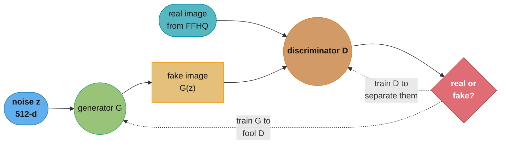
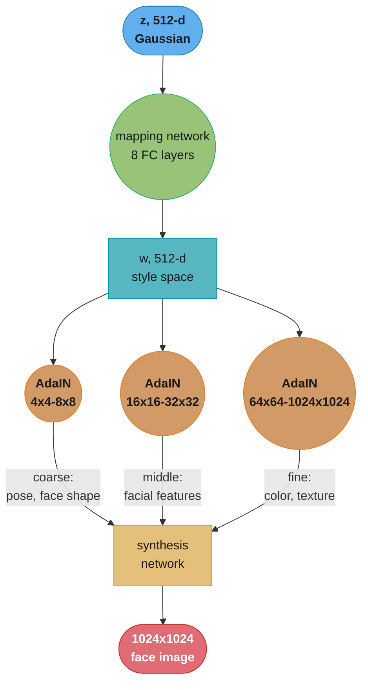

# Chapter 7: Realistic Face Generation

> Ch 7 of 11 · Generative AI System Design Interview (Aminian & Sheng, ByteByteGo, 2024) · builds on Ch 6 — Retrieval-Augmented Generation, leads to Ch 8 — High-Resolution Image Synthesis

## Chapter Map

Chapters 2 through 6 were all built on a shared spine: an encoder or a large language model
consumes text (or text plus retrieved context) and produces more text. This chapter is the
book's turn toward pure image synthesis, and it resets the mental model that got you through
the first six chapters. There is no "correct" output to compare a generated face against — no
reference translation, no ground-truth summary. The system's job is to produce a photorealistic
human face that has never existed, and the only meaningful yardstick is "does this look like it
could have been a photograph of a real person." That reframing is what makes **generative
adversarial networks (GANs)** the chapter's model of choice: instead of training a network
against a fixed loss function that scores "how close is my output to the target," you train two
networks against *each other*, and let the resulting contest define what "realistic" means.

**TL;DR:**
- A GAN pairs a **generator**, which maps random noise to a candidate image, against a
  **discriminator**, which tries to tell generated images from real ones — the generator gets
  better only by fooling an ever-improving adversary, not by matching a fixed target.
- The naive minimax objective is unstable in practice: gradients vanish once the discriminator
  gets too good, and the generator can collapse onto a handful of outputs that reliably fool
  it — **mode collapse** — which is why real systems switch to a **non-saturating** loss and add
  explicit stabilization.
- **StyleGAN** is the chapter's reference architecture: a **mapping network** turns the input
  noise into an intermediate, more disentangled **style space (w)**, and **AdaIN** injects that
  style at every resolution of a synthesis network that is grown from 4×4 up to 1024×1024 — this
  is why StyleGAN faces are simultaneously photorealistic and individually controllable
  (age, pose, hair) without retraining.
- Evaluation has no single ground truth, so the chapter leans on two distribution-level metrics,
  **Fréchet Inception Distance (FID)** and **Inception Score (IS)**, backed by human
  preference studies — and on face-specific concerns (identity fairness, deepfake risk, consent)
  that don't show up in a translation or captioning chapter at all.

## The Big Question

> There is no "correct" face. Ask a translation model to translate a sentence and there's a
> reference to grade against; ask a face generator to produce "a photorealistic 35-year-old
> woman" and there are infinitely many correct answers and no dataset that lists them. How do
> you train a model, and evaluate it, when the target is "indistinguishable from reality" rather
> than any specific label?

Analogy: think of an art forger and a museum curator locked in a room together, for a thousand
rounds. Round one, the forger's paintings are obviously fake — wrong brushstrokes, wrong
anatomy — and the curator rejects everything instantly. But every rejection teaches the forger
something, and every fake the curator lets slip through teaches the curator something too. By
round one thousand, the forger paints work a curator with an ordinary eye can no longer
distinguish from the museum's real collection — not because anyone told the forger what
"correct" looked like, but because the curator's own improving judgment was the only training
signal the forger ever had. The GAN generator is the forger; the discriminator is the curator;
and the chapter's entire arc is making sure that contest converges to a good forger rather than
a stalemate, a collapse, or a curator who simply gives up.

---

## 7.1 Clarifying Requirements

As in every chapter, the book opens by pinning down scope with the interviewer before proposing
anything.

- **What is the input and output?** Input is a **random noise vector** (optionally combined with
  conditioning attributes such as age or pose); output is a single **photorealistic human face
  image**, typically 1024×1024. There is no reference image and no text prompt in this chapter —
  text-conditioned generation is deferred to Ch 9.
- **Does the system need to generate a *specific* person, or any plausible person?** **Any
  plausible person** — the system should produce novel, non-existent faces, not reconstruct a
  particular individual's likeness. (Reconstructing a specific person's likeness from a handful
  of reference photos is a different problem, covered in Ch 10's personalized-headshot chapter.)
- **What resolution and quality bar?** High-resolution (1024×1024), photorealistic output —
  visible artifacts (asymmetric eyes, warped ears, texture "leakage" between hair and skin) are
  unacceptable at production quality.
- **How much control does the user need over attributes?** The system should support
  **controllable attributes** — age, gender presentation, expression, pose, lighting — without
  retraining a new model per attribute. This constraint is what pulls the design toward
  StyleGAN's disentangled style space rather than a plain unconditional GAN.
- **What's the latency budget?** A single-image generation should complete in well under a
  second on a production GPU, since the target use cases (avatar creation, synthetic dataset
  generation, stock-photo alternatives) are interactive or batch-at-scale, not
  minutes-per-image.
- **What are the safety and ethical constraints?** The system must not be usable to
  reconstruct or impersonate a real, identifiable person, and outputs should be
  detectable/watermarked as synthetic. This constraint shapes data curation, model design, and
  the deployment/monitoring steps far more than it would in a translation or RAG system.

**Functional summary:** given a random seed (and optional attribute controls), generate a novel,
photorealistic, high-resolution human face image in well under a second, safely and
attributably.

## 7.2 Framing the Problem as an ML Task

### Defining the ML objective

The objective is **unconditional (or lightly conditional) image synthesis**: learn the
underlying distribution of real face photographs well enough to draw new samples from it. There
is no per-example label to predict and no reference output to regress toward — the entire
learning signal has to come from "does this sample look like it was drawn from the same
distribution as the training set." That framing rules out a plain supervised loss (there is
nothing to supervise against) and rules out a simple reconstruction loss like pixel-wise L2
(minimizing L2 against an *average* face produces a blurry, generic-looking face, since L2 is
minimized by hedging between many plausible faces rather than committing to one sharp,
realistic one).

### Choosing the ML category — generative adversarial networks

The chapter frames three candidate generative families and explains why GANs are the pick for
this specific chapter (diffusion models, covered in the next chapter, are the alternative the
book returns to for Ch 8-11):

- **Variational Autoencoders (VAEs)** encode an image into a latent distribution and decode
  back, trained with a reconstruction loss plus a KL-divergence regularizer. They are stable to
  train and give an easy latent space to sample from, but the reconstruction loss produces
  characteristically blurry outputs — VAEs alone rarely hit photorealistic sharpness.
- **Autoregressive pixel models** (e.g., PixelRNN/PixelCNN-style) generate an image one pixel
  (or patch) at a time, conditioned on everything generated so far. They can be very sharp, but
  generating a 1024×1024 image one pixel at a time is prohibitively slow for an interactive
  latency budget.
- **Generative Adversarial Networks (GANs)** replace the reconstruction loss with a learned
  **discriminator** that judges realism directly, and generate a full image in a single forward
  pass. That single-pass generation is exactly what a sub-second latency budget needs, and the
  adversarial loss — rather than pixel-wise error — is what produces sharp, high-frequency detail
  instead of blur. The chapter's pick for this chapter is a GAN for precisely those two reasons;
  Ch 8 explains why the book's later, higher-resolution chapters move to diffusion instead.

### Input and output, formalized

- **Generator G**: maps a latent noise vector `z ~ N(0, I)`, typically 512-dimensional, to an
  image `G(z)` in pixel space (e.g., 1024×1024×3).
- **Discriminator D**: maps an image (real or generated) to a scalar in `[0, 1]`, its estimate of
  the probability the image is real.
- Training alternates: D is trained to output values close to 1 on real images and close to 0 on
  `G(z)`; G is trained to make D output values close to 1 on `G(z)` — i.e., to fool D.

---

## 7.3 Data Preparation

### Data engineering

Face generation needs a large corpus of high-resolution, unlabeled (or lightly labeled) face
photographs. The chapter's reference dataset is **FFHQ (Flickr-Faces-HQ)** — 70,000 images at
1024×1024, crawled from Flickr and automatically aligned/cropped to center the face — chosen for
its resolution, diversity of age/ethnicity/accessories/backgrounds, and permissive licensing
relative to earlier face datasets. **CelebA / CelebA-HQ** (roughly 200,000 celebrity photos, a
30,000-image high-quality subset) is the chapter's secondary reference, useful when
attribute labels (smiling, eyeglasses, gender presentation) are needed for conditional variants,
though it skews toward a narrower demographic and image style (celebrity press photos) than
FFHQ.

### Data engineering — cleaning and alignment

Raw crawled photos need substantial cleaning before they're usable:

- **Face detection and alignment.** A face detector locates facial landmarks (eyes, nose, mouth
  corners); the image is then rotated, scaled, and cropped so the eyes sit on a consistent
  horizontal line at a consistent distance — without this, the generator would have to learn
  pose variation *and* content simultaneously, wasting capacity.
- **Deduplication.** Near-duplicate photos (the same subject, slightly different angle) bias the
  learned distribution toward whatever happens to be over-represented; perceptual-hash-based
  dedup keeps one representative per near-duplicate cluster.
- **Quality filtering.** Blurry, low-resolution, heavily occluded (sunglasses, hands over face),
  or multi-face images are filtered out, since a generator trained on noisy inputs learns to
  produce noisy outputs.
- **Bias auditing.** The chapter flags this as a first-class data-preparation step, not an
  afterthought: auditing the corpus's age, skin-tone, and gender-presentation distribution
  against a target population, because a corpus skewed toward one demographic produces a
  generator that renders other demographics less realistically — a failure mode that compounds
  every downstream use of the model (see §7.4's fairness discussion and Common Pitfalls below).

### Feature engineering — image preprocessing

- Resize every image to the target training resolution (progressively, per §7.4's progressive
  growing).
- Normalize pixel values to `[-1, 1]` to match the generator's `tanh` output activation.
- Random horizontal flipping as a cheap, label-preserving augmentation (faces are
  approximately left-right symmetric, so flipping doubles effective data at zero labeling
  cost) — more aggressive augmentation (color jitter, heavy crops) is used sparingly, since GAN
  discriminators can "leak" strong augmentations into the generator's outputs if not handled
  carefully (a failure mode formalized as **augmentation leakage**, addressed by techniques such
  as differentiable, discriminator-only augmentation).

---

## 7.4 Model Development

### Model selection — the adversarial pair

The chapter builds up the architecture in three stages: the vanilla GAN objective, why it's
unstable, and StyleGAN's fixes.

#### The vanilla GAN objective

```
min_G max_D  E[log D(x)] + E[log(1 - D(G(z)))]
             x~real                z~noise
```

Read left to right: the discriminator D is trained to *maximize* this quantity — output high
values on real images `x` and low values on fake images `G(z)`. The generator G is trained to
*minimize* it — i.e., push `D(G(z))` toward 1, making its fakes look real to D. Both networks
train simultaneously via alternating gradient steps: one step updates D with G frozen, one step
updates G with D frozen, repeated for hundreds of thousands of iterations.

### Model training — why the vanilla objective is unstable

Two specific failure modes recur, and the chapter treats fixing both as mandatory, not optional
tuning:

**Vanishing gradients when D is too strong.** Early in training, D can trivially separate real
from fake — real faces look nothing like the noise-adjacent output of a barely-trained G. When
`D(G(z))` is close to 0, the term `log(1 - D(G(z)))` sits on a nearly flat part of the loss
curve, so its gradient with respect to G's parameters is close to zero: G gets almost no signal
about *how* to improve, even though it desperately needs to. The **broken form**:

```
G's loss (saturating):  L_G = log(1 - D(G(z)))     # minimize this
```

is "correct" in the game-theoretic sense but nearly useless in early training, because its
gradient vanishes exactly when G needs it most. The **fix** used in practice is the
**non-saturating loss**, which keeps the same fixed point (G still wins by maximizing `D(G(z))`)
but supplies a much stronger gradient in the early, easy-for-D regime:

```
G's loss (non-saturating):  L_G = -log(D(G(z)))    # minimize this instead
```

`-log(D(G(z)))` has a steep gradient exactly when `D(G(z))` is close to 0 — the regime where the
saturating loss went flat — so G receives useful learning signal from the very first
iterations. Every practical GAN implementation, including StyleGAN, trains G with this
non-saturating form rather than the textbook minimax loss.

**Mode collapse.** Even with the non-saturating loss, G can find a degenerate shortcut: produce
only a small handful of images (or one image) that reliably fool the *current* D, rather than
covering the full diversity of real faces. Because G is optimizing against D's current
weaknesses rather than against the true data distribution directly, "always generate this one
convincing face" can be a stable local optimum for many iterations, especially once D starts
chasing that one mode instead of learning general realism. Symptom: sampling a batch of 64
outputs from a mode-collapsed generator produces near-duplicate faces regardless of how
different the input noise vectors were. Mitigations the chapter lists: **minibatch
discrimination** (letting D see statistics across a batch, so it can penalize a batch that's
suspiciously homogeneous, not just individually convincing), a **Wasserstein loss with gradient
penalty (WGAN-GP)** (which replaces the binary real/fake classifier with a smoother distance
estimate less prone to this pathology), and architecture-level fixes such as StyleGAN's own
design (below), which empirically collapses far less often than earlier DCGAN-style
architectures at the same resolution.

### StyleGAN — the chapter's reference architecture

StyleGAN (Karras et al., NVIDIA) restructures the generator around two ideas that directly
target the instability above and add the controllability §7.1 asked for.

**The mapping network.** Instead of feeding the noise vector `z` directly into the synthesis
network, an 8-layer fully connected **mapping network** first transforms `z` into an
intermediate latent code `w`, both 512-dimensional. The motivation is **disentanglement**: the
input `z` is sampled from a fixed, fully entangled Gaussian, which forces any single direction
in `z`-space to simultaneously affect multiple visual attributes (moving toward "more smiling"
might inadvertently shift age or pose too, because the training data's real attribute
combinations aren't uniformly distributed the way a Gaussian is). The learned mapping network is
free to warp its output space `w` into whatever shape makes single attributes vary along
roughly independent directions — empirically, moving along one direction in `w`-space changes
age with much less bleed into unrelated attributes than the same move in `z`-space.

**AdaIN-based style injection.** Rather than feeding `w` into the network once at the start (as
a plain conditional GAN would), StyleGAN injects `w` at **every resolution** of the synthesis
network via **Adaptive Instance Normalization (AdaIN)**:

```
AdaIN(x_i, w) = w_scale(w) * (x_i - mean(x_i)) / std(x_i) + w_bias(w)
```

Each feature map `x_i` is instance-normalized (mean/variance removed per channel, per image),
then rescaled and re-shifted using a scale and bias that are themselves learned linear
projections of `w`. Because this happens independently at *every* resolution level of the
synthesis network — coarse layers (4×4-8×8) controlling pose/face shape, middle layers
(16×16-32×32) controlling finer facial features, fine layers (64×64-1024×1024) controlling
color scheme and micro-texture — a single generator can mix different `w` vectors at different
resolution levels (**style mixing**), letting an interviewer's follow-up like "swap this face's
hairstyle onto that face's identity" be answered with a mechanism, not a hand-wave. A separate,
per-pixel **noise input** injected at each layer supplies stochastic, non-identity-affecting
detail (individual hair placement, skin pore texture) so the same `w` doesn't produce
pixel-identical output on every draw.

### Progressive growing

Training a GAN to output 1024×1024 images from scratch is unstable — the discriminator can spot
high-resolution artifacts trivially early in training, starving the generator of useful
gradient (the same vanishing-gradient problem as above, made worse by resolution). StyleGAN
adopts **progressive growing**: start training both G and D at a tiny 4×4 resolution, let them
converge, then add a new layer to double the resolution (4→8→16→32→64→128→256→512→1024),
fading in each new layer's contribution smoothly rather than switching abruptly, and continue
training at the new resolution before growing again. This resolution ladder means the networks
master coarse structure (face shape, pose) before ever having to also solve fine texture, which
is both more stable and, empirically, faster to converge to a given quality bar than training
directly at 1024×1024.

### The truncation trick

At inference time, sampling `z` from the full Gaussian occasionally lands in low-density regions
of latent space that the generator was never well-trained on, producing visible artifacts. The
**truncation trick** interpolates each sampled `w` toward the *average* `w` (computed once,
offline, over many samples) by a factor `ψ` (psi):

```
w_truncated = w_avg + psi * (w - w_avg)
```

`psi = 1.0` uses the raw sample (maximum diversity, occasional artifacts); `psi ≈ 0.5-0.7` is
the chapter's typical production setting, trading some diversity for markedly higher and more
consistent per-image quality — a small, cheap, inference-time knob that meaningfully improves
perceived realism without retraining anything.

---

## 7.5 Evaluation

Because there is no per-image ground truth, evaluation compares the *distribution* of generated
images to the distribution of real images, plus targeted human judgment.

### Offline metrics

**Fréchet Inception Distance (FID)** is the chapter's primary metric. Mechanism: pass a large
batch of real images and a large batch of generated images through a pretrained Inception-v3
network, take the activations from an intermediate layer as feature vectors, fit a multivariate
Gaussian to each set of feature vectors (mean `mu`, covariance `Sigma`), and compute:

```
FID = ||mu_real - mu_gen||^2 + Tr(Sigma_real + Sigma_gen - 2*(Sigma_real*Sigma_gen)^(1/2))
```

Lower is better — FID = 0 only if the two Gaussians are identical. Published reference points
the chapter cites: StyleGAN2 (Karras et al., 2020) reaches an FID of roughly **2.84** on FFHQ at
1024×1024, versus earlier DCGAN-era architectures scoring well above 20 on comparable
benchmarks — FID is sensitive enough to both blur (VAEs tend to score worse) and mode collapse
(low diversity inflates the covariance-distance term) that it functions as a single dashboard
number for "is this generator good," even though it says nothing about any individual image.

**Inception Score (IS)** is the older, secondary metric: pass generated images through the same
Inception-v3 classifier and reward two properties at once — each individual image should produce
a confident, low-entropy class prediction (looks unambiguously like *something*), while the
*average* prediction across the whole generated set should be high-entropy (the generator
produces diverse classes, not one repeated class). The chapter treats IS as supplementary to
FID rather than a replacement, since IS has no notion of what the *real* data distribution looks
like — a generator that confidently produces diverse but entirely unrealistic images can still
score well on IS, which FID would catch immediately by comparing against the real image
statistics.

### Building the evaluation set

FID and IS are computed over batches of tens of thousands of images (50,000 real vs. 50,000
generated is the chapter's typical protocol) because both statistics are noisy at small sample
sizes — reporting FID from a batch of 500 images produces a number that swings meaningfully run
to run and is not comparable across papers or model versions.

### Online / human metrics

Distribution-level metrics don't capture subjective realism or specific artifact classes a human
notices instantly (asymmetric earrings, a stray sixth finger in an image that happens to include
a hand, warped eyeglasses frames). The chapter's online evaluation is a **human preference
study**: show raters pairs of real and generated faces (or two generator versions head-to-head)
and ask "which looks more realistic" or "can you tell which is real," reporting the fraction of
generated images misclassified as real (a **fooling rate**) alongside FID, since a model can
improve on one axis and regress on the other if the loss and metric aren't both watched.

---

## 7.6 Overall ML System Design

The end-to-end system splits into an offline **training pipeline** and an online **generation
(serving) pipeline**, with a governance layer wrapping both because of the safety requirements
from §7.1.

- **Training pipeline**: curated/aligned/deduplicated FFHQ-style corpus → progressive-growing
  StyleGAN training (weeks of multi-GPU compute, detailed below) → checkpoint evaluated by FID/IS
  → human-preference gate before a checkpoint is promoted to production.
- **Generation service**: a client request (optionally carrying attribute controls or a
  specific seed for reproducibility) is routed to a GPU-backed inference service; the service
  samples `z`, runs the mapping network to get `w`, applies the truncation trick, runs the
  synthesis network, and returns the resulting image — a single forward pass, no iterative
  refinement, which is exactly why a GAN meets the sub-second latency budget that a
  many-step diffusion model (Ch 8) cannot match at comparable quality without extra sampling
  tricks.
- **Attribute control**: because `w`-space is disentangled, attribute editing is implemented as
  **latent-space arithmetic** — a "smile direction" or "age direction" vector, discovered by
  regressing an attribute classifier's score against sampled `w` vectors, is added to a user's
  `w` before synthesis, rather than requiring a separate model per attribute.
- **Governance layer**: every generated image is watermarked (an invisible, robust signal
  identifying it as AI-generated) and logged with its generation parameters (seed, model
  version, applied attribute edits) before being returned, so a later audit can always answer
  "was this specific image produced by our system, and with what settings."

### Scale estimation

Training StyleGAN2 at 1024×1024 on FFHQ is the chapter's worked example: roughly **9 days on 8
NVIDIA V100 GPUs** (the paper's own reported figure), i.e., on the order of **1,700 GPU-hours**
per full training run — expensive enough that the book treats a full retrain as a rare,
deliberate event, not a routine iteration step, and pushes most day-to-day experimentation onto
smaller resolutions or subsets via progressive growing's own resolution ladder. At serving time,
a single StyleGAN2 forward pass on a modern GPU (A100-class) generates a 1024×1024 image in
roughly **50-100 milliseconds**, so one GPU comfortably serves on the order of **10-20 images/sec**,
and horizontal replication behind a load balancer is the scaling lever for a product-level
request volume — there is no cross-request shared state, so this scales close to linearly with
GPU count.

## 7.7 Deployment and Monitoring

- **Staged rollout.** A new checkpoint is shipped behind a shadow or canary path first — serving
  a small percentage of traffic (or purely offline shadow requests compared against the
  incumbent model) — with FID and the human fooling-rate tracked before a full rollout, exactly
  mirroring the offline evaluation gate but against live traffic patterns.
- **Model and data drift.** The training corpus's demographic distribution is monitored against
  the serving population's, since a generator trained predominantly on one demographic renders
  others less faithfully — a form of drift that a generic "is the model still accurate" monitor
  won't catch, because there's no accuracy label to drift against; it has to be tracked as a
  fairness metric explicitly (per-subgroup FID, or per-subgroup human fooling rate).
- **Abuse and safety monitoring.** Request logs are monitored for patterns consistent with
  attempted identity reconstruction (e.g., many requests seeding toward a real, identifiable
  person's known attributes) and for anomalous request volume consistent with large-scale
  synthetic-identity generation for fraud; both trigger rate limiting or manual review rather
  than a silent block, since some of these patterns overlap with legitimate bulk use (synthetic
  dataset generation for other ML teams).
- **Watermark integrity monitoring.** Periodic audits re-run the watermark detector against
  sampled production outputs to confirm the watermarking step hasn't silently regressed after a
  model or pipeline update — an easy thing to break invisibly, since a missing watermark
  produces no user-visible symptom at all.

---

## Beyond the book — face generation after 2024

> This chapter summarizes the 2024 edition of *Generative AI System Design Interview*, whose
> reference architecture is GAN-based (StyleGAN) face synthesis. It does not cover diffusion-based
> face generation, later identity-preserving zero-shot personalization techniques, or
> post-2024 regulatory developments — all described below as separate, later material.

By the time you read this, the dominant paradigm for photorealistic face generation has largely
shifted from GANs to **diffusion models** (the subject of the book's own next chapter, Ch 8) and,
increasingly, to identity-conditioned diffusion variants that generate a *specific* person's face
from one or a few reference images without any per-subject fine-tuning (IP-Adapter- and
InstantID-style zero-shot identity injection) — a capability the 2024 book treats as the
fine-tuning-heavy subject of Ch 10, not as a zero-shot serving-time feature. GANs remain
competitive specifically where the book's own latency argument still holds — a single forward
pass beats even an accelerated few-step diffusion sampler on raw speed — which is why GAN-based
face generation persists in latency-sensitive products (real-time avatar rendering, video-call
face effects) even where diffusion has taken over static, quality-maximizing image generation.

On the governance side, the regulatory and provenance landscape referenced only generally in
§7.1/§7.7 has become considerably more concrete since 2024: the EU AI Act's transparency
obligations for synthetic media, and the C2PA (Coalition for Content Provenance and Authenticity)
content-credentials standard for cryptographically signing an image's generation history, have
both moved from emerging practice toward de facto expectations for production face-generation
systems — the book's "watermark and log everything" guidance holds up well against both, but the
specific technical standards it would point to did not yet exist in their current form in 2024.

---

## Visual Intuition



Caption: the adversarial loop — D learns to separate real from generated, G learns to defeat
whatever D currently knows, and both updates run every training step, which is exactly the
dynamic that makes naive training unstable and StyleGAN's fixes necessary.



Caption: StyleGAN's signature move — `w` is injected at every resolution via AdaIN rather than
once at the input, so coarse layers control identity/pose while fine layers control texture, and
style mixing is simply feeding a different `w` into a different resolution band.

```
Progressive growing — the resolution ladder

  step 1:   [4x4]                                    train to convergence
  step 2:   [4x4] -> [8x8]                            fade in new layer, then train
  step 3:   [8x8] -> [16x16]                          fade in, train
  ...
  step N:   [512x512] -> [1024x1024]                  fade in, train      <- final output

  why:  coarse structure (face shape, pose) is learned FIRST, at low
        resolution where it is cheap and stable; fine texture is only
        layered on AFTER coarse structure already works, instead of both
        being learned simultaneously at full cost from step one
```

Caption: growing the network's resolution in stages is what makes 1024×1024 training tractable
at all — training that resolution from a random initialization directly is markedly less stable,
since the discriminator can spot high-resolution artifacts long before the generator has learned
basic facial structure.

---

## Key Concepts Glossary

- **Generative Adversarial Network (GAN)** — two networks (generator, discriminator) trained
  against each other; the generator learns to fool the discriminator into judging its output as
  real.
- **Generator (G)** — maps a noise vector to a candidate image.
- **Discriminator (D)** — a binary classifier scoring an image as real or generated.
- **Minimax objective** — the joint loss D maximizes and G minimizes; the formal GAN training
  game.
- **Saturating loss** — the textbook `log(1 - D(G(z)))` generator loss; its gradient vanishes
  when D is confidently correct, exactly when G most needs signal.
- **Non-saturating loss** — the practical `-log(D(G(z)))` generator loss; same fixed point, far
  stronger early-training gradient.
- **Mode collapse** — the generator producing only a narrow subset of the true output diversity
  because it found a shortcut that fools the current discriminator.
- **Minibatch discrimination** — letting D see cross-example batch statistics so an
  unrealistically homogeneous batch is itself detectable as fake.
- **WGAN-GP (Wasserstein GAN with gradient penalty)** — a GAN variant using a smoother distance
  estimate instead of a binary classifier, empirically more resistant to mode collapse.
- **Mapping network** — StyleGAN's 8-layer MLP that transforms noise `z` into style code `w`.
- **Style space (w)** — the intermediate, more disentangled latent space StyleGAN synthesizes
  from.
- **Disentanglement** — the property that moving along one latent direction changes one visual
  attribute with minimal effect on others.
- **AdaIN (Adaptive Instance Normalization)** — normalizing a feature map then rescaling/shifting
  it using parameters derived from `w`; StyleGAN's style-injection mechanism.
- **Style mixing** — feeding different `w` vectors to different resolution bands of the synthesis
  network to combine attributes from multiple latent codes.
- **Progressive growing** — training a GAN by starting at low resolution and doubling it in
  stages, fading in each new layer.
- **Truncation trick** — interpolating a sampled `w` toward the average `w` by a factor `psi` at
  inference time, trading diversity for quality/consistency.
- **Fréchet Inception Distance (FID)** — distance between the Gaussian-fitted Inception-feature
  distributions of real and generated image sets; the chapter's primary offline metric.
  *(beyond the book: "Inception-v3" is one specific, dated feature extractor choice; other
  feature extractors are sometimes substituted in more recent evaluation setups.)*
- **Inception Score (IS)** — rewards individually confident and collectively diverse classifier
  predictions on generated images; supplementary to FID.
- **Fooling rate** — the fraction of generated images human raters misclassify as real.
- **Augmentation leakage** — strong data augmentation applied to the discriminator's inputs
  "leaking" into the generator's learned output distribution if not handled carefully.
- **FFHQ (Flickr-Faces-HQ)** — the chapter's primary training dataset: 70,000 aligned,
  1024×1024 Flickr face photos.
- **CelebA / CelebA-HQ** — a labeled celebrity-face dataset used when attribute annotations are
  needed.
- **Face alignment** — rotating/scaling/cropping a face photo to a canonical landmark
  configuration before training.
- **Watermarking (for generated media)** — an invisible, robust signal embedded in output images
  identifying them as AI-generated.

---

## Tradeoffs & Decision Tables

### Generative family choice for photorealistic faces

| Family | Sample speed | Output sharpness | Training stability | Chapter's verdict |
|---|---|---|---|---|
| VAE | Fast (single pass) | Blurry (reconstruction-loss artifact) | High | Not sharp enough alone |
| Autoregressive pixel model | Very slow (sequential) | Sharp | High | Too slow for the latency budget |
| GAN (StyleGAN) | Fast (single pass) | Sharp | Moderate, needs stabilization | **Chosen for this chapter** |
| Diffusion (Ch 8 preview) | Slow (multi-step, unless distilled) | Sharp, most diverse | High | Book's pick once latency budget relaxes |

### Generator loss choice

| Loss form | Early-training gradient | Fixed point | Practical use |
|---|---|---|---|
| Saturating (`log(1-D(G(z)))`) | Vanishes when D is confident | Same as non-saturating | Textbook only — not used in practice |
| Non-saturating (`-log(D(G(z)))`) | Strong throughout | Same as saturating | **StyleGAN and most practical GANs** |
| Wasserstein (WGAN-GP) | Smooth, no saturation region | Different formulation entirely | Used when mode collapse is severe |

### Evaluation metric comparison

| Metric | Needs real-data reference | Captures diversity | Captures realism | Weakness |
|---|---|---|---|---|
| FID | Yes | Yes (via covariance term) | Yes | Sensitive to sample size and feature-extractor choice |
| Inception Score | No | Yes (entropy term) | Indirect | Blind to how the real distribution actually looks |
| Human fooling rate | Implicitly (rater judgment) | No | Directly | Expensive, slow, small sample |

### Truncation psi tradeoff

| psi | Diversity | Per-image quality | Typical use |
|---|---|---|---|
| 1.0 | Maximum (full latent distribution) | Occasional visible artifacts | Research / diversity benchmarking |
| 0.5-0.7 | Reduced | High and consistent | **Production default** |
| ~0 | Minimal (collapses toward w_avg) | Maximum but near-identical outputs | Rarely used — defeats the point of sampling |

---

## Common Pitfalls / War Stories

- **Training a GAN directly at 1024×1024 without progressive growing.** The discriminator learns
  to spot resolution-scale artifacts long before the generator has learned coarse facial
  structure, so gradients to the generator collapse early and training frequently diverges or
  stalls at poor quality — the fix, progressive growing, exists specifically because this failure
  mode is common, not hypothetical.
- **Reading a low FID as "the model is unbiased."** FID is computed over an aggregate feature
  distribution; a generator can post an excellent aggregate FID while rendering one demographic
  subgroup noticeably worse than another, because the aggregate statistic averages that gap away.
  Fairness requires per-subgroup FID or per-subgroup human evaluation, not just the headline
  number.
- **Trusting Inception Score in isolation.** A generator that confidently produces diverse but
  entirely unrealistic outputs can score well on IS, since IS never compares against the real
  data distribution at all — teams that optimized against IS alone in isolation have shipped
  models that looked good on the metric and poor to human raters.
- **Small-batch FID for model comparison.** Computing FID from a few hundred generated images
  produces a number with enough run-to-run variance to make two similar checkpoints look
  meaningfully different by chance; the chapter's protocol (tens of thousands of samples) exists
  to keep the comparison meaningful.
- **Mistaking the truncation trick for a training fix.** Truncation is an inference-time
  band-aid over a latent-space quality gradient that already exists in a trained model — it
  cannot fix a genuinely undertrained or mode-collapsed generator, only hide some of its worst
  samples by avoiding low-density latent regions.
- **Deploying without watermarking, then adding it later.** Every image generated before
  watermarking was added is permanently unattributable as synthetic after the fact — the
  governance layer has to ship with the first production deployment, not as a follow-up, because
  there is no way to retroactively watermark already-distributed images.

---

## Real-World Systems Referenced

**Architecture:** StyleGAN, StyleGAN2, StyleGAN3 (Karras et al., NVIDIA); DCGAN (the earlier
convolutional GAN baseline the chapter contrasts against); WGAN-GP. **Datasets:** FFHQ
(Flickr-Faces-HQ), CelebA, CelebA-HQ. **Evaluation:** Inception-v3 (the feature extractor
underlying both FID and IS). **Downstream products the chapter frames this system as feeding:**
avatar/profile-picture generation, synthetic stock photography, synthetic dataset generation for
training other computer-vision models (a way to manufacture diverse, consent-clean face data
without photographing real people).

---

## Summary

Realistic face generation replaces the book's earlier text-in/text-out framing with a problem
that has no reference output at all: the generator and discriminator train against each other,
with the discriminator's evolving judgment supplying the only learning signal the generator
ever gets. The naive minimax objective is unstable — gradients vanish once the discriminator
gets confidently good, which the non-saturating loss fixes, and the generator can collapse onto
a narrow set of convincing outputs, which minibatch discrimination, WGAN-GP, and StyleGAN's own
architecture all mitigate. StyleGAN's two central ideas — a mapping network that reshapes noise
into a more disentangled style space `w`, and AdaIN-based style injection at every resolution of
a progressively grown synthesis network — deliver both photorealism (FID ≈ 2.84 on FFHQ at
1024×1024) and fine-grained, retraining-free attribute control via latent-space arithmetic and
style mixing. Because there's no ground truth to score against, evaluation leans on
distribution-level statistics (FID, Inception Score) backed by human fooling-rate studies, and
production deployment adds a governance layer — watermarking, generation logging, demographic
fairness monitoring, and abuse detection — that has no analogue in the book's earlier,
non-generative chapters. Chapter 8 keeps the "no ground truth, distribution-level evaluation"
framing but swaps the generative mechanism for diffusion, trading the GAN's fast single-pass
sampling for the multi-step denoising process that dominates the rest of the book's image
chapters.

---

## Interview Questions

**Q: Why can't you train a face generator with a simple pixel-wise reconstruction loss (e.g. L2 against a target)?**
**Short:** L2 loss is minimized by an average, blurry face, not a sharp, realistic one.
There is no single target image to regress toward — many different faces are equally "correct" outputs for a given noise input — and minimizing pixel-wise L2 against any plausible target rewards hedging between multiple plausible outputs, which produces a blurry average rather than a sharp, committed image. A GAN sidesteps this by replacing the reconstruction loss with a learned discriminator that judges realism directly, so the generator is never rewarded for averaging; it's rewarded for producing any single output the discriminator can't distinguish from real data.

**Q: What causes the vanishing-gradient problem in vanilla GAN training, and what's the fix?**
**Short:** The saturating loss goes flat when D is confident; the non-saturating loss fixes this.
Early in training the discriminator can trivially tell fakes from real faces, so `D(G(z))` sits near 0 and the textbook generator loss `log(1 - D(G(z)))` sits on a nearly flat part of its curve — its gradient with respect to the generator's parameters vanishes exactly when the generator most needs signal to improve. The fix used in practice is the non-saturating loss `-log(D(G(z)))`, which shares the same fixed point but has a much steeper gradient in that early, easy-for-D regime, so it's what StyleGAN and virtually every practical GAN implementation actually trains with.

**Q: What is mode collapse, and how would you detect it in a training run?**
**Short:** The generator produces near-duplicate outputs regardless of varied input noise.
Mode collapse is when the generator finds a narrow set of outputs — sometimes nearly one output — that reliably fools the current discriminator, and stops covering the true diversity of the data distribution, because that narrow shortcut can be a stable local optimum against whatever the discriminator currently knows. You detect it by sampling a batch from many different noise vectors and checking for near-duplicate outputs, or by watching FID's covariance term specifically, since low output diversity inflates the distance between the generated and real feature covariances even if individual samples look locally realistic.

**Q: Why does StyleGAN use a mapping network instead of feeding the noise vector z directly into the synthesis network?**
**Short:** The mapping network reshapes entangled Gaussian noise into a more disentangled style space.
Because `z` is sampled from a fixed, fully entangled Gaussian, a single direction in `z`-space is forced to simultaneously affect multiple visual attributes whenever the real data's attribute combinations aren't uniformly distributed the way a Gaussian is — moving toward "more smiling" can inadvertently shift age or pose too. The learned mapping network is free to warp its output space `w` so that single attributes vary along roughly independent directions instead, which is what makes StyleGAN's latent-space attribute editing (age, pose, expression) work with much less unwanted bleed between attributes than editing directly in `z`-space.

**Q: How does AdaIN actually inject style into the synthesis network, mechanically?**
**Short:** AdaIN normalizes a feature map, then rescales and shifts it using values derived from w.
Adaptive Instance Normalization first instance-normalizes a feature map — removing its per-channel mean and standard deviation — and then applies a new scale and bias, both computed as learned linear projections of the style code `w`, effectively replacing the feature map's own statistics with statistics controlled by `w`. Because this happens independently at every resolution level of the synthesis network, coarse layers (controlling pose and face shape) and fine layers (controlling texture and color) can each be driven by a different part of latent space, which is also the mechanism behind style mixing — feeding a different `w` into different resolution bands.

**Q: What does progressive growing actually solve, and what would go wrong without it?**
**Short:** It trains coarse structure before fine texture; skipping it destabilizes high-res training.
Progressive growing starts training at a tiny 4×4 resolution and doubles it in stages up to 1024×1024, fading in each new layer, so the network masters coarse structure — face shape, pose — while training is cheap and stable, before it ever has to also solve fine texture. Training directly at full resolution from initialization is markedly less stable, because the discriminator can spot high-resolution artifacts long before the generator has learned basic facial structure, starving the generator of useful gradient in the same way the saturating-loss problem does, just triggered by resolution instead of training epoch.

**Q: What does the truncation trick trade away, and why would you not always set psi as low as possible?**
**Short:** Lower psi raises average quality but collapses diversity toward the average face.
The truncation trick interpolates a sampled `w` toward the pre-computed average `w` by a factor `psi`, and because latent-space regions far from the average are less well-trained (fewer real examples land there during training), pulling samples toward the average trades away diversity for more consistent, artifact-free output. Setting `psi` near 0 pushes every sample close to the single average face, defeating the purpose of sampling at all — production systems typically use `psi` around 0.5-0.7, keeping meaningfully varied output while suppressing the worst low-density artifacts.

**Q: Why is FID preferred over Inception Score as the primary evaluation metric?**
**Short:** FID compares against the real data distribution directly; Inception Score never does.
Inception Score only looks at the generated images themselves — rewarding individually confident and collectively diverse classifier predictions — so a generator that confidently produces diverse but entirely unrealistic images can still score well on it, since IS has no notion of what real data actually looks like. FID directly compares the Inception-feature statistics of generated images against real images via a Fréchet distance between fitted Gaussians, so it penalizes both blurriness (mean shift) and low diversity or mode collapse (covariance mismatch) relative to the actual training distribution, which is why it functions as the chapter's primary dashboard metric with IS only supplementary.

**Q: Why do you need tens of thousands of samples to compute a trustworthy FID, rather than a few hundred?**
**Short:** FID is a statistic fit over samples, and small samples make it noisy and non-comparable.
FID fits a multivariate Gaussian to each set of Inception features and compares the two fitted distributions, and with only a few hundred samples that fit is noisy enough that the resulting FID number swings meaningfully between runs on the exact same model — making it unreliable for comparing two checkpoints or two papers. The chapter's protocol of computing FID over tens of thousands of real and generated images (50,000 vs. 50,000 is typical) is what keeps the number stable enough to be a meaningful comparison signal rather than sampling noise.

**Q: How would you evaluate whether a face generator is fair across demographic subgroups, given that its aggregate FID looks good?**
**Short:** Compute FID and human fooling rate per subgroup, not just as one aggregate number.
An aggregate FID or fooling rate averages across the whole output distribution, so a model can render one demographic subgroup noticeably worse — visible artifacts, less realistic texture — while the aggregate statistic stays healthy because other subgroups compensate. Catching this requires computing the same metrics per subgroup (age band, skin tone, gender presentation) against a demographically balanced evaluation set, which in turn requires the training-data bias audit from data preparation to have actually produced a training corpus wide enough to make good per-subgroup performance achievable in the first place.

**Q: What's the difference between minibatch discrimination and WGAN-GP as mode-collapse fixes, at a mechanism level?**
**Short:** Minibatch discrimination exposes batch statistics to D; WGAN-GP changes D's objective.
Minibatch discrimination gives the discriminator access to statistics computed across the whole batch it's judging, not just each image individually, so it can penalize a batch that's suspiciously homogeneous even if each individual image looks convincing — directly targeting the symptom of mode collapse. WGAN-GP instead replaces the binary real/fake classification objective with an estimate of the Wasserstein (earth-mover) distance between the real and generated distributions, plus a gradient penalty for stability, which empirically produces smoother, less collapse-prone training dynamics as a structural property of the loss rather than a batch-level detector bolted onto it.

**Q: Why is a GAN a better fit than a diffusion model for this specific chapter's latency budget, and when does that stop being true?**
**Short:** A GAN generates in one forward pass; diffusion needs many sequential denoising steps.
A GAN generator produces a complete image in a single forward pass — tens of milliseconds on a production GPU — while a diffusion model (Ch 8) iteratively denoises over many steps, which is inherently slower unless the sampler is specifically accelerated. That single-pass speed is exactly why this chapter reaches for a GAN under a sub-second interactive latency budget; it stops being the deciding factor once diffusion sampling is accelerated to a handful of steps (as later chapters and post-2024 techniques do), at which point diffusion's typically higher diversity and training stability become the stronger argument.

**Q: What is augmentation leakage, and why does it matter for GAN data preparation specifically?**
**Short:** Strong augmentations shown only to D can visibly leak into the generator's own outputs.
If aggressive data augmentation (heavy color jitter, large crops) is applied to the discriminator's real-image inputs to combat overfitting on a limited dataset, the generator — which is only ever rewarded for fooling that augmented discriminator — can learn to bake the augmentation's visual signature directly into its generated outputs, since "looks augmented" becomes indistinguishable from "looks real" from the discriminator's point of view. The standard fix is differentiable augmentation applied consistently to both real and fake images the discriminator sees, or augmentation strong enough to help without ever being visually distinctive on its own.

**Q: Why does the chapter treat watermarking as a deployment requirement rather than an optional feature?**
**Short:** An unwatermarked image is permanently unattributable as synthetic once it leaves the system.
Once a generated image leaves the system without an embedded watermark, there is no way to retroactively mark it as AI-generated later — any downstream detection has to rely on external forensic techniques rather than the system's own signal, which is far less reliable. That's why the chapter frames watermarking as part of the initial production deployment rather than a follow-up feature: every image generated before the watermarking step ships is a permanent gap in the system's own provenance guarantees.

**Q: How does style mixing let you combine attributes from two different latent codes, mechanically?**
**Short:** Feed one w vector to coarse synthesis layers and a different w to the fine layers.
Because AdaIN injects the style code `w` independently at every resolution level of the synthesis network, nothing requires the same `w` to be used at every level — feeding one sampled `w1` into the coarse layers (pose, face shape) and a different `w2` into the fine layers (texture, color) produces an output that combines `w1`'s identity/pose with `w2`'s coloring and micro-texture. This is also used during training itself as a regularizer (mixing regularization), which discourages the network from assuming adjacent resolution levels always receive correlated style input.

**Q: If a stakeholder asks "can this system recreate a specific real person's face," what should the answer be and why?**
**Short:** No — this chapter's system is unconditional; recreating a specific identity is Ch 10's problem.
This chapter's system samples from a learned distribution over plausible faces and was explicitly scoped in requirements gathering to produce *novel*, non-existent people, not to reconstruct any particular individual's likeness — there's no mechanism here that conditions generation on a specific person's reference photos. Reconstructing or personalizing toward one real subject's identity from a handful of reference images is a materially different problem — subject-driven fine-tuning or few-shot identity conditioning — which the book addresses separately in Ch 10's personalized headshot chapter, and conflating the two in a system design answer is a common and costly interview mistake.

---

## Cross-links in this repo

- [ml/generative_models/generative_models.md](../../../ml/generative_models/generative_models.md) — GAN, VAE, and autoregressive generative model families in depth.
- [ml/computer_vision/computer_vision.md](../../../ml/computer_vision/computer_vision.md) — CNN backbones and image feature extraction underlying the discriminator and Inception-based metrics.
- [ml/computer_vision/vision_transformers.md](../../../ml/computer_vision/vision_transformers.md) — transformer-based vision architectures, relevant to post-2024 generator backbones.
- [ml/computer_vision/self_supervised_vision.md](../../../ml/computer_vision/self_supervised_vision.md) — self-supervised representation learning, relevant to feature extractors used in evaluation.
- [ml/model_evaluation_and_selection/model_evaluation_and_selection.md](../../../ml/model_evaluation_and_selection/model_evaluation_and_selection.md) — offline/online evaluation methodology generalized beyond this chapter's FID/IS pairing.
- [ml/gpu_and_hardware_optimization/gpu_and_hardware_optimization.md](../../../ml/gpu_and_hardware_optimization/gpu_and_hardware_optimization.md) — the hardware-efficiency techniques behind the chapter's GPU-hour training estimates.
- [llm/multimodal_models/multimodal_models.md](../../../llm/multimodal_models/multimodal_models.md) — multimodal architectures that generalize beyond single-domain image generation.
- [llm/guardrails_and_content_safety/guardrails_and_content_safety.md](../../../llm/guardrails_and_content_safety/guardrails_and_content_safety.md) — production content-safety guardrail design, generalizing this chapter's governance layer.
- [llm/safety_and_alignment/safety_and_alignment.md](../../../llm/safety_and_alignment/safety_and_alignment.md) — alignment and misuse-mitigation techniques relevant to deepfake/impersonation risk.
- [llm/case_studies/design_image_generation_platform.md](../../../llm/case_studies/design_image_generation_platform.md) — a full production-depth image-generation platform case study; this chapter's system is a component of a platform shaped like that one.
- [cuda/tensor_cores_and_mixed_precision/tensor_cores_and_mixed_precision.md](../../../cuda/tensor_cores_and_mixed_precision/tensor_cores_and_mixed_precision.md) — the mixed-precision training techniques that make multi-day GAN training runs tractable.
- [devops/cloud_cost_optimization_finops/gpu_and_ai_finops.md](../../../devops/cloud_cost_optimization_finops/gpu_and_ai_finops.md) — costing out the GPU-hour training and serving estimates in §7.6.
- Sibling chapters: [Ch 6 — Retrieval-Augmented Generation](../06_retrieval_augmented_generation/06_retrieval_augmented_generation.md) · [Ch 8 — High-Resolution Image Synthesis](../08_high_resolution_image_synthesis/08_high_resolution_image_synthesis.md) (the diffusion-based successor to this chapter's GAN approach) · [Ch 9 — Text-to-Image Generation](../09_text_to_image_generation/09_text_to_image_generation.md) (adds text conditioning on top of this chapter's unconditional synthesis) · [Ch 10 — Personalized Headshot Generation](../10_personalized_headshot_generation/10_personalized_headshot_generation.md) (subject-specific identity, explicitly out of scope here).

## Further Reading

- Goodfellow et al., "Generative Adversarial Networks," NeurIPS 2014 — the original GAN paper and
  the minimax formulation this chapter starts from.
- Karras et al., "A Style-Based Generator Architecture for Generative Adversarial Networks"
  (StyleGAN), CVPR 2019 — the mapping network and AdaIN style injection.
- Karras et al., "Analyzing and Improving the Image Quality of StyleGAN" (StyleGAN2), CVPR 2020 —
  the FID ≈ 2.84 FFHQ reference point.
- Karras et al., "Progressive Growing of GANs for Improved Quality, Stability, and Variation,"
  ICLR 2018 — the progressive-growing training procedure.
- Karras et al., "A Flexible Image Generation Framework" and Karras et al., "Alias-Free
  Generative Adversarial Networks" (StyleGAN3), NeurIPS 2021.
- Arjovsky, Chintala, and Bottou, "Wasserstein GAN," ICML 2017, and Gulrajani et al., "Improved
  Training of Wasserstein GANs" (WGAN-GP), NeurIPS 2017.
- Salimans et al., "Improved Techniques for Training GANs," NeurIPS 2016 — minibatch
  discrimination and the Inception Score.
- Heusel et al., "GANs Trained by a Two Time-Scale Update Rule Converge to a Local Nash
  Equilibrium," NeurIPS 2017 — the FID metric.
- Karras et al., "Training Generative Adversarial Networks with Limited Data," NeurIPS 2020 —
  differentiable augmentation and the augmentation-leakage problem.
- Aminian & Sheng, *Generative AI System Design Interview* (ByteByteGo, 2024), Ch 7 — original
  text.
