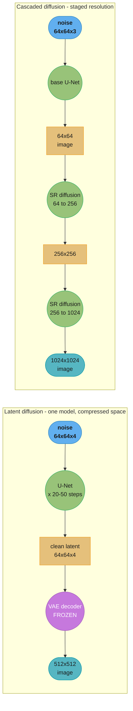
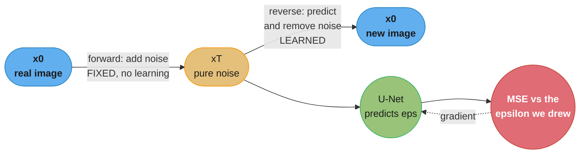
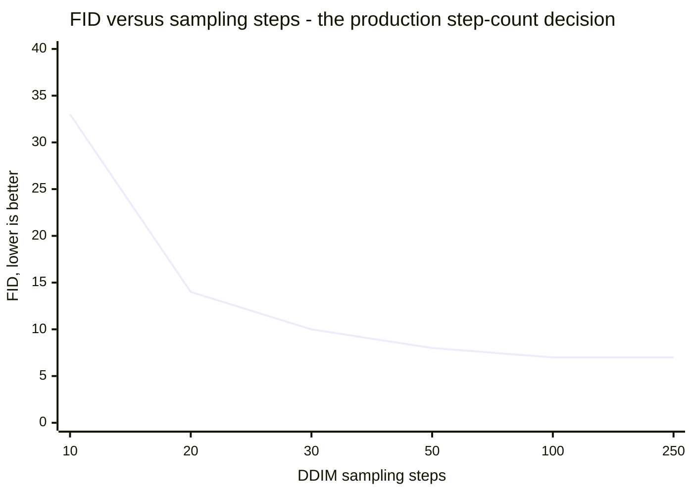
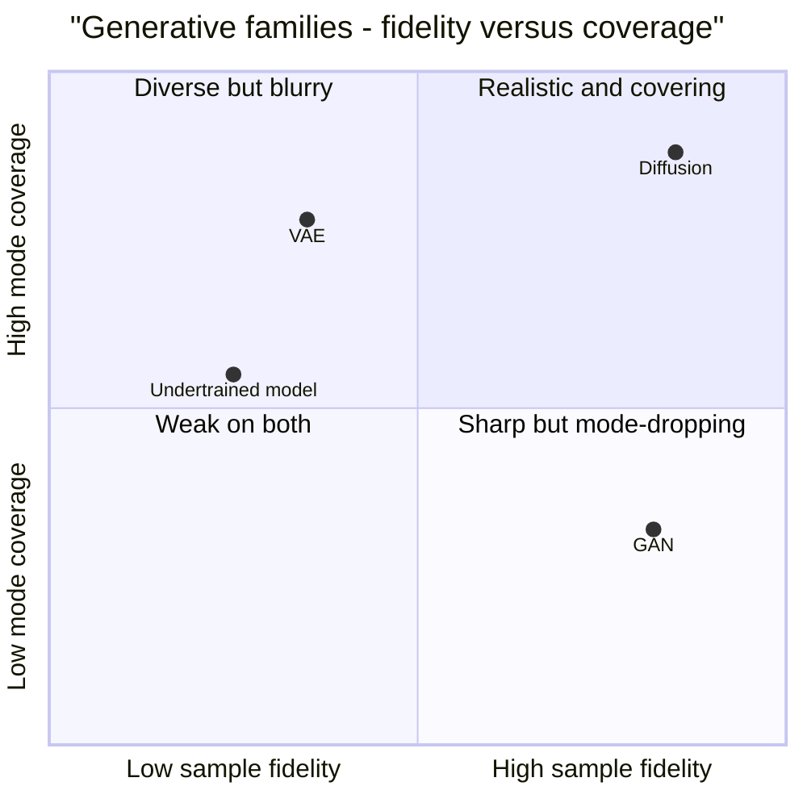

# Chapter 8: High-Resolution Image Synthesis

> Ch 8 of 11 · Generative AI System Design Interview (Aminian & Sheng, ByteByteGo, 2024) · builds on Ch 7 — Realistic Face Generation, leads to Ch 9 — Text-to-Image Generation

## Chapter Map

Chapter 7 built a photorealistic face generator out of a GAN and left it working: StyleGAN
produces 1024x1024 faces in a single forward pass at an FID around 2.84, with disentangled
attribute control and sub-100-millisecond latency. This chapter starts by asking what happens
when you take that machinery off the narrow, aligned, single-domain problem of frontal human
faces and point it at *arbitrary* high-resolution imagery — landscapes, interiors, animals,
objects, scenes with many entities in unconstrained composition. The GAN's ceiling shows up
fast, and it is not a resolution ceiling. It is a **coverage** ceiling. The adversarial game
rewards a generator for producing samples the discriminator cannot reject, and on a broad,
multi-modal data distribution the cheapest way to satisfy that objective is to abandon the
hard parts of the distribution entirely — which is mode collapse, appearing not as identical
outputs but as a generator that quietly never produces certain kinds of scene at all.

The chapter's answer is to change the generative mechanism. **Diffusion models** replace the
adversarial contest with a stable, supervised regression problem: destroy an image by adding
noise in small steps until it is pure Gaussian noise, then train a network to reverse one step
of that destruction. There is no discriminator to balance, no minimax game to stabilize, and
the loss is a plain mean-squared error on predicted noise. Training is dramatically more
stable and mode coverage is dramatically better, and the price is paid entirely at inference:
where a GAN generates in one forward pass, a diffusion model generates by running its denoiser
tens or hundreds of times in sequence. The whole back half of the chapter is about paying that
price down — better samplers that need fewer steps, and **latent diffusion**, which runs the
entire process in a compressed latent space rather than in pixels and is the single largest
cost lever in the chapter.

**TL;DR:**
- GANs hit a ceiling on broad, high-resolution distributions: the adversarial objective is
  unstable to train and prone to dropping modes, which on diverse data means silently never
  generating whole categories of image.
- A **diffusion model** defines a fixed **forward process** that adds Gaussian noise to an image
  over T steps until nothing remains, and learns a **reverse process** — a network, almost always
  a **U-Net**, that predicts the noise added at a given step. The training loss is
  `MSE(predicted noise, actual noise)`, a stable supervised objective with no adversary.
- Sampling is the cost center. **DDPM** ancestral sampling needs on the order of **1000 steps**;
  **DDIM** reformulates the reverse process as deterministic and non-Markovian, giving usable
  images in **20-50 steps** — a 20-50x latency reduction that costs some diversity.
- **Latent diffusion** is the chapter's key architectural move: train a VAE to compress
  512x512x3 pixels into a 64x64x4 latent, run the entire diffusion process there, and decode
  once at the end. The spatial elements drop by roughly **48x**, and since every one of the
  denoising steps operates on the smaller tensor, the saving multiplies across all of them.
- **Cascaded diffusion** is the alternative route to high resolution: generate a small image
  well, then run separate diffusion-based super-resolution stages to upscale it, each stage
  conditioned on the previous stage's output.
- Evaluation reuses Ch 7's distribution-level metrics — **FID**, **Inception Score** — and adds
  **precision and recall for generative models**, which separate "are the samples realistic"
  from "does the model cover the data distribution," a distinction FID collapses into one
  number and which is exactly the GAN-versus-diffusion difference.
- Serving is an **asynchronous job** problem, not a request-response one: generation takes
  seconds, so the system is a GPU worker pool behind a queue, and the operational metrics are
  queue depth, GPU-seconds per image, and step-count-versus-quality policy.

## The Big Question

> Chapter 7's GAN generates a face in 50 milliseconds. Why would anyone accept a model that
> takes fifty sequential network evaluations to produce one image — and having accepted it, how
> do you make that affordable enough to serve at product scale?

Analogy: the GAN is a forger who paints the finished canvas in one stroke, trained by a critic
who says only "real" or "fake." It is astonishingly fast, and if the critic is easy to satisfy
on a subset of subjects, the forger learns to paint only those subjects. The diffusion model is
a restorer working on a photograph that has been progressively buried under noise. The restorer
never has to produce a masterpiece from nothing — at each step the task is only "this image is
slightly noisier than it should be, remove a little noise," which is a small, well-posed,
supervised problem with an exact answer available during training. Repeat that small step
enough times starting from pure static and a coherent image emerges. Nothing about that
process lets the restorer refuse to work on certain subjects, which is why coverage is better;
and the reason it is slow is simply that each step is small on purpose. The chapter's
engineering is about making the steps fewer and each step cheaper.

---

## 8.1 Clarifying Requirements

- **What resolution?** The chapter's target is **512x512 up to 1024x1024**, and the number is
  load-bearing rather than cosmetic: pixel-space diffusion cost scales with the spatial element
  count, so moving from 256x256 to 1024x1024 is a **16x** increase in per-step work before any
  architectural change. Establishing the resolution first is what makes latent diffusion versus
  cascaded diffusion a decidable question rather than a preference.
- **Conditional or unconditional?** This chapter's scope is **unconditional or lightly
  conditional** synthesis — sampling plausible images from a learned distribution, optionally
  conditioned on a class label. Text-prompt conditioning is explicitly deferred to Ch 9, and
  keeping it out here is what lets the chapter isolate the diffusion mechanism from the
  conditioning mechanism.
- **What is the quality bar, and along which axis?** Two axes that pull apart and must be
  separated at requirements time. **Fidelity** — does each individual sample look like a real
  photograph. **Diversity** — does the model cover the breadth of the training distribution
  rather than a comfortable subset. GANs are strong on the first and weak on the second, which
  is precisely the tradeoff the chapter's model choice turns on, and a single quality number
  hides it.
- **What is the generation latency budget?** Unlike Ch 7's sub-second interactive target, the
  chapter accepts **seconds per image**, and that single relaxation is what admits diffusion at
  all. Getting the interviewer to state this explicitly is the most important requirements
  question in the chapter: a hard sub-second budget rules diffusion out and sends you back to a
  GAN or to a heavily distilled sampler.
- **What throughput and cost?** The chapter's worked scale is on the order of **1 million
  generated images per day**. Because every image costs tens of GPU-seconds, cost per image is
  a headline product metric here in a way it was not for a single-forward-pass GAN, and it is
  what drives the step-count policy in §8.6.
- **What safety constraints?** Broad-domain generation trained on web-scale imagery can produce
  NSFW content, violent imagery, and recognizable likenesses or trademarked material. The
  chapter treats **input filtering, output filtering and watermarking** as requirements, not
  post-launch additions, on the same reasoning Ch 7 gave: an unwatermarked image that has left
  the system can never be marked retroactively.

**Functional summary:** sample novel, diverse, photorealistic images at 512x512 to 1024x1024
from a learned distribution over a broad image domain, within a few seconds per image, at a
GPU cost per image that supports roughly a million images a day, with safety filtering and
provenance marking on every output.

---

## 8.2 Framing the Problem as an ML Task

### Defining the ML objective

The objective is the same as Ch 7's in principle — learn the data distribution `p(x)` well
enough to draw new samples from it — and completely different in mechanism. Rather than
learning a direct mapping from noise to image judged by an adversary, a diffusion model learns
to **invert a known corruption process**.

Define a fixed **forward process** that gradually adds Gaussian noise over `T` steps according
to a variance schedule `beta_1 ... beta_T`:

```
q(x_t | x_{t-1}) = N(x_t ; sqrt(1 - beta_t) * x_{t-1},  beta_t * I)
```

Because Gaussians compose, this closes into a one-shot form that lets you jump to any step
without iterating — which is what makes training parallelizable across timesteps:

```
alpha_t     = 1 - beta_t
alphabar_t  = product of alpha_1 ... alpha_t

x_t = sqrt(alphabar_t) * x_0  +  sqrt(1 - alphabar_t) * epsilon,     epsilon ~ N(0, I)
```

Read that line carefully, because it is the whole training procedure. To make a training
example you take a real image `x_0`, draw a random timestep `t`, draw a random noise tensor
`epsilon`, and mix them by the schedule. The network's job is to look at the noisy `x_t` and
the timestep `t` and **predict the `epsilon` that was added**. You know the answer exactly,
because you drew it. The loss is:

```
L = E over x_0, t, epsilon of  || epsilon  -  epsilon_theta(x_t, t) ||^2
```

That is a mean-squared-error regression. There is no adversary, no minimax, no discriminator
to keep balanced, and no risk that the training signal vanishes. This is the single most
important framing point in the chapter: **diffusion converts generative modeling into
supervised denoising**, which is why it trains stably where a GAN does not.

### Choosing the ML category — why diffusion over GAN and VAE here

| Family | Training stability | Mode coverage | Sample fidelity | Sampling cost | Verdict for this chapter |
|---|---|---|---|---|---|
| VAE | High | Good | **Blurry** — the reconstruction loss averages | One pass | Not sharp enough alone; used as the *compressor* in latent diffusion |
| GAN (Ch 7) | **Low** — adversarial balance | **Poor** — mode dropping | Sharp | One pass | Wins on latency, loses on coverage over broad domains |
| Diffusion | **High** — MSE regression | **Best** | Sharp | **Many passes** | **Chosen** — the latency budget from §8.1 allows it |

The row that decides it is mode coverage. On a narrow, aligned domain like frontal faces, a
GAN's tendency to drop modes costs relatively little because the distribution is nearly
unimodal to begin with. On a broad image domain it is fatal in a way that is hard to detect:
the generator does not produce garbage, it produces good images that systematically omit parts
of the distribution, and aggregate FID only partially reflects it. Diffusion's likelihood-style
objective gives it no equivalent shortcut — it is trained to denoise every training example,
so there is no subset it can decline to model.

Notice too that the VAE row is not a rejection. VAEs are blurry as *generators*, but they are
excellent *compressors*, and latent diffusion in §8.4 uses exactly that: a VAE supplies the
compressed space and the diffusion model supplies the sharpness.

### Input and output, formalized

- **Training input:** a real image `x_0`, a uniformly sampled timestep `t` in `[1, T]`, and a
  noise tensor `epsilon`. **Training target:** `epsilon`.
- **Inference input:** pure Gaussian noise `x_T` of the output's spatial shape, plus the
  sampler's step schedule.
- **Inference output:** `x_0`, produced by iterating the learned reverse step from `t = T` down
  to `t = 0`.

---

## 8.3 Data Preparation

Broad-domain synthesis needs a corpus that is large, high-resolution, and — this is where the
work is — filtered hard enough that the model's learned distribution is one you actually want
to sample from.

### Data engineering — corpus and filtering

The chapter's reference is a web-scale image corpus in the **LAION** mold: hundreds of millions
to billions of images crawled from the web, which is the only way to get the breadth that
motivated abandoning the GAN in the first place. The filtering stack that turns it into a
training set:

- **Resolution filtering.** Discard anything below the target resolution. Training a 512x512
  model on upsampled 200x200 JPEGs teaches it to reproduce upsampling artifacts, and those
  artifacts then appear in every generated image as a soft, slightly plastic texture that no
  amount of extra training removes.
- **Aesthetic scoring.** Run a small model trained on human aesthetic ratings over every image
  and keep the top slice. This is the highest-leverage filter in the chapter and it is worth
  being precise about why: a diffusion model faithfully learns *whatever distribution it is
  shown*, and the web's actual image distribution is dominated by screenshots, product photos
  on white backgrounds, receipts, memes and low-effort snapshots. A model trained on all of it
  samples from all of it. Aesthetic filtering is how you make the learned distribution match the
  distribution users want to sample from — and it is a deliberate, documented **bias** you are
  introducing, not a neutral cleaning step.
- **Deduplication.** Perceptual hashing across a billion images. Beyond wasting compute,
  duplicates are the direct cause of **memorization**: an image appearing thousands of times is
  effectively trained on thousands of times more strongly than the schedule intends, and the
  model can reproduce it near-verbatim at sampling time, which is both a quality failure and a
  copyright exposure.
- **NSFW and harmful-content filtering.** Applied at ingestion, on the image, with a
  deliberately conservative threshold. Removing a category from the training distribution is
  vastly more reliable than filtering it out of generated outputs later, because the output
  filter has to catch every sample while the data filter has to be applied once.
- **Watermark and text detection.** Images carrying stock-photo watermarks or heavy overlaid
  text teach the model to draw watermarks and pseudo-text, which is a well-known and highly
  visible artifact class.
- **Licensing and likeness review.** Web-crawled corpora carry uncertain rights and contain
  identifiable people. The chapter flags this as a real production constraint that a research
  benchmark can ignore and a shipping system cannot.

### Feature engineering — resolution buckets and preprocessing

- **Resolution bucketing.** Real images have varied aspect ratios, and center-cropping
  everything to a square is destructive — it decapitates portraits and truncates landscapes,
  and a model trained on those crops learns to generate decapitated subjects. The alternative
  is bucketing: define a set of aspect-ratio buckets with roughly equal element counts
  (512x512, 448x576, 576x448, 384x640, 640x384), assign each image to its nearest bucket, and
  batch within a bucket so every batch has a consistent tensor shape. It costs sampler
  complexity in the data loader and it removes an entire artifact class.
- **Normalization** to `[-1, 1]`, matching the noise schedule's assumptions about the data
  scale. This is not cosmetic — the variance schedule is derived assuming unit-scale data, and
  feeding `[0, 1]` inputs silently mis-scales the entire forward process.
- **Random horizontal flipping** as cheap augmentation. Vertical flips are not used for natural
  images, which have a strong gravity prior; a model trained with them generates upside-down
  scenes.
- **Latent precomputation.** For latent diffusion specifically, the VAE encoder is frozen, so
  the entire corpus can be **encoded once** into latents and cached. Training then reads small
  latent tensors instead of decoding and encoding JPEGs every epoch — a large throughput win
  that also removes the VAE encoder from the training loop's compute entirely.

---

## 8.4 Model Development

### The denoiser architecture — U-Net

The network `epsilon_theta(x_t, t)` maps a noisy image to a noise prediction of **exactly the
same shape**. That shape constraint is what makes the **U-Net** the natural architecture, and
it is worth stating as a design derivation rather than a convention:

- A **downsampling path** of convolutional blocks progressively halves spatial resolution while
  increasing channel depth, building up the large-receptive-field, global understanding needed
  to decide what the image *is*.
- An **upsampling path** mirrors it back to full resolution, so the output tensor matches the
  input.
- **Skip connections** carry each downsampling level's feature map directly across to the
  matching upsampling level. These are the critical part. Without them the fine, high-frequency
  detail destroyed by downsampling could never be reconstructed, and the model would predict
  smooth, blurry noise — which produces smooth, blurry images.
- **Timestep conditioning.** The same network handles every noise level, so it must know which
  one it is looking at. `t` is embedded with a sinusoidal positional encoding, passed through a
  small MLP, and injected into every residual block. A denoiser at `t = 900` is doing a
  completely different job (recover coarse structure from near-total noise) than one at
  `t = 50` (sharpen texture), and the timestep embedding is what lets one set of weights do
  both.
- **Self-attention at low-resolution levels.** Convolutions are local; attention at the 16x16
  and 32x32 feature levels gives the network global spatial coherence, which is what stops a
  generated scene from having a consistent left half and an unrelated right half. Attention is
  restricted to low-resolution levels because its cost is quadratic in spatial elements and is
  unaffordable at full resolution.

### Noise schedules

The variance schedule `beta_1 ... beta_T` determines how quickly information is destroyed, and
its shape matters:

- **Linear schedule** — the original DDPM formulation, `beta` increasing linearly from about
  `1e-4` to `0.02` over `T = 1000` steps. Simple, and it destroys information faster than
  necessary at the end of the schedule, where the image is already nearly pure noise and the
  final steps contribute little.
- **Cosine schedule** — adds noise more slowly at the start and end, spending more of the
  schedule in the middle regime where the signal-to-noise ratio is informative. Empirically
  better sample quality at the same step count, particularly at low resolutions.

The practical framing: the schedule controls **how the model's fixed step budget is distributed
across noise levels**, and a schedule that wastes steps in regimes where there is nothing left
to learn is wasting capacity.

### Sampling — DDPM, DDIM, and the step-count lever

This is where the chapter's cost story lives.

**DDPM (ancestral) sampling** walks the reverse process one step at a time, each step
subtracting the predicted noise contribution and adding a small amount of fresh stochastic
noise:

```
x_{t-1} = (1 / sqrt(alpha_t)) * ( x_t - ((1 - alpha_t) / sqrt(1 - alphabar_t)) * eps_theta(x_t, t) )
          + sigma_t * z,          z ~ N(0, I)
```

It is a faithful inversion of the Markov forward process and it needs roughly the same number
of steps the forward process used — on the order of **1000 network evaluations per image**. At
a few tens of milliseconds per U-Net pass, that is **tens of seconds per image**, and it is
the reason a naive diffusion implementation is unshippable.

**DDIM** is the fix, and its mechanism is worth stating precisely because "DDIM is faster" is
not an adequate interview answer. DDIM observes that the training objective only constrains the
*marginal* distributions `q(x_t | x_0)` — it never actually requires the reverse process to be
Markovian. That freedom allows a family of non-Markovian reverse processes with the same
marginals and therefore the same trained network, and choosing the member with zero added noise
(`sigma_t = 0`) yields a **deterministic** sampler:

```
x_{t-1} = sqrt(alphabar_{t-1}) * predicted_x0  +  sqrt(1 - alphabar_{t-1}) * eps_theta(x_t, t)

where predicted_x0 = ( x_t - sqrt(1 - alphabar_t) * eps_theta(x_t, t) ) / sqrt(alphabar_t)
```

Because the process is deterministic and non-Markovian, you can **skip timesteps** — run the
sampler over a strided subsequence such as every 25th step — and still land in a coherent
image. **20 to 50 steps** gives usable quality, a **20 to 50 times** reduction in generation
cost against DDPM. Two further properties matter in practice: determinism means the same seed
reproduces the same image exactly, which is essential for debugging and for user-facing
"regenerate with a tweak" features; and the diversity that the injected noise provided is
partly given up, which is the tradeoff being made.

The step count is therefore an **inference-time quality/cost dial**, tunable per request with no
retraining, and it is the single most useful operational knob in the chapter:

| Steps | Relative cost | Quality | Typical use |
|---|---|---|---|
| 10-15 | Lowest | Visible artifacts, soft detail | Thumbnails, previews, draft grids |
| **20-30** | Low | Good | **Production default** |
| 50 | 2x the default | Marginally better | Quality-sensitive requests |
| 100+ | 4x+ | Diminishing to imperceptible | Rarely justified |

### Latent diffusion — the chapter's central cost lever

Every one of those steps runs the U-Net over the full image tensor. At 512x512x3 that is
786,432 values per step, and the attention layers scale quadratically in spatial elements. The
insight behind **latent diffusion** is that a natural image's *perceptually relevant* content
is far lower-dimensional than its pixel count, and most of a pixel-space diffusion model's
capacity is spent modeling imperceptible high-frequency detail.

So: train a **VAE** (an autoencoder with a KL or vector-quantization regularizer) to compress
images into a compact latent, freeze it, and run the entire diffusion process in that latent
space.

```
pixel space   512 x 512 x 3   =  786,432 values
                 |  VAE encoder, downsample factor f = 8
                 v
latent space   64 x 64 x 4    =   16,384 values      ~48x fewer
                 |  ALL T denoising steps happen HERE
                 v
              64 x 64 x 4
                 |  VAE decoder, once
                 v
pixel space   512 x 512 x 3
```

Two things about this are easy to state imprecisely and worth getting right. First, **the
saving multiplies across steps.** Compressing the tensor once would be a modest win; compressing
the tensor that all 20-50 sequential denoising passes operate on means the reduction applies
every time, which is what turns diffusion from a research technique into a servable product.
Second, the **VAE's blurriness — the exact reason §8.2 rejected it as a generator — is not a
problem here**, because the VAE is never asked to *invent* content. It only reconstructs a
latent the diffusion model produced, and reconstruction is the one thing a VAE does well. The
division of labor is precise: the VAE handles perceptual compression, the diffusion model
handles the semantic, generative work.

The failure mode to name: the VAE's reconstruction quality is a **hard ceiling** on the whole
system. Anything the encoder-decoder pair cannot round-trip faithfully — fine text, precise
regular patterns, small faces — cannot be generated faithfully no matter how good the diffusion
model is. That is why latent-diffusion outputs have a characteristic weakness on small
high-frequency detail, and why choosing the downsample factor `f` is a real decision: `f = 8`
is the standard compromise, `f = 4` reconstructs better and costs roughly 4x more per step,
`f = 16` is cheaper and visibly lossy.

### Cascaded diffusion — the alternative route

The other way to reach high resolution is to refuse to generate it directly. **Cascaded
diffusion** chains models: a base diffusion model generates a small image (64x64), then one or
more **diffusion-based super-resolution** models upscale it in stages (64 to 256, 256 to 1024),
each conditioned on the lower-resolution output from the previous stage.

The reason this works is a division of difficulty. The base model solves the hard semantic
problem — what is in this image, how is it composed — at a resolution where that is cheap. The
super-resolution stages solve a much easier, more local problem — add plausible detail
consistent with this input — where global coherence is already settled.

The characteristic failure is **error compounding**: a flaw in the base image is not corrected
by the upsamplers, it is rendered in higher fidelity. The standard mitigation is **noise
conditioning augmentation** — deliberately adding noise to the low-resolution conditioning
input during training of each super-resolution stage, so that stage learns to tolerate an
imperfect input rather than assuming a clean one.



Caption: both routes avoid running many denoising steps at full pixel resolution — latent
diffusion by shrinking the tensor every step operates on, cascaded diffusion by only ever doing
the expensive semantic work at low resolution and treating upscaling as a separate, easier
conditional problem.

---

## 8.5 Evaluation

Like Ch 7, there is no reference output, so evaluation compares distributions and then asks
humans.

### Offline metrics

**FID (Fréchet Inception Distance)** carries over unchanged as the primary number: embed
50,000 real and 50,000 generated images with Inception-v3, fit a Gaussian to each feature set,
and compute the Fréchet distance between them. Lower is better. Its properties from Ch 7 hold
— it penalizes blur through the mean term and low diversity through the covariance term, it is
noisy below tens of thousands of samples, and it is not comparable across different feature
extractors or preprocessing pipelines.

**Inception Score** remains the secondary metric with the same weakness: it never looks at the
real data distribution, so it cannot detect a model producing confidently diverse but
unrealistic images.

**Precision and recall for generative models** is the metric family this chapter adds, and it
exists precisely because FID's single number collapses the distinction that separates GANs from
diffusion models. The construction: estimate the support of the real data distribution and the
support of the generated distribution in a feature space, using k-nearest-neighbor manifolds,
then:

- **Precision** = the fraction of *generated* samples that fall inside the *real* manifold —
  "are my samples realistic."
- **Recall** = the fraction of *real* samples that fall inside the *generated* manifold — "does
  my model cover the real distribution."

The reason this matters is the whole argument of §8.2 made measurable:

| Model | Precision | Recall | FID | What the numbers say |
|---|---|---|---|---|
| Mode-collapsed GAN | **High** | **Low** | Moderate | Beautiful samples from a fraction of the distribution |
| Diffusion model | High | **High** | Low | Realistic and covering |
| Undertrained model | Low | High | High | Diverse garbage |

A single FID cannot distinguish the first row from a mildly worse but well-covering model.
Precision and recall can, and since mode coverage is the reason this chapter left GANs behind,
it is the measurement that justifies the decision.

Other metrics the chapter names in passing: **KID (Kernel Inception Distance)**, an unbiased
alternative to FID that is more reliable at small sample sizes, and **LPIPS (Learned Perceptual
Image Patch Similarity)**, a perceptual distance between two specific images — useful for
measuring VAE reconstruction quality and for measuring how much a sampler change perturbs
outputs at a fixed seed, but not a distribution metric.

### Human evaluation

Human preference remains the ground truth, and the chapter's protocol is two-alternative forced
choice: show raters two images from two model versions and ask which they prefer, aggregating
into a win rate. Rating on separated axes is more actionable than a single preference: realism
(does it look like a photograph), coherence (do objects and geometry make sense, are there
extra limbs or impossible structures), and aesthetic quality. Coherence is the axis that
catches diffusion's characteristic failures — anatomy, counting, and text — which FID barely
registers because they are locally plausible.

### Evaluating the components separately

The chapter's structural advice mirrors Ch 6's: evaluate the pieces, not just the whole.

- **VAE reconstruction quality**, measured with LPIPS and PSNR on held-out images, is the
  ceiling on a latent-diffusion system. Measure it before blaming the diffusion model for soft
  detail.
- **Sampler quality at fixed step count**, measured as FID versus number of function
  evaluations, is the curve that sets the production step-count policy.
- **Per-stage quality in a cascade**, so you know which stage introduced an artifact rather
  than only that the final image has one.

---

## 8.6 Overall ML System Design

The defining design constraint is that a request takes **seconds**, not milliseconds, so the
serving architecture is an **asynchronous job system** rather than a synchronous RPC.


Caption: the queue is the architecture, not an implementation detail — it absorbs bursts that
would otherwise time out, it lets priority tiers exist, and its depth is the metric that tells
you whether the GPU pool is correctly sized.

### Component notes

- **Immediate job-id response.** The API accepts, validates, enqueues and returns a job
  identifier in milliseconds; the client polls or receives a webhook. Holding an HTTP
  connection open for a 20-second generation wastes connections, breaks through proxies with
  shorter timeouts, and gives the user no progress signal.
- **Priority queues.** Interactive user requests, bulk API jobs and internal batch work have
  genuinely different urgency. One queue serves them all badly.
- **Batched sampling on the workers.** The U-Net batches well, so a worker samples several
  images concurrently. The constraint is that **every image in a batch must run the same number
  of steps**, since the denoising loop is synchronized across the batch — so batches are formed
  by step count, and mixing a 20-step and a 50-step request in one batch means either wasted
  compute or a wrong result.
- **Progressive preview.** Because the sampler produces a progressively cleaner image, the
  worker can decode and stream an intermediate latent partway through. It costs one extra VAE
  decode and transforms the perceived latency of a 20-second job.
- **Model weights are large and load slowly.** Workers keep weights resident in GPU memory
  rather than loading per request, which makes them stateful and makes autoscaling slow — a new
  worker is minutes from useful, not seconds. Scale on a leading indicator such as queue growth
  rate, and keep a warm pool.
- **Caching by request parameters.** A deterministic DDIM sampler means the same seed, prompt
  configuration, step count and model version yield a byte-identical image, so the tuple is a
  perfect cache key. It only helps when clients reuse seeds, but when they do it is free.
- **Safety on both sides and watermarking on every output**, for the reasons Ch 7 established:
  an unwatermarked image that has left the system is permanently unattributable.

### Scale estimation

Take a latent-diffusion model at 512x512, `f = 8`, running on a modern datacenter GPU:

- **Per-step cost:** one U-Net pass over a 64x64x4 latent, roughly **20-40 ms** at batch size 1,
  falling well below 10 ms per image at batch size 8 where the GPU is properly saturated.
- **Per-image cost:** at 25 DDIM steps, roughly **0.5-1.0 second** of GPU time batched, plus a
  single VAE decode at roughly 30-50 ms, plus the safety classifier.
- **Throughput:** on the order of **1-2 images per GPU-second** batched, so a single GPU
  sustains roughly **100,000 images per day** at full utilization.
- **Fleet size:** 1 million images per day therefore needs roughly **10-15 GPUs** at full
  utilization, and realistically **20-30** once you account for diurnal traffic, the fact that
  a queue at 100% utilization has unbounded wait times, and headroom for higher step counts on
  quality-sensitive requests.
- **The pixel-space counterfactual:** the same model diffusing directly in 512x512x3 pixels
  operates on roughly 48x more spatial values every step. Even allowing for imperfect scaling,
  that is the difference between a 20-GPU fleet and a fleet nobody would fund — which is the
  concrete form of the claim that latent diffusion is the key cost lever.
- **Training:** the chapter treats a full training run as a rare, deliberate event on the order
  of **hundreds of thousands of GPU-hours** for a broad-domain model at this resolution, with
  the VAE trained first and then frozen so the diffusion model can be retrained against a stable
  latent space.

---

## 8.7 Deployment and Monitoring

- **GPU cost per image as a product metric.** Track GPU-seconds per image broken down by step
  count, resolution and batch size, and put cost per image on the same dashboard as quality.
  The step-count dial is the lever that moves it, and it should be a policy — previews at 15
  steps, defaults at 25, premium at 50 — rather than a constant somebody once picked.
- **Queue depth and wait time.** These are the user-visible latency in an async system, and
  they are what tells you the GPU pool is undersized before users do. Alert on the *trend*, not
  just a threshold, because worker startup takes minutes and a queue that is growing has
  already outrun your ability to scale reactively.
- **GPU utilization and batch efficiency.** A worker running at batch size 1 because requests
  arrive with mismatched step counts is wasting most of the hardware. Monitor achieved batch
  size against the configured maximum; a persistent gap is a batching-policy bug rather than a
  capacity problem.
- **Safety filtering, on both sides.** An input filter on any conditioning, an NSFW and
  harmful-content classifier on every generated image before it reaches storage, and a false-
  negative review process — because a classifier tuned to catch everything blocks benign images
  and one tuned to be permissive ships harmful ones. Track both error rates and treat the
  threshold as a product decision.
- **Watermarking and provenance.** Every output carries an invisible, robust watermark and is
  logged with its seed, model version, sampler, step count and safety verdicts, so any image can
  later be traced to the request that produced it. As in Ch 7, this must ship with the first
  deployment: images already distributed cannot be watermarked retroactively. Audit the
  watermark detector against sampled production outputs periodically, since a pipeline change
  can silently drop the step with no user-visible symptom.
- **Memorization monitoring.** A diffusion model trained on a corpus with duplicates can
  reproduce training images near-verbatim. Periodically sample generations and check them
  against the training corpus with a perceptual-similarity search; hits mean the deduplication
  stage needs strengthening, and they are a copyright exposure rather than merely a quality
  issue.
- **Quality regression on model or sampler updates.** Run FID plus generative precision/recall
  on a fixed evaluation set, and a human preference study against the incumbent, before any
  rollout. Because DDIM is deterministic, a fixed set of seeds gives an exactly reproducible
  visual regression suite — the same seeds through the old and new model, diffed with LPIPS,
  will show you precisely what changed.
- **Drift in the request distribution.** As users find new uses, the mix of requested subjects
  moves away from what the training corpus covered, and quality degrades in ways aggregate FID
  on a fixed benchmark cannot see. Sample production outputs for periodic human review rather
  than relying only on the offline benchmark.

---

## Beyond the book — high-resolution synthesis after 2024

> This chapter summarizes the 2024 edition of *Generative AI System Design Interview*, whose
> reference architecture is a U-Net latent diffusion model sampled with DDIM in 20-50 steps. It
> does not cover diffusion transformers, flow-matching objectives, few-step distillation, or
> the provenance standards that have since consolidated — all described below as separate,
> later material.

Three shifts matter. First, the **U-Net denoiser has largely been replaced by a transformer**.
Diffusion transformer (DiT) architectures operate on latent patches with a plain transformer
stack instead of a convolutional encoder-decoder, and they scale with parameter count and
compute far more predictably than U-Nets do — the same scaling-law behavior Ch 1 described for
language models. The chapter's U-Net derivation is still the right way to *understand* why the
denoiser has the shape it does, and the shape-preserving, skip-connected, timestep-conditioned
requirements it derives are all still satisfied by the transformer variants.

Second, the **step count has collapsed**. The chapter's 20-50 DDIM steps were state of the art
in 2024; distillation techniques — consistency models, adversarial and progressive distillation,
and rectified-flow reformulations that make the noise-to-image trajectory nearly straight — now
produce competitive images in **1 to 4 steps**. This directly attacks the tradeoff the chapter
built its model selection on: the GAN's single-pass advantage from Ch 7 largely evaporates when
diffusion needs four passes, and the cost model in §8.6 shifts by an order of magnitude.
Relatedly, **flow matching** has become a common alternative training objective to the DDPM
noise-prediction loss, learning a velocity field along a straight path between noise and data
rather than inverting a stochastic corruption; it trains on the same data and serves the same
purpose, with a simpler formulation and fewer sampling steps.

Third, **provenance moved from good practice to expectation**. The C2PA content-credentials
standard for cryptographically signed generation history, and regulatory transparency
obligations for synthetic media, have both consolidated since publication. The chapter's
"watermark and log everything" guidance holds up against them, but the specific standards it
would now point to did not exist in their current form in 2024.

---

## Visual Intuition



Caption: the forward process is fixed arithmetic with nothing to learn, which is what makes the
reverse problem supervised — you always know the exact noise that was added, so training is an
MSE regression rather than an adversarial game.

```
Latent diffusion - where the 48x comes from, and why it multiplies

  PIXEL DIFFUSION
    [512 x 512 x 3  = 786,432 values]  <- every one of 25 steps runs here
      step 1 ... step 25                   25 x full-resolution U-Net passes

  LATENT DIFFUSION
    encode ONCE          decode ONCE
        v                     v
    [64 x 64 x 4 = 16,384 values]      <- every one of 25 steps runs here
      step 1 ... step 25                   25 x small-tensor U-Net passes

    786,432 / 16,384 = 48x fewer values PER STEP
    and there are 25 steps, so the reduction applies 25 times over

  the VAE's blurriness does not matter here: it never invents content,
  it only reconstructs a latent the diffusion model already produced
```

Caption: compressing the tensor once would be a modest win; compressing the tensor that every
sequential denoising step operates on is what makes diffusion servable at all.



Caption: quality improves steeply up to roughly 20-30 steps and then flattens, while cost stays
strictly linear in step count — which is why the production default sits at the knee and why
step count is exposed as a per-request dial rather than fixed.



Caption: the vertical axis is why this chapter left GANs behind — on a narrow domain like Ch
7's aligned faces the coverage gap costs little, but on a broad image distribution it means
whole categories of scene are silently never generated.

---

## Key Concepts Glossary

- **Diffusion model** — a generative model that learns to reverse a fixed noise-adding process,
  generating by iteratively denoising from pure noise.
- **Forward (diffusion) process** — the fixed, non-learned procedure that adds Gaussian noise to
  an image over T steps according to a variance schedule.
- **Reverse (denoising) process** — the learned procedure that removes noise one step at a time
  to produce a sample.
- **Noise schedule (beta)** — the per-step variance sequence controlling how fast information is
  destroyed; linear and cosine are the two named forms.
- **alphabar_t** — the cumulative product of `1 - beta`, which lets any noise level be reached in
  one shot from a clean image.
- **Noise prediction objective** — training the network to predict the noise added at step `t`,
  with an MSE loss against the noise actually drawn.
- **DDPM** — the original denoising diffusion probabilistic model formulation, with ancestral
  sampling requiring on the order of 1000 steps.
- **DDIM** — a deterministic, non-Markovian reverse process with the same marginals, allowing
  strided step-skipping and usable output in 20-50 steps.
- **Number of function evaluations (NFE)** — the count of U-Net passes per generated image; the
  real unit of sampling cost.
- **U-Net** — the shape-preserving encoder-decoder denoiser with skip connections between
  matching resolution levels.
- **Skip connection** — the direct path carrying high-frequency detail from a downsampling level
  to its matching upsampling level, without which outputs are blurry.
- **Timestep embedding** — a sinusoidal encoding of `t` injected into every block so one network
  can serve every noise level.
- **Latent diffusion** — running the entire diffusion process in a VAE's compressed latent space
  rather than in pixel space.
- **Downsample factor (f)** — the VAE's spatial compression ratio; `f = 8` maps 512x512 pixels to
  a 64x64 latent.
- **VAE reconstruction ceiling** — the hard upper bound on latent-diffusion output quality set by
  what the frozen autoencoder can round-trip.
- **Cascaded diffusion** — generating at low resolution and upscaling through successive
  diffusion-based super-resolution stages.
- **Noise conditioning augmentation** — adding noise to a super-resolution stage's conditioning
  input during training so it tolerates imperfect upstream output.
- **Error compounding** — a cascade's tendency to render a base-stage flaw at higher fidelity
  rather than correct it.
- **Aesthetic scoring** — filtering a web corpus by a learned human-preference score, which
  deliberately shapes the learned distribution.
- **Resolution bucketing** — grouping training images into aspect-ratio buckets so batches have
  uniform shape without destructive square cropping.
- **Memorization** — near-verbatim reproduction of a training image, caused chiefly by duplicates
  in the corpus.
- **FID** — Fréchet distance between Gaussian-fitted Inception features of real and generated
  image sets; the primary offline metric.
- **Inception Score** — rewards individually confident and collectively diverse classifier
  predictions; blind to the real distribution.
- **KID** — an unbiased kernel-based alternative to FID, more reliable at small sample sizes.
- **LPIPS** — a learned perceptual distance between two specific images; used for reconstruction
  quality and regression diffing, not distributions.
- **Generative precision** — the fraction of generated samples falling within the real data
  manifold; measures realism.
- **Generative recall** — the fraction of real samples falling within the generated manifold;
  measures coverage.
- **Progressive preview** — decoding an intermediate latent mid-sampling to show the user a
  partial result.
- **Step-count policy** — exposing sampling steps as a per-request quality/cost dial rather than
  a fixed constant.

---

## Tradeoffs & Decision Tables

### Generative family for broad-domain high-resolution synthesis

| Family | Training stability | Coverage | Fidelity | NFE per image | Chapter's verdict |
|---|---|---|---|---|---|
| VAE | High | Good | Blurry | 1 | Compressor, not generator |
| GAN | Low | Poor | Sharp | 1 | Ch 7's pick, ceiling here |
| Diffusion (pixel) | High | Best | Sharp | 20-1000 | Correct but expensive |
| **Latent diffusion** | High | Best | Sharp | 20-50 on a small tensor | **Chosen** |

### Sampler choice

| Sampler | Steps | Deterministic | Diversity | Use |
|---|---|---|---|---|
| DDPM ancestral | ~1000 | No | Highest | Reference quality, research |
| **DDIM** | **20-50** | **Yes** | Slightly reduced | **Production default** |
| DDIM at 10-15 steps | 10-15 | Yes | Reduced | Previews and draft grids |

### Route to high resolution

| Approach | Models to train | Where cost goes | Characteristic failure |
|---|---|---|---|
| Direct pixel diffusion at 1024 | One | Every step at full resolution | Unaffordable |
| **Latent diffusion** | VAE plus diffusion | Every step on a small tensor | VAE reconstruction ceiling on fine detail |
| Cascaded diffusion | Base plus 1-2 SR stages | Low-res semantics plus cheap upscales | Error compounding from the base stage |

### VAE downsample factor

| f | Latent for 512x512 | Per-step cost | Reconstruction quality |
|---|---|---|---|
| 4 | 128x128 | ~4x the baseline | Best |
| **8** | **64x64** | **Baseline** | **Standard compromise** |
| 16 | 32x32 | ~4x cheaper | Visibly lossy on fine detail |

### Evaluation metric selection

| Question | Metric | Why |
|---|---|---|
| Is the model good overall? | FID | Penalizes both blur and low diversity |
| Are samples realistic? | Generative precision | Isolates fidelity from coverage |
| Does the model cover the data? | Generative recall | The GAN-versus-diffusion difference |
| Did the VAE lose detail? | LPIPS, PSNR on reconstructions | Bounds the whole system |
| Do humans prefer it? | Two-alternative forced choice | Ground truth, catches coherence failures |
| Small evaluation sample? | KID | Unbiased where FID is noisy |

---

## Common Pitfalls / War Stories

- **Running diffusion in pixel space at the target resolution.** The model works and the demo is
  beautiful, and then the cost model makes it unshippable — every one of 25 steps runs over 48x
  more values than it needs to. Latent diffusion is not an optimization to apply later; it
  changes the architecture and the training run, so it is a decision made up front.
- **Shipping DDPM ancestral sampling.** A thousand network evaluations per image is tens of
  seconds of GPU time, roughly 40x the DDIM cost for a quality difference most users cannot
  see. The step count is the first knob to check when generation cost looks wrong.
- **Assuming more steps always helps.** The FID-versus-steps curve flattens hard past roughly 30
  steps while cost stays strictly linear, so a default of 100 steps is paying 4x for a
  difference invisible in a preference study. Measure the knee on your own model and set policy
  there.
- **Blaming the diffusion model for soft fine detail.** In a latent system the frozen VAE sets a
  hard ceiling — if the encoder-decoder pair cannot round-trip small text or fine regular
  patterns, no amount of diffusion training recovers them. Measure VAE reconstruction LPIPS
  first; it is a five-minute check that redirects weeks of work.
- **Skipping deduplication on a web-scale corpus.** Duplicates cause memorization, and a model
  that reproduces training images near-verbatim is a copyright exposure, not just a quality
  problem. Perceptual-hash deduplication across the full corpus is expensive and not optional.
- **Center-cropping everything to a square.** The model learns the crop distribution, which
  means generated portraits are decapitated and generated landscapes truncated. Resolution
  bucketing costs data-loader complexity and removes the whole artifact class.
- **Treating aesthetic filtering as neutral cleaning.** It is a deliberate distribution shift
  toward what raters found attractive, and it carries their biases into every sample the model
  ever produces. That may be exactly what the product wants, but it should be a documented
  decision rather than an accident of a default threshold.
- **Serving generation over a synchronous HTTP request.** A 20-second generation held open on a
  connection times out at intermediate proxies, wastes connection slots, and gives the user no
  progress signal. Return a job id immediately, queue the work, and stream a progressive
  preview if you want the perceived latency to be tolerable.
- **Autoscaling GPU workers reactively on queue depth.** Model weights are large and a cold
  worker is minutes from serving, so by the time depth crosses a threshold the backlog has
  already grown. Scale on the growth rate, keep a warm pool, and size for the diurnal peak
  rather than the mean.
- **Mixing step counts within a sampling batch.** The denoising loop is synchronized across the
  batch, so a 20-step and a 50-step request in one batch means either wasted compute or a
  truncated result. Form batches by step count, and monitor achieved batch size — a persistent
  gap against the configured maximum is a batching-policy bug, not a capacity shortfall.
- **Adding watermarking after launch.** Everything generated before it shipped is permanently
  unattributable, exactly as in Ch 7, and there is no retroactive fix.

---

## Real-World Systems Referenced

**Architectures and methods:** DDPM, DDIM, latent diffusion in the Stable Diffusion mold,
cascaded diffusion with diffusion-based super-resolution stages, the U-Net denoiser with
timestep embeddings and low-resolution self-attention, VAE and VQ-based perceptual compressors,
linear and cosine noise schedules. **Contrast points from earlier chapters:** StyleGAN and
StyleGAN2 as the GAN baseline whose ceiling motivates this chapter, VAEs as the blurry
generator that becomes a good compressor. **Data:** LAION-style web-scale image corpora with
aesthetic scoring and perceptual deduplication. **Evaluation:** Inception-v3 as the feature
extractor behind FID and IS, KID, LPIPS, generative precision and recall. **Applications the
chapter frames this system as serving:** creative and stock imagery generation, synthetic
training data for other vision models, and the base generator that Ch 9 conditions on text.

---

## Summary

High-resolution image synthesis is where the book retires the GAN. Chapter 7's adversarial
approach is fast and sharp, but its training is a balancing act and its objective gives the
generator a cheap way out — dropping modes — which on a narrow domain of aligned faces costs
little and on a broad image distribution means silently never generating whole categories of
scene. Diffusion models change the mechanism entirely: a fixed forward process destroys an
image with Gaussian noise, and the network is trained to predict that noise with a plain
mean-squared-error loss, converting generative modeling into supervised denoising with no
adversary to balance and no mode it can decline to model. The cost moves to inference, where a
faithful DDPM reversal needs on the order of a thousand sequential network evaluations, and the
chapter's engineering is a sustained effort to pay that down: DDIM reformulates the reverse
process as deterministic and non-Markovian, which permits step-skipping and brings usable
quality into 20-50 evaluations, while latent diffusion moves the entire process into a frozen
VAE's compressed space so that every one of those evaluations runs on roughly 48x fewer values
— a reduction that multiplies across steps and is the difference between a research result and
a servable product. The VAE's blurriness, which disqualified it as a generator, is irrelevant
in that role because it only ever reconstructs, though its reconstruction quality becomes a
hard ceiling on fine detail. Cascaded diffusion is the alternative route, solving the hard
semantic problem cheaply at low resolution and treating upscaling as a separate conditional
problem, at the price of compounding any base-stage error. Evaluation carries FID and Inception
Score over from Ch 7 and adds generative precision and recall, which separate "are the samples
realistic" from "does the model cover the distribution" — the exact distinction FID collapses
and the exact one that justified leaving GANs behind. In production the system is an
asynchronous queue-and-worker architecture rather than a request-response service, with step
count exposed as a per-request quality-versus-cost dial, GPU-seconds per image tracked as a
product metric, and safety filtering, watermarking and memorization monitoring wired in from
the first deployment. Chapter 9 keeps this entire machine and adds the one thing this chapter
deliberately excluded: conditioning it on a text prompt.

---

## Interview Questions

**Q: Why does the book move from GANs to diffusion models for high-resolution image synthesis?**
**Short:** Diffusion trains stably as an MSE regression and covers the data distribution, where GANs are unstable and drop modes.
A GAN's adversarial objective has no term that requires the generator to cover the whole data distribution, so on a broad, multi-modal image domain the cheapest way to fool the discriminator is to abandon the hard parts — producing good images that systematically omit entire categories of scene. Diffusion replaces the adversary with a fixed corruption process and a supervised noise-prediction loss, so there is no minimax balance to maintain and no subset the model can decline to learn. The chapter accepts a much higher sampling cost in exchange, which is only possible because §8.1 relaxed the latency budget from sub-second to a few seconds.

**Q: How is a diffusion model actually trained, step by step?**
**Short:** Take a real image, pick a random timestep, add noise you drew yourself, and train the network to predict that exact noise.
Because the forward process closes into `x_t = sqrt(alphabar_t) * x_0 + sqrt(1 - alphabar_t) * epsilon`, you can jump to any noise level in one shot rather than iterating, which makes training parallelizable across timesteps. The network sees the noisy image and the timestep and outputs a noise prediction, and the loss is the mean squared error against the epsilon you sampled — a fully supervised target you know exactly. That is the whole reason diffusion trains stably where GANs do not: there is no adversary, no vanishing gradient regime and no game-theoretic equilibrium to reach.

**Q: What is latent diffusion, and why is it the key cost lever?**
**Short:** It runs every denoising step in a VAE's compressed latent space, so the roughly 48x tensor reduction multiplies across all steps.
A frozen VAE encoder compresses 512x512x3 pixels, 786,432 values, into a 64x64x4 latent of 16,384 values, the diffusion process runs entirely there, and a single decode at the end returns pixels. The reason this dominates every other optimization is that it shrinks the tensor that all 20 to 50 sequential U-Net passes operate on, so the saving applies every step rather than once. The VAE's characteristic blurriness does not hurt here because it never invents content — it only reconstructs a latent the diffusion model produced — though its reconstruction quality does become a hard ceiling on fine detail.

**Q: What does DDIM change relative to DDPM, and what does it cost?**
**Short:** DDIM makes the reverse process deterministic and non-Markovian, allowing step-skipping from about 1000 evaluations down to 20-50.
The training objective only constrains the marginal distributions `q(x_t | x_0)`, never requiring the reverse process to be Markovian, so a family of non-Markovian reverse processes shares the same trained network. Choosing the zero-noise member makes sampling deterministic, and because consecutive steps are no longer required, you can run a strided subsequence and still land in a coherent image — a 20 to 50 times cost reduction. The costs are some loss of sample diversity, since the injected stochasticity is gone, and the benefit is exact reproducibility from a seed, which makes visual regression testing and seed-based user features possible.

**Q: Why is a U-Net the natural denoiser architecture, and what do the skip connections do?**
**Short:** The output must match the input's spatial shape, and skip connections carry the high-frequency detail downsampling destroys.
The network maps a noisy image to a noise prediction of identical shape, which requires an architecture that downsamples to build global understanding and then upsamples back to full resolution. Skip connections bridge each downsampling level directly to its matching upsampling level, and without them the fine detail lost on the way down could never be recovered, so the model would predict smooth noise and generate blurry images. Timestep embeddings injected into every block let one set of weights serve every noise level, and self-attention at the 16x16 and 32x32 levels supplies global coherence at a cost that would be unaffordable at full resolution.

**Q: How do you choose the number of sampling steps in production?**
**Short:** Measure FID against step count, set the default at the knee near 20-30, and expose steps as a per-request dial.
Quality improves steeply up to roughly 20 to 30 DDIM steps and then flattens almost completely, while cost is strictly linear in step count, so anything beyond the knee is paying multiples for a difference a preference study cannot detect. The right shape is a policy rather than a constant — previews and draft grids at 10 to 15 steps, the standard path at 20 to 30, quality-sensitive requests at 50 — because it is an inference-time knob requiring no retraining. The one serving constraint is that batches must be formed by step count, since the denoising loop is synchronized across a batch.

**Q: What are generative precision and recall, and why does the chapter add them to FID?**
**Short:** Precision measures whether samples are realistic and recall whether they cover the data, a distinction FID collapses into one number.
Both are computed by estimating the real and generated data manifolds in a feature space with k-nearest-neighbor neighborhoods: precision is the fraction of generated samples inside the real manifold, recall is the fraction of real samples inside the generated one. A mode-collapsed GAN scores high precision and low recall — beautiful samples from a slice of the distribution — while a well-covering model scores high on both, and a single FID cannot reliably separate those cases. Since mode coverage is the entire reason this chapter left GANs behind, it is the metric that makes the model-selection argument measurable rather than asserted.

**Q: What is cascaded diffusion, and when would you prefer it to latent diffusion?**
**Short:** It generates a small image then upscales through diffusion super-resolution stages, dividing hard semantics from easy detail.
The base model solves the expensive semantic problem — what is in the image and how it is composed — at 64x64 where that is cheap, and each super-resolution stage adds detail conditioned on the previous stage's output, a much more local problem. It avoids the VAE reconstruction ceiling entirely, since everything stays in pixel space, which can matter for fine detail. Its characteristic failure is error compounding — a flaw in the base image is rendered at higher fidelity rather than corrected — mitigated by noise conditioning augmentation, deliberately noising the conditioning input during training so each stage tolerates imperfect upstream output.

**Q: Why is the serving architecture an async queue rather than a synchronous API?**
**Short:** Generation takes seconds, so holding an HTTP connection open wastes resources, hits proxy timeouts and gives no progress signal.
The API validates, enqueues and returns a job identifier in milliseconds while a GPU worker pool consumes the queue, and the client polls or receives a webhook. The queue is the load-shedding and prioritization mechanism — it absorbs bursts that would otherwise fail, and it lets interactive requests, bulk API jobs and internal batch work occupy separate priority tiers instead of competing in one undifferentiated stream. Its depth and growth rate are the user-visible latency in such a system, which makes them the primary operational metrics rather than a per-request duration.

**Q: Why does aesthetic filtering of the training corpus matter so much, and what is the catch?**
**Short:** A diffusion model faithfully learns whatever distribution it is shown, and the web's real distribution is mostly screenshots and low-effort snapshots.
Without filtering, the model samples from the actual web image distribution, which is dominated by product photos on white backgrounds, receipts, memes and casual snapshots — so the generator produces exactly that, competently. Scoring images with a model trained on human aesthetic ratings and keeping the top slice is what aligns the learned distribution with the distribution users want to sample from. The catch is that this is not neutral cleaning: it is a deliberate distribution shift carrying the raters' biases into every future sample, and it should be a documented product decision rather than a default threshold nobody revisits.

**Q: What causes memorization in a diffusion model, and why is it a serious production issue?**
**Short:** Duplicate images in the training corpus, which are effectively trained on far more strongly than intended and can be reproduced near-verbatim.
An image appearing thousands of times in a web crawl receives thousands of times the gradient signal the schedule intends, and the model can then emit a close copy of it at sampling time. That is a copyright and privacy exposure rather than merely a quality defect, since the reproduced image may be someone's licensed work or an identifiable person's photograph. The prevention is perceptual-hash deduplication across the full corpus before training, and the detection is periodically sampling production outputs and searching them against the training set by perceptual similarity.

**Q: What is resolution bucketing and what artifact does it prevent?**
**Short:** Grouping training images into aspect-ratio buckets so batches share a tensor shape without destructively square-cropping everything.
Center-cropping a portrait to a square decapitates the subject and cropping a landscape truncates it, and a model trained on those crops learns the crop distribution — so it generates decapitated subjects and truncated scenes. Bucketing defines a set of shapes with roughly equal element counts, such as 512x512, 448x576 and 640x384, assigns each image to its nearest bucket, and batches within a bucket so the tensor shape stays uniform. It costs data-loader complexity and eliminates an entire visible artifact class, which is a good trade.

**Q: In a latent diffusion system producing soft fine detail, how do you localize the fault?**
**Short:** Measure the frozen VAE's reconstruction quality first — it is a hard ceiling the diffusion model cannot exceed.
Encode and decode a set of held-out real images through the VAE with no diffusion involved, and score the reconstructions with LPIPS and PSNR. If small text, fine regular patterns or small faces do not survive that round trip, no amount of diffusion training or extra sampling steps will produce them, because the decoder is the last thing to touch every output. The fix is either a lower downsample factor — `f = 4` reconstructs better at roughly four times the per-step cost — or moving to a cascaded approach that stays in pixel space.

**Q: Why does the noise schedule shape matter, and what is the difference between linear and cosine?**
**Short:** The schedule decides how the model's fixed step budget is distributed across noise levels, and linear wastes steps at the end.
The original DDPM linear schedule raises beta from about 1e-4 to 0.02 over 1000 steps, which destroys information quickly and spends many late steps in a regime where the image is already essentially pure noise and there is little left to learn. A cosine schedule adds noise more slowly at both ends, concentrating the budget in the middle range where the signal-to-noise ratio is informative, and empirically produces better samples at the same step count. The framing to carry into an interview is that the schedule is capacity allocation, not a hyperparameter to leave at its default.

**Q: How do you size the GPU fleet for a million generated images per day?**
**Short:** At roughly 1-2 images per GPU-second batched, one GPU sustains about 100,000 a day, so plan for 20-30 rather than the naive 10-15.
A latent-diffusion U-Net pass on a 64x64x4 latent is roughly 20-40 milliseconds at batch size 1 and well under 10 milliseconds per image when batched, so 25 DDIM steps plus one VAE decode is on the order of a GPU-second per image. Dividing a million by 100,000 gives 10 to 15 GPUs at full utilization, which is the wrong number to plan with: traffic is diurnal, a queue at full utilization has unbounded wait times, and quality-sensitive requests run more steps. Doubling to 20 to 30 with a warm pool is the realistic figure, and worth stating explicitly since it is where naive capacity estimates go wrong.

**Q: Why must watermarking ship with the first deployment rather than being added later?**
**Short:** Every image generated before watermarking exists is permanently unattributable, and there is no retroactive fix.
Once an image leaves the system without an embedded provenance signal, nothing about it can later be tied back to the generator except unreliable external forensics, so the gap is permanent for every image already distributed. The same reasoning applies to the generation log — seed, model version, sampler, step count, safety verdicts — which is what lets an audit answer whether a specific image came from this system and with what settings. The operational corollary is to audit the watermark detector against sampled production outputs periodically, since a pipeline change can silently drop the step with no user-visible symptom.

**Q: Why can a VAE be rejected as a generator in §8.2 and then used as a core component in §8.4?**
**Short:** VAEs are blurry when asked to invent content but excellent at reconstructing, and latent diffusion only ever asks them to reconstruct.
A VAE used as a generator samples a latent from its prior and decodes it, and because it is trained with a reconstruction loss that is minimized by averaging over plausible outputs, what it invents comes out blurry. In latent diffusion the encoder and decoder are frozen and the diffusion model does all the generative work in the latent space, so the decoder is only ever handed a latent that corresponds to a coherent image and asked to round-trip it. That division of labor — the VAE handles perceptual compression, the diffusion model handles semantics — is the design idea, and it is why the two apparently contradictory judgments are both correct.

**Q: What is the batching constraint on a diffusion serving worker, and how does it shape scheduling?**
**Short:** The denoising loop is synchronized across a batch, so every image in a batch must run the same number of steps.
A worker samples several images concurrently because the U-Net batches well, but the loop advances all of them together, so mixing a 20-step and a 50-step request either wastes compute on the shorter one or truncates the longer one. Batches must therefore be formed by step count, which interacts with priority tiers — a high-priority 50-step request may wait for a compatible batch or run under-batched. Monitor achieved batch size against the configured maximum: a persistent gap is a batching-policy problem, not a capacity shortfall, and adding GPUs will not fix it.

---

## Cross-links in this repo

- [ml/generative_models/generative_models.md](../../../ml/generative_models/generative_models.md) — diffusion, GAN and VAE families side by side, with the DDPM and DDIM derivations.
- [ml/convolutional_neural_networks/convolutional_neural_networks.md](../../../ml/convolutional_neural_networks/convolutional_neural_networks.md) — the convolutional building blocks and encoder-decoder shape behind the U-Net denoiser.
- [ml/computer_vision/computer_vision.md](../../../ml/computer_vision/computer_vision.md) — image feature extraction, super-resolution and the vision backbones used in evaluation.
- [ml/model_evaluation_and_selection/model_evaluation_and_selection.md](../../../ml/model_evaluation_and_selection/model_evaluation_and_selection.md) — evaluation methodology generalizing FID, KID and generative precision/recall.
- [ml/model_serving_and_inference/model_serving_and_inference.md](../../../ml/model_serving_and_inference/model_serving_and_inference.md) — async job queues, batching policy and worker pools for slow inference.
- [ml/gpu_and_hardware_optimization/gpu_and_hardware_optimization.md](../../../ml/gpu_and_hardware_optimization/gpu_and_hardware_optimization.md) — mixed precision, memory layout and the per-step cost model in §8.6.
- [ml/monitoring_and_drift_detection/monitoring_and_drift_detection.md](../../../ml/monitoring_and_drift_detection/monitoring_and_drift_detection.md) — request-distribution drift and quality-regression monitoring in §8.7.
- [llm/guardrails_and_content_safety/guardrails_and_content_safety.md](../../../llm/guardrails_and_content_safety/guardrails_and_content_safety.md) — input and output safety filtering, threshold tradeoffs and review workflow.
- [llm/multimodal_models/multimodal_models.md](../../../llm/multimodal_models/multimodal_models.md) — where this generator sits within broader multimodal architectures.
- [devops/ml_platform_and_gpu_infrastructure/ml_platform_and_gpu_infrastructure.md](../../../devops/ml_platform_and_gpu_infrastructure/ml_platform_and_gpu_infrastructure.md) — running and autoscaling the stateful GPU worker fleet the chapter sizes.
- Sibling chapters: [Ch 7 — Realistic Face Generation](../07_realistic_face_generation/07_realistic_face_generation.md) (the GAN approach whose ceiling motivates this chapter) · [Ch 9 — Text-to-Image Generation](../09_text_to_image_generation/09_text_to_image_generation.md) (adds text conditioning to exactly this machinery) · [Ch 11 — Text-to-Video Generation](../11_text_to_video_generation/11_text_to_video_generation.md) (the same diffusion mechanism extended over time).

## Further Reading

- Ho, Jain and Abbeel, "Denoising Diffusion Probabilistic Models," NeurIPS 2020 — the DDPM
  formulation and the noise-prediction objective.
- Song, Meng and Ermon, "Denoising Diffusion Implicit Models," ICLR 2021 — the non-Markovian,
  deterministic sampler behind the 20-50 step figure.
- Rombach et al., "High-Resolution Image Synthesis with Latent Diffusion Models," CVPR 2022 —
  the latent-space formulation this chapter is built around.
- Dhariwal and Nichol, "Diffusion Models Beat GANs on Image Synthesis," NeurIPS 2021 — the
  head-to-head comparison behind the chapter's model selection.
- Nichol and Dhariwal, "Improved Denoising Diffusion Probabilistic Models," ICML 2021 — the
  cosine noise schedule.
- Ho et al., "Cascaded Diffusion Models for High Fidelity Image Generation," JMLR 2022 — the
  staged super-resolution route and noise conditioning augmentation.
- Ronneberger, Fischer and Brox, "U-Net: Convolutional Networks for Biomedical Image
  Segmentation," MICCAI 2015 — the denoiser's architectural ancestor.
- Kynkäänniemi et al., "Improved Precision and Recall Metric for Assessing Generative Models,"
  NeurIPS 2019 — the fidelity-versus-coverage metrics.
- Heusel et al., "GANs Trained by a Two Time-Scale Update Rule Converge to a Local Nash
  Equilibrium," NeurIPS 2017 — FID.
- Bińkowski et al., "Demystifying MMD GANs," ICLR 2018 — KID.
- Zhang et al., "The Unreasonable Effectiveness of Deep Features as a Perceptual Metric,"
  CVPR 2018 — LPIPS.
- Carlini et al., "Extracting Training Data from Diffusion Models," USENIX Security 2023 — the
  memorization risk behind the deduplication requirement.
- Aminian & Sheng, *Generative AI System Design Interview* (ByteByteGo, 2024), Ch 8 — original
  text.
