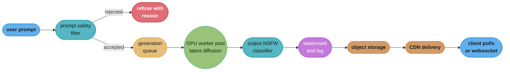
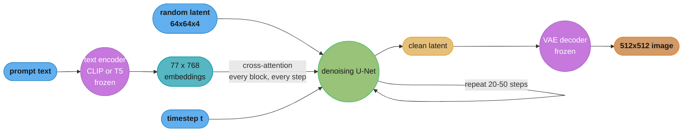
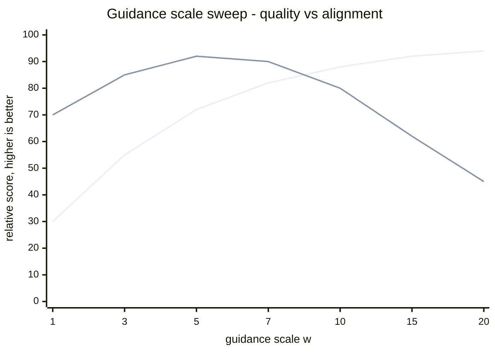

# Chapter 9: Text-to-Image Generation

> Ch 9 of 11 · Generative AI System Design Interview (Aminian & Sheng, ByteByteGo, 2024) · builds on Ch 8 — High-Resolution Image Synthesis, leads to Ch 10 — Personalized Headshot Generation

## Chapter Map

Chapter 7 generated faces from noise, and Chapter 8 replaced the GAN with a diffusion model
and moved the denoising process into a compressed latent space so that high-resolution
synthesis became tractable. Both of those systems are essentially unconditional: you sample,
and you get *a* plausible image, but you have no way to ask for a specific one. This chapter
closes that gap. The user types "an astronaut riding a horse on the moon, photorealistic" and
the system must return an image that a human would agree matches those words. Everything
structural from Ch 8 — the latent diffusion U-Net, the noise schedule, the VAE encoder and
decoder — is carried forward intact; what this chapter adds is the **conditioning pathway**:
a text encoder that turns the prompt into a sequence of embeddings, **cross-attention** layers
that let every spatial position in the U-Net attend to those embeddings, and
**classifier-free guidance**, the inference-time knob that decides how hard the model is
pushed toward the prompt versus how free it is left to produce a diverse, natural image.

**TL;DR:**
- Text-to-image is **conditional** latent diffusion: the same denoising U-Net from Ch 8, with
  a frozen **text encoder** (a CLIP text encoder, or a large language model such as **T5**)
  supplying an embedding sequence that the U-Net consumes through **cross-attention** at every
  resolution block.
- The training data is the bottleneck, not the architecture. The system needs hundreds of
  millions to billions of **image-text pairs** (LAION-scale web-crawled alt-text corpora), and
  raw alt-text is noisy enough that filtering — NSFW, watermarks, aesthetic score, resolution,
  deduplication — plus **recaptioning** with a captioning model is what actually moves prompt
  fidelity.
- **Classifier-free guidance (CFG)** replaces the earlier classifier-guidance approach: train
  one model to handle both the conditional and unconditional case by dropping the caption ~10%
  of the time, then at inference extrapolate away from the unconditional prediction by a
  **guidance scale** `w`. Raising `w` improves prompt alignment and hurts diversity — the
  chapter's central serving tradeoff.
- Evaluation needs **two** metrics that move in opposite directions: **FID** for image quality
  and distributional realism, **CLIP score** for prompt alignment. Sweeping the guidance scale
  traces a **Pareto curve** between them, and a single number on either axis alone is
  meaningless — a fact that shows up again in monitoring, where a quality regression and an
  alignment regression look nothing alike.
- The production system is a queue, not a request-response path: a prompt safety filter, an
  asynchronous generation queue, a GPU worker pool where **step count** is the primary cost
  and latency knob, and object storage plus a CDN for delivery — with watermarking, NSFW
  output filtering, and prompt-abuse detection wrapped around the whole thing.

## The Big Question

> Chapter 8 gave you a model that can synthesize a beautiful 1024×1024 image, but you cannot
> tell it *what* to synthesize. How do you inject a sentence — an arbitrary, open-vocabulary,
> compositional sentence — into an iterative denoising process that operates on tensors of
> pixels, and how do you then decide how *literally* the model should obey it?

Analogy: think of a sculptor working blindfolded from a block of marble, guided only by a
narrator standing behind them. Each chisel stroke is a denoising step; the narrator's
description is the prompt. If the narrator says nothing, the sculptor produces something
technically excellent but arbitrary — that's the unconditional model. If the narrator whispers
once at the start and then goes silent, the sculptor drifts — that's why the prompt embedding
is injected at *every* denoising step through cross-attention, not once at the beginning. And
the guidance scale is the narrator's volume: too quiet and the sculpture ignores the brief; too
loud and the sculptor over-corrects into a rigid, over-saturated caricature that satisfies every
word literally while looking nothing like a real photograph. The whole chapter is about
building the narrator, wiring the microphone into every stroke, and calibrating the volume.

---

## 9.1 Clarifying Requirements

The book opens as it always does, by scoping the problem with the interviewer before proposing
an architecture.

- **What is the input and the output?** Input is a free-form **text prompt** in natural
  language, optionally with a **negative prompt** (things to avoid) and generation parameters
  (seed, aspect ratio, step count). Output is one or more **raster images**, typically
  512×512 or 1024×1024. Unlike Ch 7, there is no reference image and no specific person to
  reproduce; unlike Ch 5 (image captioning), the direction is reversed — text in, pixels out.
- **How faithful must the image be to the prompt?** This is the requirement that drives the
  entire design. The system must handle **compositional prompts** — multiple objects, spatial
  relations ("a red cube *on top of* a blue sphere"), counts, and attribute binding ("a *green*
  cat next to a *red* dog", not the reverse). Prompt fidelity is a first-class functional
  requirement, measured separately from image quality.
- **What image quality bar and resolution?** Photorealistic or stylistically coherent output at
  512×512 minimum, with 1024×1024 as the production target — reached either by generating
  natively at that latent resolution or by a **cascaded super-resolution** stage layered on a
  lower-resolution base model (the Ch 8 machinery).
- **What is the latency budget?** Diffusion is iterative, so this is not the sub-second budget
  of Ch 7's single-pass GAN. The chapter's target is on the order of **a few seconds per
  image** on a production GPU at typical step counts, which is fast enough to feel interactive
  behind a progress indicator but slow enough that the serving design must be a **queue** with
  an asynchronous result, not a synchronous HTTP call held open.
- **What throughput and scale?** A consumer-facing product generates on the order of millions
  of images per day, every one of which occupies a GPU for seconds — which makes GPU capacity,
  not database or network capacity, the scaling constraint and the dominant line item in the
  cost model.
- **What safety constraints apply?** Both the **input** and the **output** need filtering: the
  prompt must be screened for requests for sexual content involving minors, gore, targeted
  harassment, and named-person impersonation; the generated image must be screened for NSFW
  content that slipped past the prompt filter (an innocuous prompt can still produce an unsafe
  image). Outputs should be **watermarked** as synthetic, per the same reasoning as Ch 7.
- **What about copyright and consent?** The training corpus is web-crawled, which raises
  licensing questions about the images and style-mimicry questions about living artists whose
  names appear in prompts. The chapter treats this as a genuine design constraint on data
  curation and on prompt policy, not as a legal footnote.

**Functional summary:** given a natural-language prompt (plus optional negative prompt and
generation parameters), return one or more high-resolution images that a human judges to match
the prompt, within a few seconds, safely, at millions of images per day.

---

## 9.2 Framing the Problem as an ML Task

### Defining the ML objective

The objective is **conditional image generation**: learn `p(x | c)`, the distribution over
images `x` given a text condition `c`, rather than the unconditional `p(x)` that Chapters 7 and
8 modeled. Concretely, the training objective is the same denoising objective as Ch 8 with the
text embedding threaded through:

```
L = E_{x, c, t, eps} [ || eps - eps_theta(z_t, t, tau(c)) ||^2 ]
```

Read it left to right: take a real image `x`, encode it to a latent `z` with the VAE encoder,
sample a timestep `t` and a Gaussian noise tensor `eps`, form the noised latent `z_t`, and train
the network `eps_theta` to predict exactly which noise was added — now additionally given
`tau(c)`, the text encoder's output for the caption. The loss is a plain mean-squared error on
the predicted noise. Nothing about the loss says "match the prompt"; the model learns
conditioning purely because knowing the caption makes the noise easier to predict, and gradient
descent will use any information that reduces the loss.

### Choosing the ML approach

The chapter compares three ways to get text into an image generator:

- **Conditional GAN.** Feed the text embedding into a GAN generator alongside the noise vector.
  Fast (single forward pass, per Ch 7), but text-conditional GANs proved hard to scale to
  open-vocabulary prompts: the discriminator has to judge *both* realism and prompt alignment,
  and the training instability from Ch 7 compounds with the added conditioning burden.
- **Autoregressive token models.** Quantize the image into a grid of discrete tokens with a
  VQ-VAE, then model the token sequence autoregressively conditioned on the text tokens —
  effectively "language modeling over image patches" (the DALL-E 1 lineage). Conceptually clean
  and reuses the transformer stack directly, but generation is sequential over hundreds or
  thousands of image tokens, which is slow, and the quantization step caps achievable fidelity.
- **Conditional diffusion.** Keep Ch 8's latent diffusion model and add cross-attention
  conditioning. This is the chapter's choice, for three reasons: it inherits diffusion's
  training stability and sample diversity, it operates in the compressed latent space so the
  compute cost is manageable, and — critically — **classifier-free guidance gives an
  inference-time knob on prompt adherence** that neither of the other two families offers.

### Input and output, formalized

- **Text encoder `tau`**: maps a prompt of up to ~77 tokens (the CLIP text encoder's context
  length) to a sequence of embeddings, e.g. `77 × 768` or `77 × 1024`. Frozen during diffusion
  training.
- **U-Net `eps_theta`**: takes the noised latent `z_t` (e.g. `64 × 64 × 4` for a 512×512 image
  at an 8× VAE downsampling factor), the timestep `t`, and the text embedding sequence, and
  predicts the noise `eps`.
- **VAE decoder**: maps the final denoised latent `z_0` back to pixel space
  (`64 × 64 × 4` → `512 × 512 × 3`).

---

## 9.3 Data Preparation

### Data engineering — the corpus

Text-to-image training needs **paired** image-text data at a scale that only the open web can
supply. The chapter's reference is a **LAION-style** corpus: images crawled from the web,
paired with their HTML `alt` attributes as captions, filtered by a CLIP-based image-text
similarity score to keep only pairs where the caption plausibly describes the image. The scale
involved is on the order of **hundreds of millions to billions of pairs** — LAION-5B being the
best-known example at roughly 5 billion pairs, with LAION-400M and an aesthetics-filtered
subset used more commonly for actual training runs.

The essential property of this corpus is that it is **weakly and noisily labeled**. Alt-text
was written for accessibility and SEO, not for training a generative model. A typical crawled
caption is "IMG_20190412.jpg", or "Buy now — free shipping", or a product SKU. This is the
single biggest lever on final prompt fidelity, and it is a data problem, not a modeling one.

### Data engineering — the filtering pipeline

Each stage below removes a specific failure the model would otherwise learn:

- **Image-text similarity filtering.** Score every pair with a pretrained CLIP model and drop
  pairs below a threshold. This is what turns a raw crawl into something trainable at all, since
  a large fraction of web images have captions bearing no relation to their content.
- **Resolution and aspect-ratio filtering.** Drop images below the training resolution (e.g.
  under 512 on the short side); a model trained on upscaled thumbnails learns to produce soft,
  low-detail output.
- **NSFW filtering.** Run a dedicated NSFW classifier over the images and a keyword/classifier
  filter over the captions. Anything the model has never seen it cannot readily generate, which
  makes this the cheapest and most robust safety control in the whole system — far more
  effective than trying to block it at inference time alone.
- **Watermark and text-overlay detection.** Stock-photo watermarks are extremely common in web
  crawls, and a model trained on them will happily render a plausible-looking watermark across
  a generated image, because "has a watermark" is genuinely correlated with "is a professional
  photograph" in the training distribution. A watermark classifier drops or down-weights these.
- **Aesthetic scoring.** A small model trained on human aesthetic ratings scores each image;
  fine-tuning on the top-scoring subset (an "aesthetics" split) markedly improves the perceived
  quality of output, at the cost of narrowing stylistic diversity toward whatever the aesthetic
  raters preferred.
- **Deduplication.** Perceptual hashing removes near-duplicates. Beyond distribution skew, this
  matters for a reason specific to generative models: an image duplicated thousands of times
  across the crawl can be **memorized** and reproduced near-verbatim at inference, which is
  simultaneously a privacy problem, a copyright problem, and an embarrassment.
- **Licensing and consent review.** The chapter flags this explicitly: web-crawled images carry
  unclear licensing, and individuals photographed in them never consented to being training
  data. Practical mitigations named include honoring opt-out signals and maintaining an
  exclusion list, without pretending the underlying question is settled.

### Feature engineering — recaptioning

Because alt-text is so noisy, the chapter describes **recaptioning**: run a pretrained
captioning or vision-language model (the Ch 5 machinery) over the training images to generate
dense, descriptive synthetic captions, then train on those instead of — or blended with — the
original alt-text.

The effect is direct. If every training caption is three words long, the model never learns
what a long, compositional prompt means, and it will collapse a detailed prompt into whatever
short-caption concept dominates it. Dense synthetic captions teach spatial relations, counts,
and attribute binding because those relations actually appear in the caption text. The standard
practice is a **blend** — a mix of synthetic and original captions, commonly weighted heavily
toward synthetic — so the model still handles the terse, keyword-style prompts real users
actually type rather than only the verbose style the captioner produces.

**Broken → fix.** A team trains only on raw alt-text and finds that "a red cube on top of a
blue sphere" produces a blue cube and a red sphere roughly half the time. The instinct is to
scale the model. The actual cause is that almost no training caption in the corpus ever
expressed a spatial relation or bound an adjective to a specific noun, so the model learned a
bag-of-concepts association between caption words and image content and never learned binding
at all. The fix is recaptioning, not parameters.

### Feature engineering — preprocessing

- Encode every image once through the frozen VAE encoder and **cache the latents**. The VAE is
  frozen during diffusion training, so re-encoding every epoch is pure waste; caching turns a
  `512 × 512 × 3` image into a `64 × 64 × 4` tensor, cutting both storage and per-step compute.
- Tokenize captions to the text encoder's fixed context length (77 tokens for CLIP), padding
  and truncating as needed. Truncation is worth naming: a prompt longer than the context window
  silently loses its tail, which is a common source of "the model ignored the end of my prompt."
- **Caption dropout**: replace the caption with the empty string for roughly **10%** of
  training examples. This is not a regularizer in the usual sense — it is what makes a single
  network able to produce both a conditional and an unconditional noise prediction, which is
  exactly the requirement for classifier-free guidance in §9.4.
- Random horizontal flips as cheap augmentation, applied carefully: flipping an image whose
  caption mentions left or right makes the pair inconsistent.

---

## 9.4 Model Development

### Model selection — the three components

The system is three models, only one of which is trained here:

| Component | Trained here? | Role |
|---|---|---|
| VAE encoder/decoder | No — pretrained, frozen | Compress pixels to latents and back (Ch 8) |
| Text encoder | Usually no — pretrained, frozen | Turn the prompt into an embedding sequence |
| Denoising U-Net | **Yes** | Predict noise, conditioned on text via cross-attention |

Freezing the first two is what makes the training run affordable and stable: gradients flow
only through the U-Net, and the text encoder's semantic space stays fixed so the U-Net is
learning against a stationary target rather than chasing a moving one.

### Text encoder choice — CLIP versus a large language model

The chapter presents this as a real design decision with a real tradeoff.

- **A CLIP text encoder** was trained contrastively against images, so its embedding space is
  already aligned with visual concepts — "golden retriever" sits near images of golden
  retrievers by construction. That alignment is exactly what a conditioning signal wants. Its
  weakness is that contrastive training optimizes for matching a whole caption to a whole image,
  which rewards a bag-of-concepts representation and does not force careful encoding of syntax,
  negation, counts, or which adjective attaches to which noun.
- **A large language model text encoder such as T5** was trained on text alone, so it has a far
  richer grasp of language structure — long prompts, clauses, relations — but its embedding
  space was never aligned to images, so the U-Net has to learn the text-to-vision mapping
  itself from the paired data.

The empirical finding the chapter reports is that **scaling the text encoder improves prompt
fidelity more than scaling the image generator** — the language side, not the pixel side, is the
binding constraint on how well the system understands what was asked. Several production
systems therefore use **both** encoders and concatenate their outputs, taking CLIP's visual
grounding and T5's language understanding together.

### Model training — cross-attention conditioning

The mechanism that puts text into the U-Net is **cross-attention**. Inside each resolution
block of the U-Net, alongside the usual convolutions and self-attention, sits a cross-attention
layer:

```
Attention(Q, K, V) = softmax(Q K^T / sqrt(d)) V

  Q = W_Q . flatten(spatial features from the U-Net)     # one query per spatial position
  K = W_K . tau(c)                                       # keys from the text embeddings
  V = W_V . tau(c)                                       # values from the text embeddings
```

The queries come from the **image** side and the keys and values come from the **text** side —
that asymmetry is the whole idea. Every spatial position in the latent asks "which words in this
prompt are relevant to what I should become?" and pulls a weighted blend of the corresponding
text embeddings. A position that is going to become part of the horse attends to the "horse"
token; a position in the sky attends to "moon". The attention map is literally a soft
segmentation of the prompt over the image canvas, which is why cross-attention maps can be
inspected to debug attribute binding failures and are the hook that later spatial-control
techniques attach to.

Two details matter for a design answer:

- **Cross-attention appears at every resolution block, and at every denoising step.** Injecting
  the prompt once at the start would let the image drift away from it over 50 denoising steps.
  Coarse blocks use the prompt to place large-scale composition; fine blocks use it for texture
  and detail — structurally the same coarse-to-fine story as StyleGAN's AdaIN injection in
  Ch 7, with a different mechanism.
- **The timestep `t` is injected separately**, through a sinusoidal embedding added into the
  residual blocks, because the network needs to know *how noisy* its input is to predict the
  right noise magnitude — that is orthogonal to *what* it should be drawing.

### Model training — guidance

This is the chapter's most important mechanism, and the place candidates most often go wrong.

#### Classifier guidance (the earlier approach)

The original way to trade diversity for fidelity was to train a **separate classifier** on
*noisy* images and use its gradient to steer sampling:

```
eps_guided = eps_theta(z_t, t) - w * sigma_t * grad_{z_t} log p_phi(c | z_t)
```

Each denoising step is nudged in the direction that increases the classifier's confidence that
the image belongs to class `c`. It works, but it has three problems the chapter names: it
requires training and maintaining an extra classifier, that classifier has to be trained on
noisy inputs at every timestep (an ordinary ImageNet classifier is useless on a 90%-noise
image), and it only conditions on whatever label space the classifier has — which is fine for
1,000 ImageNet classes and useless for open-vocabulary text prompts.

#### Classifier-free guidance (the fix, and what everyone uses)

**Classifier-free guidance (CFG)** removes the classifier entirely. During training, the
caption is dropped for ~10% of examples (the caption dropout from §9.3), so the *same* network
learns both `eps_theta(z_t, t, c)` and `eps_theta(z_t, t, ∅)`. At inference, run the network
twice per step — once with the prompt, once with the empty prompt — and extrapolate:

```
eps_guided = eps_theta(z_t, t, empty) + w * ( eps_theta(z_t, t, c) - eps_theta(z_t, t, empty) )
```

The bracketed difference is "the part of the prediction that exists *because* of the prompt."
Multiplying it by `w > 1` amplifies exactly that component and pushes the sample further into
the region of image space the prompt describes:

- `w = 1` reduces to the plain conditional model — the prompt is used, but not amplified.
- `w = 0` is the unconditional model — the prompt is ignored entirely.
- `w ≈ 7 - 8` is the chapter's typical production default: strong prompt adherence, good image
  quality.
- `w > 15` over-saturates. Colors blow out, contrast goes harsh, composition gets rigid and
  poster-like, and diversity collapses — every seed starts producing the same literal-minded
  interpretation of the prompt.

The cost is exact and worth stating in an interview: **CFG doubles the compute per denoising
step**, because every step now requires two forward passes through the U-Net. In practice the
conditional and unconditional inputs are batched together so it is one batched pass of size 2
rather than two sequential passes, which recovers most of the latency but none of the FLOPs.

#### Negative prompts

A **negative prompt** is a direct reuse of the CFG machinery: instead of the empty string,
supply an explicit undesired prompt as the unconditional branch.

```
eps_guided = eps_theta(z_t, t, c_neg) + w * ( eps_theta(z_t, t, c) - eps_theta(z_t, t, c_neg) )
```

Now the extrapolation actively pushes *away* from `c_neg`. Typing "blurry, watermark, extra
fingers, low quality" as a negative prompt costs nothing extra — that second forward pass was
already being computed for CFG — which is why the feature is essentially free and universally
exposed to users.

### Model training — the latent diffusion recap and the two-stage alternative

Two architectural patterns for reaching high resolution, both inherited from Ch 8:

- **Latent diffusion (single stage).** Diffuse in the VAE's compressed latent space at, say,
  `64 × 64 × 4`, then decode once to `512 × 512 × 3`. One model, one decode, cheapest path.
- **Two-stage prior + decoder (the unCLIP pattern).** A **prior** model maps the text embedding
  to a predicted *image* embedding in CLIP space, and a **decoder** diffusion model generates
  the image conditioned on that image embedding. The stated advantage is that generation is
  conditioned on a representation that already lives in image space, which improves diversity
  for a given fidelity; the cost is an extra model to train, serve, and debug.
- **Cascaded super-resolution.** Generate a base image at 64×64 or 256×256, then run one or two
  diffusion-based **super-resolution** stages (256 → 1024). Each stage is a smaller, cheaper
  model than a native 1024×1024 generator would be, and the base model can be tuned purely for
  composition while the upscalers handle detail.

### Model training — practical training scale

Training a text-to-image latent diffusion model at this scale is a multi-week, multi-hundred-GPU
job. The chapter's framing puts it in the same class as Ch 7's StyleGAN estimate but larger by
roughly an order of magnitude — **on the order of 100,000+ A100-GPU-hours** for a from-scratch
frontier-quality run over hundreds of millions of image-text pairs, using mixed precision,
gradient checkpointing, and data-parallel sharding (Ch 1's efficiency toolkit) throughout. Like
Ch 7, this makes a full retrain a rare, deliberate event; day-to-day iteration happens through
fine-tuning an existing checkpoint on a curated subset.

---

## 9.5 Evaluation

There is no reference image for a prompt, so evaluation has to measure two independent things
that a single metric cannot capture together.

### Offline metrics — the two axes

**FID (Fréchet Inception Distance)** measures **image quality and distributional realism**, in
exactly the form Ch 7 introduced: fit Gaussians to the Inception features of a set of real and
a set of generated images and compute the Fréchet distance between them. Lower is better. FID
knows nothing whatsoever about the prompt — a generator that produces gorgeous photographs
completely unrelated to what was asked scores excellently on FID.

**CLIP score** measures **prompt alignment**. Embed the generated image with a CLIP image
encoder, embed the prompt with the CLIP text encoder, take the cosine similarity:

```
CLIPScore = max(0, cos( E_image(x_generated), E_text(prompt) ))
```

Higher is better. CLIP score knows nothing about image quality — a garish, artifact-ridden
image that nonetheless contains all the prompted objects scores well.

**Neither number means anything alone.** This is the chapter's central evaluation point, and
the guidance scale is what makes it concrete.

### The FID / CLIP-score Pareto curve

Sweep the guidance scale `w` from 1 upward and evaluate both metrics at each value. What you get
is not a single optimum but a **Pareto curve**:

- At low `w`, samples are diverse and natural — FID is good (low), CLIP score is poor (low),
  because many samples wander away from the prompt.
- As `w` rises, CLIP score climbs steeply as samples snap onto the prompt, while FID initially
  improves slightly too (fewer incoherent samples).
- Past roughly `w ≈ 7-10`, the curves diverge: CLIP score keeps creeping up while FID gets
  markedly worse, because the over-saturation and reduced diversity of high-guidance sampling
  push the generated distribution away from the real image distribution.

The practical consequence: **you never report FID at a single guidance scale without saying
which scale**, and comparing two models means comparing their whole curves, not two points. A
model that looks better at `w = 3` can be worse at `w = 8`, and product quality is decided at
whatever `w` you actually ship.

### Prompt-alignment benchmarks

CLIP score is a blunt instrument — it inherits CLIP's own bag-of-concepts weakness, so it often
cannot tell "a red cube on a blue sphere" from "a blue cube on a red sphere," which is precisely
the compositional failure the requirement in §9.1 cared about most. The chapter therefore points
to structured **prompt-alignment benchmarks** built from prompt sets that systematically vary
counting, spatial relations, attribute binding, and object co-occurrence, scored either by a
VQA model asked targeted questions about the generated image ("Is the cube red?") or by human
raters. This catches the class of failure CLIP score is blind to by construction.

### Human preference evaluation

The chapter's ultimate arbiter, as in Ch 7. Raters see two images generated from the same prompt
by two model versions and choose on two separate axes: **which image is better** (quality) and
**which image better matches the prompt** (alignment). Keeping the two questions separate is
what makes the results actionable, since the whole point of the section above is that these
axes move independently and a single "which is better" question silently averages them.

### Online metrics

Once deployed, the product-level signals that map back to Step 1's business objective:
generation-to-download or generation-to-share rate, **regeneration rate** (a user immediately
re-running the same prompt is the strongest implicit signal of dissatisfaction there is),
prompt-edit-and-retry rate, session length, and paid conversion.

---

## 9.6 Overall ML System Design

The serving path is fundamentally different from Ch 7's. A GAN was a single sub-second forward
pass and could sit behind a synchronous HTTP request; a diffusion model occupies a GPU for
several seconds, so the architecture is a **job queue**.



Caption: the prompt is screened before a GPU is ever allocated — the cheapest possible place to
reject unsafe work — and the output is screened again after generation, because a benign prompt
can still produce an unsafe image.

- **Prompt safety filter.** A fast text classifier plus blocklists, running in milliseconds
  before the job is enqueued. Putting it first is both a safety and a cost decision: rejecting a
  disallowed prompt before it consumes several GPU-seconds is free, rejecting it after is not.
- **Generation queue.** Requests are enqueued with a priority (paid tier ahead of free tier)
  and a job id returned immediately. The client polls or holds a websocket. This decouples user
  arrival rate from GPU capacity, which is the only way to survive a traffic spike without
  either dropping requests or over-provisioning GPUs for peak.
- **GPU worker pool.** Each worker holds the model weights resident in GPU memory — loading
  multi-gigabyte weights per request would dominate the generation time — and pulls jobs off
  the queue. Requests are **batched** across users where the parameters allow, since a diffusion
  U-Net is heavily compute-bound and larger batches improve GPU utilization substantially.
- **Step count as the serving knob.** This is the chapter's most useful operational lever.
  Latency and cost scale essentially linearly with the number of denoising steps, and quality
  saturates: a modern sampler produces near-final quality in **20-50 steps** where the original
  DDPM formulation needed 1,000. Exposing step count as a product tier — a fast preview at low
  steps, a high-quality render at high steps — converts a model hyperparameter directly into a
  cost and latency control.
- **Storage and delivery.** Generated images go to object storage with a lifecycle policy
  (unclaimed images expire) and are served through a CDN, because the images are large,
  immutable, and often re-fetched. The generation parameters — prompt, negative prompt, seed,
  guidance scale, step count, model version — are logged alongside so any image can be
  reproduced or audited later.

### Scale estimation

Work the numbers, as the chapter does throughout:

- Assume **1 million images/day**, and **4 seconds** of GPU time per image at production step
  count and resolution.
- That is `1,000,000 × 4 s = 4,000,000` GPU-seconds/day ≈ **1,111 GPU-hours/day** ≈ **46 GPUs**
  running continuously at 100% utilization.
- Real traffic is peaky, and utilization is never 100%. At a 3× peak-to-average ratio and 70%
  achieved utilization, steady-state provisioning lands around **65-70 GPUs** with autoscaling
  headroom above that — and the queue is what absorbs the peak instead of the GPU fleet having
  to be sized for it.
- At roughly `$2-3` per A100-GPU-hour on demand, that is on the order of **$2,000-3,500/day**
  in raw inference compute, i.e. a marginal **cost per image in the low single-digit cents** —
  the number that determines whether the product's pricing model works at all.
- Storage: at ~1 MB per 1024×1024 PNG, 1 million images/day is **1 TB/day**, roughly 365 TB/year
  before lifecycle expiry — cheap next to the GPUs, but the reason a retention policy exists.

---

## 9.7 Deployment and Monitoring

- **Staged rollout with a two-axis gate.** A new checkpoint ships behind a canary, and the
  promotion gate must check FID *and* CLIP score *and* human preference — because §9.5's whole
  point is that a model can improve on one axis while regressing on the other, and a single-metric
  gate will happily promote a regression.
- **Cost per image.** The dominant operational metric. Track it as a first-class dashboard
  number, broken down by step count, resolution, and batch size, because a well-intentioned
  quality change (more steps, higher resolution, an extra super-resolution stage) is
  simultaneously a cost change that no accuracy metric will surface.
- **Queue depth and wait time.** Users experience queue wait, not GPU time. p50 and p99
  end-to-end latency, queue depth, and time-to-first-preview are the SLA-facing numbers;
  sustained queue growth is the signal to scale the worker pool.
- **Output NSFW filtering rate.** Monitor both the rate at which the output classifier fires and,
  through sampled human review, its false-negative rate. A rising fire rate means either an
  attack pattern in the prompts or a model change that shifted the output distribution, and the
  two demand very different responses.
- **Prompt-abuse detection.** Watch for adversarial patterns: prompt-obfuscation attempts to
  evade the input filter (misspellings, homoglyphs, coded language), repeated near-identical
  prompts probing for a filter gap, and prompts targeting named real people. The chapter's
  recommendation mirrors Ch 7's — rate-limit and route to review rather than silently blocking,
  since legitimate bulk use looks similar in the aggregate.
- **Watermarking.** Every output carries an invisible, robust watermark identifying it as
  AI-generated, and a periodic audit re-runs the detector over sampled production images to
  confirm the step has not silently regressed after a pipeline change.
- **Copyright and style-mimicry complaints.** A real, ongoing operational workload. Two concrete
  mechanisms: a **memorization audit** that samples generations and checks them against the
  training corpus with perceptual hashing to detect near-verbatim reproduction, and a **prompt
  policy** governing whether living artists' names may be used as style specifiers, backed by an
  artist opt-out list applied at the data-curation stage rather than only at the prompt filter.
- **Drift.** User prompt distributions move fast — new memes, new subjects, new phrasing. Track
  the distribution of prompt embeddings over time, and watch for a rising share of prompts whose
  generations score poorly on CLIP score, which is the earliest signal that users are asking for
  things the training data never covered.

---

## Beyond the book — text-to-image after 2024

> This chapter summarizes the 2024 edition of *Generative AI System Design Interview*, whose
> reference design is a cross-attention-conditioned latent diffusion U-Net with classifier-free
> guidance. It does not describe diffusion-transformer backbones, rectified-flow training
> objectives, few-step distilled samplers, or post-2024 provenance standards. Everything in this
> section is later material, not the authors'.

Three shifts are worth naming for a reader coming to this chapter today, none of which
invalidates the design reasoning above.

First, the **U-Net backbone has largely given way to the diffusion transformer (DiT)**: the
convolutional encoder-decoder is replaced by a plain transformer operating on latent patches,
which scales more predictably with parameter count and reuses the well-understood transformer
training toolkit. The conditioning story is unchanged — cross-attention or adaptive layer norm
still carries the text embedding — so §9.4's mechanism discussion transfers directly.

Second, **flow-matching and rectified-flow objectives** have replaced the noise-prediction
objective in several frontier systems, and **few-step distillation** (distilling a many-step
sampler into a model that produces comparable quality in 1-4 steps) has compressed generation
latency by an order of magnitude. That directly attacks §9.6's cost model: the "4 seconds per
image, 46 GPUs" arithmetic is the honest 2024 number for a standard sampler, and a distilled
few-step model changes it dramatically — which also erodes the latency advantage the book's
Ch 7 gives GANs.

Third, **provenance has become concrete**. The C2PA content-credentials standard for
cryptographically signed generation history, and transparency obligations for synthetic media
under the EU AI Act, have moved the chapter's general "watermark and log everything" guidance
toward specific technical and regulatory expectations that did not exist in their current form
in 2024. The design instinct in §9.7 holds up well; the standards it would name today are
different.

---

## Visual Intuition

### Where the prompt enters the denoising loop



Caption: the text embedding is not consumed once — it is read by cross-attention inside every
resolution block on every one of the 20-50 denoising steps, which is what keeps the image from
drifting away from the prompt as the loop progresses.

### Classifier-free guidance as an extrapolation

```
                 image-space direction predicted by the model at step t

  unconditional  |------------>|
  eps(z, t, empty)             |
                               |
  conditional    |------------------>|
  eps(z, t, c)                       |
                               |     |
                               |<--->|   the "prompt delta":
                               delta   what the prompt CHANGED

  guided output = unconditional + w * delta

  w = 0    |------------>|                   prompt ignored
  w = 1    |------------------>|             plain conditional model
  w = 7    |------------------------------>| production default
  w = 20   |----------------------------------------------->| over-saturated

  the guidance scale does not INTERPOLATE between the two predictions,
  it EXTRAPOLATES past the conditional one - which is why large w pushes
  the sample outside the region of realistic images entirely
```

Caption: CFG amplifies the difference between the conditioned and unconditioned predictions,
so `w` is an extrapolation factor, not a blend weight — the reason quality degrades in a
specific, recognizable way (blown-out color, rigid composition) once `w` grows large.

### FID and CLIP score move in opposite directions



Caption: illustrative shape, not measured values — prompt alignment rises monotonically with
guidance while image quality peaks around `w ≈ 5-7` and then falls, which is exactly why a
single-metric evaluation gate promotes regressions and why production settles near the knee.

### Cross-attention as a soft segmentation of the prompt

```
  prompt:  "a  red  cube  on  a  blue  sphere"
  tokens:   0   1     2    3   4   5     6

  attention weight of each latent position over prompt tokens
  (one row per spatial region of the 64x64 latent, simplified to 3 regions)

                    a   red  cube  on   a   blue sphere
  upper-left      | .02  .41  .44  .05 .02  .03  .03 |   -> becomes the cube
  center          | .03  .06  .09  .31 .03  .21  .27 |   -> the contact region
  lower-right     | .02  .04  .05  .04 .02  .39  .44 |   -> becomes the sphere

  each row sums to 1.0 across the prompt tokens

  attribute BINDING failure looks like the upper-left row attending
  strongly to "blue" instead of "red" - the model placed a cube, but
  pulled the color from the wrong token
```

Caption: because every spatial position produces its own distribution over prompt tokens, the
cross-attention map is directly inspectable — an attribute-binding bug is visible as a row
attending to the wrong adjective, which is why this is the layer that later spatial-control
methods hook into.

---

## Key Concepts Glossary

- **Text-to-image generation** — producing a raster image conditioned on a natural-language
  prompt.
- **Conditional generation** — modeling `p(x | c)` rather than `p(x)`; sampling constrained by a
  condition.
- **Text encoder** — the frozen model that converts a prompt into a sequence of embeddings used
  as the conditioning signal.
- **CLIP text encoder** — a text encoder trained contrastively against images, so its embedding
  space is aligned with visual concepts.
- **T5** — a text-only large language model used as an alternative or additional text encoder,
  stronger on language structure but not visually aligned.
- **Cross-attention** — attention where queries come from the image latent and keys/values come
  from the text embeddings; the mechanism that injects the prompt into the U-Net.
- **Latent diffusion** — running the diffusion process in a VAE's compressed latent space rather
  than in pixel space (Ch 8).
- **Denoising U-Net** — the network trained to predict the noise added to a latent at a given
  timestep.
- **Timestep embedding** — a sinusoidal encoding of the diffusion timestep injected into the
  U-Net so it knows how noisy its input is.
- **Classifier guidance** — steering sampling using the gradient of a separately trained
  noise-robust classifier; the earlier, now-superseded approach.
- **Classifier-free guidance (CFG)** — training one model on both captioned and uncaptioned
  examples, then extrapolating between its conditional and unconditional predictions at
  inference.
- **Guidance scale (w)** — the CFG extrapolation factor; higher means stronger prompt adherence
  and lower diversity.
- **Caption dropout** — replacing the caption with the empty string for a fraction (~10%) of
  training examples, which is what makes CFG possible.
- **Negative prompt** — supplying an explicit undesired prompt as CFG's unconditional branch, so
  sampling is pushed away from it.
- **Prior + decoder (unCLIP)** — a two-stage design where a prior maps text embeddings to image
  embeddings and a decoder generates the image from those.
- **Cascaded super-resolution** — generating a low-resolution image and upscaling it through one
  or more diffusion-based super-resolution stages.
- **Image-text pair corpus** — the training data format: an image paired with a caption, at
  hundreds-of-millions to billions scale.
- **LAION-style dataset** — a web-crawled image-alt-text corpus filtered by CLIP similarity;
  the chapter's reference training data.
- **Alt-text** — the HTML accessibility attribute used as the raw caption source; noisy,
  short, and frequently unrelated to image content.
- **Recaptioning** — regenerating training captions with a captioning model to produce dense,
  descriptive text, then training on those instead of raw alt-text.
- **Aesthetic scoring** — ranking training images with a model trained on human aesthetic
  ratings, then fine-tuning on the top-scoring subset.
- **Watermark filtering** — removing training images containing stock-photo watermarks so the
  generator does not learn to render them.
- **Deduplication** — removing near-duplicate training images, which reduces distribution skew
  and the risk of verbatim memorization.
- **Memorization** — a generative model reproducing a training image near-verbatim, usually
  caused by that image being heavily duplicated in the corpus.
- **CLIP score** — cosine similarity between a generated image's CLIP embedding and its prompt's
  CLIP embedding; the chapter's prompt-alignment metric.
- **FID (Fréchet Inception Distance)** — distributional distance between real and generated
  image features; the chapter's image-quality metric.
- **FID / CLIP-score Pareto curve** — the tradeoff curve traced by sweeping the guidance scale;
  quality and alignment cannot be maximized simultaneously.
- **Attribute binding** — correctly attaching each adjective in a prompt to the intended noun; a
  common compositional failure mode.
- **Step count** — the number of denoising steps at inference; the primary latency and cost knob
  at serving time.
- **Prompt safety filter** — a fast classifier screening prompts before a GPU is allocated.
- **Prompt-abuse detection** — monitoring for filter-evasion patterns such as obfuscation,
  repeated probing, and impersonation attempts.

---

## Tradeoffs & Decision Tables

### Approach to text conditioning

| Approach | Sample speed | Open-vocabulary prompts | Fidelity knob at inference | Verdict |
|---|---|---|---|---|
| Conditional GAN | Fastest (single pass) | Hard to scale | None | Unstable at open-vocabulary scale |
| Autoregressive image tokens | Slow (sequential tokens) | Yes | Temperature/top-k only | Slow, quantization caps fidelity |
| Conditional latent diffusion | Moderate (20-50 steps) | Yes | **Guidance scale** | **Chosen for this chapter** |

### Text encoder choice

| Encoder | Visual alignment | Language structure | Cost | Best for |
|---|---|---|---|---|
| CLIP text encoder | Strong (contrastively trained on images) | Weak — bag-of-concepts | Small | Short, concept-style prompts |
| T5 / LLM encoder | None out of the box | Strong — syntax, relations, counts | Larger | Long, compositional prompts |
| Both, concatenated | Strong | Strong | Largest | Production systems wanting both |

### Guidance scale

| w | Prompt alignment | Image quality | Diversity | Typical use |
|---|---|---|---|---|
| 0 | None (prompt ignored) | Good | Maximum | Unconditional baseline only |
| 1 | Moderate | Good | High | Plain conditional model |
| 5-8 | Strong | Best | Moderate | **Production default** |
| 15+ | Very strong, literal | Over-saturated, rigid | Low | Rarely useful; a debugging signal |

### Guidance mechanism

| Mechanism | Extra model needed | Works for open vocabulary | Inference cost | Status |
|---|---|---|---|---|
| Classifier guidance | Yes — a noise-robust classifier | No, fixed label space | 1× U-Net + classifier | Superseded |
| Classifier-free guidance | No | Yes | **2× U-Net per step** | Standard |

### Step count as a product tier

| Steps | Relative latency | Relative cost | Quality | Product tier |
|---|---|---|---|---|
| 4-8 | Lowest | Lowest | Draft, visible artifacts | Fast preview |
| 20-30 | Moderate | Moderate | Near-final | Default |
| 50+ | Highest | Highest | Marginal gain over 30 | "High quality" tier |

---

## Common Pitfalls / War Stories

- **Optimizing FID alone and shipping a model nobody can steer.** A checkpoint with a beautiful
  FID at low guidance produces gorgeous images that routinely ignore the prompt. Because the
  offline gate only measured FID, it promotes cleanly, and the regression only surfaces as a
  spike in the regeneration rate after launch. Both metrics gate, always, and at the guidance
  scale actually shipped.
- **Trying to fix compositional failures by scaling the model.** "A red cube on a blue sphere"
  swapping its colors is a *caption* problem: if the training corpus's alt-text never expressed
  attribute binding, no amount of parameters teaches it. Recaptioning fixes this; more GPUs do
  not.
- **Forgetting that CFG doubles inference compute.** A capacity plan built from a single forward
  pass per denoising step under-provisions the GPU fleet by 2×. Batch the conditional and
  unconditional passes together to recover the latency, but budget the FLOPs honestly.
- **Cranking the guidance scale to fix a weak prompt.** High `w` makes the model obey more
  literally, which reads as "better" on a handful of hand-picked prompts and produces
  blown-out, low-diversity output across the real prompt distribution. If a prompt is not being
  followed at `w = 7`, the answer is usually a better text encoder, better captions, or a
  negative prompt — not `w = 18`.
- **Skipping watermark filtering in the training corpus.** The model learns that professional
  photographs have watermarks and renders convincing fake ones across generated images. This is
  discovered by users, not by FID, because a watermarked image is a perfectly realistic image.
- **Shipping without an output-side NSFW filter because the prompt filter exists.** A benign
  prompt can produce an unsafe image — the mapping from text to pixels is not something the
  text filter can see through. Both filters are needed, and the output filter is the one that
  catches the cases nobody anticipated.
- **Sizing the GPU fleet for peak instead of using the queue.** A diffusion serving path without
  a queue has to be provisioned for peak concurrency, which means paying for idle GPUs the rest
  of the day. The queue converts a capacity problem into a latency problem, which is the far
  cheaper one to have.
- **Not logging generation parameters.** Without the seed, guidance scale, step count, negative
  prompt, and model version stored alongside each image, no complaint can be reproduced and no
  regression can be bisected — and a copyright or safety escalation months later has nothing to
  investigate.

---

## Real-World Systems Referenced

**Model families and architectures:** Stable Diffusion / latent diffusion (the chapter's
reference conditional-diffusion design), DALL-E and DALL-E 2 (the autoregressive-token lineage
and the unCLIP prior-plus-decoder pattern respectively), Imagen (the T5-encoder plus cascaded
super-resolution design), Midjourney (named as a production text-to-image product). **Text
encoders:** OpenAI CLIP, Google T5. **Datasets:** LAION-400M and LAION-5B, and their
aesthetics-filtered subsets. **Evaluation:** Inception-v3 (underlying FID), CLIP (underlying
CLIP score), MS-COCO captions as a standard zero-shot FID benchmark set. **Infrastructure
patterns:** GPU worker pools, asynchronous job queues, object storage plus CDN delivery.

---

## Summary

Text-to-image generation is the chapter where the book's image stack becomes controllable.
Structurally it changes very little from Ch 8 — the same VAE, the same latent diffusion U-Net,
the same noise schedule — and adds one pathway: a frozen text encoder producing an embedding
sequence, consumed by cross-attention layers inside every resolution block on every denoising
step, so that each spatial position of the latent can ask which words of the prompt it should
be listening to. The training signal for that pathway is nothing more than the ordinary
noise-prediction loss; the model learns to use the caption only because doing so makes the noise
easier to predict.

Two things then dominate the design. The first is **data**: web-crawled image-alt-text pairs at
LAION scale are the only corpus large enough, and they are noisy enough that filtering
(CLIP similarity, resolution, NSFW, watermarks, aesthetics, deduplication) and especially
**recaptioning** move prompt fidelity far more than architecture changes do. The second is
**classifier-free guidance**: by dropping the caption for roughly 10% of training examples, one
network learns both the conditional and unconditional prediction, and at inference the
difference between them is extrapolated by a guidance scale `w` — the single knob that trades
prompt adherence against diversity and realism, at the cost of doubling per-step compute, and
the same mechanism that makes negative prompts free.

That tradeoff propagates all the way through the rest of the chapter. Evaluation needs two
metrics — FID for quality, CLIP score for alignment — that move in opposite directions as `w`
varies, so a model is compared by its whole Pareto curve rather than a single number, backed by
compositional prompt benchmarks that CLIP score is structurally blind to and by human raters
asked about quality and alignment separately. Serving is a queue rather than a request-response
path, because several GPU-seconds per image makes GPU capacity the binding constraint: a
million images a day is roughly 46 continuously-busy GPUs and a few cents per image, with step
count as the direct latency-cost-quality knob. And the safety layer is doubled — a prompt filter
before a GPU is allocated and an NSFW classifier after generation — wrapped in watermarking,
parameter logging, memorization auditing, and prompt-abuse detection. Chapter 10 keeps this
entire stack and asks one further question: what if the prompt has to describe *you*?

---

## Interview Questions

**Q: How does a text prompt actually get into a diffusion U-Net, mechanically?**
**Short:** Cross-attention layers use image-side queries and text-side keys and values, in every block.
A frozen text encoder turns the prompt into a sequence of embeddings, and inside each resolution block of the U-Net a cross-attention layer computes queries from the spatial image features and keys and values from those text embeddings, so every spatial position pulls a weighted blend of the prompt tokens most relevant to it. This happens at every resolution and on every one of the 20-50 denoising steps, not once at the start, which is what stops the image drifting away from the prompt as denoising proceeds. The resulting attention map is directly inspectable and is where attribute-binding failures become visible.

**Q: What is classifier-free guidance, and why did it replace classifier guidance?**
**Short:** CFG extrapolates between one model's conditional and unconditional predictions, needing no extra classifier.
Classifier guidance required training a separate classifier on noisy images at every timestep and using its gradient to steer sampling, which meant an extra model to maintain and a fixed label space that could not handle open-vocabulary text prompts. Classifier-free guidance drops the caption for roughly 10% of training examples so a single network learns both the conditional and unconditional noise prediction, then at inference computes `eps_uncond + w * (eps_cond - eps_uncond)` — amplifying exactly the component of the prediction that the prompt caused. It works for arbitrary text, needs no second model, and gives a single interpretable knob, which is why every production text-to-image system uses it.

**Q: What does raising the guidance scale trade away?**
**Short:** Higher guidance improves prompt adherence but reduces diversity and eventually degrades realism.
The guidance scale extrapolates past the conditional prediction rather than interpolating toward it, so raising it pushes samples further into the region the prompt describes and further from the natural image distribution. Prompt alignment, measured by CLIP score, rises roughly monotonically, while image quality measured by FID peaks around `w` of 5 to 7 and then degrades into over-saturated color, harsh contrast, and rigid composition, with different seeds collapsing toward the same literal interpretation. Production systems sit near the knee of that curve, typically around 7 to 8, rather than maximizing either metric.

**Q: Why does classifier-free guidance double inference cost, and how is that mitigated?**
**Short:** Each denoising step needs both a conditional and an unconditional forward pass through the U-Net.
CFG's formula requires `eps_theta(z, t, c)` and `eps_theta(z, t, empty)` at every single denoising step, so a 30-step generation runs 60 U-Net forward passes rather than 30 — twice the FLOPs, which must be budgeted honestly in any capacity plan. The standard mitigation is to batch the conditional and unconditional inputs into a single batch of size 2 and run them together, which recovers most of the wall-clock latency by using the GPU more fully but does not reduce the compute at all. A team that sizes its GPU fleet from a single pass per step will under-provision by a factor of two.

**Q: How does a negative prompt work, and why is it essentially free?**
**Short:** It replaces CFG's empty unconditional branch with an explicit undesired prompt, using a pass already computed.
Classifier-free guidance already runs a second forward pass per step on the unconditional (empty-string) branch, and nothing requires that branch to be empty — substituting an explicit undesired prompt such as "blurry, watermark, low quality" makes the extrapolation actively push away from it rather than merely away from nothing. Because the second pass was already being computed for CFG, adding a negative prompt costs no additional compute whatsoever, which is why the feature is universally exposed to users. It is a reuse of existing machinery, not a new mechanism.

**Q: Why can't you evaluate a text-to-image model with FID alone?**
**Short:** FID measures image quality and realism but knows nothing about whether the prompt was followed.
FID compares the feature distribution of generated images against real images, so a model that produces beautiful photographs entirely unrelated to the prompts scores excellently on it. Prompt alignment needs a separate metric, typically CLIP score — the cosine similarity between the generated image's CLIP embedding and the prompt's — and the two move in opposite directions as the guidance scale varies, which means a single-metric promotion gate will happily ship a model that regressed on the axis it did not measure. Both metrics must gate, evaluated at the guidance scale actually shipped.

**Q: What is the FID / CLIP-score Pareto curve, and how do you use it to compare two models?**
**Short:** It is the tradeoff traced by sweeping guidance scale; models are compared by whole curves, not points.
Sweeping the guidance scale from 1 upward and evaluating both metrics at each value produces a curve rather than a single operating point: CLIP score climbs steadily with guidance while FID improves briefly and then degrades past roughly `w` of 7 to 10. Comparing two checkpoints therefore means comparing their entire curves, because a model that dominates at `w = 3` can be worse at `w = 8`, and product quality is decided at whatever guidance scale is actually shipped. Reporting an FID without stating the guidance scale it was measured at is meaningless.

**Q: A model reliably swaps the colors in "a red cube on a blue sphere." What is the root cause and the fix?**
**Short:** Attribute binding was never in the training captions, so recaptioning fixes it, not more parameters.
The failure is attribute binding, and its root cause is almost always the training data: web alt-text is short and keyword-like, so the corpus rarely contains captions that attach a specific adjective to a specific noun or express a spatial relation, leaving the model to learn a bag-of-concepts association instead. The fix is recaptioning — running a captioning model over the training images to produce dense, descriptive synthetic captions that actually express binding and relations — usually blended with original alt-text so terse real-user prompts still work. Scaling the image generator does not teach a relation the captions never expressed.

**Q: Why is recaptioning necessary, and what happens if you train on raw alt-text alone?**
**Short:** Alt-text is short, noisy and often unrelated, so the model never learns long compositional prompts.
HTML alt attributes were written for accessibility and SEO, not for training generative models, so a large fraction are filenames, marketing copy, or product SKUs, and even the useful ones are only a few words long. A model trained on that distribution never sees a long, compositional caption and will collapse a detailed prompt down to whichever short concept dominates it, failing at counts, spatial relations, and attribute binding. Recaptioning with a vision-language model produces dense captions that contain those structures, and blending synthetic with original captions keeps the model usable on the terse prompts real users type.

**Q: Why is the prompt safety filter placed before the generation queue rather than after generation?**
**Short:** Rejecting a disallowed prompt before a GPU is allocated costs milliseconds instead of GPU-seconds.
A text classifier runs in milliseconds while a diffusion generation occupies a GPU for several seconds, so screening the prompt first is both the safety decision and the cost decision — an abusive user hammering the system with disallowed prompts consumes essentially no compute if they are rejected pre-queue. The output-side NSFW classifier is still required afterward, because a benign-looking prompt can still produce an unsafe image and the text filter has no way to see through the text-to-pixel mapping. Removing either filter leaves a real gap.

**Q: Why is the serving path a queue rather than a synchronous request?**
**Short:** Several GPU-seconds per image makes GPU capacity the constraint, and a queue absorbs peaks instead of idle GPUs.
Unlike Ch 7's GAN, which returned in well under a second from a single forward pass, a diffusion model occupies a GPU for seconds, so holding an HTTP connection open per request couples user arrival rate directly to GPU capacity and forces provisioning for peak concurrency. Enqueuing the job, returning an id immediately, and letting the client poll or hold a websocket decouples the two, so traffic spikes become longer queue waits rather than dropped requests or a permanently over-provisioned fleet. It also makes priority tiers straightforward, since paid requests can simply jump the queue.

**Q: Why do some designs use a T5 text encoder instead of CLIP's, and what does each give up?**
**Short:** CLIP is visually aligned but weak on syntax; T5 understands language but is not image-aligned.
CLIP's text encoder was trained contrastively against images, so its embedding space already sits near visual concepts, which makes it an excellent conditioning signal for short concept-style prompts — but contrastive training rewards matching a whole caption to a whole image, producing a bag-of-concepts representation that handles negation, counts and attribute binding poorly. A text-only LLM encoder like T5 understands language structure far better but has no visual alignment, forcing the U-Net to learn that mapping from the paired data. The reported empirical finding is that scaling the text encoder helps prompt fidelity more than scaling the generator, which is why several systems concatenate both encoders' outputs.

**Q: What is step count and why is it the most useful serving knob in this system?**
**Short:** Latency and cost scale linearly with denoising steps while quality saturates around 20-50.
Every denoising step is a full U-Net forward pass (two under CFG), so cost and latency are essentially linear in step count, while perceived quality saturates — modern samplers reach near-final quality in 20 to 50 steps where the original DDPM formulation needed 1,000. That makes step count a direct dial between price, speed and quality that can be exposed as a product tier: a cheap low-step preview and an expensive high-step final render, using the same weights. No other single parameter converts so cleanly into a cost control.

**Q: How would you estimate the GPU fleet needed for a million images per day?**
**Short:** A million images at four GPU-seconds each is about 1,111 GPU-hours per day, roughly 46 saturated GPUs.
Multiply the daily image count by the per-image GPU time: one million images at four seconds each is four million GPU-seconds, about 1,111 GPU-hours a day, which is 46 GPUs running continuously at full utilization. Real traffic is peaky and utilization is never perfect, so at a three-times peak-to-average ratio and roughly 70% achieved utilization the steady-state fleet lands nearer 65 to 70 GPUs with autoscaling headroom, and the queue rather than the fleet absorbs the peak. At two to three dollars per GPU-hour that is a marginal cost in the low single-digit cents per image, which is the number the pricing model has to clear.

**Q: What is memorization in a text-to-image model, and what causes it?**
**Short:** The model reproduces a training image near-verbatim, usually because that image was heavily duplicated.
Memorization is a generative model emitting an image that is a near-exact copy of a specific training example rather than a novel sample, and its dominant cause is duplication: an image appearing thousands of times across a web crawl is effectively over-weighted until the model can reproduce it. It is simultaneously a privacy problem, a copyright problem, and a reputational one, which is why perceptual-hash deduplication is a mandatory data-preparation stage rather than an optimization. In production it is monitored with a memorization audit that hashes sampled generations against the training corpus.

**Q: Why does watermark filtering belong in the data pipeline rather than being handled at inference?**
**Short:** A model trained on watermarked stock photos learns to render convincing fake watermarks itself.
Stock-photo watermarks are extremely common in web crawls, and because "has a watermark" genuinely correlates with "is a professional photograph" in that distribution, a model trained on them learns to draw plausible watermark overlays as part of what makes an image look professional. Nothing at inference time removes this cleanly, and FID will not catch it because a watermarked image is a perfectly realistic image — it is discovered by users. Running a watermark classifier over the training corpus and dropping or down-weighting those images is the only robust fix.

**Q: Why does the design need both a prompt-side and an output-side safety filter?**
**Short:** A benign prompt can still produce an unsafe image, which no text-side classifier can predict.
The prompt filter catches explicitly disallowed requests cheaply, before any GPU time is spent, and handles the bulk of obvious abuse. But the mapping from text to pixels is not transparent to a text classifier, so innocuous wording can still yield unsafe output, whether by accident or through deliberately obfuscated prompting designed to slip past the input filter. An output-side NSFW classifier on the generated image is what catches that residual class, and its firing rate plus sampled human review of its false negatives are both monitored in production.

**Q: What generation parameters must be logged with every image, and why does it matter?**
**Short:** Prompt, negative prompt, seed, guidance scale, step count and model version, so any output is reproducible.
Without those parameters stored alongside the image, a user complaint cannot be reproduced, a quality regression cannot be bisected across model versions, and a safety or copyright escalation months later has nothing concrete to investigate. Logging them turns every generated image into a reproducible experiment, which is what makes the canary comparison in deployment meaningful and what lets an audit answer whether a specific image came from this system and with what settings. It is the same provenance argument that makes watermarking a launch requirement rather than a follow-up.

---

## Cross-links in this repo

- [ml/generative_models/generative_models.md](../../../ml/generative_models/generative_models.md) — diffusion, GAN, and VAE families and their conditioning mechanisms.
- [ml/computer_vision/computer_vision.md](../../../ml/computer_vision/computer_vision.md) — the vision backbones underlying the VAE, the U-Net, and the evaluation feature extractors.
- [ml/convolutional_neural_networks/convolutional_neural_networks.md](../../../ml/convolutional_neural_networks/convolutional_neural_networks.md) — the convolutional building blocks of the denoising U-Net.
- [ml/model_evaluation_and_selection/model_evaluation_and_selection.md](../../../ml/model_evaluation_and_selection/model_evaluation_and_selection.md) — multi-metric evaluation and Pareto-frontier model selection generalized beyond FID/CLIP.
- [ml/model_serving_and_inference/model_serving_and_inference.md](../../../ml/model_serving_and_inference/model_serving_and_inference.md) — batching, queueing, and GPU worker pool design for the serving path in §9.6.
- [ml/gpu_and_hardware_optimization/gpu_and_hardware_optimization.md](../../../ml/gpu_and_hardware_optimization/gpu_and_hardware_optimization.md) — the throughput techniques behind the GPU-hour estimates.
- [ml/distributed_training/distributed_training.md](../../../ml/distributed_training/distributed_training.md) — the data-parallel and sharded training used for a multi-week text-to-image run.
- [ml/monitoring_and_drift_detection/monitoring_and_drift_detection.md](../../../ml/monitoring_and_drift_detection/monitoring_and_drift_detection.md) — detecting the prompt-distribution drift described in §9.7.
- [llm/multimodal_models/multimodal_models.md](../../../llm/multimodal_models/multimodal_models.md) — cross-attention conditioning across modalities in depth.
- [llm/vision_language_models/vision_language_models.md](../../../llm/vision_language_models/vision_language_models.md) — CLIP and the captioning models used for recaptioning and CLIP score.
- [llm/embeddings_and_similarity_search/embeddings_and_similarity_search.md](../../../llm/embeddings_and_similarity_search/embeddings_and_similarity_search.md) — the embedding-space geometry CLIP score depends on.
- [llm/guardrails_and_content_safety/guardrails_and_content_safety.md](../../../llm/guardrails_and_content_safety/guardrails_and_content_safety.md) — the two-sided prompt and output filtering in §9.6 and §9.7.
- [llm/ai_regulations_and_compliance/ai_regulations_and_compliance.md](../../../llm/ai_regulations_and_compliance/ai_regulations_and_compliance.md) — the provenance and synthetic-media disclosure obligations noted in Beyond the book.
- [backend/serving_ai_workloads/serving_ai_workloads.md](../../../backend/serving_ai_workloads/serving_ai_workloads.md) — asynchronous inference APIs, job ids, and client polling patterns.
- [hld/message_queues/message_queues.md](../../../hld/message_queues/message_queues.md) — the generation queue's delivery, priority, and backpressure semantics.
- [devops/ml_platform_and_gpu_infrastructure/ml_platform_and_gpu_infrastructure.md](../../../devops/ml_platform_and_gpu_infrastructure/ml_platform_and_gpu_infrastructure.md) — running and autoscaling the GPU worker pool.
- [devops/cloud_cost_optimization_finops/gpu_and_ai_finops.md](../../../devops/cloud_cost_optimization_finops/gpu_and_ai_finops.md) — costing out the cost-per-image model in §9.6.
- [llm/case_studies/design_image_generation_platform.md](../../../llm/case_studies/design_image_generation_platform.md) — a production-depth image-generation platform case study built on this chapter's design.
- Sibling chapters: [Ch 7 — Realistic Face Generation](../07_realistic_face_generation/07_realistic_face_generation.md) · [Ch 8 — High-Resolution Image Synthesis](../08_high_resolution_image_synthesis/08_high_resolution_image_synthesis.md) (the unconditional latent-diffusion stack this chapter conditions) · [Ch 10 — Personalized Headshot Generation](../10_personalized_headshot_generation/10_personalized_headshot_generation.md) (personalizing this chapter's model to one subject) · [Ch 11 — Text-to-Video Generation](../11_text_to_video_generation/11_text_to_video_generation.md) (the same conditioning story extended across time).

## Further Reading

- Rombach et al., "High-Resolution Image Synthesis with Latent Diffusion Models," CVPR 2022 —
  the latent diffusion plus cross-attention conditioning design this chapter builds on.
- Ho and Salimans, "Classifier-Free Diffusion Guidance," NeurIPS 2021 workshop — the CFG
  formulation and the caption-dropout training trick.
- Dhariwal and Nichol, "Diffusion Models Beat GANs on Image Synthesis," NeurIPS 2021 — the
  classifier-guidance approach CFG superseded.
- Radford et al., "Learning Transferable Visual Models From Natural Language Supervision"
  (CLIP), ICML 2021 — the text encoder and the basis of CLIP score.
- Ramesh et al., "Hierarchical Text-Conditional Image Generation with CLIP Latents"
  (DALL-E 2 / unCLIP), 2022 — the prior-plus-decoder two-stage design.
- Saharia et al., "Photorealistic Text-to-Image Diffusion Models with Deep Language
  Understanding" (Imagen), NeurIPS 2022 — the T5 text encoder finding and cascaded
  super-resolution.
- Schuhmann et al., "LAION-5B: An open large-scale dataset for training next generation
  image-text models," NeurIPS 2022 — the image-text corpus and its filtering pipeline.
- Hessel et al., "CLIPScore: A Reference-free Evaluation Metric for Image Captioning,"
  EMNLP 2021 — the CLIP score metric.
- Heusel et al., "GANs Trained by a Two Time-Scale Update Rule Converge to a Local Nash
  Equilibrium," NeurIPS 2017 — the FID metric.
- Carlini et al., "Extracting Training Data from Diffusion Models," USENIX Security 2023 — the
  memorization risk that motivates deduplication.
- Aminian & Sheng, *Generative AI System Design Interview* (ByteByteGo, 2024), Ch 9 — original
  text.
