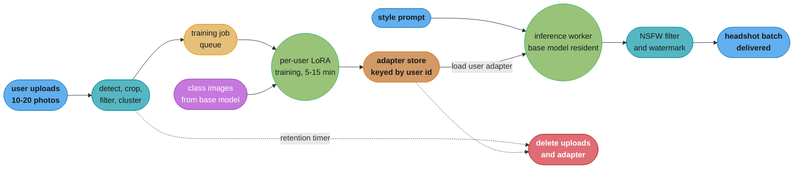
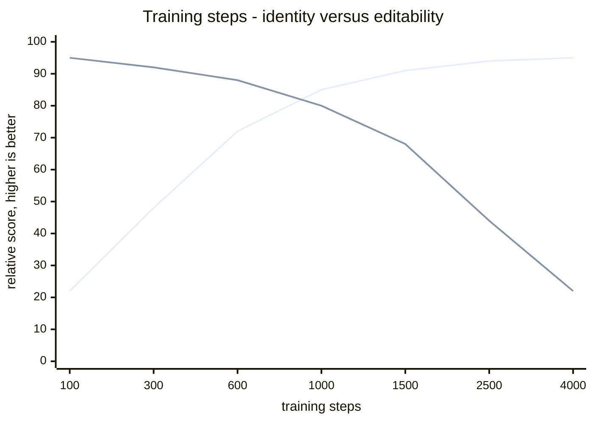
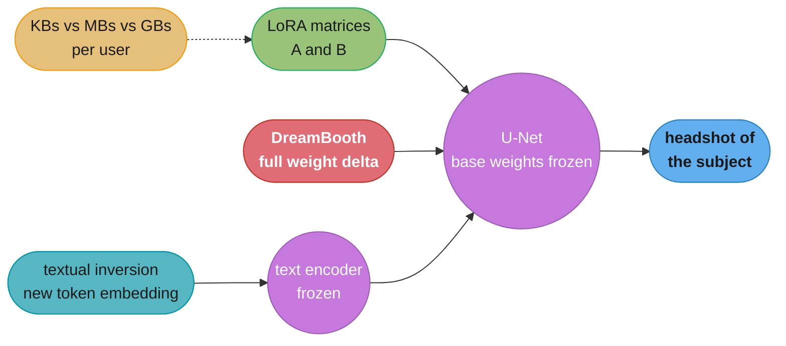

# Chapter 10: Personalized Headshot Generation

> Ch 10 of 11 · Generative AI System Design Interview (Aminian & Sheng, ByteByteGo, 2024) · builds on Ch 9 — Text-to-Image Generation, leads to Ch 11 — Text-to-Video Generation

## Chapter Map

Chapter 9 built a system that turns any sentence into an image, and its requirements section
was explicit that the model has no notion of a specific individual: ask for "a professional
headshot of a woman in her thirties" and you get a plausible stranger. This chapter takes the
constraint that Chapter 7 deliberately ruled out of scope — reproducing one *particular*
person — and makes it the product. A user uploads ten to twenty selfies; the system returns
professional headshots of **that user**, in a studio setting they never visited, wearing
clothes they do not own. Everything from Ch 9 is reused unchanged; what this chapter adds is a
**per-user personalization step** that teaches a general-purpose text-to-image model a new
concept — this specific face — from a handful of examples, and a serving architecture that can
run that step for millions of users without a GPU-hour bill that exceeds the subscription
price.

**TL;DR:**
- The task is **subject-driven personalization**: bind a new visual concept (one person's
  identity) into a pretrained text-to-image model, then generate that concept in novel
  contexts described by a prompt. It is not fine-tuning for a *style* and not retrieval; it is
  teaching the model a proper noun.
- The chapter's reference technique is **DreamBooth**-style fine-tuning — associate the subject
  with a **rare identifier token** (`sks`, `[V]`) plus a class noun ("a `sks` person"), and add
  a **prior-preservation loss** computed on model-generated images of the generic class so
  fine-tuning does not destroy the model's concept of "person" everywhere else.
- Two cheaper alternatives sit on the same axis: **textual inversion** learns only a new token
  embedding (a few kilobytes, weakest identity fidelity) and **LoRA** learns low-rank adapter
  matrices injected into the attention layers (a few megabytes, near-DreamBooth quality). LoRA
  is what makes the per-user economics work.
- The dominant tradeoff is **identity fidelity versus prompt editability**. Train longer and the
  face gets more accurate while the model progressively loses the ability to place that face in
  new scenes — **overfitting** to the training photos' background and pose, and **language
  drift**, where the class noun itself collapses onto the subject.
- Evaluation needs three numbers that no single metric combines: **identity similarity** (cosine
  distance between face embeddings of the input and the output), **prompt fidelity** (CLIP
  score), and image quality — plus human rating, because the first two can both look fine while
  the result is subtly, uncannily not the person.
- The system is two pipelines, not one: an **upload and training pipeline** (face detection,
  cropping, quality filtering, a queued per-user GPU training job producing an adapter) and an
  **inference pipeline** that loads the user's adapter onto a shared base model. Privacy is a
  first-class design constraint throughout — the source photos are biometric data, and deletion
  must remove the adapter as well as the uploads.

## The Big Question

> A text-to-image model has seen billions of images and learned tens of thousands of concepts,
> but it has never seen *you*. How do you teach a 1-billion-parameter model a new concept from
> twelve photographs, in minutes, without the model forgetting everything else it knows — and
> then do that separately for every one of a million users?

Analogy: think of a portrait painter with thirty years of experience. They can paint anyone in
any setting — a boardroom, a garden, dramatic side lighting — but only if they know the face.
Show them a dozen photographs of a new client and after an hour of study they can paint that
client anywhere. Study for ten minutes and the likeness is generic. Study for three days and
something worse happens: they stop being able to paint *anyone else*, and every commission
starts coming back looking faintly like the client, always in the same lighting as the
reference photos. That over-study is exactly overfitting and language drift, the prior-preservation
loss is the instruction "keep painting other people during your study", and LoRA is the trick
of writing down what you learned about this one face on a small index card instead of
rebuilding the painter's entire memory.

---

## 10.1 Clarifying Requirements

- **What is the input and the output?** Input is a small set of photographs of a single person —
  the chapter's typical range is **10 to 20 images** — plus a text prompt or a set of preset
  styles ("corporate headshot, grey backdrop, soft key light"). Output is a batch of generated
  headshots of that person, typically **20 to 100 images** per job so the user has a selection
  to choose from.
- **What is the quality bar?** The primary functional requirement is **identity preservation**:
  a person who knows the user must recognize the output as them, not as someone who resembles
  them. This is a stricter bar than "photorealistic" — Ch 7's system was allowed to produce any
  convincing face, and here a convincing face that is not the right face is a total failure.
- **How many input photos can we ask for, realistically?** The requirement pulls both ways. More
  photos means better identity fidelity and better generalization across pose and lighting;
  more photos also means more upload friction and a higher drop-off rate. The chapter settles on
  10-20 as the point where identity is learnable and users will still complete the flow, and
  makes **input photo diversity** (varied angles, lighting, expressions, backgrounds) matter
  more than raw count.
- **What is the turnaround time?** This is *not* an interactive latency budget. Per-user
  fine-tuning is a training job, and the chapter's target is on the order of **10 to 30 minutes**
  end-to-end from upload to first results — clearly asynchronous, communicated to the user as
  "we'll email you when your headshots are ready." Once the adapter exists, subsequent
  generations for that user are ordinary Ch 9 inference, a few seconds each.
- **What is the cost per user?** The requirement that constrains the entire model-development
  section. A per-user training job that consumes 30 GPU-minutes at $2-3/GPU-hour costs roughly
  **$1.00-1.50** in compute alone, before the generation batch, which sets a hard floor under
  the product's price. Any technique that reduces training time or lets one GPU train several
  users concurrently changes the business model directly.
- **What are the privacy requirements?** The uploaded photographs are **biometric data** of an
  identifiable person. Requirements: explicit consent that the photos will be used to train a
  model, a stated retention period, deletion on request that removes the uploads **and the
  trained adapter** (the adapter encodes the user's likeness and is itself personal data), no
  use of one user's photos to improve any other user's model, and encryption at rest and in
  transit.
- **What are the safety and consent constraints?** The system must verify, as far as it can,
  that the person uploading is the person in the photos — otherwise it is a turnkey
  impersonation tool. Named mitigations: a liveness or selfie-verification step at upload,
  refusing to generate the subject in contexts that imply harm or falsehood, watermarking every
  output, and detecting attempts to upload photos of public figures.

**Functional summary:** given 10-20 photographs of a consenting user and a style prompt,
produce a batch of professional headshots that preserve that user's identity, within 10-30
minutes, at a per-user cost the subscription price supports, with the source photos treated as
deletable biometric data throughout.

---

## 10.2 Framing the Problem as an ML Task

### Defining the ML objective

The objective is **subject-driven text-to-image generation**: given a small reference set of a
subject `S` and a prompt `c`, sample from `p(x | c, S)` — images that satisfy the prompt *and*
depict that specific subject. Nothing about Ch 9's model can do this, because a text prompt is
the only conditioning channel it has and there is no sequence of English words that uniquely
picks out one private individual's face out of the space of all faces.

The framing insight is that the problem is **not** generating a face from scratch. The base
model already knows how to render photorealistic people in arbitrary settings; the only missing
piece is a handle — a token, an embedding, a small weight delta — that means "this face." Once
the model has that handle, the prompt does all the remaining work, exactly as in Ch 9.

### Choosing the ML approach

The chapter frames a spectrum, from per-user optimization to zero-shot conditioning:

- **Full fine-tuning of the base model per user.** Update every weight of the U-Net on the
  user's photos. Highest fidelity in principle, and completely impractical: a full model
  checkpoint per user is gigabytes of storage each, training is slow, and catastrophic
  forgetting is severe with only a dozen training images.
- **DreamBooth-style fine-tuning with prior preservation.** Fine-tune the U-Net (and optionally
  the text encoder) while binding the subject to a rare identifier token, using a
  prior-preservation loss to protect the class concept. The chapter's reference technique for
  quality.
- **Textual inversion.** Freeze the entire model and learn *only* a new word embedding for the
  subject. Extremely cheap to store — a single vector, a few kilobytes — and completely
  non-destructive to the base model, but the identity has to be expressible entirely within the
  text-embedding space, which limits achievable fidelity.
- **LoRA adapters.** Freeze the base model and learn small low-rank update matrices injected
  into the attention layers. Trains in minutes, stores as a few megabytes, and reaches quality
  close to full DreamBooth. The chapter's practical answer to the cost requirement.
- **Encoder-based zero-shot identity conditioning.** Train a *single* general-purpose encoder
  that maps a face photograph directly to a conditioning signal the base model consumes, so a
  new user requires **no per-user training at all** — just a forward pass. This inverts the cost
  model entirely: expensive once, free per user. Its cost is a large upfront training effort and
  typically somewhat lower identity fidelity and editability than per-user tuning.

### Input and output, formalized

- **Reference set `S`**: 10-20 images of the subject, each cropped to the face region and
  resized to the training resolution.
- **Instance prompt**: the caption paired with every reference image during training, of the
  form `"a photo of sks person"` — a rare identifier token plus a class noun.
- **Class prompt**: `"a photo of a person"`, used to generate the prior-preservation set.
- **Output artifact of training**: not an image, but an **adapter** — a set of LoRA matrices or
  a fine-tuned weight delta, keyed by user id.
- **Inference**: base model + user's adapter + an arbitrary prompt containing the identifier
  token, e.g. `"a professional corporate headshot of sks person, grey backdrop, soft lighting"`.

---

## 10.3 Data Preparation

Data preparation here is per-user and runs at upload time, in seconds, as part of the product
flow — a very different shape from the offline, billion-scale curation of Ch 9.

### Data engineering — the user's photos

- **Face detection and cropping.** Run a face detector on each uploaded image, reject images
  with zero or multiple faces (a group photo teaches the model the wrong subject or an average
  of two people), and crop to a consistent framing around the detected face with some margin for
  hair and shoulders. Consistent framing matters for the same reason it did in Ch 7: the model
  should spend its limited capacity learning the identity, not learning to normalize pose and
  scale.
- **Identity consistency check.** Embed every cropped face with a face-recognition model and
  cluster. If the uploaded set contains two different people — a partner, a sibling, a photo of
  someone else entirely — the largest cluster is kept and outliers are flagged or rejected.
  Without this, the model learns a blend of two identities, which produces the single most
  confusing failure the product can ship: output that looks like the user's relative.
- **Quality filtering.** Reject blurry images, low-resolution crops (below roughly 512 px on the
  face region), heavy occlusion (sunglasses, masks, hands), extreme angles, and heavy filters or
  beauty-retouching, since the model will faithfully learn whatever distortion the filter
  applied and render it into every output.
- **Diversity checking.** Actively measure whether the set spans multiple angles, lighting
  conditions, expressions and backgrounds, and prompt the user to add more if it does not.
  **Twelve near-identical selfies taken in one session are worse than six varied photographs**,
  because everything constant across the set — the same background, the same shirt, the same
  three-quarter angle — is something the model will learn as part of the identity and reproduce
  in every generation.

**Broken → fix.** A user uploads fifteen selfies all taken at their desk against the same
bookshelf. Training succeeds, identity fidelity scores well, and every single generated
"beach at sunset" headshot has a faint bookshelf-like structure behind the subject and the same
neutral desk lighting. The cause is that the bookshelf co-occurred with the identity token in
100% of training examples, so the model bound it into the concept. The fix is at the data stage,
not the model stage: enforce background and lighting diversity in the upload flow, and augment
by cropping tightly to the face so less background is present to learn.

### Data engineering — the prior-preservation set

DreamBooth's second dataset is not user data at all. Before fine-tuning, generate roughly
**100 to 200 images** of the generic class using the **unmodified base model** with the class
prompt (`"a photo of a person"`), and hold them fixed for the duration of training. These are
the images the prior-preservation loss is computed on, and the crucial detail is that they come
from the base model itself, not from a real photo corpus: the goal is to pin the model's
*current* concept of "person" in place, so the target is the model's own prior output, not some
external notion of what a person looks like.

### Feature engineering — captions and augmentation

- **The instance caption is deliberately minimal.** `"a photo of sks person"` and nothing more.
  Every word in the caption that describes something present in the photos gives the model an
  alternative place to attribute that visual feature; keeping the caption bare forces the
  identity into the identifier token, which is exactly where it needs to live for the prompt to
  be able to reference it later.
- **Choosing the identifier.** The token must be **rare** in the tokenizer's vocabulary, so it
  carries almost no prior meaning. Using a common word ("john", "man") means fighting the
  model's existing strong association for that word, and the result is a face that keeps drifting
  back toward the generic prior for it. Sequences like `sks` or a bracketed `[V]` are used
  because they tokenize into fragments with negligible learned semantics.
- **The class noun still matters.** The instance prompt is `"a sks person"`, not just `"a sks"`.
  Keeping the class noun lets the model anchor the new concept to everything it already knows
  about people — anatomy, lighting, how faces sit on bodies — so it only has to learn what is
  *different* about this person rather than what a person is.
- **Light augmentation only.** Horizontal flips are safe. Aggressive color jitter or crops are
  counterproductive here, because skin tone and facial proportion are precisely the signal being
  learned and distorting them degrades identity fidelity directly.

---

## 10.4 Model Development

### Model selection — the personalization spectrum

| Technique | What is trained | Artifact size per user | Train time | Identity fidelity | Editability |
|---|---|---|---|---|---|
| Full fine-tune | All U-Net weights | GBs | Tens of minutes | Highest | Poor without care |
| DreamBooth (+ prior preservation) | U-Net, optionally text encoder | GBs (or MBs with LoRA) | 10-30 min | High | Good |
| Textual inversion | One token embedding | **KBs** | 10-60 min | Moderate | Excellent |
| LoRA adapter | Low-rank matrices in attention | **~2-100 MB** | **5-15 min** | High | Good |
| Encoder-based zero-shot | Nothing per user | **0** | **0** | Moderate | Good |

### Model training — DreamBooth and the prior-preservation loss

The naive approach is simply to fine-tune the model on the user's fifteen photos with the
caption `"a photo of sks person"`. Two things go wrong, and the chapter treats both as the core
mechanics of the technique.

**Overfitting.** With only a dozen training images and thousands of gradient steps, the model
memorizes the training images rather than learning a reusable concept of the face. The symptom
is unmistakable: every generated image reproduces the pose, background and clothing of the
training photos regardless of what the prompt asks for. The prompt stops working.

**Language drift.** This is the subtler failure and the one prior preservation exists for.
Because the instance caption contains the class noun `person`, gradient descent updates the
model's representation of `person` too, not just of `sks`. After enough steps, *every* prompt
mentioning a person starts producing the subject's face — the model has forgotten what a generic
person looks like and collapsed the whole class onto this one individual. In a multi-tenant
product this is catastrophic: the class concept the next user's training run depends on has been
destroyed.

**The fix — prior-preservation loss.** Train on two losses simultaneously. The **instance loss**
is the ordinary diffusion denoising loss on the user's photos with the instance prompt. The
**prior-preservation loss** is the same denoising loss computed on the 100-200 base-model-generated
class images with the class prompt:

```
L = L_instance( x_user,  "a photo of sks person" )
  + lambda * L_prior(   x_class, "a photo of a person" )
```

with `lambda` typically around **1.0**. The second term continuously pulls the model back toward
its original behavior on the generic class while the first term teaches the new identity. The
model can satisfy both only by attaching the new information to the `sks` token rather than
smearing it across the class noun — which is precisely the outcome wanted. Without this term,
identity fidelity actually improves slightly and everything else falls apart.

### Model training — LoRA, and why it is the production answer

**LoRA (Low-Rank Adaptation)** freezes every base weight and learns a low-rank update instead.
For a frozen weight matrix `W` of shape `d × k`, LoRA learns two small matrices `A` (`r × k`)
and `B` (`d × r`) with rank `r` far smaller than either dimension, and computes:

```
h = W x + B A x          # W frozen, only A and B receive gradients
                         # r is typically 4 to 32 for a personalization adapter
```

Applied to the U-Net's cross-attention and self-attention projection matrices, this reduces the
trainable parameter count by orders of magnitude. Four consequences follow directly, and every
one of them maps onto a requirement from §10.1:

- **Training is minutes, not tens of minutes** — fewer parameters to update and far less
  optimizer state, which cuts the per-user GPU cost directly.
- **The artifact is megabytes, not gigabytes** — which is what makes storing one adapter per
  user for millions of users a tractable storage bill rather than an absurd one.
- **The base model is untouched**, so one copy of the base weights stays resident in GPU memory
  and serves every user; only the small adapter is swapped per request.
- **Catastrophic forgetting is structurally limited** — the low-rank constraint restricts how far
  the effective weights can move from the base model, which acts as an implicit regularizer.
  Prior-preservation loss is still used alongside it, but LoRA makes the failure less severe to
  begin with.

### Model training — hyperparameters and the fidelity/editability dial

The chapter's practical guidance, and the numbers worth having in an interview:

| Knob | Typical value | What raising it does |
|---|---|---|
| Training steps | 400-1,500 | Identity fidelity up, editability down |
| Learning rate | 1e-6 to 1e-4 (LoRA higher) | Faster convergence, faster overfitting |
| LoRA rank `r` | 4-32 | More capacity for identity, larger artifact, more overfitting risk |
| Prior-preservation `lambda` | ~1.0 | Class concept better protected, identity learned more slowly |
| Class images | 100-200 | Stronger prior protection, longer training |

The single most important observation is that **training steps is not a knob you maximize**.
Identity similarity and prompt fidelity move in opposite directions along it, exactly as FID and
CLIP score did along Ch 9's guidance scale, and the correct stopping point is a *knee*, not an
extreme. Undertrain and the output is a generic person who vaguely resembles the user;
overtrain and the output is unmistakably the user, in the training photo's shirt, against the
training photo's wall, ignoring the prompt entirely.

### Model training — inference-time controls

Two knobs exist after training that avoid a retrain:

- **Adapter scale.** A LoRA adapter's contribution can be multiplied by a scalar `alpha` at
  inference: `h = W x + alpha * B A x`. Lowering `alpha` toward 0.6-0.8 recovers prompt
  editability from a slightly overtrained adapter at some cost to identity — a cheap production
  rescue that does not require re-running the training job.
- **Guidance scale**, unchanged from Ch 9, still trades prompt adherence against diversity, and
  interacts with adapter scale: a strongly-weighted adapter plus a high guidance scale is the
  combination most likely to produce rigid, over-saturated, pose-locked output.

### Model training — the encoder-based alternative

The chapter presents encoder-based identity conditioning as the structurally different option
rather than a variant. Instead of training per user, train **once** a face encoder that maps a
photograph to a conditioning embedding, and train the base model to accept that embedding as an
additional conditioning input alongside the text. At serving time a new user costs a single
encoder forward pass — milliseconds — and no training job, no adapter, and no per-user storage
at all.

The economics invert completely: the fixed cost is a large multi-week training effort, and the
marginal cost per user drops to essentially zero. What is given up is typically some identity
fidelity relative to a well-tuned per-user adapter, and less control over how strongly the
identity is enforced. The chapter's framing is that this is a **business-model decision** as much
as a modeling one — a high-volume consumer product with thin margins wants the zero-marginal-cost
path, while a premium product selling a small number of high-quality outputs can afford
per-user tuning.

---

## 10.5 Evaluation

Three axes, and no single metric spans them.

### Identity similarity

Embed the generated image's face and each of the user's input faces with a dedicated
**face-recognition embedding model**, and take the cosine similarity:

```
IdentitySim = mean over reference photos of  cos( E_face(x_generated), E_face(x_reference_i) )
```

This is the metric the whole product depends on, and it uses a *face-recognition* embedder
rather than CLIP deliberately — CLIP embeddings encode "a person with dark hair in a suit"
whereas a face-recognition embedder is trained specifically to separate individuals, which is
the distinction that matters here. Reporting practice: measure against a held-out reference
photo the model never trained on, otherwise a memorizing, badly overfit adapter scores
perfectly.

### Prompt fidelity

**CLIP score** between the generated image and the prompt, exactly as in Ch 9 — with the
identifier token stripped from the prompt before embedding it, since `sks` means nothing to
CLIP and adds noise to the similarity. This is the metric that detects overfitting: an adapter
that ignores "on a beach at sunset" and reproduces the training background scores poorly here
while scoring beautifully on identity.

**The two metrics must be read together.** A grid of (training steps × identity similarity ×
CLIP score) is the chapter's practical evaluation artifact, and the chosen configuration sits
where the product of the two is best, not where either alone peaks.

### Image quality

FID against a reference set of professional headshots, plus targeted artifact checks — hands,
eyeglass frames, ears, and the specific failure of a face rendered with subtly wrong proportions
that reads as uncanny without any single identifiable defect.

### Human evaluation

The final arbiter, and the chapter is emphatic that it cannot be skipped here, because identity
similarity has a specific blind spot: two images can score highly similar on a face embedder and
still be judged "that's not me" by the person themself or by someone who knows them. Rater
protocol: show a rater the reference photos and a generated image and ask (1) is this the same
person, (2) does this match the requested style, (3) would you use this professionally. Include
the **subject themself** as a rater where possible, since self-recognition is a stricter and
more product-relevant test than a stranger's judgment.

### Fairness evaluation

Break every metric down by skin tone, gender presentation, and age. The chapter flags a
specific, well-documented failure: personalization pipelines built on a base model whose
training data underrepresents some groups produce systematically worse identity preservation for
those groups, and the aggregate number hides it. Both the face-detection stage and the
face-embedding metric itself can carry their own demographic performance gaps, so a
subgroup-level audit has to cover the evaluation pipeline as well as the generator.

### Online metrics

Download or purchase rate per generated batch, the number of images a user keeps out of the
batch (a direct usable-output rate), retrain-request rate, refund rate, and completion rate of
the upload flow — the last being the one that ties directly back to the §10.1 tradeoff about how
many photos to ask for.

---

## 10.6 Overall ML System Design

The system splits into two pipelines that meet at the adapter store.



Caption: the two pipelines are asynchronous and meet only at the adapter store — which is also
why deletion has to reach both the uploads and the adapter, since the adapter itself encodes
the user's likeness.

- **Upload pipeline.** Photos land in encrypted object storage, run through face detection,
  cropping, quality filtering and identity clustering, and produce a validated reference set
  plus immediate user feedback if the set is too small, too uniform, or contains multiple people.
  Failing fast here is far cheaper than failing after a 15-minute training job.
- **Training job queue.** One job per user, scheduled onto a GPU pool. Because jobs are short
  and independent, this is embarrassingly parallel; the scheduling concern is fairness and
  bounded wait time under bursty signups, not throughput. Jobs are checkpointed lightly so a
  preempted spot instance does not lose the whole run — and spot instances are exactly the right
  fit here, since a 10-minute job that occasionally restarts is far cheaper than reserved
  capacity and the user is already waiting asynchronously.
- **Adapter store.** Object storage keyed by user id, holding a small LoRA file plus its
  metadata: base-model version, training hyperparameters, creation time, and retention deadline.
  The **base-model version is load-bearing** — an adapter is trained against a specific set of
  base weights and produces degraded or broken output if loaded onto a different base model, so
  upgrading the base model invalidates every existing adapter.
- **Inference path.** Workers keep the shared base model resident in GPU memory and load only the
  user's adapter per request — the reason LoRA's small artifact matters operationally as well as
  financially. Requests for the same user batch naturally, since they share an adapter, so
  generating a user's whole 50-image batch on one worker amortizes the adapter load across the
  entire batch instead of paying it per image.
- **Safety layer.** Output NSFW filtering, watermarking, and generation logging, all as in Ch 9,
  plus the personalization-specific check that the generated identity actually matches the
  enrolled user — a mismatch is either a serving bug (wrong adapter loaded) or an abuse signal.
- **Deletion path.** A first-class component, not an afterthought: a retention timer and an
  on-request path that removes the uploaded photos, the cropped derivatives, the cached latents,
  the trained adapter, and the generated outputs, with an audit record proving it happened.

### Scale estimation

- **Training.** At **10 GPU-minutes** per user on a LoRA configuration, **10,000 new users/day**
  is `10,000 × 10 min = 100,000` GPU-minutes ≈ **1,667 GPU-hours/day** ≈ **70 GPUs** running
  continuously. At $2-3/GPU-hour that is roughly **$3,300-5,000/day**, or a training cost of
  about **$0.35-0.50 per user** — which is the number the subscription price has to clear before
  any generation cost is counted.
- **Generation.** A 50-image batch at ~4 GPU-seconds per image is 200 GPU-seconds ≈ **3.3
  GPU-minutes**, roughly **$0.11-0.17** per user per batch. Generation is materially cheaper than
  training, which is why the product encourages users to generate more batches from an existing
  adapter rather than retraining.
- **Storage.** A LoRA adapter at ~20 MB per user across 1 million users is **20 TB** — trivial
  as object storage, but it grows monotonically with signups and is the reason retention
  policies exist for adapters and not only for photos. The uploaded photos themselves, at ~15
  images × 3 MB, are ~45 MB per user, over twice the adapter — and are the part with a legal
  obligation to disappear.
- **The zero-shot comparison.** An encoder-based system replaces that entire 70-GPU training
  fleet with a single forward pass per user, i.e. **effectively zero marginal training cost** —
  which is why the chapter frames the choice between per-user tuning and encoder conditioning as
  the design's single largest economic lever.

---

## 10.7 Deployment and Monitoring

- **Training-job duration and cost.** The primary operational dashboard: p50 and p99 job
  duration, GPU-minutes per user, queue wait time, and job failure rate. A creeping p99 usually
  means either queue contention or a change in input photo counts, and both have different fixes.
- **Job failure and retry.** Per-user training jobs fail for mundane reasons — a corrupt upload,
  a face detector finding nothing, a preempted spot instance — and every failure is a user
  waiting for an email that never arrives. Failures need automatic retry with a bounded budget
  and, past that, an explicit user-facing message telling them what to fix.
- **Adapter storage growth.** Monitor total adapter bytes and count against retention policy
  compliance. An adapter that outlives its retention window is both a cost item and a privacy
  violation, and the two are noticed at very different speeds.
- **Per-user identity and prompt-fidelity sampling.** Score a sample of production outputs on
  identity similarity and CLIP score continuously. A drop in identity similarity across many
  users at once points to a pipeline change (a different face crop, a base-model update, a
  hyperparameter change); a drop for one user points to that user's input photos.
- **Base-model upgrades invalidate adapters.** This is the operational trap unique to this
  chapter. Rolling out a new base model silently degrades every existing user's output because
  their adapter was trained against the old weights. The options are to version the base model
  and keep old versions serving old adapters (storage and complexity cost), or to retrain every
  adapter in a bulk migration (large one-off GPU cost), and the decision must be made *before*
  the base-model upgrade ships, not after complaints arrive.
- **Fairness monitoring.** Per-subgroup identity similarity, usable-output rate, and refund rate.
  This is the metric most likely to reveal a real problem that aggregate numbers hide, and it
  needs a demographically labeled evaluation set maintained deliberately, not sampled
  opportunistically from production.
- **Identity-leak and misuse risk.** Concrete threats to monitor: a serving bug loading the wrong
  user's adapter (catastrophic — one user generating images of another), attempts to upload
  photos of a public figure or a non-consenting third party, and generation requests that place
  the enrolled subject in defamatory or explicit contexts. Uploaded-face matching against a
  public-figure index and output-side identity verification are the named controls.
- **Right to be forgotten.** Deletion must be verifiable end to end. The awkward truth the
  chapter surfaces is that a **trained adapter is derived personal data** — it encodes the user's
  likeness closely enough to regenerate it — so deleting only the photos is not compliance.
  Adapter deletion is straightforward because it is a separate small file; this is another
  structural argument for adapters over full fine-tuning, where the user's likeness would be
  smeared across a shared model's weights and genuinely hard to remove.
- **Watermarking and provenance**, exactly as Ch 7 and Ch 9 require, with the added weight that
  these images depict a real, identifiable person, which raises the stakes of an unattributable
  synthetic image considerably.

---

## Beyond the book — personalization after 2024

> This chapter summarizes the 2024 edition of *Generative AI System Design Interview*, whose
> reference techniques are DreamBooth-style fine-tuning, textual inversion, and LoRA adapters,
> with encoder-based zero-shot identity conditioning presented as the alternative direction.
> The specific post-2024 systems and regulations below are not in the book and are not the
> authors'.

The direction the chapter identifies as the alternative — encoder-based zero-shot identity
conditioning — is the one that won for consumer-scale products. Adapter-style identity injection
modules and dedicated face-identity encoders (the IP-Adapter and InstantID lineage) made it
possible to produce a recognizable likeness from a **single** reference photo with no per-user
training at all, collapsing both the 10-30 minute turnaround and the per-user GPU cost to a
single forward pass. That does not make §10.4's per-user tuning obsolete: it remains the higher
fidelity option, and the fidelity-versus-editability tradeoff, the prior-preservation reasoning,
and the adapter-versioning operational trap all transfer directly to any system that still
fine-tunes.

On the governance side, the chapter's privacy requirements have hardened into specific law in
several jurisdictions. Biometric-specific statutes (Illinois' BIPA being the most litigated
example) and the EU AI Act's provisions on biometric processing and synthetic-media disclosure
give the "consent, retention, deletion, and watermarking" requirements of §10.1 and §10.7
concrete legal shape — including, in some readings, the derived-data argument that a trained
adapter is itself covered. The book's engineering instincts hold up; the compliance surface
around them is now much more explicit than it was in 2024.

---

## Visual Intuition

### The identity-fidelity / editability tradeoff over training steps



Caption: illustrative shape, not measured values — identity climbs and saturates while prompt
editability falls off a cliff past the knee, which is why the correct number of training steps
is a knee-finding exercise and never a maximization.

### Where the user's identity actually lives



Caption: the three techniques differ in *where* the new identity is stored — in a word
embedding, in low-rank attention deltas, or across all the U-Net weights — and that placement is
what determines artifact size, training cost, and how much of the base model's knowledge is at
risk.

### What prior preservation prevents

```
  WITHOUT prior-preservation loss, after ~1200 steps:

    prompt: "a photo of sks person"    ->  the user      correct
    prompt: "a photo of a person"      ->  the user      LANGUAGE DRIFT
    prompt: "a doctor in a hospital"   ->  the user      the class noun
    prompt: "a crowd of people"        ->  all the user  collapsed entirely

  WITH prior-preservation loss (lambda = 1.0, 200 class images):

    prompt: "a photo of sks person"    ->  the user      correct
    prompt: "a photo of a person"      ->  a stranger    class intact
    prompt: "a doctor in a hospital"   ->  a stranger    class intact
    prompt: "a crowd of people"        ->  strangers     class intact

  the second loss term denoises the base model's OWN generated class
  images against the class prompt, pinning "person" where it was while
  the identity attaches to the rare token "sks" instead
```

Caption: language drift is not a quality problem, it is a correctness problem for a
multi-tenant system — the class concept every future user's training run depends on is the thing
being destroyed.

### LoRA's low-rank update, dimensionally

```
  full fine-tune of one attention projection:

     W  [ d x k ]                 all d*k parameters trained
     e.g. 1024 x 1024  =  1,048,576 trainable parameters

  LoRA with rank r = 8:

     W  [ d x k ]   FROZEN
     B  [ d x r ]   trained       1024 x 8  =  8,192
     A  [ r x k ]   trained          8 x 1024 =  8,192
                                  ----------------------
                                  16,384 trainable  (1.6% of full)

     forward:  h = W x  +  B (A x)
                    ^        ^
                    |        low-rank correction, the only thing
                    |        that differs between users
                    base, shared by every user in GPU memory

  the r-dimensional bottleneck is also an implicit regularizer: the
  update simply CANNOT move the weights in more than r directions
```

Caption: the rank bottleneck delivers three things at once — a tiny per-user artifact, a short
training run, and a structural limit on how far the model can drift from the base — which is
why it is the technique that makes the per-user economics of §10.6 work at all.

---

## Key Concepts Glossary

- **Subject-driven generation** — generating images of one specific subject in novel contexts
  described by a prompt.
- **Personalization** — adapting a pretrained generative model to a new concept (a person, an
  object, a style) from a small reference set.
- **Identity preservation** — the requirement that a generated image be recognizable as the
  specific enrolled individual, not merely as a plausible similar person.
- **DreamBooth** — fine-tuning a text-to-image model to bind a subject to a rare identifier
  token, using a prior-preservation loss to protect the class concept.
- **Rare identifier token** — a token with negligible prior meaning (e.g. `sks`, `[V]`) used as
  the handle for the new concept.
- **Class noun** — the generic category word paired with the identifier ("person"), anchoring
  the new concept to what the model already knows.
- **Instance prompt** — the caption used with the subject's photos during training, e.g.
  "a photo of sks person".
- **Class prompt** — the generic caption used to generate and train on the prior-preservation
  set, e.g. "a photo of a person".
- **Prior-preservation loss** — a second loss term computed on base-model-generated class images,
  preventing the class concept from collapsing onto the subject.
- **Language drift** — the failure where fine-tuning causes the class noun itself to start
  producing the subject, destroying the generic concept.
- **Overfitting (in personalization)** — the model reproducing the training photos' pose,
  background and clothing regardless of the prompt.
- **Textual inversion** — learning only a new token embedding for the subject, leaving all model
  weights frozen.
- **LoRA (Low-Rank Adaptation)** — freezing base weights and learning small low-rank update
  matrices injected into attention layers.
- **LoRA rank (r)** — the bottleneck dimension of the low-rank update; controls adapter capacity
  and size.
- **Adapter** — the small trained artifact holding a user's personalization, stored separately
  from the base model.
- **Adapter scale (alpha)** — an inference-time multiplier on the adapter's contribution,
  trading identity strength against prompt editability without retraining.
- **Encoder-based identity conditioning** — a single pretrained encoder mapping a face photo to
  a conditioning signal, removing per-user training entirely.
- **Catastrophic forgetting** — a fine-tuned model losing capabilities it had before fine-tuning.
- **Identity similarity** — cosine similarity between face-recognition embeddings of the
  generated and reference faces; the chapter's identity metric.
- **Face-recognition embedding** — a representation trained specifically to separate individuals,
  used for identity similarity rather than CLIP embeddings.
- **Prompt fidelity (in personalization)** — CLIP score between the generated image and the
  prompt with the identifier token stripped; detects overfitting.
- **Input photo diversity** — variation in angle, lighting, expression and background across the
  reference set; matters more than raw photo count.
- **Identity clustering** — embedding and clustering uploaded faces to detect and reject photos
  of a different person.
- **Biometric data** — personal data derived from physical characteristics; the legal category
  the uploaded photos and the trained adapter fall into.
- **Right to be forgotten** — the obligation to delete a user's data on request, which here must
  include the derived adapter, not only the source photos.
- **Base-model versioning** — tracking which base weights an adapter was trained against, since
  an adapter is not portable across base-model versions.

---

## Tradeoffs & Decision Tables

### Personalization technique

| Technique | Per-user cost | Artifact | Identity fidelity | Editability | Best for |
|---|---|---|---|---|---|
| Full fine-tune | Highest | GBs | Highest | Poor | Essentially never in production |
| DreamBooth (full weights) | High | GBs | High | Good | Small-scale, premium quality |
| DreamBooth + LoRA | **Moderate** | **MBs** | **High** | **Good** | **The chapter's practical default** |
| Textual inversion | Low | KBs | Moderate | Excellent | Style or object concepts, not faces |
| Encoder-based zero-shot | **~0** | **None** | Moderate | Good | High-volume consumer scale |

### What raising each training knob costs

| Knob | Raising it helps | Raising it hurts |
|---|---|---|
| Training steps | Identity similarity | Prompt fidelity, sharply past the knee |
| LoRA rank `r` | Identity capacity | Artifact size, overfitting risk |
| Prior-preservation `lambda` | Class concept integrity | Speed of identity learning |
| Number of input photos | Identity and generalization | Upload completion rate, training time |
| Adapter scale `alpha` at inference | Identity strength | Prompt editability |

### Where a failure actually comes from

| Symptom | Likely root cause | Fix |
|---|---|---|
| Output looks like a generic person | Undertrained, or too few/low-quality photos | More steps, better reference set |
| Every output has the training background | Overfitting plus low background diversity | Fewer steps, tighter crops, diverse uploads |
| Unrelated "person" prompts return the user | Language drift | Prior-preservation loss with class images |
| Output resembles a relative | Multiple identities in the upload set | Identity clustering at upload |
| Output has the training photo's beauty filter | Filtered images not rejected at intake | Quality filtering at upload |
| Quality dropped for all users at once | Base-model upgrade invalidated adapters | Version base models, or bulk retrain |

### Per-user tuning versus encoder conditioning, as economics

| | Per-user tuning | Encoder-based |
|---|---|---|
| Fixed cost | Low (reuse a base model) | High (a large one-off training effort) |
| Marginal cost per user | ~$0.35-0.50 GPU + storage | ~0 |
| Turnaround for a new user | 10-30 minutes | Seconds |
| Storage per user | MBs, monotonically growing | None |
| Identity fidelity | Higher | Somewhat lower |
| Deletion story | Delete one small file | Nothing derived to delete |

---

## Common Pitfalls / War Stories

- **Training without a prior-preservation loss.** Identity fidelity looks great in isolated
  testing, and then a QA engineer notices that the prompt "a doctor examining a patient" returns
  the test user's face. The class concept has been destroyed, and in a multi-tenant system that
  is a correctness bug, not a quality issue.
- **Maximizing training steps because identity similarity keeps improving.** It does keep
  improving — that is exactly the trap. Prompt fidelity collapses on the same axis, and the
  product's whole value proposition is placing the user in a scene they were never photographed
  in. Optimize the pair, stop at the knee.
- **Accepting fifteen selfies from one sitting.** Everything constant across the reference set
  gets bound into the identity: the same shirt, the same lighting, the same bookshelf. Diversity
  in the upload set is worth more than count, and the upload flow should say so explicitly
  rather than discovering it after a 15-minute training job.
- **Using a common word as the identifier token.** Training against a token that already has a
  strong learned meaning means fighting that prior for the whole run, and the identity keeps
  bleeding back toward the generic concept. Rare tokens exist for this reason.
- **Upgrading the base model without a plan for existing adapters.** Every user's adapter was
  trained against specific base weights. Ship a new base model and quality degrades silently
  and universally, discovered through a wave of complaints rather than through monitoring.
  Version the base models or budget a bulk retrain, and decide before the rollout.
- **Deleting the photos but keeping the adapter.** The adapter encodes the user's likeness well
  enough to regenerate it, so it is derived personal data. A deletion flow that removes only the
  uploads satisfies neither the user's intent nor a regulator's reading of it.
- **Measuring identity similarity against a training photo.** An overfit adapter that has
  memorized its inputs scores perfectly on this and is broken in every way that matters. Always
  evaluate against a held-out reference the model never saw.
- **Skipping identity clustering at upload.** One photo of a sibling in the reference set
  produces output that is uncannily almost-the-user, which is worse than an obvious failure
  because it is hard for the user to articulate and hard for a metric to catch.
- **Serving the wrong user's adapter.** A cache-key bug that mixes up adapters means one user
  generating photorealistic images of another. This deserves an explicit output-side identity
  verification check, not just careful code, because the consequence is severe enough to warrant
  defense in depth.

---

## Real-World Systems Referenced

**Personalization techniques:** DreamBooth (Google Research — rare-token binding plus
prior-preservation loss), Textual Inversion (learning a new token embedding), LoRA (Low-Rank
Adaptation, originally introduced for adapting large language models and carried over to
diffusion U-Nets). **Base models:** Stable Diffusion and the latent-diffusion family from Ch 8
and Ch 9, serving as the pretrained model being personalized. **Supporting models:** face
detection and face-recognition embedding models for intake filtering, identity clustering and
the identity-similarity metric; CLIP for prompt fidelity; NSFW classifiers on the output path.
**Product category named:** AI headshot and avatar products, where a user uploads selfies and
receives styled professional portraits. **Infrastructure patterns:** per-user training job
queues on preemptible/spot GPU capacity, object-storage adapter stores keyed by user id, and
shared-base-model inference workers with per-request adapter loading.

---

## Summary

Personalized headshot generation takes the text-to-image system of Chapter 9 and asks it to
render a concept it has never seen — one specific person — from ten to twenty photographs. The
framing insight is that this is not a generation problem but a **binding** problem: the base
model already knows how to render people in any setting, and all that is missing is a handle
that means "this face." DreamBooth supplies that handle as a **rare identifier token** paired
with a class noun, and the technique's defining component is the **prior-preservation loss** —
a second denoising loss on base-model-generated images of the generic class, which stops
gradient descent from smearing the new identity across the class noun and collapsing every
"person" prompt onto one individual. Textual inversion and LoRA sit on the same spectrum at
different price points, and **LoRA is what makes the product viable**: minutes of training, a
few megabytes per user, a shared frozen base model resident in GPU memory, and a low-rank
bottleneck that structurally limits drift.

The chapter's central tradeoff is **identity fidelity against prompt editability**, dialed by
training steps and rescued at inference by adapter scale. Both ends are failures — an
undertrained adapter produces a stranger who vaguely resembles the user, an overtrained one
produces the user in the training photo's shirt against the training photo's wall, ignoring the
prompt entirely — so evaluation has to carry both numbers, identity similarity from a
face-recognition embedder and CLIP score from the prompt, together with image quality, human
rating including the subject themself, and a per-subgroup fairness breakdown that aggregate
numbers reliably hide.

Operationally the system is two asynchronous pipelines meeting at an adapter store: an intake
path doing face detection, cropping, quality filtering and identity clustering; a queued
per-user training job on cheap preemptible GPUs; and an inference path that keeps one base model
resident and swaps small adapters per user. Ten thousand new users a day at ten GPU-minutes each
is around seventy continuously-busy GPUs and roughly forty cents of training compute per user —
the number the subscription price has to clear, and the reason the chapter presents
**encoder-based zero-shot identity conditioning**, with essentially zero marginal cost per user,
as the genuine alternative rather than a footnote. Wrapped around all of it is a privacy and
consent layer with a sharper edge than anything earlier in the book: the inputs are biometric
data, the trained adapter is derived personal data that a deletion request must also remove, a
base-model upgrade silently invalidates every adapter in the store, and loading the wrong user's
adapter is a failure severe enough to justify output-side identity verification. Chapter 11
keeps this stack and adds the one dimension image generation has so far avoided entirely: time.

---

## Interview Questions

**Q: What is the prior-preservation loss, and what specifically breaks without it?**
**Short:** It denoises base-model-generated class images so fine-tuning does not collapse the class concept onto the subject.
Because the instance caption contains a class noun ("a photo of sks person"), gradient descent updates the model's representation of "person" alongside the new identifier, and after enough steps every prompt mentioning a person returns the subject's face — the failure called language drift. The prior-preservation loss adds a second denoising term computed on 100-200 images the unmodified base model generated from the class prompt, weighted by lambda around 1.0, which continuously pulls the model back toward its original behavior on the generic class. The model can satisfy both terms only by attaching the new information to the rare token, which is exactly the desired outcome.

**Q: Why use a rare token like "sks" instead of the person's actual name?**
**Short:** A common word carries a strong prior the fine-tune must fight, so identity keeps bleeding back to it.
The identifier's job is to be a blank handle that the new concept can be attached to, and a token the model already has a strong learned meaning for — a common first name, "man", "woman" — means every gradient step is competing against that existing association rather than building on empty space. The practical symptom is that the generated identity keeps drifting back toward the model's generic prior for that word, and the drift worsens with prompt complexity. Rare token sequences tokenize into fragments with negligible learned semantics, which is why they are chosen.

**Q: Describe the identity-fidelity versus prompt-editability tradeoff and how you would pick a training length.**
**Short:** More training steps raise identity similarity while destroying the model's ability to place that identity in new scenes.
Identity similarity rises and saturates with training steps, while prompt fidelity measured by CLIP score falls off sharply past a knee, because the model progressively memorizes the training photos' pose, background and clothing rather than learning a reusable concept. The right procedure is to sweep training steps and evaluate both metrics on held-out references and varied prompts, then pick the knee where their product is best — typically several hundred to low thousands of steps depending on the technique. Maximizing either metric alone ships a broken product: a generic stranger, or the user permanently stuck in their training photo's shirt.

**Q: Why is LoRA the practical choice over full DreamBooth fine-tuning at production scale?**
**Short:** LoRA trains in minutes, stores megabytes per user, and leaves one shared base model resident in GPU memory.
LoRA freezes every base weight and learns only two small low-rank matrices per attention projection, which cuts trainable parameters by orders of magnitude — so a per-user job runs in five to fifteen minutes instead of tens of minutes, and the resulting artifact is a few megabytes rather than gigabytes. That artifact size is what makes storing one adapter per user across millions of users tractable and what lets inference workers keep a single base model in GPU memory and swap only the tiny adapter per request. The rank bottleneck also acts as an implicit regularizer, structurally limiting how far the fine-tune can drift from the base model.

**Q: What is language drift in this context, and why is it worse for a multi-tenant product than for a single user?**
**Short:** Fine-tuning collapses the class noun itself onto the subject, destroying the concept every future user's training depends on.
Language drift is the model losing its generic representation of the class word, so that "a photo of a person" or "a doctor in a hospital" starts returning the fine-tuned subject rather than anyone. For a hobbyist tuning a model for themselves this is an annoyance; for a product it is a correctness failure, because the class concept is shared infrastructure — the prior-preservation set for the next user is generated from it, and any prompt mentioning people is now broken. Prior-preservation loss is the direct fix, and LoRA's low-rank constraint reduces but does not eliminate the risk.

**Q: How would you measure whether a generated headshot actually preserves the user's identity?**
**Short:** Cosine similarity between face-recognition embeddings of the output and a held-out reference photo.
Embed the generated image's detected face and the user's reference faces with a model trained specifically for face recognition — not CLIP, whose embeddings encode "a person with dark hair in a suit" rather than which individual it is — and average the cosine similarity. The critical detail is measuring against a held-out reference the adapter never trained on, because a badly overfit adapter that memorized its inputs scores perfectly against them while being useless. Identity similarity must then be read alongside CLIP score for prompt fidelity, since the two move in opposite directions with training length.

**Q: A user's generated headshots all have the same background as their uploaded selfies. What went wrong?**
**Short:** Overfitting combined with low background diversity in the upload set bound the background into the identity.
When every reference photo shares a background, that background co-occurs with the identifier token in one hundred percent of training examples, so the model has no way to separate "this face" from "this wall behind it" and binds both into the learned concept. Overtraining compounds it by pushing the model further toward memorizing the training images outright. The fix is primarily at the data stage — enforce angle, lighting and background diversity in the upload flow and crop tightly to the face — with fewer training steps or a lower adapter scale as the immediate mitigation.

**Q: What is encoder-based zero-shot identity conditioning, and when would you choose it over per-user tuning?**
**Short:** A single pretrained encoder maps a face photo to a conditioning signal, removing per-user training entirely.
Instead of fine-tuning a model per user, you train one encoder that turns a face photograph into an embedding the base model accepts as an extra conditioning input alongside the text, so onboarding a new user costs a single forward pass rather than a GPU training job. This inverts the economics completely: a large fixed training investment buys essentially zero marginal cost per user, zero adapter storage, and seconds instead of minutes of turnaround, at the price of typically somewhat lower identity fidelity and less control over identity strength. A thin-margin high-volume consumer product wants this; a premium product selling a small number of high-quality outputs can afford per-user tuning.

**Q: Why does deleting a user's uploaded photos not satisfy a deletion request?**
**Short:** The trained adapter is derived personal data that still encodes the likeness well enough to regenerate it.
A LoRA adapter or fine-tuned weight delta trained on someone's face is a compressed representation of their likeness — loading it and prompting produces images of them — so it falls squarely within what a deletion obligation covers, alongside the source photos, the cropped derivatives, the cached latents, and the generated outputs. A deletion flow that removes only the uploads leaves the capability to regenerate the person intact, which satisfies neither the user's intent nor a regulator's reading. This is also a structural argument for adapters over full fine-tuning, where the likeness would be smeared across shared model weights and genuinely hard to remove.

**Q: What happens to existing user adapters when you upgrade the base model?**
**Short:** They break, because an adapter is a delta against specific base weights and is not portable across versions.
An adapter encodes a correction relative to the exact weights it was trained against, so loading it onto different base weights produces degraded, distorted, or simply wrong output — and it happens silently and universally, discovered through a wave of complaints rather than through any accuracy metric. The two viable answers are to version the base model and keep old versions serving old adapters, at a storage and operational-complexity cost, or to bulk-retrain every adapter as part of the migration, at a large one-off GPU cost. Whichever is chosen, the decision has to be made before the base-model rollout ships, and the adapter store must record its base-model version from day one.

**Q: How many reference photos should the system ask for, and why is diversity more important than count?**
**Short:** Around 10-20 photos, with varied angle, lighting and background mattering more than raw quantity.
More photos improve identity fidelity and generalization, but each additional required upload increases friction and drop-off in the onboarding flow, so 10-20 is the point where identity is learnable and users still complete the process. What matters more than the count is diversity: anything constant across the entire set — one shirt, one lighting setup, one background, one head angle — co-occurs with the identity in every training example and gets bound into the learned concept, so twelve near-identical selfies from one sitting perform worse than six genuinely varied photographs. The upload flow should measure and prompt for this rather than discovering it after a fifteen-minute training job.

**Q: Why run identity clustering on the uploaded photos?**
**Short:** A stray photo of someone else makes the model learn a blend of two identities that looks like the user's relative.
Users routinely upload a set containing a partner, a sibling, or a group photo, and if those slip through the model learns an average of two faces rather than one. The resulting output is the worst kind of failure — recognizably almost the user, uncanny in a way the user struggles to articulate and that identity similarity against a mixed reference set will not cleanly flag. Embedding every cropped face with a face-recognition model, clustering, keeping the dominant cluster and rejecting or flagging the outliers catches it in seconds at intake, long before any GPU time is spent.

**Q: How would you estimate the GPU fleet and per-user cost for this system?**
**Short:** Ten thousand users a day at ten GPU-minutes each is about 70 GPUs and roughly forty cents of training compute per user.
Multiply new users per day by per-user training time: ten thousand users at ten GPU-minutes is one hundred thousand GPU-minutes, about 1,667 GPU-hours a day, which needs roughly seventy GPUs running continuously. At two to three dollars per GPU-hour that is three to five thousand dollars a day, or about thirty-five to fifty cents of training compute per user, before the generation batch adds another ten to seventeen cents for fifty images. That per-user floor is what the subscription price must clear, and it is precisely why the encoder-based zero-shot alternative, with essentially no marginal cost, is such a large economic lever.

**Q: What is adapter scale, and how does it rescue a slightly overtrained adapter?**
**Short:** It multiplies the adapter's contribution at inference, trading identity strength for prompt editability without retraining.
A LoRA adapter's output is added to the frozen base computation as `alpha * B A x`, and alpha is a free scalar chosen at inference rather than baked in at training. Lowering it toward 0.6 to 0.8 weakens the adapter's pull, restoring the base model's ability to follow the prompt at some cost to identity accuracy — which recovers a usable result from an adapter that trained slightly too long without paying for another training job. It is a production rescue and a per-request quality dial, not a substitute for choosing the right number of training steps.

**Q: What are the specific safety risks of a personalized generation product that Ch 7's face generator did not have?**
**Short:** It generates a real, identifiable person, so impersonation, non-consensual likeness use, and adapter mix-ups all become possible.
Chapter 7's system deliberately produced novel, non-existent people, which bounded its misuse; this system produces a specific real individual on demand, so someone uploading photos of a public figure or a non-consenting third party turns it into a turnkey impersonation tool. The named controls are consent and liveness verification at upload, matching uploaded faces against a public-figure index, refusing prompts that place the subject in defamatory or explicit contexts, watermarking every output, and output-side identity verification to catch a serving bug that loads the wrong user's adapter. That last failure — one user generating photorealistic images of another — is severe enough to justify defense in depth rather than relying on careful code alone.

**Q: How does textual inversion differ from LoRA, and why is it usually the weaker choice for faces?**
**Short:** Textual inversion learns only a token embedding, so identity must fit inside the text-embedding space.
Textual inversion freezes the entire model and optimizes a single new word embedding to represent the subject, which makes it extremely cheap to store — a few kilobytes — and completely non-destructive to the base model, since no weight ever changes. Its limitation is expressive: the whole identity has to be representable as a point in the text encoder's embedding space, and a human face carries far more detail than that space was built to convey, so fidelity plateaus below what LoRA reaches. It remains a reasonable choice for styles or simple objects, where the concept genuinely is describable, and a poor one for identity preservation.

**Q: Why must fairness be evaluated per subgroup here rather than as an aggregate score?**
**Short:** Aggregate identity similarity hides systematically worse identity preservation for underrepresented groups.
A pipeline built on a base model whose training data underrepresents some skin tones, ages or gender presentations produces measurably worse identity preservation for those users, and an averaged metric across the whole user base conceals it because well-served groups compensate. The audit has to break identity similarity, usable-output rate and refund rate down by subgroup against a deliberately maintained, demographically labeled evaluation set. It also has to cover the evaluation pipeline itself, since the face detector at intake and the face-embedding model used to compute the metric each carry their own demographic performance gaps that can mask or manufacture a finding.

---

## Cross-links in this repo

- [llm/fine_tuning/fine_tuning.md](../../../llm/fine_tuning/fine_tuning.md) — fine-tuning strategy, catastrophic forgetting, and when adaptation beats prompting.
- [llm/fine_tuning/lora.md](../../../llm/fine_tuning/lora.md) — LoRA's low-rank decomposition, rank selection, and adapter serving in depth.
- [llm/fine_tuning/peft_methods.md](../../../llm/fine_tuning/peft_methods.md) — the wider parameter-efficient tuning family this chapter's techniques belong to.
- [ml/generative_models/generative_models.md](../../../ml/generative_models/generative_models.md) — the diffusion base model being personalized.
- [ml/computer_vision/computer_vision.md](../../../ml/computer_vision/computer_vision.md) — face detection, cropping and the face-embedding models used at intake and in evaluation.
- [ml/model_evaluation_and_selection/model_evaluation_and_selection.md](../../../ml/model_evaluation_and_selection/model_evaluation_and_selection.md) — multi-metric evaluation and knee-finding on a tradeoff curve.
- [ml/model_serving_and_inference/model_serving_and_inference.md](../../../ml/model_serving_and_inference/model_serving_and_inference.md) — adapter-swapping inference workers and batching a single user's generation job.
- [ml/fairness_and_responsible_ai/fairness_and_responsible_ai.md](../../../ml/fairness_and_responsible_ai/fairness_and_responsible_ai.md) — the per-subgroup auditing methodology in §10.5.
- [ml/privacy_preserving_ml/privacy_preserving_ml.md](../../../ml/privacy_preserving_ml/privacy_preserving_ml.md) — biometric data handling, derived-data deletion, and privacy-preserving training.
- [ml/monitoring_and_drift_detection/monitoring_and_drift_detection.md](../../../ml/monitoring_and_drift_detection/monitoring_and_drift_detection.md) — detecting the cross-user quality regressions described in §10.7.
- [llm/vision_language_models/vision_language_models.md](../../../llm/vision_language_models/vision_language_models.md) — CLIP and the embedding models behind the prompt-fidelity metric.
- [llm/guardrails_and_content_safety/guardrails_and_content_safety.md](../../../llm/guardrails_and_content_safety/guardrails_and_content_safety.md) — the consent, impersonation and output-filtering controls in §10.7.
- [llm/ai_regulations_and_compliance/ai_regulations_and_compliance.md](../../../llm/ai_regulations_and_compliance/ai_regulations_and_compliance.md) — biometric-data regulation and the right-to-be-forgotten obligations.
- [backend/serving_ai_workloads/serving_ai_workloads.md](../../../backend/serving_ai_workloads/serving_ai_workloads.md) — asynchronous job APIs for the upload-to-email flow.
- [hld/message_queues/message_queues.md](../../../hld/message_queues/message_queues.md) — the per-user training job queue's scheduling and fairness semantics.
- [devops/ml_platform_and_gpu_infrastructure/ml_platform_and_gpu_infrastructure.md](../../../devops/ml_platform_and_gpu_infrastructure/ml_platform_and_gpu_infrastructure.md) — running short per-user training jobs on preemptible GPU capacity.
- [devops/cloud_cost_optimization_finops/gpu_and_ai_finops.md](../../../devops/cloud_cost_optimization_finops/gpu_and_ai_finops.md) — the per-user cost model in §10.6.
- [llm/case_studies/design_llm_fine_tuning_platform.md](../../../llm/case_studies/design_llm_fine_tuning_platform.md) — a production fine-tuning platform case study with the same queue-and-adapter shape.
- Sibling chapters: [Ch 7 — Realistic Face Generation](../07_realistic_face_generation/07_realistic_face_generation.md) (which explicitly scoped this chapter's problem out) · [Ch 9 — Text-to-Image Generation](../09_text_to_image_generation/09_text_to_image_generation.md) (the base model being personalized) · [Ch 11 — Text-to-Video Generation](../11_text_to_video_generation/11_text_to_video_generation.md).

## Further Reading

- Ruiz et al., "DreamBooth: Fine Tuning Text-to-Image Diffusion Models for Subject-Driven
  Generation," CVPR 2023 — the rare-identifier binding and prior-preservation loss.
- Gal et al., "An Image is Worth One Word: Personalizing Text-to-Image Generation using Textual
  Inversion," ICLR 2023 — learning a new token embedding with the model frozen.
- Hu et al., "LoRA: Low-Rank Adaptation of Large Language Models," ICLR 2022 — the low-rank
  adaptation method carried over to diffusion U-Nets.
- Rombach et al., "High-Resolution Image Synthesis with Latent Diffusion Models," CVPR 2022 —
  the base model being personalized.
- Kumari et al., "Multi-Concept Customization of Text-to-Image Diffusion" (Custom Diffusion),
  CVPR 2023 — personalizing on multiple concepts and the cross-attention-only tuning variant.
- Deng et al., "ArcFace: Additive Angular Margin Loss for Deep Face Recognition," CVPR 2019 —
  the class of face-embedding model used for identity similarity.
- Buolamwini and Gebru, "Gender Shades: Intersectional Accuracy Disparities in Commercial Gender
  Classification," FAT* 2018 — the demographic performance gaps that motivate per-subgroup
  evaluation of the face pipeline.
- Aminian & Sheng, *Generative AI System Design Interview* (ByteByteGo, 2024), Ch 10 — original
  text.
