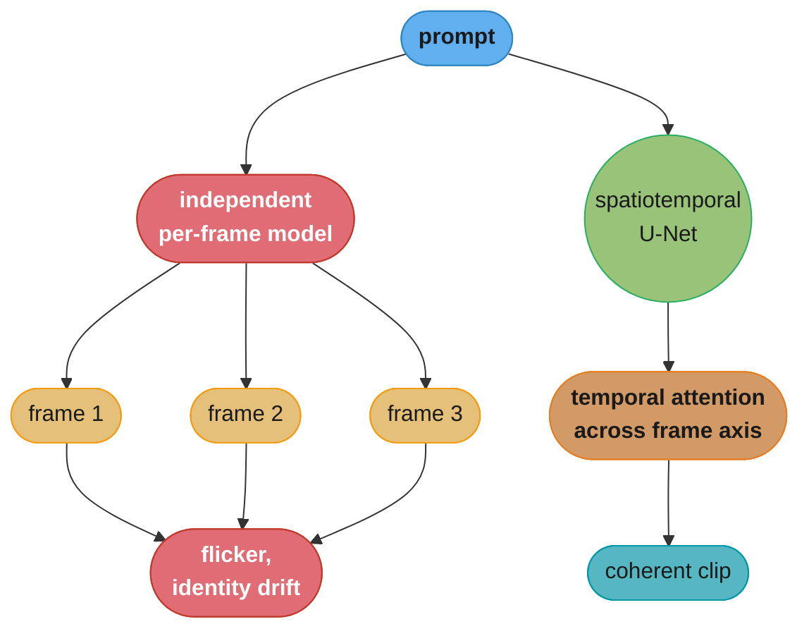
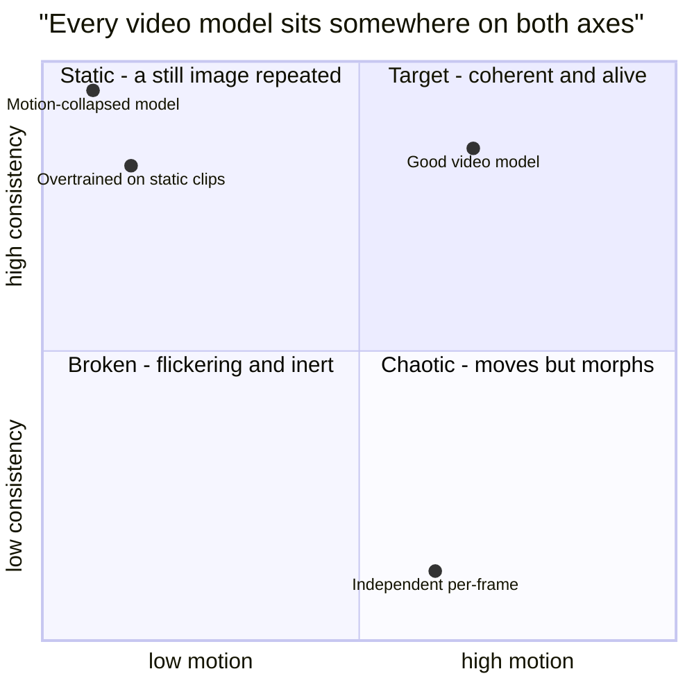
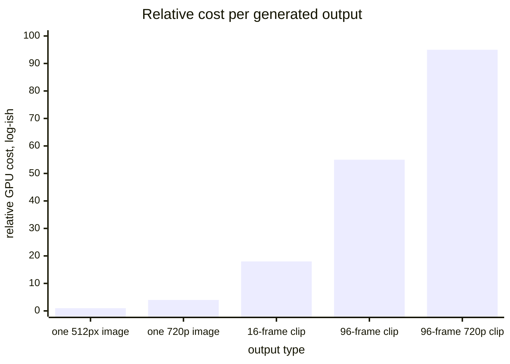

# Chapter 11: Text-to-Video Generation

> Ch 11 of 11 · Generative AI System Design Interview (Aminian & Sheng, ByteByteGo, 2024) · builds on Ch 10 — Personalized Headshot Generation, closes the book

## Chapter Map

The book's final chapter adds the one dimension every previous image chapter avoided: time. On
the surface a video is just a stack of images, and the temptation — which the chapter treats as
the central mistake to argue *against* — is to generate each frame independently with the
Chapter 9 system and concatenate them. That fails immediately and visibly: the subject's shirt
changes color between frames, the background flickers, objects appear and vanish. Video
generation is not per-frame image generation; it is **spatiotemporal** generation, in which the
model must produce a sequence that is coherent *across* frames as well as plausible *within*
each one. Everything from Chapters 8 through 10 carries forward — latent diffusion,
cross-attention text conditioning, classifier-free guidance — and this chapter adds temporal
layers to the U-Net, a video-text training corpus that has to be built rather than crawled, a
metric family that measures motion, and a serving architecture where a single job runs for
minutes on multiple GPUs.

**TL;DR:**
- The framing is **conditional spatiotemporal generation**. A model that generates frames
  independently produces flicker and identity drift, so temporal coherence has to be built into
  the architecture, not post-processed on.
- The architectural move is to **inflate** the 2D image U-Net into a 3D one: keep the spatial
  layers, add **temporal attention** across the frame axis and/or **(2+1)D factorized
  convolutions**, and initialize from a pretrained image model so the enormous prior learned
  from image-text data is not thrown away.
- **Compute scales far worse than for images.** A 4-second clip at 24 fps is 96 frames — roughly
  two orders of magnitude more latent tokens than one image — and temporal attention is
  quadratic in frame count on top of that. This is why every practical design is a **cascade**:
  generate sparse keyframes at low resolution, then interpolate in time, then upsample in space.
- Data is the hardest part. Video-text pairs barely exist naturally, so the corpus is built:
  **scene-cut detection** to segment raw video into single-shot clips, automatic **captioning**
  of those clips, aesthetic and motion filtering, and a storage volume measured in petabytes.
- Evaluation adds **FVD** (the video analogue of FID, over spatiotemporal features) alongside
  per-frame FID and CLIP score, plus explicit **temporal-consistency** and **motion** measures —
  because a model can score perfectly on every frame independently and still produce a video no
  human would accept.
- Serving is a long-running asynchronous job: minutes of multi-GPU work per clip, checkpointing
  so a preemption does not discard it, a progressive low-resolution preview to keep the user
  engaged, and safety filtering that must run across frames rather than on a single thumbnail.

## The Big Question

> You have a model that can generate one photorealistic image from a sentence. A four-second
> video at 24 frames per second is ninety-six images. Why can you not simply run the image model
> ninety-six times — and once you accept that you cannot, how do you make a model that reasons
> about all ninety-six frames at once without the compute cost exploding past anything you can
> serve?

Analogy: ask ninety-six different illustrators to each draw one frame of a scene from the same
one-sentence brief, then flip through the results. Every drawing is excellent. The flipbook is
unwatchable — the character's jacket changes shade, the room's furniture rearranges itself, the
lighting jumps. The brief simply does not contain enough information to pin down all the
choices each illustrator has to make, and nothing connects one illustrator's choices to the
next's. Now put all ninety-six illustrators in one room and let them see each other's work:
coherence appears, but so does the coordination cost, which grows with the square of the number
of people in the room. The whole chapter is about what those illustrators need to see of one
another (temporal attention), how to keep the room small enough to be affordable (keyframes
plus interpolation, cascaded resolution), and how to tell from the outside whether the flipbook
actually works (FVD and temporal-consistency metrics, which per-frame quality scores cannot
see).

---

## 11.1 Clarifying Requirements

- **What is the input and the output?** Input is a text prompt, optionally with a starting image
  (image-to-video) and generation parameters. Output is a short **video clip** — the chapter's
  scope — not a long-form film.
- **How long a clip, at what frame rate and resolution?** The chapter's target range is
  **2 to 5 seconds** at **24 frames per second**, at **512×512 up to 1280×720**. Those three
  numbers multiply directly into compute, so pinning them early is the single most consequential
  requirement in the chapter: 4 s × 24 fps = **96 frames**, and at 720p that is on the order of
  100 million pixels per clip before any denoising step is counted.
- **What is the coherence requirement?** Two distinct properties, and a candidate should name
  both. **Temporal consistency**: objects, colors, identities and backgrounds persist across
  frames without flicker or morphing. **Motion realism**: things move the way physics and
  intuition say they should — a walking figure's gait is plausible, a thrown ball follows an
  arc. A clip can have perfect consistency and no motion at all (a still image repeated), which
  is why both are requirements rather than one.
- **How well must the video follow the prompt?** Prompt fidelity as in Ch 9, extended: the
  prompt may describe not only content ("a red sports car") but **action** ("driving through a
  tunnel, camera following from behind"), and following an action instruction is a strictly
  harder requirement than following a static description.
- **What is the latency budget?** Minutes, not seconds. Generation is **asynchronous by
  necessity** — the chapter's framing target is on the order of **1 to 10 minutes** per clip on
  multiple GPUs, which makes this the most firmly job-shaped system in the book. There is no
  design in which a user holds a connection open.
- **What is the cost per clip?** The requirement that constrains everything. At minutes of
  multi-GPU time, a single clip costs on the order of **dollars**, not the cents of Ch 9's
  images — one to two orders of magnitude more expensive per output, which reshapes pricing,
  quota design, and whether free-tier generation is viable at all.
- **What throughput?** Far lower than an image product by count, and far higher by GPU-hours.
  The GPU cluster is the system's dominant cost and its scaling constraint.
- **What safety constraints?** Everything from Ch 9, made harder: content filtering has to run
  **across frames**, since unsafe content can occupy a handful of frames in the middle of an
  otherwise benign clip and a thumbnail check will miss it entirely. **Deepfake and likeness
  misuse** is a materially larger risk than for still images, because moving video of a real
  person is far more persuasive as fabricated evidence, and **watermarking and provenance**
  must survive re-encoding, cropping and compression.

**Functional summary:** given a text prompt, generate a 2-5 second, 24 fps, up-to-720p video
clip that is temporally consistent, exhibits realistic motion, and matches the prompt's content
and action, within minutes, asynchronously, at a cost per clip measured in dollars, with
safety filtering and provenance applied across every frame.

---

## 11.2 Framing the Problem as an ML Task

### Defining the ML objective

The objective is **conditional spatiotemporal generation**: model `p(v | c)` where `v` is a
tensor of shape `frames × height × width × channels` and `c` is the text prompt. The training
objective is the same denoising loss as Ch 9, with the noise now applied to a *video* latent:

```
L = E_{v, c, t, eps} [ || eps - eps_theta(z_t, t, tau(c)) ||^2 ]

  where z has shape  [ F x H' x W' x C ]   -- F frames of compressed latent
  and the noise eps has that same shape
```

The formal change is small; the consequence is enormous. Because `eps_theta` now sees all `F`
frames at once and must predict noise for all of them jointly, it can — and must — learn that
frame `f+1` looks like frame `f` plus a small change. That joint prediction is the entire
mechanism behind temporal consistency. Nothing in the loss says "be consistent"; consistency
emerges because predicting each frame's noise is easier when the model uses the neighboring
frames it can see.

### Why independent per-frame generation fails

The chapter makes this the framing section's centerpiece. Generate each frame with an
independent call to the Ch 9 model, even with the same prompt and the same seed, and you get:

- **Flicker** — textures, grain and fine detail are resampled every frame.
- **Identity and attribute drift** — the same character's face, hair and clothing change subtly
  or dramatically from frame to frame, because the prompt underdetermines them and each frame
  independently samples a different point in the space of valid answers.
- **Structural instability** — objects appear, disappear, and change count or position
  discontinuously.

Seeding every frame identically does not fix it: identical seeds with a slightly different
condition still land in different regions after 30 denoising steps, and identical seeds with an
*identical* condition produce an identical frame — a still image, not a video. The failure is
structural, not a tuning problem, which is what forces the architecture change in §11.4.

### Choosing the ML approach

- **Per-frame image generation with post-hoc smoothing.** Cheapest, and the baseline the chapter
  rejects. Optical-flow warping and temporal filters can reduce flicker but cannot manufacture
  coherent motion that was never generated.
- **Autoregressive frame generation.** Generate frame `f+1` conditioned on frames `1..f`.
  Coherent by construction and naturally extends to arbitrary length, but errors **accumulate**
  — a small artifact in frame 10 is conditioned on for every subsequent frame and compounds into
  visible drift — and generation is inherently sequential, so it cannot be parallelized across
  frames.
- **Full-clip spatiotemporal diffusion.** Denoise the entire clip jointly. Best coherence, fully
  parallel across frames within a step, and the chapter's choice — at the cost of memory and
  compute that scale with clip length, and a fixed maximum clip length baked into the
  architecture.
- **Cascaded generation.** Not an alternative so much as the practical realization of the above:
  a base model generates a short, low-resolution, low-frame-rate clip, and separate models
  interpolate frames and upsample resolution. This is how the compute is made tractable.

### Input and output, formalized

- **Text encoder**: unchanged from Ch 9 — a CLIP and/or T5 encoder producing an embedding
  sequence.
- **Video latent**: a video VAE encodes `96 × 720 × 1280 × 3` down to something like
  `24 × 90 × 160 × 4` when compressing **4× temporally and 8× spatially** — the temporal
  compression being the addition over Ch 8's image VAE, and a large one, since it removes 75% of
  the frame axis before diffusion ever runs.
- **Spatiotemporal U-Net**: predicts noise over the whole latent video tensor, conditioned on
  text and timestep.
- **Output**: decoded frames, assembled and encoded into a delivery container (H.264/H.265 in an
  MP4).

---

## 11.3 Data Preparation

Chapter 9's corpus existed — the web is full of images with alt-text. Video-text pairs are not
lying around in the same way, so this section is about **manufacturing** a dataset.

### Data engineering — sourcing

Sources named: web-scraped video with whatever text accompanies it (titles, descriptions,
subtitles), stock-video libraries with human-written descriptions, and — importantly — **image
data used alongside video**. Joint image-video training is a standard technique: images are far
more plentiful and far more diverse, and training on both teaches visual concepts from the image
half while the video half teaches motion. A model trained on video alone inherits the narrow
subject distribution of whatever video happened to be collectable.

### Data engineering — the clip pipeline

Raw video is unusable as-is, and each stage below removes a specific defect:

- **Scene-cut detection.** A raw video contains many shots. Train on a clip spanning a cut and
  the model learns that content *should* change abruptly mid-clip — which shows up in generation
  as an inexplicable jump. A shot-boundary detector (frame-difference or histogram-based) splits
  raw video into single-shot segments, and this is the single most important stage in the
  pipeline.
- **Clip segmentation.** Single-shot segments are cut into fixed-length training clips matching
  the model's frame count, with a stride that may overlap for augmentation.
- **Motion filtering — in both directions.** Discard clips that are nearly static (a locked-off
  shot of a wall teaches the model that video means "a still image", and models trained on too
  many of these generate videos with almost no movement, a well-known and product-fatal failure)
  and clips with excessive or chaotic motion (fast pans and shaky handheld footage produce
  motion blur the model learns to reproduce). Optical-flow magnitude is the usual filter
  statistic, keeping a middle band.
- **Aesthetic and quality filtering.** Resolution and bitrate floors, compression-artifact
  detection, and an aesthetic score as in Ch 9.
- **Text-overlay and watermark detection.** Stock video is heavily watermarked and web video is
  full of burned-in captions and channel logos; a model trained on them renders convincing fake
  text overlays.
- **NSFW filtering across frames.** Sampling one frame per clip is not sufficient — the filter
  must sample multiple frames, for exactly the reason the §11.1 safety requirement gives.
- **Deduplication.** Near-duplicate clips (re-uploads, mirrored copies, the same stock clip
  licensed into many videos) are extremely common in video corpora and carry the same
  distribution-skew and memorization risks as in Ch 9.

### Feature engineering — captioning video

The captioning problem is worse than Ch 9's and the solution is the same shape. Whatever text
accompanies a web video describes the *video* ("Our 2019 summer trip!"), not the *shot*, and
after scene splitting there is no caption attached to the individual clip at all. So clips are
**automatically captioned** by a video- or image-captioning model.

The essential requirement is that the caption describe **motion and action**, not only content.
A caption reading "a dog in a park" teaches nothing about movement; "a golden retriever running
left to right across a grass field, camera panning to follow" teaches the model what the prompt
word "running" and the phrase "camera panning" should produce. A pipeline that captions the
middle frame with an image captioner produces a model that ignores every verb in a user's
prompt — a direct, traceable line from a data shortcut to a product failure.

Practical approach: caption several sampled frames plus a motion description, or use a
video-language model directly, and blend the synthetic captions with whatever original text
exists so the model still handles terse real-user prompts.

### Feature engineering — frame sampling and storage

- **Frame-rate normalization.** Source video arrives at 24, 25, 30 and 60 fps; everything is
  resampled to the training frame rate so the model learns one consistent relationship between
  frame index and elapsed time. Skip this and the model has no coherent notion of speed.
- **Temporal stride as an implicit speed control.** Sampling every 2nd frame from 24 fps footage
  yields a training clip that appears to move twice as fast; used deliberately this is
  augmentation, and used accidentally it teaches the model an inconsistent time base.
- **Storage.** The number that makes this section different from every other in the book. Raw
  video at even modest quality is on the order of **1-10 MB per second**, so a corpus of tens of
  millions of clips is **petabytes**, versus the terabytes of an image corpus. Consequences:
  latents are pre-encoded once through the frozen video VAE and cached (compressing a
  `96 × 720 × 1280 × 3` clip to `24 × 90 × 160 × 4` is roughly a 250× reduction and turns the
  training data-loading problem from impossible into merely expensive), the pipeline is built on
  distributed object storage with columnar/sharded formats, and **data loading, not GPU compute,
  is frequently the training bottleneck**.
- **Caption dropout** at ~10%, exactly as in Ch 9, because classifier-free guidance is used
  unchanged.

---

## 11.4 Model Development

### Model selection — inflating an image model into a video model

The chapter's central architectural idea is that you do **not** train a video model from
scratch. You take a pretrained text-to-image latent diffusion model — carrying everything it
learned from a billion image-text pairs about objects, materials, lighting and composition —
and **inflate** it: keep every spatial layer and its weights, insert new temporal layers, and
initialize those temporal layers so that at step zero the inflated model reproduces the image
model's behavior frame by frame. Training then only has to teach motion, not vision.

The two mechanisms for the temporal layers:

**Temporal attention.** After each spatial self-attention block, add an attention layer that
operates along the **frame axis**: for a fixed spatial position, attend across all `F` frames.
This is what lets a pixel region in frame 40 see what it looked like in frame 1, and it is the
mechanism that delivers long-range temporal consistency. Its cost is `O(F^2)` per spatial
position, which is where clip length becomes expensive.

**(2+1)D factorized convolution.** Replace a full 3D convolution (`k × k × k`, cost `k^3`) with
a spatial convolution (`1 × k × k`) followed by a temporal one (`k × 1 × 1`), cost `k^2 + k`.
For `k = 3` that is 27 multiplications versus 12 — a better than 2× saving — and the
factorization also means the spatial half can be initialized directly from the pretrained image
model's weights, which full 3D convolution cannot.

**Spatial-temporal factorization** is the general principle behind both: never mix space and
time in one operation when you can do them in sequence. It is the single most important
efficiency idea in the chapter.

```
  full 3D attention over a clip latent:

     tokens = F * H' * W'  =  24 * 90 * 160  =  345,600 tokens
     attention cost ~ tokens^2  =  1.19 x 10^11        intractable

  factorized: spatial attention within each frame, then temporal
  attention across frames at each position:

     spatial  = F * (H'*W')^2   = 24 * 14400^2 = 4.98 x 10^9
     temporal = (H'*W') * F^2   = 14400 * 576  = 8.29 x 10^6
     total                      ~ 4.98 x 10^9         ~24x cheaper

  and the temporal term is a rounding error next to the spatial one,
  which is why clip LENGTH is cheaper to extend than RESOLUTION
```

### Model training — the cascade

Even factorized, generating 96 frames at 720p in one model is impractical. The production
pattern is a **cascade** of specialized models:

1. **Base model** — generate a short, low-resolution, low-frame-rate clip. Say **16 frames at
   64×64 or 256×256**. This model does the hard work: composition, subject, and the overall
   motion trajectory.
2. **Temporal super-resolution (frame interpolation)** — a model that takes the sparse frames
   and generates the frames between them, taking 16 frames to 32 to 96. Interpolating between
   two known frames is a far easier conditional problem than generating motion from nothing.
3. **Spatial super-resolution** — one or two diffusion upsampling stages taking 256×256 to
   576×320 to 1280×720, conditioned on the low-resolution frames and on the prompt.

Each stage is a smaller model solving an easier problem than a single monolithic
generate-96-frames-at-720p network would be, and each can be scaled or replaced independently.
The chapter also frames the **keyframe-plus-interpolation** view of the same idea: the base
model produces keyframes carrying the semantic content, and interpolation fills in motion,
which is directly analogous to how traditional animation is produced.

### Model training — conditioning and guidance

Text conditioning is unchanged from Ch 9: cross-attention in every spatial block, with the text
embedding from a frozen encoder. Classifier-free guidance is used unchanged, with the same
guidance-scale tradeoff and the same doubling of per-step compute — which is far more painful
here, since each step is already a full-clip forward pass.

Two video-specific conditioning options the chapter names:

- **Image-to-video**: condition on a first frame (supplied by the user, or generated by the Ch 9
  model) and generate motion from it. This decomposes an unreliable problem into two more
  reliable ones and lets a user approve the still before paying for the video.
- **Motion conditioning**: an explicit control over how much movement to produce — usually a
  scalar "motion strength" derived at training time from each clip's optical-flow magnitude and
  supplied as a conditioning input. This directly addresses the near-static-output failure and
  gives users a dial rather than a hope.

### Model training — why compute scales so much worse than for images

Worth stating explicitly, because it is the answer to the chapter's most common interview
question:

| Axis | Image (Ch 9) | Video (this chapter) | Factor |
|---|---|---|---|
| Latent tokens | `H' × W'` ≈ 4,096 | `F × H' × W'` ≈ 345,600 | ~85× |
| Spatial attention | `O(HW)^2` per step | `O(HW)^2` per frame per step | ×F |
| Temporal attention | none | `O(F^2)` per position | new term |
| Memory per sample | one latent | F latents plus temporal activations | ~F× |
| Denoising steps | 20-50 | 20-50 (per cascade stage) | ×stages |

The compounding is multiplicative, which is why a clip costs dollars where an image costs cents,
and why the entire §11.4 design is a sequence of tricks — factorization, cascading,
interpolation, temporal VAE compression — aimed squarely at this table.

### Model training — practical scale

Training a text-to-video model of this shape is a larger undertaking than Ch 9's text-to-image
run: the same or larger parameter count, a per-sample cost tens of times higher, and a data
pipeline moving petabytes. The chapter's framing puts a frontier-quality run in the range of
**hundreds of thousands to millions of GPU-hours** across a multi-hundred-GPU cluster over
weeks to months, using the full Ch 1 efficiency toolkit — mixed precision, gradient
checkpointing (unusually valuable here, since temporal activations dominate memory), and
sharded data and model parallelism.

---

## 11.5 Evaluation

Video evaluation needs everything image evaluation needed, plus a family of metrics that
per-frame scoring is structurally blind to.

### Offline metrics

**FVD (Fréchet Video Distance)** is the primary metric and the direct analogue of FID. Instead
of passing images through Inception-v3, pass video clips through a pretrained **video**
classification network (an I3D-style spatiotemporal model), fit Gaussians to the resulting
feature distributions for real and generated clips, and compute the Fréchet distance. Lower is
better. The crucial property is that the feature extractor is *spatiotemporal*, so a video that
flickers produces different features from a coherent one even if every individual frame is
excellent — which is exactly what FID cannot see.

**Per-frame FID** measures individual frame quality, and is deliberately reported alongside FVD
rather than instead of it. The gap between them is diagnostic: excellent per-frame FID with poor
FVD is the precise signature of a temporally incoherent model, and it is the most common failure
in the chapter.

**CLIP score**, computed per frame and averaged, measures prompt alignment as in Ch 9. Its
weakness here is specific and worth naming: CLIP is an image model, so it evaluates content and
is nearly blind to whether the *action* in the prompt actually happened. A video of a
stationary dog scores well against "a dog running."

**Temporal-consistency metrics** measure frame-to-frame stability directly, without a reference:
average CLIP-embedding cosine similarity between consecutive frames (too low means flicker, too
high means nothing is moving), warping error under an optical-flow estimate (warp frame `f` to
`f+1` using estimated flow and measure the residual), and structural similarity between adjacent
frames.

**Motion metrics** are the necessary counterweight, and the chapter is explicit about why: a
model that outputs a still image repeated 96 times achieves *perfect* temporal consistency.
Optical-flow magnitude statistics quantify how much motion is present, and both consistency and
motion have to be reported together or the metric set rewards degenerate output.

### Human evaluation

The final arbiter, and here it carries more weight than in any earlier chapter, because the
artifacts that matter most — unnatural gait, physics that feels wrong, an object that morphs
subtly through the clip — are perceptual and not reliably captured by any automated metric.
Raters judge on separate axes, and separating them is what makes the results actionable:
**per-frame image quality**, **temporal consistency**, **motion realism and naturalness**, and
**prompt/action fidelity**. Video rating is also markedly more expensive than image rating — a
rater must watch a clip several times rather than glance at an image — which is a real
throughput constraint on how fast a team can iterate.

### Online metrics

Clip completion rate (did the user watch it through), download and share rate, regeneration
rate, per-clip cost against per-clip revenue, and abandonment during the multi-minute queue
wait — the last being unique to a system whose users are asked to wait minutes.

---

## 11.6 Overall ML System Design

```mermaid
flowchart LR
    classDef io      fill:#61afef,stroke:#2e86c1,color:#1a1a1a,font-weight:bold
    classDef frozen  fill:#c678dd,stroke:#9b59b6,color:#fff
    classDef train   fill:#98c379,stroke:#27ae60,color:#1a1a1a
    classDef mathOp  fill:#d19a66,stroke:#e67e22,color:#1a1a1a,font-weight:bold
    classDef lossN   fill:#e06c75,stroke:#c0392b,color:#fff,font-weight:bold
    classDef req     fill:#56b6c2,stroke:#0097a7,color:#1a1a1a
    classDef base    fill:#e5c07b,stroke:#f39c12,color:#1a1a1a

    P(["prompt"]) --> SAFE(["prompt safety<br/>filter"])
    SAFE --> JQ(["job queue<br/>with quota check"])
    JQ --> SCHED(("cluster scheduler<br/>multi-GPU slot"))
    SCHED --> BASE(("base model<br/>16 frames, low res"))
    BASE --> PREV(["progressive preview<br/>shown to user"])
    BASE --> TSR(("temporal SR<br/>16 to 96 frames"))
    TSR --> SSR(("spatial SR<br/>to 720p"))
    SSR --> DEC(("video VAE<br/>decode, frozen"))
    DEC --> ENC(["encode MP4<br/>H.264"])
    ENC --> FSAFE(["multi-frame NSFW<br/>and watermark"])
    FSAFE --> OBJ(["object storage"])
    OBJ --> CDN(["CDN delivery"])
    SCHED -.->|"checkpoint<br/>every stage"| CKPT(["checkpoint store"])

    class P io
    class SAFE,FSAFE req
    class JQ base
    class SCHED mathOp
    class BASE,TSR,SSR train
    class DEC frozen
    class PREV,ENC,OBJ,CDN io
    class CKPT lossN
```



Caption: the cascade is visible as three separate model stages, and checkpointing between them
is what makes a preemption cost one stage rather than the whole multi-minute job.

- **Prompt safety filter and quota check.** Before enqueueing, because a clip costs dollars —
  the cost asymmetry that made pre-queue filtering sensible in Ch 9 is roughly 100× stronger
  here. Quota enforcement belongs at the same point, since an unmetered expensive endpoint is a
  denial-of-wallet vector.
- **Job queue and cluster scheduler.** A job needs a *slot* of several GPUs for several minutes,
  which is a scheduling problem closer to batch HPC than to request serving: bin-packing jobs
  onto GPU groups, fair-sharing across tenants, and priority tiers. Bounded queue wait, not
  throughput, is the SLA users experience.
- **Checkpointing long jobs.** A multi-minute multi-GPU job on preemptible capacity will be
  interrupted. Writing intermediate state between cascade stages — the base clip latent, the
  interpolated latent — means a preemption costs one stage, not the whole job. Without it, spot
  capacity is unusable and the cost per clip roughly doubles.
- **Progressive preview.** The strongest UX lever available. Because the cascade produces a
  usable low-resolution clip in the first stage, showing it to the user immediately turns a
  five-minute blank wait into a fast preview followed by a refinement — and lets the user cancel
  a bad generation before the expensive upsampling stages ever run, which is a direct cost
  saving as well as a UX win.
- **Post-processing and encoding.** Decoded frames are assembled and encoded (H.264/H.265 in
  MP4) at delivery resolution, usually with multiple renditions for different clients.
- **Multi-frame safety filtering.** The NSFW classifier samples **many frames across the clip**,
  not one. Unsafe content occupying frames 40-50 of a 96-frame clip is invisible to a thumbnail
  check, and this is a known evasion pattern rather than a hypothetical.
- **Storage and delivery.** Object storage plus CDN, with lifecycle expiry. Video objects are
  far larger than images, so egress and storage are meaningful line items rather than
  rounding errors.

### Scale estimation

- **Per clip.** Say **4 GPU-minutes** across the cascade for a 4-second 720p clip, on **2 GPUs
  for 2 minutes** wall-clock. At $2-3/GPU-hour, that is roughly **$0.13-0.20** in raw compute
  per clip at that (optimistic) figure; a heavier configuration at 15 GPU-minutes per clip lands
  near **$0.50-0.75**, and a frontier-quality long clip runs to several dollars. The range is
  the point: **video is one to two orders of magnitude more expensive per output than the images
  of Ch 9**, and the pricing model must be built around that rather than adapted from an image
  product.
- **Fleet.** **100,000 clips/day** at 4 GPU-minutes each is `400,000` GPU-minutes ≈ **6,667
  GPU-hours/day** ≈ **278 GPUs** running continuously — versus the ~46 GPUs Ch 9 needed for a
  million images. Ten times fewer outputs, six times more hardware.
- **Storage.** A 4-second 720p H.264 clip is roughly **2-5 MB**; 100,000 clips/day is
  **200-500 GB/day**, or 70-180 TB/year before expiry. Modest next to the training corpus, but
  the CDN egress from users re-watching and sharing is the larger number.
- **Training data.** The number that dwarfs everything else: tens of millions of clips at
  seconds each is **petabytes** of raw video, which is why pre-encoded cached latents are not an
  optimization but a precondition for training at all.

---

## 11.7 Deployment and Monitoring

- **GPU-hours per clip.** The primary cost metric, broken down **per cascade stage**. A quality
  improvement to the spatial upsampler is also a cost increase, and the per-stage breakdown is
  what makes that visible before it appears on an invoice.
- **Queue depth, wait time and SLA.** Users tolerate minutes only if the estimate is honest, so
  the monitored numbers are p50/p99 queue wait, p50/p99 end-to-end time, and **time to first
  preview**, which is what the user actually perceives as responsiveness.
- **Job failure and preemption rate.** Long multi-GPU jobs fail more often than short ones —
  preemption, OOM on a long clip, a node failure mid-cascade. Track failure rate by stage and
  retry-from-checkpoint success rate; a rising OOM rate usually means a parameter change let
  users request longer or larger clips than the memory budget supports.
- **Abandonment during the wait.** Unique to this system: users leaving before the clip is ready
  is both a product signal and pure wasted compute, and it is the number that justifies
  investment in progressive preview.
- **Safety filtering across frames.** Monitor the per-clip fire rate and, separately, the
  distribution of *which* frames fire — a cluster of detections in the middle of clips is the
  signature of deliberate evasion rather than incidental content. Sampled human review measures
  the false-negative rate the automated filter cannot self-report.
- **Deepfake and likeness misuse.** The chapter's sharpest deployment concern, and materially
  more serious than for still images because moving video of a real person is far more
  persuasive as fabricated evidence. Controls named: detecting prompts naming real individuals,
  face-matching generated output against a public-figure index, refusing prompts that place
  identifiable people in contexts implying falsehood, rate limiting, and a reporting and
  takedown path with human review.
- **Watermarking and provenance.** Harder than for images and correspondingly more important.
  The watermark must be embedded such that it survives **re-encoding, transcoding, cropping and
  compression** — the ordinary lifecycle of any video that gets shared — which means a
  frame-level robust watermark plus signed provenance metadata, with a periodic audit that
  re-extracts the watermark from sampled outputs after a round-trip through a typical social
  platform's transcoder.
- **Quality regression monitoring.** FVD, per-frame FID, CLIP score and the temporal-consistency
  and motion statistics, all sampled continuously on production output. The specific regression
  to watch for is **motion collapse** — a model update that improves temporal consistency and
  FVD by producing videos that barely move, which every consistency metric rewards and every
  user rejects.
- **Prompt drift.** As in Ch 9, users' prompt distribution moves, and the video-specific version
  is a shift toward action and camera-motion language the training captions may not have
  covered.

---

## Beyond the book — video generation after 2024

> This chapter summarizes the 2024 edition of *Generative AI System Design Interview*, whose
> reference design is an inflated image U-Net with temporal attention, trained as a cascade of
> base, temporal-super-resolution and spatial-super-resolution stages. The specific post-2024
> systems, architectures and standards below are not in the book and are not the authors'.

The direction of travel since 2024 has been toward **replacing the cascade with a single
transformer**. Diffusion-transformer backbones operating on **spacetime latent patches** — the
architecture behind the video systems released from 2024 onward — treat a video as a sequence of
patch tokens spanning both space and time and denoise them jointly with a plain transformer,
which scales more predictably with parameters and handles variable durations, resolutions and
aspect ratios in one model rather than needing a fixed-shape cascade. The chapter's factorization
argument still explains *why* attention has to be structured rather than dense, but the specific
(2+1)D convolutional framing is no longer how frontier systems are built.

Clip lengths and controllability have both moved substantially: **minute-long single-shot
generations with sustained subject consistency**, and control signals beyond text — reference
images, camera-trajectory specifications, pose and depth conditioning — are now standard product
features rather than research directions. Few-step distilled samplers have compressed generation
latency in video as they did in images, which pulls directly against the §11.6 cost arithmetic
above; the multi-minute, dollars-per-clip figures are the honest 2024 numbers for the
architecture the chapter describes.

Finally, **provenance has become concrete and, in places, mandatory**. C2PA content credentials
and the EU AI Act's synthetic-media transparency obligations give §11.7's watermarking guidance
a specific technical and legal shape that did not exist in 2024 — which matters more for video
than anything earlier in the book, since fabricated video of a real person is the misuse case
regulators moved on first.

---

## Visual Intuition

### Why independent frames fail, and what temporal attention adds



Caption: the difference is not post-processing but information flow — in the joint model every
frame's denoising prediction can see every other frame, so consistency emerges from the loss
rather than being smoothed on afterward.

### The cascade, in numbers

```
  stage 1  base model
           16 frames  @ 256x256      composition + motion trajectory
                |
                |  temporal super-resolution (frame interpolation)
                v
  stage 2  96 frames  @ 256x256      motion filled in between keyframes
                |
                |  spatial super-resolution, 1-2 passes
                v
  stage 3  96 frames  @ 1280x720     final detail

  why not one model straight to 96 x 1280 x 720?

     one-shot latent tokens  = 96 * 160 * 90   = 1,382,400
     cascade stage-1 tokens  = 16 *  32 * 32   =    16,384     84x smaller

  the hard part - what is in the scene and how it moves - is solved
  where it is cheapest, and every later stage solves a strictly easier
  conditional problem than generating from nothing
```

Caption: the cascade is a compute-allocation argument — spend the expensive joint reasoning on
the smallest tensor that still determines the content, and buy resolution and frame rate
afterward with cheap conditional models.

### Temporal consistency and motion are two axes, not one



Caption: this is why the metric set must report motion alongside consistency — a model that
degenerates into a repeated still image scores at the very top of the consistency axis, which
is exactly the wrong reward.

### Where the compute actually goes



Caption: illustrative shape, not measured values — the jump from image to video is not
incremental, and it is why the chapter's every architectural choice is a compute-reduction
argument rather than a quality-maximization one.

---

## Key Concepts Glossary

- **Text-to-video generation** — producing a video clip conditioned on a natural-language
  prompt.
- **Spatiotemporal generation** — generating content jointly across spatial and temporal
  dimensions rather than frame by frame.
- **Temporal consistency** — objects, colors, identities and backgrounds persisting across
  frames without flicker or morphing.
- **Motion realism** — generated movement being physically and perceptually plausible.
- **Flicker** — high-frequency frame-to-frame variation in texture or detail, the signature
  failure of independent per-frame generation.
- **Identity drift** — a subject's appearance changing across frames because the prompt
  underdetermines it and each frame samples independently.
- **Inflation** — converting a pretrained 2D image model into a video model by keeping spatial
  layers and inserting temporal ones initialized to be near-identity.
- **Temporal attention** — attention operating along the frame axis at a fixed spatial position;
  the mechanism delivering long-range temporal coherence.
- **(2+1)D convolution** — factorizing a 3D convolution into a spatial convolution followed by a
  temporal one, cutting cost and enabling image-model weight reuse.
- **Spatial-temporal factorization** — the general principle of never mixing space and time in a
  single operation when they can be applied in sequence.
- **Latent video diffusion** — running the diffusion process on a temporally and spatially
  compressed video latent rather than on raw frames.
- **Video VAE** — the autoencoder compressing video both spatially and temporally before
  diffusion.
- **Cascaded generation** — a pipeline of base model, temporal super-resolution and spatial
  super-resolution stages.
- **Keyframe generation** — producing sparse frames carrying the semantic content, to be filled
  in by interpolation.
- **Frame interpolation / temporal super-resolution** — generating intermediate frames between
  generated keyframes to raise the frame rate.
- **Spatial super-resolution** — diffusion-based upsampling of generated frames to delivery
  resolution.
- **Autoregressive frame generation** — generating each frame conditioned on previous frames;
  coherent but subject to error accumulation and inherently sequential.
- **Error accumulation** — artifacts compounding across an autoregressive sequence because each
  step conditions on the flawed previous one.
- **Scene-cut detection** — segmenting raw video at shot boundaries so training clips never span
  a cut.
- **Clip segmentation** — cutting single-shot segments into fixed-length training clips.
- **Motion filtering** — discarding training clips that are nearly static or excessively chaotic,
  using optical-flow magnitude.
- **Video captioning** — automatically generating clip descriptions that include motion and
  action, not only static content.
- **Frame-rate normalization** — resampling all training video to a single frame rate so the
  model learns one consistent time base.
- **Temporal stride** — the frame-sampling interval, which implicitly controls apparent playback
  speed.
- **Motion conditioning** — an explicit conditioning input controlling how much movement to
  generate, typically derived from optical flow at training time.
- **Image-to-video** — conditioning generation on a supplied or separately generated first frame.
- **FVD (Fréchet Video Distance)** — FID computed over spatiotemporal features from a video
  classification network; the chapter's primary offline metric.
- **Per-frame FID** — image FID applied frame by frame; diagnostic when read against FVD.
- **Warping error** — the residual after warping one frame to the next using estimated optical
  flow; a reference-free temporal-consistency measure.
- **Motion collapse** — a model degenerating toward near-static output, which every temporal
  consistency metric rewards and every user rejects.
- **Progressive preview** — showing the cascade's cheap low-resolution output immediately while
  the expensive stages run.
- **Checkpointing (of generation jobs)** — persisting intermediate cascade state so a preempted
  multi-minute job resumes from a stage boundary.
- **Multi-frame safety filtering** — sampling many frames across a clip for content filtering,
  since unsafe content can occupy a middle segment only.

---

## Tradeoffs & Decision Tables

### Generation approach

| Approach | Temporal coherence | Parallel across frames | Max length | Verdict |
|---|---|---|---|---|
| Independent per-frame | None — flicker and drift | Fully | Unlimited | Rejected; the chapter's counterexample |
| Per-frame plus smoothing | Reduced flicker, no real motion | Fully | Unlimited | Cosmetic only |
| Autoregressive frames | Good, but errors accumulate | No — sequential | Extensible | Drift over long clips |
| Full-clip spatiotemporal diffusion | Best | Yes, within a step | Fixed by architecture | **Chosen** |
| Cascaded (base + interpolate + upsample) | Best, at feasible cost | Yes | Fixed by base model | **How it is actually built** |

### Temporal mechanism

| Mechanism | Range of coherence | Cost | Reuses image weights |
|---|---|---|---|
| 3D convolution (`k × k × k`) | Local only | `k^3` | ✗ |
| (2+1)D factorized convolution | Local | `k^2 + k` | ✓ (spatial half) |
| Temporal attention | **Full clip** | `O(F^2)` per position | ✓ (added as new layers) |
| Both together | Full clip, locally smooth | Sum of the above | ✓ |

### What each requirement costs

| Raise this | Compute impact | Quality impact |
|---|---|---|
| Clip length (frames) | Linear in tokens, quadratic in temporal attention | Longer stories, more drift risk |
| Frame rate | Linear in frames — or free via interpolation | Smoother motion |
| Resolution | Quadratic in spatial tokens — the most expensive axis | More detail |
| Denoising steps | Linear, per cascade stage | Diminishing past ~30 |
| Guidance scale | 2× per step (CFG), unchanged from Ch 9 | Prompt adherence up, diversity down |

### Image versus video, as a system

| | Text-to-image (Ch 9) | Text-to-video (Ch 11) |
|---|---|---|
| Latency | Seconds | **Minutes** |
| Cost per output | Cents | **Dollars** |
| Serving shape | Queue, single GPU | Queue, **multi-GPU slot, checkpointed** |
| Training corpus | Terabytes of image-text pairs | **Petabytes** of video, captions manufactured |
| Primary metric | FID + CLIP score | **FVD** + per-frame FID + CLIP + motion/consistency |
| Degenerate failure | Over-saturation at high guidance | **Motion collapse** — a repeated still image |
| Safety check | One image | **Many frames across the clip** |

---

## Common Pitfalls / War Stories

- **Generating frames independently and post-processing the flicker away.** The information that
  would make the frames consistent was never generated; optical-flow smoothing can suppress
  high-frequency noise but cannot invent a coherent trajectory. The failure is architectural.
- **Optimizing temporal consistency alone and shipping motion collapse.** Every consistency
  metric peaks on a still image repeated 96 times, so a model update that reduces motion looks
  like an unambiguous win on the dashboard and is rejected instantly by users. Motion magnitude
  must be reported alongside consistency, always.
- **Training on clips that span scene cuts.** The model learns that content is supposed to change
  abruptly mid-clip and reproduces unexplained jumps in generation. Scene-cut detection is the
  highest-value stage in the data pipeline, and skipping it is not recoverable downstream.
- **Captioning the middle frame with an image captioner.** The captions describe content and not
  action, so the model never learns what verbs mean, and every prompt asking for movement returns
  a nearly static clip. This is a direct, traceable line from a data-pipeline shortcut to the
  single most-complained-about product failure.
- **Sizing GPU capacity from image-generation intuition.** A clip is not "a few images." The
  latent token count is roughly two orders of magnitude larger, temporal attention adds a
  quadratic term, memory scales with frame count, and the cascade multiplies denoising steps by
  the number of stages — the effects compound rather than add.
- **Running long jobs on preemptible GPUs without checkpointing.** A multi-minute multi-GPU job
  will be preempted, and without intermediate state every preemption discards the whole run,
  roughly doubling effective cost and making spot capacity useless. Checkpoint between cascade
  stages.
- **Checking safety on a thumbnail.** Unsafe content occupying frames 40-50 of a 96-frame clip is
  invisible to a single-frame check, and this is an actively exploited evasion pattern, not a
  theoretical gap. Sample many frames across the clip.
- **Watermarking that does not survive transcoding.** Any shared video is re-encoded, cropped and
  compressed by whatever platform carries it, and a fragile watermark is gone by the time
  provenance is actually needed. Test the watermark after a round-trip through a real transcoder,
  not only on the freshly generated file.
- **Making users wait five minutes with no feedback.** The cascade already produces a usable
  low-resolution clip in its first stage; not showing it wastes both the user's patience and the
  GPU time spent finishing generations the user has already abandoned.
- **Treating deepfake risk as the image chapter's problem at the same severity.** Moving video of
  a real person is far more persuasive as fabricated evidence than a still, and the controls —
  real-person prompt detection, public-figure matching, robust provenance, a takedown path —
  need to be proportionally stronger.

---

## Real-World Systems Referenced

**Architectures and systems:** video latent diffusion built by inflating a pretrained
text-to-image latent diffusion model; the cascaded base plus temporal-super-resolution plus
spatial-super-resolution pattern used by the Imagen Video and Make-A-Video lines of work;
Stable Video Diffusion as the open video-diffusion reference; (2+1)D factorized convolution from
the video-recognition literature. **Text encoders:** CLIP and T5, unchanged from Ch 9.
**Evaluation:** I3D-style spatiotemporal video classification networks as the FVD feature
extractor, Inception-v3 for per-frame FID, CLIP for prompt alignment, optical-flow estimators
for motion and warping-error statistics. **Infrastructure:** GPU cluster schedulers allocating
multi-GPU slots, preemptible/spot capacity with checkpointing, H.264/H.265 encoding, object
storage plus CDN delivery. **Product category named:** short-clip text-to-video generation for
marketing, social and creative use.

---

## Summary

Text-to-video is the book's final and hardest design, and its opening move is a rejection: a
video is not a stack of independently generated images. Generate each frame separately and the
prompt underdetermines everything the prompt does not mention, so textures flicker, identities
drift and objects appear and vanish — a structural failure no post-processing can repair. The
fix is to make the model predict all frames **jointly**, which is achieved by **inflating** a
pretrained image diffusion model: keep every spatial layer and the billion image-text pairs of
prior knowledge baked into it, insert **temporal attention** across the frame axis and
**(2+1)D factorized convolutions**, and initialize the new layers so training only has to teach
motion. **Spatial-temporal factorization** is the idea the whole architecture rests on — never
mix space and time in one operation — and it is a compute argument first and a modeling one
second, because a clip carries roughly two orders of magnitude more latent tokens than an image
and attention costs grow quadratically on top of that. The practical realization is a
**cascade**: a base model that decides content and motion on the smallest tensor that can carry
them, temporal super-resolution to fill in frames, and spatial super-resolution to buy
resolution — each later stage solving a strictly easier conditional problem than generating from
nothing.

Data is manufactured rather than found. Video-text pairs do not exist at scale the way alt-text
images do, so the corpus is built by **scene-cut detection** (train across a cut and the model
learns to jump), clip segmentation, motion filtering in both directions, and **automatic
captioning that describes action rather than content** — caption the middle frame with an image
captioner and you ship a model that ignores every verb a user types. The storage is petabytes,
which makes pre-encoded cached latents a precondition rather than an optimization. Evaluation
adds **FVD** over spatiotemporal features to per-frame FID and CLIP score, and — critically —
reports **motion magnitude alongside temporal consistency**, because a still image repeated 96
times achieves perfect consistency and is the degenerate optimum every consistency metric
rewards. And serving is the most job-shaped system in the book: minutes of multi-GPU work per
clip, checkpointed between cascade stages so preemptible capacity is usable, a progressive
low-resolution preview that both keeps the user engaged and lets them cancel before the
expensive stages run, safety filtering sampled across many frames rather than a thumbnail, and
provenance robust enough to survive the transcoding every shared video goes through.

**Closing the book.** Across eleven chapters the same seven steps from Chapter 1 have carried
every design, and what changed underneath them is instructive. Chapters 2 through 6 were
text-in, text-out: Smart Compose, translation, a chatbot, captioning, and retrieval-augmented
generation, where the evaluation problem was reference-based and the serving problem was
milliseconds. Chapter 7 broke the reference: with no correct face to compare against, evaluation
became distributional (FID, Inception Score, human fooling rate) and a governance layer —
watermarking, logging, fairness monitoring, abuse detection — appeared for the first time and
never left. Chapter 8 replaced adversarial training with diffusion and moved the process into a
latent space, trading single-pass speed for stability and diversity. Chapter 9 made the
generator controllable with cross-attention text conditioning and classifier-free guidance, and
introduced the pattern that dominates the rest of the book: **two metrics that move in opposite
directions along one knob**, so quality is a Pareto curve rather than a number. Chapter 10 kept
that stack and personalized it to one individual, where the same shape recurred — identity
fidelity against prompt editability along training steps — and where the economics of per-user
adapters, and the privacy weight of biometric data, mattered as much as the model. This chapter
adds time, and with it the last escalation: from cents to dollars per output, from seconds to
minutes, from one image to check to ninety-six frames to filter, and from a synthetic face
nobody knows to synthetic video of someone real. The through-line the book leaves you with is
that a generative system's hardest problems are rarely in the model — they are in the data you
have to manufacture, the evaluation you have to invent because no reference exists, the compute
budget that decides which architecture you can actually afford, and the governance layer that
has to ship on day one because it cannot be added retroactively.

---

## Interview Questions

**Q: Why can't you generate a video by running a text-to-image model once per frame?**
**Short:** The prompt underdetermines everything it does not mention, so each frame samples differently and the result flickers.
A prompt like "a woman walking through a city" leaves the exact face, hairstyle, jacket color, building layout and lighting unspecified, and an independent per-frame model resolves each of those choices afresh every frame, producing flicker, identity drift, and objects that appear and vanish. Fixing the seed does not help: an identical seed with identical conditioning yields an identical frame, which is a still image, and any small change in conditioning lands somewhere else entirely after 30 denoising steps. The information needed for coherence is never generated, so no post-processing can recover it — the model has to predict all frames jointly.

**Q: What is temporal attention and what does it buy you over a 3D convolution?**
**Short:** It attends across the whole frame axis at each spatial position, giving full-clip coherence rather than local smoothness.
A 3D convolution has a fixed small kernel along time, so it only relates a frame to its immediate neighbors — enough to smooth local transitions, not enough to keep frame 90 consistent with frame 1. Temporal attention treats the frame axis as a sequence and lets each spatial position attend across every frame in the clip, which is what delivers long-range consistency of identity, color and background. The cost is quadratic in frame count, but because it operates per spatial position rather than over all tokens jointly, that term is small next to the spatial attention cost, which is why extending clip length is cheaper than raising resolution.

**Q: What is model inflation, and why start from a pretrained image model rather than training from scratch?**
**Short:** Inflation keeps the image model's spatial layers and inserts temporal ones, so training only has to teach motion.
A pretrained text-to-image diffusion model has already learned, from a billion image-text pairs, what objects look like, how materials reflect light, and how composition works — throwing that away to train a video model from random initialization wastes an enormous prior and would require video data the world does not have. Inflation keeps every spatial layer and its weights, adds temporal attention and factorized temporal convolutions, and initializes those new layers close to identity so the inflated model initially reproduces the image model frame by frame. Training then only has to teach the temporal relationships, which is a far smaller learning problem on a far scarcer dataset.

**Q: Why does compute scale so much worse for video than for images?**
**Short:** The effects compound: token count multiplies by frame count, temporal attention adds a quadratic term, and the cascade multiplies steps by stages.
A 96-frame clip carries roughly 85 times the latent tokens of a single image, spatial attention runs per frame so its cost multiplies by frame count, temporal attention adds a new quadratic-in-frames term on top, memory scales with the number of frames plus temporal activations, and a cascade of base, temporal-super-resolution and spatial-super-resolution stages multiplies the denoising steps by the number of stages. These multiply rather than add, which is why a clip costs dollars where an image costs cents and why every architectural choice in the chapter is a compute-reduction argument. A capacity plan built by scaling image intuition will be wrong by orders of magnitude.

**Q: What is spatial-temporal factorization and why is it the chapter's central efficiency idea?**
**Short:** Apply spatial and temporal operations in sequence rather than jointly, cutting cost by orders of magnitude.
Full 3D attention over a clip latent would relate every spacetime token to every other, which for a realistic latent is on the order of 10^11 operations and is simply intractable. Factorizing it — spatial attention within each frame, then temporal attention across frames at each position — reduces that by more than an order of magnitude while retaining both kinds of relationship, and the same idea applied to convolution replaces a `k×k×k` kernel with a `1×k×k` followed by a `k×1×1` for roughly half the multiplications. The factorization also lets the spatial half be initialized directly from the pretrained image model, which a full 3D operator cannot do.

**Q: Describe the cascade and explain why each stage exists.**
**Short:** A base model decides content and motion at low resolution, then temporal and spatial super-resolution buy frame rate and detail.
The base model generates a short low-resolution clip — say 16 frames at 256×256 — and does the genuinely hard work of deciding what is in the scene and how it moves, on the smallest tensor that can carry that information. A temporal super-resolution model then interpolates the intermediate frames up to 96, which is a far easier conditional problem than generating motion from nothing because it sees the frames on both sides. Spatial super-resolution stages then upsample to 720p conditioned on the low-resolution frames and the prompt. Each stage is a smaller model solving an easier problem than a monolithic generate-96-frames-at-720p network, and each can be scaled or replaced independently.

**Q: What is motion collapse and why do temporal-consistency metrics fail to catch it?**
**Short:** A model degenerating toward a repeated still image scores perfectly on every consistency metric while being useless.
Temporal consistency is measured by how similar adjacent frames are — embedding cosine similarity, warping error, structural similarity — and a video consisting of one image repeated 96 times maximizes all of them. So a model update that reduces motion, whether from overtraining on static clips or from a change that penalizes frame-to-frame variation, appears on the dashboard as an unambiguous consistency win and is rejected instantly by users. The fix is to report motion magnitude, typically optical-flow statistics, alongside consistency, so the metric set cannot reward the degenerate optimum.

**Q: What is FVD and why isn't per-frame FID sufficient?**
**Short:** FVD uses a spatiotemporal feature extractor, so it sees flicker and incoherence that per-frame FID is blind to.
Fréchet Video Distance is FID's direct analogue: pass real and generated clips through a pretrained video classification network rather than an image classifier, fit Gaussians to the feature distributions, and compute the Fréchet distance. Because the features are spatiotemporal, a clip whose frames are individually beautiful but temporally incoherent produces different features from a coherent one, which is precisely the failure per-frame FID cannot see. The two are reported together deliberately: excellent per-frame FID with poor FVD is the exact signature of a temporally incoherent model, and the gap between them is the diagnostic.

**Q: Why is scene-cut detection the most important stage in the video data pipeline?**
**Short:** A training clip spanning a shot boundary teaches the model that content should change abruptly mid-clip.
Raw source video contains many shots, and if clip segmentation cuts blindly by duration, a meaningful fraction of training clips will straddle a cut — meaning the model repeatedly sees examples where the entire scene changes in one frame and learns that as normal video behavior. It shows up in generation as unexplained jumps and content discontinuities that look like a bug in the sampler but are faithfully learned data. A shot-boundary detector run before segmentation prevents it, and nothing downstream can recover from skipping it.

**Q: What goes wrong if you caption training clips by running an image captioner on the middle frame?**
**Short:** The captions describe content but not action, so the model never learns what verbs in a prompt mean.
A caption like "a dog in a park" contains no information about movement, so the association between the word "running" and the visual pattern of running is never learned, and a model trained this way returns nearly static clips for every action prompt. Captions must describe motion and camera behavior — "a golden retriever running left to right across grass, camera panning to follow" — which requires either a video-language model or captioning multiple sampled frames plus an explicit motion description. This is one of the clearest cases in the book of a data-pipeline shortcut becoming the product's most-complained-about failure.

**Q: Why is checkpointing essential for text-to-video serving in a way it wasn't for image generation?**
**Short:** A multi-minute multi-GPU job will be preempted, and without checkpoints every preemption discards the whole run.
An image generation takes seconds, so a preemption loses seconds of work and a retry is cheap; a video job occupies several GPUs for minutes, and on preemptible capacity it will be interrupted with meaningful probability. Without intermediate state, each preemption throws away the entire cascade and roughly doubles effective cost, which makes spot capacity — the natural fit for asynchronous batch work — unusable. Persisting state between cascade stages means a preemption costs one stage, which is what makes the cheap capacity viable and the cost model work.

**Q: Why must NSFW filtering sample many frames rather than checking a thumbnail?**
**Short:** Unsafe content can occupy a middle segment of an otherwise benign clip, which a single-frame check never sees.
A 96-frame clip can be entirely innocuous at its first and last frames and unsafe in frames 40 through 50, so any filter that checks one representative frame has an obvious, actively exploited gap. The filter must sample many frames spread across the clip, and monitoring should track not only the fire rate but the distribution of which frames fire — a cluster of detections in clip middles is the signature of deliberate evasion rather than incidental content. The same argument applies to the training-data NSFW filter, which must also sample multiple frames per clip.

**Q: What is progressive preview and why is it both a UX and a cost feature?**
**Short:** The cascade's cheap first stage is shown immediately, letting users cancel bad generations before the expensive stages run.
The base model produces a usable, low-resolution clip in the first stage of the cascade, long before temporal and spatial super-resolution finish, so surfacing it turns a multi-minute blank wait into a fast preview followed by a refinement. That is the strongest UX lever available for a system whose latency floor is minutes. It is simultaneously a cost saving, because a user who sees that the composition is wrong can cancel before the expensive upsampling stages consume GPU time on a generation that was going to be discarded anyway.

**Q: Compare autoregressive frame generation against full-clip diffusion.**
**Short:** Autoregressive extends to any length but accumulates error and cannot parallelize; full-clip diffusion is coherent and parallel but fixed-length.
Generating frame `f+1` conditioned on frames `1..f` guarantees each frame relates to its predecessor and naturally extends to arbitrary clip length, but any artifact introduced early is conditioned on for every subsequent frame and compounds into visible drift, and generation is inherently sequential so it cannot be parallelized across frames. Full-clip spatiotemporal diffusion denoises every frame jointly, giving the best coherence with no accumulation and full parallelism within each denoising step, at the cost of memory scaling with clip length and a maximum length effectively baked into the architecture. Production systems choose full-clip diffusion and recover length through the cascade rather than through autoregression.

**Q: Why is motion filtering applied in both directions during data preparation?**
**Short:** Near-static clips teach the model not to move, and chaotic clips teach it to reproduce motion blur.
A corpus full of locked-off static shots teaches the model that video means "an image that does not change," which is the direct data-side cause of motion collapse in generation. At the other extreme, fast pans and shaky handheld footage carry heavy motion blur and rapid content change that the model faithfully learns to reproduce, producing smeared, unusable output. Optical-flow magnitude is computed per clip and a middle band is kept, and the same statistic doubles as the training signal for a motion-strength conditioning input that gives users an explicit dial at inference.

**Q: How would you estimate the GPU fleet for a text-to-video product, and how does it compare to an image product?**
**Short:** 100,000 clips a day at four GPU-minutes each is about 278 GPUs, against roughly 46 GPUs for a million images.
Multiply daily clip volume by per-clip GPU time across the whole cascade: 100,000 clips at four GPU-minutes is 400,000 GPU-minutes, roughly 6,667 GPU-hours a day, which needs about 278 GPUs running continuously — and heavier configurations at fifteen GPU-minutes per clip multiply that fourfold. The comparison is the point: a million images a day needs around 46 GPUs, so video delivers ten times fewer outputs on six times more hardware, and per-output cost moves from cents to dollars. Pricing, quotas, and whether a free tier is viable at all have to be designed around that rather than inherited from an image product.

**Q: Why is deepfake risk treated more seriously here than in the image chapters, and what controls does that imply?**
**Short:** Moving video of a real person is far more persuasive as fabricated evidence than a still image.
A still can be dismissed or explained away, whereas video carries an intuitive evidentiary weight that makes fabricated footage of an identifiable person a substantially larger harm, which is why the chapter escalates rather than reuses the earlier chapters' controls. The named measures are detecting prompts that name real individuals, matching generated faces against a public-figure index, refusing prompts placing identifiable people in contexts implying falsehood, rate limiting suspicious patterns, and a reporting-and-takedown path with human review. Provenance also gets harder: the watermark must survive the re-encoding, cropping and compression every shared video goes through, which means testing extraction after a round-trip through a real transcoder rather than only on the freshly generated file.

**Q: What does the video VAE's temporal compression buy, and why does it matter for training rather than just inference?**
**Short:** Compressing the frame axis before diffusion removes most of the tensor, turning an impossible data pipeline into a merely expensive one.
A video VAE that compresses 4× temporally and 8× spatially turns a 96-frame 720p clip into a latent of roughly 24 by 90 by 160 by 4 — around a 250-fold reduction — which shrinks every subsequent attention and convolution cost proportionally. The reason it matters most for training is throughput: a video corpus is petabytes, so encoding every clip once through the frozen VAE and caching the latents is what makes data loading feasible at all, and without it data loading rather than GPU compute becomes the training bottleneck. It is a precondition for the training run, not an inference optimization.

---

## Cross-links in this repo

- [ml/generative_models/generative_models.md](../../../ml/generative_models/generative_models.md) — the diffusion family this chapter extends across time.
- [ml/computer_vision/computer_vision.md](../../../ml/computer_vision/computer_vision.md) — spatiotemporal vision backbones, optical flow, and the video feature extractors behind FVD.
- [ml/convolutional_neural_networks/convolutional_neural_networks.md](../../../ml/convolutional_neural_networks/convolutional_neural_networks.md) — 3D and factorized (2+1)D convolution mechanics.
- [ml/model_evaluation_and_selection/model_evaluation_and_selection.md](../../../ml/model_evaluation_and_selection/model_evaluation_and_selection.md) — multi-metric evaluation and guarding against degenerate optima like motion collapse.
- [ml/model_serving_and_inference/model_serving_and_inference.md](../../../ml/model_serving_and_inference/model_serving_and_inference.md) — long-running asynchronous inference jobs and multi-GPU serving.
- [ml/gpu_and_hardware_optimization/gpu_and_hardware_optimization.md](../../../ml/gpu_and_hardware_optimization/gpu_and_hardware_optimization.md) — the memory and throughput techniques the compute table in §11.4 depends on.
- [ml/distributed_training/distributed_training.md](../../../ml/distributed_training/distributed_training.md) — sharded training and the data-loading bottleneck of a petabyte-scale corpus.
- [ml/monitoring_and_drift_detection/monitoring_and_drift_detection.md](../../../ml/monitoring_and_drift_detection/monitoring_and_drift_detection.md) — continuous quality sampling and regression detection in §11.7.
- [ml/fairness_and_responsible_ai/fairness_and_responsible_ai.md](../../../ml/fairness_and_responsible_ai/fairness_and_responsible_ai.md) — the responsible-generation framing behind the deepfake controls.
- [llm/multimodal_models/multimodal_models.md](../../../llm/multimodal_models/multimodal_models.md) — cross-modal conditioning architectures including video.
- [llm/vision_language_models/vision_language_models.md](../../../llm/vision_language_models/vision_language_models.md) — the captioning and video-language models that manufacture this chapter's training captions.
- [llm/guardrails_and_content_safety/guardrails_and_content_safety.md](../../../llm/guardrails_and_content_safety/guardrails_and_content_safety.md) — multi-frame content filtering and prompt-side controls.
- [llm/ai_regulations_and_compliance/ai_regulations_and_compliance.md](../../../llm/ai_regulations_and_compliance/ai_regulations_and_compliance.md) — synthetic-media provenance and disclosure obligations.
- [backend/serving_ai_workloads/serving_ai_workloads.md](../../../backend/serving_ai_workloads/serving_ai_workloads.md) — asynchronous job APIs, progress streaming, and cancellation.
- [hld/message_queues/message_queues.md](../../../hld/message_queues/message_queues.md) — the job queue, priority tiers, and backpressure behind §11.6.
- [devops/ml_platform_and_gpu_infrastructure/ml_platform_and_gpu_infrastructure.md](../../../devops/ml_platform_and_gpu_infrastructure/ml_platform_and_gpu_infrastructure.md) — multi-GPU slot scheduling and preemptible-capacity operation.
- [devops/cloud_cost_optimization_finops/gpu_and_ai_finops.md](../../../devops/cloud_cost_optimization_finops/gpu_and_ai_finops.md) — the cost-per-clip model in §11.6.
- [llm/case_studies/design_video_generation_platform.md](../../../llm/case_studies/design_video_generation_platform.md) — a production-depth video generation platform case study built on this chapter's design.
- [llm/case_studies/design_avatar_video_platform.md](../../../llm/case_studies/design_avatar_video_platform.md) — the identity-plus-video combination of Ch 10 and Ch 11 as one product.
- Sibling chapters: [Ch 1 — Introduction and Overview](../01_introduction_and_overview/01_introduction_and_overview.md) (the seven-step framework this chapter closes out) · [Ch 9 — Text-to-Image Generation](../09_text_to_image_generation/09_text_to_image_generation.md) (the conditioning stack extended here across time) · [Ch 10 — Personalized Headshot Generation](../10_personalized_headshot_generation/10_personalized_headshot_generation.md).

## Further Reading

- Ho et al., "Video Diffusion Models," NeurIPS 2022 — the space-time factorized U-Net and joint
  image-video training.
- Ho et al., "Imagen Video: High Definition Video Generation with Diffusion Models," 2022 — the
  cascaded base plus temporal and spatial super-resolution design.
- Singer et al., "Make-A-Video: Text-to-Video Generation without Text-Video Data," ICLR 2023 —
  inflating an image model and learning motion from unlabeled video.
- Blattmann et al., "Align your Latents: High-Resolution Video Synthesis with Latent Diffusion
  Models," CVPR 2023 — latent video diffusion by inflating a pretrained image LDM.
- Blattmann et al., "Stable Video Diffusion: Scaling Latent Video Diffusion Models to Large
  Datasets," 2023 — the data curation pipeline (scene-cut detection, motion and aesthetic
  filtering, captioning).
- Tran et al., "A Closer Look at Spatiotemporal Convolutions for Action Recognition," CVPR 2018 —
  the (2+1)D factorized convolution.
- Unterthiner et al., "Towards Accurate Generative Models of Video: A New Metric and Challenges,"
  2018 — the FVD metric.
- Carreira and Zisserman, "Quo Vadis, Action Recognition? A New Model and the Kinetics Dataset"
  (I3D), CVPR 2017 — the feature extractor underlying FVD.
- Ho and Salimans, "Classifier-Free Diffusion Guidance," NeurIPS 2021 workshop — the guidance
  mechanism carried unchanged from Ch 9.
- Aminian & Sheng, *Generative AI System Design Interview* (ByteByteGo, 2024), Ch 11 — original
  text.
