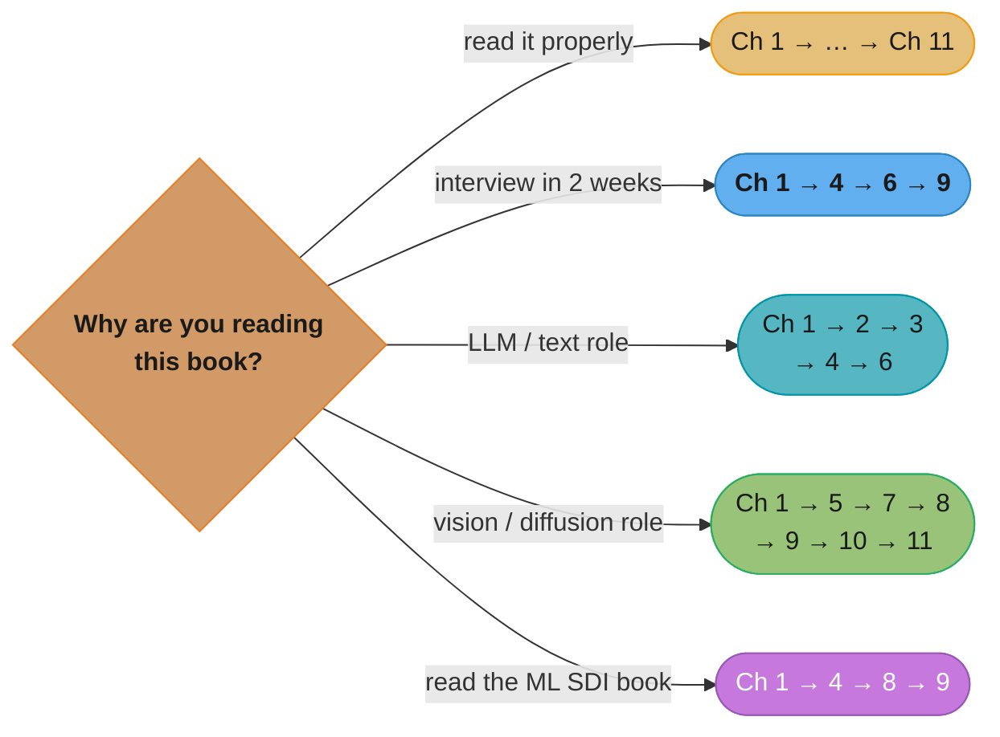

# Generative AI System Design Interview

> Ali Aminian & Hao Sheng · **ByteByteGo, 2024** · ISBN 9781736049143 · A chapter-by-chapter,
> in-depth summary — read this folder in order and you have read the book.

> **Table of contents established from the publisher's own course edition of the book**,
> <https://bytebytego.com/courses/genai-system-design-interview/introduction-and-overview> —
> 11 chapters: one framework chapter and ten worked design problems.

> **This is a companion volume, not a sequel.** The same house's
> [`machine_learning_system_design_interview/`](../machine_learning_system_design_interview/machine_learning_system_design_interview.md)
> (Aminian & Xu, 2023) covers classical ML design problems — ranking, recommendation, search,
> ads. This book keeps the same 7-step interview frame and points it at *generative* problems:
> text generation, translation, chatbots, captioning, retrieval-augmented generation, and five
> chapters of image and video synthesis.

---

## The Book's Thesis

A generative AI design interview is still a **system** design interview. The failure mode the
book is written against is a candidate who spends forty-five minutes on model architecture and
never mentions data collection, evaluation, serving cost, or what happens when the model
generates something harmful.

So Chapter 1 lays out a seven-step framework — clarify requirements, frame as an ML task,
choose the model, prepare data, train, evaluate, serve and monitor — and **every one of the ten
remaining chapters walks the same seven steps** over a different problem. The repetition is the
pedagogy: by the fourth chapter you are meant to be able to open a new problem and know which
question comes next.

Three claims recur:

- **Requirements clarification decides the design.** Latency budget, output modality, quality
  bar, and safety constraints eliminate most of the model space before you have named a single
  architecture.
- **Evaluation is where generative problems diverge from classical ML.** There is no accuracy
  number for "is this a good caption" or "is this face realistic", so each chapter spends real
  effort on offline metrics (BLEU, FID, CLIP score, perplexity) *and* the online metrics that
  actually decide whether the system shipped well.
- **Serving cost and safety are design constraints, not appendices.** Diffusion sampling steps,
  KV-cache size, and content filtering all change the architecture, and the book puts them
  inside the design rather than after it.

---

## The Shape of the Book

```mermaid
flowchart TD
    classDef io      fill:#61afef,stroke:#2e86c1,color:#1a1a1a,font-weight:bold
    classDef frozen  fill:#c678dd,stroke:#9b59b6,color:#fff
    classDef train   fill:#98c379,stroke:#27ae60,color:#1a1a1a
    classDef mathOp  fill:#d19a66,stroke:#e67e22,color:#1a1a1a,font-weight:bold
    classDef req     fill:#56b6c2,stroke:#0097a7,color:#1a1a1a
    classDef base    fill:#e5c07b,stroke:#f39c12,color:#1a1a1a

    root(["Generative AI System<br/>Design Interview"]) --> F
    root --> G1
    root --> G2
    root --> G3

    subgraph F["The framework"]
        C1("Ch 1<br/>Introduction and Overview<br/>the 7-step process")
    end

    subgraph G1["Text generation<br/>sequence models and LLMs"]
        C2("Ch 2<br/>Gmail<br/>Smart Compose") --> C3("Ch 3<br/>Google<br/>Translate") --> C4("Ch 4<br/>ChatGPT — Personal<br/>Assistant Chatbot")
    end

    subgraph G2["Multimodal and grounded<br/>text conditioned on something else"]
        C5("Ch 5<br/>Image<br/>Captioning") --> C6("Ch 6<br/>Retrieval-Augmented<br/>Generation")
    end

    subgraph G3["Image and video synthesis<br/>GANs then diffusion"]
        C7("Ch 7<br/>Realistic Face<br/>Generation") --> C8("Ch 8<br/>High-Resolution<br/>Image Synthesis") --> C9("Ch 9<br/>Text-to-Image<br/>Generation") --> C10("Ch 10<br/>Personalized Headshot<br/>Generation") --> C11("Ch 11<br/>Text-to-Video<br/>Generation")
    end

    class root io
    class C1 mathOp
    class C2,C3,C4 req
    class C5,C6 base
    class C7,C8 frozen
    class C9,C10,C11 train
```

*Colour follows the modality: the framework in orange, the three pure-text chapters in teal,
the two grounded-text chapters in gold, the two unconditional-image chapters in purple, and the
three conditioned generation chapters — text-to-image, personalization, text-to-video — in
green.*

The ordering is a difficulty ramp inside each group and across them. Ch 2's Smart Compose is a
constrained next-token problem with a hard latency budget; Ch 4's chatbot is the same family
with alignment, memory and safety on top. Ch 7 generates a face from noise; Ch 11 generates a
video from a sentence, and every intermediate chapter adds one axis of control.

---

## Chapter Index

| # | Chapter | Folder | One-line summary | Repo deep-dive |
|---|---------|--------|------------------|----------------|
| 1 | Introduction and Overview | [01_introduction_and_overview/](01_introduction_and_overview/01_introduction_and_overview.md) | Discriminative vs generative; the 7-step design framework | [ml/ml_system_design/](../../ml/ml_system_design/ml_system_design.md) |
| 2 | Gmail Smart Compose | [02_gmail_smart_compose/](02_gmail_smart_compose/02_gmail_smart_compose.md) | Real-time inline suggestion under a tight latency budget | [llm/inference_and_decoding/](../../llm/inference_and_decoding/inference_and_decoding.md) |
| 3 | Google Translate | [03_google_translate/](03_google_translate/03_google_translate.md) | Seq2seq and transformer NMT; BLEU; low-resource languages | [ml/natural_language_processing/](../../ml/natural_language_processing/natural_language_processing.md) |
| 4 | ChatGPT: Personal Assistant Chatbot | [04_chatgpt_personal_assistant_chatbot/](04_chatgpt_personal_assistant_chatbot/04_chatgpt_personal_assistant_chatbot.md) | Pre-train, SFT, RLHF; multi-turn context; safety and serving | [llm/alignment_and_rlhf/](../../llm/alignment_and_rlhf/alignment_and_rlhf.md) |
| 5 | Image Captioning | [05_image_captioning/](05_image_captioning/05_image_captioning.md) | Vision encoder plus language decoder; CIDEr and CLIP score | [llm/vision_language_models/](../../llm/vision_language_models/vision_language_models.md) |
| 6 | Retrieval-Augmented Generation | [06_retrieval_augmented_generation/](06_retrieval_augmented_generation/06_retrieval_augmented_generation.md) | Chunking, embedding, ANN retrieval, grounded generation | [llm/rag_fundamentals/](../../llm/rag_fundamentals/rag_fundamentals.md) |
| 7 | Realistic Face Generation | [07_realistic_face_generation/](07_realistic_face_generation/07_realistic_face_generation.md) | GAN training dynamics; FID; unconditional synthesis | [ml/generative_models/](../../ml/generative_models/generative_models.md) |
| 8 | High-Resolution Image Synthesis | [08_high_resolution_image_synthesis/](08_high_resolution_image_synthesis/08_high_resolution_image_synthesis.md) | Diffusion and latent diffusion; sampling-step cost; upscaling | [ml/generative_models/](../../ml/generative_models/generative_models.md) |
| 9 | Text-to-Image Generation | [09_text_to_image_generation/](09_text_to_image_generation/09_text_to_image_generation.md) | Text conditioning, CLIP guidance, classifier-free guidance, safety | [llm/multimodal_models/](../../llm/multimodal_models/multimodal_models.md) |
| 10 | Personalized Headshot Generation | [10_personalized_headshot_generation/](10_personalized_headshot_generation/10_personalized_headshot_generation.md) | Subject personalization from a few images; per-user fine-tuning at scale | [llm/fine_tuning/](../../llm/fine_tuning/fine_tuning.md) |
| 11 | Text-to-Video Generation | [11_text_to_video_generation/](11_text_to_video_generation/11_text_to_video_generation.md) | Temporal consistency; spatiotemporal models; the compute wall | [ml/generative_models/](../../ml/generative_models/generative_models.md) |

---

## How to Read This (Reading Paths)

- **Cover to cover (recommended):** Ch 1 → … → Ch 11. Ch 1 is not optional — every later
  chapter is an instance of its framework and reads as a list of disconnected facts without it.
- **Interview in two weeks:** Ch 1 → 4 → 6 → 9. The framework plus the three problems most
  often asked as-is.
- **LLM/text-focused role:** Ch 1 → 2 → 3 → 4 → 6.
- **Vision/diffusion-focused role:** Ch 1 → 5 → 7 → 8 → 9 → 10 → 11.
- **Already read the ML System Design Interview book:** Ch 1 (to see what changed in the
  framework) → 4 → 8 → 9. The generative-specific evaluation and serving material is the delta.

*Every path starts at Ch 1 — the seven steps are the only thing the ten design chapters share,
and they are what an interviewer is actually grading.*

---

## Build Manifest

Per-file build status for this book. Update the row to `done` the moment a chapter file is
completed and diagram-linted.

| # | File | Status |
|---|------|--------|
| 1 | `01_introduction_and_overview/01_introduction_and_overview.md` | done |
| 2 | `02_gmail_smart_compose/02_gmail_smart_compose.md` | done |
| 3 | `03_google_translate/03_google_translate.md` | done |
| 4 | `04_chatgpt_personal_assistant_chatbot/04_chatgpt_personal_assistant_chatbot.md` | done |
| 5 | `05_image_captioning/05_image_captioning.md` | done |
| 6 | `06_retrieval_augmented_generation/06_retrieval_augmented_generation.md` | done |
| 7 | `07_realistic_face_generation/07_realistic_face_generation.md` | done |
| 8 | `08_high_resolution_image_synthesis/08_high_resolution_image_synthesis.md` | done |
| 9 | `09_text_to_image_generation/09_text_to_image_generation.md` | done |
| 10 | `10_personalized_headshot_generation/10_personalized_headshot_generation.md` | done |
| 11 | `11_text_to_video_generation/11_text_to_video_generation.md` | done |

---

## Cross-Reference Map (Generative AI SDI → repo deep dives)

| Book concept | Primary deep-dive module |
|--------------|--------------------------|
| The end-to-end ML design framework | [ml/ml_system_design/](../../ml/ml_system_design/ml_system_design.md) |
| Framing a product need as an ML task | [ml/ml_interview_patterns/](../../ml/ml_interview_patterns/ml_interview_patterns.md) |
| Transformer internals, attention | [llm/foundations_and_architecture/](../../llm/foundations_and_architecture/foundations_and_architecture.md) |
| Decoding strategies, beam search, latency | [llm/inference_and_decoding/](../../llm/inference_and_decoding/inference_and_decoding.md) |
| Serving engines and batching | [llm/inference_engines/](../../llm/inference_engines/inference_engines.md) |
| Seq2seq, machine translation, BLEU | [ml/natural_language_processing/](../../ml/natural_language_processing/natural_language_processing.md) |
| SFT, RLHF, preference optimization | [llm/alignment_and_rlhf/](../../llm/alignment_and_rlhf/alignment_and_rlhf.md) |
| Multi-turn context and memory | [llm/context_engineering/](../../llm/context_engineering/context_engineering.md) |
| Vision encoders, CLIP, captioning | [llm/vision_language_models/](../../llm/vision_language_models/vision_language_models.md) |
| Multimodal fusion and cross-attention | [llm/multimodal_models/](../../llm/multimodal_models/multimodal_models.md) |
| Chunking, embedding, hybrid retrieval | [llm/rag_fundamentals/](../../llm/rag_fundamentals/rag_fundamentals.md) |
| Reranking and retrieval quality | [llm/advanced_rag/](../../llm/advanced_rag/advanced_rag.md) |
| Vector index structures and ANN | [database/vector_databases/](../../database/vector_databases/vector_databases.md) |
| GANs, VAEs, diffusion models | [ml/generative_models/](../../ml/generative_models/generative_models.md) |
| Convolutional backbones and U-Nets | [ml/convolutional_neural_networks/](../../ml/convolutional_neural_networks/convolutional_neural_networks.md) |
| Image models and vision pipelines | [ml/computer_vision/](../../ml/computer_vision/computer_vision.md) |
| LoRA, DreamBooth-style personalization | [llm/fine_tuning/](../../llm/fine_tuning/fine_tuning.md) |
| Offline vs online evaluation | [ml/model_evaluation_and_selection/](../../ml/model_evaluation_and_selection/model_evaluation_and_selection.md) |
| Content safety and output filtering | [llm/guardrails_and_content_safety/](../../llm/guardrails_and_content_safety/guardrails_and_content_safety.md) |
| Bias, consent, responsible generation | [ml/fairness_and_responsible_ai/](../../ml/fairness_and_responsible_ai/fairness_and_responsible_ai.md) |
| GPU capacity and cost planning | [devops/ml_platform_and_gpu_infrastructure/](../../devops/ml_platform_and_gpu_infrastructure/ml_platform_and_gpu_infrastructure.md) |
| Serving and monitoring in production | [ml/model_serving_and_inference/](../../ml/model_serving_and_inference/model_serving_and_inference.md) |
| Drift detection after launch | [ml/monitoring_and_drift_detection/](../../ml/monitoring_and_drift_detection/monitoring_and_drift_detection.md) |

---

## Further Reading

- Publisher's course edition of the book:
  <https://bytebytego.com/courses/genai-system-design-interview/introduction-and-overview>
- The companion volume in this repo, same framework, classical ML problems:
  [`machine_learning_system_design_interview/`](../machine_learning_system_design_interview/machine_learning_system_design_interview.md)
- Huyen, *Designing Machine Learning Systems* — the production-systems background this book
  assumes: [`designing_machine_learning_systems/`](../designing_machine_learning_systems/designing_machine_learning_systems.md)
- Huyen, *AI Engineering* — the foundation-model application layer:
  [`ai_engineering/`](../ai_engineering/ai_engineering.md)
- The repo's own generative-AI spine: [`llm/`](../../llm/README.md) and [`ml/`](../../ml/README.md)
