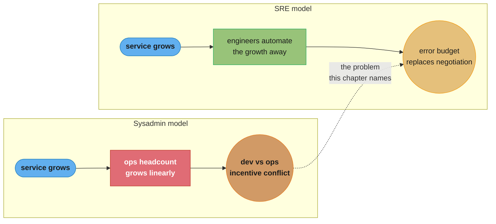

# Chapter 1: Introduction

> Part I — Introduction · Site Reliability Engineering: How Google Runs Production Systems
> (Beyer, Jones, Petoff & Murphy, eds., O'Reilly 2016) · opens the book, leads to Ch 3
> (Embracing Risk) — Ch 2, "The Production Environment at Google," is Google-infrastructure-
> specific and is not summarized in this folder

## Chapter Map

Every other chapter in this folder assumes you already know what SRE *is*; this one is where
the book earns that assumption. Founder Ben Treynor Sloss's famous one-line definition —
"what happens when you ask a software engineer to design an operations team" — is the spine
of the whole book: everything downstream (error budgets, toil caps, blameless postmortems,
on-call as an engineering practice rather than a chore) follows from taking that sentence
seriously rather than treating it as a slogan.

**TL;DR:**
- Traditional "sysadmin" operations teams scale **linearly** with service size and load,
  because a growing service means proportionally more manual work; SRE staffs operations with
  software engineers on the theory that automation, not headcount, is the only thing that
  scales sublinearly.
- The sysadmin/dev split creates structurally opposed incentives — developers are rewarded for
  shipping features fast, operators are rewarded for nothing breaking — and the friction between
  the two teams is a recurring, predictable tax on the organization.
- SRE resolves that tax with an explicit, engineered mechanism (the **error budget**, developed
  fully in Chapter 3) rather than by hoping the two camps negotiate nicely.
- **The Tenets of SRE** — the chapter's real content — are eight commitments (an engineering time
  cap, an error-budget-gated release velocity, and six operational disciplines) that together
  define what distinguishes an SRE team from a traditional ops team in practice, not just in job
  title.

## The Big Question

Every software service eventually needs someone to keep it running: watch it, patch it,
capacity-plan it, respond when it breaks at 3 a.m. The traditional answer is a dedicated
operations team of systems administrators, hired and organized separately from the developers
who write the software. That answer works, but it has a scaling problem and an incentive
problem baked in from day one — and Chapter 1's job is to state both problems precisely before
proposing Google's alternative.

Analogy: imagine a factory that keeps adding a new night-shift worker for every new production
line, forever. That is what team growth proportional to service growth looks like — the factory
never gets more efficient per line, it just gets bigger. Google's answer is closer to building
an assembly-line engineer who studies why each new line needs a night-shift worker at all and
tries to design that need away. SRE is that assembly-line-engineer role applied to running
software in production.

---

## 1.1 The Sysadmin Approach to Service Management

The traditional path to running a production service is to assemble it from existing software
components — some built in-house, most not — and hand it to a **systems administrator (sysadmin)**
team to keep alive: respond to events, handle capacity, apply updates, escalate serious problems
to the development team. This model is attractive because it's fast to adopt (little specialized
development work is required up front) and the skill set it needs — solid Unix administration,
common tools, existing off-the-shelf software — is easy to hire for at any company's current
growth stage.

The chapter's argument against it is a **cost** argument with two halves.

**Direct costs.** As a service grows in scope, complexity, and traffic, so does the manual work
of keeping it running — and that work scales *with* the service, roughly linearly. Twice the
traffic tends to mean roughly twice the operational load, because nothing about the sysadmin
model automatically makes each additional unit of load cheaper to handle than the last. A team
sized for today's traffic is undersized for next year's traffic unless it grows too.

**Indirect costs** are subtler and, the book argues, larger. Developers and sysadmins sit in
different reporting chains with different, structurally opposed goals: developers want to ship
change quickly because that is how a product improves and how they are evaluated; sysadmins want
production stable because that is how they are evaluated, and nearly all production risk in a
running service originates from *some kind of change* — a new release, a config push, a
traffic-pattern shift. This makes conflict close to inevitable, not a symptom of any particular
team being unreasonable: pushing hard for velocity and pushing hard for stability are genuinely
in tension when the org chart splits the people accountable for each. Two familiar coping
patterns follow from the split — reducing the rate of change (fewer releases, more
gatekeeping) and building layers of protective, often redundant, machinery around the service
— and both trade velocity for stability at a cost the organization pays whether or not anyone
names it explicitly.

## 1.2 Google's Approach to Service Management: Site Reliability Engineering

Google's alternative is to staff operations with people who have software engineering skills and
explicitly bias the team's toolset and culture toward automation over manual work — a team the
book calls **site reliability engineers**. An SRE team is composed, roughly, of a mix of
conventional software engineers and engineers whose skill profile sits one notch short of a
standard SWE hire but who bring specialized skills rare or absent in that population (Linux
internals, networking at depth, distributed-systems experience) — informally split around
**50-60% conventional SWEs** and **40-50%** of this second profile. Both groups write code:
the point of the split is that the whole team is engineering-capable, not that some fraction of
it is exempt from operational work.

Structurally, SRE removes the sysadmin/dev incentive conflict by putting engineering capability
*and* operational responsibility inside the same team, given to people motivated to automate
their own toil away rather than reduce risk by simply refusing changes. Google's explicit
long-term goal for a **well-managed service is for it to be able to run itself**: the team's job
is to make the system need less and less hands-on operation as it grows, not to become
permanently indispensable to running it day to day.

This has a real cost most companies do not pay: engineers capable of designing systems from
scratch are, in dollar terms, more expensive than a comparable sysadmin hire. The book's
counter-argument is that a *smaller* team of them, spending most of its time automating rather
than operating, produces flatter total cost as the service scales, plus the qualitative benefit
of avoiding the dev/ops rift entirely — the tradeoff is a bet that engineering leverage beats
headcount over the service's lifetime.

## 1.3 DevOps or SRE?

The book explicitly situates SRE relative to **DevOps**, the industry movement that emerged
around the same era (the term dates to around 2008) and argues for tighter collaboration between
development and operations, small and reversible releases, shared tooling, and cross-team trust.
The chapter's own framing: DevOps can be thought of as generalizing several core SRE practices
(shared ownership, automation-first thinking, measurement-driven decisions, learning from
failure) into a wider set of applicability across organizations of every size and every industry.
The book's own summary line is close to "class SRE implements interface DevOps" — SRE is offered
as one concrete, opinionated, load-bearing implementation of the DevOps philosophy, developed
independently and largely in parallel at Google, rather than a rebranding of it or a competitor
to it.

## 1.4 Tenets of SRE

The chapter closes with the concrete commitments that distinguish an SRE team from an ops team
in practice — the part of the chapter every later chapter in this folder expands on at length.

### Ensuring a Durable, Long-Term Focus on Engineering

SRE work is split, deliberately and by policy, so that operational load never quietly grows to
consume the whole team. **No more than 50% of an SRE's time** should go to purely operational
work — on-call, tickets, manual operational tasks (collectively, **toil**, defined precisely in
Chapter 5) — leaving **at least 50%** for engineering project work that reduces future
operational load or adds features. When operational load exceeds that 50% ceiling, the excess
is explicitly routed back to the development team that owns the service, which both protects the
SRE team's engineering capacity and gives the development team a direct, felt incentive to build
operable software.

### Pursuing Maximum Change Velocity Without Violating a Service's SLO

Google's SRE model treats 100% reliability as almost always the *wrong* target (Chapter 3 makes
this rigorous): a **service level objective (SLO)**, agreed with the service owner, defines how
much unreliability is acceptable, and the resulting **error budget** is what SRE spends on risk —
new releases, migrations, experiments — without needing case-by-case negotiation with
development. As long as the budget isn't exhausted, change proceeds at whatever pace the team
can sustain; once it is, the brakes come on automatically rather than politically.

### Monitoring

Monitoring is how a system tells its operators what's wrong. The tenet here — developed at
length in Chapter 6 — is that a page (an interruption of a human being) should be reserved for
conditions that are genuinely urgent, actionable, and not something a machine could have handled
instead; monitoring output otherwise routes to dashboards, tickets, or nowhere, rather than to a
human's pager.

### Emergency Response

Reliability is fundamentally a function of **mean time to repair (MTTR)** more than mean time
between failures for most services, because failures at scale are not fully avoidable — the
question is how fast you find and fix them. A team following a well-tested, well-maintained
playbook resolves incidents roughly **3 times faster**, by the book's own comparison, than a team
improvising from first principles under pressure; Chapters 12-15 (outside this folder's scope
except where cross-referenced) build the playbook and incident-response machinery this tenet
depends on.

### Change Management

The book states that roughly **70% of outages** in Google's own experience are caused by a change
to a live system — a new release, a config change, or a similar modification. SRE's answer is not
"change less" but "change more safely": progressive rollouts, fast and reliable automated
detection of problems, and safe automated rollback when detection fires, so that most change-
related incidents are caught and reverted before they become customer-visible outages.

### Demand Forecasting and Capacity Planning

Capacity must be provisioned ahead of actual demand, using both organic growth forecasts (product
adoption trends over time) and inorganic ones (a launch, a marketing push, a seasonal spike).
Getting this wrong in either direction is expensive: under-provisioning risks an outage exactly
when demand is highest and matters most; over-provisioning wastes capital that could have funded
other engineering work.

### Provisioning

Provisioning combines capacity planning with the operational act of bringing new capacity online,
and the chapter flags it as riskier than most other operational changes precisely because it
touches the live system's configuration and footprint directly — so it needs to happen carefully,
correctly, and (per the automation bias running through the whole chapter) as infrequently by
hand as engineering effort can make it.

### Efficiency and Performance

An efficiently run service costs less to operate for the same load and performs better for
users, and both properties are the SRE team's explicit remit, not an afterthought: resource use
is monitored and provisioning is tuned against real utilization data rather than static
guesswork, closing the loop with the demand-forecasting tenet above.

## 1.5 The End of the Beginning

The chapter's short closer frames the rest of the book as an extended demonstration of the eight
tenets above in practice — each later chapter takes one commitment (error budgets, toil,
monitoring, on-call, incident response, postmortems...) and shows the mechanics that make it real
rather than aspirational. The book's stated goal is to show these ideas are portable outside
Google specifically because they follow from the underlying problem (running a service reliably
at scale, cheaply, without wearing out the humans responsible for it) rather than from anything
particular to Google's own infrastructure.

---

## Beyond the book — SRE's spread and Platform Engineering

> The chapter argues SRE's principles generalize beyond Google, and are worth adopting elsewhere.
> It does **not** discuss the specific industry trajectory that followed 2016: the vocabulary
> this chapter introduces (error budgets, toil, the tenets) became a shared industry standard
> largely because of this book's own influence, and a newer discipline — **platform
> engineering** — has since emerged, building self-service internal developer platforms that
> package much of what an early SRE team built by hand. That is a 2020s development the 2016
> text cannot describe.

The DevOps-vs-SRE framing in §1.3 also predates a decade of industry debate about how the two
relate in practice; Google's own later publication, *The Site Reliability Workbook* (2018),
revisits and sharpens several tenets from this chapter with lessons learned from adopting SRE at
companies other than Google — see the editorial note on the book index page.

---

## Visual Intuition



Caption: the sysadmin model's cost line tracks the service's growth line directly; SRE's bet is
that engineering time spent automating bends that line down, and the error budget (Chapter 3)
replaces ad hoc dev/ops conflict with one shared, quantified number.

```
  SRE time budget, per the chapter's own cap:

  |------------------- 100% -------------------|
  |<--- max 50% operational (toil, on-call) --->|<--- min 50% engineering --->|
       overflow beyond 50% routes back to the
       development team that owns the service
```

Caption: the 50/50 split is not an aspiration, it is a hard operating ceiling — when
operational load crosses it, the excess is a signal to push work back to development, not a
reason to grow the SRE team's headcount.

---

## Key Concepts Glossary

- **Site reliability engineer (SRE)** — an engineer running production with a software-engineering
  skill set and an automation-first mandate, rather than a traditional sysadmin.
- **Sysadmin approach** — the traditional model of a dedicated operations team assembling and
  running a service built from existing components.
- **Direct costs (of the sysadmin model)** — operational labor that scales roughly linearly with
  service size and load.
- **Indirect costs (of the sysadmin model)** — the organizational friction between developers
  (rewarded for velocity) and operators (rewarded for stability).
- **50% operational cap** — the ceiling on how much of an SRE's time may go to toil and on-call
  before excess load routes back to the owning development team.
- **Error budget** — the quantified amount of unreliability a service is allowed to spend on risk
  in a given period, developed fully in Chapter 3.
- **Service level objective (SLO)** — the target reliability level a service commits to.
- **Toil** — manual, repetitive, automatable operational work with no enduring engineering value;
  defined precisely in Chapter 5.
- **Mean time to repair (MTTR)** — the average time from a failure occurring to it being resolved;
  the metric SRE optimizes for over avoiding all failures.
- **DevOps** — the broader industry movement toward shared dev/ops ownership, automation, and
  small reversible releases, which the chapter treats SRE as one concrete implementation of.
- **Playbook** — a documented, tested incident-response procedure; the chapter's cited factor for
  faster resolution versus improvised response.

---

## Tradeoffs & Decision Tables

| Dimension | Sysadmin model | SRE model |
|---|---|---|
| Team composition | Systems administrators | Software engineers + specialized-skill engineers |
| Cost scaling with service growth | Roughly linear headcount growth | Bet on sublinear growth via automation |
| Dev/ops relationship | Structurally opposed incentives (velocity vs. stability) | Same team owns both; error budget resolves the conflict quantitatively |
| Change-risk resolution | Slow releases, protective layers, gatekeeping | Progressive rollout + fast automated detection/rollback |
| Long-run goal | Keep the service running | Make the service need less and less operation over time |
| Hiring cost per head | Lower | Higher (software-engineering-capable hires) |

| Tenet | What it constrains | Chapter that develops it |
|---|---|---|
| Durable focus on engineering | Time allocation (≤50% ops) | Ch 5 (Eliminating Toil) |
| Max velocity without violating SLO | Release risk via error budget | Ch 3, Ch 4 |
| Monitoring | What pages a human | Ch 6 |
| Emergency response | MTTR via playbooks | Ch 12-15 (outside this folder) |
| Change management | Rollout safety | Ch 8 (Release Engineering) |
| Demand forecasting & capacity planning | Provisioning timing | outside this folder |
| Provisioning | Provisioning execution risk | outside this folder |
| Efficiency and performance | Cost and latency per unit load | outside this folder |

---

## Common Pitfalls / War Stories

- **Treating SRE as a rename for ops.** The chapter's own contrast is explicit: giving an
  operations team the SRE title without giving it the engineering skill set, the automation
  mandate, or the 50% cap produces the sysadmin model's costs under a new label — the tenets are
  the substance, not the org-chart name.
- **Ignoring the indirect cost of the dev/ops split.** Organizations that only track the direct,
  linear cost of operational headcount and never account for the friction cost between teams
  chronically underestimate why releases slow down and trust erodes as a service grows.
- **Skipping the error budget and negotiating case by case instead.** Without a quantified,
  agreed budget, every release becomes a fresh negotiation between development and operations —
  exactly the political, non-scalable process the tenets are designed to replace.
- **Letting operational load creep past 50% without acting.** The chapter is explicit that the
  correct response to sustained overload is to route excess work back to the owning development
  team, not to quietly absorb it and let engineering time evaporate.
- **Assuming 100% reliability is always the goal.** The chapter previews (and Chapter 3 proves)
  that over-investing in reliability past what users can perceive is a real cost with no
  matching benefit — a lesson many organizations relearn expensively.

---

## Real-World Systems Referenced

- **Google** — the whole chapter's organizational context; SRE as practiced at Google is the
  chapter's only worked example.
- **Anti-lock brakes and pacemakers** — the book's own analogy for automation with a human still
  ultimately accountable for the outcome, used to frame why automating operational work does not
  mean removing human judgment from the loop.

---

## Summary

The chapter's own closing argument, restated: a traditional sysadmin operations team scales its
costs — both the direct cost of manual labor and the indirect cost of dev/ops conflict — roughly
with the service it runs. Google's alternative, site reliability engineering, staffs operations
with engineers under an explicit mandate to spend at least half their time automating the job
away, and replaces the political dev/ops negotiation over release risk with a quantified error
budget. The eight tenets of SRE are the concrete commitments that make this more than a rebrand:
a hard cap on operational time, a data-driven ceiling on release risk, monitoring that pages only
for genuine urgency, playbook-driven emergency response, change management that assumes most
outages come from changes and defends against that directly, and disciplined capacity,
provisioning, efficiency, and performance work. Every later chapter in the book is an expansion
of one of these eight commitments.

---

## Interview Questions

**Q: What is Ben Treynor Sloss's one-line definition of SRE, and why does it matter?**
**Short:** SRE is "what happens when you ask a software engineer to design an operations team."
It matters because it sets the organizing principle for every later chapter: solve operational
problems with software engineering and automation, not headcount, and every tenet in this
chapter is a consequence of taking that seriously rather than treating it as a slogan.

**Q: According to the book, what fraction of an SRE's time should go to operational work, and what happens when it's exceeded?**
**Short:** No more than 50%; work beyond that routes back to the development team that owns the service.
The cap protects the team's engineering capacity from being silently consumed by growing
operational load, and pushing overflow back to development gives that team a direct incentive to
build software that is easier to operate.

**Q: What percentage of Google's outages does the book attribute to changes made to a live system?**
**Short:** Roughly 70%, by the book's own figure.
SRE's response isn't to slow change down across the board but to make change safer — progressive
rollouts, fast automated problem detection, and automated rollback — so most change-related
incidents are caught before they become user-visible.

**Q: Is SRE the same thing as DevOps, according to this chapter?**
**Short:** No — the book frames SRE as one specific, opinionated implementation of the broader DevOps philosophy.
DevOps is presented as a general movement toward shared dev/ops ownership and automation
applicable to organizations of any size; SRE is Google's own concrete implementation, developed
largely in parallel with the DevOps movement rather than derived from it.

**Q: What are the two categories of "cost" the book uses to argue against the pure sysadmin model?**
**Short:** Direct costs (labor that scales with service size) and indirect costs (dev/ops incentive conflict).
Direct costs are the easier one to see and budget for; the book argues the indirect cost — the
organizational friction between a team rewarded for velocity and a team rewarded for stability —
is the larger and less visible of the two.

**Q: What is Google's stated composition target for an SRE team, in terms of engineer background?**
**Short:** Roughly 50-60% conventional software engineers and 40-50% engineers with specialized systems skills.
Both groups are expected to write code; the split describes background and specialization, not a
division between "engineers" and "operators" within the team.

**Q: Why does the book claim playbook-driven incident response resolves problems faster than improvised response?**
**Short:** The book cites roughly a 3x improvement in mean time to repair with a tested playbook versus none.
Improvised response under pressure re-derives the diagnosis and fix from scratch every time; a
maintained playbook captures that reasoning once so responders don't have to reconstruct it live
during an incident.

**Q: What does the book mean by treating a service's long-term goal as "running itself"?**
**Short:** A well-managed service should need progressively less manual operational effort as it scales, ideally toward none.
This reframes the SRE team's job away from perpetually operating the service by hand and toward
engineering the operational need out of it — automation is the exit strategy, not a side project.

**Q: How does the chapter distinguish "toil" conceptually from ordinary engineering work, even though it does not define the term in full here?**
**Short:** Toil is manual, repetitive, operational work with no lasting engineering value, as opposed to project work that reduces future load.
Chapter 1 only previews the distinction through the 50% time cap; Chapter 5 defines toil rigorously
and gives the criteria (manual, repetitive, automatable, tactical, no enduring value, scales
linearly) that separate it from legitimate operational engineering.

**Q: What role does the error budget play in resolving the dev/ops conflict the chapter describes?**
**Short:** It replaces case-by-case negotiation over release risk with one shared, quantified, pre-agreed number.
Instead of development and operations arguing about whether a given release is "too risky" each
time, both teams operate against the same budget: as long as it isn't spent, releases proceed;
once it is, they slow automatically.

**Q: Why does the book treat 100% reliability as generally the wrong target, even in Chapter 1's preview of the idea?**
**Short:** Because reliability beyond what users can perceive costs real engineering effort for no felt benefit.
The full argument — the cost curve, the availability-percentage math, and the error-budget
mechanics — is developed in Chapter 3; Chapter 1 only states the principle that risk should be
managed to an explicit target, not eliminated.

**Q: What is the chapter's stated advantage of putting engineering skill and operational responsibility on the same team?**
**Short:** The people who feel operational pain are the same people empowered and motivated to automate it away.
Splitting the two, as the sysadmin model does, leaves the team best positioned to fix the root
cause (engineers) with no direct stake in doing so, since they don't carry the pager.

**Q: According to the chapter, what's the tradeoff of hiring software engineers into operations roles instead of traditional sysadmins?**
**Short:** Higher cost per hire, offset by a bet that a smaller, automation-focused team produces flatter total cost as the service scales.
The book is explicit this is a bet, not a guarantee — it depends on the team actually spending its
protected engineering time reducing operational load rather than it being consumed by other work.

**Q: What does the "Change Management" tenet actually prescribe, distinct from just "be careful"?**
**Short:** Progressive rollout combined with fast, automated problem detection and automated rollback.
It targets the 70%-of-outages-are-change-caused statistic directly: rather than reducing the rate
of change, it aims to shrink the blast radius and detection-to-rollback time of any single change.

**Q: How does the book's framing of "Provisioning" as riskier than routine operational work square with the automation-first bias of the chapter?**
**Short:** Provisioning changes the live system's footprint and configuration directly, so the chapter treats it as a high-risk category needing careful, not merely infrequent, execution.
The automation bias still applies — provisioning should be automated wherever engineering effort
allows it — but the chapter flags it as a category that deserves more caution than typical
day-to-day operational changes, not less.

**Q: The chapter previews eight tenets without fully developing most of them — which two receive the most direct follow-up within this folder's scope, and where?**
**Short:** Change management is developed in Chapter 8 (Release Engineering); the engineering-focus and monitoring tenets are developed in Chapters 5 and 6.
The remaining tenets (emergency response, demand forecasting, provisioning, efficiency) are
developed in book chapters outside this folder's curated 14-chapter subset.

---

## Cross-links in this repo

- [devops/sre_principles_and_slos/sre_principles_and_slos.md](../../../devops/sre_principles_and_slos/sre_principles_and_slos.md) — the repo's own SRE and SLO deep dive, the natural companion to this whole book.
- [devops/incident_management_and_oncall/incident_management_and_oncall.md](../../../devops/incident_management_and_oncall/incident_management_and_oncall.md) — the on-call and incident-response practices the "Emergency Response" tenet gestures at.
- [devops/ci_cd_fundamentals/ci_cd_fundamentals.md](../../../devops/ci_cd_fundamentals/ci_cd_fundamentals.md) — the "Change Management" tenet's modern tooling counterpart.
- [devops/disaster_recovery_and_resilience/disaster_recovery_and_resilience.md](../../../devops/disaster_recovery_and_resilience/disaster_recovery_and_resilience.md) — capacity, provisioning, and failure-tolerance planning referenced by the "Demand Forecasting and Capacity Planning" and "Provisioning" tenets.
- [backend/distributed_system_operational_patterns/distributed_system_operational_patterns.md](../../../backend/distributed_system_operational_patterns/distributed_system_operational_patterns.md) — operational patterns for keeping distributed backend systems reliable, the backend-side counterpart to this chapter's operations focus.

---

## Further Reading

- Chapter 3, "Embracing Risk" — the error budget mechanism this chapter only previews.
- Chapter 5, "Eliminating Toil" — the rigorous definition of the term this chapter uses loosely.
- Chapter 6, "Monitoring Distributed Systems" — the monitoring tenet developed in full.
- Chapter 8, "Release Engineering" — the change-management tenet developed in full.
- *The Site Reliability Workbook* (Google, O'Reilly, 2018) — the practical companion volume that
  revisits these tenets with lessons from adopting SRE outside Google (see the editorial note on
  the book index page).
