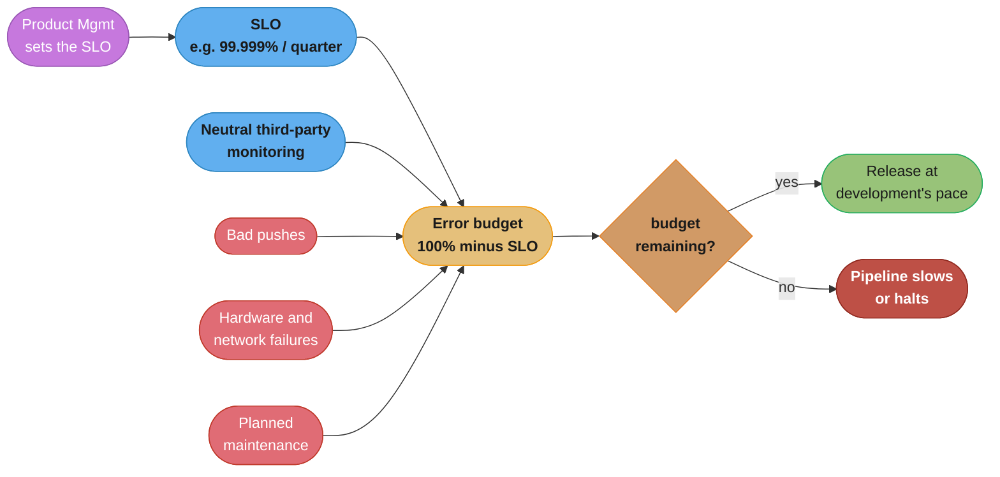
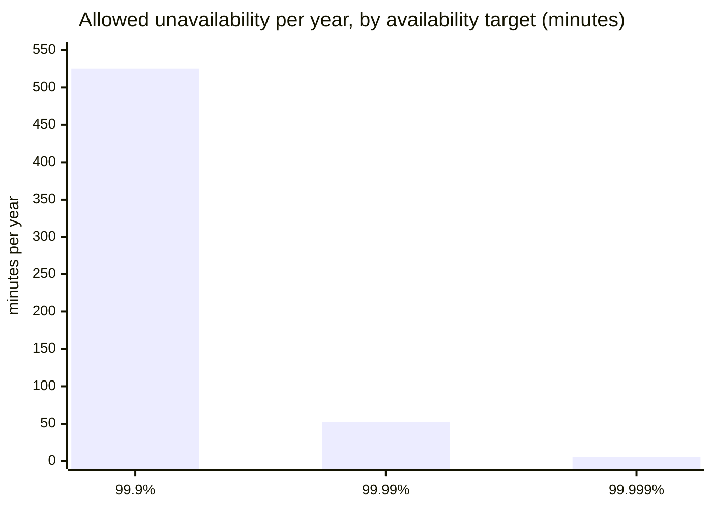
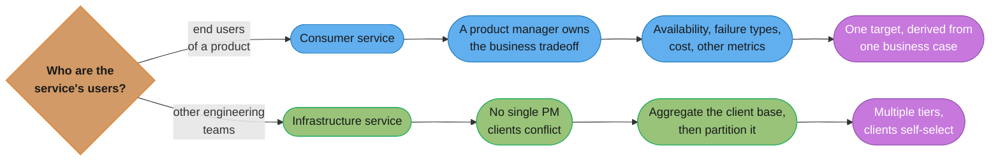

# Chapter 3: Embracing Risk

> Part II — Principles · Site Reliability Engineering: How Google Runs Production Systems
> (Beyer, Jones, Petoff & Murphy, eds., O'Reilly 2016) · builds on Ch 1's tenets, leads to Ch 4
> (Service Level Objectives)

## Chapter Map

Chapter 1 asserted that pursuing maximum change velocity without violating a service's SLO is a
core SRE tenet; this chapter is where that assertion becomes a load-bearing engineering
mechanism. Its argument runs in one direction from start to finish: perfect reliability is not
merely hard to achieve, it is usually the *wrong target*, because reliability past the point users
can perceive costs real engineering effort for no felt benefit — and once you accept that, risk
becomes something to be deliberately budgeted rather than minimized on reflex.

**TL;DR:**
- Google explicitly treats **100% availability as almost always the wrong target** for a service —
  the cost of each additional "nine" of reliability grows nonlinearly while the marginal user
  benefit shrinks, often below the point users can even perceive.
- **Service risk** is measured, at Google, as an **aggregate availability metric** derived from
  request success rate (a **yield**-style metric) rather than raw uptime, because most Google
  services are globally distributed and rarely fully "down" everywhere at once.
- **Risk tolerance differs by service type** — consumer services (with a product manager who owns
  business tradeoffs) and infrastructure services (serving many internal clients with conflicting
  latency/throughput needs) each need their own method for deriving an appropriate target.
- The **error budget** — one minus the SLO, over a period — turns the abstract tension between
  "ship fast" and "stay reliable" into one shared, objective number that both product development
  and SRE optimize against, replacing negotiation with arithmetic.

## The Big Question

If nothing ever went wrong, there would be no such thing as risk management — but nothing ever
failing is not on the menu for a service running on real hardware, over real networks, changed by
real engineers. So the actual question isn't "how do we prevent all failure," it's "how much
failure can we afford, and what do we buy with the failure we're willing to tolerate?"

Analogy: think of reliability like insurance. Buying more coverage always reduces your risk, but
every additional percentage point of coverage costs more than the last, and past some point you
are paying for protection against scenarios that barely matter to you. Nobody insures a used
bicycle for its full replacement value against every conceivable disaster; the sensible amount of
insurance depends on what you're protecting and what more protection is actually worth. Google's
error budget is that same idea, formalized: an explicit, pre-negotiated amount of "insurance
against being unreliable" that both development and operations spend from the same account.

---

## 3.1 Managing Risk

Unreliability inflicts real costs — user dissatisfaction, lost revenue, reputational damage — but
those costs are rarely measured with any precision; instead, organizations tend to seek the
*maximum* reliability they can afford, treating "as reliable as possible" as a default target. The
chapter argues this default is a mistake at scale, for two intertwined reasons.

**The cost curve is nonlinear.** Improving a service's reliability by one additional increment
gets progressively more expensive as reliability climbs, because the easy wins (obvious single
points of failure, cheap redundancy) get exhausted first, leaving only expensive ones (geographic
redundancy, extensive testing infrastructure, operational rigor around every change). Costs come
in two forms: the **direct cost** of redundant machine and compute resources that sit idle most of
the time as a hedge against failure, and the **opportunity cost** of the engineering time spent
building that redundancy instead of shipping features.

**Users mostly can't tell the difference above some threshold.** A user's own device, their home
network, and the public internet between them and any given service are themselves imperfect —
so a jump from, say, 99.99% to 99.999% availability is frequently invisible to the user, whose
overall experience is dominated by their own less-reliable last mile anyway. Reliability past that
threshold is therefore often a pure cost with no perceivable benefit.

The upshot: an availability target should function as **both a minimum and a maximum**. A service
should reliably *meet* its target — but Google explicitly discourages *significantly exceeding*
it too, on the theory that resources spent driving reliability past the target, and the user
expectations set by consistently over-delivering, are both wasted relative to what that engineering
time could otherwise buy (new features, other services, other reliability work with a real
marginal benefit). SRE's job is therefore to actively engineer *toward* the target availability
level from both directions, not simply to make the service as reliable as engineeringly possible.

## 3.2 Measuring Service Risk

To manage risk as an engineering quantity, Google needs a standard, objective way to measure it.
The obvious naive metric — **time-based availability**, the fraction of wall-clock time a service
was "up" — works well for a service that is either entirely available or entirely unavailable at
a given moment, the traditional single-machine-datacenter model. It works poorly for Google's
actual services, which run replicated across globally distributed clusters: a serving cluster
going down in one region rarely takes the whole service down everywhere at once, so binary
uptime/downtime is the wrong shape for describing what actually happened.

```
  time-based availability  =  uptime / (uptime + downtime)
```

At a 99.99% target that formula permits **52.56 minutes** of downtime per year — the chapter's own
worked figure, given to make the target concrete before the metric itself is set aside as
ill-fitting for the shape of service Google actually runs.

Google's standard metric instead is **aggregate availability**, defined via **request success
rate** — the fraction of well-formed requests that succeed, measured over a rolling window,
typically expressed as a percentage of "successful" requests out of the total:

```
  availability  =  (successful requests) / (total valid requests)
```

This is a **yield**-style metric (borrowed from hardware manufacturing, where "yield" means the
fraction of a batch that meets quality standards) rather than a uptime-style one — it captures
partial degradation naturally, since a bad deploy that fails 1% of requests globally shows up as
99% availability rather than as either "fully up" or "fully down." Not every request necessarily
counts equally: a service can choose to weight requests (e.g. by size, by request class) if raw
request-count weighting misrepresents user-perceived reliability, though simple unweighted
success-rate is a reasonable default in most cases.

## 3.3 Risk Tolerance of Services

Different services warrant different availability targets, and identifying the *right* target for
a given service requires understanding its business context — who its users are, what it competes
against, what a failure actually costs. The chapter splits this into two categories with different
methods, because the people who can answer "what does this service need" differ between them.

### Identifying the Risk Tolerance of Consumer Services

Most Google consumer products have a dedicated product manager (PM) responsible for the business
side, who is the right person to define the service's risk tolerance because they own the
business tradeoffs the engineering target must serve. The chapter lays out four considerations a
PM (with SRE's help translating them into an engineering target) should work through:

- **Target level of availability.** What level of reliability does this specific service actually
  need, given its users and use case? The chapter's own factor list is concrete: what level of
  service users expect; whether the service ties directly to revenue (Google's own, or a customer's);
  whether it is a paid or a free offering; what competitors provide; and whether it targets
  consumers or enterprises. A calendar or email product that users depend on for daily work has
  different expectations than an experimental or entertainment product.
- **Types of failures.** Not all unavailability is equal — a service with intermittent, brief
  failures may be far less damaging to users than one with occasional prolonged outages, even at
  the same aggregate availability number; and some categories of failure (data privacy breaches,
  data corruption) may warrant taking the *whole service down deliberately* rather than serving a
  compromised experience. The chapter's worked case is a contact-management application:
  intermittently failing to render profile pictures is an annoyance users tolerate, whereas a bug
  that exposes one user's private contacts to another user is the kind of failure where taking the
  service offline is the *correct* response. It also records that Google's **Ads Frontend**
  historically ran scheduled off-hours maintenance windows — downtime deliberately planned rather
  than counted as failure.
- **Cost.** Availability targets should be chosen with real cost-benefit reasoning, not chosen as
  "as high as possible." The book's own worked example: raising availability by roughly **0.09
  percentage points** (99.9% → 99.99%) on a service earning **$1,000,000** in a relevant period
  might be worth on the order of **$900** in that same period from the extra reliability alone —
  a number a PM can weigh directly against the engineering cost of achieving that jump.
- **Other service metrics.** Availability is one axis among several — latency, freshness of
  results, correctness — and a PM may reasonably trade a small amount of availability for gains
  on another axis if that axis matters more for the product. The chapter's named pair is **AdWords**
  versus **AdSense**. AdWords ads render alongside Google Search results, so the service carries a
  hard latency invariant: it must not slow the search page down. AdSense ads are fetched
  asynchronously into third-party publishers' pages, so AdSense can be **hundreds of milliseconds
  slower** without a user noticing — and that looser latency requirement let Google **consolidate
  AdSense serving into fewer geographic locations, reducing operational overhead**. A relaxed target
  is not a concession here; it is bought back directly as cost.

Google's Apps for Work products, an enterprise offering, are held to an external commitment near
**99.9%** with contractual consequences for missing it, reflecting business customers' need for
predictable reliability; YouTube in its earlier (2006-era) form, a fast-growing consumer product,
accepted a comparatively lower reliability bar in exchange for shipping features and growth faster
— the same framework, applied to two very different businesses, produces two very different
targets, which is the point.

### Identifying the Risk Tolerance of Infrastructure Services

Internal infrastructure — storage systems, compute platforms, data-processing frameworks — serves
many different client teams whose needs can directly conflict, so there is no single PM whose
business judgment settles the target the way there is for a consumer product; instead the
infrastructure service itself must reason about the *aggregate* needs of its client base.

- **Target level of availability.** Infrastructure reliability targets are often set higher than
  any single consumer product's target, because an infrastructure outage cascades into every
  service built on top of it — infrastructure failures multiply rather than staying contained.
- **Types of failures.** As with consumer services, the *shape* of failure matters as much as its
  aggregate rate — brief partial degradation is generally more tolerable to clients than a full,
  sustained outage of a shared platform.
- **Cost.** The same cost-benefit reasoning applies, but weighed against the aggregate needs of
  every client, not one product's business case.
- **Example: Frontend infrastructure.** Components that sit directly between users and Google's
  services — reverse proxies, load balancers, and other request-path infrastructure — receive
  particularly aggressive engineering investment in reliability, because a failure there is
  immediately and directly visible to every user of every service behind it, unlike a failure
  buried several layers deep in a backend.

**Worked example — a storage service with conflicting client needs.** The chapter's own case:
Bigtable, Google's internal wide-column storage system, serves both low-latency interactive
clients (who want their requests served immediately, meaning near-empty server queues) and
high-throughput batch/analysis clients (who want maximum utilization, meaning queues kept
consistently full so no server capacity sits idle). A single tier of infrastructure cannot serve
both preferences well simultaneously — near-empty queues waste throughput capacity, full queues
add latency. Google's answer is not to over-engineer one tier to satisfy everyone, but to offer
**multiple service tiers**: a low-latency tier provisioned generously enough to keep queues short,
and a separate throughput-optimized tier that runs "hot" (near saturation) with minimal
redundancy, at roughly **10-50% of the cost** of the low-latency tier for the same raw compute.
Clients pick the tier that matches their actual need instead of every client paying for a
one-size-fits-all compromise. The chapter's client-side illustration is **Google+**, which routes
different data to different tiers according to what a loss actually costs: user posts and other
privacy-critical data go into a highly available, strongly consistent, expensively replicated
store, while optional, reconstructible data — the chapter's example is data that is cheap to
recompute or simply do without — goes into a cheaper, less-available, eventually consistent one.
Risk tolerance is decided per *data class*, not once per company.

---

## 3.4 Motivation for Error Budgets

The tension Chapter 1 named structurally — development wants velocity, operations wants
stability — plays out concretely as a disagreement over what counts as an acceptable level of
risk in day-to-day decisions: how much testing is enough before a release, how fast can pushes go
out, how aggressive can a canary rollout be. Left to resolve informally, this becomes a political
argument, decided by whoever has more organizational leverage in the moment rather than by any
objective standard — a bad outcome regardless of which side wins, because it optimizes for
influence rather than for the business's actual risk tolerance. The chapter's specific list of
where the two sides collide is worth memorizing, because each item is a knob someone will want to
turn during a launch: **software fault tolerance** (how hard do we harden against unexpected
events), **testing** (how much is enough before a release), **push frequency**, and **canary
duration and size**. Its verdict on resolving any of them by argument is the line the chapter is
best known for: **"Hope is not a strategy."**

Google's fix treats the disagreement as a resource-allocation problem with an objective answer,
not a political one: given the target availability the business actually needs (from §3.3), the
gap between that target and perfect reliability *is* a quantified, spendable resource — the
**error budget** — and both engineering teams draw from the same account.

## 3.5 Forming Your Error Budget

The mechanism, concretely:

1. **Product Management defines an SLO** — a service level objective, stated as a percentage of
   successful requests (or another appropriate metric) over a fixed period, typically a quarter,
   using the risk-tolerance analysis from §3.3.
2. **Actual performance is tracked by a neutral, third-party monitoring system** — not
   self-reported by either development or SRE, so neither side's numbers are trusted more than the
   other's.
3. **The difference between the SLO and 100% is the error budget**, expressed as an allowed
   failure rate over the period. As long as actual failures stay under that budget, releases keep
   shipping at whatever pace development wants; once the budget is exhausted, the release
   pipeline slows or halts until reliability recovers.

**Worked arithmetic** (the book's own example, restated). A service with an SLO of **99.999%
successful queries per quarter** has an error budget of **0.001%** of queries for that quarter —
that is the total "spendable" unreliability across every cause: bad releases, hardware failures,
network problems, planned maintenance, everything. If, partway through the quarter, an incident
consumes **0.0002%** of queries in failures, that single incident has spent **20% of the quarter's
entire error budget** — a number both development and SRE can look at and agree means something,
without needing to argue about whose fault the incident was or how "bad" it felt.

**Request-volume worked example.** A service handling **2.5 million requests per day** with a
target of **99.99%** availability can afford roughly **250 failed requests per day** and remain
within its SLO — a concrete daily number engineers can compare directly against dashboards, rather
than reasoning only in abstract percentages.

**Context for what "small" failure rates actually mean.** The book notes that even the raw,
uncontrolled background error rate of typical ISPs and client networks runs on the order of
**0.01% to 1%** — meaning an error budget denominated in a few thousandths of a percent is already
operating at a precision well below what most of the path between Google and the user can
guarantee, reinforcing §3.1's point that reliability past a certain threshold stops being
perceptible to users at all.

## 3.6 Benefits

Once the error budget exists as a shared, objectively tracked number, several practical benefits
follow that a purely political negotiation could never produce:

- **It aligns incentives without requiring agreement on values.** Development and SRE do not need
  to agree philosophically on how much risk is "acceptable" — they only need to agree the budget
  is correctly measured, and then both teams optimize against the same number.
- **Product teams become self-policing.** As the budget depletes, the team that wants to keep
  shipping features has its own direct incentive to slow down, add testing, or improve rollout
  safety — nobody outside the team has to intervene or argue for caution, because caution is now
  in the shipping team's own interest.
- **Every source of unreliability draws from the same account.** Network outages, datacenter
  failures, hardware faults and planned maintenance all consume error budget exactly as a bad push
  does. Nobody gets to argue that their failure was "not really our fault" — the budget does not
  care about attribution, only about how many requests the user did not get served. The practical
  effect is that infrastructure and product teams end up sharing responsibility for uptime rather
  than pointing at each other.
- **It converts an argument about values into an argument about measurement.** The only thing the
  two teams must agree on is that the SLO is the right number and that the monitoring is honest.
  Everything downstream of that is arithmetic, which is a far easier thing to settle in a room than
  a disagreement about how much risk a company *should* take.
- **A team that wants more room to innovate has a legitimate way to ask for it.** If development
  keeps running out of budget, the response the chapter sanctions is to go back to Product
  Management and negotiate a **looser SLO** — accepting less reliability in exchange for more
  velocity — rather than quietly shipping through the gate. That is a business decision made in
  the open, with the cost stated.
- **Overachievement stops being free.** Because the budget is a resource with a use, an unspent
  budget at quarter's end is not a trophy; it is capacity that could have bought releases,
  experiments, or riskier but more valuable work. This is the same argument §3.1 makes about
  targets functioning as a maximum as well as a minimum, now denominated in something a team can
  actually spend.

The chapter's closing position is that the whole apparatus — the availability metric of §3.2, the
risk-tolerance analysis of §3.3, and the budget of §3.5 — exists to make one specific class of
argument unnecessary. Development and SRE do not need shared values, shared instincts, or a shared
manager with the authority to overrule one of them. They need one number that both of them believe
is measured correctly, and a rule about what happens when it runs out.

---

## Beyond the book — error budget policies, burn rate, and what the chapter leaves unspecified

> This chapter defines the error budget, gives the arithmetic, and lists the benefits. It does
> **not** specify an *error budget policy* as a written, pre-agreed document; it does not define
> **burn rate** or multiwindow multi-burn-rate alerting; and it says nothing about how to handle
> a budget exhausted by a single catastrophic incident on day three of a quarter, nor about
> **silver bullets**, **budget freezes**, or the practice of exempting some outage classes from the
> budget. All of that is later Google practice, most of it codified in *The Site Reliability
> Workbook* (2018). Nothing in this section is the 2016 authors'.

Three gaps are worth naming, because interviewers routinely ask about them as though this chapter
answered them.

**The policy, not the budget, is what has teeth.** The chapter says releases halt when the budget
is exhausted, but "halt" is unspecified: who decides, for how long, with what exceptions, and who
can override. Later practice writes this down in advance as an *error budget policy* signed by
product, development and SRE before the quarter starts — precisely because the moment the budget
runs out is the worst possible moment to negotiate what running out means.

**Consumption rate matters as much as consumption.** A quarter-long budget spent evenly is a
healthy service; the same budget spent in forty minutes is an incident. Modern SLO alerting is
built on **burn rate** — how many times faster than the sustainable rate the budget is currently
being consumed — with multiple windows so that a fast burn pages immediately and a slow burn opens
a ticket. This chapter's framing is a single quarterly quantity with no rate dimension at all.

**The metric has moved from requests toward user journeys.** §3.2's request success rate remains
the standard starting point, but the industry has since layered on the idea that the *right*
denominator is a critical user journey rather than all valid requests, since a service can be at
99.99% overall while the one flow that matters is at 99%. The chapter's own hedge — that "not all
requests are equal" and a service may weight them — is the seed of this, left undeveloped.

---

## Visual Intuition

### The error budget as a single shared account



*Every arrow into the budget box is a withdrawal, and the chapter's point is that they are
indistinguishable once inside. A datacenter failure and a careless push spend the same currency, so
neither team can claim the other's failures do not count against them.*

### What each additional nine actually costs you in downtime



*The chapter states the 52.56-minutes-per-year figure for 99.99% directly; the neighbouring bars
are the same arithmetic one nine either side. The visual makes §3.1's asymmetry obvious: each step
right cuts the tolerable failure by 10x, and the engineering that buys that tenfold cut does not
get ten times cheaper — which is exactly why the chapter calls the cost curve nonlinear.*

### Why one Bigtable tier cannot serve both clients

```
  Low-latency client wants                Throughput client wants

    request ->  [    ]  server              request ->  [####]  server
                 empty queue                             full queue
                 served immediately                      no idle capacity

    SUCCESS = queues stay near empty        SUCCESS = queues stay full
    (spare capacity is the product)         (spare capacity is waste)

  Same knob, opposite directions:

    queue depth   0 -------------------------------------> saturated
                  ^                                              ^
                  |                                              |
             low-latency                                   throughput
             tier optimum                                  tier optimum
             heavily provisioned,                          runs hot, less
             redundant, isolated                           redundancy
             baseline cost                                 10-50% of that cost
```

*Caption: the chapter's sharpest line is that "success for the low-latency user is failure for the
user concerned with offline analysis." There is no single provisioning point that satisfies both,
so Google stops trying to find one and sells two tiers instead — which is why the answer to
"what availability should our platform target" is often "how many platforms are we willing to run."*

### Two different methods, because two different people can answer the question



*The split is not about how important the service is; it is about whether a single person exists
who can legitimately answer "what does this need." When one does, you get a number. When one does
not, the chapter's answer is to stop searching for a compromise number and offer a menu.*

---

## Key Concepts Glossary

- **Risk (service risk)** — the possibility of unreliability, treated by SRE as a quantity to be
  deliberately budgeted rather than minimized on reflex.
- **Reliability continuum** — the chapter's framing that reliability is not binary; a service should
  be reliable *enough*, and no more reliable than it needs to be.
- **Cost of reliability** — the two-part price of each additional increment: the **direct cost** of
  redundant machines and resources that sit idle as a hedge, and the **opportunity cost** of
  engineering time diverted from user-visible features.
- **Nonlinear cost curve** — the observation that each additional nine costs disproportionately more
  than the last, because the cheap fixes get exhausted first.
- **Target as a maximum as well as a minimum** — the policy that significantly *exceeding* an
  availability target is also a defect, since it wastes resources and sets user expectations that
  must then be met.
- **Time-based availability** — `uptime / (uptime + downtime)`; the traditional metric, natural for a
  system that is either wholly up or wholly down, and ill-fitting for globally distributed services.
- **Aggregate availability** — Google's standard metric: `successful requests / total valid
  requests`, measured over a rolling window; a yield-style rather than uptime-style measure.
- **Request success rate** — the concrete quantity behind aggregate availability; captures partial
  degradation naturally, since a push failing 1% of requests reads as 99%, not as "down."
- **Yield** — the manufacturing term the metric borrows: the fraction of a batch meeting quality
  standards.
- **Valid request** — the denominator's qualifier; malformed requests are excluded, so a client
  sending garbage cannot deplete the service's measured availability.
- **Risk tolerance** — the business-derived answer to how much unreliability a specific service can
  accept; derived differently for consumer and infrastructure services.
- **Consumer service** — a product with end users and, at Google, a product manager who owns the
  business tradeoffs and is therefore the right person to set the target.
- **Infrastructure service** — an internal platform serving many client teams with conflicting
  needs, where no single PM's judgment can settle the target.
- **Types of failures** — the axis distinguishing a constant low rate of small failures from
  occasional full outages, at the same aggregate number; and separating failures worth taking the
  service down for (privacy, corruption) from failures worth serving through.
- **Planned maintenance window** — deliberately scheduled downtime, taken off-hours; the chapter's
  example is Google's Ads Frontend historically running these.
- **Service tiers** — the infrastructure answer to conflicting clients: a low-latency tier
  provisioned generously and a throughput tier run hot with less redundancy, at 10-50% of the cost.
- **Frontend infrastructure** — reverse proxies and load balancers on the request path, held to
  especially high reliability because a request they drop never reaches an application server at
  all and is simply lost.
- **Error budget** — `100% minus the SLO`, over a fixed period (typically a quarter), expressed as
  a spendable quantity of failed requests.
- **SLO (Service Level Objective)** — the target set by Product Management that the error budget is
  derived from; developed in full in Chapter 4.
- **Neutral third-party monitoring** — the requirement that actual performance be measured by a
  system owned by neither development nor SRE, so the number is not contested.
- **Self-policing** — the behaviour the budget produces: the team that wants to ship has its own
  incentive to slow down as the budget depletes, without external intervention.
- **Background error rate** — the 0.01% to 1% error rate typical of ISPs and client networks, below
  which a service's own errors become indistinguishable from internet noise.
- **"Hope is not a strategy"** — the chapter's slogan for refusing to settle risk decisions by
  argument or optimism instead of by measurement.

---

## Tradeoffs & Decision Tables

| Availability target | Allowed downtime per year (time-based) | Typical fit, per the chapter's reasoning |
|---|---|---|
| 99% | ~3.65 days | internal or experimental services where users have alternatives |
| 99.9% | ~8.76 hours | the chapter's named external target for Google Apps for Work, with contractual consequences |
| 99.99% | **52.56 minutes** (the chapter's own figure) | consumer services where downtime is directly revenue-affecting |
| 99.999% | ~5.26 minutes | the chapter's error-budget worked example; approaching the ISP background noise floor |

| Metric | Natural for | Breaks down when | Chapter's verdict |
|---|---|---|---|
| Time-based availability | a single system that is wholly up or wholly down | the service is globally replicated and partially degraded | traditional, and the wrong shape for Google |
| Aggregate availability (request success rate) | globally distributed, replicated services | requests differ wildly in cost or user impact | the standard, with weighting available if needed |
| Weighted request success | services where request classes differ materially | weights become a negotiation of their own | sanctioned but not required; unweighted is a reasonable default |

| Question | Consumer service | Infrastructure service |
|---|---|---|
| Who sets the target? | the product manager, who owns the business tradeoff | nobody single — the platform must aggregate its clients' needs |
| What is the target usually like? | derived from the product's own business case | often *higher*, because failures cascade into everything above |
| How are conflicting needs resolved? | by the PM, as a product decision | by **partitioning**: multiple tiers, clients self-select |
| What is the cost basis? | one product's revenue and user expectations | the aggregate needs of the whole client base |

| Reliability decision | Argument for | Argument against, per the chapter |
|---|---|---|
| Push from 99.9% to 99.99% on a $1M service | fewer failures, better user experience | worth about **$900** in that period; if the engineering costs more, do not do it |
| Run the platform at one very high tier for everyone | simple, one number to defend | every client pays for the strictest client's needs; throughput users get 2-10x the bill they need |
| Exceed the SLO comfortably every quarter | looks like good engineering | wastes resources and sets expectations you must then keep meeting; the target is a maximum too |
| Take the whole service down on a privacy bug | availability drops to zero | correct — some failure classes are worse than unavailability |
| Drive errors below the 0.01-1% ISP background rate | maximum reliability | the improvement is invisible to users; you are buying precision the network cannot deliver |

---

## Common Pitfalls / War Stories

- **Treating "as reliable as possible" as the default target.** This is the exact habit §3.1 opens
  by attacking. It feels responsible and is unfalsifiable, because no one ever has to justify the
  next nine — and it quietly commits the team to spending its entire engineering capacity on
  reliability work whose marginal user benefit may be zero.
- **Reporting uptime for a globally replicated service.** A regional cluster failure that drops 4%
  of traffic for an hour is, under time-based availability, either "no downtime" (the service was
  reachable somewhere) or "one hour down" (some users saw nothing) depending on who is writing the
  report. Both are wrong. The request-success-rate metric produces a number nobody can spin.
- **Letting the release argument be decided by seniority.** §3.4's whole framing is that without a
  budget, "how much canary is enough" is settled by whoever has more organizational leverage that
  week. The outcome is bad even when the *right* side wins, because the next decision will be
  decided by leverage too.
- **Self-reported availability numbers.** §3.5 puts a neutral third-party monitoring system in the
  mechanism deliberately. A budget computed from numbers one of the two parties owns is not a
  shared account; it is a claim, and it will be contested the first time the gate closes.
- **Exempting "infrastructure failures" from the budget.** The moment network outages and hardware
  faults stop counting, the budget becomes a measure of development's carefulness rather than of
  the user's experience — and the user does not care why their request failed. The chapter's design
  has every cause draw from the same account.
- **A budget with no policy behind it.** The chapter says the pipeline halts; it does not say who
  decides, for how long, or who may override. Teams that leave this unwritten discover that the
  first exhausted budget produces exactly the political argument the budget existed to prevent,
  only now with a number to argue about. *(This is a gap in the chapter, not a claim it makes — see
  "Beyond the book" above.)*
- **Spending a quarter's budget in one afternoon and calling it fine.** The arithmetic says a
  0.0002% incident spends 20% of a 0.001% quarterly budget, which sounds survivable. Four such
  incidents in the first three weeks leave nine weeks with nothing left to spend, and the chapter's
  quarterly framing has no rate dimension to warn you before you get there.
- **Building one platform tier and calling the conflict a requirements problem.** The Bigtable case
  is the standing counterexample: low-latency clients and batch clients are not confused about what
  they want, and no amount of requirements-gathering reconciles empty queues with full ones.
- **Setting an infrastructure target from one loud client.** Infrastructure targets are meant to be
  derived from the aggregate client base. A platform tuned to its noisiest customer is a platform
  every other customer is subsidizing.
- **Forgetting the last mile.** Users reach the service across their own device, their home
  network, and the public internet, all less reliable than the service. Past a threshold you are
  measuring your own excellence against a channel that cannot deliver it.

---

## Real-World Systems Referenced

- **Google Apps for Work** — the enterprise offering held to an external quarterly availability
  target of **99.9%**, with stricter internal targets and contractual penalties for missing it; the
  chapter's example of enterprise expectations driving a target.
- **YouTube** — cited as the contrasting case: at and shortly after acquisition, a fast-growing
  consumer product that deliberately accepted a lower availability target than Google Search in
  exchange for feature velocity.
- **Google Search** — the implicit reliability baseline against which YouTube's looser target is
  compared.
- **Bigtable** — the chapter's worked infrastructure example: a distributed storage system serving
  both low-latency interactive clients and high-throughput offline analysis clients whose
  definitions of success are opposites.
- **MapReduce** — named as the shape of the offline-analysis client that wants queues kept full.
- **Google+** — the client-side example of tier selection: privacy-critical user data into the
  highly available consistent store, optional and reconstructible data into the cheaper one.
- **AdWords** — held to a strict latency invariant because its ads render alongside Google Search
  results.
- **AdSense** — the looser-latency counterpart, served asynchronously into publisher pages,
  tolerating hundreds of milliseconds more and consolidated into fewer locations as a result.
- **Ads Frontend** — cited as historically using scheduled off-hours maintenance windows, i.e.
  planned rather than unplanned downtime.
- **Google's frontend infrastructure** — reverse proxies and load balancers, singled out as
  demanding especially high reliability because requests they drop are lost outright.

---

## Summary

The chapter's argument, restated and expanded. Unreliability has real costs — dissatisfied users,
lost revenue, damaged trust — but organizations rarely measure them, and in the absence of
measurement they default to seeking maximum reliability. **That default is wrong past a certain
point**, for two reasons the chapter develops in §3.1. The cost of each additional increment of
reliability rises nonlinearly, in redundant resources that sit idle and in engineering time
diverted from features. And the benefit falls, because a user's own device, home network and ISP
are less reliable than the service, so improvements above some threshold are simply invisible.
The consequence is a policy most organizations find counterintuitive: an availability target is a
**maximum as well as a minimum**, and SRE engineers toward it from both directions.

To manage risk as a quantity you must measure it. §3.2 rejects **time-based availability**
(`uptime / (uptime + downtime)`, which allows 52.56 minutes a year at 99.99%) as the wrong shape
for globally replicated services that are rarely wholly down, and adopts **aggregate availability**
— `successful requests / total valid requests` over a rolling window — a yield-style metric that
represents partial degradation honestly. Not all requests are equal, and a service may weight them,
but unweighted success rate is a reasonable proxy for user experience.

§3.3 then asks what target a given service should have, and answers it differently for two
populations. For **consumer services** a product manager owns the business tradeoff, and works
through four considerations: the target level of availability (driven by user expectations, revenue
linkage, paid versus free, competitors, consumer versus enterprise); the types of failures that
matter (intermittent small failures versus sustained outages; and failures such as privacy breaches
where taking the service down is the correct response); cost, reasoned concretely — raising a $1M
service from 99.9% to 99.99% is worth about **$900**, which is either more or less than the
engineering costs, and that comparison is the decision; and other service metrics, where AdWords'
hard latency invariant beside Search contrasts with AdSense tolerating hundreds of milliseconds
more and consolidating into fewer locations as a result. For **infrastructure services** no single
PM can settle the question, because clients conflict: Bigtable's low-latency users need empty
queues and its batch users need full ones, and "success for the low-latency user is failure for the
user concerned with offline analysis." The answer is not a compromise tier but **partitioning** —
a heavily provisioned low-latency tier and a hot, less redundant throughput tier at **10-50% of the
cost** — with clients, like Google+, choosing per data class. Frontend infrastructure is the one
place the chapter admits to near-unbounded investment, because a request dropped at the proxy is
lost before any application sees it.

§3.4 through §3.6 turn all of this into a mechanism. Development wants velocity and SRE wants
stability, and they collide over fault tolerance, testing, push frequency, and canary duration and
size — decisions that, argued rather than measured, are settled by organizational leverage.
"Hope is not a strategy." The **error budget** is the fix: Product Management sets an SLO, a
neutral third-party system measures actual performance, and the gap between the SLO and 100% is a
spendable quantity. A 99.999% quarterly SLO yields a 0.001% budget, of which a single 0.0002%
incident spends 20%. A service at 2.5M requests a day targeting 99.99% may fail about **250
requests a day**. And the background error rate of ISPs and client networks — **0.01% to 1%** —
frames how little of this the user can perceive.

The benefits follow from the budget being one number rather than two opinions. Both teams optimize
against it without needing to agree on values. Product teams become **self-policing**, slowing down
of their own accord as the budget depletes. Every cause of unreliability, including infrastructure
failures nobody chose, draws from the same account, which makes uptime a shared responsibility
rather than a blame allocation. And a team that keeps running out has a sanctioned move: go back to
Product Management and negotiate a looser SLO in the open, trading reliability for velocity as a
business decision with its price stated.

---

## Interview Questions

**Q: Why does Google say 100% is the wrong reliability target for almost any service?**
**Short:** Because the cost of each additional nine rises nonlinearly while the benefit falls below what users can perceive across their own device, network and ISP.

The chapter makes both halves of the argument explicitly. On cost, the easy wins are exhausted
first, so further increments buy progressively more expensive redundancy and operational rigor, and
they cost twice: directly, in machines and resources held idle as a hedge, and in opportunity, as
engineering time not spent on features. On benefit, the user's path to the service is itself
unreliable, so going from 99.99% to 99.999% is often invisible to the person you built it for. The
line to quote is that a service should be reliable enough, but no *more* reliable than it needs to
be. In an interview, give the cost argument and the perception argument as two separate reasons —
most candidates give only the first.

**Q: What does it mean that an availability target is a maximum as well as a minimum?**
**Short:** Significantly exceeding the target is treated as a defect too — it burns resources for invisible benefit and sets user expectations you must then keep meeting.

This is the part of the chapter people find genuinely surprising, and it is the direct consequence
of the cost argument: if reliability past the target has no perceivable benefit, then engineering
spent getting there is waste measured against features, other services, or reliability work that
does have a marginal benefit. SRE's job is therefore to engineer *toward* the target from both
directions rather than to maximize uptime. Chapter 4 pushes this further with the Chubby planned
outage, where a service is deliberately taken down to stop clients depending on reliability it
never promised.

**Q: Why does Google measure availability as request success rate instead of uptime?**
**Short:** Because globally replicated services are rarely wholly down; uptime cannot express partial degradation, whereas success rate does so naturally.

Time-based availability, `uptime / (uptime + downtime)`, assumes a system is either serving or not,
which fits a single machine in a single datacenter and does not fit a service replicated across
regions where one cluster failing leaves most users unaffected. Aggregate availability —
`successful requests / total valid requests` over a rolling window — is a yield metric borrowed
from manufacturing, and a bad push failing 1% of requests globally reads honestly as 99% rather
than as an argument about whether the service was "up." The chapter allows weighting requests when
raw counts misrepresent user impact, but treats unweighted success rate as a reasonable default.

**Q: What exactly is an error budget, and how is it formed?**
**Short:** It is 100% minus the SLO over a fixed period, typically a quarter, expressed as a spendable allowance of failed requests.

The mechanism has three steps in the chapter. Product Management defines an SLO using the
risk-tolerance analysis of §3.3; actual performance is measured by a neutral third-party monitoring
system rather than self-reported by either team; and the difference between the two is the budget.
While budget remains, releases proceed at development's pace; once it is exhausted, the release
pipeline slows or halts until reliability recovers. The neutrality of the monitoring is not a
detail — a budget computed from numbers one party owns is a claim, not a shared account, and it
will be contested the first time the gate closes.

**Q: Walk through the chapter's error budget arithmetic.**
**Short:** A 99.999% quarterly SLO gives a 0.001% budget; an incident consuming 0.0002% of queries has spent 20% of the entire quarter.

That is the chapter's own worked example, and its value is that it converts an incident into a
share of a finite resource that both teams can see. The other figure worth carrying is the
volume-denominated one: a service handling 2.5 million requests a day at a 99.99% target can afford
roughly 250 failed requests a day, which is a number an engineer can compare against a dashboard
rather than a percentage they have to reason about. Note what the budget covers — everything. Bad
releases, hardware faults, network problems and planned maintenance all draw from the same account.

**Q: Which sources of unreliability count against the error budget?**
**Short:** All of them — bad pushes, hardware faults, network outages, datacenter failures and planned maintenance draw from the same account.

This is deliberate and it is the design's sharpest edge. The budget measures what the user did not
get, not whose fault it was, so nobody can argue their failures should be exempt because they were
unforeseeable. The chapter's stated consequence is that network and infrastructure failures deplete
budget too, which makes uptime a shared responsibility rather than a blame allocation between
teams. Exempting a category is the most common way organizations neuter the mechanism: the budget
stops being a measure of user experience and becomes a scorecard for development's carefulness.

**Q: What is the tension the error budget is designed to resolve, and how does it resolve it?**
**Short:** Development wants velocity, SRE wants stability, and the budget replaces a political argument with an agreed number both sides optimize against.

The chapter names the specific collision points: how much software fault tolerance to build, how
much testing is enough before a release, how frequently to push, and how long and how large a
canary should be. Argued informally, each is decided by whoever has more organizational leverage
that week — a bad outcome even when the right side wins, because the next decision is decided the
same way. The budget's contribution is that the two teams no longer need to agree on how much risk
is acceptable in principle; they need only agree the SLO is right and the monitoring is honest.
"Hope is not a strategy" is the chapter's summary of the alternative.

**Q: What does "the product development team becomes self-policing" mean in practice?**
**Short:** As the budget depletes, the team that wants to keep shipping has its own incentive to slow down, test more, or canary longer — nobody has to intervene.

The mechanism works because the budget is the team's own resource and the gate is automatic.
Before it exists, caution has to be argued for by someone outside the shipping team, which makes
reliability a thing done *to* development; after it exists, the shipping team is the party with the
most to lose from spending recklessly early in the quarter. The chapter treats this as the primary
practical benefit — it changes behaviour without changing anyone's opinion.

**Q: If a team keeps exhausting its error budget, what is the sanctioned response?**
**Short:** Go back to Product Management and negotiate a looser SLO — trading reliability for velocity openly, as a business decision with its cost stated.

This is the escape valve most summaries omit, and it is what keeps the budget from being purely
punitive. The chapter treats the SLO as a business input rather than a physical constant, so a team
that consistently wants more room to innovate has a legitimate way to buy it. What is *not*
sanctioned is shipping through the gate anyway, because that converts the budget back into the
political negotiation it replaced. Note the direction of the trade: less reliability is being
purchased with an explicit acknowledgment that users will see more failures.

**Q: How do you determine the right availability target for a consumer service?**
**Short:** A product manager owns the tradeoff and works through four considerations: target availability level, types of failures, cost, and other service metrics.

The target level itself is driven by user expectations, whether the service is directly tied to
revenue, whether it is paid or free, what competitors offer, and whether it serves consumers or
enterprises. The chapter's contrasting pair is Google Apps for Work, an enterprise offering held to
an external quarterly target of 99.9% with contractual consequences, and YouTube at acquisition,
which deliberately accepted a lower bar than Google Search in exchange for feature velocity. Same
framework, two very different businesses, two very different numbers — which is the point.

**Q: Why can't an infrastructure service set its target the same way a consumer service does?**
**Short:** Because there is no single product manager whose business judgment settles it — an internal platform serves many client teams whose needs directly conflict.

The chapter's worked case is Bigtable, which serves low-latency interactive clients wanting
near-empty queues so their requests are handled immediately, and high-throughput batch clients
wanting queues kept full so no capacity sits idle. Its formulation is that "success for the
low-latency user is failure for the user concerned with offline analysis," and no requirements
process reconciles that. Infrastructure targets are also often set *higher* than any single
consumer product's, because an infrastructure failure cascades into everything built on top of it.

**Q: What is Google's answer to conflicting infrastructure clients?**
**Short:** Partition the infrastructure into tiers — a heavily provisioned low-latency tier and a hot, less redundant throughput tier at 10-50% of the cost.

The move is to stop looking for one provisioning point that satisfies everyone and to sell a menu
instead. The low-latency tier gets redundancy, slack capacity and strict isolation; the throughput
tier runs very hot with less redundancy and costs as little as 10-50% of the low-latency tier for
comparable raw compute. Clients then self-select, and the chapter's example of a client doing so is
Google+, which routes privacy-critical user data into the highly available consistent store and
optional, reconstructible data into the cheaper, eventually consistent one. Risk tolerance ends up
decided per data class rather than once per company.

**Q: Reproduce the chapter's cost-benefit example for adding a nine.**
**Short:** Going 99.9% to 99.99% gains 0.09%; on a service earning $1M in the period that is worth about $900, which you compare against the engineering cost.

The arithmetic is deliberately blunt: $1,000,000 multiplied by 0.0009 is $900. If the extra nine
costs more than that to achieve, the chapter's guidance is not to buy it; if it costs less, buy it.
What makes the example useful in an interview is not the number but the *form* — it gives a product
manager a comparison they can actually make, in place of an unbounded instruction to be as reliable
as possible. The obvious caveat, which the chapter leaves to the PM, is that revenue is not the
only cost of unreliability; reputational damage and enterprise contract penalties are real too.

**Q: Why does the chapter say frontend infrastructure warrants especially high reliability?**
**Short:** Because a request dropped by a reverse proxy or load balancer never reaches an application server — it is lost outright, with nothing behind it to recover.

Failures deep in a backend can often be retried, served from cache, or degraded around; a failure
at the edge is simply the user getting nothing, across every service sitting behind that edge. The
blast radius argument compounds it: the frontend is shared, so its failures are simultaneously
visible to every product. This is the one place in the chapter where the "reliable enough, no more"
discipline gives way to near-unbounded investment, and it is worth naming as such rather than
presenting it as an exception to the argument.

**Q: Does the chapter treat all failures of the same magnitude as equivalent?**
**Short:** No — the shape of failure matters as much as the aggregate rate, and some failure classes justify taking the whole service down.

Two services can post identical availability numbers with completely different user experiences:
constant brief intermittent failures are usually far more tolerable than an occasional sustained
outage. More sharply, the chapter's contact-management example distinguishes intermittently failing
to load profile pictures — an annoyance — from exposing one user's private contacts to another,
where deliberately taking the service offline is the correct response. Availability is not the only
thing being protected, and a metric that cannot express that difference should not be the only
input to a decision.

**Q: What is the significance of the 0.01% to 1% background error rate the chapter cites?**
**Short:** It is the typical uncontrolled error rate of ISPs and client networks, so errors driven far below it become indistinguishable from internet noise.

The figure exists to give §3.1's perception argument a number. If the path between your service and
your user already fails between one in ten thousand and one in a hundred requests, then a service
whose own error budget is measured in thousandths of a percent is delivering precision the channel
cannot carry to the user. It is the strongest single argument against the reflex to add another
nine, because it is not about cost at all — the improvement is not expensive so much as
undetectable.

**Q: Why must the error budget be measured by a neutral third-party system?**
**Short:** So that neither development nor SRE owns the number — a budget computed from one side's own reporting is a claim, not a shared account.

The chapter builds this into the mechanism at step two, immediately after the SLO is set, and the
reason is structural rather than about trust. The entire benefit of the budget is that it converts
a values disagreement into an arithmetic one, and that conversion only holds if both parties accept
the arithmetic's inputs. The first time the gate closes on a release someone badly wants to ship,
the instinct is to challenge the measurement; a neutral system is what makes that challenge go
nowhere.

**Q: What does the chapter mean by calling availability one metric among several?**
**Short:** Latency, freshness and correctness are separate axes, and a product may rationally trade a little availability for a gain on the axis that matters more to it.

The named pair is AdWords and AdSense. AdWords ads render alongside Google Search results, so the
service carries a hard latency invariant — it must never slow the search page. AdSense ads are
fetched asynchronously into third-party publisher pages, so it can tolerate being hundreds of
milliseconds slower, and Google used that slack to consolidate AdSense serving into fewer
geographic locations and reduce operational overhead. The lesson is that a relaxed requirement is
not merely a concession; it converts directly into cost savings if you actually spend it.

**Q: What is the connection between this chapter and Chapter 4?**
**Short:** Chapter 3 says why targets should be below 100% and defines the budget as 100% minus the SLO; Chapter 4 defines what an SLO actually is and how to pick one.

The dependency runs in both directions, which is why the two are usually read together. This
chapter needs an SLO to exist in order to subtract it from 100%, and it hands the question of how
that number gets chosen to §3.3's risk-tolerance analysis and then to Chapter 4's machinery of
indicators, objectives and agreements. Chapter 4 in turn takes this chapter's "target is a maximum
too" conclusion and turns it into concrete policy, including the Chubby planned-outage story where
a service is taken down on purpose to hold it to its SLO from above.

**Q: What does the chapter not tell you about operating an error budget?**
**Short:** It gives no written error-budget policy, no definition of burn rate, and no guidance on a budget exhausted early in a quarter.

The chapter says the release pipeline halts when the budget is spent, but leaves unspecified who
decides, for how long, with what exemptions, and who can override — which means the first
exhaustion produces exactly the political argument the budget was meant to prevent. It also frames
the budget as a single quarterly quantity with no rate dimension, so a budget spent evenly over
thirteen weeks and one spent in forty minutes look identical until it is gone. Both gaps were
addressed later, in Google's *Site Reliability Workbook* and in the multiwindow burn-rate alerting
practice built on top of it. Say clearly that these are later developments, not claims of this
chapter.

---

## Cross-links in this repo

- [devops/sre_principles_and_slos/sre_principles_and_slos.md](../../../devops/sre_principles_and_slos/sre_principles_and_slos.md) — the repo's SLI/SLO/SLA and error-budget deep dive; the closest module to this chapter.
- [devops/case_studies/cross_cutting/slo_error_budget_math.md](../../../devops/case_studies/cross_cutting/slo_error_budget_math.md) — burn rate, multiwindow alerting, and the budget arithmetic this chapter states only as a single quarterly quantity.
- [devops/incident_management_and_oncall/incident_management_and_oncall.md](../../../devops/incident_management_and_oncall/incident_management_and_oncall.md) — what happens operationally when a budget is being spent fast.
- [devops/deployment_strategies/deployment_strategies.md](../../../devops/deployment_strategies/deployment_strategies.md) — canary duration and size, one of the four decisions §3.4 names as the site of the velocity-versus-stability collision.
- [devops/observability_metrics_prometheus/observability_metrics_prometheus.md](../../../devops/observability_metrics_prometheus/observability_metrics_prometheus.md) — how request success rate is actually measured and turned into a budget-consumption signal.
- [devops/disaster_recovery_and_resilience/disaster_recovery_and_resilience.md](../../../devops/disaster_recovery_and_resilience/disaster_recovery_and_resilience.md) — the redundancy whose direct cost §3.1 counts against the reliability budget.
- [devops/cloud_cost_optimization_finops/cloud_cost_optimization_finops.md](../../../devops/cloud_cost_optimization_finops/cloud_cost_optimization_finops.md) — the cost side of the tiering decision, and the modern form of the 10-50% throughput-tier argument.
- [hld/availability_and_reliability/availability_and_reliability.md](../../../hld/availability_and_reliability/availability_and_reliability.md) — the system-design treatment of nines, redundancy, and failure modes.

---

## Further Reading

- Chapter 1, "Introduction" — the tenet that pursuing maximum change velocity without violating a
  service's SLO is core to SRE; this chapter is that tenet turned into a mechanism.
- Chapter 4, "Service Level Objectives" — where the SLO this chapter subtracts from 100% is actually
  defined, chosen and published, including the "don't overachieve" policy and the global Chubby
  planned outage.
- Chapter 5, "Eliminating Toil" — the other half of the 50% argument: what SRE spends the
  engineering time that reliability work would otherwise consume.
- Chapter 6, "Monitoring Distributed Systems" — the measurement discipline behind the "neutral
  third-party monitoring system" this chapter's mechanism requires.
- Chapter 22, "Addressing Cascading Failures" — what happens when the infrastructure whose failures
  deplete everyone's budget fails in a correlated way.
- Appendix A, "Availability Table" — the full percentage-to-downtime mapping behind the 52.56
  minutes-per-year figure.
- *The Site Reliability Workbook* (Google, O'Reilly, 2018) — the later companion volume that
  develops the written error-budget policy, burn rate, and multiwindow alerting this chapter leaves
  unspecified.
