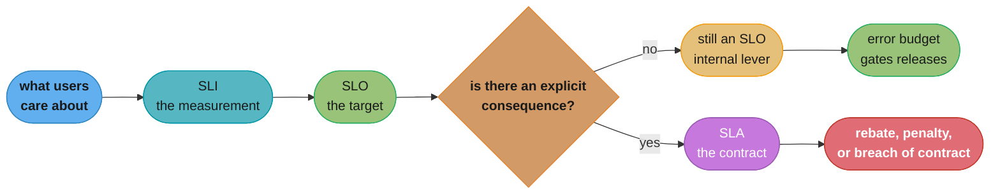
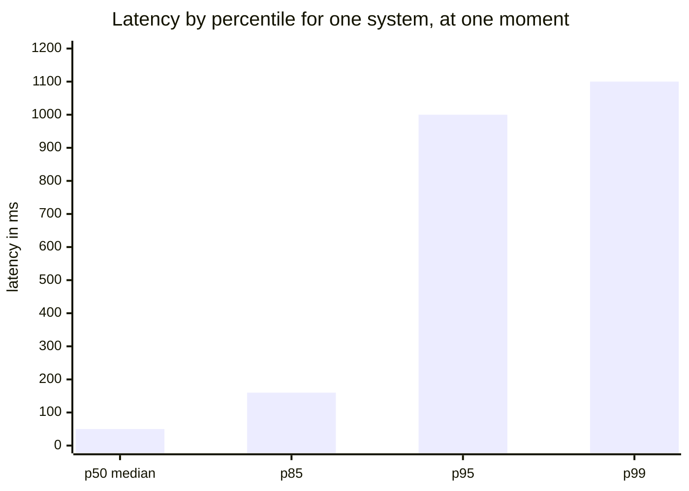
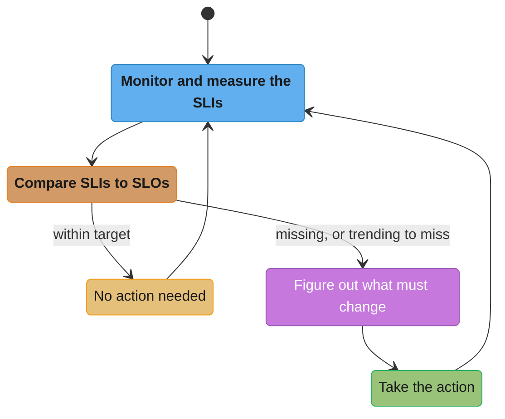
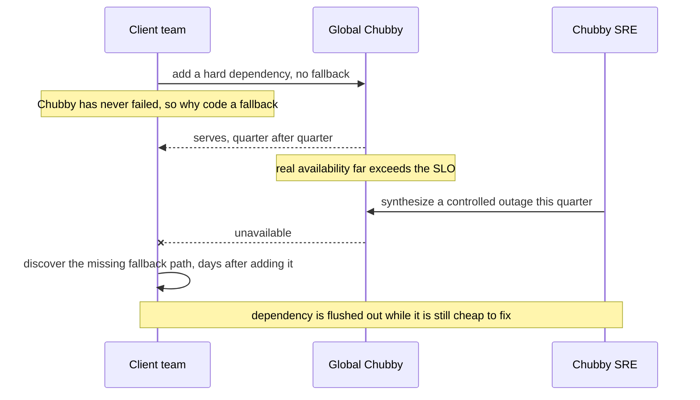

# Chapter 4: Service Level Objectives

> Part II — Principles · Site Reliability Engineering: How Google Runs Production Systems
> (Beyer, Jones, Petoff & Murphy, eds., O'Reilly 2016) · builds on Ch 3 (Embracing Risk), leads to
> Ch 5 (Eliminating Toil)

## Chapter Map

Chapter 3 established that risk is a budgetable quantity and that the error budget is what you
spend it from. That whole mechanism has an unstated dependency: somebody has to have written down
*what number the service is being held to*, and *how it is measured*, precisely enough that two
teams reading the same dashboard reach the same conclusion. Chapter 4 supplies that missing
foundation. Written by Chris Jones, John Wilkes, and Niall Murphy with Cody Smith, it separates
three words the industry uses interchangeably — **SLI**, **SLO**, **SLA** — and then spends most of
its length on the practical craft: which indicators to pick, how to aggregate them without lying to
yourself, how to choose a target, and what happens socially once the target is published. It is the
most cross-referenced chapter in this folder because almost every later mechanism (error budgets,
alerting thresholds, release gating, on-call load) bottoms out in an SLO.

**TL;DR:**
- **SLI** is the measurement, **SLO** is the target for that measurement, **SLA** is the contract
  with consequences attached. The chapter's one-line test for the last distinction: ask *"what
  happens if the SLOs aren't met?"* — if there is no explicit consequence, it is an SLO, not an SLA.
- **Pick few indicators, and pick them from what users care about, not from what is easy to
  collect.** The chapter recommends working backward from desired objectives to indicators rather
  than forward from whatever the monitoring system already emits.
- **Aggregate as a distribution, never as an average.** A mean hides both instantaneous bursts and
  the long tail; the chapter's own figure shows a system whose typical request takes about **50 ms**
  while **5% of requests are 20 times slower**, a change an average-based alert would never see.
- **Do not pick a target based on current performance** — that locks you into supporting whatever
  the system happens to do today, possibly through heroics, and possibly beyond redesign.
- **Keep it simple, avoid absolutes, have as few SLOs as possible, and accept that perfection can
  wait.** The chapter's defence test for an SLO: if you can never win a priorities conversation by
  quoting it, it probably should not exist.
- Publishing an SLO **sets expectations in both directions** — and the chapter's Chubby story shows
  that consistently *over*-delivering is itself a failure mode, fixed at Google by deliberately
  taking the service down.

## The Big Question

Chapter 3 handed you an error budget and told you it was the objective, shared number that ends the
dev-versus-ops argument. But a number is only shared if both parties compute it the same way. Two
engineers can look at the same outage and honestly disagree about whether the SLO was missed — one
measuring at the load balancer and one at the client, one averaging over a minute and one sampling
every ten seconds, one counting timeouts as errors and one discarding them. So the real question of
this chapter is not "what target should we pick" but the one underneath it: **what exactly are we
measuring, and is that measurement close enough to the user's actual experience that hitting the
target means something?**

Analogy: a restaurant that promises "fast service" has promised nothing. A restaurant that promises
"95% of orders leave the kitchen within 12 minutes of being placed, measured by the ticket printer,
excluding catering orders" has promised something a manager can argue about, staff to, and be held
to. The first promise generates complaints that cannot be adjudicated; the second generates
staffing decisions. The SLI is the ticket printer, the SLO is "95% within 12 minutes," and the SLA
is the coupon you hand over when you miss.

---

## 4.1 Service Level Terminology

The chapter's opening move is definitional, and deliberately so: it notes that most readers know
the term SLA, that the term is *overloaded* in common use, and that the other two terms are worth
careful definition precisely because collapsing them is what makes reliability conversations
unfalsifiable.

### Indicators

An **SLI** is a *service level indicator* — "a carefully defined quantitative measure of some
aspect of the level of service that is provided." The emphasis in that sentence is on *carefully
defined*: an SLI is not a metric you happen to have, it is a metric whose definition has been
pinned down.

The chapter names the common ones:

- **Request latency** — how long it takes to return a response. The chapter calls this a key SLI
  for most services.
- **Error rate** — usually expressed as a fraction of all requests received.
- **Throughput** — typically measured in requests per second.
- **Availability** — the fraction of time a service is usable, "often defined in terms of the
  fraction of well-formed requests that succeed, sometimes called **yield**." This is the same
  yield-style definition Chapter 3 used for aggregate availability.
- **Durability** — for storage systems, the likelihood that data will be retained over a long
  period. The chapter flags it as "equally important" for data storage, in a parenthetical.

Two properties of SLIs the chapter is explicit about, and which most summaries skip:

**Measurements are usually aggregated.** Raw data is collected over a measurement window and then
turned into a rate, an average, or a percentile. That aggregation step is itself part of the SLI
definition — which is exactly why §4.2's aggregation section exists.

**A proxy is often all you can get.** "Ideally, the SLI directly measures a service level of
interest, but sometimes only a proxy is available." The chapter's own example: client-side latency
is often the more user-relevant metric, but it might only be possible to measure latency at the
server. That gap is not a defect to be hidden — it is a known property of the indicator, and it
belongs in the indicator's definition.

**On "nines."** The chapter states plainly that "100% availability is impossible, near-100%
availability is often readily achievable," and that the industry expresses high availability in
counts of nines: 99% is "2 nines," 99.999% is "5 nines." Its worked datapoint is that the
then-published target for **Google Compute Engine availability is "three and a half nines" —
99.95%**.

The nines vocabulary is compact but slippery, because each nine costs an order of magnitude more
allowed downtime than it sounds like. The book tabulates this fully in **Appendix A, "Availability
Table"** — the chapter itself only names the vocabulary. Reproduced here for the numbers the rest
of this page uses:

| Availability | Nines | Allowed downtime / year | / month (30 d) | / week | / day |
|---|---|---|---|---|---|
| 99% | 2 | 3.65 days | 7.2 hours | 1.68 hours | 14.4 minutes |
| 99.9% | 3 | 8.76 hours | 43.2 minutes | 10.1 minutes | 1.44 minutes |
| 99.95% | 3.5 | 4.38 hours | 21.6 minutes | 5.04 minutes | 43.2 seconds |
| 99.99% | 4 | 52.6 minutes | 4.32 minutes | 1.01 minutes | 8.64 seconds |
| 99.999% | 5 | 5.26 minutes | 25.9 seconds | 6.05 seconds | 0.86 seconds |

The reason the chapter bothers naming 99.95% specifically is that it sits *between* nines — real
published targets are frequently not round numbers of nines, and a vocabulary that only counts
whole nines cannot express them.

### Objectives

An **SLO** is a *service level objective*: "a target value or range of values for a service level
that is measured by an SLI." The chapter gives the two natural structures:

```
  SLI <= target                       (one-sided: latency under 100 ms)
  lower bound <= SLI <= upper bound   (two-sided: a target range)
```

Its running example: "we might decide that we will return Shakespeare search results *quickly*,
adopting an SLO that our average search request latency should be less than **100 milliseconds**."
(The chapter is careful to call 100 ms "obviously an arbitrary value," while citing "Speed Matters"
[Bru09] for the general claim that user-experienced latency above certain values drives people
away.)

Three complications the chapter raises immediately, each of which trips real teams:

**You do not always get to choose the value.** For incoming HTTP requests from the outside world,
**queries per second is determined by your users' desires, not by you** — you cannot set an SLO on
QPS in any meaningful sense. You can set one on latency, and doing so drives real engineering
decisions (low-latency frontend design, particular hardware choices). The distinction is whether
the quantity is something your engineering can move.

**Your SLIs are coupled behind the scenes.** QPS and latency are connected: "higher QPS often leads
to larger latencies, and it's common for services to have a performance cliff beyond some load
threshold." So an SLO on latency is implicitly an SLO on the capacity you provision, whether or not
anyone wrote that down.

**Publishing an SLO changes user behaviour.** This is the chapter's most socially consequential
claim and it cuts both ways. Without an explicit SLO, "users often develop their own beliefs about
desired performance, which may be unrelated to the beliefs held by the people designing and
operating the service." That produces two symmetric failures:

- **Over-reliance** — users believe the service is more available than it is, and build hard
  dependencies on it. The chapter's named case is Chubby (below).
- **Under-reliance** — prospective users believe the system is flakier than it is, and route around
  a service that would have served them fine.

#### The Global Chubby Planned Outage

The chapter carries this as a sidebar written by Marc Alvidrez, and it is the single most quoted
story in the SRE canon after the error budget itself.

**Chubby** [Bur06] is Google's lock service for loosely coupled distributed systems. In the global
configuration, Chubby instances are distributed so that each replica sits in a different
geographical region. Over time Google found that failures of the *global* instance of Chubby
"consistently generated service outages, many of which were visible to end users."

The mechanism of the damage is the interesting part, and it is not what you would guess. True
global Chubby outages were **so infrequent** that service owners began adding dependencies on
Chubby *assuming it would never go down*. Its high reliability "provided a false sense of security
because the services could not function appropriately when Chubby was unavailable, however rarely
that occurred." The reliability itself manufactured the fragility downstream.

The fix Google adopted, which the chapter calls "interesting" with some understatement: **SRE makes
sure that global Chubby meets, but does not significantly exceed, its SLO.** In any given quarter,
if a true failure has not already dropped availability below the target, a **controlled outage is
synthesized by intentionally taking the system down**. That flushes out unreasonable dependencies
on Chubby shortly after they are added, and "forces service owners to reckon with the reality of
distributed systems sooner rather than later."

**Broken, then fixed** — stated as the chapter frames it:

```
  BROKEN
    global Chubby runs at ~5 nines, well above its SLO
      -> teams add hard dependencies, no fallback path
        -> the rare real outage takes down N services at once, user-visible
          -> each team is individually surprised

  FIXED
    global Chubby is held TO its SLO, from both directions
      -> quarterly synthetic outage if reality did not supply one
        -> a missing fallback path is discovered days after it is added
          -> the rare real outage is a rehearsal, not a surprise
```

### Agreements

An **SLA** is a *service level agreement*: "an explicit or implicit contract with your users that
includes **consequences** of meeting (or missing) the SLOs they contain." The consequences are most
easily recognized when financial — a rebate or a penalty — but the chapter allows that they can
take other forms.

The chapter's test, worth memorizing verbatim because it is the cleanest disambiguation in the
whole SRE vocabulary:

> An easy way to tell the difference between an SLO and an SLA is to ask "what happens if the SLOs
> aren't met?": if there is no explicit consequence, then you are almost certainly looking at an
> SLO.

And its footnote is sharper still: **most people really mean SLO when they say "SLA."** The
giveaway the chapter offers — if somebody talks about an "SLA violation," they are almost always
talking about a missed SLO, because a real SLA violation "might trigger a court case for breach of
contract."

**SRE's role in SLAs is deliberately narrow.** SRE does not typically get involved in *constructing*
SLAs, because they are closely tied to business and product decisions. SRE does get involved in two
places: helping to **avoid triggering the consequences** of missed SLOs, and helping to **define the
SLIs**, because "there obviously needs to be an objective way to measure the SLOs in the agreement,
or disagreements will arise."

**The no-SLA case still needs SLIs and SLOs.** Google Search is the chapter's example of an
important service with no public SLA: "we want everyone to use Search as fluidly and efficiently as
possible, but we haven't signed a contract with the whole world." There are still consequences of
unavailability — reputation damage and a drop in advertising revenue — they are simply not
contractual. Other Google services, such as Google for Work, do carry explicit SLAs. The chapter's
conclusion: "Whether or not a particular service has an SLA, it's valuable to define SLIs and SLOs
and use them to manage the service."

---

## 4.2 Indicators in Practice

The chapter pivots here from vocabulary to craft, with the framing question: given that choosing
appropriate metrics matters, "how do you go about identifying what metrics are meaningful to your
service or system?"

### What Do You and Your Users Care About?

The first rule is subtractive. **"You shouldn't use every metric you can track in your monitoring
system as an SLI."** The chapter names the failure on both sides:

- **Too many indicators** makes it hard to pay the right level of attention to the ones that
  matter.
- **Too few** leaves significant behaviours of the system unexamined.

Google's own experience: "a handful of representative indicators are enough to evaluate and reason
about a system's health."

The chapter then supplies a taxonomy of service types and the SLIs each tends to care about — the
practical starting checklist most teams actually use:

| Service category | Indicators that matter | The questions they answer |
|---|---|---|
| **User-facing serving systems** (e.g. the Shakespeare search frontends) | availability, latency, throughput | Could we respond to the request? How long did it take? How many requests could be handled? |
| **Storage systems** | latency, availability, durability | How long to read or write? Can we access data on demand? Is the data still there when we need it? |
| **Big data systems** (data-processing pipelines) | throughput, end-to-end latency | How much data is being processed? How long from ingestion to completion? |
| **All systems** | correctness | Was the right answer returned, the right data retrieved, the right analysis done? |

The correctness row carries a caveat the chapter states explicitly and which is easy to misread:
correctness is "important to track as an indicator of system health, even though it's often a
property of the *data* in the system rather than the infrastructure per se, and so usually **not an
SRE responsibility to meet**." Tracked by SRE, owned elsewhere.

Some pipelines, the chapter adds, may also carry latency targets on *individual processing stages*
rather than only end to end.

### Collecting Indicators

**Server side is the default.** Many indicator metrics are "most naturally gathered on the server
side," using a monitoring system such as Borgmon (see Chapter 10, Practical Alerting) or
Prometheus, or by periodic log analysis — the chapter's example being HTTP 500 responses as a
fraction of all requests.

**Client side is the correction.** Some systems "should be instrumented with client-side
collection, because not measuring behavior at the client can miss a range of problems that affect
users but don't affect server-side metrics." The worked case: concentrating on the response latency
of the Shakespeare search *backend* might miss poor user latency caused by problems with the page's
JavaScript. In that situation, "measuring how long it takes for a page to become usable in the
browser is a better proxy for what the user actually experiences."

This is the same point as §4.1's proxy caveat, now with an operational consequence: the gap between
where you measure and where the user stands is a real, quantifiable blind spot, and the fix is to
move the measurement, not to argue about it.

### Aggregation

This is the section the rest of the repo cites most, and its opening is a warning rather than a
recipe: "For simplicity and usability, we often aggregate raw measurements. **This needs to be done
carefully.**"

**Trap 1 — the measurement window hides bursts.** Even something as apparently simple as "requests
per second served" implicitly aggregates over a window. Is it sampled once a second, or averaged
over a minute? The chapter's arithmetic:

```
  System A: 200 req/s in even-numbered seconds, 0 req/s in odd-numbered seconds
  System B: a constant 100 req/s

  Average over any minute:      A = 100 req/s      B = 100 req/s      (identical)
  Instantaneous peak load:      A = 200 req/s      B = 100 req/s      (2x apart)
```

Same average load; A's instantaneous load is twice the average. A minute-averaged metric "may hide
much higher instantaneous request rates in bursts that last for only a few seconds" — and it is the
instantaneous rate that overruns queues and blows capacity.

**Trap 2 — the mean hides the tail.** "Averaging request latencies may seem attractive, but
obscures an important detail: it's entirely possible for most of the requests to be fast, but for a
long tail of requests to be much, much slower."

The chapter's own Figure 4-1 plots the 50th, 85th, 95th, and 99th percentile latencies for a system
over a day, on a logarithmic Y axis, and the finding is stated in the caption text: "although a
typical request is served in about **50 ms**, **5% of requests are 20 times slower**." Crucially,
**monitoring and alerting based only on the average latency would show no change in behaviour over
the course of the day, when there are in fact significant changes in the tail latency** — the
topmost line moves while the mean does not.

**Therefore: most metrics are better thought of as distributions rather than averages.** The
chapter's guidance on what each percentile buys you:

- A **high-order percentile** — the 99th or 99.9th — "shows you a plausible worst-case value."
- The **50th percentile (the median)** "emphasizes the typical case."
- "The higher the variance in response times, the more the typical user experience is affected by
  long-tail behavior, an effect exacerbated at high load by **queuing effects**."

And a human-factors argument for skewing toward the high end: **user studies have shown that people
typically prefer a slightly slower system to one with high variance in response time**, so "some
SRE teams focus only on high percentile values, on the grounds that if the 99.9th percentile
behavior is good, then the typical experience is certainly going to be."

#### A Note on Statistical Fallacies

The chapter carries a boxed aside on why percentiles rather than the mean, and it is a statistics
argument, not a monitoring one:

- Computing systems produce **artificially skewed** data. "No request can have a response in less
  than 0 ms, and a timeout at 1,000 ms means that there can be no successful responses with values
  greater than the timeout." The distribution is bounded below by zero and truncated above by the
  timeout.
- Consequently "**we cannot assume that the mean and the median are the same — or even close to
  each other**."
- "We try not to assume that our data is normally distributed without verifying it first, in case
  some standard intuitions and approximations don't hold."

The operational consequence the chapter names: if the distribution is not what you expected, "a
process that takes action when it sees outliers (e.g., restarting a server with high request
latencies) may do this too often, or not often enough." An automated remediation tuned against an
assumed-normal distribution is an automated remediation that misfires.

### Standardize Indicators

The final practice in this section is an organizational one, and it is the one teams most often
skip. "We recommend that you standardize on common definitions for SLIs so that you don't have to
reason about them from first principles each time."

The chapter's own list of the properties a standard definition template should fix, with its
example values:

| Template property | Example value from the chapter |
|---|---|
| Aggregation intervals | "Averaged over 1 minute" |
| Aggregation regions | "All the tasks in a cluster" |
| How frequently measurements are made | "Every 10 seconds" |
| Which requests are included | "HTTP GETs from black-box monitoring jobs" |
| How the data is acquired | "Through our monitoring, measured at the server" |
| Data-access latency | "Time to last byte" |

"Any feature that conforms to the standard definition templates can be **omitted** from the
specification of an individual SLI." That omission is the whole payoff: it is what lets §4.3 write
an SLO as one short line instead of a paragraph. The chapter's closing advice: "build a set of
reusable SLI templates for each common metric; these also make it simpler for everyone to
understand what a specific SLI means."

---

## 4.3 Objectives in Practice

The section's opening instruction inverts the intuitive order: **"Start by thinking about (or
finding out!) what your users care about, not what you can measure."** Often what users care about
is difficult or impossible to measure directly, so you will end up approximating — but "if you
simply start with what's easy to measure, you'll end up with less useful SLOs." Google's own
experience is stated as a preference: "working from desired objectives backward to specific
indicators works better than choosing indicators and then coming up with targets."

### Defining Objectives

"For maximum clarity, SLOs should specify **how they're measured** and **the conditions under which
they're valid**."

The chapter's first pair of examples demonstrates what standardization (§4.2) buys — both lines say
the same thing, the second relying on the SLI defaults to remove redundancy:

```
  99% (averaged over 1 minute) of Get RPC calls will complete in
      less than 100 ms (measured across all the backend servers).

  99% of Get RPC calls will complete in less than 100 ms.
```

**Multiple targets when the shape of the curve matters.** If the shape of the performance curve is
important, specify several SLO targets against the same indicator:

```
  90%   of Get RPC calls will complete in less than    1 ms
  99%   of Get RPC calls will complete in less than   10 ms
  99.9% of Get RPC calls will complete in less than  100 ms
```

Three points pin the distribution's shape in a way one point never can — a system that meets only
the 99.9%-under-100 ms line could still be missing the 90%-under-1 ms line badly, and a single
target would not reveal it.

**Separate objectives per workload class.** If you have users with heterogeneous workloads — the
chapter's example is a bulk processing pipeline that cares about throughput alongside an
interactive client that cares about latency — "it may be appropriate to define separate objectives
for each class of workload":

```
  95% of throughput clients' Set RPC calls will complete in < 1 s
  99% of latency clients'    Set RPC calls with payloads < 1 kB will complete in < 10 ms
```

Note the second line's payload qualifier. It is doing real work: without it, one client sending
multi-megabyte payloads through the latency-class path would blow the SLO for a reason that has
nothing to do with the service's health. **The conditions under which an objective is valid are
part of the objective.**

**And the target is never 100%.** "It's both unrealistic and undesirable to insist that SLOs will
be met 100% of the time: doing so can reduce the rate of innovation and deployment, require
expensive, overly conservative solutions, or both." Instead, allow an **error budget** — "a rate at
which the SLOs can be missed" — and track it **on a daily or weekly basis**, with upper management
likely wanting a monthly or quarterly assessment too.

The chapter's own parenthetical is the neatest one-line framing of the error budget in the book:
**"An error budget is just an SLO for meeting other SLOs!"** The SLO violation rate is compared
against the error budget (the mechanism of Chapter 3, §3.4), "with the gap used as an input to the
process that decides when to roll out new releases."

### Choosing Targets

The chapter is blunt that this is not an engineering decision: "Choosing targets (SLOs) is not a
purely technical activity because of the product and business implications." Product attributes may
have to be traded against each other "within the constraints posed by staffing, time to market,
hardware availability, and funding." SRE should be part of the conversation and should advise on
risk and viability — but does not own the outcome.

Then five lessons, which are the most-quoted list in the chapter:

**1. Don't pick a target based on current performance.** "While understanding the merits and limits
of a system is essential, adopting values without reflection may lock you into supporting a system
that requires heroic efforts to meet its targets, and that cannot be improved without significant
redesign."

This is the trap worth dwelling on, because it is so natural. The path into it looks like diligence:

```
  BROKEN
    "what does the service do today?"  -> dashboard says 99.97% and p99 = 240 ms
      -> SLO is written as 99.97% / p99 < 240 ms
        -> every incident is now an SLO breach, because there is no headroom by construction
          -> the only way to hold the line is heroics: manual failovers, weekend pushes
            -> and any redesign that trades a little latency for maintainability is now blocked

  FIXED
    "what do users need, and what would we be happy to have?"  -> 99.9% / p99 < 400 ms
      -> the number is defensible in a priorities conversation
        -> the gap between need and current performance IS the error budget
          -> a redesign that costs 100 ms of p99 is now a decision, not a violation
```

**2. Keep it simple.** "Complicated aggregations in SLIs can obscure changes to system performance,
and are also harder to reason about."

**3. Avoid absolutes.** "While it's tempting to ask for a system that can scale its load
'infinitely' without any latency increase and that is 'always' available, this requirement is
unrealistic." A system approaching such ideals "will probably take a long time to design and build,
and will be expensive to operate — and probably turn out to be unnecessarily better than what users
would be happy (or even delighted) to have."

**4. Have as few SLOs as possible.** "Choose just enough SLOs to provide good coverage of your
system's attributes." And then the chapter's test, which is a political test rather than a
technical one: **"Defend the SLOs you pick: if you can't ever win a conversation about priorities
by quoting a particular SLO, it's probably not worth having that SLO."** Its footnote extends the
same logic one level up: "If you can't ever win a conversation about SLOs, it's probably not worth
having an SRE team for the product." The chapter also concedes the limit of the tool: "not all
product attributes are amenable to SLOs — it's hard to specify 'user delight' with an SLO."

**5. Perfection can wait.** "You can always refine SLO definitions and targets over time as you
learn about a system's behavior. It's **better to start with a loose target that you tighten than
to choose an overly strict target that has to be relaxed** when you discover it's unattainable."

The section closes on the leverage point: SLOs "can — and should — be a major driver in prioritizing
work for SREs and product developers, because they reflect what users care about. A good SLO is a
helpful, legitimate **forcing function** for a development team." And symmetrically, "a poorly
thought-out SLO can result in wasted work if a team uses heroic efforts to meet an overly
aggressive SLO, or a bad product if the SLO is too lax." The chapter's own summary sentence:
**"SLOs are a massive lever: use them wisely."**

### Control Measures

SLIs and SLOs are described as "crucial elements in the control loops used to manage systems." The
loop, in the chapter's four steps:

1. Monitor and **measure** the system's SLIs.
2. Compare the SLIs to the **SLOs**, and decide whether or not action is needed.
3. If action is needed, **figure out what needs to happen** in order to meet the target.
4. Take that **action**.

The chapter's worked instance: if step 2 shows request latency is increasing and will miss the SLO
in a few hours unless something is done, step 3 might include testing the hypothesis that the
servers are CPU-bound, and deciding to add more of them to spread the load. The closing line is the
argument for the whole chapter in nine words: **"Without the SLO, you wouldn't know whether (or
when) to take action."**

### SLOs Set Expectations

"Publishing SLOs sets expectations for system behavior." Users and prospective users "often want to
know what they can expect from a service in order to understand whether it's appropriate for their
use case." The chapter's example of the same service being right and wrong for different callers: a
team building a photo-sharing website might want to avoid a service that promises very strong
durability and low cost in exchange for slightly lower availability — "though the same service
might be a perfect fit for an archival records management system."

Two tactics for setting realistic expectations:

**Keep a safety margin.** "Using a tighter internal SLO than the SLO advertised to users gives you
room to respond to chronic problems before they become visible externally." The buffer also "makes
it possible to accommodate reimplementations that trade performance for other attributes, such as
cost or ease of maintenance, without having to disappoint users."

```
  advertised SLO to users   ->  99.9%    (what the contract or docs say)
  internal SLO for SRE      ->  99.95%   (what dashboards alert against)
                                  ^
                                  the gap is response time for chronic
                                  problems, and headroom for a rewrite
```

**Don't overachieve.** This is the Chubby lesson generalized into policy: "**Users build on the
reality of what you offer, rather than what you say you'll supply**, particularly for infrastructure
services. If your service's actual performance is much better than its stated SLO, users will come
to rely on its current performance." The chapter names three remedies:

- **Deliberately taking the system offline occasionally** — "Google's Chubby service introduced
  planned outages in response to being overly available."
- **Throttling some requests.**
- **Designing the system so that it isn't faster under light loads.**

The chapter footnotes that failure injection [Ben12] "serves a different purpose, but can also help
set expectations" — that is, chaos-style injection is not the same practice as the deliberate
planned outage, though the two rhyme.

The section closes by turning the SLO into an investment signal: understanding how well a system is
meeting its expectations "helps decide whether to invest in making the system faster, more
available, and more resilient. Alternatively, if the service is doing fine, perhaps staff time
should be spent on other priorities, such as paying off technical debt, adding new features, or
introducing other products."

---

## 4.4 Agreements in Practice

The chapter's shortest section, and its content is mostly about who is in the room.

"Crafting an SLA requires **business and legal teams** to pick appropriate consequences and
penalties for a breach. SRE's role is to help them understand the **likelihood and difficulty** of
meeting the SLOs contained in the SLA." Much of the advice on SLO construction (§4.3) applies
directly to SLAs as well.

The one distinctive warning: **"It is wise to be conservative in what you advertise to users, as
the broader the constituency, the harder it is to change or delete SLAs that prove to be unwise or
difficult to work with."** An SLO can be revised next quarter after a conversation with a product
manager. An SLA signed with ten thousand customers is a renegotiation with ten thousand
counterparties — the ratchet only turns one way, and that asymmetry is why §4.3's "perfection can
wait" advice is even more binding here than internally.

---

## Beyond the book — error-budget burn-down arithmetic

> The chapter states that you should "allow an error budget — a rate at which the SLOs can be
> missed — and track that on a daily or weekly basis," and Chapter 3 supplies the error budget's
> definition and two worked examples. Neither chapter draws a **burn-down**, defines a **burn rate**,
> or discusses **multi-window multi-burn-rate alerting** — those are later industry practice,
> formalized in Google's own *Site Reliability Workbook* (2018), which postdates this text. The
> arithmetic below is this summary's own scaffolding, built only from numbers the two chapters do
> state.

Take an SLO of **99.9% of requests successful, measured monthly**, on a service handling
**2.5 million requests per day** (Chapter 3's own request-volume figure). Then:

```
  monthly request volume   = 2,500,000 x 30          = 75,000,000 requests
  error budget             = 0.1% of 75,000,000      =     75,000 failed requests
  even-burn allowance      = 75,000 / 30             =      2,500 failed requests/day
```

A single incident that fails 15,000 requests has spent **20% of the month's budget** — precisely
the arithmetic Chapter 3 performs with different figures. The value of drawing it as a burn-down
rather than a percentage is that the *slope* is legible: a line steeper than the even-burn
reference will exhaust the budget before the period ends, and how much steeper tells you how long
you have.

---

## Visual Intuition

### The three terms, and where the consequence lives



*The chapter's own disambiguation test is the decision node: ask what happens when the target is
missed. Everything to the left of it is engineering vocabulary, everything to the right of the
"yes" branch is legal and commercial.*

### Why the average lies: Figure 4-1 restated



*Two of these four bars are the chapter's own stated numbers — a typical request at about 50 ms,
and the top 5% roughly 20 times slower, i.e. around 1,000 ms at p95. The p85 and p99 bars are
interpolated to show the shape and are this summary's illustration, not the book's data. The point
survives either way: an alert on the mean sees a number somewhere near the left-hand bar and never
notices when the right-hand bars double.*

### The two aggregation traps, side by side

```
  TRAP 1 - the measurement window hides bursts

    A: |####|    |####|    |####|      200 req/s every other second
    B: |##|##|##|##|##|##|##|##|##|    100 req/s constant

       one-minute average:  A = 100  B = 100     <- identical, and useless
       instantaneous peak:  A = 200  B = 100     <- 2x apart, and what breaks you

  TRAP 2 - the mean hides the tail

       request count
         |
      ###|##
      ###|####
      ###|######                                 mean pulled slightly right
      ###|########_______________________ ###    by a tail 20x further out
         +--------------------------------------
         0ms    50ms                      1000ms
              ^ median                        ^ p95

       the mean can sit still all day while the p95 line doubles
```

*Caption: both traps have the same shape — a single scalar summarizing a distribution discards
exactly the information that predicts an outage. The fix in both cases is to keep the distribution:
sample finely enough to see bursts, and report percentiles rather than a mean.*

### The control loop an SLO closes



*Without the SLO, the "Compare" state has nothing to compare against, and the loop degenerates into
staring at graphs. The chapter's closing line for this section — "without the SLO, you wouldn't
know whether (or when) to take action" — is a statement about this state machine having no
transition condition.*

### Over-reliance, and the planned outage that cures it



*The story's counterintuitive claim is that Chubby's reliability was the cause of the outages
attributed to it. Holding a service TO its SLO from both directions — meeting it and not
significantly exceeding it — is what keeps callers honest about what they have actually built on.*

---

## Key Concepts Glossary

- **SLI (service level indicator)** — a carefully defined quantitative measure of some aspect of
  the level of service provided.
- **SLO (service level objective)** — a target value or range of values for a service level
  measured by an SLI; structured as `SLI <= target` or `lower <= SLI <= upper`.
- **SLA (service level agreement)** — an explicit or implicit contract with users that includes
  consequences for meeting or missing the SLOs it contains.
- **Availability** — the fraction of time a service is usable, commonly defined as the fraction of
  well-formed requests that succeed.
- **Yield** — the alternate name for the request-success-rate form of availability.
- **Durability** — the likelihood that data will be retained over a long period; the storage-system
  counterpart to availability.
- **Nines** — the shorthand for availability expressed as a count of leading nines; 99% is 2 nines,
  99.999% is 5 nines, and 99.95% is "three and a half nines."
- **Request latency** — how long it takes to return a response to a request; the chapter's
  canonical key SLI.
- **Error rate** — the fraction of received requests that fail.
- **Throughput** — requests served per unit time, typically requests per second.
- **Correctness** — whether the right answer was returned; an all-systems indicator, usually a
  property of data rather than infrastructure, and usually not SRE's to meet.
- **QPS (queries per second)** — the incoming request rate; determined by users, and therefore not
  something you can set an SLO on.
- **Proxy metric** — a measurable stand-in for a service level you actually care about but cannot
  measure directly, e.g. server-side latency standing in for client-side latency.
- **Aggregation window** — the interval over which raw measurements are combined; part of the SLI's
  definition, and the thing that hides bursts when chosen too coarse.
- **Percentile** — a distribution-preserving aggregation; the 50th shows the typical case, the 99th
  or 99.9th a plausible worst case.
- **Performance cliff** — the load threshold beyond which latency degrades sharply, the mechanism
  coupling the QPS and latency indicators.
- **SLI template / standardized indicator** — a reusable definition fixing aggregation interval,
  region, measurement frequency, included requests, acquisition method, and latency definition, so
  individual SLIs can omit them.
- **Error budget** — the allowed rate at which SLOs may be missed over a period; the chapter's own
  gloss is "just an SLO for meeting other SLOs."
- **Safety margin** — a tighter internal SLO than the one advertised externally, giving room to fix
  chronic problems before users see them.
- **Overachievement** — sustained performance far above the stated SLO, which causes users to build
  on the observed reality rather than the promise.
- **Planned outage** — a deliberately synthesized outage used to hold a service to its SLO from
  above and flush out unreasonable dependencies.
- **Control loop (for SLOs)** — measure, compare to objective, decide the action, take it, repeat.
- **Forcing function** — the chapter's term for what a good SLO is to a development team: a
  legitimate lever for prioritizing work.

---

## Tradeoffs & Decision Tables

| | SLI | SLO | SLA |
|---|---|---|---|
| What it is | a measurement | a target for that measurement | a contract containing targets |
| Owner | SRE, with product input | product, with SRE advice | business and legal, with SRE advice |
| Changing it | edit the definition template | quarterly conversation | renegotiation with every counterparty |
| Consequence of missing | n/a — it is just a number | internal: budget burn, release gating | external: rebate, penalty, breach |
| The chapter's test | "is it carefully defined?" | "can you win a priorities argument with it?" | "what happens if it isn't met?" |

| Aggregation choice | What it shows | What it hides | Use when |
|---|---|---|---|
| Mean / average | central tendency, cheaply | bursts, tails, bimodality | almost never for latency SLIs |
| Median (p50) | the typical user's experience | everything past the halfway point | reporting "normal" behaviour |
| p95 / p99 | a plausible worst case | how bad the worst 1% is | alerting and SLO targets |
| p99.9 | near-worst case | cost: needs many samples to be stable | high-variance systems, per the chapter's "if p99.9 is good, typical is certainly good" |
| Full histogram | the whole distribution's shape | nothing, but costs storage | debugging and capacity work |

| Target-setting failure | What it looks like | The chapter's remedy |
|---|---|---|
| Target = current performance | every incident is a breach, no headroom | derive from user need, not from the dashboard |
| Complicated aggregation | nobody can explain why the SLO moved | keep it simple |
| Absolutes ("always," "infinite") | expensive, slow to build, better than needed | avoid absolutes |
| Too many SLOs | none of them drives a decision | have as few as possible, and defend each |
| Overly strict from day one | must be publicly relaxed later | start loose and tighten; perfection can wait |
| Overachieving against the SLO | users silently build hard dependencies | safety margin internally, planned outages externally |

| Where to measure | Catches | Misses |
|---|---|---|
| Server side (Borgmon, Prometheus, log analysis) | backend errors, backend latency, throughput | client-side rendering, JavaScript, last-mile network |
| Client side / black-box probes | what the user actually experiences | fine-grained internal causes |
| Both, with standardized definitions | the gap between the two, which is itself a signal | — |

---

## Common Pitfalls / War Stories

- **Calling an SLO an SLA.** The chapter's footnote is explicit that most people mean SLO when they
  say SLA, and that anyone discussing an "SLA violation" is almost certainly discussing a missed
  SLO. The cost is not pedantic: teams that believe they have a contract behave as though missing
  the number is catastrophic, and teams that believe a real contract is "just an SLO" discover
  otherwise in court.
- **Chubby's reliability caused its outages.** Global Chubby's near-perfect record led service
  owners to add dependencies with no fallback path, so that the rare genuine failure took down
  multiple user-visible services at once. The remedy — quarterly synthetic outages when reality
  did not supply one — is the sharpest illustration in the book that an SLO is a ceiling as well as
  a floor.
- **Alerting on the mean while the tail doubles.** The chapter's Figure 4-1 shows exactly this: the
  average latency line is flat across the day while the p99 line moves substantially. Any team
  whose alerting rule is "average latency > X" is, by construction, blind to the change that its
  users feel most.
- **A minute-averaged request rate that hides a 2x burst.** 200 req/s on even seconds and 0 on odd
  seconds averages to the same 100 req/s as a perfectly smooth load, while imposing twice the
  instantaneous demand. Capacity blown by bursts is invisible on a dashboard that averages them
  away.
- **Setting the SLO to whatever the dashboard currently shows.** The chapter warns this "may lock
  you into supporting a system that requires heroic efforts to meet its targets, and that cannot be
  improved without significant redesign." Every subsequent improvement that costs a little latency
  now reads as a regression against the team's own commitment.
- **Server-side latency that looks fine while the page is unusable.** The Shakespeare-search
  example: backend response latency is healthy, page JavaScript is slow, and the user experience is
  bad in a way no server-side SLI can see. The fix is a client-side indicator, not a better
  server-side threshold.
- **An SLO nobody can cite in a planning meeting.** The chapter's test — "if you can't ever win a
  conversation about priorities by quoting a particular SLO, it's probably not worth having that
  SLO" — is a maintenance instruction as much as a design one. Unusable SLOs accumulate, and every
  one of them dilutes attention from the ones that matter.
- **Outlier-triggered automation on a wrongly assumed distribution.** The statistical-fallacies box
  names the concrete damage: a process that restarts servers showing high request latency will
  restart too often or too rarely if the latency distribution is not what the threshold assumed —
  and computing-system distributions are floored at zero and truncated at the timeout, so they are
  reliably not normal.

---

## Real-World Systems Referenced

- **Chubby** [Bur06] — Google's lock service for loosely coupled distributed systems; the global
  instance is the chapter's planned-outage case study.
- **Google Compute Engine** — cited for its then-published availability target of "three and a half
  nines," 99.95%.
- **Google Search** — the chapter's example of a service with no public SLA that still has real
  (reputational and revenue) consequences for unavailability.
- **Google for Work** — the counter-example: a Google service that does carry explicit SLAs with
  its users.
- **Gmail, Bigtable and the Shakespeare sample service** — the Shakespeare service (introduced in
  the book's own "Shakespeare: A Sample Service" preface material) is the chapter's running example
  for frontends, backends, and client-side measurement.
- **Borgmon** — Google's internal monitoring system, named as a typical server-side collector
  (developed in Chapter 10, Practical Alerting).
- **Prometheus** — named alongside Borgmon as a monitoring system suitable for gathering
  server-side indicators.

---

## Summary

The chapter's own argument, restated and expanded. You cannot manage a service well without
understanding which behaviours matter and how to measure them, so Google defines three distinct
things: the **SLI**, a carefully defined quantitative measure; the **SLO**, a target value or range
for that measure; and the **SLA**, a contract that attaches consequences to the objectives it
contains. The distinction between the last two collapses in common usage, and the chapter's test —
ask what happens if the objective is missed — is what restores it.

Choosing indicators is a subtractive exercise: a handful of representative ones, chosen from what
users care about rather than from what the monitoring system happens to emit, with the choice
informed by service category (serving systems care about availability, latency and throughput;
storage adds durability; data pipelines care about throughput and end-to-end latency; everything
cares about correctness). Collect server-side by default and client-side where the server cannot
see what the user feels. Then aggregate carefully, because aggregation is where measurement quietly
turns into fiction: a coarse window hides bursts, and a mean hides the tail. Report distributions
and percentiles, and standardize the definitions so an SLI can be written in one line instead of a
paragraph.

Setting the target is a business decision that SRE advises on rather than owns. Five lessons govern
it: do not anchor on current performance, keep the aggregation simple, avoid absolutes, keep the
number of SLOs small enough that each one can be defended in a priorities argument, and start loose
rather than strict because you can always tighten. Once set, the SLO closes a control loop —
measure, compare, decide, act — and gives the organization a defensible reason to act or to stop
acting. Publishing it sets user expectations in both directions, which is why the chapter
recommends both a **safety margin** (a tighter internal target than the advertised one) and a
prohibition on **overachievement**, enforced at Google by taking global Chubby down on purpose when
the quarter has been too kind. Finally, SLAs belong to business and legal, and should be advertised
conservatively, because the broader the constituency the harder an unwise commitment is to undo.

---

## Interview Questions

**Q: What is the one-line test the chapter gives for telling an SLO from an SLA?**
**Short:** Ask what happens if the objective is missed — with no explicit consequence, the book says you are almost certainly looking at an SLO.

The chapter defines an SLA as a contract, explicit or implicit, that includes consequences of
meeting or missing the SLOs it contains, most recognizably financial ones such as a rebate or
penalty. An SLO is the target on its own, with no attached consequence. The chapter's footnote goes
further: most people really mean SLO when they say SLA, and anyone talking about an "SLA violation"
is almost always describing a missed SLO, because a real SLA violation might trigger a court case
for breach of contract. In an interview, state the consequence test first and the SLI/SLO/SLA
ordering second.

**Q: Why does the chapter warn against picking an SLO target based on current performance?**
**Short:** The book argues it can lock you into supporting a system that needs heroic effort to hold its target and cannot be improved without a redesign.

Anchoring on what the dashboard shows today looks like diligence but leaves zero headroom by
construction: every incident becomes a breach, and every design change that costs a little latency
or availability reads as a regression against your own commitment. The chapter's phrasing is that
adopting values "without reflection" is the failure — understanding a system's merits and limits is
essential, but the target should come from what users need. Derive the number from user need, and
treat the gap between that number and current performance as the error budget.

**Q: Why does the chapter insist on percentiles rather than averages for a latency SLI?**
**Short:** Because a mean hides the tail — the chapter's figure shows a typical request at about 50 ms while 5% of requests run 20 times slower.

Monitoring and alerting based only on average latency would show no change across the day in the
chapter's Figure 4-1, even though the tail latency changes significantly. Percentiles preserve the
shape of the distribution: a high-order percentile such as the 99th or 99.9th shows a plausible
worst case, while the 50th emphasizes the typical case, and the higher the variance the more the
typical user's experience is dominated by the tail, an effect that queuing makes worse under load.
The chapter also cites user studies finding people prefer a slightly slower system to a
high-variance one, which is why some SRE teams target only high percentiles.

**Q: What is the Global Chubby planned outage, and what problem was it solving?**
**Short:** Chubby was so reliable that teams added dependencies with no fallback, so SRE synthesizes a quarterly outage to hold it to its SLO from above.

The chapter's sidebar reports that failures of the global Chubby instance consistently generated
user-visible service outages, because true global Chubby outages were so infrequent that service
owners began assuming it would never go down and built no fallback paths. Its high reliability
provided a false sense of security. The remedy is that SRE makes sure global Chubby meets but does
not significantly exceed its SLO: in any quarter where a real failure has not already dropped
availability below the target, a controlled outage is deliberately synthesized. That flushes out
unreasonable dependencies shortly after they are added rather than during a real incident.

**Q: What does the chapter mean by "don't overachieve," and what remedies does it name?**
**Short:** Users build on observed reality rather than the stated SLO, so the book suggests planned outages, throttling, or not being faster under light load.

The claim is that if actual performance is much better than the stated objective, users come to
depend on the actual performance, particularly for infrastructure services. Three remedies are
named: deliberately taking the system offline occasionally, as Chubby did; throttling some
requests; and designing the system so that it is not faster under light loads. The complementary
tactic is a safety margin, keeping a tighter internal SLO than the one advertised so you can react
to chronic problems before users see them.

**Q: How does the chapter suggest deciding how many SLOs a service should have?**
**Short:** As few as possible — the chapter's test is that an SLO you can never win a priorities conversation by quoting is probably not worth having.

The guidance is to choose just enough SLOs to give good coverage of the system's attributes, then
defend each one. The test is deliberately political rather than technical, because an SLO's value
is measured by the decisions it drives; the footnote extends it upward, saying that if you can
never win a conversation about SLOs at all, it is probably not worth having an SRE team for that
product. The chapter also concedes the tool's limits: not all product attributes are amenable to
SLOs, and "user delight" is its example of one that is not.

**Q: Why can't you set an SLO on queries per second for a public-facing service?**
**Short:** The chapter says incoming QPS is determined by your users' desires, so it is not a quantity your engineering can move toward a target.

For incoming HTTP requests from the outside world, QPS is an input, not an output. You can set an
SLO on latency and thereby motivate real engineering decisions, such as writing a low-latency
frontend or buying particular equipment. The subtlety the chapter adds is that the two indicators
are coupled behind the scenes — higher QPS often means larger latencies, and services commonly have
a performance cliff past some load threshold — so a latency SLO is implicitly a commitment about
the capacity you provision for the QPS you receive.

**Q: What is the aggregation trap the chapter illustrates with 200 requests per second on alternating seconds?**
**Short:** A system serving 200 req/s every other second and none in between has the same average as a steady 100 req/s but twice the instantaneous load.

The point is that "requests per second" already contains an aggregation choice, and a minute-level
average hides bursts lasting only a few seconds. The instantaneous rate is what overruns queues and
exhausts capacity, so the averaged number can look healthy while the system is being hit twice as
hard as anyone believes. The chapter's general instruction follows from it: aggregation must be
part of the SLI's written definition, because two teams choosing different windows will measure
genuinely different things.

**Q: What does the chapter mean by the SLI/SLO "control loop"?**
**Short:** Monitor and measure the SLIs, compare them to the SLOs, decide what must change if action is needed, then take that action.

The chapter's worked instance: if the comparison shows latency rising toward a miss within hours,
step three might test the hypothesis that servers are CPU-bound and decide to add capacity to
spread the load. The closing line is the argument for the whole chapter — without the SLO you would
not know whether or when to take action, because the comparison step has nothing to compare
against. In practice this is why an SLO must be measurable continuously rather than assessed
retrospectively at the end of a quarter.

**Q: Which SLIs does the chapter recommend for each broad category of service?**
**Short:** Serving systems care about availability, latency and throughput; storage adds durability; big-data systems care about throughput and end-to-end latency; everything cares about correctness.

The chapter frames each as a question: could we respond, how long did it take, how many could we
handle; how long to read or write, can we access data on demand, is the data still there; how much
data is processed and how long from ingestion to completion. Correctness is the universal one, and
the chapter flags that although it should be tracked as a health indicator it is usually a property
of the data rather than the infrastructure, and therefore usually not SRE's responsibility to meet.
Pipelines may additionally carry per-stage latency targets rather than only end-to-end ones.

**Q: When should indicators be collected client-side rather than server-side?**
**Short:** When server-side metrics cannot see the problem the user feels — the chapter's example is page JavaScript making a fast backend feel slow.

Most indicator metrics are naturally gathered server-side, with a monitoring system such as Borgmon
or Prometheus, or by periodic log analysis such as counting HTTP 500s as a fraction of all
requests. But concentrating on backend response latency can miss poor user-perceived latency
entirely, and the chapter's fix is to measure how long it takes for a page to become usable in the
browser, as a better proxy for the actual experience. The general principle stated earlier in the
chapter is that an SLI is often only a proxy, and the distance between where you measure and where
the user stands is a known blind spot that belongs in the indicator's definition.

**Q: What belongs in a standardized SLI definition template, per the chapter?**
**Short:** Aggregation interval and region, measurement frequency, which requests are included, how data is acquired, and the data-access latency definition.

The chapter's example values are "averaged over 1 minute," "all the tasks in a cluster," "every 10
seconds," "HTTP GETs from black-box monitoring jobs," "through our monitoring, measured at the
server," and "time to last byte." The payoff is that anything conforming to the template can be
omitted from an individual SLI's specification, which is what lets an SLO be written as one short
sentence rather than a paragraph of qualifiers. The recommendation is to build a set of reusable
templates per common metric so nobody reasons about these choices from first principles each time.

**Q: How do you express an SLO when the shape of the latency curve matters, not just one point?**
**Short:** Specify several targets against the same indicator — the chapter's example is 90% under 1 ms, 99% under 10 ms, and 99.9% under 100 ms.

One target pins one point on the distribution and says nothing about the rest, so a system could
satisfy a single 99.9%-under-100 ms objective while badly missing what interactive users need at
the median. Three targets constrain the curve's shape. The related pattern for heterogeneous users
is separate objectives per workload class — the chapter's example being 95% of throughput clients'
Set RPCs under 1 second alongside 99% of latency clients' Set RPCs with payloads under 1 kB under
10 milliseconds, where the payload qualifier keeps one oversized caller from breaking the
latency-class objective.

**Q: What is a safety margin in SLO terms, and why keep one?**
**Short:** A tighter internal SLO than the one advertised, giving room to fix chronic problems before they become visible to users.

The chapter names a second benefit that is easy to overlook: the buffer also makes it possible to
accommodate reimplementations that trade performance for other attributes, such as cost or ease of
maintenance, without disappointing users. Without the margin, any rewrite that costs a little
latency immediately shows up as a commitment breach. In practice the margin is the difference
between the number your dashboards alert on and the number in your documentation or contract.

**Q: What is SRE's role in constructing an SLA, according to the chapter?**
**Short:** SRE typically does not construct SLAs — it advises on the likelihood and difficulty of meeting them and helps define the measurable SLIs.

SLAs are closely tied to business and product decisions, and crafting one requires business and
legal teams to pick appropriate consequences and penalties for a breach. SRE contributes two
things: an assessment of how hard the contained objectives will be to meet, and objective
measurement definitions, because without an objective way to measure the SLOs in the agreement
disagreements will arise. SRE also helps avoid triggering the consequences of missed SLOs, which is
the operational half of the same job.

**Q: The chapter says "an error budget is just an SLO for meeting other SLOs" — what does that mean?**
**Short:** Because insisting on 100% SLO compliance is unrealistic, the book allows a rate at which SLOs may be missed and tracks that rate as its own target.

The chapter argues that insisting SLOs be met 100% of the time reduces the rate of innovation and
deployment, requires expensive and overly conservative solutions, or both. So the SLO violation
rate is itself budgeted and tracked daily or weekly, with management likely wanting a monthly or
quarterly assessment. That budget is compared against actual violations, and the gap feeds the
process that decides when to roll out new releases — which is precisely the Chapter 3 mechanism,
now with the measurement machinery underneath it.

**Q: What is the "statistical fallacies" warning in the chapter, and what practical damage does it name?**
**Short:** Computing-system data is skewed and truncated, so the mean and median need not be close, and outlier-triggered automation misfires when tuned on a wrong distribution.

The chapter notes that no request can have a response in less than 0 ms and a 1,000 ms timeout
means no successful response exceeds it, so the distribution is bounded below and truncated above
and is reliably not normal. Its named consequence is operational: a process that takes action on
outliers, such as restarting a server with high request latencies, may fire too often or not often
enough. The instruction is to verify the distribution before assuming normality rather than
importing standard intuitions and approximations.

**Q: What does the chapter mean by calling an SLO a "forcing function" and "a massive lever"?**
**Short:** A good SLO legitimately drives prioritization for both SRE and product developers, and a badly chosen one wastes effort or ships a bad product.

Because SLOs reflect what users care about, they are a legitimate basis for arguing about
priorities, which is why the chapter's defence test asks whether you could ever win such an
argument by quoting the SLO. The lever cuts both ways: an overly aggressive SLO produces heroic
effort spent on the wrong thing, and an overly lax one produces a product users find inadequate.
That two-sided risk is why the chapter pairs the lever framing with "perfection can wait" — start
with a loose target you can tighten rather than a strict one you will have to publicly relax.

**Q: Why does Google Search have no public SLA, and does that change how it is managed?**
**Short:** The chapter says Google has not signed a contract with the whole world, but unavailability still costs reputation and ad revenue, so SLIs and SLOs still apply.

The stated intent is for everyone to use Search as fluidly and efficiently as possible, which a
public contract would not help. The consequences of unavailability are real but non-contractual.
The chapter's general conclusion covers both cases: whether or not a particular service has an SLA,
it is valuable to define SLIs and SLOs and use them to manage the service — the contract only
changes who else is entitled to complain, not whether you need the measurement.

**Q: What does "three and a half nines" mean, and why does the chapter use that phrase?**
**Short:** It means 99.95%, the then-published Google Compute Engine availability target, and it shows real targets often fall between whole nines.

The chapter introduces the nines vocabulary — 99% as two nines, 99.999% as five nines — while
stating that 100% availability is impossible though near-100% is often readily achievable. The
half-nine phrasing exists because published targets are frequently not round: 99.95% allows about
21.6 minutes of downtime a month against 99.9%'s 43.2 minutes, a factor of two that the whole-nine
vocabulary cannot express. The book tabulates the full mapping from percentage to allowed downtime
in Appendix A rather than in this chapter.

---

## Cross-links in this repo

- [devops/sre_principles_and_slos/sre_principles_and_slos.md](../../../devops/sre_principles_and_slos/sre_principles_and_slos.md) — the repo's own SLI/SLO/SLA and error-budget deep dive; the closest module to this chapter.
- [devops/case_studies/cross_cutting/slo_error_budget_math.md](../../../devops/case_studies/cross_cutting/slo_error_budget_math.md) — the worked arithmetic of budgets, burn rates, and multi-window alerting that this chapter's error-budget paragraph only gestures at.
- [devops/observability_metrics_prometheus/observability_metrics_prometheus.md](../../../devops/observability_metrics_prometheus/observability_metrics_prometheus.md) — histograms, quantiles, and recording rules, i.e. how §4.2's "keep the distribution" advice is actually implemented.
- [devops/visualization_and_alerting/visualization_and_alerting.md](../../../devops/visualization_and_alerting/visualization_and_alerting.md) — turning objectives into dashboards and alert rules.
- [backend/observability_and_monitoring/observability_and_monitoring.md](../../../backend/observability_and_monitoring/observability_and_monitoring.md) — the backend-side view of indicator collection, server-side versus client-side.
- [hld/observability/observability.md](../../../hld/observability/observability.md) — system-design-level treatment of what to measure and why.
- [devops/performance_and_load_testing/performance_and_load_testing.md](../../../devops/performance_and_load_testing/performance_and_load_testing.md) — percentiles, tail latency, and the performance cliff this chapter names but does not measure.

---

## Further Reading

- Chapter 3, "Embracing Risk" — the error budget this chapter's objectives feed, plus the
  cost-of-reliability argument that justifies targets below 100%.
- Chapter 6, "Monitoring Distributed Systems" — the four golden signals, and the tail-latency and
  measurement-resolution material that continues §4.2's aggregation discussion.
- Chapter 10, "Practical Alerting from Time-Series Data" — Borgmon, the system implied by "collect
  indicators server-side."
- Appendix A, "Availability Table" — the full percentage-to-downtime mapping behind the nines
  vocabulary introduced here.
- [Bur06] Burrows, "The Chubby Lock Service for Loosely-Coupled Distributed Systems" — the source
  for the service in the planned-outage sidebar.
- [Bru09] "Speed Matters" — the chapter's citation for user-experienced latency driving users away.
- [Ben12] — the failure-injection reference the chapter footnotes alongside planned outages.
