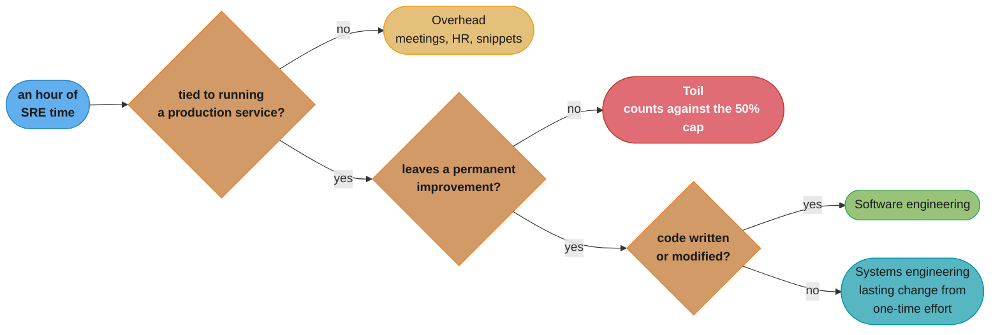
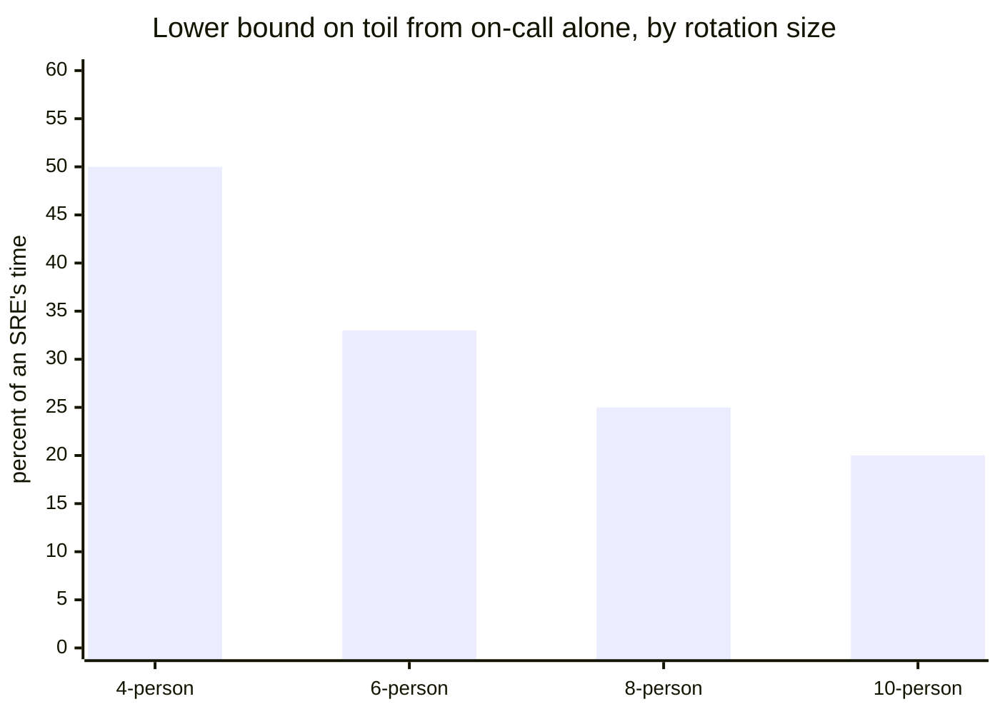
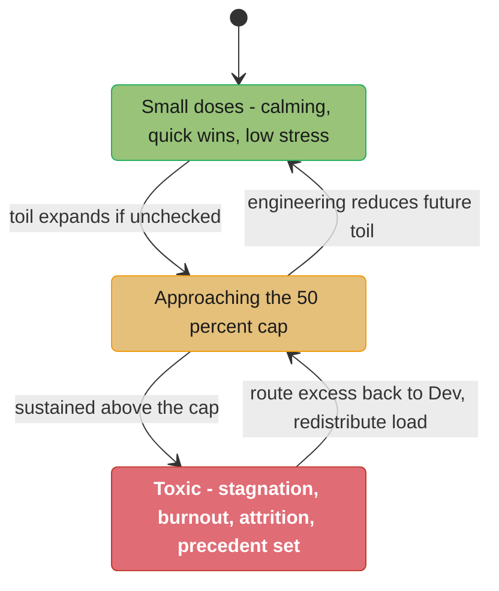

# Chapter 5: Eliminating Toil

> Part II — Principles · Site Reliability Engineering: How Google Runs Production Systems
> (Beyer, Jones, Petoff & Murphy, eds., O'Reilly 2016) · builds on Ch 4 (Service Level Objectives),
> leads to Ch 6 (Monitoring Distributed Systems)

## Chapter Map

Chapter 1 asserted, as a tenet, that no more than 50% of an SRE's time should go to operational
work, and used the word **toil** for what that cap constrains — without defining it. This chapter,
written by Vivek Rau, is where the word gets a definition sharp enough to argue with. It is the
shortest chapter in Part II and the one most often misquoted, because two of its four substantive
sections exist specifically to stop the obvious misreadings: **toil is not "work I dislike"**, and
**toil is not automatically bad**. The chapter's structure is a definition, a justification of the
50% number, a taxonomy of what counts as engineering instead, and an explicit nuance section on
when toil is tolerable.

**TL;DR:**
- **Toil is work tied to running a production service that tends to be manual, repetitive,
  automatable, tactical, devoid of enduring value, and O(n) with service growth.** Not every task
  called toil has all six attributes — the more it matches, the more likely it is toil.
- **Toil is not the same as overhead, and not the same as grungy work.** Overhead is administrative
  work not directly tied to running a production service (meetings, HR paperwork, goal-setting).
  Grungy work with lasting value — the chapter's example is cleaning up an alerting configuration —
  is engineering, not toil.
- **The 50% cap** is an advertised organizational goal, and the chapter is explicit about why it
  exists: **toil expands if left unchecked and can quickly fill 100% of everyone's time**, and
  Google made a hiring promise it has to keep.
- **There is a floor on toil, set by the on-call rotation.** A 6-person rotation with one primary
  and one secondary week per cycle puts the lower bound at 2/6 = **33%**; an 8-person rotation at
  2/8 = **25%**. Google's quarterly surveys report an average of about **33%**, with outliers from
  **0% to 80%**.
- **"Is toil always bad?" is answered no.** Small doses can be calming and low-stress. Toil becomes
  toxic in large quantities, and the chapter enumerates the damage: career stagnation, low morale,
  and five organizational harms including setting a precedent that Devs can offload work onto SRE.

## The Big Question

The 50% cap only means something if you can classify a given hour of work on one side of the line
or the other. That sounds easy until you try it on real weeks. Is running a well-written deploy
script toil? Is answering the third identical question this month from a client team toil? Is
spending two days untangling a decade of accreted alerting configuration toil, given that the work
is unpleasant and repetitive-feeling? Is responding to a page toil, given that pages are supposedly
the core of the job?

The chapter's answer to all four is precise and, in at least two cases, counterintuitive. So the
big question is: **what property of a task determines whether the hour you spent on it bought your
organization anything durable?** Everything else in the chapter — the cap, the taxonomy, the
nuance — is downstream of that test.

Analogy: think of the difference between bailing water out of a boat and patching the hull.
Bailing is real, necessary work; the boat genuinely stays afloat because of it; a person can be
very good at it. But the boat is in exactly the same state after an hour of bailing as before, and
the amount of bailing required scales with how much water is coming in. Patching leaves the boat
permanently different. The chapter's six attributes are, collectively, a test for whether you spent
the hour bailing. And its "is toil always bad" section is the acknowledgement that sometimes you
genuinely do have to bail — you just should not build a career, or a team, out of it.

---

## 5.1 Toil Defined

The chapter opens with an epigraph from Carla Geisser, Google SRE, that frames the whole
discipline:

> If a human operator needs to touch your system during normal operations, you have a bug. The
> definition of normal changes as your systems grow.

The second sentence is the one people forget. It means the target is moving: work that was
legitimately manual at one scale becomes a bug at the next, so the classification has to be redone
as the service grows rather than settled once.

### What toil is not

The chapter spends its first paragraph clearing away three wrong definitions, because each of them
produces a different, wrong worklist.

**Toil is not "work I don't like to do."** The chapter states this first and flatly. Preferences
vary from person to person, and "some people even enjoy manual, repetitive work." A definition
based on distaste would classify the same task differently depending on who drew it.

**Toil is not administrative chores. That is overhead.** Overhead is "work not directly tied to
running a production service," and the chapter's examples are team meetings, setting and grading
goals (Google uses the Objectives and Key Results system pioneered by Andy Grove at Intel),
snippets — Google's short free-form weekly summaries of what each person worked on — and HR
paperwork. This distinction matters operationally: overhead is real work that has to get done and
that also does not count as engineering, but it is not what the 50% cap is about.

**Toil is not grungy work.** "Grungy work can sometimes have long-term value, and in that case,
it's not toil, either." The chapter's own example is the one that catches most people out:
**cleaning up the entire alerting configuration for your service and removing clutter may be
grungy, but it's not toil.** It is unpleasant, it is fiddly, and it leaves the service permanently
better — so it is engineering.

### The six attributes

"Toil is the kind of work tied to running a production service that tends to be manual, repetitive,
automatable, tactical, devoid of enduring value, and that scales linearly as a service grows."

The chapter is careful about how the test is applied: **"Not every task deemed toil has all these
attributes, but the more closely work matches one or more of the following descriptions, the more
likely it is to be toil."** It is a family resemblance, not a six-way AND.

| # | Attribute | The chapter's own gloss | The clarifying case |
|---|---|---|---|
| 1 | **Manual** | work such as manually running a script that automates some task | running a script is *still toil* — the hands-on human time counts, not the elapsed time |
| 2 | **Repetitive** | work you do over and over | doing something for the first or even second time is **not** toil; solving a novel problem or inventing a new solution is not toil |
| 3 | **Automatable** | a machine could do it just as well, or the need could be designed away | if human judgment is *essential*, there is a good chance it is not toil — but see the footnote trap below |
| 4 | **Tactical** | interrupt-driven and reactive rather than strategy-driven and proactive | **handling pager alerts is toil**, and the chapter concedes this type may never be fully eliminable |
| 5 | **No enduring value** | if the service is in the same state after you finish, it was probably toil | if the task produced a permanent improvement it probably was not toil, "even if some amount of grunt work was involved" |
| 6 | **O(n) with service growth** | the work scales linearly with service size, traffic volume, or user count | the standard: "an ideally managed and designed service can **grow by at least one order of magnitude with zero additional work**, other than some one-time efforts to add resources" |

Read as a checklist:

```
  For a task you did this week, mark each line that applies:

    [ ] I did it by hand (even if "by hand" meant running a script)
    [ ] I have done it before, more than once
    [ ] A machine could do it, or the need for it could be designed away
    [ ] It found me - I did not plan it
    [ ] The service is in the same state now as before I started
    [ ] Twice the traffic would mean twice this task

  Six marks: unambiguous toil.  Zero marks: engineering.
  In between: the chapter's own answer is "the more marks, the more likely it is toil."
```

### The footnote that is the whole trap

Attribute 3 ships with a warning the chapter puts in a footnote, and it is the single most
load-bearing paragraph in this chapter for anyone trying to apply the definition honestly:

> We have to be careful about saying a task is "not toil because it needs human judgment." We need
> to think carefully about whether the nature of the task intrinsically requires human judgment and
> cannot be addressed by better design.

Its worked example: one could build — "and some have built" — a service that alerts its SREs
several times a day, where each alert requires a complex response involving plenty of human
judgment. The chapter's verdict is unsparing: **"Such a service is poorly designed, with
unnecessary complexity."** The system needs to be simplified and rebuilt to either eliminate the
underlying failure conditions or handle them automatically. And until that redesign is finished and
rolled out, **"the work of applying human judgment to respond to each alert is definitely toil."**

```
  BROKEN reasoning
    "this page needs real judgment every time, so it isn't toil"
      -> the toil count looks healthy
        -> nobody is accountable for the design defect generating the pages
          -> the service keeps paging several times a day, forever

  FIXED reasoning
    "does this task INTRINSICALLY need judgment, or is the design forcing it?"
      -> several judgment-heavy pages a day is evidence of a design defect
        -> the pages are counted as toil until the redesign ships
          -> the toil number now points at the actual problem
```

This is the mechanism by which a team can look compliant with the 50% cap while being buried. The
judgment escape hatch is real — some tasks genuinely require it — but the chapter demands you
interrogate whether the judgment is intrinsic to the problem or manufactured by a bad design.

---

## 5.2 Why Less Toil Is Better

"Our SRE organization has an advertised goal of keeping operational work (i.e., toil) **below 50%**
of each SRE's time. At least 50% of each SRE's time should be spent on engineering project work
that will either **reduce future toil or add service features**."

The chapter adds a second-order note that is easy to skip: feature development typically focuses on
improving reliability, performance, or utilization, "which often reduces toil as a second-order
effect." So the two permitted uses of the engineering half are not as different as they look.

Three reasons the chapter gives for the cap, in its own order:

**1. Toil expands to fill the available space.** "We share this 50% goal because toil tends to
expand if left unchecked and can quickly fill 100% of everyone's time." The cap is a dam, not a
measurement.

**2. Engineering is what makes SRE scale sublinearly.** "The work of reducing toil and scaling up
services is the *Engineering* in Site Reliability Engineering. Engineering work is what enables the
SRE organization to scale up sublinearly with service size and to manage services more efficiently
than either a pure Dev team or a pure Ops team." This is the Chapter 1 cost argument restated as a
time-allocation policy.

**3. It is a hiring promise.** "When we hire new SREs, we promise them that SRE is not a typical Ops
organization, quoting the 50% rule just mentioned. We need to keep that promise by not allowing the
SRE organization or any subteam within it to devolve into an Ops team." The cap is partly a
retention mechanism, and §5.4 returns to what happens when it is broken.

### Calculating Toil

The chapter carries a sidebar doing the arithmetic, and it is the part most summaries omit — which
is unfortunate, because it is where the 50% number stops being arbitrary.

**There is a floor, and on-call sets it.** "There's a floor on the amount of toil any SRE has to
handle if they are on-call." A typical SRE has **one week of primary on-call and one week of
secondary on-call in each cycle** (primary versus secondary shifts are developed in Chapter 11,
Being On-Call). Therefore:

```
  6-person rotation:  2 weeks out of every 6 are on-call + interrupt handling
                      lower bound on toil = 2/6 = 33%

  8-person rotation:  2 weeks out of every 8
                      lower bound on toil = 2/8 = 25%
```

Two consequences worth drawing out. First, **a 4-person rotation would put the floor at 2/4 = 50%**
— the entire cap consumed by on-call before a single ticket is handled. That is the structural
reason SRE teams have a minimum viable size. Second, the floor is a property of the *rotation
shape*, not of how well the service is engineered: no amount of automation reduces 2/6 below 2/6
while the rotation stays the same.

**Where the toil actually comes from.** "Consistent with this data, SREs report that their top
source of toil is **interrupts** (that is, non-urgent service-related messages and emails). The
next leading source is **on-call (urgent) response**, followed by **releases and pushes**." And on
that last one, the chapter is self-critical: "Even though our release and push processes are
usually handled with a fair amount of automation, there's still plenty of room for improvement in
this area."

The ordering is the surprise. The thing that hurts most is not the pager — it is the steady drip of
non-urgent messages, which is exactly the category most easily dismissed as "not real work."

**What the numbers actually are.** "Quarterly surveys of Google's SREs show that the average time
spent toiling is **about 33%**, so we do much better than our overall target of 50%. However, the
average doesn't capture outliers: **some SREs claim 0% toil** (pure development projects with no
on-call work) **and others claim 80% toil**."

The chapter's prescription for that spread is managerial rather than technical: "When individual
SREs report excessive toil, it often indicates a need for managers to **spread the toil load more
evenly across the team** and to **encourage those SREs to find satisfying engineering projects**."
Note what it does not say — it does not say the answer is more automation. A distribution problem
inside a team is fixed by redistributing, and the aggregate number will not reveal it.

| Statistic | Value | What it tells you |
|---|---|---|
| Advertised organizational goal | toil **< 50%** of each SRE's time | the policy ceiling |
| Engineering floor | **>= 50%**, averaged over quarters or a year | the same policy, stated positively |
| Lower bound, 6-person rotation | **33%** | you cannot cap below your rotation's shape |
| Lower bound, 8-person rotation | **25%** | larger rotations buy headroom |
| Google-wide reported average | **~33%** | comfortably inside the cap, on average |
| Reported range across individuals | **0% to 80%** | the average conceals the people in trouble |
| Top toil source | interrupts (non-urgent messages and email) | above on-call, above releases |

---

## 5.3 What Qualifies as Engineering?

Having defined toil negatively, the chapter defines its complement positively — and the definition
is not "anything that isn't toil."

**"Engineering work is novel and intrinsically requires human judgment. It produces a permanent
improvement in your service, and is guided by a strategy. It is frequently creative and innovative,
taking a design-driven approach to solving a problem — the more generalized, the better.
Engineering work helps your team or the SRE organization handle a larger service, or more services,
with the same level of staffing."**

Five properties in one paragraph: **novel**, **judgment-requiring**, **permanently improving**,
**strategy-guided**, and **leverage-producing**. That last clause is the operational test — does
this let the same headcount handle more?

The chapter then gives the four-way breakdown of typical SRE activities. All four are real
categories of time; only the first two count toward the 50% engineering floor.

| Category | Definition | The chapter's examples |
|---|---|---|
| **Software engineering** | writing or modifying code, plus associated design and documentation work | writing automation scripts; creating tools or frameworks; adding service features for scalability and reliability; modifying infrastructure code to make it more robust |
| **Systems engineering** | configuring production systems, modifying configurations, or documenting systems "in a way that produces lasting improvements from a one-time effort" | monitoring setup and updates; load balancing configuration; server configuration; tuning of OS parameters; load balancer setup; **consulting on architecture, design, and productionization for developer teams** |
| **Toil** | "work directly tied to running a service that is repetitive, manual, etc." | the six attributes of §5.1 |
| **Overhead** | "administrative work not tied directly to running a service" | hiring; HR paperwork; team and company meetings; bug queue hygiene; snippets; peer reviews and self-assessments; training courses |

Two things in that table repay attention.

**Systems engineering is defined by durability, not by whether code was written.** "Produces
lasting improvements from a one-time effort" is the whole test. Editing a config counts if the edit
persists and improves things; editing the same config every week does not, because that is
attribute 5 (no enduring value) plus attribute 2 (repetitive). Consulting for a developer team on
productionization is explicitly engineering — advice that changes what someone else builds has
leverage even though it produces no artifact of your own.

**Overhead is a third bucket, not a subtype of toil.** This is why the 50/50 split can be tighter
in practice than it reads: overhead consumes time that counts toward neither half. The chapter does
not budget it, but it exists, and a team that assumes "not-toil equals engineering" will
consistently miss its engineering target without understanding why.

### The averaging window

"Every SRE needs to spend **at least 50% of their time on engineering work, when averaged over a
few quarters or a year**."

The chapter immediately grants the practical exception: "**Toil tends to be spiky**, so a steady 50%
of time spent on engineering may not be realistic for some SRE teams, and they may dip below that
target in some quarters." A launch, an incident, a migration all lump toil into a short window.

But the escape clause has a hard edge: "if the fraction of time spent on projects **averages
significantly below 50% over the long haul**, the affected team needs to **step back and figure out
what's wrong**." One bad quarter is weather. A bad year is a defect in the service, the team's
staffing, or its boundaries with the development team — and the instruction is to diagnose it, not
to absorb it.

---

## 5.4 Is Toil Always Bad?

This is the section most summaries drop, and dropping it produces a caricature of the chapter.

**The answer is no.** "Toil doesn't make everyone unhappy all the time, especially in small
amounts." The chapter's own list of what is genuinely good about it:

- Predictable and repetitive tasks "can be quite **calming**."
- "They produce a sense of **accomplishment** and quick wins."
- "They can be **low-risk and low-stress** activities."
- "Some people **gravitate toward** tasks involving toil and may even enjoy that type of work."

And the conclusion drawn from that: "Toil isn't always and invariably bad, and everyone needs to be
absolutely clear that **some amount of toil is unavoidable in the SRE role, and indeed in almost any
engineering role**. It's fine in small doses, and if you're happy with those small doses, toil is
not a problem."

**The failure mode is dosage, not existence.** "Toil becomes toxic when experienced in large
quantities. If you're burdened with too much toil, you should be very concerned and **complain
loudly**." That instruction — complain loudly — is a deliberate cultural commitment: the chapter
treats excessive toil as something an individual is entitled and expected to escalate, not endure.

### The damage to the individual

| Harm | The chapter's argument |
|---|---|
| **Career stagnation** | "Your career progress will slow down or grind to a halt if you spend too little time on projects. Google rewards grungy work when it's inevitable and has a big positive impact, but **you can't make a career out of grunge**." |
| **Low morale** | "People have different limits for how much toil they can tolerate, but **everyone has a limit**. Too much toil leads to burnout, boredom, and discontent." |

### The damage to the organization

Five distinct harms, and the chapter frames them as consequences of spending time on toil "at the
expense of time spent engineering":

| Harm | The chapter's argument |
|---|---|
| **Creates confusion** | Google works hard to ensure everyone understands SRE is an engineering organization. Individuals or teams doing too much toil "undermine the clarity of that communication and confuse people about our role." |
| **Slows progress** | "Excessive toil makes a team less productive. A product's feature velocity will slow if the SRE team is too busy with manual work and firefighting to roll out new features promptly." |
| **Sets precedent** | "If you're too willing to take on toil, your Dev counterparts will have incentives to load you down with even more toil, sometimes **shifting operational tasks that should rightfully be performed by Devs to SRE**. Other teams may also start expecting SREs to take on such work." |
| **Promotes attrition** | "Even if you're not personally unhappy with toil, your current or future teammates might like it much less. If you build too much toil into your team's procedures, you motivate **the team's best engineers to start looking elsewhere**." |
| **Causes breach of faith** | "New hires or transfers who joined SRE with the promise of project work will feel cheated, which is bad for morale." |

The "sets precedent" harm is the one with a feedback loop, and it is worth naming as a mechanism
rather than a warning: toil accepted is toil requested again. Chapter 1's tenet routes operational
work above 50% back to the owning development team precisely to break this loop, and this section
is the explanation of what happens if you do not.

The "causes breach of faith" harm closes the circle with §5.2's third reason for the cap: the 50%
rule is quoted to candidates during hiring, so exceeding it is not merely an operational problem,
it is a broken promise.

---

## 5.5 Conclusion

The chapter's closing paragraph is short and is a call to incrementalism rather than a program:

> If we all commit to eliminate a bit of toil each week with some good engineering, we'll steadily
> clean up our services, and we can shift our collective efforts to engineering for scale,
> architecting the next generation of services, and building cross-SRE toolchains. Let's invent
> more, and toil less.

Note what is *not* prescribed: no framework, no toil-tracking tool, no mandated automation project.
The mechanism is a per-week, per-person commitment, backed organizationally by the 50% cap and by
quarterly surveys that make the number visible. The chapter's theory of change is that a measured
number plus a standing ceiling plus a weekly habit is enough.

---

## Beyond the book — what "toil budget" practice became after 2016

> This chapter defines toil, caps it at 50%, and reports Google's measured average of about 33%. It
> does **not** describe a toil-tracking tool, a taxonomy of automation maturity, or the idea of a
> formal "toil budget" reviewed alongside the error budget. Those are later developments —
> Google's own *Site Reliability Workbook* (2018) devotes a chapter to identifying and measuring
> toil with far more machinery, and the platform-engineering movement of the 2020s packages much of
> what this chapter would call anti-toil engineering into self-service internal developer
> platforms. Nothing below is Rau's.

Two things the 2016 text leaves implicit that later practice made explicit. First, **toil is
measured by self-report here** — quarterly surveys — and self-report is exactly the measurement most
likely to under-count interrupts, which the chapter itself names as the top source. Second, the
chapter's automatability attribute assumes automation is available to the team that suffers the
toil; the platform-engineering answer is that the automation is built once, centrally, and consumed
as a product, which changes the arithmetic of "could a machine do this" from a per-team question
into an organizational one.

---

## Visual Intuition

### The four-way split of an SRE's time



*Only the two green-and-teal leaves count toward the 50% engineering floor. Overhead is the bucket
teams forget: it is neither toil nor engineering, so a team that treats "not toil" as "engineering"
will keep missing its floor without knowing why.*

### The toil floor is set by the rotation, not by the engineering



*Two of these bars are the chapter's own arithmetic — 2/6 = 33% and 2/8 = 25% — with the 4- and
10-person bars extending the same one-primary-plus-one-secondary formula. The point the chapter
makes with it: a 4-person rotation consumes the entire 50% cap before any ticket is handled, so
rotation size is a structural constraint on how much engineering a team can possibly do.*

### Where toil actually comes from, versus where people assume

```
  Assumed ranking                  The chapter's reported ranking

    1. pages (on-call)               1. interrupts
    2. releases and pushes              (non-urgent service-related
    3. interrupts                        messages and email)
                                     2. on-call, urgent response
                                     3. releases and pushes

  The category most easily dismissed as "not real work" is the largest single
  source. It is also the one least visible on any dashboard, because nothing
  pages and nothing is ticketed - it arrives as messages to a human.
```

*Caption: the mismatch matters because automation effort follows the assumed ranking. A team that
automates its release pipeline hard and leaves its interrupt channel unmanaged has optimized the
third-largest source.*

### Toil at low dose versus high dose



*The chapter's own position is that the leftmost state is fine and the rightmost is an emergency
worth complaining loudly about. The self-loop that matters is the one back from "unchecked" —
engineering that reduces future toil is the only transition that moves left without simply handing
the work to someone else.*

---

## Key Concepts Glossary

- **Toil** — work tied to running a production service that tends to be manual, repetitive,
  automatable, tactical, devoid of enduring value, and O(n) with service growth.
- **Overhead** — administrative work not directly tied to running a production service; meetings,
  goal-setting, snippets, HR paperwork, hiring, bug queue hygiene, peer reviews, training.
- **Grungy work** — unpleasant, fiddly work; toil only if it also lacks enduring value, so cleaning
  up an alerting configuration is grungy engineering, not toil.
- **Manual (toil attribute)** — done by a human's hands, including the hands-on time spent running
  an automating script; measured as human time, not elapsed time.
- **Repetitive (toil attribute)** — work done over and over; a first or second occurrence, or a
  novel problem, is not toil.
- **Automatable (toil attribute)** — a machine could do it as well, or the need could be designed
  away; the judgment exception must be interrogated rather than assumed.
- **Tactical (toil attribute)** — interrupt-driven and reactive rather than strategy-driven and
  proactive; handling pager alerts is the canonical case.
- **No enduring value (toil attribute)** — the service is in the same state after the task as
  before it.
- **O(n) with service growth (toil attribute)** — the work scales linearly with service size,
  traffic, or user count; the ideal is a service that grows an order of magnitude with zero
  additional work beyond one-time resource additions.
- **50% cap** — the advertised organizational goal that operational work stays below half of each
  SRE's time, with at least half spent on engineering project work.
- **Engineering work** — novel, judgment-requiring, permanently improving, strategy-guided work
  that lets the same staffing handle a larger service or more services.
- **Software engineering (SRE category)** — writing or modifying code plus its design and
  documentation: automation scripts, tools, frameworks, reliability and scalability features.
- **Systems engineering (SRE category)** — configuration and documentation work producing lasting
  improvements from a one-time effort, including architecture and productionization consulting.
- **Interrupts** — non-urgent service-related messages and emails; the chapter's reported top
  source of toil.
- **Primary and secondary on-call** — the two shift roles in a rotation; one week of each per cycle
  sets the floor on an SRE's toil.
- **Snippets** — Google's short free-form weekly summaries of what each person worked on; an
  example of overhead.
- **OKRs (Objectives and Key Results)** — the goal-setting system Google uses, pioneered by Andy
  Grove at Intel; goal-setting and grading is overhead.
- **Toil floor** — the minimum toil imposed by rotation shape alone: 2/6 = 33% for a six-person
  rotation, 2/8 = 25% for an eight-person one.

---

## Tradeoffs & Decision Tables

| Task | Toil? | Why, per the chapter |
|---|---|---|
| Running a deploy script by hand every week | **yes** | manual (hands-on time counts), repetitive, automatable, no enduring value |
| Writing the script that removes that deploy step | no | software engineering: novel, permanent improvement, leverage |
| Handling a pager alert | **yes** | explicitly named as tactical toil, though possibly not fully eliminable |
| Doing an unfamiliar operational task for the first time | no | not repetitive; novel work is not toil |
| Cleaning up an accreted alerting configuration | no | grungy but leaves a permanent improvement |
| Attending a team meeting or writing snippets | no | overhead, not toil — and not engineering either |
| Answering a client team's third identical question this month | **yes** | interrupt-driven, repetitive, the underlying need could be designed away with docs or an API |
| Tuning OS parameters once, durably | no | systems engineering: lasting improvement from a one-time effort |
| Reviewing a developer team's design for productionization | no | systems engineering, explicitly listed |
| Judgment-heavy response to a page that fires several times a day | **yes** | the footnote's case: the judgment is manufactured by a design defect, so it counts as toil until the redesign ships |

| Lever for reducing toil | What it changes | Limit |
|---|---|---|
| Automate the task | removes the manual attribute | only if the need cannot instead be designed away entirely |
| Design the need away | removes the task | the chapter's preferred form — "or the need for the task could be designed away" |
| Grow the on-call rotation | lowers the structural floor (2/6 -> 2/8) | needs headcount; does nothing about interrupt volume |
| Redistribute across the team | fixes an individual at 80% while the team averages 33% | a managerial fix, not an engineering one; the total is unchanged |
| Route excess back to the Dev team | Chapter 1's tenet; restores the 50% split | requires organizational backing, and is the antidote to "sets precedent" |
| Absorb it quietly | nothing | the chapter's five organizational harms are the price |

| Time bucket | Counts toward the 50% engineering floor? | Counts toward the 50% toil cap? |
|---|---|---|
| Software engineering | yes | no |
| Systems engineering | yes | no |
| Toil | no | yes |
| Overhead | no | no |

---

## Common Pitfalls / War Stories

- **"It needs human judgment, so it isn't toil."** The chapter's footnote demolishes this directly:
  a service that pages several times a day with each page requiring complex judgment is "poorly
  designed, with unnecessary complexity," and the judgment work is definitely toil until the
  redesign ships. This is the single most common way a team's toil number looks fine while the team
  is drowning.
- **"I automated it — I run the script now."** Attribute 1 is explicit that running a script is
  still manual work, because the measure is the hands-on human time, not the elapsed time. A
  five-second script run fifty times a week is fifty interruptions.
- **Counting overhead as engineering.** Meetings, goal-grading, snippets, peer reviews and training
  are a third bucket. A team that treats "not toil" as "engineering" will report itself at the
  floor and still fail to reduce future toil, because much of the reported half never touched the
  service.
- **Reading the average and missing the person at 80%.** Google's own numbers are an average of
  about 33% with individuals reporting between 0% and 80%. The chapter's prescription is
  managerial — spread the load more evenly, and help the overloaded engineer find satisfying
  project work — because the aggregate number is structurally incapable of showing the problem.
- **Automating releases while ignoring interrupts.** The reported ranking puts interrupts above
  on-call and above releases as a toil source, and Google says this even though its release and
  push processes already carry "a fair amount of automation." Effort spent on the visible pipeline
  can miss the largest source entirely.
- **Accepting toil that belongs to the development team.** The "sets precedent" harm is a feedback
  loop: willingness to absorb operational work gives Dev counterparts an incentive to shift more of
  it, including tasks that should rightfully be theirs. The countermeasure is Chapter 1's routing
  rule, applied before the precedent sets.
- **A four-person on-call rotation.** One primary and one secondary week per cycle puts the toil
  floor at 2/4 = 50% — the entire cap consumed by rotation shape before any work is done. The
  chapter gives the 6- and 8-person figures; the implication for smaller teams is arithmetic.
- **Treating one bad quarter as a failure, or a bad year as weather.** The chapter grants that toil
  is spiky and that some quarters will dip below 50% engineering. What it does not grant is a
  sustained miss: averaging significantly below 50% over the long haul is an instruction to stop
  and diagnose, not to try harder.

---

## Real-World Systems Referenced

- **Google SRE organization** — the chapter's only empirical subject: the 50% advertised goal, the
  quarterly toil surveys, the ~33% average, and the 0%-to-80% individual range.
- **Carla Geisser, Google SRE** — the chapter's epigraph on human operators as evidence of a bug.
- **Objectives and Key Results (OKRs)** — the goal-setting system Google uses, credited to Andy
  Grove at Intel [Kla12]; cited as an example of overhead.
- **Snippets** — Google's weekly free-form work summaries, cited as overhead.
- **Google on-call rotations** — primary and secondary shifts, the source of the toil floor
  arithmetic; developed in Chapter 11, Being On-Call.

---

## Summary

The chapter's own argument, restated and expanded. SRE wants to spend its time on long-term
engineering rather than operational work, so it needs a precise word for the thing being displaced.
**Toil** is that word: work tied to running a production service that tends to be manual,
repetitive, automatable, tactical, devoid of enduring value, and O(n) with service growth. It is
explicitly *not* work you happen to dislike, *not* administrative overhead, and *not* grungy work
that leaves a permanent improvement.

The organizational response is the 50% cap — no more than half of an SRE's time on toil, at least
half on engineering that reduces future toil or adds features — justified by three arguments: toil
expands to fill available time, engineering is what lets SRE scale sublinearly with the service,
and the 50% number is quoted to candidates as a hiring promise. The cap has a structural floor set
by the on-call rotation: 2/6 = 33% for a six-person rotation, 2/8 = 25% for an eight-person one.
Google's quarterly surveys report an average of about 33%, with individuals ranging from 0% to 80%,
and the top reported source of toil is interrupts, ahead of on-call response and ahead of releases
and pushes.

The complement of toil is engineering, defined as novel, judgment-requiring, permanently improving,
strategy-guided work that lets the same staffing handle more. Typical SRE activity splits four
ways — software engineering, systems engineering, toil, and overhead — and only the first two count
toward the floor, which is measured over a few quarters or a year rather than week by week, because
toil is spiky.

Finally, and importantly, toil is not always bad. Small doses are calming, produce quick wins, and
are low-risk and low-stress, and some people genuinely enjoy them; some toil is unavoidable in
almost any engineering role. It becomes toxic in quantity, at which point the chapter tells you to
complain loudly, and enumerates the cost: career stagnation and low morale for the individual, and
for the organization confusion about SRE's role, slowed feature velocity, a precedent that lets Dev
teams offload more, attrition of the best engineers, and a breach of the promise made at hiring.
The closing prescription is deliberately small: eliminate a bit of toil each week with some good
engineering. Invent more, toil less.

---

## Interview Questions

**Q: What are the six attributes the book uses to define toil?**
**Short:** Manual, repetitive, automatable, tactical, devoid of enduring value, and O(n) with service growth — the more a task matches, the more likely it is toil.

The chapter is careful that this is a family resemblance rather than a six-way conjunction: "not
every task deemed toil has all these attributes, but the more closely work matches one or more of
the following descriptions, the more likely it is to be toil." Each attribute carries a clarifying
case — running a script still counts as manual because human hands-on time is what is measured, and
a task done for the first or second time is not repetitive and therefore not toil. In an interview,
list the six and then give the O(n) standard, since it is the sharpest: an ideally managed service
can grow by at least an order of magnitude with zero additional work.

**Q: How does the book distinguish toil from overhead and from grungy work?**
**Short:** Overhead is admin work not tied to running a production service, and grungy work with lasting value is engineering, not toil.

Overhead includes team meetings, setting and grading goals, snippets, and HR paperwork — real work
that has to get done and that counts toward neither the toil cap nor the engineering floor. Grungy
work is judged by the enduring-value attribute rather than by how unpleasant it feels, so the
chapter's own example is that cleaning up an entire alerting configuration is grungy but is not
toil. The chapter opens with the third exclusion too: toil is not simply "work I don't like to do,"
since preferences vary and some people enjoy manual repetitive work.

**Q: Why does Google cap operational work at 50% of an SRE's time?**
**Short:** The book gives three reasons — toil expands to fill 100% of available time, engineering is what makes SRE scale sublinearly, and the 50% figure is a hiring promise.

The chapter states the cap as an advertised organizational goal: below 50% toil, at least 50% on
engineering project work that either reduces future toil or adds service features. The scaling
argument is Chapter 1's cost argument restated as time allocation — engineering work is what lets
the SRE organization manage services more efficiently than a pure Dev or pure Ops team. The hiring
argument is the one people forget: new SREs are told during hiring that SRE is not a typical Ops
organization, quoting this rule, so exceeding it is also a broken promise.

**Q: What is the floor on toil, and where does it come from?**
**Short:** On-call sets it: with one primary and one secondary week per cycle, a 6-person rotation floors toil at 2/6 = 33% and an 8-person one at 2/8 = 25%.

The floor is a property of the rotation's shape rather than of how well the service is engineered —
no amount of automation reduces 2/6 below 2/6 while the rotation stays the same. The obvious
extension the chapter leaves implicit is that a four-person rotation would floor toil at 50%,
consuming the entire cap before a single ticket is handled, which is the structural reason SRE
teams have a minimum viable size. Quote the two figures the chapter gives and derive the rest.

**Q: What does the book report as the actual measured toil at Google, and what does the average conceal?**
**Short:** Quarterly surveys show about 33% average toil against a 50% target, but individuals range from 0% to 80%.

The chapter is explicit that the average does not capture outliers: some SREs claim 0% toil because
they are on pure development projects with no on-call work, and others claim 80%. Its prescribed
remedy is managerial rather than technical — managers should spread the toil load more evenly
across the team and encourage overloaded SREs to find satisfying engineering projects. The lesson
for interviews is that an aggregate toil number is structurally incapable of revealing a
distribution problem inside a team.

**Q: According to the book, what is the top source of toil for Google SREs?**
**Short:** Interrupts — non-urgent service-related messages and emails — ranking above urgent on-call response and above releases and pushes.

The ordering is counterintuitive, since most people assume the pager dominates. The chapter also
notes self-critically that even though release and push processes are usually handled with a fair
amount of automation, there is still plenty of room for improvement there. The practical
consequence is that automation effort tends to follow the assumed ranking, so a team that hardens
its release pipeline while leaving its interrupt channel unmanaged has optimized the third-largest
source.

**Q: Is running an automation script by hand toil, according to the book?**
**Short:** Yes — the chapter counts the hands-on human time spent running the script, not the elapsed time it saves.

The manual attribute is worded specifically to close this loophole: "this includes work such as
manually running a script that automates some task. Running a script may be quicker than manually
executing each step in the script, but the hands-on time a human spends running that script is
still toil time." A five-second script invoked fifty times a week is fifty interruptions to a
human, regardless of how much wall-clock work it replaced. The fix the chapter points toward is to
remove the human trigger entirely, or to design the need away.

**Q: What is the trap in saying a task "isn't toil because it requires human judgment"?**
**Short:** The book's footnote insists you ask whether the judgment is intrinsic or manufactured by a bad design — pages needing judgment several times a day are toil until the redesign ships.

The chapter grants that if human judgment is essential there is a good chance the task is not toil,
then immediately warns against using that as an escape hatch. Its example is a service alerting its
SREs several times a day where each alert requires a complex judgment-heavy response; the verdict
is that such a service is poorly designed with unnecessary complexity and needs to be simplified or
rebuilt. This is the main way a team's toil accounting can look compliant while the team is buried,
because the judgment claim is unfalsifiable unless you interrogate the design.

**Q: Does the book say toil is always bad?**
**Short:** No — the chapter says small doses can be calming, low-risk and low-stress, some people enjoy them, and some toil is unavoidable in almost any engineering role.

This is the section most summaries drop, and dropping it produces a caricature of the argument. The
chapter's position is about dosage: toil is fine in small doses and if you are happy with them it
is not a problem, but it becomes toxic in large quantities, at which point you should be very
concerned and complain loudly. Framing it as dosage rather than existence is also what makes the
50% cap coherent — a ban would not need a number.

**Q: What harms does the book attribute to excessive toil?**
**Short:** For the individual, career stagnation and low morale; for the organization, confusion about SRE's role, slowed progress, precedent, attrition, and breach of faith.

The chapter's individual arguments are that you cannot make a career out of grunge even though
Google rewards inevitable high-impact grungy work, and that everyone has a tolerance limit past
which toil leads to burnout, boredom, and discontent. The organizational list is the more useful
one in interviews: excess toil confuses people about whether SRE is an engineering organization,
slows a product's feature velocity, gives Dev counterparts an incentive to shift still more
operational work onto SRE, motivates the best engineers to look elsewhere, and cheats new hires who
joined on the promise of project work.

**Q: What are the four categories of SRE activity in the book's breakdown, and which count as engineering?**
**Short:** Software engineering, systems engineering, toil, and overhead — only the first two count toward the 50% engineering floor.

Software engineering is writing or modifying code plus its design and documentation: automation
scripts, tools and frameworks, scalability and reliability features, hardening infrastructure code.
Systems engineering is configuring production systems, modifying configurations, or documenting
systems in a way that produces lasting improvements from a one-time effort — monitoring setup, load
balancing and server configuration, OS parameter tuning, and consulting on architecture, design and
productionization for developer teams. The category most often misfiled is overhead, which counts
toward neither half, so a team that equates "not toil" with "engineering" will miss its floor
without understanding why.

**Q: How does the book define engineering work, as distinct from merely not-toil?**
**Short:** Engineering is novel, intrinsically requires human judgment, produces a permanent improvement, is guided by strategy, and lets the same staffing handle more.

The chapter's paragraph packs five properties together and adds that the work is frequently
creative and innovative, taking a design-driven approach — "the more generalized, the better." The
leverage clause is the operational test: engineering work helps your team or the SRE organization
handle a larger service, or more services, with the same level of staffing. That test is what
separates a durable configuration change from a weekly one, since both are configuration work and
only one buys capacity.

**Q: Over what window does the book say the 50% engineering target must hold?**
**Short:** Averaged over a few quarters or a year, because toil is spiky — but a sustained miss is an instruction to stop and diagnose.

The chapter explicitly grants that a steady 50% may not be realistic for some teams and that they
may dip below target in some quarters, since launches, incidents and migrations lump toil into
short windows. The hard edge follows immediately: if the fraction of time spent on projects
averages significantly below 50% over the long haul, the affected team needs to step back and
figure out what is wrong. One bad quarter is weather; a bad year is a defect in the service, the
staffing, or the team's boundaries with development.

**Q: What is the O(n) attribute of toil, and what standard does the book set against it?**
**Short:** Work that scales linearly with service size, traffic, or user count — against an ideal of a service growing an order of magnitude with zero additional work.

The full standard is that "an ideally managed and designed service can grow by at least one order
of magnitude with zero additional work, other than some one-time efforts to add resources." That is
a demanding bar and it is the attribute that connects this chapter directly to Chapter 1's cost
argument, where the sysadmin model's defect was headcount scaling with the service. In practice it
is also the most testable attribute: ask what happens to this task if traffic doubles.

**Q: What does Carla Geisser's epigraph claim, and why does the second sentence matter?**
**Short:** If a human operator must touch your system during normal operations you have a bug — and the definition of "normal" changes as systems grow.

The first sentence sets the standard the whole chapter is built on: manual intervention in the
normal path is a defect, not a job description. The second sentence is the one people drop, and it
means the classification is not settled once — work that was legitimately manual at one scale
becomes a bug at the next, so a team has to re-run the toil test as the service grows. It is also
why the chapter's closing prescription is a weekly habit rather than a one-off cleanup project.

**Q: If one engineer on a team reports 80% toil while the team averages 33%, what does the book prescribe?**
**Short:** A managerial fix — spread the toil load more evenly across the team and help that engineer find satisfying engineering projects.

The chapter raises this precisely as the case the average conceals, and notably does not prescribe
more automation as the first response. The total toil is unchanged by redistribution, so the
underlying engineering work still has to happen; but an individual stuck far above the cap is a
retention and career-progression risk right now, and that is the immediate problem. Read alongside
§5.4, the harms of leaving it — career stagnation, burnout, and attrition of the team's best
engineers — are what make it urgent rather than merely unfair.

**Q: Why does the book call "sets precedent" a distinct organizational harm rather than a variant of the others?**
**Short:** Because it is a feedback loop — willingness to absorb toil gives Dev counterparts an incentive to shift still more operational work onto SRE.

The chapter's wording is that being too willing to take on toil leads Devs to load you down with
more of it, "sometimes shifting operational tasks that should rightfully be performed by Devs to
SRE," and that other teams may start expecting the same. Unlike morale or velocity damage, this one
compounds: each acceptance makes the next request more likely. Chapter 1's tenet of routing
operational work above 50% back to the owning development team is the structural countermeasure,
and it works best applied before the precedent sets.

**Q: What is the chapter's own conclusion about how to eliminate toil, and what does it deliberately not prescribe?**
**Short:** Commit to eliminating a bit of toil each week with good engineering — the book prescribes no framework, tool, or mandated automation programme.

The closing line is "let's invent more, and toil less," reached via the claim that a steady weekly
commitment will progressively clean up services and free collective effort for engineering at
scale, next-generation architecture, and cross-SRE toolchains. The theory of change is that a
measured number, a standing organizational ceiling, and a weekly personal habit are together
sufficient. Anything more elaborate — toil-tracking tooling, formal toil budgets reviewed alongside
error budgets — belongs to later practice, not to this chapter.

---

## Cross-links in this repo

- [devops/sre_principles_and_slos/sre_principles_and_slos.md](../../../devops/sre_principles_and_slos/sre_principles_and_slos.md) — the repo's SRE module, covering the toil cap alongside SLOs and error budgets.
- [devops/incident_management_and_oncall/incident_management_and_oncall.md](../../../devops/incident_management_and_oncall/incident_management_and_oncall.md) — rotation design, primary/secondary shifts, and interrupt handling: the machinery behind this chapter's toil floor.
- [devops/shell_scripting_and_automation/shell_scripting_and_automation.md](../../../devops/shell_scripting_and_automation/shell_scripting_and_automation.md) — the automation craft the chapter assumes but does not teach.
- [devops/platform_engineering_and_idp/platform_engineering_and_idp.md](../../../devops/platform_engineering_and_idp/platform_engineering_and_idp.md) — the self-service-platform answer to "could a machine do this," built once and consumed as a product.
- [devops/ci_cd_fundamentals/ci_cd_fundamentals.md](../../../devops/ci_cd_fundamentals/ci_cd_fundamentals.md) — releases and pushes, the chapter's third-ranked toil source.
- [devops/gitops_argocd_flux/gitops_argocd_flux.md](../../../devops/gitops_argocd_flux/gitops_argocd_flux.md) — declarative reconciliation as a way to remove the human from the normal operating path.

---

## Further Reading

- Chapter 1, "Introduction" — the tenet that introduces the 50% cap and the rule routing excess
  operational work back to the owning development team.
- Chapter 6, "Monitoring Distributed Systems" — the chapter that attacks this one's top toil
  source at the root, by ruling that a page must be urgent, actionable, and require intelligence.
- Chapter 7, "The Evolution of Automation at Google" — the automation practice this chapter's
  "automatable" attribute presumes (not summarized in this folder).
- Chapter 11, "Being On-Call" — primary versus secondary shifts, the source of the toil-floor
  arithmetic.
- [Kla12] — the reference for Objectives and Key Results, cited in the overhead discussion.
- *The Site Reliability Workbook* (Google, O'Reilly, 2018) — the later companion volume that
  develops toil identification and measurement far beyond this chapter's survey-based approach.
