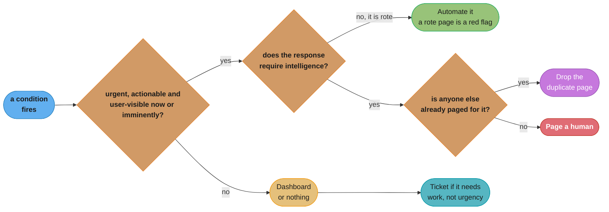
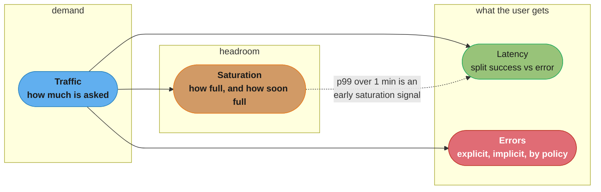
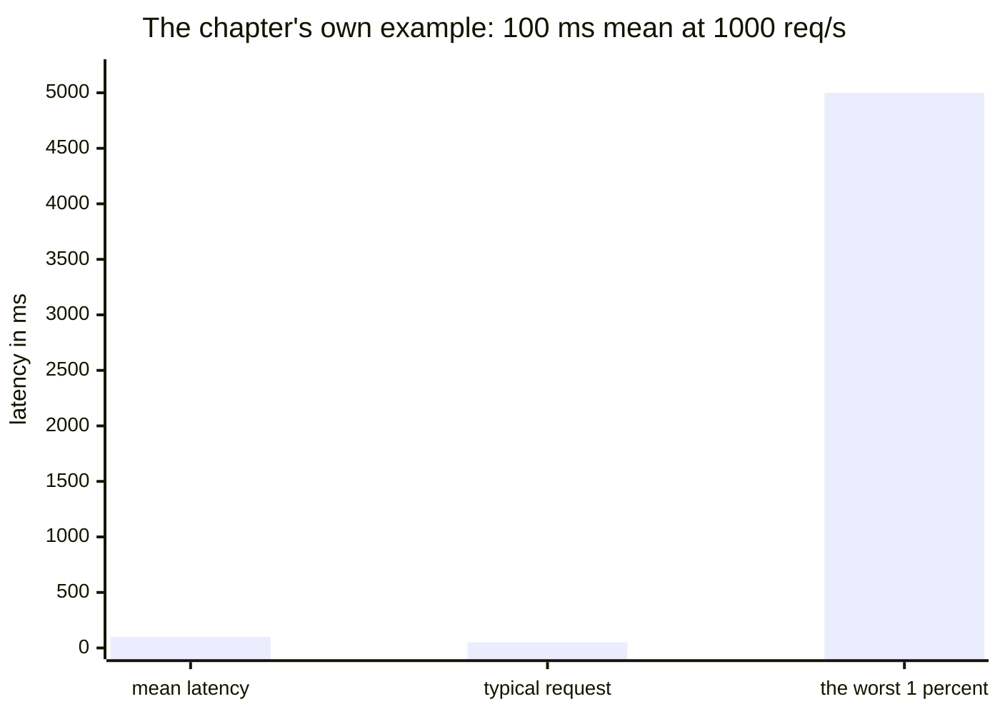
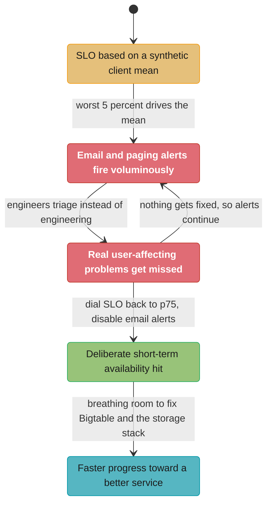

# Chapter 6: Monitoring Distributed Systems

> Part II — Principles · Site Reliability Engineering: How Google Runs Production Systems
> (Beyer, Jones, Petoff & Murphy, eds., O'Reilly 2016) · builds on Ch 5 (Eliminating Toil), leads
> to Ch 8 (Release Engineering) — Ch 7, "The Evolution of Automation at Google," is not summarized
> in this folder

## Chapter Map

Chapter 4 defined the numbers a service is held to. Chapter 5 named the top source of an SRE's
toil — interrupts — and ranked on-call response second. This chapter, written by Rob Ewaschuk, is
where those two threads meet: it is the book's ruling on **what is allowed to interrupt a human**,
and it is deliberately restrictive. Its thesis is that a page is one of the most expensive things
an organization can spend, so the bar for spending one must be high, explicit, and defended
continuously against the natural drift toward more alerts. Everything else in the chapter — the
four golden signals, symptoms versus causes, black-box versus white-box, tail latency, measurement
resolution, and the two case studies — is instrumentation in service of that one ruling.

**TL;DR:**
- **The four golden signals are latency, traffic, errors, and saturation.** "If you can only
  measure four metrics of your user-facing system, focus on these four" — and if you page on all
  four when one is problematic, your service is at least decently covered.
- **Page on symptoms, not causes.** "What's broken" is the symptom and "why" is a possibly
  intermediate cause; the chapter calls this "one of the most important distinctions in writing
  good monitoring with maximum signal and minimum noise."
- **Alerts come in three grades — pages, tickets, and email alerts — and the chapter is scathing
  about the third.** Email alerts are "sometimes known as alert spam, as they are rarely read or
  acted on"; the conclusion recommends replacing them with a dashboard.
- **Averages lie about tails.** At an average latency of 100 ms and 1,000 requests per second, "1%
  of requests might easily take 5 seconds" — and "the 99th percentile of one backend can easily
  become the median response of your frontend."
- **Google trends toward simpler and faster monitoring, avoiding "magic" systems** that learn
  thresholds or infer causality, and has had "only limited success with complex dependency
  hierarchies."
- Two case studies carry the long-term argument: **Bigtable SRE** deliberately relaxed its SLO to
  the 75th percentile and switched off email alerts to buy time for a real fix, and **Gmail's**
  Workqueue story ends with the ruling that **pages with rote, algorithmic responses are a red
  flag** worth escalating.

## The Big Question

Every monitoring discussion eventually collapses into a fight about thresholds. Should the alert
fire at 80% disk or 90%? At a p99 of 300 ms or 500 ms? Those arguments are unwinnable because they
are downstream of a question nobody asked first: **what is a page actually for?**

The chapter answers it economically. A page interrupts a human. If they are at work, it interrupts
their workflow; if they are at home, it interrupts their personal time and perhaps their sleep. And
the damage compounds — "when pages occur too frequently, employees second-guess, skim, or even
ignore incoming alerts, sometimes even ignoring a real page that's masked by the noise." So the
real question is not "what threshold" but **"is this condition worth the cost of a human being's
attention, and will that human be able to do anything about it?"** Every rule in the chapter is a
consequence of taking that price seriously.

Analogy: think of a page as a fire alarm rather than a dashboard notification. A building whose
alarm sounds whenever someone burns toast will, within a month, have occupants who walk past a
sounding alarm without looking up — and the alarm has then made the building *less* safe than no
alarm at all. The fix is not a louder alarm or a better evacuation procedure. It is a stricter
definition of what counts as a fire. That is the whole of this chapter: a stricter definition of
what counts as a fire, plus the four sensors most likely to detect one.

---

## 6.1 Definitions

The chapter opens by conceding there is "no uniformly shared vocabulary for discussing all topics
related to monitoring" — even inside Google — and then fixes the terms it will use.

| Term | The chapter's definition |
|---|---|
| **Monitoring** | "Collecting, processing, aggregating, and displaying real-time quantitative data about a system, such as query counts and types, error counts and types, processing times, and server lifetimes." |
| **White-box monitoring** | "Monitoring based on metrics exposed by the internals of the system, including logs, interfaces like the Java Virtual Machine Profiling Interface, or an HTTP handler that emits internal statistics." |
| **Black-box monitoring** | "Testing externally visible behavior as a user would see it." |
| **Dashboard** | An application, usually web-based, "that provides a summary view of a service's core metrics," prebuilt to expose what matters most to its users; may also display team information such as ticket queue length, high-priority bugs, the current on-call engineer, or recent pushes. |
| **Alert** | "A notification intended to be read by a human and that is pushed to a system such as a bug or ticket queue, an email alias, or a pager." These three are, respectively, **tickets**, **email alerts**, and **pages**. |
| **Root cause** | "A defect in a software or human system that, if repaired, instills confidence that this event won't happen again in the same way." |
| **Node / machine** | Used interchangeably for "a single instance of a running kernel in either a physical server, virtual machine, or container." |
| **Push** | "Any change to a service's running software or its configuration." |

Three of these definitions do more work than they appear to.

**The three grades of alert are a single concept with three destinations.** The chapter treats
tickets, email alerts, and pages as the same thing routed differently, which is what makes the
later ruling coherent: the question is never "should we alert" but "which destination does this
condition deserve." And the footnote attached to email alerts is the chapter's verdict on that
destination: **"Sometimes known as 'alert spam,' as they are rarely read or acted on."**

**A root cause is defined by the confidence repairing it gives you**, not by being first in a causal
chain. The chapter is explicit that "a given incident might have multiple root causes" — its example
is an incident caused by a combination of insufficient process automation, software that crashed on
bogus input, and insufficient testing of the config-generation script. "Each of these factors might
stand alone as a root cause, and each should be repaired." That plurality is what stops
postmortems from converging on a single blameable step.

**Node and machine are deliberately collapsed,** and the chapter notes there might be multiple
services worth monitoring on a single machine, either related to each other (a caching server and a
web server) or unrelated services merely sharing hardware (a code repository and a master for a
configuration system like Puppet or Chef).

---

## 6.2 Why Monitor?

Five reasons, and the list is worth reading as a warning against collapsing them into one system.

| Reason | The chapter's own questions |
|---|---|
| **Analyzing long-term trends** | "How big is my database and how fast is it growing? How quickly is my daily-active user count growing?" |
| **Comparing over time or experiment groups** | "Are queries faster with Acme Bucket of Bytes 2.72 versus Ajax DB 3.14? How much better is my memcache hit rate with an extra node? Is my site slower than it was last week?" |
| **Alerting** | "Something is broken, and somebody needs to fix it right now! Or, something might break soon, so somebody should look soon." |
| **Building dashboards** | Dashboards "should answer basic questions about your service, and normally include some form of the four golden signals." |
| **Conducting ad hoc retrospective analysis (i.e., debugging)** | "Our latency just shot up; what else happened around the same time?" |

The chapter notes monitoring also feeds business analytics and security-breach analysis, but
excludes both from scope as outside SRE's particular expertise.

Then the two rulings that the rest of the chapter enforces.

**Never alert on strangeness.** "Unless you're performing security auditing on very narrowly scoped
components of a system, **you should never trigger an alert simply because 'something seems a bit
weird.'**" The purpose of an alert is to summon a human who will "investigate the alert, determine
if there's a real problem at hand, mitigate the problem, and determine the root cause" — and none
of those steps is possible when the alert's own premise is a vague anomaly.

**Paging is expensive.** "Paging a human is a quite expensive use of an employee's time." The
chapter's cost accounting, in full: at work, it interrupts their workflow; at home, it interrupts
their personal time and perhaps their sleep. And the compounding damage — too-frequent pages cause
employees to "second-guess, skim, or even ignore incoming alerts, sometimes even ignoring a 'real'
page that's masked by the noise," so that "outages can be prolonged because other noise interferes
with a rapid diagnosis and fix." The one-line standard: **"Effective alerting systems have good
signal and very low noise."**

---

## 6.3 Setting Reasonable Expectations for Monitoring

The chapter's least-quoted section, and the one with the most surprising content, because it is
mostly about what Google *avoids*.

**Monitoring is a real engineering investment.** "Even with substantial existing infrastructure for
instrumentation, collection, display, and alerting in place, **a Google SRE team with 10-12 members
typically has one or sometimes two members whose primary assignment is to build and maintain
monitoring systems for their service**." That number has decreased over time as common monitoring
infrastructure was generalized and centralized, but every SRE team typically has at least one
"monitoring person."

And an immediate caveat about what that person is *not* for: "while it can be fun to have access to
traffic graph dashboards and the like, **SRE teams carefully avoid any situation that requires
someone to 'stare at a screen to watch for problems.'**"

**Google trends simpler and faster, not smarter.** "In general, Google has trended toward simpler
and faster monitoring systems, with better tools for post hoc analysis. **We avoid 'magic' systems
that try to learn thresholds or automatically detect causality.**"

The chapter names its own counterexample rather than pretending the rule is absolute: rules that
detect unexpected changes in end-user request rates are kept, because "while these rules are still
kept as simple as possible, they give a very quick detection of a very simple, specific, severe
anomaly."

It also supplies the principle governing where complexity is acceptable, and it is about
**fragility tolerance**:

```
  Where fragility is unacceptable          Where fragility is tolerable
  -------------------------------          ----------------------------
  the critical path: problem onset         capacity planning
    -> page -> triage -> debugging         traffic prediction
                                           long-horizon observational
  Rules that page a human must be            experiments (months/years,
  very simple and robust                     sampled hourly/daily)

  Why: an occasional missed sample cannot hide a long-running trend,
  but a fragile paging rule fails exactly when you need it.
```

**Complex dependency hierarchies mostly do not work.** "Google SRE has experienced only limited
success with complex dependency hierarchies. We seldom use rules such as, 'If I know the database
is slow, alert for a slow database; otherwise, alert for the website being generally slow.'"

Where dependency rules *do* survive is a narrow band: "very stable parts of our system, such as our
system for draining user traffic away from a datacenter." The chapter's example of a rule that
works — **"If a datacenter is drained, then don't alert me on its latency"** — is a common
datacenter alerting rule. And the structural reason the general case fails is stated plainly: "Few
teams at Google maintain complex dependency hierarchies because **our infrastructure has a steady
rate of continuous refactoring**." A dependency graph encoded in alerting rules is a second copy of
the architecture, and it rots at the speed the architecture changes.

The section closes with an unusual admission: "some of the ideas described in this chapter are
still aspirational: there is always room to move more rapidly from symptom to root cause(s),
especially in ever-changing systems."

---

## 6.4 Symptoms Versus Causes

The chapter's shortest section and one of its two most-quoted. "Your monitoring system should
address two questions: **what's broken, and why?**"

- **"What's broken" indicates the symptom.**
- **"Why" indicates a (possibly intermediate) cause.**

Table 6-1 in the chapter, reproduced:

| Symptom | Cause |
|---|---|
| I'm serving HTTP 500s or 404s | Database servers are refusing connections |
| My responses are slow | CPUs are overloaded by a bogosort, or an Ethernet cable is crimped under a rack, visible as partial packet loss |
| Users in Antarctica aren't receiving animated cat GIFs | Your Content Distribution Network hates scientists and felines, and thus blacklisted some client IPs |
| Private content is world-readable | A new software push caused ACLs to be forgotten and allowed all requests |

The chapter's verdict: **"'What' versus 'why' is one of the most important distinctions in writing
good monitoring with maximum signal and minimum noise."**

The operational consequence, drawn out: symptoms are a bounded set and causes are not. A service
has a handful of ways to be broken *from the user's point of view* — wrong answer, no answer, slow
answer, leaked answer — and an unbounded number of internal reasons for each. Alerting on causes
means enumerating an unbounded set in advance and maintaining it as the architecture changes;
alerting on symptoms means covering the bounded set once.

```
  BROKEN
    alert on causes: "DB connection pool > 90%", "GC pause > 2s",
                     "queue depth > 5000", "cache hit rate < 70%" ...
      -> each rule needs a threshold nobody can defend
        -> the outage arrives via the one cause nobody enumerated
          -> and the 40 rules that did not fire still page you all quarter

  FIXED
    alert on symptoms: "error rate above SLO", "p99 latency above SLO"
      -> one rule covers every cause, enumerated or not
        -> causes become DEBUGGING signals, kept on dashboards
          -> "when it comes to causes, only worry about very definite,
             very imminent ones"
```

---

## 6.5 Black-Box Versus White-Box

"We combine **heavy use of white-box monitoring** with **modest but critical uses of black-box
monitoring**."

The chapter's simplest framing of the difference: **black-box monitoring is symptom-oriented and
represents active — not predicted — problems**: "The system isn't working correctly, right now."
White-box monitoring depends on the ability to inspect the innards of the system, such as logs or
HTTP endpoints, with instrumentation, and therefore "allows detection of **imminent problems,
failures masked by retries**, and so forth."

That phrase — *failures masked by retries* — is the whole argument for white-box in four words. A
backend failing 30% of calls that a client retries successfully is invisible from outside and
obvious from inside, right up until the retry budget runs out.

**Symptom and cause are relative to your position in the stack.** "In a multilayered system, one
person's symptom is another person's cause." The chapter's example: slow database reads are a
**symptom** for the database SRE who detects them, and the same slow reads are a **cause** for the
frontend SRE observing a slow website. Therefore "white-box monitoring is sometimes
symptom-oriented, and sometimes cause-oriented, depending on just how informative your white-box
is."

**For debugging, white-box is essential.** "If web servers seem slow on database-heavy requests,
you need to know both how fast the web server perceives the database to be, and how fast the
database believes itself to be. Otherwise, **you can't distinguish an actually slow database server
from a network problem** between your web server and your database." Two measurements of the same
thing from two vantage points is the only way to localize the fault to the link between them.

**For paging, black-box has one key benefit** — and it is a discipline benefit, not a technical one:
it "has the key benefit of forcing discipline to only nag a human when a problem is both **already
ongoing and contributing to real symptoms**." The counterweight is stated in the same breath: "for
not-yet-occurring but imminent problems, black-box monitoring is fairly useless."

| | Black-box | White-box |
|---|---|---|
| Vantage point | outside, as a user | inside, via instrumentation, logs, HTTP handlers, JVM profiling interfaces |
| Orientation | symptom, always | symptom or cause, depending on how informative the instrumentation is |
| Detects | active problems, right now | imminent problems, failures masked by retries |
| Best used for | paging (it forces the discipline) | debugging, and predicting |
| Blind to | causes, and anything not yet user-visible | nothing internal — but it can page you for things users never feel |

---

## 6.6 The Four Golden Signals

"The four golden signals of monitoring are **latency, traffic, errors, and saturation**. If you can
only measure four metrics of your user-facing system, focus on these four."

### Latency

"The time it takes to service a request."

The chapter's non-obvious instruction: **"It's important to distinguish between the latency of
successful requests and the latency of failed requests."** Its reasoning runs both ways, and both
directions matter.

- An HTTP 500 triggered by loss of connection to a database or other critical backend "might be
  served **very quickly**; however, as an HTTP 500 error indicates a failed request, factoring 500s
  into your overall latency might result in **misleading calculations**." Fast failures make your
  latency graph look better as the service gets worse.
- "On the other hand, **a slow error is even worse than a fast error!** Therefore, it's important to
  **track error latency, as opposed to just filtering out errors**."

So the rule is not "exclude errors from latency." It is "measure success latency and error latency
as two separate series."

```
  BROKEN
    one latency series over all requests
      -> backend dies, 40% of requests now fail in 3 ms
        -> the overall p99 IMPROVES
          -> the latency alert goes quiet during the outage

  FIXED
    latency of successful requests   (the SLI users care about)
    latency of failed requests       (a slow error is worse than a fast one)
      -> the outage shows up in both series, in opposite directions
```

### Traffic

"A measure of how much demand is being placed on your system, measured in a high-level
system-specific metric." The chapter's point is that the right unit is service-specific:

| Service type | The chapter's traffic metric |
|---|---|
| Web service | HTTP requests per second, "perhaps broken out by the nature of the requests (e.g., static versus dynamic content)" |
| Audio streaming system | network I/O rate, or concurrent sessions |
| Key-value storage system | transactions and retrievals per second |

### Errors

"The rate of requests that fail," in three distinct modes:

- **Explicitly** — e.g. HTTP 500s.
- **Implicitly** — "for example, an HTTP 200 success response, but coupled with the **wrong
  content**."
- **By policy** — "for example, 'If you committed to one-second response times, any request over
  one second is an error.'"

The policy mode is the one that ties this chapter back to Chapter 4: **an SLO turns slowness into
an error**, by definition, and that redefinition is what makes a latency objective enforceable
rather than advisory.

The chapter also notes that where protocol response codes are insufficient to express all failure
conditions, "secondary (internal) protocols may be necessary to track partial failure modes," and
that the detection method differs sharply by mode: "**catching HTTP 500s at your load balancer can
do a decent job of catching all completely failed requests, while only end-to-end system tests can
detect that you're serving the wrong content.**"

### Saturation

"How 'full' your service is. A measure of your system fraction, **emphasizing the resources that
are most constrained** (e.g., in a memory-constrained system, show memory; in an I/O-constrained
system, show I/O)."

Four sub-points, each of which is a distinct practice:

1. Systems **degrade before 100%**. "Note that many systems degrade in performance before they
   achieve 100% utilization, so **having a utilization target is essential**." Saturation is not
   "are we at capacity," it is "are we past the point where this resource starts costing us
   latency."
2. Higher-level **load measurement supplements it**. In complex systems, ask: "can your service
   properly handle double the traffic, handle only 10% more traffic, or handle even less traffic
   than it currently receives?"
3. Simple services can use a **static number**. For very simple services with no parameters that
   alter request complexity — the chapter's examples are "Give me a nonce" or "I need a globally
   unique monotonic integer" — that rarely change configuration, "a static value from a load test
   might be adequate." Most services instead need indirect signals like CPU utilization or network
   bandwidth "that have a known upper bound."
4. Latency is a **leading indicator of saturation**. "Latency increases are often a leading
   indicator of saturation. **Measuring your 99th percentile response time over some small window
   (e.g., one minute) can give a very early signal of saturation.**"

And finally, saturation includes prediction: "saturation is also concerned with predictions of
impending saturation, such as **'It looks like your database will fill its hard drive in 4
hours.'**"

The section's closing standard: "**If you measure all four golden signals and page a human when one
signal is problematic (or, in the case of saturation, nearly problematic), your service will be at
least decently covered by monitoring.**"

| Signal | What it answers | Watch out for |
|---|---|---|
| **Latency** | how long did it take | separate success from error latency; fast errors flatter the graph |
| **Traffic** | how much demand | the unit is service-specific; break out by request nature |
| **Errors** | what fraction failed | three modes: explicit, implicit (wrong content), by policy (SLO breach) |
| **Saturation** | how full are we | degradation starts before 100%; p99 over a one-minute window is an early signal; predict, don't just report |

---

## 6.7 Worrying About Your Tail (or, Instrumentation and Performance)

"When building a monitoring system from scratch, it's tempting to design a system based upon the
**mean** of some quantity: the mean latency, the mean CPU usage of your nodes, or the mean fullness
of your databases."

The chapter concedes the danger is obvious for the last two — "CPUs and databases can easily be
utilized in a very imbalanced way" — and then makes the case that latency is identical:

> If you run a web service with an **average latency of 100 ms at 1,000 requests per second, 1% of
> requests might easily take 5 seconds**.

Its footnote does the arithmetic that makes this bite: "If 1% of your requests are 50x the average,
it means that **the rest of your requests are about twice as fast as the average**. But if you're
not measuring your distribution, the idea that most of your requests are near the mean is **just
hopeful thinking**."

And then the amplification result that every system designer should carry around:

> **If your users depend on several such web services to render their page, the 99th percentile of
> one backend can easily become the median response of your frontend.**

```
  A page that fans out to 100 backend calls, each with a p99 of 5 s:

    P(all 100 calls avoid the p99 tail) = 0.99^100  ~=  0.366

    -> roughly 63 of every 100 page loads touch at least one 5-second call
    -> the backend's rare tail is the frontend's typical case

  (the multiplication is this summary's own arithmetic; the chapter states
   the conclusion - "the 99th percentile of one backend can easily become
   the median response of your frontend" - without showing the algebra)
```

**The fix is histograms, not better averages.** "The simplest way to differentiate between a slow
average and a very slow 'tail' of requests is to **collect request counts bucketed by latencies**
(suitable for rendering a histogram), rather than actual latencies: how many requests did I serve
that took between 0 ms and 10 ms, between 10 ms and 30 ms, between 30 ms and 100 ms, between 100 ms
and 300 ms, and so on?"

The chapter's bucketing rule: "**Distributing the histogram boundaries approximately exponentially**
(in this case by factors of roughly 3) is often an easy way to visualize the distribution of your
requests."

```
  Exponential buckets, factor ~3, exactly as the chapter lists them:

    0-10ms   10-30ms   30-100ms   100-300ms   300ms-1s   1-3s   3-10s ...

  Why exponential and not linear: latency spans four or five orders of
  magnitude, so linear buckets either miss all the structure at the fast
  end or need thousands of buckets to reach the slow end. Constant
  RELATIVE resolution is what a percentile calculation actually needs.
```

---

## 6.8 Choosing an Appropriate Resolution for Measurements

"Different aspects of a system should be measured with different levels of granularity." The
chapter's three examples, which bracket the range:

- "Observing **CPU load over the time span of a minute** won't reveal even quite long-lived spikes
  that drive high tail latencies." (Too coarse.)
- "For a web service targeting **no more than 9 hours aggregate downtime per year (99.9% annual
  uptime)**, probing for a 200 (success) status **more than once or twice a minute** is probably
  unnecessarily frequent." (Too fine.)
- "Similarly, checking hard drive fullness for a service targeting **99.9% availability more than
  once every 1-2 minutes** is probably unnecessary." (Too fine.)

The middle example is the one worth internalizing, because it derives sampling frequency from the
SLO rather than from taste: if you are allowed nine hours of downtime a year, a probe interval of
30-60 seconds already resolves outages far finer than your budget cares about, and everything
beyond that is cost with no decision attached.

**The cost of high resolution, and the way around it.** "Take care in how you structure the
granularity of your measurements. Collecting per-second measurements of CPU load might yield
interesting data, but such frequent measurements **may be very expensive to collect, store, and
analyze**."

The chapter's technique when you need high resolution but not low latency: **sample internally on
the server, aggregate externally.**

```
  1. Record the current CPU utilization each second.
  2. Using buckets of 5% granularity, increment the appropriate CPU
     utilization bucket each second.
  3. Aggregate those values every minute.

  Result: you observe brief CPU hotspots (per-second resolution, retained
  as a distribution) while shipping and storing one aggregate per minute.
```

"This strategy allows you to observe brief CPU hotspots without incurring very high cost due to
collection and retention." It is the same move as §6.7's histograms, applied to a resource metric
instead of a latency one: **keep the distribution, discard the timeline.**

---

## 6.9 As Simple as Possible, No Simpler

"Piling all these requirements on top of each other can add up to a very complex monitoring
system." The chapter's own list of how the complexity accumulates:

- "Alerts on different latency thresholds, at different percentiles, on all kinds of different
  metrics"
- "Extra code to detect and expose possible causes"
- "Associated dashboards for each of these possible causes"

"The sources of potential complexity are never-ending. Like all software systems, **monitoring can
become so complex that it's fragile, complicated to change, and a maintenance burden.**"

Three guidelines, and two of them are deletion rules:

1. "**The rules that catch real incidents most often should be as simple, predictable, and reliable
   as possible.**"
2. "**Data collection, aggregation, and alerting configuration that is rarely exercised** (e.g.,
   less than once a quarter for some SRE teams) **should be up for removal.**"
3. "**Signals that are collected, but not exposed in any prebaked dashboard nor used by any alert,
   are candidates for removal.**"

The second rule is the one teams resist, because a rule that fires once a year feels like insurance.
The chapter's implicit answer is that an alerting rule exercised less than quarterly has not been
validated recently enough to be trusted when it does fire, and it still costs maintenance every
time the architecture moves under it.

**Keep monitoring separate from its neighbours.** "In Google's experience, basic collection and
aggregation of metrics, paired with alerting and dashboards, has worked well as a relatively
standalone system." The chapter then names the temptations explicitly — combining monitoring with
"detailed system profiling, single-process debugging, tracking details about exceptions or crashes,
load testing, log collection and analysis, or traffic inspection" — and rules on them: "while most
of these subjects share commonalities with basic monitoring, **blending together too many results in
overly complex and fragile systems**."

The prescribed architecture is the ordinary software-engineering one: "maintaining distinct systems
with clear, simple, loosely coupled points of integration is a better strategy (for example, using
web APIs for pulling summary data in a format that can remain constant over an extended period of
time)."

---

## 6.10 Tying These Principles Together

The chapter now assembles a philosophy "widely endorsed and followed within Google SRE teams,"
while conceding it is "a bit aspirational." Its stated use: "a good starting point for writing or
reviewing a new alert."

**The five questions to ask of any monitoring or alerting rule**, to avoid false positives and
pager burnout:

1. "**Does this rule detect an otherwise undetected condition that is urgent, actionable, and
   actively or imminently user-visible?**" (The chapter's footnote: zero-redundancy, or N+0,
   situations count as imminent, as do "nearly full" parts of your service.)
2. "Will I ever be able to **ignore this alert, knowing it's benign**? When and why will I be able
   to ignore this alert, and how can I avoid this scenario?"
3. "Does this alert **definitely indicate that users are being negatively affected**? Are there
   detectable cases in which users aren't being negatively impacted, such as **drained traffic or
   test deployments**, that should be filtered out?"
4. "**Can I take action in response to this alert?** Is that action urgent, or could it wait until
   morning? Could the action be **safely automated**? Will that action be a long-term fix, or just
   a short-term workaround?"
5. "Are **other people getting paged for this issue**, therefore rendering at least one of the pages
   unnecessary?"

**And the four-bullet philosophy those questions reflect:**

> - Every time the pager goes off, I should be able to react with a **sense of urgency**. I can only
>   react with a sense of urgency **a few times a day** before I become fatigued.
> - **Every page should be actionable.**
> - **Every page response should require intelligence.** If a page merely merits a robotic response,
>   it shouldn't be a page.
> - **Pages should be about a novel problem or an event that hasn't been seen before.**

Two consequences the chapter draws from that list, and they pull in opposite directions:

- **It dissolves the black-box/white-box distinction for paging.** "If a page satisfies the
  preceding four bullets, **it's irrelevant whether the page is triggered by white-box or black-box
  monitoring.**" The four bullets are the test; the mechanism is an implementation detail.
- **It sharpens the symptom/cause distinction.** "It's better to spend much more effort on
  **catching symptoms than causes**; when it comes to causes, **only worry about very definite, very
  imminent causes.**"

Note how bullets three and four connect directly to Chapter 5. "If a page merely merits a robotic
response, it shouldn't be a page" is a toil ruling: a rote response is by definition automatable,
tactical, and devoid of enduring value.

---

## 6.11 Monitoring for the Long Term

"In modern production systems, monitoring systems track an ever-evolving system with changing
software architecture, load characteristics, and performance targets. **An alert that's currently
exceptionally rare and hard to automate might become frequent**, perhaps even meriting a
hacked-together script to resolve it. At this point, someone should find and eliminate the root
causes of the problem; **if such resolution isn't possible, the alert response deserves to be fully
automated.**"

The central tradeoff, stated once and then illustrated twice: "**Every page that happens today
distracts a human from improving the system for tomorrow**, so there is often a case for taking a
short-term hit to availability or performance in order to improve the long-term outlook for the
system."

### Bigtable SRE: A Tale of Over-Alerting

Google's internal infrastructure is typically offered and measured against an SLO (Chapter 4). Many
years before the book, **the Bigtable service's SLO was based on a synthetic well-behaved client's
mean performance**. Because of problems in Bigtable and lower layers of the storage stack, "the
mean performance was driven by a 'large' tail: **the worst 5% of requests were often significantly
slower than the rest**."

The alerting configuration on top of that SLO: "Email alerts were triggered as the SLO approached,
and paging alerts were triggered when the SLO was exceeded."

The result: **"Both types of alerts were firing voluminously, consuming unacceptable amounts of
engineering time."** The failure had three distinct symptoms, all of which the chapter names:

- "The team spent significant amounts of time **triaging the alerts to find the few that were
  really actionable**."
- "We often **missed the problems that actually affected users**, because so few of them did."
- "Many of the pages were **non-urgent**, due to well-understood problems in the infrastructure, and
  had either **rote responses or received no response**."

**The three-pronged remedy**, and two of the three prongs are things most organizations would
consider unthinkable:

1. Make "great efforts to improve the performance of Bigtable" — the real fix.
2. Temporarily **dial back the SLO target, using the 75th percentile request latency** instead of
   the mean.
3. Disable **email alerts entirely**, "as there were so many that spending time diagnosing them was
   infeasible."

"This strategy gave us enough breathing room to actually fix the longer-term problems in Bigtable
and the lower layers of the storage stack, rather than constantly fixing tactical problems. On-call
engineers could actually accomplish work when they weren't being kept up by pages at all hours.
**Ultimately, temporarily backing off on our alerts allowed us to make faster progress toward a
better service.**"

Read against Chapter 4, prong 2 is the striking one: the SLO was based on the *mean*, which
Chapter 4 warns against, and the temporary fix was to move to a *percentile* — but a low one, the
75th, deliberately chosen to be achievable rather than aspirational. Relaxing an objective is
normally a failure; here it is the instrument that bought the engineering time to earn a better
one.

### Gmail: Predictable, Scriptable Responses from Humans

"In the very early days of Gmail, the service was built on a retrofitted distributed process
management system called **Workqueue**, which was originally created for batch processing of pieces
of the search index." Workqueue was "adapted" to long-lived processes and applied to Gmail, "but
certain bugs in the relatively opaque codebase in the scheduler proved hard to beat."

The alerting setup: "alerts fired when individual tasks were 'de-scheduled' by Workqueue. This
setup was less than ideal because even at that time, **Gmail had many, many thousands of tasks, each
task representing a fraction of a percent of our users**." Caring deeply about user experience while
alerting per-task at that cardinality was, in the chapter's word, "unmaintainable."

The response: "Gmail SRE built a tool that helped 'poke' the scheduler in just the right way to
minimize impact to users." And then the argument that is the real content of the story: "The team
had several discussions about whether or not we should simply **automate the entire loop from
detecting the problem to nudging the rescheduler**, until a better long-term solution was achieved,
but **some worried this kind of workaround would delay a real fix**."

The chapter's diagnosis of that argument is unusually candid about team dynamics:

> This kind of tension is common within a team, and often reflects an **underlying mistrust of the
> team's self-discipline**: while some team members want to implement a "hack" to allow time for a
> proper fix, others worry that a hack will be forgotten or that the proper fix will be
> deprioritized indefinitely. **This concern is credible**, as it's easy to build layers of
> unmaintainable technical debt by patching over problems instead of making real fixes.

And its assignment of responsibility: "**Managers and technical leaders play a key role in
implementing true, long-term fixes by supporting and prioritizing potentially time-consuming
long-term fixes even when the initial 'pain' of paging subsides.**"

The story's ruling, stated in two sentences that deserve to be quoted verbatim:

> **Pages with rote, algorithmic responses should be a red flag. Unwillingness on the part of your
> team to automate such pages implies that the team lacks confidence that they can clean up their
> technical debt. This is a major problem worth escalating.**

### The Long Run

"A common theme connects the previous examples of Bigtable and Gmail: **a tension between short-term
and long-term availability**."

The chapter's argument against heroics: "Often, sheer force of effort can help a rickety system
achieve high availability, but this path is usually **short-lived and fraught with burnout and
dependence on a small number of heroic team members**. Taking a controlled, short-term decrease in
availability is often a painful, but strategic trade for the long-run stability of the system."

And the framing instruction: "**It's important not to think of every page as an event in isolation,
but to consider whether the overall level of paging leads toward a healthy, appropriately available
system with a healthy, viable team and long-term outlook.**"

The governance mechanism that makes this real rather than aspirational: "We review statistics about
**page frequency (usually expressed as incidents per shift**, where an incident might be composed of
a few related pages) **in quarterly reports with management**, ensuring that decision makers are
kept up to date on the pager load and overall health of their teams."

That last sentence is the chapter's answer to how any of this survives contact with organizational
pressure: pager load is reported upward on a regular cadence, in a unit (incidents per shift) that a
manager can act on.

---

## 6.12 Conclusion

The chapter's own closing summary:

> A healthy monitoring and alerting pipeline is **simple and easy to reason about**. It focuses
> **primarily on symptoms for paging**, reserving cause-oriented heuristics to serve as aids to
> debugging problems.

Four further rulings in the conclusion:

- **Monitoring symptoms is easier the further "up" your stack you monitor**, "though monitoring
  saturation and performance of subsystems such as databases often must be performed directly on
  the subsystem itself."
- **"Email alerts are of very limited value and tend to easily become overrun with noise."**
- The replacement: "instead, you should favor a **dashboard that monitors all ongoing subcritical
  problems** for the sort of information that typically ends up in email alerts."
- "A dashboard might also be **paired with a log**, in order to analyze historical correlations."

And the long-horizon statement: "Over the long haul, achieving a successful on-call rotation and
product includes **choosing to alert on symptoms or imminent real problems, adapting your targets to
goals that are actually achievable, and making sure that your monitoring supports rapid
diagnosis.**"

---

## Beyond the book — where these principles went next

> This chapter names white-box and black-box monitoring, dashboards, three alert destinations, and
> exponential latency histograms. It does **not** use the word "observability," does not discuss
> distributed tracing, does not mention structured events or high-cardinality analysis, and predates
> both OpenTelemetry and the multi-window multi-burn-rate SLO alerting patterns that Google's own
> *Site Reliability Workbook* (2018) later published. Everything in this section is post-2016 and is
> not Ewaschuk's.

Two connections are worth naming for a reader coming from a modern stack. First, the chapter's
"symptoms for paging, causes for debugging" split is exactly the division of labour that later
tooling formalized as SLO-based alerting on the paging side and tracing on the debugging side —
distributed tracing is the industrial answer to §6.5's "you need to know both how fast the web
server perceives the database to be, and how fast the database believes itself to be." Second, the
chapter's histogram advice anticipates the Prometheus histogram and its quantile estimation almost
exactly, including the exponential bucket boundaries; what it could not anticipate is the
cardinality cost of doing that per label combination, which is now the dominant operational
constraint on metric design.

---

## Visual Intuition

### What is allowed to interrupt a human



*Every branch that avoids the red node is a saving. The chapter's four philosophy bullets are the
three decision nodes plus the frequency budget: a human can react with genuine urgency only a few
times a day before fatigue sets in.*

### Symptom versus cause, and why the arrow points where it does

```
                    USER
                     |
                     |  what the user feels = the SYMPTOM
                     v         (bounded set: wrong, missing, slow, leaked)
              +--------------+
              |   frontend   |  <- page here
              +--------------+
                     |
                     v
              +--------------+
              |     API      |     slow API reads are:
              +--------------+       a SYMPTOM to the API SRE
                     |               a CAUSE to the frontend SRE
                     v
              +--------------+
              |   database   |  <- dashboard here, page only on
              +--------------+     very definite, very imminent causes
                     |
                     v
              +--------------+
              |     disk     |
              +--------------+

  Alerting on causes means enumerating an unbounded set in advance, and
  maintaining that enumeration as the architecture changes underneath it.
  Alerting on symptoms covers the bounded set once, including the cause
  nobody thought of.
```

*Caption: the chapter's "one person's symptom is another person's cause" is not a paradox — it is a
statement that the symptom/cause label is relative to your layer, while the paging rule stays
absolute: page on what the user feels.*

### The four golden signals



*Traffic is the input; latency and errors are what the user experiences; saturation is the headroom
that determines whether the other three are about to move. The dotted edge is the chapter's own
claim that rising tail latency leads saturation rather than following it.*

### Why the mean is the wrong statistic, twice over



*All three bars come from the chapter and its footnote: an average of 100 ms, a top 1% around 5
seconds, and therefore a typical request about twice as fast as the average. Watching only the
left-hand bar tells you nothing about the right-hand one, which is fifty times taller.*

### Keeping the distribution while discarding the timeline

```
  EXPENSIVE                              THE CHAPTER'S TECHNIQUE

  ship one sample per second             sample per second, bucket locally,
  to the monitoring system               ship one aggregate per minute

    60 datapoints/min/metric               1 datapoint/min/metric
    full timeline retained                 timeline lost
    hotspots visible                       hotspots STILL visible, as a
    cost: 60x                                distribution over 5% buckets

  Same move as latency histograms in 6.7: what you actually need for
  percentiles and hotspot detection is the DISTRIBUTION, not the ordering.
```

*Caption: resolution and cost are not a straight trade. Sampling finely and aggregating coarsely
keeps the property you need — the shape of the distribution — and throws away the property you
usually do not — the exact second each sample landed.*

### Bigtable: the loop the team broke deliberately



*The self-loop is the trap: alert volume consumed the engineering time that would have removed the
alerts. Breaking it required doing two things that look like giving up — relaxing the objective and
switching off a whole alert channel — in order to reach a better objective later.*

---

## Key Concepts Glossary

- **Monitoring** — collecting, processing, aggregating, and displaying real-time quantitative data
  about a system.
- **White-box monitoring** — monitoring based on metrics exposed by the system's internals: logs,
  profiling interfaces, HTTP handlers emitting internal statistics.
- **Black-box monitoring** — testing externally visible behaviour as a user would see it.
- **Dashboard** — a prebuilt summary view of a service's core metrics, possibly including team
  information such as ticket queue length or the current on-call engineer.
- **Alert** — a notification intended to be read by a human, routed to a ticket queue, an email
  alias, or a pager.
- **Page** — the pager-routed grade of alert; the most expensive, reserved for urgent, actionable,
  user-visible problems.
- **Ticket** — the bug-or-ticket-queue grade of alert; work that needs doing but not now.
- **Email alert** — the email-alias grade; the chapter's footnote calls it "alert spam," and the
  conclusion recommends a dashboard instead.
- **Root cause** — a defect in a software or human system that, if repaired, gives confidence the
  event will not recur in the same way; an incident may have several.
- **Node / machine** — a single instance of a running kernel, whether physical server, VM, or
  container.
- **Push** — any change to a service's running software or configuration.
- **Symptom** — what is broken, from the perspective of the observer; the thing to page on.
- **Cause** — why it is broken, possibly intermediate; the thing to put on a dashboard.
- **The four golden signals** — latency, traffic, errors, saturation.
- **Latency (golden signal)** — time to service a request, tracked separately for successful and
  failed requests.
- **Traffic (golden signal)** — demand placed on the system, in a high-level service-specific unit.
- **Errors (golden signal)** — rate of failing requests, explicitly, implicitly (wrong content), or
  by policy (an SLO breach).
- **Saturation (golden signal)** — how full the service is, emphasizing the most constrained
  resource, including predictions of impending saturation.
- **Utilization target** — the fullness level a system is managed to, necessary because many
  systems degrade before 100% utilization.
- **Error latency** — the latency of failed requests, tracked separately because a slow error is
  worse than a fast one and fast errors flatter an aggregate latency graph.
- **Latency histogram / bucketed request counts** — request counts binned by latency range, with
  approximately exponential boundaries (factors of roughly 3), used instead of raw latencies.
- **Internal sampling with external aggregation** — recording finely on the server, bucketing
  locally, and shipping an aggregate, to get high resolution at low collection cost.
- **Alert spam** — the chapter's footnoted name for email alerts that are rarely read or acted on.
- **Incidents per shift** — the unit in which Google reports page frequency to management in
  quarterly reviews.
- **Workqueue** — the retrofitted distributed process management system underlying early Gmail, and
  the source of its de-scheduling alerts.

---

## Tradeoffs & Decision Tables

| Destination | Use when | The chapter's stance |
|---|---|---|
| **Page** | urgent, actionable, user-visible now or imminently, needs intelligence, nobody else paged | the expensive one; budget is a few per day before fatigue |
| **Ticket** | needs human work but not now | fine |
| **Email alert** | — | "of very limited value," "alert spam"; replace with a dashboard |
| **Dashboard** | ongoing subcritical problems, causes, debugging context | the recommended home for what would have been email |
| **Nothing** | signals with no dashboard and no alert using them | "candidates for removal" |

| Question | Symptom-based alerting | Cause-based alerting |
|---|---|---|
| Set size | bounded — the ways a user can be hurt | unbounded — the ways a system can break |
| Maintenance as architecture changes | stable | rots continuously |
| Catches the unanticipated failure | yes | no, by construction |
| Diagnostic value | low on its own | high |
| Chapter's ruling | spend "much more effort" here | only "very definite, very imminent" causes |

| Monitoring complexity | Acceptable? | Why |
|---|---|---|
| Paging rules | must be very simple and robust | they fail exactly when you need them |
| Anomaly-detecting "magic" that learns thresholds | avoided | Google trends simpler and faster instead |
| End-user request-rate change detection | kept | very quick detection of a simple, specific, severe anomaly |
| Complex dependency hierarchies | mostly avoided | continuous refactoring makes them rot; only stable cases like drained datacenters survive |
| Capacity planning and traffic prediction | more complexity tolerated | can tolerate fragility |
| Long-horizon observational experiments | more complexity tolerated | a missed sample cannot hide a long trend |

| Measurement | Resolution | The chapter's reasoning |
|---|---|---|
| CPU load | finer than one minute | a minute-scale view hides long-lived spikes that drive tail latency |
| HTTP 200 probe, 99.9% annual target | once or twice a minute is enough | more is unnecessarily frequent against a 9-hour annual budget |
| Hard drive fullness, 99.9% target | once every 1-2 minutes | more is unnecessary |
| Per-second CPU, if you need it | sample per second, bucket at 5%, aggregate per minute | keeps hotspot visibility at a fraction of the collection cost |

---

## Common Pitfalls / War Stories

- **Bigtable's mean-based SLO produced an alerting storm.** The SLO was based on a synthetic
  well-behaved client's mean performance while the worst 5% of requests were much slower, so email
  alerts fired as the SLO approached and pages fired when it was exceeded — both voluminously. The
  team spent its time triaging rather than fixing, and still missed the problems that actually
  affected users. The remedy was to dial the target back to the 75th percentile and switch email
  alerts off entirely while the real fix was built.
- **Gmail alerted per de-scheduled task across many thousands of tasks.** Each task represented a
  fraction of a percent of users, so the alerting setup was, in the chapter's word, unmaintainable.
  The story's lasting ruling is about the argument that followed: pages with rote, algorithmic
  responses are a red flag, and unwillingness to automate them implies the team does not believe it
  can clean up its technical debt — "a major problem worth escalating."
- **Alerting because "something seems a bit weird."** The chapter forbids this outright outside
  narrowly scoped security auditing. An alert whose premise is a vague anomaly cannot be
  investigated, mitigated, or root-caused, which is the entire job the human was summoned for.
- **A single latency series that improves during an outage.** Fast HTTP 500s pull an aggregate
  latency number down, so a backend failure can make the latency graph look better while the
  service is broken. Track success latency and error latency separately — and remember the
  chapter's other direction, that a slow error is worse than a fast one.
- **Reasoning from the mean.** At 100 ms average and 1,000 req/s, 1% of requests might easily take
  5 seconds, which implies the rest are about twice as fast as the average — and if a page fans out
  across several such services, one backend's 99th percentile becomes the frontend's median. The
  chapter's word for assuming most requests sit near the mean without measuring the distribution is
  "hopeful thinking."
- **Encoding the architecture into dependency-aware alert rules.** Google reports only limited
  success here, because its infrastructure undergoes continuous refactoring and the rules rot at
  that speed. The narrow exception that does work is a stable one: do not alert on the latency of a
  drained datacenter.
- **Keeping rarely-exercised alerting configuration as insurance.** The chapter puts collection,
  aggregation and alerting exercised less than about once a quarter up for removal, along with any
  signal not exposed on a dashboard or used by an alert. Rules that never fire are not validated,
  and they still cost maintenance every time the system moves under them.
- **Merging monitoring with profiling, tracing, load testing, and log analysis.** The chapter warns
  that blending too many of these produces overly complex and fragile systems, and prescribes
  distinct systems with clear, simple, loosely coupled integration points such as web APIs serving
  summary data in a format stable over a long period.
- **Staffing a person to watch a screen.** SRE teams "carefully avoid any situation that requires
  someone to stare at a screen to watch for problems," even though a 10-12 person team does
  typically dedicate one or two people to building and maintaining monitoring.
- **Treating each page as an isolated event.** The long-run section's instruction is to judge the
  overall paging level against whether it leads toward a healthy system and a viable team, which is
  why Google reviews page frequency as incidents per shift in quarterly reports with management.

---

## Real-World Systems Referenced

- **Bigtable** — Google's wide-column storage system; the mean-based-SLO over-alerting case study,
  and the source of the p75 and disable-email remedy.
- **Gmail** and **Workqueue** — early Gmail ran on Workqueue, a distributed process management
  system originally built for batch processing of search index pieces and retrofitted for
  long-lived processes; its scheduler bugs produced the per-task de-scheduling alerts.
- **Java Virtual Machine Profiling Interface** — named as an example of a white-box instrumentation
  interface.
- **Puppet** and **Chef** — named as examples of configuration systems whose masters might share a
  machine with unrelated services.
- **Content Distribution Network** — the cause in Table 6-1's Antarctica example.
- **Google SRE teams** — the source of the 10-12 person team sizing with one or two monitoring
  specialists, and of the quarterly incidents-per-shift management reviews.

---

## Summary

The chapter's own argument, restated and expanded. Monitoring exists for five reasons — long-term
trend analysis, comparison across time or experiment groups, alerting, dashboards, and ad hoc
retrospective debugging — and only one of those five is allowed to interrupt a human. Paging is an
expensive use of an employee's time, and too many pages actively degrade reliability because people
begin to skim or ignore alerts, including real ones masked by the noise. Effective alerting systems
have good signal and very low noise, and you should never alert simply because something seems a
bit weird.

The technical core is four ideas. **Symptoms versus causes**: page on what is broken from the
user's perspective, and reserve cause-oriented heuristics as debugging aids, because symptoms are a
bounded set and causes are not. **Black-box versus white-box**: black-box is symptom-oriented and
sees only active problems, which is exactly the discipline paging needs; white-box sees internals,
which is what detects imminent problems and failures masked by retries and what makes debugging
possible at all. **The four golden signals** — latency, traffic, errors, saturation — are the
minimum viable instrumentation of a user-facing system, with latency split between successful and
failed requests, errors counted explicitly, implicitly and by policy, and saturation measured
against a utilization target because systems degrade before they reach 100%. And **distributions,
not means**: at a 100 ms average and 1,000 requests per second, 1% of requests might take 5
seconds, and a backend's 99th percentile can become a frontend's median, so collect request counts
bucketed by latency with approximately exponential boundaries.

Everything else is restraint. Choose measurement resolution from what the SLO actually needs, and
where you need fine resolution cheaply, sample internally and aggregate externally. Keep the
monitoring system as simple as possible: the rules that catch real incidents should be the simplest
ones, rarely-exercised configuration should be removed, unused signals should be removed, and
monitoring should stay a distinct system from profiling, tracing, load testing and log analysis.
Ask of every rule whether it is urgent, actionable, definitely user-affecting, non-duplicated, and
whether you will ever be able to ignore it; and hold the four philosophy bullets — react with
urgency, be actionable, require intelligence, be novel. Finally, take the long view: Bigtable's
team relaxed its SLO to the 75th percentile and disabled email alerts to buy time for a real fix,
Gmail's story ends with the ruling that rote pages are a red flag worth escalating, and Google
reviews page frequency as incidents per shift in quarterly management reports, because every page
today distracts a human from improving the system for tomorrow.

---

## Interview Questions

**Q: What are the four golden signals of monitoring?**
**Short:** Latency, traffic, errors and saturation — the book says if you can measure only four metrics of a user-facing system, measure these.

Latency is the time to service a request, tracked separately for successful and failed requests
because fast HTTP 500s flatter an aggregate while a slow error is worse than a fast one. Traffic is
demand in a service-specific unit — requests per second for a web service, network I/O or concurrent
sessions for audio streaming, transactions and retrievals per second for a key-value store. Errors
is the failure rate counted explicitly, implicitly (an HTTP 200 with the wrong content) or by policy
(any request over a committed one-second response time), and saturation is how full the system is
against its most constrained resource. The chapter's standard: page when one signal is problematic,
or in saturation's case nearly problematic, and your service is at least decently covered.

**Q: Why does the book say to page on symptoms rather than causes?**
**Short:** Symptoms are what the user feels and form a bounded set; causes are unbounded, so cause-based rules always miss the failure nobody enumerated.

The chapter calls "what versus why" one of the most important distinctions in writing good
monitoring with maximum signal and minimum noise, and its table pairs symptoms like serving HTTP
500s or slow responses against causes like a database refusing connections or a crimped Ethernet
cable. Its ruling in the philosophy section is to spend much more effort catching symptoms than
causes and, for causes, to worry only about very definite and very imminent ones. Causes still
belong in monitoring — as dashboard signals and debugging aids — just not on the pager.

**Q: What is the difference between black-box and white-box monitoring, and which does the book prefer for paging?**
**Short:** Black-box tests externally visible behaviour and is always symptom-oriented; white-box inspects internals. The book pages preferentially on black-box discipline.

Black-box monitoring represents active rather than predicted problems — the system is not working
right now — and its key benefit for paging is that it forces the discipline of only nagging a human
when a problem is both ongoing and producing real symptoms. White-box monitoring, based on logs,
profiling interfaces, or HTTP handlers emitting internal statistics, detects imminent problems and
failures masked by retries, and is essential for debugging. Google combines heavy use of white-box
with modest but critical use of black-box, and the chapter later notes that if a page satisfies its
four philosophy bullets it is irrelevant which mechanism triggered it.

**Q: What are the three grades of alert in the book, and what does it say about email alerts?**
**Short:** Tickets, email alerts and pages — and the chapter footnotes email alerts as "alert spam," rarely read or acted on, and recommends a dashboard instead.

All three are the same concept routed to different destinations: a bug or ticket queue, an email
alias, or a pager. The conclusion is explicit that email alerts are of very limited value and tend
to become overrun with noise, and prescribes a dashboard that monitors all ongoing subcritical
problems as the replacement, optionally paired with a log for historical correlation. The Bigtable
case study shows the ruling being applied in anger: the team disabled email alerts outright because
there were so many that diagnosing them was infeasible.

**Q: What is the book's four-bullet philosophy about pages?**
**Short:** You can only react with urgency a few times a day; every page must be actionable, require intelligence, and concern a novel problem.

The frequency bullet is the economic one — a human's capacity for genuine urgency is a scarce
resource that noise depletes. The "requires intelligence" bullet has a direct corollary the chapter
states elsewhere: if a page merely merits a robotic response it should not be a page, which is also
a toil ruling since a rote response is by definition automatable and devoid of enduring value. The
novelty bullet is why a recurring alert should either have its root cause eliminated or its
response fully automated.

**Q: Why is alerting on the average latency dangerous, per the book?**
**Short:** At a 100 ms mean and 1,000 requests per second, 1% of requests might easily take 5 seconds, and the mean never moves when that tail does.

The chapter's footnote completes the arithmetic: if 1% of requests are 50 times the average, the
rest are about twice as fast as the average, and believing most requests sit near the mean without
measuring the distribution is "just hopeful thinking." The amplification result is the one worth
quoting in an interview — if users depend on several such services to render a page, the 99th
percentile of one backend can easily become the median response of the frontend. The prescribed fix
is to collect request counts bucketed by latency rather than raw latencies.

**Q: How does the book recommend bucketing latency measurements?**
**Short:** Collect request counts binned by latency range with approximately exponential boundaries — its example steps by factors of roughly three.

The chapter's own bucket list runs 0-10 ms, 10-30 ms, 30-100 ms, 100-300 ms and onward, which it
describes as an easy way to visualize the distribution of requests. Exponential boundaries give
constant relative resolution, which is what percentile estimation actually needs across a latency
range spanning several orders of magnitude; linear buckets either lose all structure at the fast end
or need thousands of bins to reach the slow end. The same idea reappears in the resolution section
applied to CPU utilization, using 5% buckets.

**Q: What happened in the Bigtable over-alerting case study, and how was it fixed?**
**Short:** An SLO based on a synthetic client's mean was driven by the worst 5%, so the team relaxed the target to the 75th percentile and disabled email alerts.

Email alerts fired as the SLO approached and pages fired when it was exceeded, both voluminously,
so engineers spent their time triaging rather than fixing and still missed the problems that
actually affected users, while many pages were non-urgent and had rote or no responses. The remedy
was three-pronged: genuinely improve Bigtable's performance, temporarily dial the SLO back to p75,
and switch email alerts off. The chapter's conclusion is that temporarily backing off on alerts
allowed faster progress toward a better service — a deliberate short-term availability trade for
long-term stability.

**Q: What is the lasting ruling from the Gmail Workqueue case study?**
**Short:** Pages with rote, algorithmic responses are a red flag, and unwillingness to automate them signals a team that doubts it can clear its technical debt.

Early Gmail ran on Workqueue, a batch-processing scheduler retrofitted for long-lived processes,
and alerts fired whenever individual tasks were de-scheduled — unmaintainable given many thousands
of tasks each representing a fraction of a percent of users. SRE built a tool to poke the scheduler,
then argued about whether automating the whole detect-and-nudge loop would delay the real fix. The
chapter calls that concern credible, since patching over problems does build unmaintainable debt,
and assigns managers and technical leads responsibility for prioritizing the long-term fix even
after the paging pain subsides. It ends by calling the situation "a major problem worth escalating."

**Q: How should measurement resolution be chosen, according to the book?**
**Short:** From what the objective actually needs — a 99.9% annual target makes probing more than once or twice a minute unnecessarily frequent.

The chapter brackets the range with three examples: observing CPU load only once a minute misses
long-lived spikes that drive tail latency, while probing for HTTP 200s or checking disk fullness
more often than roughly once a minute is wasted against a nine-hours-a-year downtime budget. Where
you genuinely need high resolution but not low latency, its technique is internal sampling with
external aggregation: record CPU utilization every second, increment a 5%-granularity bucket, and
aggregate every minute. That keeps hotspot visibility while shipping and retaining one datapoint per
minute rather than sixty.

**Q: What does the book say about anomaly-detection and dependency-aware alerting?**
**Short:** Google trends toward simpler and faster monitoring, avoids "magic" systems that learn thresholds or infer causality, and reports only limited success with complex dependency hierarchies.

The named exception on the anomaly side is detecting unexpected changes in end-user request rates,
kept because it gives very quick detection of a simple, specific, severe anomaly while remaining as
simple as possible. On dependencies, the rule that does survive is narrow and stable — do not alert
on the latency of a drained datacenter — while general rules of the form "if the database is slow
alert for the database, otherwise alert for the website" are seldom used. The structural reason is
that Google's infrastructure undergoes continuous refactoring, so a dependency graph encoded in
alert rules is a second copy of the architecture that rots as the architecture moves.

**Q: What does the book say makes a good saturation signal?**
**Short:** How full the most constrained resource is, measured against a utilization target because many systems degrade before reaching 100%.

The chapter supplements the raw fraction with higher-level load questions — can the service handle
double the traffic, only 10% more, or less than it currently gets — and notes that very simple
services with no request-complexity parameters can use a static value from a load test, while most
need indirect signals like CPU or network bandwidth with a known upper bound. Two further points
are easy to miss: latency increases are often a leading indicator of saturation, so measuring the
99th percentile over a one-minute window gives a very early signal; and saturation includes
prediction, as in "it looks like your database will fill its hard drive in 4 hours."

**Q: Why does the book insist on tracking the latency of failed requests separately?**
**Short:** Because an HTTP 500 served in milliseconds pulls an aggregate latency number down, making the graph improve exactly as the service breaks.

The chapter's phrasing is that factoring 500s into overall latency "might result in misleading
calculations," since a failed request served very quickly is not evidence of a healthy service. But
it explicitly rejects simply filtering errors out, because "a slow error is even worse than a fast
error," and slow errors carry real diagnostic information about backend timeouts and retries. The
correct configuration is two series — success latency and error latency — which move in opposite
directions during a backend outage and make it unmistakable.

**Q: What are the five questions the book says to ask when writing or reviewing an alerting rule?**
**Short:** Is it urgent, actionable and user-visible; could I ever ignore it; are users definitely affected; can I act; and is someone else already paged?

The urgency question includes the footnoted clarification that zero-redundancy (N+0) situations and
"nearly full" parts of a service count as imminent. The user-impact question asks specifically
whether detectable non-impacting cases such as drained traffic or test deployments should be
filtered out. The actionability question is layered — is the action urgent or could it wait until
morning, could it be safely automated, and is it a long-term fix or a workaround — which is the
question that most often converts a page into a ticket or an automation task.

**Q: How does the book define root cause, and why does the definition matter?**
**Short:** A defect in a software or human system that, if repaired, gives confidence the event will not recur the same way — and one incident can have several.

The definition is stated in terms of the confidence a repair buys rather than in terms of being
first in a causal chain, which is what admits human-system defects like insufficient process
automation alongside software ones. The chapter's example incident has three root causes at once —
insufficient process automation, software that crashed on bogus input, and insufficient testing of
the config-generation script — and each stands alone and each should be repaired. That plurality is
what stops a postmortem from collapsing onto a single blameable step.

**Q: What does the book say should be removed from a monitoring system?**
**Short:** Collection, aggregation or alerting configuration exercised less than about once a quarter, and any signal not on a dashboard and not used by an alert.

The framing is that monitoring, like all software, can become so complex that it is fragile, hard to
change, and a maintenance burden, so the rules that catch real incidents most often should be the
simplest, most predictable and most reliable ones. Rarely-fired rules feel like insurance, but they
have not been validated recently enough to be trusted when they do fire and they still cost
maintenance as the architecture moves. The related boundary rule is to keep monitoring a distinct
system from profiling, single-process debugging, crash tracking, load testing, log analysis and
traffic inspection, integrated through simple stable interfaces such as web APIs.

**Q: What does "one person's symptom is another person's cause" mean in practice?**
**Short:** The label is relative to your layer — slow database reads are a symptom to the database SRE and a cause to the frontend SRE watching a slow site.

The consequence the chapter draws is that white-box monitoring is sometimes symptom-oriented and
sometimes cause-oriented, depending on how informative the instrumentation is, so the black-box and
white-box labels do not map cleanly onto symptom and cause. It also explains why debugging needs
measurements from both sides of a boundary: you need to know both how fast the web server perceives
the database to be and how fast the database believes itself to be, or you cannot distinguish a slow
database from a slow network between them. The paging rule stays absolute even though the label is
relative — page on what your users feel.

**Q: How much engineering does the book say a monitoring system actually costs?**
**Short:** A Google SRE team of 10 to 12 members typically has one, sometimes two, people whose primary assignment is building and maintaining monitoring.

The chapter notes that number has decreased over time as common monitoring infrastructure was
generalized and centralized, but that every SRE team typically still has at least one "monitoring
person." It pairs the staffing note with a prohibition: SRE teams carefully avoid any situation
requiring someone to stare at a screen watching for problems, however enjoyable the traffic graphs
are. The point is that monitoring is a build-and-maintain engineering investment, not a
watch-and-wait staffing one.

**Q: What is the "long run" argument connecting the Bigtable and Gmail case studies?**
**Short:** Both show a tension between short-term and long-term availability, and the book argues a controlled short-term availability hit is often the strategic trade.

The chapter warns that sheer force of effort can hold up a rickety system, but that the path is
short-lived and produces burnout and dependence on a few heroic team members. Its instruction is not
to consider each page in isolation but to ask whether the overall level of paging leads toward a
healthy, appropriately available system with a viable team and long-term outlook. The governance
mechanism that makes this stick is reporting page frequency, usually as incidents per shift, in
quarterly reports with management, so decision makers see pager load alongside everything else.

**Q: What is the book's stated position on alerting because "something seems a bit weird"?**
**Short:** Never do it, outside security auditing of very narrowly scoped components — the chapter rules it out explicitly.

The reasoning follows from what a page is for: a human is summoned to investigate, decide whether
there is a real problem, mitigate it, and determine the root cause. An alert whose premise is a
vague anomaly supports none of those four steps, so it consumes the most expensive resource in the
system and returns nothing. It is also the failure mode that produces alert fatigue fastest, since
by construction such alerts are frequently benign — and the chapter is clear that too-frequent pages
lead people to skim or ignore real ones masked by the noise.

---

## Cross-links in this repo

- [devops/observability_metrics_prometheus/observability_metrics_prometheus.md](../../../devops/observability_metrics_prometheus/observability_metrics_prometheus.md) — the modern implementation of this chapter's histogram and bucketing advice, plus recording and alerting rules.
- [devops/visualization_and_alerting/visualization_and_alerting.md](../../../devops/visualization_and_alerting/visualization_and_alerting.md) — dashboards and alert routing: the three destinations §6.1 defines.
- [devops/observability_logging/observability_logging.md](../../../devops/observability_logging/observability_logging.md) — the log half of the "dashboard paired with a log" recommendation in the conclusion.
- [devops/observability_tracing_and_otel/observability_tracing_and_otel.md](../../../devops/observability_tracing_and_otel/observability_tracing_and_otel.md) — distributed tracing, the post-2016 answer to §6.5's "measure the database from both sides."
- [devops/incident_management_and_oncall/incident_management_and_oncall.md](../../../devops/incident_management_and_oncall/incident_management_and_oncall.md) — pager load, rotation health, and the incidents-per-shift reporting the long-run section prescribes.
- [devops/sre_principles_and_slos/sre_principles_and_slos.md](../../../devops/sre_principles_and_slos/sre_principles_and_slos.md) — SLO-based alerting, which is where "page on symptoms" ended up as concrete practice.
- [devops/case_studies/cross_cutting/prometheus_cardinality_and_scale.md](../../../devops/case_studies/cross_cutting/prometheus_cardinality_and_scale.md) — the cardinality cost of per-label histograms, the constraint this chapter could not anticipate.
- [backend/observability_and_monitoring/observability_and_monitoring.md](../../../backend/observability_and_monitoring/observability_and_monitoring.md) — the backend-side treatment of the golden signals and instrumentation.
- [hld/observability/observability.md](../../../hld/observability/observability.md) — system-design-level view of what to measure and where.

---

## Further Reading

- Chapter 4, "Service Level Objectives" — the objectives this chapter's symptom alerts are written
  against, and the aggregation and percentile material it continues.
- Chapter 5, "Eliminating Toil" — interrupts and on-call as the top toil sources this chapter's
  paging discipline attacks at the root.
- Chapter 10, "Practical Alerting from Time-Series Data" — Borgmon, the concrete system behind
  these principles.
- Chapter 11, "Being On-Call" — the human side of pager load and incidents per shift.
- Chapter 12, "Effective Troubleshooting" — the debugging workflow white-box monitoring exists to
  support.
- [Hol14] "Applying Cardiac Alarm Management Techniques to Your On-Call" — the chapter's cited
  example of alert fatigue in another domain.
- *The Site Reliability Workbook* (Google, O'Reilly, 2018) — the later companion volume that turns
  "page on symptoms" into concrete multi-window SLO burn-rate alerting.
