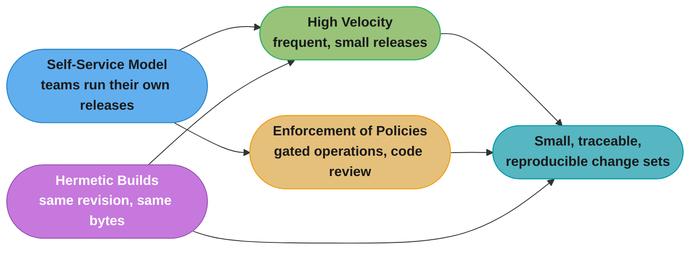
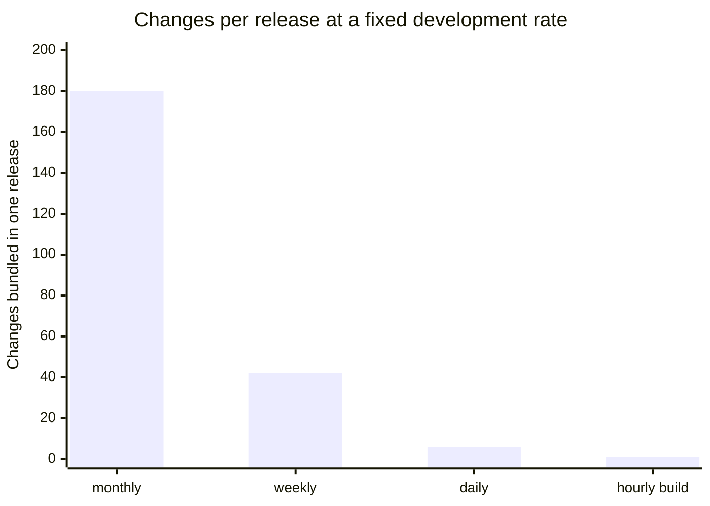
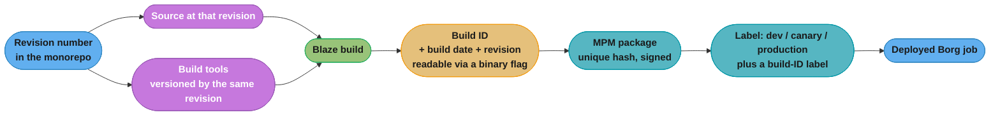

# Chapter 8: Release Engineering

> Part II — Principles · Site Reliability Engineering: How Google Runs Production Systems
> (Beyer, Jones, Petoff & Murphy, eds., O'Reilly 2016) · builds on Ch 6 (Monitoring Distributed
> Systems) and Ch 7 (The Evolution of Automation at Google), leads to Ch 9 (Simplicity)

Written by Dinah McNutt; edited by Betsy Beyer and Tim Harvey.

## Chapter Map

Part II has spent six chapters arguing that reliability is an engineering property you design
for — a budgeted quantity (Ch 3), a measured one (Ch 4), a thing automation buys you (Ch 5, Ch 7),
a thing you watch (Ch 6). This chapter names the one process every single change to production
must pass through, and asserts something the rest of the book leans on constantly: **running
reliable services requires reliable release processes.** If the binary in production cannot be
traced back to a revision, cannot be rebuilt from that revision months later, and cannot be
reasoned about as "these N changes and no others," then every other reliability mechanism in the
book is operating on an object of unknown provenance.

The chapter's framing is unusual for the book: release engineering at Google is not a practice
that SREs absorb into their own role, it is **a specific job function** with its own discipline,
its own tooling, and its own practitioners who sit between product-development software engineers
and SREs. The chapter describes that discipline through four philosophical principles, then walks
Google's concrete toolchain (Rapid, Blaze, MPM, Sisyphus) end to end, then treats configuration
management as a first-class release problem rather than an afterthought, and closes with an
argument aimed squarely at readers who are *not* Google: define your release process early, budget
for it at the start of the product cycle, and do not let developers throw a build over the fence.

**TL;DR:**
- Release engineering is described as **its own engineering discipline** — "building and delivering
  software" — requiring expert knowledge of source control, compilers, build configuration
  languages, build tools, package managers, and installers, and it is a **distinct job function**
  at Google, not a hat an SRE wears on Fridays.
- Four principles carry the philosophy: **self-service** (teams run their own releases so the
  process scales past the release team's headcount), **high velocity** (frequent releases mean
  fewer changes per release, which makes testing and troubleshooting easier — some teams build
  hourly, some deploy every green build), **hermetic builds** (the same revision built by two
  people on two machines produces identical results, because the build depends only on versioned,
  checked-in inputs *including the toolchain*), and **enforcement of policies and procedures**
  (who may approve, cut, and deploy a release is gated by access control, not convention).
- The concrete pipeline: code lands on **mainline**; a release **branches** from mainline at a
  specific revision and **never merges back**; bug fixes land on mainline and are **cherry picked**
  into the branch; **Blaze** compiles; unit tests are re-run **on the branch** so the audit trail
  covers what is actually shipping; **MPM** packages, versions by unique hash, signs, and labels;
  **Rapid** orchestrates the whole workflow from blueprints; **Sisyphus** drives the complicated
  rollouts.
- **Configuration is a release artifact**, and the chapter gives four models for shipping it —
  mainline, bundled in the binary's package, in a separate versioned configuration package, or
  read from an external store — each with a stated tradeoff, and no single winner.
- The closing argument is a scheduling one: **start release engineering at the beginning.** It is
  cheaper to put good practice in place at the start of the product cycle than to retrofit it, and
  the chapter's claim is that when tooling, automation, and policy are right, "releases can be as
  painless as simply pressing a button."

---

## The Big Question

The question the chapter answers is not "how do we ship faster" — it is **"can you say, with
evidence, exactly what is running in production, and can you make that exact thing again?"**

Every reliability practice in this book is downstream of that answer. An error budget (Ch 3) is
spent by *some* change; a postmortem attributes an outage to *some* diff; a rollback restores
*some* previous artifact. If your production binary is a "unique snowflake" — built once, on one
engineer's machine, with whatever compiler and libraries happened to be installed that afternoon —
then none of those sentences has a well-defined subject. You cannot roll back to a thing you
cannot rebuild, and you cannot attribute an outage to a change set you cannot enumerate.

**Analogy:** think of a production binary as a chemical batch in a regulated factory. A pharma
plant does not merely record "we made 400,000 tablets in March." It records the lot number of
every input, the calibration state of every machine, the operators who signed off at each gate,
and it retains a sample of the batch. When a problem surfaces in the field eighteen months later,
that lot number is what lets the plant say precisely which batches share the defect, reconstruct
the process that produced them, and re-run it with one input changed. Release engineering is that
apparatus for software: the branch is the lot, the revision number and build ID are the lot number,
MPM's hash and signature are the tamper-evident seal, and hermeticity is the guarantee that the
factory conditions themselves were recorded rather than assumed.

---

## 8.1 The Role of a Release Engineer

Release engineering is introduced as "a relatively new and fast-growing discipline of software
engineering that can be concisely described as **building and delivering software**." The chapter
is specific about the skill set: a release engineer has a solid (if not expert) understanding of
**source code management, compilers, build configuration languages, automated build tools, package
managers, and installers**, spanning development, configuration management, test integration,
system administration, and customer support. That list is the argument in miniature — release
engineering touches enough distinct domains that treating it as "the part of the job nobody wanted"
guarantees it is done badly.

Three things the chapter says release engineers do at Google:

**They measure the release process itself.** Google is described as a data-driven company and
release engineering follows suit: the tools report metrics such as **how long it takes a code
change to reach production — that is, release velocity** — and statistics on which features are
actually being used in build configuration files. Most of those tools were envisioned and built by
release engineers. This is worth pausing on, because it is the release-engineering equivalent of
Ch 6's argument about monitoring: the release pipeline is itself a production system, and an
unmeasured one is an unmanaged one.

**They define best practices, so teams do not each reinvent the wheel poorly.** The chapter's own
examples of what "best practice" covers: **compiler flags, formats for build identification tags,
and required steps during a build.** The stated goal of making tools behave correctly by default
and be adequately documented is to keep product teams focused on features and users rather than
"reinventing the wheel (poorly) when it comes to releasing software."

**They co-develop rollout strategy with SRE.** Release engineers and SREs together develop the
strategies for **canarying changes, pushing new releases without interrupting service, and rolling
back features that show problems.** This is the seam where this chapter meets the rest of the book:
canarying is a release-engineering capability, but the decision of what a canary must prove before
it is promoted is an SRE judgment informed by the SLO.

Why SREs care at all, in the chapter's words: SREs need to know that the binaries and configurations
they use are **built in a reproducible, automated way so that releases are repeatable and are not
"unique snowflakes."** Changes to any aspect of the release process should be **intentional, rather
than accidental.** SREs care about this process **from source code to deployment** — not from
artifact to deployment.

**Broken → fixed, the shape of the failure this section is preventing:**

```
BROKEN — the snowflake release
  Engineer builds on her workstation Friday afternoon.
  Toolchain: whatever gcc/JDK the workstation had. Deps: whatever was in ~/lib.
  Artifact: server-final-v2-REALLY-final.tar.gz, scp'd to prod.
  Monday: p99 latency doubles.
  Question 1: "what changed?"        -> nobody can enumerate the diff.
  Question 2: "roll back to what?"   -> the previous tarball, built by someone else,
                                        from an unknown revision, with an unknown compiler.
  Question 3: "reproduce it?"        -> the workstation has since been reimaged.

FIXED — the release-engineered release
  Build is cut by the release system at revision r=12345 on a release branch.
  Toolchain version is itself pinned by revision. Deps are checked-in, versioned.
  Artifact is named, hashed, signed, and labelled with a build ID.
  An auto-generated report enumerates every change since the last release.
  Question 1: read the report.
  Question 2: roll the label back to the previous package.
  Question 3: rebuild r=12345 on any machine, get the same bytes.
```

---

## 8.2 Philosophy

The chapter states that release engineering is guided by an engineering and service philosophy
expressed through **four major principles.** They are not independent: self-service is what makes
high velocity possible at Google's headcount; hermetic builds are what make high velocity safe;
and policy enforcement is what keeps self-service from meaning "anyone can push anything."



*The four principles are load-bearing on each other: self-service without policy enforcement is
chaos, and high velocity without hermeticity is a stream of unreproducible snowflakes shipped
faster.*

### Self-Service Model

The stated premise: **"In order to work at scale, teams must be self-sufficient."** Release
engineering has developed best practices and tools that let *product development teams* control and
run their own release processes. The chapter is explicit about the payoff — "although we have
thousands of engineers and products, we can achieve a high release velocity because **individual
teams can decide how often and when to release** new versions of their products."

The endpoint of that automation is stated plainly: release processes can be automated to the point
that they require **minimal involvement by engineers**, and many projects are automatically built
and released by the combination of the automated build system and the deployment tools. **"Releases
are truly automatic, and only require engineer involvement if and when problems arise."**

The structural point hiding in this section: a central release team that personally cuts every
release is a bottleneck whose throughput is its headcount. Self-service converts the release team
from an operator into a *platform provider* — the same move Ch 5 and Ch 7 make for operational
work generally. What the release team owns is the tooling and the policy; what the product team
owns is the decision to press the button.

### High Velocity

User-facing software (the chapter's example is many components of Google Search) is **rebuilt
frequently**, because the aim is to roll out customer-facing features as quickly as possible. The
philosophical claim underneath is counterintuitive to anyone who equates "release less often" with
"be safer":

> "We have embraced the philosophy that **frequent releases result in fewer changes between
> versions.** This approach makes testing and troubleshooting easier."

The reasoning is arithmetic, not ideological. Release cadence and change-set size are inversely
related for a fixed rate of development. Halve the interval and you halve the number of changes in
each release; halve the number of changes and you roughly halve the candidate set that a
post-release regression must be bisected against. The risk *per release* falls even though the
number of releases rises. Chapter 9 makes exactly the same argument under the name **release
simplicity**, and this is where the two chapters shake hands.

Two concrete cadences the chapter names:

- **Hourly builds with selection.** Some teams perform **hourly builds** and then select which
  version to actually deploy from the resulting pool, **based on test results and the features
  contained in a given build.** Building is decoupled from shipping: you build constantly and
  choose late.
- **"Push on Green."** Other teams have adopted a **"Push on Green"** release model and **deploy
  every build that passes all tests.** Here the test suite *is* the release decision, which is only
  a sane arrangement if the suite is trusted enough to be the sole gate.

| Cadence model | What builds | What ships | Where the release decision lives |
|---|---|---|---|
| Hourly build + selection | every hour | a selected build from the pool | a human, informed by test results and feature content |
| Push on Green | on each change | every build that passes all tests | the test suite itself |

### Hermetic Builds

This is the most transferable idea in the chapter, and the one with the sharpest definition.

The requirement, stated as an expectation: **"If two people attempt to build the same product at
the same revision number in the source code repository on different machines, we expect identical
results."** Everything else follows from taking that sentence literally.

> "Our builds are **hermetic**, meaning that they are **insensitive to the libraries and other
> software installed on the build machine.** Instead, builds depend on known versions of build
> tools, such as compilers, and dependencies, such as libraries. The build process is
> **self-contained and must not rely on services that are external to the build environment.**"

Unpack the three clauses, because each rules out a distinct class of irreproducibility:

1) **Insensitive to what is installed on the build machine.** The build must not resolve a header,
   a shared object, or a jar from the machine's ambient state. If it does, the artifact is a
   function of the machine as well as of the source, and the machine is not under version control.
2) **Depends on known versions of build tools *and* dependencies.** Note that **the compiler is
   named as a dependency**, not as part of the environment. This is the clause almost every
   non-hermetic build system gets wrong: it pins libraries and leaves the toolchain floating.
3) **Must not rely on services external to the build environment.** No fetching from a network
   endpoint whose contents can change, no build step that calls a live service. A build that
   downloads "latest" at build time is a build whose output is dated, not versioned.

**The payoff is stated as a concrete production scenario: rebuilding old releases.** The chapter
frames this as a challenge — "rebuilding older releases when we need to fix a bug in software
that's running in production can be a challenge" — and gives the technique: rebuild **at the same
revision as the original build**, including specific changes submitted after that point. That
technique is named **cherry picking**, and it is the same mechanism §8.3's branching model uses.

Then comes the sentence that makes hermeticity more than a slogan:

> "**Our build tools are themselves versioned based on the revision in the source code repository
> for the project being built.** Therefore, a project built last month won't use this month's
> version of the compiler if a cherry pick is required, because that version may contain
> incompatible or undesired features."

That is the whole idea in one move. The revision number does not merely select your source — it
selects **your compiler**. A cherry pick onto a branch cut in March is compiled in March's
toolchain in August, so the only difference between the August artifact and the March artifact is
the change you deliberately cherry picked. If the toolchain floated forward, an emergency one-line
fix would silently arrive bundled with five months of compiler behaviour change, and the "one-line
fix" would be an untested recompilation of the entire product.

The chapter also records, in a footnote, that Google uses a **monolithic unified source code
repository** — which is the substrate that makes "the same revision number" a meaningful,
repo-wide coordinate for source, dependencies, and toolchain simultaneously.

**Broken → fixed for hermeticity:**

```
NOT HERMETIC                          HERMETIC
------------------------------------  ------------------------------------------
uses whatever cc is on $PATH          toolchain version selected by the revision
links against /usr/lib/libfoo.so      links against a checked-in, versioned libfoo
fetches deps from the network at      all deps resolved from the repo at the
  build time ("latest")                 build revision
build ID = timestamp                  build ID recorded in the binary alongside
                                        build date and revision number
=> rebuild in 6 months: different     => rebuild in 6 months: identical bytes
   bytes, unknown delta
```

One detail from §8.3 belongs here because it is what makes hermeticity *auditable* rather than
merely claimed: **all binaries support a flag that displays the build date, the revision number,
and the build identifier**, which lets any binary in production be associated with the record of
how it was built. Hermeticity you cannot interrogate from a running process is a policy; hermeticity
with a `--version`-style flag on every binary is a control.

### Enforcement of Policies and Procedures

Self-service says teams run their own releases. This principle says that does not mean anyone may
do anything. **"Several layers of security and access control determine who can perform specific
operations when releasing a project."** The chapter enumerates the **gated operations**:

- **Approving source code changes** — managed through configuration files scattered throughout the
  codebase (this is Google's ownership mechanism: the right to approve a change is declared next to
  the code it governs).
- **Specifying the actions to be performed during the release process.**
- **Creating a new release.**
- **Approving the initial integration proposal** (a request to perform a build at a specific
  revision number) **and subsequent cherry picks.**
- **Deploying a new release.**
- **Making changes to a project's build configuration.**

Two of those deserve a second look. **"Making changes to a project's build configuration"** being
a gated operation is the enforcement counterpart of hermeticity — if build configuration were
ungated, a single unreviewed edit could reintroduce an ambient dependency and quietly break
reproducibility for every future build. And gating **cherry-pick approval separately from release
creation** is what keeps a branch's contents deliberate: each cherry pick is an individually
approved decision to add a change to a release that has already been cut, which is precisely the
moment when pressure to "just slip this in" is highest.

The section closes with two mechanisms that turn policy into artifact:

- **Almost all changes to the codebase require a code review**, described as "a streamlined action
  integrated into our normal developer workflow." Code review as the default state of the
  repository, not as a special ceremony for risky changes.
- **The automated release system produces a report of all changes contained in a release**, archived
  alongside the other build artifacts. The chapter's stated purpose is operational: by allowing SREs
  to understand what changes are in a new release, **this report can expedite troubleshooting when
  there are problems with a release.**

That report is the artefact an SRE reaches for at 3am. It is generated automatically, at release
time, and archived — not reconstructed under pressure from a source-control log while a service is
down.

---

## 8.3 Continuous Build and Deployment

Google's automated release system is named **Rapid**: "a system that leverages a number of Google
technologies to provide a framework that delivers **scalable, hermetic, and reliable** releases."
The following subsections are the software lifecycle at Google, in the chapter's own order.

```mermaid
flowchart LR
  ML(["Mainline<br/>all code checked in"]) --> CT(["Continuous test<br/>unit tests per change"])
  CT --> BR(["Rapid cuts<br/>release branch<br/>at revision N"])
  BR --> BZ(["Blaze<br/>compile binaries<br/>+ run unit tests"])
  BZ --> ST(["System tests<br/>on packaged artifacts"])
  ST --> PK(["MPM<br/>name, hash,<br/>sign, label"])
  PK --> CN(["Canary<br/>a few jobs in prod"])
  CN --> SY(["Sisyphus<br/>rollout automation"])
  SY --> PR(["Production<br/>Borg jobs updated"])
  CP(["Cherry pick<br/>fix from mainline"]) --> BR

  classDef blue fill:#61afef,stroke:#2e86c1,color:#1a1a1a,font-weight:bold
  classDef green fill:#98c379,stroke:#27ae60,color:#1a1a1a,font-weight:bold
  classDef purple fill:#c678dd,stroke:#9b59b6,color:#fff,font-weight:bold
  classDef gold fill:#e5c07b,stroke:#f39c12,color:#1a1a1a,font-weight:bold
  classDef orange fill:#d19a66,stroke:#e67e22,color:#1a1a1a,font-weight:bold
  classDef teal fill:#56b6c2,stroke:#0097a7,color:#1a1a1a,font-weight:bold
  classDef red fill:#e06c75,stroke:#c0392b,color:#fff,font-weight:bold
  class ML,CT blue
  class BR,CP gold
  class BZ,ST green
  class PK purple
  class CN orange
  class SY teal
  class PR red
```



*Rapid orchestrates the whole chain from blueprints; note that the cherry pick re-enters at the
branch, never at the mainline-to-branch merge — the branch is never merged back.*

### Building

**Blaze** is described as "Google's build tool of choice." It supports building binaries from a
range of languages, and the chapter names the standard ones: **C++, Java, Python, Go, and
JavaScript.** Engineers use Blaze to define **build targets** — the chapter's example of a target
is "the output of a build, such as a JAR file" — and to **specify the dependencies for each
target**. When performing a build, **Blaze automatically builds the dependency targets.**

The Rapid integration: build targets for **binaries and unit tests** are defined in **Rapid's
project configuration files**, and project-specific flags such as **a unique build identifier** are
passed by Rapid down to Blaze. And then the auditability hook already quoted in §8.2: **all binaries
support a flag that displays the build date, the revision number, and the build identifier**, which
lets a binary be associated with the record of how it was built.

*(The chapter records in a footnote that Blaze has been open sourced as **Bazel**.)*

### Branching

This section is short and every sentence is load-bearing.

- **"All code is checked into the main branch of the source code tree (mainline)."**
- **"However, most major projects don't release directly from the mainline."**
- The model: **branch from the mainline at a specific revision, and never merge changes from the
  branch back into the mainline.**
- Bug fixes are **submitted to the mainline and then cherry picked into the branch** for inclusion
  in the release.

The stated reason for the "never merge back" rule and the cherry-pick discipline: **"This practice
avoids inadvertently picking up unrelated changes submitted to the mainline since the original
build occurred."** And the payoff: **"Using this branch and cherry pick method, we know the exact
contents of each release."**

That is a *knowledge* claim, not a hygiene claim. The alternative — refreshing a release branch
from mainline to get a fix — silently drags in every unrelated change that landed in the interim,
so the release you ship is no longer the release you tested. The branch is a frozen coordinate;
each cherry pick is a single, individually approved delta from it (and §8.2 gated that approval).

```
MAINLINE  ──●───●───●───●───●───●───●───●──▶   (all development lands here)
            r100    r103  fix1        fix2
              │              ╲          ╲
              │  branch at r100 ╲ cherry  ╲ cherry
              ▼                  ▼ pick    ▼ pick
BRANCH    ────●──────────────────●─────────●──▶  release-1.0 -> 1.0.1 -> 1.0.2
                                                 (never merged back to mainline)
```

*The branch is cut once at a known revision; every subsequent change to it is an individually
approved cherry pick of a fix that already exists on mainline. Nothing flows from branch to
mainline, so the branch's contents are exactly r100 plus an enumerated list.*

### Testing

Three distinct test layers, and the chapter is precise about why the second exists.

**A continuous test system** runs **unit tests against the code in the mainline each time a change
is submitted**, so build and test failures are detected quickly. Two recommendations follow, both
from release engineering:

- the **continuous build test targets should correspond to the same test targets that gate the
  project release** — otherwise "green on mainline" and "green at release" are measuring different
  things;
- **create releases at the revision number of the last continuous test build that successfully
  completed all tests.** The stated effect: these measures **decrease the chance that subsequent
  changes made to the mainline will cause failures during the build performed at release time.**

**Re-running unit tests on the release branch.** During the release process, the unit tests are
re-run **using the release branch**, creating **an audit trail showing that all the tests passed.**
The chapter gives the exact reason, and it is the cherry-pick model biting:

> "This step is important because **if a release involves cherry picks, the release branch may
> contain a version of the code that doesn't exist anywhere on the mainline.** We want to guarantee
> that the tests pass in the context of what's actually being released."

This is the subtle failure mode of branch-and-cherry-pick, and the chapter names it head on: a
branch at r100 with three cherry picks is a code state that has *never existed on mainline*, so
mainline's green build says nothing about it. Cherry picks are individually reviewed, individually
safe, and collectively untested — until you re-run the suite on the branch.

**System-level tests on packaged artifacts.** To complement the continuous test system, an
**independent testing environment runs system-level tests on packaged build artifacts.** These can
be **launched manually or from Rapid.** Note the object under test: the *package*, not the source
tree — which catches the class of defect that lives in packaging rather than in code.

### Packaging

Software is distributed to production machines via the **Midas Package Manager (MPM)**.

- **MPM assembles packages based on Blaze rules** listing the build artifacts to include, **along
  with their owners and permissions.**
- Packages are **named** — the chapter's example name is `search/shakespeare/frontend`, a path-like
  namespace — **versioned with a unique hash, and signed to ensure authenticity.**
- **MPM supports applying labels** to a particular version of a package. **Rapid applies a label
  containing the build ID**, which guarantees a package can be **uniquely referenced using the name
  of the package and this label.**

The label mechanic is the interesting part, because it doubles as a deployment primitive:

> "Labels can be applied to an MPM package to **indicate a package's location in the release
> process (e.g., `dev`, `canary`, or `production`).** If you apply an existing label to a new
> package, **the label is automatically moved** from the old package to the new package. For
> example: if a package is labeled as `canary`, someone subsequently installing the canary version
> of that package will automatically receive the newest version of the package with the label
> `canary`."

So a label is a *movable pointer* into an immutable, hash-versioned set of packages. Promotion from
canary to production is not a rebuild and not a copy — it is moving a label. Rollback is moving it
back. And because the underlying packages are content-hashed and signed, the thing the label points
at is unambiguous and tamper-evident.

```
Immutable packages (hash-versioned, signed)      Movable labels
-------------------------------------------      ---------------------
search/shakespeare/frontend  @ hash a1b2c3   <-- production
search/shakespeare/frontend  @ hash d4e5f6   <-- canary,  build_id=8891
search/shakespeare/frontend  @ hash 778899   <-- dev

promote canary -> production  ==  move the 'production' label to d4e5f6
rollback                      ==  move it back to a1b2c3
```

*Labels are the only mutable thing in the packaging model. The packages themselves never change,
which is what makes "roll back" a well-defined operation rather than a rebuild.*

### Rapid

**Rapid is configured with files called blueprints**, written in an internal configuration language,
used to define **build and test targets, rules for deployment, and administrative information (like
project owners).** **Role-based access control lists determine who can perform specific actions on
a Rapid project** — this is where §8.2's "enforcement of policies and procedures" is implemented in
the tooling rather than asserted in a document.

**Each Rapid project has workflows** that define the actions to perform during the release process.
Workflow actions can be performed **serially or in parallel**, and **a workflow can launch other
workflows.** Rapid **dispatches work requests to tasks running as a Borg job on production servers**
— and the chapter draws the consequence: **"Because Rapid uses our production infrastructure, it
can handle thousands of release requests simultaneously."** The release system is not a special
snowflake cluster off to one side; it runs on the same scheduler as everything else, and inherits
that scheduler's scale.

The chapter's **typical release process**, in order:

1) **Rapid uses the requested integration revision number** — often obtained automatically from the
   continuous test system — **to create a release branch.**
2) **Rapid uses Blaze to compile all the binaries and execute the unit tests**, often performing
   these two steps **in parallel.** Compilation and testing occur **in environments dedicated to
   those specific tasks**, rather than inside the Borg job where the Rapid workflow is executing —
   the chapter's stated reason is that this separation **allows work to be parallelized easily.**
3) **Build artifacts are then available for system testing and canary deployments.** A **typical
   canary deployment involves starting a few jobs in the production environment after the
   completion of system tests.**
4) **The results of each step of the process are logged**, and **a report of all changes since the
   last release is created.**

Rapid also **manages release branches and cherry picks**: individual cherry-pick requests can be
**approved or rejected** for inclusion in a release.

### Deployment

Two deployment paths, split by complexity.

**Simple deployments: Rapid drives them directly.** It **updates the Borg jobs to use newly built
MPM packages**, based on **deployment definitions in the blueprint files** and **specialized task
executors.**

**Complicated deployments: Sisyphus.** Described as **"a general-purpose rollout automation
framework developed by SRE"** — note the authorship; this is the SRE-built half of the toolchain.

- A **rollout** is defined as **"a logical unit of work that is composed of one or more individual
  tasks."**
- Sisyphus **provides a set of Python classes that can be extended to support any deployment
  process.**
- It has **a dashboard** that allows **finer control on how the rollout is performed** and provides
  **a way to monitor the rollout's progress.**

The handoff between the two systems is precise: **in a typical integration, Rapid creates a rollout
in a long-running Sisyphus job.** Rapid **knows the build label associated with the MPM package it
created**, and **specifies that build label when creating the rollout in Sisyphus**; Sisyphus then
**uses the build label to specify which version of the MPM packages should be deployed.** The label
from §8.3's packaging section is the contract between the build system and the rollout system.

Sisyphus rollouts can be **as simple or complicated as necessary** — the chapter's range: **update
all associated jobs immediately**, or **roll out a new binary to successive clusters over a period
of several hours.**

**The governing principle for choosing among them is stated as one sentence: "Our goal is to fit
the deployment process to the risk profile of a given service."** Three worked cases follow:

| Service class | Chapter's stated deployment shape |
|---|---|
| Development / pre-production | **build hourly and push releases automatically when all tests pass** |
| Large user-facing services | **push by starting in one cluster and expand exponentially until all clusters are updated** |
| Sensitive pieces of infrastructure | **extend the rollout over several days, interleaving them across instances in different geographic regions** |

The middle row is the one people misremember. The chapter says **exponential** expansion, not
linear: one cluster, then a larger set, then larger again. That shape gives you the maximum number
of *early* observation windows per unit of elapsed time — the first few steps are cheap and small,
where a bad binary costs least, and the doubling only takes over once the change has survived
several stages. The third row's "interleaving across geographic regions" is a different hedge
entirely: it protects against a rollout that is fine everywhere except under one region's traffic
pattern or hardware mix.

---

## 8.4 Configuration Management

The chapter promotes configuration management to a first-class release-engineering topic and calls
it **"one area of particularly close collaboration between release engineers and SREs."** It then
issues a warning:

> "Although configuration management may initially seem a deceptively simple problem,
> **configuration changes are a potential source of instability.**"

Two invariants hold across every model that follows: **all schemes involve storing configuration in
the primary source code repository**, and **all enforce a strict code review requirement.** Whatever
else varies, configuration is versioned, reviewed source — never an untracked edit on a live host.

The chapter presents **four models**, each with its own tradeoff, and explicitly declines to crown
a winner.

**1. Use the mainline for configuration.** The first method used to configure services in Borg (and
its predecessors). Developers and SREs **modify configuration files at the head of the main
branch**; changes are reviewed and then applied to the running system. **Binary releases and
configuration changes are decoupled.** The stated cost: while conceptually and procedurally simple,
**"this technique often leads to skew between the checked-in version of the configuration files and
the running version of the configuration file because jobs must be updated in order to pick up the
changes."** That is the classic failure of this model — the repository is not a statement about
production, it is a statement about intent, and the gap between them is invisible until an incident.

**2. Include configuration files and binaries in the same MPM package.** Suitable for **projects
with few configuration files**, or projects where the files (or a subset) **change with each release
cycle.** The tradeoff, both directions: it **limits flexibility by binding the binary and
configuration files tightly**, but it **simplifies deployment, because it only requires installing
one package.** There is no skew possible here — the config in production is definitionally the
config that shipped with the binary — but you cannot change a flag without a new binary release.

**3. Package configuration files into MPM "configuration packages."** This is the chapter's own
"apply the hermetic principle to configuration management" move. Since **binary configurations tend
to be tightly bound to particular versions of binaries**, the build and packaging systems are used
to **snapshot and release configuration files alongside their binaries** — and, as with binaries,
**the build ID can be used to reconstruct the configuration at a specific point in time.**

The chapter's worked example is worth reproducing exactly, because it shows what the extra package
buys:

> A change implementing a new feature is released with a flag setting that configures that feature.
> By generating **two MPM packages — one for the binary and one for the configuration** — the two
> **can be changed independently.** If the feature was released with a flag setting of
> `first_folio` but it should instead be `bad_quarto`, you can **cherry pick that change onto the
> release branch, rebuild the configuration package, and deploy it.** The stated advantage: **"This
> approach has the advantage of not requiring a new binary build."**

And the two packages are still kept together when they need to be, via labels: **a label of
`much_ado` can be applied to both packages**, allowing both to be fetched with that one label. When
a new version of the project is built, **the `much_ado` label is applied to the new packages**;
because **these tags are unique within the namespace for an MPM package, only the latest package
with that tag will be used.** So the split gets independent release cadence for binary and config
*without* losing the ability to say "these two artifacts belong together."

**4. Read configuration files from an external store.** For projects with configuration that needs
to change **frequently or dynamically (i.e., while the binary is running).** The chapter names the
stores: **Chubby, Bigtable, or a source-based filesystem.** This is the only model that supports
changing behaviour without a deployment at all — and correspondingly the only one where the
"release process" no longer sits between a change and production.

| Model | Config changes without new binary? | Skew risk between repo and running state | Chapter's stated fit |
|---|---|---|---|
| Mainline | yes | **high** — jobs must be updated to pick up changes | simple cases; the original Borg method |
| Same MPM package as binary | no | none — shipped together | few config files, or files that change every release cycle |
| Separate MPM configuration package | yes — rebuild config package only | low — build ID reconstructs config at a point in time | binary configs tightly bound to binary versions |
| External store (Chubby / Bigtable / source-based FS) | yes, **while the binary is running** | n/a — the store is the running state | config that must change frequently or dynamically |

The chapter's own conclusion is a deliberate non-answer: **"project owners consider the different
options for distributing and managing configuration files and decide which works best on a
case-by-case basis."** No single model is endorsed.

---

## 8.5 Conclusions

The closing section pivots from "here is what Google does" to "here is what you should take from
it," and the chapter opens it by saying so: while the chapter has discussed Google's approach
specifically, **"these practices can also be applied more widely."**

### It's Not Just for Googlers

The aspirational statement: **"When equipped with the right tools, proper automation, and
well-defined policies, developers and SREs shouldn't have to worry about releasing software.
Releases can be as painless as simply pressing a button."**

Then the universality claim — **"Most companies deal with the same set of release engineering
problems regardless of their size or the tools they use"** — followed by the chapter's own list of
those problems, which reads as a checklist any team can run against itself:

- **How should you handle versioning of your packages?**
- **Should you use a continuous build and deploy model, or perform periodic builds?**
- **How often should you release?**
- **What configuration management policies should you use?**
- **What release metrics are of interest?**

And an honest note about why Google's tools are Google's: **"Google Release Engineers have
developed our own tools out of necessity because open sourced or vendor-supplied tools don't work
at the scale we require."** Custom tools let Google **include functionality to support (and even
enforce) release process policies** — but the chapter immediately adds the part that generalizes:

> "**However, these policies must first be defined in order to add appropriate features to our
> tools, and all companies should take the effort to define their release processes whether or not
> the processes can be automated and/or enforced.**"

The ordering is the lesson. Policy is prior to tooling. A team that has not decided what its release
process *is* cannot be rescued by adopting someone else's release tool, because the tool encodes
decisions the team has not made.

### Start Release Engineering at the Beginning

The final argument is about *when*, and it is the chapter's most quotable practical claim.

- **"Release engineering has often been an afterthought, and this way of thinking must change as
  platforms and services continue to grow in size and complexity."**
- **"Teams should budget for release engineering resources at the beginning of the product
  development cycle. It's cheaper to put good practices and process in place early, rather than
  have to retrofit your system later."**
- **"It is essential that the developers, SREs, and release engineers work together."** The release
  engineer **needs to understand the intention of how the code should be built and deployed**, and
  — the memorable line — **"the developers shouldn't build and 'throw the results over the fence'
  to be handled by the release engineers."**

The chapter is candid about why this does not happen by default: **individual project teams decide
when release engineering becomes involved**, and because release engineering is **still a relatively
young discipline, managers don't always plan and budget for it in the early stages of a project.**
The instruction is therefore to consider release engineering's role **as applied to the entire
lifecycle of the product or service — particularly the early stages.**

---

## Beyond the book — the 2016 toolchain and what the industry built afterwards

> The chapter describes a **Google-internal, 2016-vintage toolchain**: Rapid, Blaze, MPM, Sisyphus,
> Borg, Chubby. Except for Blaze — which the chapter's own footnote records as having been open
> sourced as **Bazel** — the book does *not* discuss external equivalents, does not mention any
> of the tools named below, and makes no claim about them. What follows is this repo's mapping for
> readers who have never used the internal tools, not the authors'. The chapter's *principles* are
> what transfer; the product names are of their time.

The mapping is approximate and is offered only so the mechanics above are legible:

| Chapter's component | Its role in the chapter | Rough public analogue *(beyond the book)* |
|---|---|---|
| **Blaze** | build tool; targets and dependencies | **Bazel** (the book's own footnote), and in spirit Buck, Pants, Gradle |
| **Rapid** | release workflow orchestration from blueprints | CI/CD pipeline definitions — a workflow engine driving build, test, package, canary |
| **MPM** | naming, hashing, signing, and labelling packages | a content-addressed artifact registry with immutable digests and movable tags |
| **Sisyphus** | progressive rollout automation with a dashboard | progressive-delivery controllers that stage a rollout across clusters |
| **Cherry pick onto a frozen branch** | knowing the exact contents of a release | release branches with backported fixes; the pattern itself is unchanged |

Two ideas from the chapter aged into industry-wide vocabulary that the book does not use *(beyond
the book)*: **hermetic builds** became the core of the **reproducible builds** movement and of
supply-chain integrity frameworks, where "the toolchain is itself a versioned dependency" is exactly
the property being attested; and MPM's **hash-versioned, signed package plus movable label** is the
same shape as a modern registry's immutable digest plus mutable tag, with the same warning attached
— the tag is a pointer, the digest is the identity, and deploying by tag alone reintroduces the
ambiguity MPM's build-ID label was designed to remove.

For those modern practices as practices, see this repo's
[devops/devsecops_and_supply_chain_security/](../../../devops/devsecops_and_supply_chain_security/devsecops_and_supply_chain_security.md)
and [devops/artifact_and_registry_management/](../../../devops/artifact_and_registry_management/artifact_and_registry_management.md).

---

## Visual Intuition

### Why frequent releases make bisection cheap

The chapter asserts that "frequent releases result in fewer changes between versions" and that this
"makes testing and troubleshooting easier." The mechanism is that the change set you must search
after a regression is the release's change set.



*Illustrative only — the chapter states the inverse relationship and its consequence, not these
numbers. The point is the shape: a regression in a monthly release has a change set two orders of
magnitude larger to search than one in a daily release, and the same engineers wrote both.*

### The build-ID chain of custody



*One revision number selects source **and** toolchain; the build ID is stamped into the binary and
into the package label; the label is what the rollout system is handed. Every arrow is a lookup a
responder can perform in the opposite direction during an incident.*

### The chapter's deployment-shape ladder

```
risk profile                     rollout shape                        elapsed time
──────────────────────────────────────────────────────────────────────────────────
dev / pre-production      ▏ push automatically when tests pass  ▏     minutes
large user-facing         ▏ 1 cluster -> exponential expansion  ▏     hours
sensitive infrastructure  ▏ interleaved across geographic       ▏     several days
                          ▏ regions, staged                     ▏
──────────────────────────────────────────────────────────────────────────────────
"Our goal is to fit the deployment process to the risk profile of a given service."
```

*The three rows are the chapter's own three examples. Note that what changes across them is not the
tooling — Sisyphus drives all of them — but the pacing and the observation windows.*

---

## Key Concepts Glossary

| Term | Definition as the chapter uses it |
|---|---|
| **Release engineering** | A discipline of software engineering concisely described as building and delivering software; a distinct job function at Google. |
| **Release velocity** | A metric the release tools report: how much time it takes for a code change to be deployed into production. |
| **Unique snowflake** | The anti-pattern the chapter names: a release that was not built in a reproducible, automated way and so cannot be repeated. |
| **Self-service model** | Release engineering provides tools and best practices so product teams control and run their own releases, deciding how often and when to release. |
| **High velocity** | The philosophy that frequent releases result in fewer changes between versions, making testing and troubleshooting easier. |
| **Push on Green** | A release model in which every build that passes all tests is deployed. |
| **Hermetic build** | A build insensitive to the libraries and other software installed on the build machine; it depends on known versions of build tools and dependencies and does not rely on services external to the build environment. |
| **Cherry picking** | Rebuilding at the same revision as an original build while including specific changes submitted after that point; also the mechanism for getting a mainline bug fix onto a release branch. |
| **Mainline** | The main branch of the source code tree, into which all code is checked in. |
| **Release branch** | A branch cut from mainline at a specific revision, never merged back, modified only by approved cherry picks. |
| **Gated operations** | The release actions controlled by security and access control: approving source changes, specifying release actions, creating a release, approving the integration proposal and cherry picks, deploying, and changing build configuration. |
| **Integration proposal** | A request to perform a build at a specific revision number in the source code repository; its approval is a gated operation. |
| **Change report** | The report of all changes contained in a release, produced automatically and archived with the build artifacts, used to expedite SRE troubleshooting. |
| **Rapid** | Google's automated release system; a framework delivering scalable, hermetic, and reliable releases. |
| **Blueprint** | A Rapid configuration file, in an internal configuration language, defining build and test targets, deployment rules, and administrative information such as project owners. |
| **Workflow (Rapid)** | The actions performed during a release process; can run serially or in parallel and can launch other workflows. |
| **Blaze** | Google's build tool; defines build targets and their dependencies and builds dependency targets automatically. Open sourced as Bazel (per the chapter's footnote). |
| **Build target** | The output of a build, such as a JAR file, as defined to Blaze. |
| **Build identifier (build ID)** | A unique identifier passed by Rapid to Blaze, displayed by every binary alongside build date and revision number, and applied by Rapid as an MPM label. |
| **Continuous test system** | The system that runs unit tests against mainline on every submitted change, to detect build and test failures quickly. |
| **MPM (Midas Package Manager)** | The system that distributes software to production machines; assembles packages from Blaze rules with owners and permissions, names them, versions them by unique hash, and signs them. |
| **MPM label** | A movable marker applied to a package version indicating its place in the release process (dev, canary, production); applying an existing label to a new package moves it. |
| **Sisyphus** | A general-purpose rollout automation framework developed by SRE, extensible via Python classes, with a dashboard for control and progress monitoring. |
| **Rollout** | In Sisyphus, a logical unit of work composed of one or more individual tasks. |
| **Configuration package** | An MPM package containing configuration files, released alongside but independently of the binary package, reconstructible at a point in time via the build ID. |

---

## Tradeoffs & Decision Tables

### Branch-and-cherry-pick versus release-from-mainline

| Dimension | Branch at a revision, cherry pick fixes (the chapter's model) | Release directly from mainline head |
|---|---|---|
| Do you know the exact contents of the release? | **Yes** — a known revision plus an enumerated list of approved picks | Only if nothing landed between your decision and your build |
| Risk of picking up unrelated changes | **Eliminated by construction** — the chapter's stated reason for the model | Present on every refresh |
| Does the shipped code state exist on mainline? | Often **no** — which is exactly why unit tests are re-run on the branch | Yes |
| Overhead | Branch management, per-pick approval, branch test runs | Minimal |
| Where it fits | "Most major projects" at Google | Push-on-Green style flows where head is always releasable |

### The four configuration models, as decisions

| If your situation is… | The chapter's fitting model | What you accept |
|---|---|---|
| Config rarely changes, few files, changes with each release | bundle config in the binary's MPM package | no config change without a binary release |
| Config is tightly bound to a binary version but must be fixable alone | separate MPM configuration package, joined by a shared label | two artifacts to reason about |
| Config must change while the binary runs | external store (Chubby / Bigtable / source-based FS) | the change bypasses the release pipeline's gates |
| You want the simplest possible thing | mainline config, applied after review | **skew** between checked-in and running config until jobs update |

### What each principle buys and costs

| Principle | Buys | Costs / prerequisites |
|---|---|---|
| Self-service | release throughput that does not scale with the release team's headcount | tooling investment; policy enforcement must be built into the tools |
| High velocity | small change sets, easier testing and troubleshooting | a test suite trustworthy enough to gate frequent releases |
| Hermetic builds | identical results from the same revision on any machine; safe cherry picks months later | the toolchain must itself be versioned in the repository |
| Enforcement of policies | intentional rather than accidental change; an auditable change report | access control lists, gated approvals, near-universal code review |

---

## Common Pitfalls / War Stories

**The floating toolchain.** A team pins every library but resolves the compiler from the build
image. Eight months after a release branch is cut, a one-line emergency cherry pick is built —
against a compiler three minor versions newer. The "one-line fix" ships as a full recompilation
under different optimization behaviour. The chapter forecloses this explicitly: build tools are
themselves versioned by the revision, so "a project built last month won't use this month's version
of the compiler if a cherry pick is required, because that version may contain incompatible or
undesired features."

**Refreshing a release branch from mainline to get one fix.** The tempting shortcut is to merge
mainline into the branch. The chapter's model says never merge back and cherry pick instead,
because merging "inadvertently picks up unrelated changes submitted to the mainline since the
original build occurred." The service you then ship is not the service you tested, and the
postmortem's change list is wrong.

**Trusting mainline's green build to cover a branch with cherry picks.** The chapter states the
trap directly: a release branch with cherry picks "may contain a version of the code that doesn't
exist anywhere on the mainline." Three individually reviewed picks can interact in a way no CI run
has ever exercised. The mitigation is the one the chapter prescribes — re-run the unit tests on the
branch and keep the audit trail.

**Config skew under the mainline model.** The chapter names this as the mainline model's specific
failure: the checked-in config and the running config drift apart "because jobs must be updated in
order to pick up the changes." The repository looks like a description of production and is not
one; the divergence is discovered during an incident, when someone reads the file in the repo and
reasons from it.

**Continuous-test targets that do not match release-gating targets.** Release engineering's own
recommendation exists because these drift apart: teams add a test to the release gate and not to
continuous testing, or vice versa, and "green on mainline" stops predicting "green at release."
The chapter's paired recommendation — cut releases at the revision of the last fully passing
continuous build — only works if the two target sets agree.

**Deploying by a label without knowing the build.** MPM labels move automatically: apply `canary`
to a new package and it leaves the old one. That is the feature, and it is also the hazard of
reasoning about production by label alone. The chapter's counterweight is that Rapid also applies
**a label containing the build ID**, so a package can be **uniquely** referenced — the moving
label is for promotion, the build-ID label is for identity.

**Release engineering budgeted after launch.** The chapter's closing warning, and the one it says
happens by default because the discipline is young: managers do not plan or budget for release
engineering in a project's early stages, and the process is retrofitted onto a system whose build
and deployment assumptions have already hardened. Its verdict is a cost claim — "it's cheaper to
put good practices and process in place early, rather than have to retrofit your system later."

**Throwing the build over the fence.** Named explicitly: "the developers shouldn't build and 'throw
the results over the fence' to be handled by the release engineers." The release engineer must
understand the *intention* of how the code should be built and deployed, which is information that
lives with the developers and is lost in a handoff.

---

## Real-World Systems Referenced

| System | What the chapter says it is |
|---|---|
| **Rapid** | Google's automated release system; blueprint-configured, workflow-driven, running as Borg jobs on production infrastructure, able to handle thousands of release requests simultaneously. |
| **Blaze** | Google's build tool of choice; C++, Java, Python, Go, JavaScript; target and dependency based. Footnoted as open sourced as **Bazel**. |
| **MPM (Midas Package Manager)** | Package distribution to production machines; Blaze-rule-driven assembly, named packages, unique-hash versions, signing, movable labels. |
| **Sisyphus** | SRE-developed general-purpose rollout automation framework; extensible Python classes, dashboard, progress monitoring. |
| **Borg** | Google's cluster manager; Rapid workflows run as Borg jobs, and deployments update Borg jobs to use new MPM packages. |
| **Chubby** | Named as one store for configuration files that must change frequently or dynamically. |
| **Bigtable** | Named alongside Chubby as an external configuration store. |
| **Google Search** | The chapter's example of user-facing software rebuilt frequently. |
| **Monolithic unified source repository** | Footnoted as Google's source-control model, the substrate for revision-number-addressed builds. |

---

## Summary

The chapter's own conclusion is that release engineering is a distinct discipline whose practices
generalize beyond Google, and that the biggest mistake organizations make is treating it as an
afterthought. Expanded:

**Reliability of a service is bounded by the reliability of its release process.** SREs need to know
their binaries and configurations were built reproducibly and automatically — that releases are
repeatable and not unique snowflakes, and that every change to the release process was intentional
rather than accidental. This is why the chapter sits in Part II with the principles rather than in
Part III with the practices: it is a precondition for the others, not a technique among them.

**The four principles interlock.** Self-service scales release throughput past the release team's
headcount. High velocity shrinks each release's change set, which is the quantity that dominates the
cost of testing and troubleshooting. Hermetic builds make any revision rebuildable at any later time
with identical results — including the toolchain in the versioned inputs, which is what makes an
emergency cherry pick a one-line change rather than an accidental toolchain upgrade. Policy
enforcement, implemented as access-controlled gated operations plus near-universal code review,
keeps self-service from degrading into "anyone can push anything," and produces the archived change
report an SRE reads during an incident.

**The pipeline is a chain of custody.** Code lands on mainline under continuous testing; a branch is
cut at a revision blessed by that testing; fixes reach the branch only as individually approved
cherry picks; unit tests are re-run on the branch precisely because a cherry-picked branch is a code
state that exists nowhere else; system tests run against the *packaged* artifact; MPM names, hashes,
signs, and labels it; and the label is what Rapid hands to Sisyphus to roll out. At every step there
is an identifier that can be followed backwards from a running process to the exact source revision
and toolchain that produced it.

**Configuration is part of the release, and there is no single right answer.** All four models keep
configuration in the source repository under strict code review — that part is not optional. Beyond
it the chapter lays out mainline config (simple, but prone to skew between checked-in and running
state), config bundled with the binary (no skew, no independent change), a separate configuration
package (independent cadence, reconstructible by build ID, joined to its binary by a shared label),
and an external store (dynamic change while running, at the price of leaving the release pipeline).
Project owners choose case by case.

**Start at the beginning.** Define your release processes whether or not you can automate or enforce
them, because policy must precede tooling. Budget release engineering resources at the start of the
product development cycle, since retrofitting is more expensive than building it in. And keep
developers, SREs, and release engineers working together, because the release engineer must
understand how the code is *intended* to be built and deployed — which is not information that
survives being thrown over a fence.

---

## Interview Questions

**Q: What exactly makes a build "hermetic," and why does the compiler version matter?**
**Short:** The book defines a hermetic build as one insensitive to what is installed on the build machine, depending only on known versions of build tools and dependencies.

A hermetic build is insensitive to the libraries and other software installed on the build machine: it depends on known versions of build tools such as compilers and of dependencies such as libraries, and the build process is self-contained and must not rely on services external to the build environment. The chapter's operational test is that two people building the same product at the same revision number on different machines expect identical results. The compiler matters because Google versions its build tools by the revision number of the project being built, so a project built last month will not use this month's compiler when a cherry pick is required — that newer version "may contain incompatible or undesired features," which would turn a one-line emergency fix into an untested recompilation under a different toolchain. When you assess a build system, check whether the toolchain is a versioned dependency or an ambient property of the build image; only the first gives you reproducibility months later.

**Q: Why does Google branch from mainline and never merge the branch back?**
**Short:** The chapter's reason is knowing the exact contents of each release — merging back would inadvertently pick up unrelated mainline changes submitted since the build.

The chapter's model is that all code is checked into mainline, most major projects branch from mainline at a specific revision, and changes are never merged from the branch back into mainline; bug fixes are submitted to mainline and then cherry picked into the branch. The stated purpose is that this "avoids inadvertently picking up unrelated changes submitted to the mainline since the original build occurred," and the payoff is stated as a knowledge claim: "using this branch and cherry pick method, we know the exact contents of each release." The alternative — refreshing the branch from mainline to obtain one fix — silently drags in every unrelated change that landed in the interim, so the thing you ship stops being the thing you tested and your incident change list becomes wrong. In practice, treat the branch as a frozen coordinate and every addition to it as an individually approved, individually justified delta.

**Q: Why are unit tests re-run on the release branch if they already passed on mainline?**
**Short:** Because a branch with cherry picks may contain a version of the code that exists nowhere on mainline, so mainline's green build says nothing about it.

During the release process the unit tests are re-run using the release branch, producing an audit trail showing all tests passed. The chapter gives the exact reason: if a release involves cherry picks, the release branch may contain a version of the code that does not exist anywhere on the mainline, and the goal is to guarantee the tests pass "in the context of what's actually being released." This is the subtle failure of the branch-and-cherry-pick model — three individually reviewed, individually safe picks form a combined code state that no continuous-integration run has ever exercised. The practical rule is that your test evidence must be about the artifact you are shipping, not about a nearby ancestor of it.

**Q: The book claims frequent releases are safer, not riskier. What is the argument?**
**Short:** Google's stated philosophy is that frequent releases result in fewer changes between versions, which makes testing and troubleshooting easier.

The chapter states plainly that "we have embraced the philosophy that frequent releases result in fewer changes between versions" and that "this approach makes testing and troubleshooting easier." The reasoning is arithmetic rather than ideological: at a fixed rate of development, release cadence and change-set size are inversely related, so halving the interval halves the candidate set that a post-release regression must be bisected against. Risk per release falls even as the number of releases rises. The chapter names two concrete cadences — hourly builds with later selection of which build to deploy based on test results and feature content, and "Push on Green," deploying every build that passes all tests — and Chapter 9 makes the identical argument under the name release simplicity. The practical prerequisite is a test suite you trust enough to gate that frequency.

**Q: What is an MPM label, and how does it differ from a package version?**
**Short:** A version is an immutable unique hash; a label is a movable marker such as dev, canary, or production that jumps to the newest package it is applied to.

MPM packages are named (for example `search/shakespeare/frontend`), versioned with a unique hash, and signed to ensure authenticity, while labels are markers applied to a particular version indicating the package's location in the release process — dev, canary, or production. The chapter is explicit that applying an existing label to a new package automatically moves that label off the old package, so someone installing the canary version subsequently receives the newest package carrying the canary label. That makes promotion and rollback pointer moves over an immutable, content-hashed, signed set rather than rebuilds. The hazard is reasoning about production by moving label alone, which is why Rapid also applies a label containing the build ID: the moving label is for promotion, the build-ID label is for identity.

**Q: What is the difference between Rapid and Sisyphus?**
**Short:** Rapid is Google's release-orchestration system driven by blueprints; Sisyphus is an SRE-developed rollout automation framework Rapid hands complicated deployments to.

Rapid is the automated release system: configured by blueprint files that define build and test targets, deployment rules, and administrative information, it runs workflows as Borg jobs, creates the release branch, invokes Blaze to compile and test, produces artifacts for system testing and canarying, logs each step, and generates the change report. It can drive simple deployments directly by updating Borg jobs to use newly built MPM packages. Sisyphus is a general-purpose rollout automation framework developed by SRE for more complicated deployments, offering extensible Python classes, a dashboard for finer control, and rollout progress monitoring, where a rollout is a logical unit of work composed of one or more tasks. The seam between them is the label: Rapid knows the build label of the MPM package it created and specifies that label when creating the rollout, and Sisyphus uses it to pick which package version to deploy.

**Q: How does the book say deployment pacing should be chosen?**
**Short:** By risk profile — the chapter's goal is stated as fitting the deployment process to the risk profile of a given service.

The chapter states the principle as one sentence — "our goal is to fit the deployment process to the risk profile of a given service" — and gives three worked examples. In development or pre-production environments they may build hourly and push releases automatically when all tests pass. For large user-facing services they may push by starting in one cluster and expanding exponentially until all clusters are updated. For sensitive pieces of infrastructure they may extend the rollout over several days, interleaving across instances in different geographic regions. Note that the expansion is described as exponential rather than linear, which front-loads the cheap early observation windows where a bad binary costs least, and that geographic interleaving hedges a different risk entirely — a change that is fine everywhere except under one region's traffic pattern or hardware mix.

**Q: Which release operations does Google gate with access control?**
**Short:** Approving source changes, specifying release actions, creating a release, approving the integration proposal and cherry picks, deploying, and changing build configuration.

The chapter lists six gated operations: approving source code changes (managed through configuration files scattered throughout the codebase), specifying the actions to be performed during the release process, creating a new release, approving the initial integration proposal — a request to build at a specific revision — and subsequent cherry picks, deploying a new release, and making changes to a project's build configuration. Two are easy to overlook and both are structural: gating build configuration is the enforcement counterpart of hermeticity, since an unreviewed build-config edit could reintroduce an ambient dependency, and gating cherry-pick approval separately from release creation keeps a cut branch's contents deliberate at exactly the moment pressure to slip something in is highest. Access control is implemented in the tooling itself through Rapid's role-based access control lists rather than asserted in a policy document.

**Q: What are the four models the book gives for distributing configuration, and what does each cost?**
**Short:** Mainline config, config bundled in the binary's MPM package, a separate MPM configuration package, or an external store — the chapter endorses none of them universally.

Using the mainline means developers and SREs edit config at the head of the main branch, decoupling binary releases from config changes, but the chapter says it "often leads to skew between the checked-in version of the configuration files and the running version" because jobs must be updated to pick up changes. Bundling config into the binary's MPM package simplifies deployment to a single package but binds the two tightly. A separate MPM configuration package applies the hermetic principle to config: two packages that can change independently, reconstructible at a point in time via the build ID, and joinable by a shared label such as the chapter's `much_ado` example — so a wrong flag value can be fixed by cherry picking, rebuilding the config package, and deploying, with no new binary build. Reading config from an external store such as Chubby or Bigtable supports change while the binary is running. All four store config in the primary source repository under strict code review, and the chapter's conclusion is that project owners decide case by case.

**Q: What is a "unique snowflake" release and why does SRE care?**
**Short:** The chapter's term for a release not built reproducibly and automatically; SREs need repeatable releases and intentional, not accidental, process changes.

The chapter states that SREs "need to know that the binaries and configurations they use are built in a reproducible, automated way so that releases are repeatable and aren't 'unique snowflakes,'" and that changes to any aspect of the release process should be intentional rather than accidental. A snowflake release breaks every downstream reliability mechanism at once: you cannot enumerate what changed, so a postmortem has no defined subject; you cannot rebuild the artifact, so rollback has no defined target; and you cannot reproduce the build, so a fix cannot be isolated from incidental toolchain and dependency drift. The chapter's scope statement follows from this — SREs care about the process "from source code to deployment," not merely from artifact to deployment.

**Q: Does the self-service model mean product teams can do whatever they want?**
**Short:** No — the chapter pairs self-service with enforcement of policies and procedures, implemented as gated operations and role-based access control in the tooling.

Self-service means release engineering supplies best practices and tools so product development teams control and run their own release processes, deciding how often and when to release, with automation taken far enough that releases are "truly automatic, and only require engineer involvement if and when problems arise." But the fourth philosophy principle is enforcement of policies and procedures: several layers of security and access control determine who can perform which release operations, almost all codebase changes require code review as a streamlined part of the normal developer workflow, and Rapid's role-based access control lists determine who can act on a project. The design intent is that the release team owns tooling and policy while the product team owns the decision to press the button — self-service is a delegation of scheduling, not of authority.

**Q: What does the automatically generated change report do for SREs?**
**Short:** It enumerates every change contained in a release and is archived with the build artifacts, which the chapter says expedites troubleshooting when a release has problems.

The chapter says the automated release system produces a report of all changes contained in a release, archived with the other build artifacts, and states the operational purpose directly: by allowing SREs to understand what changes are included in a new release, the report "can expedite troubleshooting when there are problems with a release." Rapid also creates a report of all changes since the last release as part of its typical process, and logs the results of each step. The value is that this artifact exists *before* the incident — generated automatically at release time rather than reconstructed under pressure from a source-control log while a service is degraded. It is the concrete deliverable that makes "we know the exact contents of each release" usable at 3am.

**Q: How does the book describe release engineering as a job — and why is that distinction made?**
**Short:** The chapter calls it a specific job function at Google and a discipline of software engineering, concisely described as building and delivering software.

The chapter describes release engineering as a relatively new and fast-growing discipline of software engineering concisely described as building and delivering software, and states that it is a specific job function at Google where release engineers work with product-development software engineers and SREs to define every step from how software is stored in the repository, to build rules for compilation, to how testing, packaging, and deployment are conducted. The skill set spans source code management, compilers, build configuration languages, automated build tools, package managers, installers, plus development, configuration management, test integration, system administration, and customer support. The distinction matters because that breadth is the argument: a domain touching this many specialisms will be done badly if treated as leftover work, which is exactly the failure the chapter's closing section warns against.

**Q: What is "Push on Green," and what does it presuppose?**
**Short:** A release model the chapter describes as deploying every build that passes all tests, which makes the test suite itself the release decision.

The chapter names Push on Green as a model adopted by some teams that deploy every build passing all tests, contrasting it with teams that perform hourly builds and then select which version to deploy from the resulting pool based on test results and the features contained in a given build. The difference is where the release decision lives: under selection it is a human informed by evidence, and under Push on Green it is the suite. That makes the suite's coverage and trustworthiness the gating property of the whole pipeline, since there is no later human checkpoint to catch what the tests miss. It also pairs naturally with the chapter's recommendations that continuous build test targets match the targets gating the release and that releases be cut at the revision of the last fully passing continuous test build.

**Q: What is the chapter's advice for a company that is not Google?**
**Short:** Define your release processes whether or not you can automate or enforce them — the chapter says policies must be defined before tools can support them.

The chapter argues that most companies face the same set of release engineering problems regardless of size or tooling, and gives the checklist: how to version packages, continuous build and deploy versus periodic builds, how often to release, what configuration management policies to use, and what release metrics are of interest. It acknowledges Google built custom tools out of necessity because open-source and vendor tools do not work at its scale, and that custom tools can support and even enforce release policies — but immediately adds the generalizable part: those policies must first be defined in order to add appropriate features to the tools, and "all companies should take the effort to define their release processes whether or not the processes can be automated and/or enforced." The ordering is the lesson: policy precedes tooling, and adopting someone else's release tool cannot substitute for decisions you have not made.

**Q: Why does the chapter insist on budgeting release engineering at the start of a project?**
**Short:** It argues it is cheaper to put good practices and process in place early than to retrofit a system later, and warns against developers throwing builds over the fence.

The chapter's closing argument is that release engineering has often been an afterthought and that this must change as platforms and services grow in size and complexity: teams should budget for release engineering resources at the beginning of the product development cycle because "it's cheaper to put good practices and process in place early, rather than have to retrofit your system later." It also insists developers, SREs, and release engineers work together — the release engineer needs to understand the intention of how the code should be built and deployed, and "the developers shouldn't build and 'throw the results over the fence' to be handled by the release engineers." The chapter is candid that this does not happen by default, since individual project teams decide when release engineering gets involved and managers do not always plan or budget for it in early stages given how young the discipline is.

**Q: What role does the continuous test system play in choosing a release revision?**
**Short:** The chapter recommends creating releases at the revision of the last continuous test build that successfully completed all tests.

The continuous test system runs unit tests against mainline each time a change is submitted so build and test failures are detected quickly. Release engineering makes two paired recommendations on top of it: that the continuous build test targets correspond to the same test targets gating the project release, and that releases be created at the revision number of the last continuous test build that successfully completed all tests. The stated effect is to decrease the chance that subsequent mainline changes cause failures during the build performed at release time. Both halves matter — cutting at a known-green revision is worthless if the continuous targets and the release gate targets have drifted apart, because "green on mainline" would then no longer predict "green at release."

**Q: Why does Rapid run on Google's production infrastructure rather than dedicated release hardware?**
**Short:** The chapter says because Rapid dispatches work as Borg jobs on production servers, it can handle thousands of release requests simultaneously.

Rapid dispatches work requests to tasks running as a Borg job on Google's production servers, and the chapter draws the consequence explicitly: "because Rapid uses our production infrastructure, it can handle thousands of release requests simultaneously." Within a release, compilation and unit-test execution are often performed in parallel and occur in environments dedicated to those specific tasks rather than inside the Borg job where the Rapid workflow is executing, which the chapter says allows the work to be parallelized easily. Workflow actions themselves can run serially or in parallel and a workflow can launch other workflows. The design point is that the release system inherits the scale properties of the cluster manager instead of being provisioned as a separate, separately-sized system.

**Q: What does it mean that build tools are "versioned based on the revision in the source code repository"?**
**Short:** The revision number selects the toolchain as well as the source, so rebuilding an old revision uses that revision's compiler, not today's.

The chapter states that Google's build tools are themselves versioned based on the revision in the source code repository for the project being built, and gives the consequence: a project built last month will not use this month's version of the compiler if a cherry pick is required, because that version may contain incompatible or undesired features. This is what turns hermeticity from an aspiration into a mechanism — the revision is a single repo-wide coordinate that selects source, dependencies, and toolchain together, which the footnoted monolithic unified source repository makes possible. Without it, the delta between a rebuilt artifact and the original is your cherry pick plus however much toolchain drift accumulated in the interim, which is precisely the ambiguity the branch model was designed to eliminate. When evaluating any build system, this is the property to test first, because most pin libraries and leave the compiler floating.

---

## Cross-links in this repo

**Within this book:**
- [Ch 1 — Introduction](../01_introduction/01_introduction.md) — the SRE/product-development tension that release engineering sits inside.
- [Ch 3 — Embracing Risk](../03_embracing_risk/03_embracing_risk.md) — the error budget that a release spends; deployment pacing is how you spend it deliberately.
- [Ch 5 — Eliminating Toil](../05_eliminating_toil/05_eliminating_toil.md) — manual releases are the canonical toil, and self-service automation is the canonical fix.
- [Ch 6 — Monitoring Distributed Systems](../06_monitoring_distributed_systems/06_monitoring_distributed_systems.md) — what a canary is watched with.
- [Ch 9 — Simplicity](../09_simplicity/09_simplicity.md) — "release simplicity" is this chapter's high-velocity argument restated from the design side.

**Elsewhere in the repo:**
- [devops/ci_cd_fundamentals/](../../../devops/ci_cd_fundamentals/ci_cd_fundamentals.md) — the general form of the build-test-package-deploy chain.
- [devops/ci_cd_platforms/](../../../devops/ci_cd_platforms/ci_cd_platforms.md) — the tools that occupy Rapid's position outside Google.
- [devops/deployment_strategies/](../../../devops/deployment_strategies/deployment_strategies.md) — canary, exponential expansion, and staged regional rollouts as strategies.
- [devops/artifact_and_registry_management/](../../../devops/artifact_and_registry_management/artifact_and_registry_management.md) — MPM's hash-versioned, signed, labelled package model in general terms.
- [devops/configuration_management/](../../../devops/configuration_management/configuration_management.md) — the four config-distribution models as a standing practice area.
- [devops/devsecops_and_supply_chain_security/](../../../devops/devsecops_and_supply_chain_security/devsecops_and_supply_chain_security.md) — package signing and hermeticity as supply-chain integrity.
- [devops/version_control_and_git_workflows/](../../../devops/version_control_and_git_workflows/version_control_and_git_workflows.md) — branch-and-cherry-pick against the alternatives.
- [devops/gitops_argocd_flux/](../../../devops/gitops_argocd_flux/gitops_argocd_flux.md) — the "configuration lives in the repository" invariant, made continuous.
- [devops/sre_principles_and_slos/](../../../devops/sre_principles_and_slos/sre_principles_and_slos.md) — how release pacing is tied to a reliability target.
- [backend/backend_testing_strategies/](../../../backend/backend_testing_strategies/backend_testing_strategies.md) — the unit / system / packaged-artifact test layering.

---

## Further Reading

The chapter's own "More Information" list of presentations, each with video available online:

- **"How Embracing Continuous Release Reduced Change Complexity"** — USENIX Release Engineering Summit West 2014 [Dic14].
- **"Maintaining Consistency in a Massively Parallel Environment"** — USENIX Configuration Management Summit 2013 [McN13].
- **"The 10 Commandments of Release Engineering"** — 2nd International Workshop on Release Engineering, 2014 [McN14b].
- **"Distributing Software in a Massively Parallel Environment"** — LISA 2014 [McN14c].

Other works the chapter cites:

- **[McN14a]** — the source of the chapter's definition of release engineering as building and delivering software.
- **[Ada15]** — on build configuration file feature usage statistics.
- **[Kem11]** — on Blaze build targets and dependencies.
- **[Kle14]** — on the "Push on Green" release model.
- **[Yor11]** — on the source-based filesystem used as an external configuration store.
- **[Pot16]** — on Google's monolithic unified source code repository.
- **Bazel FAQ** — footnoted as the open-source release of Blaze.
