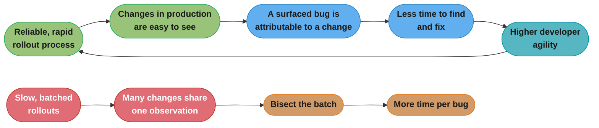
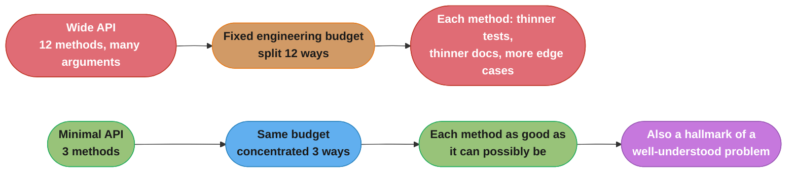
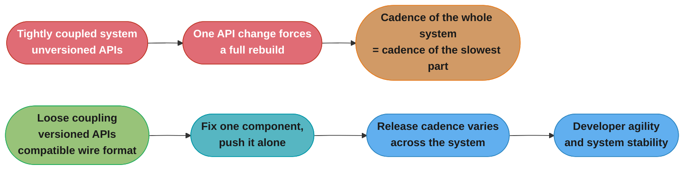
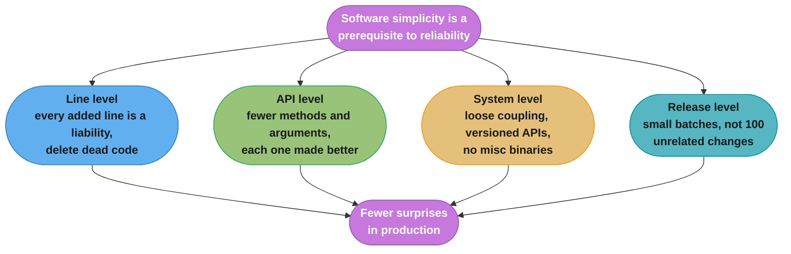
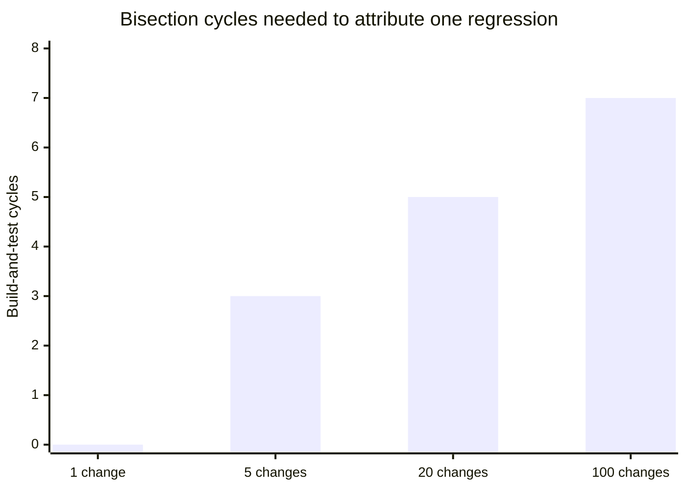

# Chapter 9: Simplicity

> Part II — Principles · Site Reliability Engineering: How Google Runs Production Systems
> (Beyer, Jones, Petoff & Murphy, eds., O'Reilly 2016) · builds on Ch 8 (Release Engineering),
> closes Part II and leads into Part III — Practices (Ch 10, Practical Alerting)

Written by Max Luebbe; edited by Tim Harvey.

## Chapter Map

This is the shortest chapter in Part II and the one the rest of the book quotes most. It closes
the Principles section by naming the property that every earlier principle quietly assumed:
**software simplicity is a prerequisite to reliability.** Chapter 3 could budget risk, Chapter 4
could measure it, Chapters 5 and 7 could automate the work away, Chapter 6 could watch for it, and
Chapter 8 could ship changes reproducibly — but all of that operates on a system whose behaviour
someone has to be able to hold in their head at 3am. The chapter's argument is that this
holdability is not a happy side effect of good engineering; it is a thing you must actively spend
engineering effort to preserve, against a codebase's natural tendency to accrete.

The chapter opens with C.A.R. Hoare's Turing Award line — **"The price of reliability is the
pursuit of the utmost simplicity"** — and its first move is to state the uncomfortable premise
plainly: **software systems are inherently dynamic and unstable.** A software system could only be
perfectly stable in a vacuum. Stop changing the codebase and you stop introducing bugs; freeze the
hardware and libraries and neither introduces bugs; freeze the user base and you never have to
scale. None of those are available. So the chapter's summary of the whole SRE approach, quoted
from the author's former manager Johan Anderson, is: **"At the end of the day, our job is to keep
agility and stability in balance in the system."**

It is worth being precise about what kind of chapter this is. It is an argument, largely in the
first person, with almost no mechanism and almost no numbers. Its claims are about **what
engineers should say no to** — features, retained dead code, wide APIs, grab-bag binaries, big
batched releases — and its unusual contribution is that it treats *deletion* as an engineering
achievement rather than as cleanup.

**TL;DR:**
- The SRE job is framed as **keeping agility and stability in balance**, not as maximizing
  stability; the chapter concedes it "sometimes makes sense to sacrifice stability for the sake of
  agility," and offers **exploratory coding** — code written with an explicit shelf life, never
  shipped, never seen by users — as the case where lax test coverage and release management are
  legitimate.
- SRE's experience, the chapter claims, is that **reliable processes tend to actually increase
  developer agility**: rapid, reliable rollouts make changes in production easier to see, so once a
  bug surfaces it takes less time to find and fix.
- **"Boring" is a positive attribute in software.** Borrowing Brooks's *No Silver Bullet*
  distinction, SRE teams should **push back on accidental complexity** (removable with engineering
  effort) while accepting **essential complexity** (inherent in the problem definition). "Surprises
  in production are the nemeses of SRE."
- The chapter is blunt about retained dead code: commenting it out, or gating it behind a
  permanently-disabled flag, are called **"terrible suggestions"** — the flag-gated case is a
  **"metaphorical time bomb waiting to explode,"** with **Knight Capital** cited as the painful
  example. Source control already makes reversal easy.
- The **"negative lines of code" metric** frames software bloat from the SRE side: **every line of
  code changed or added creates the potential for new defects**, so a smaller project is easier to
  understand, easier to test, and frequently has fewer defects. The author's line: some of the most
  satisfying coding he has done was **deleting thousands of lines of code at a time** when it was
  no longer useful.
- **Minimal APIs, modularity, and release simplicity** are the same principle at three scales:
  fewer methods and arguments means more effort available to make each one good; loose coupling and
  API versioning let components change independently; and a release of a few changes is
  understandable in a way that a release of **100 unrelated changes** is not.

---

## The Big Question

The driving question is not "how do we make the system simple?" — it is **"who pays for the
complexity we just added, and when?"**

The chapter's answer is that the bill arrives during an outage, and it is paid by whoever is
on-call. A feature added on a Tuesday costs an hour of writing; the same feature costs a decade of
being a thing that must be understood before anyone can reason about a failure, tested before any
release, kept working through every dependency upgrade, and eliminated as a suspect during every
incident. Nobody bills that cost to the feature, which is why complexity accumulates by default and
why the chapter has to argue for simplicity rather than simply observe it.

**Analogy:** think of a codebase as a house you also have to evacuate in the dark. Every new room
is a pleasure to build and a liability during the fire drill — one more place to check, one more
door that might be locked, one more hallway to remember the shape of. Nobody demolishes a room they
still might want. But the person who has to get everyone out at 3am does not experience rooms as
possibilities; they experience them as search space. The chapter's position is that the person
doing the evacuation should have a vote on the floor plan, and that a room nobody has entered in
two years should come down — because source control means you can rebuild it, and because a room
that does not exist cannot be the one you get lost in.

---

## 9.1 System Stability Versus Agility

The chapter does **not** argue that stability always wins. It opens by conceding the opposite:
**"It sometimes makes sense to sacrifice stability for the sake of agility."**

The author's own worked case is **exploratory coding**: approaching an unfamiliar problem domain by
"setting an explicit shelf life for whatever code I write with the understanding that I'll need to
try and fail once in order to really understand the task I need to accomplish." The permission that
follows is precise and conditional — **"Code that comes with an expiration date can be much more
liberal with test coverage and release management because it will never be shipped to production or
be seen by users."**

Two conditions carry that permission, and both are stated: the shelf life must be **explicit**, and
the code must **never be shipped to production or seen by users**. Exploratory code that quietly
ships is not exploratory code enjoying a discount; it is production code with no tests.

For the majority of production software systems, the chapter wants **"a balanced mix of stability
and agility."** SREs work to create procedures, practices, and tools that render software more
reliable, **while ensuring this work has as little impact on developer agility as possible.**

Then the claim the chapter is most often quoted for, and the one that inverts the usual framing:

> "In fact, SRE's experience has found that **reliable processes tend to actually increase developer
> agility**: rapid, reliable production rollouts make changes in production easier to see. As a
> result, once a bug surfaces, it takes less time to find and fix that bug."

The mechanism named is *visibility*, not ceremony. If rollouts are rapid and reliable, the mapping
from "a change went out" to "behaviour changed" is tight, so a regression is attributable. If
rollouts are slow and batched, that mapping is many-to-one and the same regression costs a bisect
across everything in the batch. This is Chapter 8's high-velocity argument arriving from the other
direction, and §9.7 will state it a third time as release simplicity.

The section closes with what the reliability work is *for*: **"Building reliability into development
allows developers to focus their attention on what we really do care about — the functionality and
performance of their software and systems."**



*The chapter's counterintuitive claim drawn as a loop: reliability is not a tax on agility, it is
what makes agility affordable, because attribution is what makes a bug cheap to fix.*

---

## 9.2 The Virtue of Boring

> "Unlike just about everything else in life, 'boring' is actually a positive attribute when it
> comes to software!"

The chapter's statement of what we want from programs: **"We don't want our programs to be
spontaneous and interesting; we want them to stick to the script and predictably accomplish their
business goals."** It quotes Google engineer **Robert Muth**: *"Unlike a detective story, the lack
of excitement, suspense, and puzzles is actually a desirable property of source code."* And then the
line that is effectively this chapter's motto: **"Surprises in production are the nemeses of SRE."**

### Essential versus accidental complexity

The section's analytical content is a borrowing from **Fred Brooks's "No Silver Bullet" essay**:

| | Definition, as the chapter states it | What to do about it |
|---|---|---|
| **Essential complexity** | "the complexity inherent in a given situation that cannot be removed from a problem definition" | accept it; it is the problem |
| **Accidental complexity** | "more fluid and can be resolved with engineering effort" | remove it, and push back when it is introduced |

The chapter's own example is precise and worth keeping intact, because it shows accidental
complexity arriving through an *implementation choice* rather than through carelessness:

> "For example, writing a web server entails **the essential complexity of serving web pages
> quickly**. However, if we write a web server in Java, we may introduce **accidental complexity
> when trying to minimize the performance impact of garbage collection.**"

Nobody chose to take on GC-tuning complexity; it arrived as a consequence of a language decision
that was probably right for other reasons. That is the general shape: accidental complexity is
usually the downstream cost of a defensible upstream choice, which is exactly why it needs a named
category and a standing instruction to hunt it — otherwise every instance individually looks
justified.

**With an eye towards minimizing accidental complexity, SRE teams should** (the chapter's two
bullets, verbatim in substance):

- **Push back when accidental complexity is introduced** into the systems for which they are
  responsible.
- **Constantly strive to eliminate complexity** in systems they onboard and for which they assume
  operational responsibility.

Note the second one's phrasing: complexity elimination is attached to **onboarding**. The moment a
team assumes operational responsibility for a system is the moment its accidental complexity
becomes that team's 3am problem, and it is the moment of maximum leverage to demand simplification
— before the team has normalized the system's quirks.

```
                     COMPLEXITY IN A SYSTEM
   ┌───────────────────────────────┬──────────────────────────────┐
   │      ESSENTIAL                │      ACCIDENTAL              │
   │  inherent in the problem      │  introduced by how we chose  │
   │  definition; cannot be        │  to solve it; resolvable     │
   │  removed                      │  with engineering effort     │
   ├───────────────────────────────┼──────────────────────────────┤
   │  "serve web pages quickly"    │  "minimize the performance   │
   │                               │   impact of garbage          │
   │                               │   collection"                │
   ├───────────────────────────────┼──────────────────────────────┤
   │  SRE response: accept,        │  SRE response: push back on  │
   │  design for, monitor          │  new instances; strive to    │
   │                               │  eliminate on onboarding     │
   └───────────────────────────────┴──────────────────────────────┘
```

*The chapter's own worked example placed in Brooks's two columns. The dividing line is not
"hard versus easy" — it is "would any correct solution have this problem."*

---

## 9.3 I Won't Give Up My Code!

This section is about the human obstacle, and it does not soften it: **"Because engineers are human
beings who often form an emotional attachment to their creations, confrontations over large-scale
purges of the source tree are not uncommon."**

The chapter lists the three objections it hears, and its verdict on all three is one sentence:

| The objection | The chapter's response |
|---|---|
| *"What if we need that code later?"* | **"These are all terrible suggestions."** Source control systems make it easy to reverse changes. |
| *"Why don't we just comment the code out so we can easily add it again later?"* | Hundreds of lines of commented code **create distractions and confusion**, especially as the source files continue to evolve. |
| *"Why don't we gate the code with a flag instead of deleting it?"* | Code that is never executed, gated by a flag that is always disabled, is **"a metaphorical time bomb waiting to explode."** |

The flag-gated case gets a real-world citation: the chapter points to **Knight Capital**, referring
the reader to "Order In the Matter of Knight Capital Americas LLC" [Sec13], as having **painfully
experienced** exactly this. The chapter does not narrate the incident; it cites it as the canonical
demonstration that dormant flag-gated code is not inert.

Why the "comment it out" answer is wrong is worth restating in the chapter's terms, because it is a
strictly weaker version of what version control already gives you. Commented code is not preserved
— it is *frozen while everything around it moves*. Refactors do not touch it, compilers do not check
it, tests do not exercise it, and it decays into a plausible-looking artifact that no longer works
and that nobody can distinguish from working code by reading. Deleting it puts the same text in the
history, where it is dated, attributed, and unambiguously not live.

Then the section's strongest claim, hedged exactly as the chapter hedges it:

> "At the risk of sounding extreme, when you consider a web service that's expected to be available
> 24/7, **to some extent, every new line of code written is a liability.**"

And the three practices SRE promotes to make it more likely that all code has an essential purpose:

- **scrutinizing code to make sure that it actually drives business goals**;
- **routinely removing dead code**;
- **building bloat detection into all levels of testing.**

The third is the one teams skip. Bloat detection *in testing* means the accretion is caught
mechanically and continuously, rather than depending on someone periodically finding the courage to
propose a purge — which, per this section's opening sentence, is a confrontation.

```
CODE YOU ARE NOT SURE YOU STILL NEED — four dispositions

  keep it live          ▏ it runs, it is tested, it is understood   ▏ KEEP if it has a purpose
  comment it out        ▏ frozen text, unrefactored, uncompiled,    ▏ NO   "distractions and
                        ▏ untested, indistinguishable from live     ▏   confusion"
  gate it behind an     ▏ ships, is reachable in principle, is      ▏ NO   "a metaphorical time
  always-off flag       ▏ never exercised                           ▏   bomb waiting to explode"
  delete it             ▏ in version control: dated, attributed,    ▏ KEEP the chapter's answer
                        ▏ recoverable, unambiguously not live       ▏
```

*The chapter's ranking of the four options. Note that the two "preserving" options preserve the
maintenance cost and the confusion while discarding the benefit — version control already preserved
the code.*

---

## 9.4 The "Negative Lines of Code" Metric

The section opens by defining **software bloat**: a term "coined to describe the tendency of
software to become slower and bigger over time as a result of a constant stream of additional
features."

The SRE reframing is the whole point of the section. Bloat is intuitively undesirable, but the
chapter says its negative aspects "become even more clear when considered from the SRE
perspective," and states the mechanism:

> "**Every line of code changed or added to a project creates the potential for introducing new
> defects and bugs.** A smaller project is easier to understand, easier to test, and frequently has
> fewer defects."

Three separate benefits are claimed for smallness there, and they are worth separating because they
pay out at different times: *easier to understand* pays out during an incident, *easier to test*
pays out on every release, and *fewer defects* pays out continuously. Only the middle one is
usually measured.

The behavioural consequence: **"we should perhaps entertain reservations when we have the urge to
add new features to a project."** And then the sentence the metric is named for, in the author's own
voice:

> "Some of the most satisfying coding I've ever done was **deleting thousands of lines of code at a
> time** when it was no longer useful."

The "negative lines of code" framing is the cultural device: if lines-of-code is treated as
production, deletion is negative production and looks like failure. The chapter's inversion is that
under the SRE lens the sign is backwards — a diff of −3,000 lines removed potential defect sites,
shortened every future incident's search space, and made every test run cheaper, so it is the more
valuable of the two diffs, not the lesser one.

*(A note on voice: the chapter states the causal claim — added or changed lines create the potential
for new defects — and the author's personal satisfaction in mass deletion. It does not offer a
defect-density figure, a target ratio, or any quantitative version of the metric. Treat the metric
as a framing device the chapter proposes, not as an instrumented measurement it reports.)*

---

## 9.5 Minimal APIs

The section's epigraph is **Antoine de Saint Exupéry**: *"perfection is finally attained not when
there is no longer more to add, but when there is no longer anything to take away."* The chapter's
claim is that this "is also applicable to the design and construction of software," and that **APIs
are a particularly clear expression of why this rule should be followed.**

The core mechanism, stated as a tradeoff between surface area and quality:

> "The **fewer methods and arguments** we provide to consumers of the API, the **easier that API
> will be to understand**, and the **more effort we can devote to making those methods as good as
> they can possibly be.**"

That second clause is the one people drop when they quote this section. A minimal API is not merely
easier for callers; it *concentrates a fixed engineering budget*. Twelve methods maintained by the
same team get one twelfth of the attention each — the testing, the documentation, the performance
work, the edge-case handling — that three methods would get.

The chapter then names the recurring theme explicitly: **"the conscious decision to not take on
certain problems allows us to focus on our core problem and make the solutions we explicitly set out
to create substantially better. In software, less is more!"** It closes with a diagnostic worth
remembering: **"A small, simple API is usually also a hallmark of a well-understood problem."**

That last sentence turns API size into a *signal*, not just a cost. A sprawling interface is often
evidence that the designers did not yet know which operations were fundamental, so they exposed all
of them and let callers decide. The size is a symptom; the unclear problem definition is the disease.



*The chapter's argument is about budget concentration, not just about caller convenience — and it
ends with a diagnostic: API size is evidence about how well the problem is understood.*

---

## 9.6 Modularity

The section expands the same principle "outward from APIs and single binaries," and its framing
sentence is the bridge between object-oriented design and distributed systems: **"many of the rules
of thumb that apply to object-oriented programming also apply to the design of distributed
systems."**

### Loose coupling as a simplicity pattern

> "**The ability to make changes to parts of the system in isolation is essential to creating a
> supportable system.** Specifically, **loose coupling between binaries, or between binaries and
> configuration**, is a simplicity pattern that **simultaneously promotes developer agility and
> system stability.**"

The concrete payoff the chapter names: **if a bug is discovered in one program that is a component
of a larger system, that bug can be fixed and pushed to production independently of the rest of the
system.** Note "or between binaries and configuration" — that is exactly Chapter 8's separate MPM
configuration package, which allowed a wrong flag value to be corrected by rebuilding the config
package alone, with no new binary build. The two chapters are describing the same decoupling from
opposite ends.

### Modularity extends to how API changes are introduced

The chapter flags this as the non-obvious part: **"While the modularity that APIs offer may seem
straightforward, it is not so apparent that the notion of modularity also extends to how changes to
APIs are introduced."**

The failure it names: **"Just a single change to an API can force developers to rebuild their entire
system and run the risk of introducing new bugs."** The remedy: **versioning APIs allows developers
to continue to use the version their system depends upon while they upgrade to a newer version in a
safe and considered way.** And the systemic consequence, which is the real prize: **"The release
cadence can vary throughout a system, instead of requiring a full production push of the entire
system every time a feature is added or improved."**

That is a strong claim about organizational throughput, not only about code hygiene. Without API
versioning, the release cadence of every component collapses to the cadence of the slowest one,
because any change forces a synchronized rebuild. With it, each component ships on its own clock.

### The "grab bag" anti-pattern

> "As a system grows more complex, the separation of responsibility between APIs and between
> binaries becomes increasingly important. This is a **direct analogy to object-oriented class
> design**: just as it is understood that it is poor practice to write a **'grab bag' class** that
> contains unrelated functions, it is also poor practice to create and put into production a
> **'util' or 'misc' binary.**"

The chapter's positive statement of the target: **"A well-designed distributed system consists of
collaborators, each of which has a clear and well-scoped purpose."**

A `misc` binary is worse than a `misc` class for a reason the analogy leaves implicit: a binary is a
**deployment unit and a failure domain**. Unrelated functions bundled into one binary share a
release, a rollback, a resource footprint, and an outage. Rolling back one of them rolls back all of
them, and the blast radius of a crash in any one is all the others.

### Modularity in data formats

> "The concept of modularity **also applies to data formats.** One of the central strengths and
> design goals of Google's **protocol buffers** was to create a wire format that was **backward and
> forward compatible.**"

Backward *and* forward is the point, and it is the data-format analogue of API versioning: backward
compatibility lets new code read old data, and forward compatibility lets old code read data written
by new code without choking on fields it does not recognize. Together they mean producer and
consumer do not have to be upgraded at the same instant — which is the same "release cadence can
vary throughout a system" property, applied to bytes on the wire instead of to method signatures.



*Modularity's payoff in the chapter is throughput, not tidiness: versioned APIs and a
backward/forward-compatible wire format are what let each component keep its own release clock.*

---

## 9.7 Release Simplicity

The shortest section, and the one that closes the loop with Chapter 8.

> "**Simple releases are generally better than complicated releases.** It is much easier to measure
> and understand the impact of a single change rather than a batch of changes released
> simultaneously."

The chapter's own worked scenario, with its own number:

> "If we release **100 unrelated changes** to a system at the same time and performance gets worse,
> understanding **which changes impacted performance, and how they did so**, will take
> **considerable effort or additional instrumentation.** If the release is performed in **smaller
> batches**, we can **move faster with more confidence** because each code change can be understood
> **in isolation** in the larger system."

"Move faster with more confidence" is the phrase to hold onto: the chapter is not trading speed for
safety, it is claiming smaller batches deliver both, for the same reason §9.1 gave — attribution.

The closing analogy is the chapter's most distinctive:

> "This approach to releases can be compared to **gradient descent in machine learning**, in which
> we find an optimum solution by **taking small steps at a time, and considering if each change
> results in an improvement or degradation.**"

The analogy earns its place because it captures the feedback structure, not just the step size. In
gradient descent the point of a small step is that you can *evaluate* it before taking the next one;
a step so large that it jumps past everything tells you nothing about direction. A 100-change
release is a giant step with a single scalar readout — "performance got worse" — and no gradient
information at all.

*(Scale note, in the summarizer's voice, since the chapter states the relationship without
quantifying it: if a regression must be attributed by bisection, a batch of 100 changes costs on the
order of seven build-and-test cycles to isolate, and each cycle must reproduce the regression
reliably. A batch of 5 costs about three cycles, and a batch of 1 costs none — the release *is* the
answer. The chapter's "considerable effort or additional instrumentation" is that cost, plus the
much larger cost of the cases where bisection is not clean because two of the 100 changes
interact.)*

---

## 9.8 A Simple Conclusion

The chapter's own closing, and it names its thesis outright:

> "This chapter has repeated one theme over and over: **software simplicity is a prerequisite to
> reliability.**"

Then the defence against the obvious misreading — that simplification is laziness or a lack of
ambition:

> "**We are not being lazy when we consider how we might simplify each step of a given task.**
> Instead, we are **clarifying what it is we actually want to accomplish and how we might most
> easily do so.** Every time we say 'no' to a feature, **we are not restricting innovation; we are
> keeping the environment uncluttered of distractions so that focus remains squarely on innovation,
> and real engineering can proceed.**"

The reframe is that simplification is an act of *specification*. You cannot simplify a step you have
not understood, so the work of simplifying forces the clarification that should have happened first.
And the argument about saying "no" is a claim about attention as a conserved quantity: a team's
capacity for real engineering is finite, and every retained feature, every extra API method, every
grab-bag binary draws on it permanently.

---

## Visual Intuition

### The chapter's one principle at four scales



*Sections 9.3 through 9.7 are one argument applied at four scales. "Surprises in production are the
nemeses of SRE" is the shared target at every level.*

### Batch size and attribution cost

The chapter states that understanding which of 100 simultaneous changes hurt performance "will take
considerable effort or additional instrumentation," and that smaller batches let you move faster
with more confidence. The relationship it describes:



*Summarizer's arithmetic, not the chapter's — the chapter gives the 100-change scenario and the
qualitative claim, not these figures. The shape is the point: attribution cost grows with batch
size, and each cycle requires reproducing the regression reliably, which is itself not free.*

### Why "commented out" is the worst of the three preservation options

```
                        runs?   compiled?  tested?  refactored?  recoverable?  confusing?
  live code               yes       yes       yes        yes          yes          no
  flag-gated, always off  no        yes       no         yes          yes       YES - "time bomb"
  commented out           no        no        no         no           yes       YES - "distractions
                                                                                  and confusion"
  deleted                 no        -         -          -            yes          no
```

*Deletion loses nothing that version control does not already keep, and is the only option that
removes the confusion. The chapter's verdict on the two middle rows: "these are all terrible
suggestions."*

---

## Key Concepts Glossary

| Term | Definition as the chapter uses it |
|---|---|
| **Simplicity (as SRE uses it)** | The property the chapter names as a prerequisite to reliability; the deliberate minimization of what a system contains and exposes. |
| **Stability versus agility** | The balance the chapter identifies as the SRE job: "our job is to keep agility and stability in balance in the system." |
| **Exploratory coding** | Writing code with an explicit shelf life to learn an unfamiliar problem domain; it may be liberal with test coverage and release management because it will never be shipped to production or seen by users. |
| **The virtue of boring** | The chapter's claim that predictability is a positive attribute in software: programs should "stick to the script," and "surprises in production are the nemeses of SRE." |
| **Essential complexity** | Brooks's term as the chapter uses it: complexity inherent in a situation that cannot be removed from the problem definition (e.g. serving web pages quickly). |
| **Accidental complexity** | Complexity that is "more fluid and can be resolved with engineering effort" (e.g. minimizing GC impact after choosing Java for a web server). |
| **Dead code** | Code no longer serving a purpose; SRE promotes routinely removing it rather than commenting it out or gating it behind a disabled flag. |
| **Flag-gated dormant code** | Code never executed because its flag is always disabled; the chapter calls it "a metaphorical time bomb waiting to explode," citing Knight Capital. |
| **Code as liability** | The chapter's hedged claim that for a service expected to be available 24/7, "to some extent, every new line of code written is a liability." |
| **Software bloat** | A coined term for the tendency of software to become slower and bigger over time as a result of a constant stream of additional features. |
| **The "negative lines of code" metric** | The chapter's framing that deleting code is valuable output, since every line changed or added creates the potential for new defects. |
| **Bloat detection** | A practice SRE promotes: building bloat detection into all levels of testing, alongside scrutinizing code against business goals and routinely removing dead code. |
| **Minimal API** | An API with few methods and arguments; easier to understand, and it concentrates engineering effort on making each method as good as possible. Also "a hallmark of a well-understood problem." |
| **Modularity** | The ability to change parts of the system in isolation; loose coupling between binaries, or between binaries and configuration. |
| **API versioning** | Letting developers keep using the version their system depends on while upgrading safely, so release cadence can vary throughout a system. |
| **"Grab bag" class / "util" or "misc" binary** | The anti-pattern of bundling unrelated functions together; the chapter calls both poor practice. |
| **Collaborators** | The chapter's term for what a well-designed distributed system consists of: components each with a clear and well-scoped purpose. |
| **Backward and forward compatibility** | A central design goal of protocol buffers' wire format, cited as modularity applied to data formats. |
| **Release simplicity** | The principle that simple releases beat complicated ones, because a single change's impact is easier to measure and understand than a batch's. |

---

## Tradeoffs & Decision Tables

### When the chapter permits sacrificing stability

| Situation | Chapter's position |
|---|---|
| Exploratory coding with an **explicit shelf life**, never shipped, never seen by users | **Permitted** — may be liberal with test coverage and release management |
| The majority of production software systems | **A balanced mix** of stability and agility |
| Reliability work that impedes developers | Minimize it — SREs should ensure reliability work "has as little impact on developer agility as possible" |
| Reliability work that speeds developers up | **Pursue it** — the chapter claims reliable processes tend to *increase* agility via visibility |

### Disposing of code you might want later

| Option | Preserves the code? | Preserves the maintenance cost? | Chapter's verdict |
|---|---|---|---|
| Comment it out | yes, as frozen unrefactored text | yes, plus confusion | "terrible" — distractions and confusion |
| Gate behind an always-off flag | yes, and it still ships | yes, plus latent risk | "a metaphorical time bomb waiting to explode" (Knight Capital) |
| Delete it | yes, in version control | **no** | the answer — "source control systems make it easy to reverse changes" |

### Scale of the same principle

| Scale | The simplicity move | What it buys, in the chapter's words |
|---|---|---|
| Lines of code | delete dead code, resist new features | "easier to understand, easier to test, and frequently has fewer defects" |
| API | fewer methods and arguments | "the more effort we can devote to making those methods as good as they can possibly be" |
| Binaries and configuration | loose coupling, no misc binaries | fix and push one component "independent of the rest of the system" |
| API evolution | version the API | "release cadence can vary throughout a system" |
| Data formats | backward and forward compatible wire format | producer and consumer need not upgrade together |
| Releases | small batches | "move faster with more confidence" |

---

## Common Pitfalls / War Stories

**The always-off flag that turned on.** The chapter's cited example is **Knight Capital**, pointed
to via "Order In the Matter of Knight Capital Americas LLC," as having painfully experienced the
consequences of code that is never executed because it is gated by a flag that is always disabled.
The chapter's framing is that such code is *not* inert — it is deployed, reachable in principle, and
untested in practice, which is the definition of a latent failure waiting for a configuration
mistake.

**Commented-out code that rots into a trap.** The chapter warns that "hundreds of lines of commented
code create distractions and confusion (especially as the source files continue to evolve)." The
rot mechanism is that commented code is excluded from every mechanism that keeps live code correct —
compilation, refactoring, testing — while remaining visually indistinguishable from code that works.
Someone eventually uncomments it.

**Accidental complexity arriving through a defensible choice.** The chapter's GC example is the
pattern: nobody sets out to add complexity, but choosing Java for a web server imports the work of
minimizing garbage-collection impact, which is not part of "serve web pages quickly." Each such
import looks individually justified, which is why the chapter gives SRE a *standing* instruction to
push back rather than a case-by-case one.

**The `misc` binary.** Called out directly as poor practice, by analogy to the grab-bag class. In
production it is worse than the class analogy suggests, because a binary is a deployment unit and a
failure domain: unrelated functions inside it share a release, a rollback, and an outage.

**The synchronized rebuild.** "Just a single change to an API can force developers to rebuild their
entire system and run the risk of introducing new bugs." Without API versioning, every component's
release cadence collapses to the slowest component's, and each API change becomes a coordinated
multi-team push — the exact opposite of the release simplicity §9.7 asks for.

**The 100-change release.** The chapter's own scenario: release 100 unrelated changes, watch
performance get worse, and now understanding which changes did it and how "will take considerable
effort or additional instrumentation." The instrumentation is the tell — you are paying, after the
fact, to recover the attribution that a smaller batch would have given you for free.

**Confusing simplification with laziness.** The chapter defends against this explicitly: "We are not
being lazy when we consider how we might simplify each step of a given task. Instead, we are
clarifying what it is we actually want to accomplish." A team that treats simplification proposals
as a lack of ambition will accumulate exactly the complexity this chapter is about.

---

## Real-World Systems Referenced

| Reference | How the chapter uses it |
|---|---|
| **C.A.R. Hoare, Turing Award lecture** | The chapter's epigraph: "The price of reliability is the pursuit of the utmost simplicity." |
| **Fred Brooks, "No Silver Bullet" [Bro95]** | Source of the essential/accidental complexity distinction the chapter builds §9.2 on. |
| **Robert Muth (Google engineer)** | Quoted: "Unlike a detective story, the lack of excitement, suspense, and puzzles is actually a desirable property of source code." |
| **Johan Anderson** | The author's former manager, credited with "our job is to keep agility and stability in balance in the system." |
| **Antoine de Saint Exupéry [Sai39]** | Quoted on perfection being attained when there is nothing left to take away, as the epigraph to minimal APIs. |
| **Knight Capital [Sec13]** | Cited as having painfully experienced the consequences of flag-gated, never-executed code. |
| **Google protocol buffers** | Cited as an example of modularity in data formats; backward and forward wire compatibility named as a central design goal. |
| **Java (as a web-server language)** | The chapter's worked example of a choice that introduces accidental complexity via garbage-collection tuning. |
| **Gradient descent** | The analogy for small-batch releases: small steps, each evaluated for improvement or degradation. |

---

## Summary

The chapter states its own thesis in its final section — **software simplicity is a prerequisite to
reliability** — and everything before it is that claim applied at successively larger scales.

**The premise is that stability is not the goal; balance is.** Software systems are inherently
dynamic and unstable, and could only be perfectly stable in a vacuum where the code, the hardware,
the libraries, and the user base all stop changing. Since none of that is available, the SRE job is
summarized as keeping agility and stability in balance. The chapter concedes that agility sometimes
wins outright — exploratory code with an explicit shelf life, never shipped, may be liberal with
tests and release process — and then makes its counterintuitive claim about the normal case:
reliable processes *increase* developer agility, because rapid, reliable rollouts make changes in
production visible, and visible changes make surfaced bugs cheap to attribute and fix.

**"Boring" is the target, and accidental complexity is the enemy.** We want programs that stick to
the script and predictably accomplish business goals, because surprises in production are the
nemeses of SRE. Brooks's distinction gives SRE a place to push: essential complexity is inherent in
the problem and must be accepted, while accidental complexity is fluid and resolvable with
engineering effort. The two standing instructions are to push back when accidental complexity is
introduced, and to strive to eliminate it in systems the team onboards.

**Deletion is engineering work, and the objections to it are wrong.** Engineers form emotional
attachments to code, and the three standard defences — we might need it later, comment it out, gate
it behind a flag — are all called terrible suggestions. Source control already makes reversal easy;
commented code creates distractions and confusion as the surrounding files evolve; and never-executed
flag-gated code is a metaphorical time bomb, with Knight Capital cited as the demonstration. For a
24/7 service, to some extent every new line of code is a liability, so SRE promotes scrutinizing code
against business goals, routinely removing dead code, and building bloat detection into all levels of
testing.

**The "negative lines of code" metric inverts the sign on deletion.** Software bloat is the tendency
to grow slower and bigger under a constant stream of features; from the SRE side, every line changed
or added creates the potential for new defects, and a smaller project is easier to understand, easier
to test, and frequently has fewer defects. Hence the reservation the chapter asks for before adding a
feature, and the author's report that some of his most satisfying coding was deleting thousands of
lines at a time.

**Minimal APIs, modularity, and small releases are the same idea at three scales.** Fewer methods
and arguments make an API easier to understand and concentrate the effort available to make each
method excellent — and a small API is a hallmark of a well-understood problem. Loose coupling
between binaries, and between binaries and configuration, lets a bug be fixed and pushed
independently, while API versioning lets release cadence vary across a system instead of forcing a
full production push for every change; protocol buffers' backward- and forward-compatible wire
format is the same property for data. And simple releases beat complicated ones, because the impact
of a single change can be measured while the impact of 100 simultaneous unrelated changes takes
considerable effort or additional instrumentation to untangle — the chapter's gradient-descent
analogy being about the value of *evaluating* each small step.

**And the closing defence:** simplifying is not laziness, it is clarifying what you actually want to
accomplish; saying "no" to a feature does not restrict innovation, it keeps the environment
uncluttered so real engineering can proceed.

---

## Interview Questions

**Q: What is the difference between essential and accidental complexity, and what should an SRE do about each?**
**Short:** The chapter uses Brooks's distinction: essential complexity is inherent in the problem definition and cannot be removed, while accidental complexity is resolvable with engineering effort.

Essential complexity is, in the chapter's words, "the complexity inherent in a given situation that cannot be removed from a problem definition," whereas accidental complexity "is more fluid and can be resolved with engineering effort." The worked example is a web server: serving web pages quickly is essential complexity, but writing that server in Java may introduce accidental complexity when trying to minimize the performance impact of garbage collection. The chapter's two standing instructions for SRE teams are to push back when accidental complexity is introduced into systems they are responsible for, and to constantly strive to eliminate complexity in systems they onboard and assume operational responsibility for. The onboarding clause is the leverage point in practice, because that is the moment before a team normalizes a system's quirks.

**Q: The book calls commenting out code and flag-gating it "terrible suggestions." Why?**
**Short:** Because source control already makes reversal easy, while commented code causes distractions and confusion and always-disabled flag-gated code is called a metaphorical time bomb.

The chapter lists three objections engineers raise to deleting code — we might need it later, let's comment it out, let's gate it behind a flag — and says "these are all terrible suggestions." Source control systems make it easy to reverse changes, so nothing is preserved by the alternatives that was going to be lost. Hundreds of lines of commented code "create distractions and confusion (especially as the source files continue to evolve)," because commented text is excluded from compilation, refactoring, and testing while remaining visually indistinguishable from working code. Code that is never executed because its flag is always disabled is "a metaphorical time bomb waiting to explode," and the chapter cites Knight Capital as having painfully experienced exactly that. The practical rule is that deletion is the only disposition that removes the maintenance cost and the confusion while keeping the code recoverable.

**Q: The chapter claims reliability work increases developer agility. What is the mechanism?**
**Short:** Visibility — the chapter argues rapid, reliable production rollouts make changes easier to see, so once a bug surfaces it takes less time to find and fix.

The chapter states that "SRE's experience has found that reliable processes tend to actually increase developer agility: rapid, reliable production rollouts make changes in production easier to see. As a result, once a bug surfaces, it takes less time to find and fix that bug." The mechanism is attribution, not ceremony: when rollouts are rapid and reliable the mapping from "a change shipped" to "behaviour changed" is close to one-to-one, so a regression points at a specific diff. When rollouts are slow and batched, that mapping is many-to-one and the same regression costs a bisection across the batch. This is the same argument Chapter 8 makes for high velocity and that §9.7 restates as release simplicity, and it is why the chapter frames reliability work as freeing developers to focus on functionality and performance rather than as a tax on them.

**Q: What is the "negative lines of code" metric?**
**Short:** The chapter's framing that deleting code is valuable output, since every line changed or added creates the potential for introducing new defects and bugs.

The section defines software bloat as the tendency of software to become slower and bigger over time under a constant stream of additional features, then gives the SRE reframing: "every line of code changed or added to a project creates the potential for introducing new defects and bugs. A smaller project is easier to understand, easier to test, and frequently has fewer defects." The metric's name inverts the usual sign — if lines of code are treated as production, deletion looks like negative production, whereas under the SRE lens a large deletion is the more valuable diff. The author reports that "some of the most satisfying coding I've ever done was deleting thousands of lines of code at a time when it was no longer useful." Note that the chapter offers this as a framing device: it states the causal claim and the personal experience, not a defect-density figure or a target ratio.

**Q: When does the book say it is acceptable to sacrifice stability for agility?**
**Short:** For exploratory coding with an explicit shelf life — code that will never be shipped to production or seen by users may be liberal with tests and release management.

The chapter opens §9.1 by conceding that "it sometimes makes sense to sacrifice stability for the sake of agility," and gives the author's own practice as the case: approaching an unfamiliar problem domain with exploratory coding, "setting an explicit shelf life for whatever code I write with the understanding that I'll need to try and fail once in order to really understand the task." The permission is explicitly conditional — such code "can be much more liberal with test coverage and release management because it will never be shipped to production or be seen by users." Both conditions carry the argument: the shelf life must be explicit, and the code must not reach production. For the majority of production software systems the chapter wants a balanced mix of stability and agility instead.

**Q: Why does the book say a small API is better, beyond being easier for callers?**
**Short:** Because fewer methods and arguments mean more of a fixed engineering effort can be devoted to making each method as good as it can possibly be.

The chapter's sentence has two clauses and the second is the one usually dropped: "the fewer methods and arguments we provide to consumers of the API, the easier that API will be to understand, and the more effort we can devote to making those methods as good as they can possibly be." A minimal API concentrates a fixed budget of testing, documentation, performance work, and edge-case handling on fewer surfaces. The chapter frames this as an instance of its recurring theme — "the conscious decision to not take on certain problems allows us to focus on our core problem" — and closes with a diagnostic worth remembering: "a small, simple API is usually also a hallmark of a well-understood problem." That makes API size evidence about the design, not merely a cost to callers.

**Q: How does the chapter connect modularity to release cadence?**
**Short:** Versioning APIs lets developers keep using the version they depend on while upgrading safely, so the release cadence can vary throughout a system.

The chapter flags this as the non-obvious half of modularity: "it is not so apparent that the notion of modularity also extends to how changes to APIs are introduced." The failure it names is that "just a single change to an API can force developers to rebuild their entire system and run the risk of introducing new bugs," and the remedy is API versioning, which "allows developers to continue to use the version that their system depends upon while they upgrade to a newer version in a safe and considered way." The systemic payoff is stated directly: "the release cadence can vary throughout a system, instead of requiring a full production push of the entire system every time a feature is added or improved." Without versioning, every component's cadence collapses to the slowest component's, which is the opposite of the release simplicity the chapter asks for.

**Q: Why is a "util" or "misc" binary called poor practice?**
**Short:** The chapter draws a direct analogy to object-oriented design: just as a grab-bag class of unrelated functions is poor practice, so is a util or misc binary in production.

The chapter says that "as a system grows more complex, the separation of responsibility between APIs and between binaries becomes increasingly important," and makes the analogy explicit — just as it is understood to be poor practice to write a grab-bag class containing unrelated functions, it is also poor practice to create and put into production a util or misc binary. Its positive statement of the target is that "a well-designed distributed system consists of collaborators, each of which has a clear and well-scoped purpose." In production the binary case is worse than the class case for a reason the analogy leaves implicit: a binary is a deployment unit and a failure domain, so unrelated functions bundled in one share a release, a rollback, and an outage, and rolling back one rolls back all of them.

**Q: What does the book mean by "the virtue of boring"?**
**Short:** That predictability is a positive attribute in software — programs should stick to the script, because surprises in production are the nemeses of SRE.

The chapter states that "unlike just about everything else in life, 'boring' is actually a positive attribute when it comes to software," and that "we don't want our programs to be spontaneous and interesting; we want them to stick to the script and predictably accomplish their business goals." It quotes Google engineer Robert Muth: "Unlike a detective story, the lack of excitement, suspense, and puzzles is actually a desirable property of source code." The chapter then makes the operational point that gives the phrase teeth — "surprises in production are the nemeses of SRE" — and immediately turns to the essential/accidental complexity distinction as the tool for reducing them. Read together, boring is not a style preference: it is the property that lets an on-call engineer predict what a system will do without reading it.

**Q: What is the gradient-descent analogy in the release simplicity section?**
**Short:** The chapter compares small-batch releases to gradient descent — taking small steps and considering whether each change results in an improvement or degradation.

The chapter writes that its approach to releases "can be compared to gradient descent in machine learning, in which we find an optimum solution by taking small steps at a time, and considering if each change results in an improvement or degradation." The analogy captures the feedback structure rather than just the step size: the value of a small step is that you can evaluate it before choosing the next one. Its counterpart is the chapter's own worked scenario — release 100 unrelated changes at once and see performance get worse, and "understanding which changes impacted performance, and how they did so, will take considerable effort or additional instrumentation." A giant step gives you one scalar readout and no direction information, whereas smaller batches let you "move faster with more confidence" because each change can be understood in isolation.

**Q: Does the book claim simplicity means writing less ambitious software?**
**Short:** No — the chapter argues simplifying is clarifying what you actually want to accomplish, and that saying no to a feature keeps the environment uncluttered so innovation can proceed.

The chapter anticipates this misreading and answers it in its conclusion: "We are not being lazy when we consider how we might simplify each step of a given task. Instead, we are clarifying what it is we actually want to accomplish and how we might most easily do so." On features it is equally direct: "Every time we say 'no' to a feature, we are not restricting innovation; we are keeping the environment uncluttered of distractions so that focus remains squarely on innovation, and real engineering can proceed." The underlying claim is that a team's capacity for real engineering is a conserved quantity, and every retained feature, extra API method, and grab-bag binary draws on it permanently. Simplification is therefore an act of specification, since you cannot simplify a step you have not understood.

**Q: How does the chapter apply modularity to data formats?**
**Short:** It cites protocol buffers, whose central design goals included a wire format that was backward and forward compatible.

The chapter states that "the concept of modularity also applies to data formats," and gives protocol buffers as its example: "one of the central strengths and design goals of Google's protocol buffers was to create a wire format that was backward and forward compatible." Both directions matter and the chapter names both. Backward compatibility lets new code read data written by old code; forward compatibility lets old code read data written by new code without choking on fields it does not recognize. Together they mean producer and consumer do not need to be upgraded simultaneously, which is the wire-level version of the same property API versioning gives at the interface level — each component keeps its own release clock instead of participating in a synchronized push.

**Q: What is the chapter's premise about the stability of software systems?**
**Short:** That software systems are inherently dynamic and unstable, and could only be perfectly stable in a vacuum where code, hardware, libraries, and the user base all stop changing.

The chapter opens with the observation that "software systems are inherently dynamic and unstable" and that "a software system can only be perfectly stable if it exists in a vacuum," then enumerates the vacuum's conditions: if we stop changing the codebase we stop introducing bugs, if the underlying hardware or libraries never change neither introduces bugs, and if we freeze the current user base we never have to scale. Since none of those are available for a real service, the chapter offers Johan Anderson's line as a summary of the entire SRE approach: "At the end of the day, our job is to keep agility and stability in balance in the system." That framing is what licenses the rest of the chapter — simplicity is presented as the lever that makes the balance achievable, not as a way to reach the vacuum.

**Q: What three practices does SRE promote to keep code purposeful?**
**Short:** Scrutinizing code to confirm it drives business goals, routinely removing dead code, and building bloat detection into all levels of testing.

The chapter states that "SRE promotes practices that make it more likely that all code has an essential purpose," and lists exactly those three: scrutinizing code to make sure it actually drives business goals, routinely removing dead code, and building bloat detection into all levels of testing. The third is the one teams most often skip, and it is the one that changes the dynamic, because it makes accretion visible mechanically and continuously rather than depending on someone periodically proposing a purge. That matters given the section's own opening premise — engineers form emotional attachments to their creations, so "confrontations over large-scale purges of the source tree are not uncommon." Automating detection converts a recurring argument into a routine signal.

**Q: What does the chapter mean by calling every new line of code a liability?**
**Short:** The claim is hedged — for a service expected to be available 24/7, the chapter says that to some extent every new line of code written is a liability.

The exact framing matters because the sentence is often quoted without its hedges: "At the risk of sounding extreme, when you consider a web service that's expected to be available 24/7, to some extent, every new line of code written is a liability." Two qualifiers are doing work — the claim is scoped to always-available services, and it is "to some extent," not absolutely. The supporting mechanism comes from the next section: every line changed or added creates the potential for introducing new defects and bugs, and a smaller project is easier to understand, easier to test, and frequently has fewer defects. The practical consequence the chapter draws is not to stop writing code but to make sure all code has an essential purpose, via the three practices it lists.

**Q: Where does Chapter 9's release argument overlap with Chapter 8's?**
**Short:** Both argue that smaller change sets make testing and troubleshooting easier — Ch 8 calls it high velocity, Ch 9 calls it release simplicity.

Chapter 8 states that Google embraced the philosophy that frequent releases result in fewer changes between versions, which makes testing and troubleshooting easier, and describes cadences from hourly builds to Push on Green. Chapter 9 arrives at the same place from the design side: simple releases are generally better than complicated ones, because it is much easier to measure and understand the impact of a single change than of a batch released simultaneously, and smaller batches let you "move faster with more confidence." Section 9.1 supplies the shared mechanism — reliable, rapid rollouts make changes in production easier to see, so a surfaced bug takes less time to find and fix. The unifying quantity across both chapters is the size of the change set a regression must be attributed against.

**Q: What is the chapter's thesis in one sentence, and how does it defend it?**
**Short:** That software simplicity is a prerequisite to reliability — a theme the chapter says it has repeated over and over, applied from single lines up to whole releases.

The chapter names its own thesis in its conclusion: "this chapter has repeated one theme over and over: software simplicity is a prerequisite to reliability." The defence is by repetition at increasing scale rather than by argument from first principles — the same claim appears at the line level (every added line is a liability, delete dead code), the API level (fewer methods, each made better), the system level (loose coupling, versioned APIs, no misc binaries, compatible wire formats), and the release level (small batches instead of 100 unrelated changes). Underneath all four sits the operational target stated in §9.2: surprises in production are the nemeses of SRE. That is why the chapter closes Part II — it names the property that Chapters 3 through 8 all quietly depend on.

---

## Cross-links in this repo

**Within this book:**
- [Ch 1 — Introduction](../01_introduction/01_introduction.md) — the agility-versus-stability tension this chapter proposes to balance.
- [Ch 3 — Embracing Risk](../03_embracing_risk/03_embracing_risk.md) — reliability past a threshold is cost without benefit, the same "less is more" logic applied to nines.
- [Ch 5 — Eliminating Toil](../05_eliminating_toil/05_eliminating_toil.md) — complexity is what makes operational work irreducible.
- [Ch 6 — Monitoring Distributed Systems](../06_monitoring_distributed_systems/06_monitoring_distributed_systems.md) — the chapter's argument for simple, understandable monitoring is this chapter applied to the alerting stack.
- [Ch 8 — Release Engineering](../08_release_engineering/08_release_engineering.md) — high velocity, the branch-and-cherry-pick model, and the separate configuration package are §9.6 and §9.7 in mechanism form.

**Elsewhere in the repo:**
- [devops/deployment_strategies/](../../../devops/deployment_strategies/deployment_strategies.md) — small-batch releases and progressive delivery in practice.
- [devops/ci_cd_fundamentals/](../../../devops/ci_cd_fundamentals/ci_cd_fundamentals.md) — the pipeline that makes small batches affordable.
- [devops/sre_principles_and_slos/](../../../devops/sre_principles_and_slos/sre_principles_and_slos.md) — simplicity as an SRE principle alongside SLOs and error budgets.
- [devops/configuration_management/](../../../devops/configuration_management/configuration_management.md) — loose coupling between binaries and configuration.
- [hld/microservices/](../../../hld/microservices/microservices.md) — collaborators with clear, well-scoped purposes, and the misc-service anti-pattern at architecture scale.
- [backend/rest_api_design/](../../../backend/rest_api_design/rest_api_design.md) — minimal APIs and API versioning as design practice.
- [backend/microservices_fundamentals/](../../../backend/microservices_fundamentals/microservices_fundamentals.md) — service boundaries and independent deployability.
- [lld/solid_principles/](../../../lld/solid_principles/solid_principles.md) — the object-oriented rules of thumb the chapter says also apply to distributed systems.

---

## Further Reading

Works the chapter cites:

- **C.A.R. Hoare**, Turing Award lecture — the source of the chapter's epigraph on reliability and simplicity.
- **Fred Brooks, "No Silver Bullet"** [Bro95] — essential versus accidental complexity.
- **Antoine de Saint Exupéry** [Sai39] — "perfection is finally attained not when there is no longer more to add, but when there is no longer anything to take away."
- **"Order In the Matter of Knight Capital Americas LLC"** [Sec13] — the cited example of flag-gated dormant code.
- **[Per99]** and **[Coo00]** — footnoted as background on complex systems generally, in support of the claim that software systems are inherently dynamic and unstable.
- **Protocol buffers documentation** — footnoted for the language-neutral, platform-neutral extensible serialization mechanism whose wire format was designed to be backward and forward compatible.
