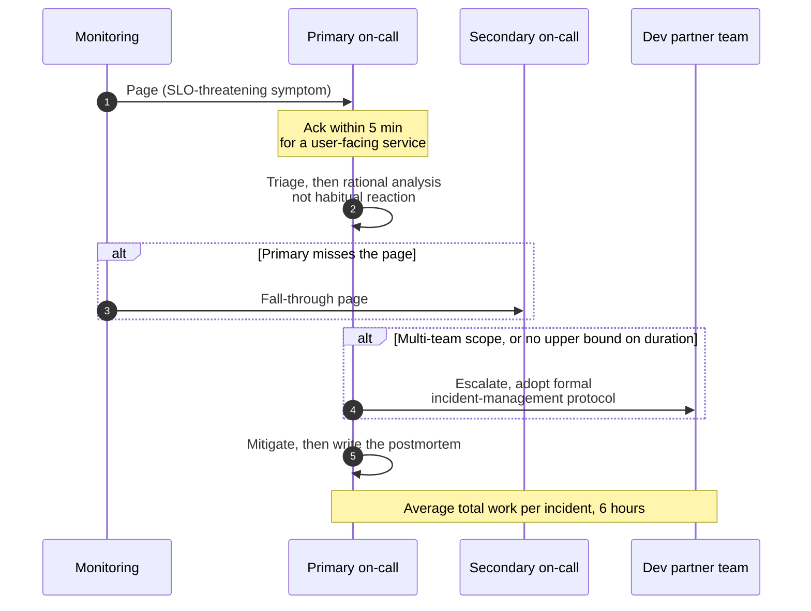
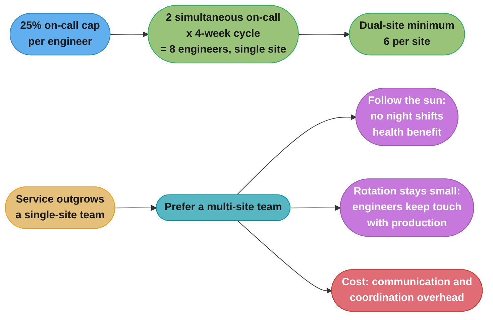
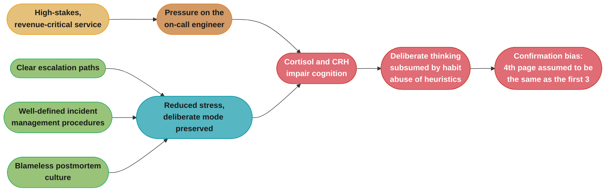
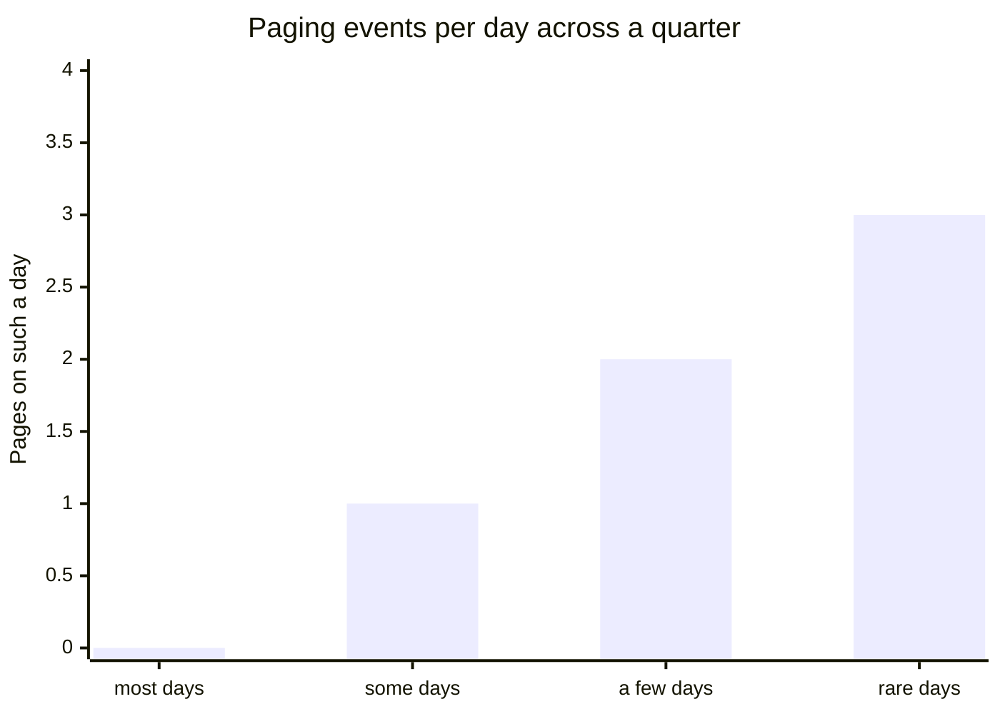
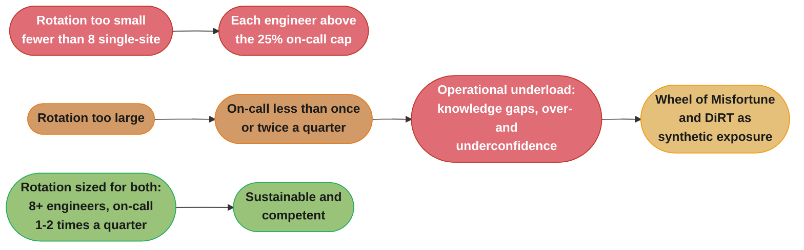

# Chapter 11: Being On-Call

> Part III — Practices · Site Reliability Engineering: How Google Runs Production Systems
> (Beyer, Jones, Petoff & Murphy, eds., O'Reilly 2016) · builds on Ch 6 (Monitoring Distributed
> Systems) and Ch 10 (Practical Alerting), leads to Ch 12 (Effective Troubleshooting)

Written by Andrea Spadaccini; edited by Kavita Guliani. An earlier version of this chapter appeared
as an article in `;login:` (October 2015, vol. 40, no. 5).

## Chapter Map

Part II established what SRE believes; Part III opens with the practice those beliefs are most
often tested against. Being on-call is where the error budget (Ch 3), the SLO (Ch 4), the toil cap
(Ch 5), the monitoring philosophy (Ch 6), and the alerting design (Ch 10) all arrive at once, in
the form of a phone waking someone at 2am. The chapter's contribution is that it refuses to treat
this as an endurance problem. It treats on-call as a **workload with engineering constraints**, and
it puts hard numbers on those constraints: what fraction of an engineer's time it may consume, how
many incidents a shift may contain, how many engineers a rotation therefore needs, and what happens
— structurally, not heroically — when the load exceeds those bounds.

The chapter's most-cited passage is the pair of caps: **at most 50% of an SRE's time on operational
work**, and within the remainder **no more than 25% on-call**. From those two numbers everything
else is derived, including the minimum team size for a sustainable 24/7 rotation. Its second most
useful passage is the one almost every summary drops: **operational underload is also a failure
mode.** A team that is paged too rarely loses competence and calibration, which is why the chapter
prescribes deliberate exposure — every engineer on-call at least once or twice a quarter, plus
"Wheel of Misfortune" exercises and Google's annual company-wide **DiRT** disaster-recovery event.

**TL;DR:**
- **On-call is capped, not endured.** SREs spend **at most 50%** of their time on operational work;
  **at least 50%** goes to engineering. Within the operational half, **no more than 25%** is on-call,
  leaving up to another 25% for other operational, non-project work.
- **Those caps determine team size.** Assuming two people on-call at all times (primary and
  secondary) and week-long shifts, the **minimum single-site team is 8 engineers** — each on-call one
  week every month. For **dual-site** teams, a reasonable minimum is **6 per site**.
- **Quality is capped separately from quantity.** The chapter's measured average is **6 hours** of
  work per incident (root-cause analysis, remediation, postmortem, bug fixes), which yields the
  book's headline constraint: **a maximum of 2 incidents per 12-hour on-call shift**, with a
  **median incidents/day likely of 0.**
- **Feeling safe is an engineering requirement, not a comfort.** Citing Kahneman's two modes of
  thinking, the chapter wants the deliberate mode during outages, and notes that stress hormones
  (**cortisol** and **CRH**) impair cognition and push responders toward heuristics and confirmation
  bias. The countermeasures are **clear escalation paths, well-defined incident-management
  procedures, and a blameless postmortem culture.**
- **Overload has an escape valve, and underload is a real enemy.** Overload symptoms should be
  quantified (the chapter's examples: **daily tickets < 5, paging events per shift < 2**), alerts
  should approach a **1:1 alert/incident ratio**, and in the extreme SRE can **"give back the
  pager."** Conversely, teams paged too rarely lose competence — hence **on-call at least once or
  twice a quarter**, Wheel of Misfortune, and **DiRT**.

---

## The Big Question

Every operations organization eventually asks "how do we keep the service up?" This chapter asks a
harder and more useful question: **"how do we keep the service up for years without consuming the
people who keep it up?"**

The distinction matters because the naive answer to the first question — page more people, page
them faster, page them for more things — is a *direct* attack on the second. An on-call rotation is
a system with a load, a capacity, and a failure mode, and its failure mode is not an outage; it is
attrition, alert fatigue, and a team whose most experienced members leave. So the chapter's move is
to give on-call the same treatment SRE gives a service: define its SLO-like constraints, measure
against them, and treat a breach as a bug requiring corrective action rather than as a season to be
survived.

**Analogy:** think of an on-call rotation as a load-balanced service with eight replicas. Each
replica has a maximum sustainable request rate, a queue that must not grow without bound, and a
recovery time between requests. Route too much traffic at it and you do not get a clean failure —
you get degraded, slow, and increasingly wrong responses, exactly as an overloaded server does under
Chapter 21's cascading-failure conditions. And the analogy holds in the other direction too, which
is the part most people miss: a replica that receives *no* traffic for a long time is not a healthy
replica held in reserve. Its caches are cold, its code paths are unexercised, and the first request
it serves after months of idleness is the one most likely to fail. That is §11.5's operational
underload, and it is why the chapter prescribes synthetic traffic — drills — rather than gratitude
for the quiet.

---

## 11.1 Introduction

The chapter frames on-call as a duty that is **not** unique to software: "several professions
require employees to perform some sort of on-call duty, which entails being available for calls
during both working and nonworking hours." In the IT context, it notes, on-call activities **have
historically been performed by dedicated Ops teams** whose primary responsibility is keeping their
services in good health.

At Google, **many important services — the chapter names Search, Ads, and Gmail — have dedicated
teams of SREs** responsible for their performance and reliability, and **those SREs are on-call for
the services they support.** The distinguishing claim follows immediately: SRE teams are **"quite
different from purely operational teams in that they place heavy emphasis on the use of engineering
to approach problems."** The justification given is scale — these problems "exist at a scale that
would be intractable without software engineering solutions."

Then the enforcement mechanism, which is the first of the chapter's two governing numbers:

> "To enforce this type of problem solving, Google hires people with a diverse background in systems
> and software engineering into SRE teams. **We cap the amount of time SREs spend on purely
> operational work at 50%; at minimum, 50% of an SRE's time should be allocated to engineering
> projects** that further scale the impact of the team through automation, in addition to improving
> the service."

Note the word **enforce**. The 50% cap is presented not as a wellbeing perk but as the mechanism
that *makes* SRE an engineering discipline rather than an operations one. Without a cap, operational
load expands to fill available time — there is always another ticket — and the engineering work that
would reduce future operational load is the thing that gets deferred. The cap is what breaks that
loop. It is the same structural argument Chapter 5 makes about toil, applied specifically to the
paging half of the job.

---

## 11.2 Life of an On-Call Engineer

The chapter describes on-call engineers as **"the guardians of production systems"**, who take care
of their assigned operations by **managing outages that affect the team and performing and/or
vetting production changes.**

### Response times

> "When on-call, an engineer is available to perform operations on production systems **within
> minutes**, according to the **paging response times agreed to by the team and the business system
> owners.** Typical values are **5 minutes for user-facing or otherwise highly time-critical
> services**, and **30 minutes for less time-sensitive systems.**"

The company provides the page-receiving device, **typically a phone**, and Google's alert delivery
systems can **dispatch pages via multiple mechanisms (email, SMS, robot call, app) across multiple
devices.**

### Why the response time is derived, not chosen

This is the chapter's most quotable piece of arithmetic, and it connects Chapter 4's SLOs directly
to a human constraint:

> "Response times are related to desired service availability, as demonstrated by the following
> simplistic example: **if a user-facing system must obtain 4 nines of availability in a given
> quarter (99.99%), the allowed quarterly downtime is around 13 minutes** (Availability Table). This
> constraint implies that **the reaction time of on-call engineers has to be in the order of
> minutes** (strictly speaking, 13 minutes). For systems with more relaxed SLOs, the reaction time
> can be on the order of tens of minutes."

Work the implication through, because it is sharper than the text lets on. Thirteen minutes is the
**entire quarter's** downtime budget. If a responder takes 13 minutes merely to *acknowledge and
begin*, the budget is exhausted before any diagnosis, any mitigation, and any verification — for the
whole quarter, on the strength of a single incident. So a 5-minute paging response for a
four-nines service is not a comfortable margin; it is already most of the budget spent on human
latency alone, which is the chapter's implicit argument for why automated mitigation must handle the
first response wherever it can.

| Availability target (quarterly) | Approx. allowed downtime per quarter | Implied human reaction time |
|---|---|---|
| 99.99% ("4 nines") | **~13 minutes** | **order of minutes** — the chapter's 5-minute typical value |
| more relaxed SLOs | correspondingly larger | **order of tens of minutes** — the chapter's 30-minute typical value |

### What happens after the page

**"As soon as a page is received and acknowledged, the on-call engineer is expected to triage the
problem and work toward its resolution, possibly involving other team members and escalating as
needed."**

Non-paging production events — **lower-priority alerts or software releases** — can also be handled
or vetted by the on-call engineer **during business hours.** The chapter is explicit about the
priority ordering: these activities **"are less urgent than paging events, which take priority over
almost every other task, including project work."**

That last clause is the operational reason the 50% cap exists. A page preempts project work by
design, so without a ceiling on paging load, project work is not merely reduced — it becomes
unschedulable, because it can be interrupted at any moment and never has a protected block.

### Primary and secondary rotations

**"Many teams have both a primary and a secondary on-call rotation,"** and **the distribution of
duties between them varies from team to team.** The chapter gives two models it has seen:

- one team might **employ the secondary as a fall-through for the pages the primary on-call
  misses**;
- another might specify that **the primary handles only pages, while the secondary handles all
  other non-urgent production activities.**

Where a secondary rotation is **not strictly required for duty distribution**, the chapter notes a
common arrangement: **two related teams serve as secondary on-call for each other, with
fall-through handling duties** — which **"eliminates the need for an exclusive secondary on-call
rotation."** The chapter refers readers to the "Oncall" chapter of [Lim14] for detailed analysis of
rotation organization.



*The chapter's response flow. Both alt branches are safety valves the chapter names explicitly —
fall-through to the secondary, and escalation plus a formal protocol when scope or duration is
unbounded.*

---

## 11.3 Balanced On-Call

The section states the two axes and makes them a manager's responsibility:

> "SRE teams have specific constraints on the **quantity** and **quality** of on-call shifts. **The
> quantity of on-call can be calculated by the percent of time spent by engineers on on-call
> duties. The quality of on-call can be calculated by the number of incidents that occur during an
> on-call shift.** … **SRE managers have the responsibility of keeping the on-call workload balanced
> and sustainable across these two axes.**"

That two-axis split is the chapter's key analytical move, and it is worth dwelling on because
conflating the two is the standard mistake. **Quantity** asks *how often are you carrying the
pager*; **quality** asks *what happens while you are carrying it*. A team can be perfectly balanced
on quantity — one week in four, exactly to spec — and utterly broken on quality if each of those
weeks contains twenty incidents. Conversely, a team with a quiet pager can still be over-quantity if
five people are covering a 24/7 rotation. The two must be measured and fixed independently, and
they have different remedies: quantity is fixed by team size and rotation structure, quality is
fixed by alerting hygiene and by removing the sources of pages.

### Balance in Quantity

The chapter opens by restating the identity claim — **"We strongly believe that the 'E' in 'SRE' is
a defining characteristic of our organization"** — and then gives the full budget breakdown:

> "we strive to invest **at least 50% of SRE time into engineering**: of the remainder, **no more
> than 25% can be spent on-call**, leaving up to another **25% on other types of operational,
> nonproject work.**"

```
                    HOW AN SRE'S TIME IS BUDGETED

  |<---------------- 50% engineering ---------------->|<-25% on-call->|<-25% other ops->|
  |  automation, tooling, service improvement,        | carrying the  | tickets,        |
  |  projects that scale the team's impact            | pager         | releases,       |
  |                                                   |               | non-project     |
  |                                                   |               | operational     |
  |                                                   |               | work            |
  +---------------------------------------------------+---------------+-----------------+
   AT LEAST 50%                                        AT MOST 25%     UP TO 25%
                                                      \______________________________/
                                                        AT MOST 50% operational total
```

*The chapter's two caps drawn as one budget. The 25% on-call figure is the one that determines
minimum team size, and the 50% operational total is the one that triggers §11.5 when breached.*

**Deriving the minimum team size.** This is the chapter's own derivation, and it is worth following
step by step because the number 8 is widely quoted without its assumptions:

> "Using the 25% on-call rule, we can derive the minimum number of SREs required to sustain a 24/7
> on-call rotation. **Assuming that there are always two people on-call (primary and secondary, with
> different duties), the minimum number of engineers needed for on-call duty from a single-site team
> is eight**: assuming week-long shifts, **each engineer is on-call (primary or secondary) for one
> week every month.** For **dual-site teams, a reasonable minimum size of each team is six**, both to
> honor the 25% rule and to ensure a substantial and critical mass of engineers for the team."

The arithmetic behind "eight": two people are on-call at any moment, shifts are a week long, and one
week in four is 25% of an engineer's time. Two simultaneous slots × four weeks of rotation = eight
engineers. Change any assumption and the number moves — a team running only a primary needs four; a
team running two-week shifts needs the same eight but with worse recovery; a team of six on the same
structure is at 33% on-call and over the cap.

| Rotation structure | Simultaneous on-call | Cycle length at 25% | Minimum engineers |
|---|---|---|---|
| Single-site, primary + secondary, week-long shifts | 2 | 4 weeks | **8** (the chapter's figure) |
| Dual-site, per site | — | — | **6 per site** (the chapter's "reasonable minimum") |

**Why multi-site, and why a floor on team size rather than just a ceiling on load.** The chapter
states that if a service entails enough work to justify growing a single-site team, **"we prefer to
create a multi-site team,"** and gives **two** advantages:

- **"Night shifts have detrimental effects on people's health [Dur05], and a multi-site 'follow the
  sun' rotation allows teams to avoid night shifts altogether."**
- **"Limiting the number of engineers in the on-call rotation ensures that engineers do not lose
  touch with the production systems"** — an explicit forward reference to the operational-underload
  section.

That second bullet is the subtle one and is easy to misread. It is an argument for *limiting* the
rotation's size: adding people reduces each person's on-call frequency, and past some point the
frequency is so low that individuals lose familiarity with production. A follow-the-sun structure
gets you out of night shifts **without** diluting each engineer's exposure the way simply adding
more people to one site would.

The tradeoff is stated plainly: **"multi-site teams incur communication and coordination
overhead,"** so the decision should be based on **the trade-offs each option entails, the importance
of the system, and the workload each system generates.**



*Multi-site is presented as the preferred way to grow, for two reasons that pull in different
directions from "just hire more people at one site": it removes night shifts and it keeps each
rotation small enough that exposure to production stays high.*

### Balance in Quality

The quality axis is where the book's most-quoted number lives, and the chapter derives it rather
than asserting it.

First, a definition, because "incident" needs to be countable: **"let's define an incident as a
sequence of events and alerts that are related to the same root cause and would be discussed as part
of the same postmortem."** Note that this definition is *per root cause*, not per alert — five pages
from one bad push are one incident. That is what makes the alert/incident ratio in §11.5 a
meaningful thing to measure.

Then the measurement and the derivation:

> "For each on-call shift, an engineer should have **sufficient time to deal with any incidents and
> follow-up activities such as writing postmortems**. … **We've found that on average, dealing with
> the tasks involved in an on-call incident — root-cause analysis, remediation, and follow-up
> activities like writing a postmortem and fixing bugs — takes 6 hours.** It follows that the
> **maximum number of incidents per day is 2 per 12-hour on-call shift.**"

The derivation is deliberately literal: 6 hours of work per incident, 12 hours in a shift, therefore
2 incidents. There is no slack in it, which is the point — the number is not "how many pages can a
person tolerate" but "how many incidents can actually be *completed*, follow-up included, in the
time available." A third incident in a shift does not merely tire someone; it guarantees that
something — usually the postmortem, which is the part that prevents recurrence — does not get done.

Then the distributional requirement, which is the half people forget:

> "In order to stay within this upper bound, the **distribution of paging events should be very flat
> over time, with a likely median value of 0**: if a given component or issue **causes pages every
> day (median incidents/day > 1), it is likely that something else will break at some point, thus
> causing more incidents than should be permitted.**"

A **median of 0** is a strong statement: most days should have no pages at all. The reasoning given
is about headroom, not comfort — a component that pages daily has already consumed the shift's
capacity, so the *next* independent failure pushes the shift over the limit. Averaging to two per
shift is not good enough if the average is achieved by a steady daily drip, because incidents are not
scheduled and arrive on top of whatever is already burning.

Finally, the corrective-action rule: **"If this limit is temporarily exceeded, e.g., for a quarter,
corrective measures should be put in place to make sure that the operational load returns to a
sustainable state"** — with a forward reference to Operational Overload and to Chapter 30
(Embedding an SRE to Recover from Operational Overload). Breach of the quality cap is treated as a
condition requiring a remedy, not as a fact about the quarter.

### Compensation

The chapter is direct that out-of-hours work must be paid for: **"Adequate compensation needs to be
considered for out-of-hours support."** It notes that different organizations handle this
differently, and states Google's practice:

> "Google offers **time-off-in-lieu or straight cash compensation, capped at some proportion of
> overall salary.**"

The interesting part is what the cap is *for*, and the chapter says so explicitly:

> "**The compensation cap represents, in practice, a limit on the amount of on-call work that will be
> taken on by any individual.** This compensation structure **ensures incentivization to be involved
> in on-call duties as required by the team, but also promotes a balanced on-call work distribution
> and limits potential drawbacks of excessive on-call work, such as burnout or inadequate time for
> project work.**"

This is a mechanism-design argument, not a payroll one. Uncapped on-call pay creates an incentive to
volunteer for more shifts, which concentrates on-call in a few individuals — bad for those
individuals (burnout, no project time) and bad for the team (the rest lose exposure, which is §11.5's
underload). Capping the compensation removes the incentive to hoard shifts while keeping enough
incentive to take a fair share. Both halves matter: compensation with no cap concentrates load, and
no compensation at all makes on-call an unpaid tax.

---

## 11.4 Feeling Safe

The premise: SRE teams support Google's most critical systems, so being an SRE on-call **"typically
means assuming responsibility for user-facing, revenue-critical systems or for the infrastructure
required to keep these systems up and running."** Given those stakes, **"SRE methodology for
thinking about and tackling problems is vital."**

### Two modes of thinking, and which one you want at 3am

The chapter cites modern research [Kah11] identifying **two distinct ways of thinking an individual
may, consciously or subconsciously, choose when faced with challenges**:

- **Intuitive, automatic, and rapid action**
- **Rational, focused, and deliberate cognitive functions**

Its verdict: **"When one is dealing with the outages related to complex systems, the second of these
options is more likely to produce better results and lead to well-planned incident handling."**

### Why stress is an engineering problem

This is the chapter's distinctive argument, and it is physiological rather than motivational:

> "To make sure that the engineers are in the appropriate frame of mind to leverage the latter
> mindset, **it's important to reduce the stress related to being on-call.** The importance and the
> impact of the services and the consequences of potential outages **can create significant pressure
> on the on-call engineers, damaging the well-being of individual team members and possibly
> prompting SREs to make incorrect choices that can endanger the availability of the service.
> Stress hormones like cortisol and corticotropin-releasing hormone (CRH) are known to cause
> behavioral consequences — including fear — that can impair cognitive functions and cause
> suboptimal decision making** [Chr09]."

The mechanism it then describes is a chain, and the endpoint is a specific, nameable error:

> "Under the influence of these stress hormones, **the more deliberate cognitive approach is
> typically subsumed by unreflective and unconsidered (but immediate) action, leading to potential
> abuse of heuristics.** Heuristics are very tempting behaviors when one is on-call. For example,
> **when the same alert pages for the fourth time in the week, and the previous three pages were
> initiated by an external infrastructure system, it is extremely tempting to exercise confirmation
> bias by automatically associating this fourth occurrence of the problem with the previous
> cause.**"

That worked example is the whole section in miniature. The responder is not being lazy; they are
being *efficient in the way stressed cognition is efficient*, matching the current situation to the
most recently seen pattern. Three times it was right. The fourth time it is a different failure with
the same symptom, and the pattern match costs the entire diagnosis.

### The downside of intuition, stated fairly

The chapter is careful not to make speed the villain:

> "While intuition and quick reactions can seem like desirable traits in the middle of incident
> management, they have downsides. **Intuition can be wrong and is often less supportable by obvious
> data.** Thus, following intuition can lead an engineer to **waste time pursuing a line of reasoning
> that is incorrect from the start.** **Quick reactions are deep-rooted in habit, and habitual
> responses are unconsidered, which means they can be disastrous.**"

And its statement of the target:

> "**The ideal methodology in incident management strikes the perfect balance of taking steps at the
> desired pace when enough data is available to make a reasonable decision while simultaneously
> critically examining your assumptions.**"

### The three resources that make on-call less daunting

The chapter says on-call SREs must understand they can rely on several resources, and names **the
most important** three:

- **Clear escalation paths**
- **Well-defined incident-management procedures**
- **A blameless postmortem culture** [Loo10], [All12]

Each gets a mechanism:

**Escalation.** The developer teams of SRE-supported systems **usually participate in a 24/7 on-call
rotation**, so **"it is always possible to escalate to these partner teams when necessary."** The
chapter frames escalation positively: **"The appropriate escalation of outages is generally a
principled way to react to serious outages with significant unknown dimensions."** Escalation is a
technique for handling unknown scope, not an admission of inadequacy.

**Formal incident management.** The chapter gives two explicit triggers for adopting the formal
protocol (described in Chapter 14, Managing Incidents): **if the issue is complex enough to involve
multiple teams**, or **if, after some investigation, it is not yet possible to estimate an upper
bound for the incident's time span.** The protocol **"offers an easy-to-follow and well-defined set
of steps that aid an on-call engineer to rationally pursue a satisfactory incident resolution with
all the required help."** It is **internally supported by a web-based tool that automates most of the
incident management actions, such as handing off roles and recording and communicating status
updates** — and the stated purpose of that tool ties straight back to the cortisol argument: it
**"allows incident managers to focus on dealing with the incident, rather than spending time and
cognitive effort on mundane actions such as formatting emails or updating several communication
channels at once."** Under stress, cognitive capacity is the scarce resource, so automating the
clerical work is a reliability intervention.

**Blameless postmortems.** When an incident occurs it is important to **evaluate what went wrong,
recognize what went well, and take action to prevent the same errors from recurring.** SRE teams
**must write postmortems after significant incidents and detail a full timeline of the events.** The
value proposition is stated as a contrast: **"By focusing on events rather than the people, these
postmortems provide significant value. Rather than placing blame on individuals, they derive value
from the systematic analysis of production incidents. Mistakes happen, and software should make sure
that we make as few mistakes as possible. Recognizing automation opportunities is one of the best
ways to prevent human errors."**



*The chapter's causal chain from stakes to a specific diagnostic error, and the three named
resources that interrupt it. The intervention point is the stress, not the engineer's discipline.*

---

## 11.5 Avoiding Inappropriate Operational Load

The section opens with the question the 50% cap invites: **"As mentioned in Balanced On-Call, SREs
spend at most 50% of their time on operational work. What happens if operational activities exceed
this limit?"**

### Operational Overload

**Responsibility is assigned first:** **"The SRE team and leadership are responsible for including
concrete objectives in quarterly work planning in order to make sure that the workload returns to
sustainable levels."** One remedy named up front: **temporarily loaning an experienced SRE to an
overloaded team** (Chapter 30) **"can provide enough breathing room so that the team can make
headway in addressing issues."**

**Quantify the symptoms.** The chapter's instruction and its own example targets:

> "Ideally, **symptoms of operational overload should be measurable, so that the goals can be
> quantified** (e.g., **number of daily tickets < 5, paging events per shift < 2**)."

Those are the chapter's own illustrative thresholds, and the second matches the Balance in Quality
derivation exactly — 2 paging events per shift is the 6-hours-per-incident number restated as an
objective a team can be held to in quarterly planning.

**The most common cause is monitoring, not the service.** The chapter names it directly:

> "**Misconfigured monitoring is a common cause of operational overload.** **Paging alerts should be
> aligned with the symptoms that threaten a service's SLOs. All paging alerts should also be
> actionable.** Low-priority alerts that bother the on-call engineer **every hour (or more
> frequently) disrupt productivity, and the fatigue such alerts induce can also cause serious alerts
> to be treated with less attention than necessary.**"

Two criteria in one breath — **SLO-aligned** and **actionable** — and one compounding harm: alert
fatigue does not merely waste time, it *degrades the response to real alerts*. This is Chapter 6's
symptom-based monitoring philosophy arriving as a staffing constraint.

**Control alert fan-out; target a 1:1 alert/incident ratio.**

> "It is also important to **control the number of alerts that the on-call engineers receive for a
> single incident.** Sometimes a single abnormal condition can generate several alerts, so it's
> important to **regulate the alert fan-out by ensuring that related alerts are grouped together by
> the monitoring or alerting system.** If, for any reason, **duplicate or uninformative alerts are
> generated during an incident, silencing those alerts** can provide the necessary quiet for the
> on-call engineer to focus on the incident itself. **Noisy alerts that systematically generate more
> than one alert per incident should be tweaked to approach a 1:1 alert/incident ratio.** Doing so
> allows the on-call engineer to **focus on the incident instead of triaging duplicate alerts.**"

Recall §11.3's definition of an incident as everything sharing one root cause. A 1:1 ratio therefore
means one page per root cause — which is exactly the property that makes the "2 incidents per
12-hour shift" cap measurable from the alerting system rather than by hand.

**When the cause is outside SRE's control.** The chapter acknowledges it: **"the application
developers might introduce changes that cause the system to be more noisy, less reliable, or both.
In this case, it is appropriate to work together with the application developers to set common goals
to improve the system."**

**The escape valve: giving back the pager.** This is the section's most structurally important
passage, and its framing is careful:

> "**In extreme cases, SRE teams may have the option to 'give back the pager' — SRE can ask the
> developer team to be exclusively on-call for the system until it meets the standards of the SRE
> team in question.** **Giving back the pager doesn't happen very frequently**, because it's almost
> always possible to work with the developer team to reduce the operational load and make a given
> system more reliable. In some cases, though, **complex or architectural changes spanning multiple
> quarters might be required** to make a system sustainable operationally. In such cases, **the SRE
> team should not be subject to an excessive operational load.** Instead, it is appropriate to
> **negotiate the reorganization of on-call responsibilities with the development team, possibly
> routing some or all paging alerts to the developer on-call.** Such a solution is **typically a
> temporary measure**, during which time the SRE and developer teams work together to get the
> service in shape to be **on-boarded by the SRE team again.**"

Four qualifiers are doing real work there and are routinely dropped when this is quoted: it is for
**extreme cases**, it **doesn't happen very frequently**, it may be **partial** (some or all paging
alerts), and it is **typically temporary** with re-onboarding as the goal. It is not a punishment
and not a divorce.

What it *is*, the chapter says, is evidence about power: **"The possibility of renegotiating on-call
responsibilities between SRE and product development teams attests to the balance of powers between
the teams. This working relationship also exemplifies how the healthy tension between these two
teams and the values that they represent — reliability versus feature velocity — is typically
resolved by greatly benefiting the service and, by extension, the company as a whole."**

The mechanism is the same one Chapter 3's error budget uses. If a development team can generate
unlimited operational load with no consequence that lands on them, they will — not from malice but
because the cost is externalized. Making the pager returnable internalizes it. Chapter 3 does this
with a number; this chapter does it with an ownership transfer.

### A Treacherous Enemy: Operational Underload

The section almost every summary drops, and the chapter titles it as an *enemy* deliberately.

> "**Being on-call for a quiet system is blissful, but what happens if the system is too quiet or
> when SREs are not on-call often enough?** An operational underload is undesirable for an SRE team.
> **Being out of touch with production for long periods of time can lead to confidence issues, both
> in terms of overconfidence and underconfidence, while knowledge gaps are discovered only when an
> incident occurs.**"

Three distinct harms, and they are not the same harm:

| Harm | What it looks like |
|---|---|
| **Overconfidence** | acting decisively on a stale mental model of a system that has since changed |
| **Underconfidence** | hesitating, over-escalating, failing to act when action is needed |
| **Knowledge gaps** | discovered "only when an incident occurs" — the worst possible time to find them |

The countermeasures, all three of which the chapter names:

- **Size teams for exposure.** "**SRE teams should be sized to allow every engineer to be on-call at
  least once or twice a quarter**, thus ensuring that each team member is sufficiently exposed to
  production."
- **"Wheel of Misfortune" exercises** (discussed in Chapter 28, Accelerating SREs to On-Call and
  Beyond) are "**useful team activities that can help to hone and improve troubleshooting skills and
  knowledge of the service.**"
- **DiRT.** "**Google also has a company-wide annual disaster recovery event called DiRT (Disaster
  Recovery Training) that combines theoretical and practical drills to perform multiday testing of
  infrastructure systems and individual services**" [Kri12].

Notice that the first countermeasure is a **team-size floor**, and read it against §11.3's team-size
*minimum* of eight. The two constraints squeeze from opposite directions: the 25% cap says the team
must be **at least** eight so nobody is on-call too often, and the underload argument says the
rotation must be **small enough** that everyone is on-call at least once or twice a quarter. A
40-person rotation satisfies the first and violates the second. This is why §11.3 gave "limiting the
number of engineers in the on-call rotation" as an argument *for* multi-site rather than for simply
hiring more people onto one rotation.

```
                     THE ON-CALL LOAD WINDOW

  UNDERLOAD                     SUSTAINABLE                      OVERLOAD
  <-------------------|===============================|------------------->
  on-call rarely      | on-call once or twice a       |  > 2 incidents per
  knowledge gaps      | quarter, at most 25% of time, |  12-hour shift, or
  over/underconfidence| <= 2 incidents per 12h shift, |  > 50% operational
                      | median incidents/day ~ 0      |  time
  ------------------- | ----------------------------- | -------------------
  REMEDY:             | maintain: alerting hygiene,   |  REMEDY:
  size the rotation   | 1:1 alert/incident ratio,     |  quarterly objectives,
  smaller, Wheel of   | quarterly review              |  loan an SRE, work with
  Misfortune, DiRT    |                               |  devs, give back pager
```

*The chapter's constraints are two-sided. Most organizations only defend the right-hand edge, which
is why "a treacherous enemy" is the phrase the chapter chose for the left one.*

---

## 11.6 Conclusions

The chapter's closing claim is about sustainability as the enabler of scale:

> "The approach to on-call described in this chapter serves as a **guideline for all SRE teams in
> Google** and is **key to fostering a sustainable and manageable work environment.** Google's
> approach to on-call has **enabled us to use engineering work as the primary means to scale
> production responsibilities and maintain high reliability and availability despite the increasing
> complexity and number of systems and services for which SREs are responsible.**"

And it ends with an appropriately hedged claim of generality: **"While this approach might not be
immediately applicable to all contexts in which engineers need to be on-call for IT services, we
believe it represents a solid model that organizations can adopt in scaling to meet a growing volume
of on-call work."**

The logic of the conclusion runs backwards through the whole chapter. Engineering work is what
scales production responsibility sublinearly (Ch 1's founding claim). Engineering work only happens
if it is protected. It is protected by the 50% cap. The 50% cap only holds if operational load is
bounded, which requires the quantity constraint (team size), the quality constraint (2 incidents per
shift), alerting hygiene, and — when all of that fails — the ability to hand the pager back. Every
number in this chapter exists to keep that first claim true.

---

## Beyond the book — what the chapter does not cover

> The chapter describes Google SRE's on-call model as of 2016: the 50%/25% caps, the 6-hour incident
> figure, the 2-incidents-per-12-hour-shift ceiling, primary/secondary rotations, follow-the-sun
> multi-site teams, compensation capped as a proportion of salary, Wheel of Misfortune, and DiRT.
> It does **not** discuss on-call for small teams that cannot reach eight engineers, does **not**
> name any commercial paging or incident-response product, and does **not** address the legal and
> regulatory dimensions of on-call compensation, which vary by jurisdiction. The notes below are
> this repo's, not the authors'.

**The team-size floor is the hardest constraint to import.** A great deal of the chapter's arithmetic
assumes at least eight engineers per rotation, or six per site across two sites. An organization with
four engineers on a service cannot satisfy the 25% cap with a primary-plus-secondary week-long
rotation, and the chapter offers no adaptation for that case — it simply states the minimum. The
options a smaller organization actually has (shorter shifts, a primary-only rotation, shared
rotations across services, or accepting a higher-than-25% on-call share) are all outside what the
chapter discusses, and each trades against a different one of its constraints.

**"Give back the pager" presupposes an organizational structure.** The escape valve works because
Google has two distinct teams — SRE and product development — with the developer teams already
participating in 24/7 rotations, and because the chapter says the arrangement "attests to the balance
of powers between the teams." Where the same people write and operate the software, there is no
pager to hand back, and the chapter's mechanism does not translate directly; what carries over is the
principle that operational load must land on whoever can reduce it.

**The compensation discussion is deliberately thin.** The chapter says adequate compensation "needs
to be considered," names Google's own approach (time-off-in-lieu or capped cash), and explains the
cap's incentive effect. It does not address the employment-law dimension of on-call standby time,
which differs substantially between jurisdictions and is not an engineering question.

For on-call as a standing operational practice, see this repo's
[devops/incident_management_and_oncall/](../../../devops/incident_management_and_oncall/incident_management_and_oncall.md).

---

## Visual Intuition

### The 6-hour incident and where the shift budget goes

```
  ONE ON-CALL INCIDENT, AS THE CHAPTER MEASURES IT: ~6 HOURS OF WORK

  |--- root-cause analysis ---|--- remediation ---|--- postmortem + bug fixes ---|
  |<--------------------------------- ~6 hours -------------------------------->|

  A 12-HOUR SHIFT

  |=========== incident 1 (6h) ===========|=========== incident 2 (6h) ==========|
  |<------------------------------ 12 hours ------------------------------------>|
                                                                        AT CAPACITY

  A THIRD INCIDENT IN THE SAME SHIFT

  |==== incident 1 ====|==== incident 2 ====|==== incident 3 ==== overflow ---->
                                                    something gets dropped, and
                                                    it is usually the postmortem
```

*The chapter's "maximum 2 incidents per 12-hour shift" is not a fatigue threshold, it is a capacity
calculation: 6 hours of work per incident against 12 hours of shift. What overflows first is the
follow-up work that prevents the next incident.*

### Why the median must be 0, not the mean 2



*The chapter asks for a distribution "very flat over time, with a likely median value of 0" and warns
that a component paging every day (median > 1) means "something else will break at some point, thus
causing more incidents than should be permitted." Headroom, not the average, is the constraint —
incidents are not scheduled and arrive on top of whatever is already burning.*

### The two-sided constraint on rotation size



*Both edges of the window are failure modes. Drills exist because the underload edge cannot always
be fixed by shrinking the rotation — sometimes the system is simply quiet, and exposure must be
manufactured.*

---

## Key Concepts Glossary

| Term | Definition as the chapter uses it |
|---|---|
| **On-call duty** | Being available for calls during both working and nonworking hours; in IT, historically performed by dedicated Ops teams. |
| **The 50% operational cap** | Google caps the time SREs spend on purely operational work at 50%; at minimum 50% goes to engineering projects that scale the team's impact. |
| **The 25% on-call cap** | Of the non-engineering half, no more than 25% of an SRE's time may be spent on-call, leaving up to another 25% for other operational, non-project work. |
| **Paging response time** | The time within which an on-call engineer must be able to act, agreed between the team and business system owners; typically 5 minutes for user-facing or highly time-critical services and 30 minutes for less time-sensitive systems. |
| **Primary on-call** | The rotation that receives pages; in some teams it handles only pages. |
| **Secondary on-call** | A second rotation whose duties vary by team: a fall-through for missed pages, or the handler of all non-urgent production activities. |
| **Fall-through** | Routing a page the primary missed to the secondary, or to a partner team acting as each other's secondary. |
| **Quantity of on-call** | Calculated as the percent of time engineers spend on on-call duties. |
| **Quality of on-call** | Calculated as the number of incidents that occur during an on-call shift. |
| **Incident** | A sequence of events and alerts related to the same root cause that would be discussed as part of the same postmortem. |
| **Follow-the-sun rotation** | A multi-site rotation arrangement that lets teams avoid night shifts altogether. |
| **Compensation cap** | Time-off-in-lieu or cash compensation limited to some proportion of overall salary, functioning in practice as a limit on how much on-call any individual takes on. |
| **Escalation path** | A route to partner teams — usually the developer teams, who also run 24/7 rotations — described as a principled way to react to serious outages with significant unknown dimensions. |
| **Incident-management protocol** | The formal procedure (Chapter 14) adopted when an issue involves multiple teams or when no upper bound on its duration can be estimated. |
| **Blameless postmortem** | A written full timeline of a significant incident that focuses on events rather than people, deriving value from systematic analysis rather than blame. |
| **Operational overload** | Operational activities exceeding the 50% limit; addressed with concrete quarterly objectives, quantified symptom targets, and, in extreme cases, giving back the pager. |
| **Alert fan-out** | Multiple alerts generated by a single abnormal condition; regulated by grouping related alerts, aiming for a 1:1 alert/incident ratio. |
| **Giving back the pager** | Asking the developer team to be exclusively on-call for a system until it meets the SRE team's standards; infrequent, possibly partial, and typically temporary. |
| **Operational underload** | Being out of touch with production for long periods, causing confidence issues in both directions and knowledge gaps discovered only during incidents. |
| **Wheel of Misfortune** | Team exercises (Chapter 28) that hone troubleshooting skills and knowledge of the service. |
| **DiRT (Disaster Recovery Training)** | Google's company-wide annual disaster recovery event combining theoretical and practical drills in multiday testing of infrastructure systems and individual services. |

---

## Tradeoffs & Decision Tables

### The chapter's numbers in one place

| Constraint | The chapter's figure |
|---|---|
| Maximum operational work | **50%** of an SRE's time |
| Minimum engineering work | **50%** of an SRE's time |
| Maximum on-call | **25%** of an SRE's time |
| Other operational, non-project work | up to **25%** |
| Paging response, user-facing / highly time-critical | **5 minutes** |
| Paging response, less time-sensitive | **30 minutes** |
| Quarterly downtime allowed at 99.99% | **~13 minutes** |
| Average work per incident | **6 hours** |
| Maximum incidents per 12-hour shift | **2** |
| Target median incidents per day | **0** |
| Minimum single-site team (primary + secondary, week-long shifts) | **8 engineers** |
| Reasonable dual-site minimum, per site | **6 engineers** |
| Example overload objectives | **daily tickets < 5, paging events per shift < 2** |
| Target alert-to-incident ratio | **1:1** |
| Minimum on-call frequency to avoid underload | **once or twice a quarter** |

### Single-site versus multi-site

| Dimension | Single-site | Multi-site (follow the sun) |
|---|---|---|
| Night shifts | unavoidable; the chapter cites detrimental health effects [Dur05] | **avoided altogether** |
| Rotation size per site | grows as the service grows, diluting exposure | **stays small**, so engineers keep touch with production |
| Communication and coordination | minimal | **overhead incurred** |
| Minimum team size | **8** | **6 per site** |
| Chapter's preference when a service outgrows one team | — | **preferred** |

### Overload responses, in escalating order

| Stage | Response the chapter names |
|---|---|
| 1 | Include **concrete objectives in quarterly work planning** to return workload to sustainable levels |
| 2 | Fix **misconfigured monitoring** — align paging alerts with SLO-threatening symptoms, make every page actionable |
| 3 | **Regulate alert fan-out**; group related alerts, silence duplicates, approach a **1:1** alert/incident ratio |
| 4 | **Temporarily loan an experienced SRE** to the overloaded team (Ch 30) |
| 5 | **Work with application developers** to set common goals where they are the source of noise or unreliability |
| 6 | **Give back the pager** — extreme cases only, possibly partial, typically temporary, with re-onboarding as the goal |

---

## Common Pitfalls / War Stories

**The fourth page of the week.** The chapter's own example, and the most concrete cognitive trap it
describes: the same alert fires a fourth time, the previous three were caused by an external
infrastructure system, and "it is extremely tempting to exercise confirmation bias by automatically
associating this fourth occurrence of the problem with the previous cause." The responder is not
careless — under stress hormones the deliberate mode is "subsumed by unreflective and unconsidered
(but immediate) action." The countermeasure is structural: reduce the stress, and critically examine
assumptions as a matter of methodology rather than of willpower.

**Averaging away the quality constraint.** A team reports two incidents per shift on average and
declares itself compliant, while one component pages every single day. The chapter forecloses this:
the distribution should be "very flat over time, with a likely median value of 0," because a
component with a median above one has already consumed the shift's capacity, so "it is likely that
something else will break at some point, thus causing more incidents than should be permitted."

**Alert fan-out counted as incidents.** A single abnormal condition generates six pages, and the
shift looks like six incidents when the chapter's definition — everything sharing one root cause and
one postmortem — makes it one. The chapter's remedy is to group related alerts in the monitoring
system, silence duplicate or uninformative alerts during an incident, and tune noisy alerts toward a
1:1 alert/incident ratio, so that the incident count is measurable rather than inferred.

**Low-priority alerts that fire hourly.** Called out directly: they "disrupt productivity, and the
fatigue such alerts induce can also cause serious alerts to be treated with less attention than
necessary." The second clause is the real damage — fatigue does not just cost time, it degrades the
response to the pages that matter. Both criteria the chapter names must hold: alerts aligned with
SLO-threatening symptoms, and every paging alert actionable.

**Growing the single-site rotation instead of going multi-site.** Adding engineers to one rotation
reduces each person's on-call frequency, which sounds like relief. The chapter's second argument for
multi-site says otherwise: "limiting the number of engineers in the on-call rotation ensures that
engineers do not lose touch with the production systems." Below once or twice a quarter, you have
traded overload for underload.

**The blissful quiet system.** "Being on-call for a quiet system is blissful, but what happens if the
system is too quiet…" — the chapter's framing of underload as *treacherous* is deliberate, because
nothing about it looks like a problem until an incident arrives and the knowledge gaps surface at the
worst possible moment. The prescribed answer is manufactured exposure: Wheel of Misfortune exercises
and DiRT.

**Uncapped on-call compensation.** The chapter's stated design intent is that "the compensation cap
represents, in practice, a limit on the amount of on-call work that will be taken on by any
individual." Without a cap, shifts concentrate in whoever wants the money, producing burnout and
inadequate project time for them and underload for everyone else — both of the chapter's failure
modes at once.

**Treating "giving back the pager" as a threat or as a divorce.** The chapter's qualifiers are
explicit: extreme cases only, it "doesn't happen very frequently," it may route "some or all" paging
alerts, and it is "typically a temporary measure" during which both teams work to get the service
back in shape for SRE onboarding. Its purpose is to internalize an externalized cost, in the same
spirit as Chapter 3's error budget.

**Assuming a page can absorb the whole downtime budget.** At 99.99% the quarter's entire allowance is
around 13 minutes. A responder who takes 13 minutes to acknowledge has spent the quarter before
diagnosis begins. The chapter's 5-minute typical response value for such services is a consequence of
that arithmetic, not a preference.

---

## Real-World Systems Referenced

| Reference | How the chapter uses it |
|---|---|
| **Google Search, Ads, Gmail** | Named as important Google services with dedicated SRE teams responsible for their performance and reliability. |
| **Google's alert delivery systems** | Described as flexible, dispatching pages via email, SMS, robot call, and app across multiple devices. |
| **Availability Table (Appendix A)** | Cited for the ~13-minute quarterly downtime allowance at 99.99%. |
| **Google's incident-management web tool** | Automates most incident-management actions — handing off roles, recording and communicating status updates — so incident managers can focus on the incident. |
| **Wheel of Misfortune** | Google's troubleshooting exercise, discussed in Chapter 28. |
| **DiRT (Disaster Recovery Training)** | Google's company-wide annual disaster recovery event; multiday theoretical and practical drills [Kri12]. |
| **Kahneman [Kah11]** | Source of the two-modes-of-thinking framing (intuitive/rapid versus rational/deliberate). |
| **[Chr09]** | Cited for cortisol and CRH impairing cognitive functions and causing suboptimal decision making. |
| **[Dur05]** | Cited for the detrimental health effects of night shifts. |
| **[Lim14]** | The "Oncall" chapter cited for detailed analysis of how to organize on-call rotations. |
| **[Loo10], [All12]** | Cited for postmortem practice and blameless postmortem culture. |

---

## Summary

The chapter's own conclusion is that this model of on-call is a guideline for all Google SRE teams
and is key to a sustainable, manageable work environment — one that lets engineering work, rather
than headcount, be the primary means of scaling production responsibility. Expanded:

**On-call is a bounded workload with two independent axes.** Quantity is the percentage of time
engineers spend on on-call duties; quality is the number of incidents per shift. SRE managers own
both. Conflating them is the standard error, because a team can be compliant on one and broken on
the other, and the remedies differ — quantity is fixed by team size and rotation structure, quality
by alerting hygiene and by eliminating the sources of pages.

**The numbers are derived, not decreed.** At least 50% of an SRE's time goes to engineering, at most
25% to on-call, up to 25% to other operational non-project work. From the 25% cap plus two
simultaneous on-call slots and week-long shifts comes the minimum single-site team of eight, each
person on-call one week a month, with six per site as a reasonable dual-site minimum. From a measured
average of 6 hours of work per incident — root-cause analysis, remediation, postmortem, bug fixes —
comes the maximum of 2 incidents per 12-hour shift, with a target median of 0 pages per day so the
capacity is headroom rather than a steady drip. And from a 99.99% quarterly target's ~13 minutes of
allowed downtime comes a paging response time on the order of minutes.

**Feeling safe is a cognitive-performance argument.** Complex outages are best handled by the
rational, deliberate mode of thinking, but stress hormones like cortisol and CRH impair cognition and
subsume that mode under habitual, unconsidered action — leading to heuristic abuse, of which the
chapter's example is confirmation bias about a repeat alert. Reducing on-call stress is therefore an
engineering intervention, delivered through three resources: clear escalation paths to partner
developer teams who also run 24/7 rotations, a well-defined incident-management protocol adopted when
scope spans teams or duration has no estimable upper bound, and a blameless postmortem culture that
analyses events rather than people and looks for automation opportunities that prevent human error.

**Both too much and too little are failures.** Operational overload is met with quantified quarterly
objectives (the chapter's examples: daily tickets < 5, paging events per shift < 2), with fixing
misconfigured monitoring so alerts are SLO-aligned and actionable, with regulating alert fan-out
toward a 1:1 alert/incident ratio, with loaning an experienced SRE to the team, with joint goals when
developers are the source — and in extreme cases with giving back the pager, an infrequent, possibly
partial, typically temporary transfer that the chapter says attests to the balance of powers between
SRE and product development. Operational underload is the treacherous counterpart: too little
exposure produces overconfidence, underconfidence, and knowledge gaps found only during incidents,
so teams should be sized so everyone is on-call at least once or twice a quarter, supplemented by
Wheel of Misfortune exercises and the annual DiRT event.

**And the point of all of it** is that engineering work — the thing that scales production
responsibility sublinearly — only survives if it is protected, and it is protected only if
operational load is bounded on every side.

---

## Interview Questions

**Q: What are the 50% and 25% caps in Google SRE, and what do they actually constrain?**
**Short:** The book caps purely operational work at 50% of an SRE's time, with no more than 25% on-call and up to another 25% on other operational non-project work.

The chapter states that Google caps the amount of time SREs spend on purely operational work at 50%, with at minimum 50% allocated to engineering projects that further scale the team's impact through automation. Within the operational half, the Balance in Quantity section adds that no more than 25% can be spent on-call, leaving up to another 25% for other types of operational, non-project work. The chapter uses the word "enforce" — the cap is the mechanism that makes SRE an engineering discipline rather than an operations one, because operational load otherwise expands to fill available time and the engineering work that would reduce future load is what gets deferred. The 25% figure is also what determines minimum team size, and breaching the 50% figure is what triggers the operational-overload response.

**Q: Where does the "maximum 2 incidents per 12-hour on-call shift" number come from?**
**Short:** From a measured average of 6 hours of work per incident — root-cause analysis, remediation, postmortem, and bug fixes — divided into a 12-hour shift.

The chapter defines an incident as a sequence of events and alerts related to the same root cause that would be discussed as part of the same postmortem, then reports that on average, dealing with the tasks involved — root-cause analysis, remediation, and follow-up activities like writing a postmortem and fixing bugs — takes 6 hours. It follows that the maximum number of incidents is 2 per 12-hour on-call shift. The derivation is deliberately literal and leaves no slack: it is a capacity calculation, not a fatigue threshold, and it asks whether the incidents can actually be completed with their follow-up. A third incident does not merely tire the responder, it guarantees something gets dropped, and the thing that drops is usually the postmortem — the part that prevents recurrence.

**Q: Why does the book want a median of 0 incidents per day rather than just an average of 2 per shift?**
**Short:** The chapter asks for a flat distribution because a component paging daily has consumed the shift's capacity, so the next independent failure exceeds the limit.

The chapter says that to stay within the two-incidents-per-shift bound, "the distribution of paging events should be very flat over time, with a likely median value of 0," and warns that if a given component or issue causes pages every day — median incidents per day above one — "it is likely that something else will break at some point, thus causing more incidents than should be permitted." The reasoning is about headroom rather than averages. Incidents are not scheduled and arrive on top of whatever is already burning, so a steady daily drip that averages within budget leaves nothing in reserve for the independent failure that eventually coincides with it. A team reporting a compliant average while one component pages every day is the exact case this passage forecloses.

**Q: How does the book derive the minimum on-call team size of eight?**
**Short:** From the 25% on-call cap: two people on-call at all times, week-long shifts, and one week in four per engineer gives eight for a single-site team.

The chapter states that using the 25% on-call rule, and assuming there are always two people on-call — a primary and a secondary with different duties — the minimum number of engineers needed from a single-site team is eight, with week-long shifts putting each engineer on-call, primary or secondary, for one week every month. For dual-site teams it gives a reasonable minimum of six per site, both to honor the 25% rule and to ensure a critical mass of engineers. The assumptions are what make the number move: a primary-only rotation would need four, and a six-person team on the same primary-plus-secondary structure sits at roughly 33% on-call and breaches the cap. Quoting "eight" without the two-simultaneous-slots and week-long-shift assumptions is where most misapplications start.

**Q: What is operational underload, and why does the book call it a treacherous enemy?**
**Short:** Being out of touch with production for long periods, which the chapter says causes overconfidence, underconfidence, and knowledge gaps discovered only when an incident occurs.

The chapter asks what happens if a system is too quiet or SREs are not on-call often enough, and answers that operational underload is undesirable: being out of touch with production for long periods "can lead to confidence issues, both in terms of overconfidence and underconfidence, while knowledge gaps are discovered only when an incident occurs." It is treacherous precisely because nothing looks wrong until an incident arrives and the gaps surface at the worst possible moment. The countermeasures the chapter names are sizing SRE teams so every engineer is on-call at least once or twice a quarter, running "Wheel of Misfortune" exercises to hone troubleshooting skills and service knowledge, and Google's company-wide annual DiRT event, which combines theoretical and practical drills in multiday testing of infrastructure systems and individual services.

**Q: What does "giving back the pager" mean, and how often does the book say it happens?**
**Short:** SRE asking the developer team to be exclusively on-call until the system meets SRE's standards; the chapter says it doesn't happen very frequently and is typically temporary.

The chapter describes it as an option in extreme cases: SRE can ask the developer team to be exclusively on-call for the system until it meets the SRE team's standards. It immediately qualifies this — giving back the pager "doesn't happen very frequently," because it is almost always possible to work with the developer team to reduce operational load, but where complex or architectural changes spanning multiple quarters are required, "the SRE team should not be subject to an excessive operational load." The negotiated form may route "some or all" paging alerts to the developer on-call and is "typically a temporary measure" while both teams work to get the service ready for SRE onboarding again. The chapter's framing is that this possibility attests to the balance of powers between SRE and product development, resolving the healthy tension between reliability and feature velocity.

**Q: Why does the book connect stress hormones to incident response?**
**Short:** Because cortisol and CRH are cited as impairing cognitive functions, subsuming deliberate thinking under habitual action and prompting abuse of heuristics.

Citing Kahneman, the chapter identifies two ways of thinking — intuitive, automatic and rapid, versus rational, focused and deliberate — and says the second is more likely to produce better results when dealing with outages in complex systems. It then argues that stress hormones like cortisol and corticotropin-releasing hormone are known to cause behavioral consequences including fear that impair cognitive functions and cause suboptimal decision making. Under their influence, the deliberate approach is "subsumed by unreflective and unconsidered (but immediate) action, leading to potential abuse of heuristics." The chapter's worked example is confirmation bias: when the same alert pages a fourth time and the previous three came from an external infrastructure system, it is extremely tempting to assume the fourth has the same cause. The practical conclusion is that reducing on-call stress is an engineering intervention, not a wellbeing nicety.

**Q: What three resources does the chapter say make on-call less daunting?**
**Short:** Clear escalation paths, well-defined incident-management procedures, and a blameless postmortem culture.

The chapter lists exactly those three as the most important on-call resources. Escalation works because the developer teams of SRE-supported systems usually participate in a 24/7 on-call rotation, so it is always possible to escalate to partner teams, and the chapter frames appropriate escalation as "a principled way to react to serious outages with significant unknown dimensions" rather than as an admission of failure. The formal incident-management protocol is adopted when an issue is complex enough to involve multiple teams or when it is not yet possible to estimate an upper bound for the incident's time span, and is supported by a web-based tool that automates handing off roles and communicating status so managers can spend cognitive effort on the incident itself. Blameless postmortems focus on events rather than people, deriving value from systematic analysis, with the chapter noting that recognizing automation opportunities is one of the best ways to prevent human errors.

**Q: How does the book connect an availability target to a paging response time?**
**Short:** Its example: 99.99% quarterly allows around 13 minutes of downtime, so on-call reaction time has to be on the order of minutes.

The chapter gives what it calls a simplistic example: if a user-facing system must obtain four nines of availability in a given quarter, the allowed quarterly downtime is around 13 minutes, which implies the reaction time of on-call engineers has to be on the order of minutes — strictly speaking, 13 minutes. For systems with more relaxed SLOs the reaction time can be on the order of tens of minutes. Typical agreed values it reports are 5 minutes for user-facing or otherwise highly time-critical services and 30 minutes for less time-sensitive systems, with response times agreed between the team and the business system owners. The sharper implication is that 13 minutes is the *entire quarter's* budget, so a responder who takes that long merely to acknowledge has spent it before any diagnosis begins — which is the case for automating first response wherever possible.

**Q: What does the book identify as a common cause of operational overload?**
**Short:** Misconfigured monitoring — paging alerts should be aligned with symptoms threatening a service's SLOs, and all paging alerts should be actionable.

The chapter names misconfigured monitoring as a common cause of operational overload and gives two criteria in one breath: paging alerts should be aligned with the symptoms that threaten a service's SLOs, and all paging alerts should also be actionable. It then names the compounding harm — low-priority alerts that bother the on-call engineer every hour or more frequently disrupt productivity, "and the fatigue such alerts induce can also cause serious alerts to be treated with less attention than necessary." That second clause is the one that matters most operationally, since alert fatigue degrades the response to real pages rather than merely wasting time. The chapter pairs this with regulating alert fan-out and quantifying overload symptoms so goals can be set in quarterly planning.

**Q: What is the 1:1 alert/incident ratio and why does it matter?**
**Short:** The chapter's target that a single incident should produce a single alert, achieved by grouping related alerts and silencing duplicates during an incident.

The chapter says it is important to control the number of alerts an on-call engineer receives for a single incident, because one abnormal condition can generate several alerts, and prescribes regulating alert fan-out by grouping related alerts in the monitoring or alerting system. Where duplicate or uninformative alerts are generated during an incident, silencing them "can provide the necessary quiet for the on-call engineer to focus on the incident itself," and noisy alerts that systematically generate more than one alert per incident "should be tweaked to approach a 1:1 alert/incident ratio." This matters beyond noise reduction because the chapter defines an incident as everything sharing one root cause and one postmortem, so a 1:1 ratio is what makes the two-incidents-per-shift cap measurable from the alerting system rather than reconstructed by hand.

**Q: Why does the book prefer multi-site teams, and what does multi-site cost?**
**Short:** Two reasons — follow-the-sun rotations avoid night shifts, and limiting rotation size keeps engineers in touch with production; the cost is coordination overhead.

The chapter says that if a service entails enough work to justify growing a single-site team, Google prefers to create a multi-site team, and gives two advantages. Night shifts have detrimental effects on people's health, and a multi-site follow-the-sun rotation allows teams to avoid them altogether. And limiting the number of engineers in the on-call rotation ensures that engineers do not lose touch with the production systems — an explicit forward reference to operational underload. The second reason is the subtle one: simply adding engineers to a single-site rotation dilutes everyone's exposure, whereas follow-the-sun removes night shifts without that dilution. The stated cost is that multi-site teams incur communication and coordination overhead, so the decision should weigh the tradeoffs, the importance of the system, and the workload it generates.

**Q: How does the book handle on-call compensation, and what is the cap for?**
**Short:** Google offers time-off-in-lieu or cash capped at a proportion of salary, and the chapter says the cap functions as a limit on how much on-call any individual takes on.

The chapter states that adequate compensation needs to be considered for out-of-hours support, notes that organizations handle it differently, and reports Google's practice as time-off-in-lieu or straight cash compensation capped at some proportion of overall salary. Its explanation of the cap is a mechanism-design argument: "the compensation cap represents, in practice, a limit on the amount of on-call work that will be taken on by any individual," and the structure "ensures incentivization to be involved in on-call duties as required by the team, but also promotes a balanced on-call work distribution and limits potential drawbacks of excessive on-call work, such as burnout or inadequate time for project work." Both halves are load-bearing — uncapped pay concentrates shifts in a few people, and no pay at all makes on-call an unpaid tax.

**Q: How does the chapter define an incident, and why does the definition matter?**
**Short:** As a sequence of events and alerts related to the same root cause that would be discussed as part of the same postmortem — that is, per root cause, not per alert.

The definition appears in Balance in Quality precisely because incidents must be countable for the two-per-shift cap to mean anything. Defining an incident by shared root cause and shared postmortem means five pages from one bad push count as one incident, not five. That is what makes the 1:1 alert/incident ratio in the operational overload section a coherent target — the ratio is measuring how well the alerting system's output matches the underlying reality. It also makes the 6-hour average sensible, since the six hours cover root-cause analysis, remediation, and follow-up for a single root cause. Teams that count pages instead of incidents will simultaneously overstate their incident load and understate how noisy their alerting is.

**Q: What is the difference between the primary and secondary on-call rotations?**
**Short:** The chapter says the split varies by team — the secondary may be a fall-through for missed pages, or may handle all non-urgent production activities.

The chapter notes that many teams have both a primary and a secondary rotation and that the distribution of duties between them varies from team to team. One team might employ the secondary as a fall-through for the pages the primary misses; another might specify that the primary handles only pages while the secondary handles all other non-urgent production activities. Where a secondary rotation is not strictly required for duty distribution, it is common for two related teams to serve as secondary on-call for each other with fall-through handling duties, eliminating the need for an exclusive secondary rotation. The structural point for team sizing is that having two people on-call at all times is the assumption behind the minimum-of-eight derivation, so a team that drops the secondary changes the arithmetic.

**Q: What non-paging work does the on-call engineer handle, and how is it prioritized?**
**Short:** Lower-priority alerts and software releases, handled during business hours — the chapter says paging events take priority over almost every other task, including project work.

The chapter says non-paging production events such as lower-priority alerts or software releases can be handled or vetted by the on-call engineer during business hours, and that these activities are less urgent than paging events, "which take priority over almost every other task, including project work." That priority ordering is the operational reason the caps exist: a page preempts project work by design, so without a ceiling on paging load, project work becomes unschedulable rather than merely reduced, since it can be interrupted at any moment and never gets a protected block. The chapter points readers to Chapter 29 (Dealing with Interrupts) for more on non-paging events that contribute to operational load.

**Q: What does the chapter say a team should do when it exceeds the operational load limit?**
**Short:** Put concrete objectives in quarterly work planning to return workload to sustainable levels, with quantified symptom targets such as daily tickets under 5.

The chapter assigns responsibility to the SRE team and leadership for including concrete objectives in quarterly work planning so the workload returns to sustainable levels, and says symptoms of operational overload should ideally be measurable so goals can be quantified — its own examples being number of daily tickets under 5 and paging events per shift under 2. It also names temporarily loaning an experienced SRE to an overloaded team as a way to provide breathing room, points to fixing misconfigured monitoring and alert fan-out as the most common technical remedies, and says that where application developers introduce changes making the system noisier or less reliable it is appropriate to work with them to set common goals. Only after all of that does the chapter reach the extreme option of giving back the pager.

**Q: What is the chapter's overall argument for why any of these constraints matter?**
**Short:** That engineering work is the primary means of scaling production responsibility, and it only survives if operational load is bounded on every side.

The conclusion states that Google's approach to on-call "has enabled us to use engineering work as the primary means to scale production responsibilities and maintain high reliability and availability despite the increasing complexity and number of systems and services for which SREs are responsible," and calls the approach key to fostering a sustainable and manageable work environment. Read backwards, the chain is that engineering work scales production responsibility sublinearly, engineering work only happens when protected, it is protected by the 50% cap, and the cap only holds if operational load is bounded — by team size, by the two-incidents-per-shift ceiling, by alerting hygiene, and ultimately by the ability to return the pager. The chapter closes with an appropriately hedged claim of generality: the approach might not be immediately applicable to every context, but it is offered as a solid model for organizations scaling to meet growing on-call volume.

---

## Cross-links in this repo

**Within this book:**
- [Ch 1 — Introduction](../01_introduction/01_introduction.md) — the founding claim that engineering, not headcount, is what scales operations; this chapter is the constraint set that protects it.
- [Ch 3 — Embracing Risk](../03_embracing_risk/03_embracing_risk.md) — the error budget internalizes reliability cost with a number, as giving back the pager does with an ownership transfer.
- [Ch 4 — Service Level Objectives](../04_service_level_objectives/04_service_level_objectives.md) — the source of the 99.99% target whose ~13 minutes drives paging response times.
- [Ch 5 — Eliminating Toil](../05_eliminating_toil/05_eliminating_toil.md) — the 50% cap in its general form; on-call is the paging half of the same budget.
- [Ch 6 — Monitoring Distributed Systems](../06_monitoring_distributed_systems/06_monitoring_distributed_systems.md) — symptom-based, actionable alerting is what keeps the incidents-per-shift count inside the cap.
- [Ch 8 — Release Engineering](../08_release_engineering/08_release_engineering.md) — releases are among the non-paging production activities the on-call engineer vets.
- [Ch 9 — Simplicity](../09_simplicity/09_simplicity.md) — "surprises in production are the nemeses of SRE," which is the same target from the design side.

**Elsewhere in the repo:**
- [devops/incident_management_and_oncall/](../../../devops/incident_management_and_oncall/incident_management_and_oncall.md) — rotations, escalation, and incident command as a standing practice.
- [devops/sre_principles_and_slos/](../../../devops/sre_principles_and_slos/sre_principles_and_slos.md) — the SLO and error-budget machinery the response-time arithmetic depends on.
- [devops/visualization_and_alerting/](../../../devops/visualization_and_alerting/visualization_and_alerting.md) — alert grouping, deduplication, and silencing, the mechanics behind the 1:1 ratio.
- [devops/observability_metrics_prometheus/](../../../devops/observability_metrics_prometheus/observability_metrics_prometheus.md) — where SLO-aligned paging rules are actually written.
- [devops/disaster_recovery_and_resilience/](../../../devops/disaster_recovery_and_resilience/disaster_recovery_and_resilience.md) — the practice DiRT belongs to.
- [hld/observability/](../../../hld/observability/observability.md) — symptom-versus-cause alerting at architecture scale.
- [backend/observability_and_monitoring/](../../../backend/observability_and_monitoring/observability_and_monitoring.md) — instrumenting a service so pages are actionable.

---

## Further Reading

Works the chapter cites:

- **[Kah11]** — the source of the two-modes-of-thinking framing (intuitive and rapid versus rational and deliberate) the Feeling Safe section builds on.
- **[Chr09]** — on stress hormones (cortisol, CRH) causing behavioral consequences that impair cognitive function and produce suboptimal decision making.
- **[Dur05]** — on the detrimental health effects of night shifts, the chapter's justification for follow-the-sun rotations.
- **[Lim14]** — the "Oncall" chapter cited for detailed analysis of how to organize on-call rotations.
- **[Loo10]** — on postmortems and blameless postmortem culture.
- **[All12]** — cited alongside [Loo10] on blameless postmortem culture.
- **[Kri12]** — on DiRT, Google's company-wide annual disaster recovery training event.
- **`;login:`, October 2015, vol. 40, no. 5** — where an earlier version of this chapter appeared.
