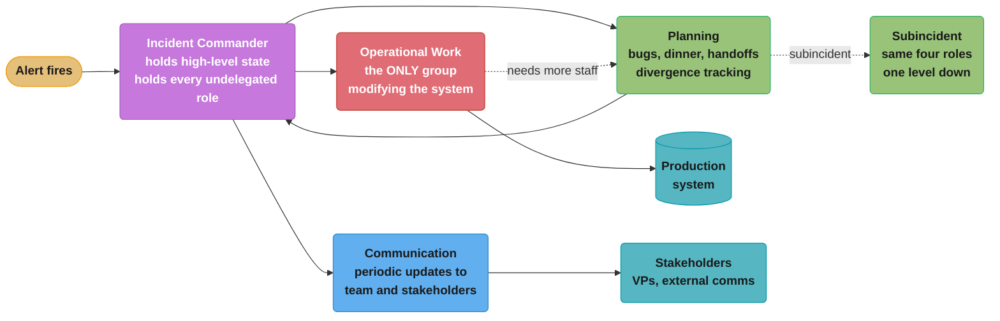
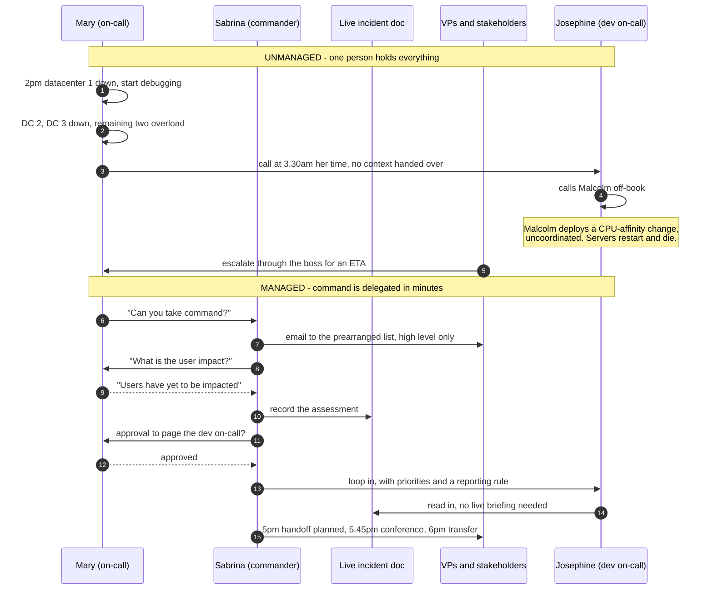
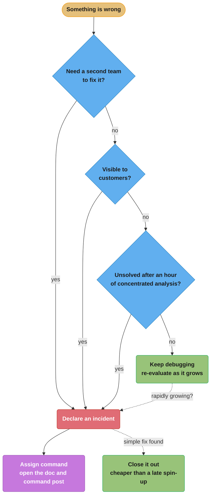

# Chapter 14: Managing Incidents

> Part III — Practices · Site Reliability Engineering: How Google Runs Production Systems
> (Beyer, Jones, Petoff & Murphy, eds., O'Reilly 2016) · builds on Ch 13 (Emergency Response),
> leads to Ch 15 (Postmortem Culture)

## Chapter Map

Chapter 12 taught an individual engineer how to troubleshoot and Chapter 13 catalogued what
Google's emergency responses actually looked like. This chapter, written by Andrew Stribblehill
and edited by Kavita Guliani, answers the question those two leave open: once more than one person
is involved, who decides what happens next? Its claim is that incident *response* — the technical
act of diagnosing and fixing — and incident *management* — the organizational act of coordinating
people, information, and authority — are different jobs, and that failing to separate them is what
turns a recoverable outage into a spiral. The chapter makes its case narratively rather than
abstractly: it tells the same outage twice, once unmanaged and once managed, and lets the
difference in outcome carry the argument.

**TL;DR:**
- The chapter's opening story is a **deliberately unmanaged incident**: five datacenters fail one
  after another, and every participant is doing their job competently, yet the outage gets
  strictly worse because nobody is coordinating.
- Three named hazards produce that outcome — **sharp focus on the technical problem**, **poor
  communication**, and **freelancing** — and the chapter is explicit that all three are failures
  of *structure*, not of individual skill or intent.
- Google's incident management system is **based on the Incident Command System (ICS)**, the
  emergency-services framework cited to FEMA's National Incident Management System, "known for
  its clarity and scalability."
- The process has four features: **recursive separation of responsibilities**, **a recognized
  command post**, a **live incident state document**, and a **clear, live handoff**; the roles
  delegated are **Incident Command**, **Operational Work**, **Communication**, and **Planning**.
- The chapter gives **three explicit trigger conditions** for declaring an incident, and argues it
  is better to declare early and stand down than to spin the framework up hours into a spiral.
- Google's reported result of formalizing this in advance: **reduced mean time to recovery** and
  "a less stressful way to work on emergent problems" for staff.

## The Big Question

An outage is, at bottom, a resource-allocation problem under extreme time pressure with incomplete
information. The people available to work on it are scarce, their attention is scarcer, and the
single most contended resource of all is the right to change production. The naive answer — put
your best engineer on it and let everyone else help — is exactly what the chapter's first story
does, and it is the reason that story ends with every server dead. So the question is: what
structure lets many people contribute to one incident without any of them making it worse?

**Analogy:** think of a building fire. Nobody argues that the most skilled firefighter should also
be the one briefing the press, tracking which floors have been cleared, deciding whether to
evacuate the block, and personally holding a hose. The fire service solved this a long time ago by
inventing an incident commander who holds *none* of the hoses — a role whose entire product is
decisions and situational awareness, and whose value comes precisely from not being absorbed in
the immediate technical task. Google's incident management is that idea imported wholesale: the
Incident Command System is a fire-service framework, and the chapter adopts it by name. The
counterintuitive part, which the chapter states directly, is that hard role boundaries give people
*more* autonomy rather than less — because inside your assigned box you can act without
second-guessing whether a colleague is already doing it.

---

## 14.1 Unmanaged Incidents

The chapter opens with a scenario rather than a definition. Mary is the on-call engineer for a
company called The Firm. It is **2 p.m. on a Thursday**. Her pager fires: black-box monitoring
reports that the service has stopped serving any traffic in an entire datacenter. She puts down
her coffee and starts fixing it.

The sequence that follows is worth tracking precisely, because every step of it is a consequence
of the previous one:

- (1) **A second datacenter stops serving.** Minutes into the first problem.
- (2) **A third of five datacenters fails.** The service is now down to two.
- (3) **The two survivors overload.** There is more traffic than the remaining capacity can absorb,
   so they begin to fail from load rather than from the original fault — the cascading-failure
   dynamic that Chapter 22 dissects in full. The service is now unable to serve any requests at
   all.
- (4) **Mary reads logs for "what seems like an eternity."** Thousands of lines suggest an error in a
   recently updated module, so she rolls the servers back to the previous release.
- (5) **The rollback does not help.** She calls Josephine, who wrote most of the code — at **3:30
   a.m.** in Josephine's timezone. Josephine blearily agrees to log in.
- (6) **Sabrina and Robin start poking around** from their own terminals. "Just looking," they say.
- (7) **An executive phones Mary's boss** demanding to know why he was not informed of the "total
   meltdown of this business-critical service."
- (8) **Vice presidents nag for an ETA** and repeatedly ask "how could this possibly have happened?",
   drawing on prior engineering experience to make suggestions the chapter characterizes as
   "irrelevant but hard-to-refute" — the example given is "Increase the page size!" Mary would
   sympathize, but sympathy requires cognitive effort she is holding in reserve for her job.
- (9) **The two remaining datacenters fail completely.**
- (10) **Josephine, sleep-addled, calls Malcolm.** Malcolm has a brainwave about CPU affinity. He is
    certain he can optimize the remaining server processes with one simple change, so he deploys
    it to production. Within seconds the servers restart, pick up the change, and die.

The story is constructed so that the final blow — Malcolm's deploy — comes from someone who was
never assigned to the incident, was contacted by someone who was themselves only contacted an hour
in, and never spoke to the person nominally in charge. That is the point.

**What the story is not.** The chapter is emphatic on this: *"Note that everybody in the preceding
scenario was doing their job, as they saw it."* Mary debugged. Josephine got out of bed at 3:30
a.m. Malcolm had a genuine optimization idea and shipped it. The failure is not attributable to
any individual's competence or motivation, which is exactly why hiring better engineers does not
fix it.

---

## 14.2 The Anatomy of an Unmanaged Incident

The chapter names three hazards that made the story go the way it did.

### Sharp Focus on the Technical Problem

"We tend to hire people like Mary for their technical prowess." That prowess is what makes her
useful and also what traps her: she is busy making operational changes and trying valiantly to
solve the problem, so she is **not in a position to think about the bigger picture of how to
mitigate** it. The technical task at hand is overwhelming, and it consumes exactly the attention
that strategic decisions require.

The insight worth extracting is that this is not a discipline problem you can fix by telling
engineers to step back. Debugging a live outage is genuinely absorbing; the chapter's fix is not
"concentrate less" but "give the bigger picture to a different human being."

### Poor Communication

For the same reason — Mary was far too busy — she could not communicate clearly. The chapter lists
the specific costs:

| Cost | Who paid it in the story |
|---|---|
| Nobody knew what their coworkers were doing | Sabrina and Robin "just looking"; Malcolm deploying |
| Business leaders angry | The executive phoning Mary's boss |
| Customers frustrated | No user-facing messaging was ever drafted |
| Available engineers not used effectively | Sabrina and Robin had capacity nobody directed |

The last row is the one teams underestimate. The unmanaged incident did not suffer from a shortage
of engineers — it had at least five people engaged. It suffered from having no mechanism to turn
willing people into assigned work.

### Freelancing

Malcolm was making changes to the system **with the best of intentions**. He did not coordinate
with his coworkers — "not even Mary, who was technically in charge of troubleshooting." His changes
made a bad situation far worse.

The word *technically* in that sentence is doing heavy lifting. Mary was in charge in the sense
that she was the on-call, but nothing in the structure made that authority visible or enforceable
to a person two hops away in the phone tree. Freelancing is what an unstructured incident produces
by default, not an aberration within it.

**Broken, then fixed.** The unmanaged pattern and its structural remedy, side by side:

```
UNMANAGED                                MANAGED
---------                                -------
on-call debugs AND decides AND briefs    commander decides, Ops debugs,
                                         comms briefs -- three people
anyone with an idea may touch prod       only the Ops team modifies the system
state lives in one person's head         state lives in a shared live document
"who's in charge?" is implicit           command post is named and advertised
handoff = the on-call goes home          handoff = explicit verbal transfer,
                                         acknowledged, then broadcast
```

*The left column is not a caricature of a bad team; it is the default behaviour of a good team with
no agreed structure. Every line on the right is a named element of the process in section 14.3.*

---

## 14.3 Elements of Incident Management Process

The chapter's framing sentence: *"Incident management skills and practices exist to channel the
energies of enthusiastic individuals."* Not to restrain them — to channel them. Google's system is
based on the **Incident Command System**, footnoted to FEMA's National Incident Management System,
and chosen because it is "known for its clarity and scalability."

A well-designed incident management process has the following four features.

### Recursive Separation of Responsibilities

Everybody involved must know their role and **not stray onto someone else's turf**. The chapter
flags its own counterintuitive claim immediately: *a clear separation of responsibilities allows
individuals more autonomy than they might otherwise have, since they need not second-guess their
colleagues.* If the boundary is crisp, you can act inside it at full speed.

The word **recursive** is the load-bearing one, and it describes what happens when a role
saturates. If the load on a given member becomes excessive:

- That person asks the **planning lead** for more staff.
- They then **delegate work to others**, a task that might entail **creating subincidents** — an
  incident nested inside an incident, with its own role structure.
- Alternatively, a role leader might **delegate system components** to colleagues, who report
  high-level information back up to the leaders.

This is what makes the structure scale rather than merely organize. A three-person incident and a
thirty-person incident use the same shape; the large one just has more levels of it.

**The four roles.** The chapter names four, each delegated to a particular individual:

| Role | What the chapter says it owns | The failure it prevents |
|---|---|---|
| **Incident Command** | Holds the high-level state. Structures the response task force, assigning responsibilities by need and priority. **De facto holds all positions they have not delegated.** Removes roadblocks preventing Ops from working effectively. | The story's total absence of a bigger picture |
| **Operational Work** | Works with the commander, applying operational tools to the task. **The operations team should be the only group modifying the system during an incident.** | Malcolm's freelance deploy |
| **Communication** | The public face of the task force. Issues **periodic updates** to the response team and stakeholders (usually via email); may extend to keeping the incident document accurate and up to date. | The executive phoning Mary's boss |
| **Planning** | Supports Ops with longer-term issues: filing bugs, **ordering dinner**, arranging handoffs, and **tracking how the system has diverged from the norm so it can be reverted** once the incident resolves. | Ad-hoc changes that outlive the outage |

Two details in that table repay attention.

**"De facto holds all positions they have not delegated."** This is the rule that makes a
one-person incident legal. A single engineer at 3 a.m. is simultaneously commander, Ops, comms and
planning — and as the incident grows, they hand roles away one at a time. There is no threshold
below which the framework does not apply; there is only a threshold above which you start
delegating.

**"Ordering dinner."** The chapter puts a mundane logistics task in the same list as filing bugs
and arranging handoffs, deliberately. A long incident is a human-endurance problem as much as a
technical one, and the planning role owns the fact that responders need food, relief, and a
successor.

**Divergence tracking is the least-copied element.** Planning tracks how the system has diverged
from the norm *so it can be reverted once the incident is resolved*. Emergency mitigations —
disabled health checks, hand-edited configs, traffic pinned to one region, a feature flag flipped
off — are debt taken on at speed, and without a written ledger of them, some survive for months and
become the trigger for the next incident.

### A Recognized Command Post

Interested parties need to understand **where they can interact with the incident commander**. The
chapter offers two shapes and does not insist on either:

- **A central designated "War Room"** — physically locating the task force together. Appropriate in
  many situations.
- **Working at desks**, keeping alert to incident updates via **email and IRC**. Preferred by other
  teams.

Google's own experience, stated plainly: *"Google has found IRC to be a huge boon in incident
response."* The chapter's reasons are specific and, notably, are not about chat being pleasant:

| Property | Why it matters during an incident |
|---|---|
| **Very reliable** | The coordination channel must not share a failure domain with the thing that is broken |
| **Serves as a log of communications** | The record is "invaluable in keeping detailed state changes in mind" |
| **Bots log incident-related traffic** | Written at Google specifically because the log is "helpful for postmortem analysis" |
| **Other bots log events such as alerts to the channel** | Alerts and human discussion interleave on one timeline |
| **Convenient medium for geographically distributed teams** | Follow-the-sun coordination and handoff |

The reliability point deserves emphasis: the command post is infrastructure, and it must be chosen
so that the outage cannot take it down. That principle recurs immediately below.

### Live Incident State Document

*"The incident commander's most important responsibility is to keep a living incident document."*
The chapter is unusually direct — of everything the commander does, this is named the most
important.

Requirements the chapter gives:

- It **can live in a wiki**, but should ideally be **editable by several people concurrently**.
- **Most Google teams use Google Docs.**
- **Google Docs SRE use Google Sites** — and the chapter states the reason in one of its best
  sentences: *"after all, depending on the software you are trying to fix as part of your incident
  management system is unlikely to end well."*
- The living doc **can be messy, but must be functional**.
- **Using a template makes generating this documentation easier.**
- **Keeping the most important information at the top makes it more usable.**
- **Retain the documentation for postmortem analysis** and, if necessary, meta analysis.

Appendix C of the book is an Example Incident State Document, which is what the template rule
points at.

The Google Docs SRE detail generalizes into a hard rule: **your incident tooling must not depend on
the service you are on call for.** A team that runs the chat product should not coordinate its own
outage in that chat product. A team that runs object storage should not keep its playbooks only in
that object storage. This is the same reasoning as the IRC reliability point, applied to documents.

"Messy but functional" is also a real permission, not throwaway prose. A live document written
under pressure will contain contradictions, struck-through hypotheses, and half-sentences. Demanding
polish during the incident is how you end up with an accurate document that is thirty minutes
stale — which is worse than a scrappy one that is current.

### Clear, Live Handoff

*"It's essential that the post of incident commander be clearly handed off at the end of the working
day."* The chapter specifies the mechanics with unusual precision, because a fumbled handoff is a
period during which nobody is commanding and everyone believes somebody is:

- (1) If handing off to another location, **update the new commander over the phone or a video call** —
   simply and safely.
- (2) **Once the new commander is fully apprised**, the outgoing commander must be explicit,
   *specifically stating, "You're now the incident commander, okay?"*
- (3) The outgoing commander **should not leave the call until receiving firm acknowledgment** of the
   handoff.
- (4) **The handoff should be communicated to others working on the incident**, so it is clear who is
   leading at all times.

The pattern is a two-phase commit performed by humans: propose, acknowledge, then broadcast. The
prescribed sentence is verbatim in the book because ambiguity is the entire risk — "I think Raj has
it now" is how a command gap opens.

---

## 14.4 A Managed Incident

The chapter now reruns the identical outage under the framework. Same service, same faults, same
people. Only the structure differs.

**2 p.m.** Mary is into her third coffee of the day. The pager's harsh tone surprises her and she
gulps the drink down. A datacenter has stopped serving traffic; she starts to investigate.

**Shortly after.** A second alert: the second of five datacenters is out of order. Because this is
a *rapidly growing issue*, she knows she will benefit from the structure of her incident management
framework. That recognition — growth rate, not current severity — is the trigger.

**Mary snags Sabrina.** *"Can you take command?"* Sabrina nods, gets a rundown of what has occurred
so far, and **captures these details in an email to a prearranged mailing list**. The list existing
in advance is the point; nobody is assembling a distribution list mid-incident.

**Sabrina scopes impact by asking, not guessing.** She recognizes she cannot yet scope the impact,
so she asks Mary for an assessment. Mary responds: *"Users have yet to be impacted; let's just hope
we don't lose a third datacenter."* Sabrina **records Mary's response in a live incident document**.
Note the division: the commander does not diagnose, she elicits and records.

**Third alert.** Sabrina sees it among the debugging chatter on IRC and **follows up to the email
thread with an update**. The chapter explains what that thread buys: it *"keeps VPs abreast of the
high-level status without bogging them down in minutiae."* This is the structural answer to the
angry-executive problem from 14.1 — the VPs in the unmanaged story were not being unreasonable, they
were starved of information and escalated to get it.

**External communications, in parallel.** Sabrina asks an **external communications representative
to start drafting user messaging** — begun while the incident is still growing, not after it is
resolved.

**Escalation goes through command.** She follows up with Mary to ask whether they should contact the
developer on-call (Josephine). **Receiving Mary's approval, Sabrina loops in Josephine.** Compare
the unmanaged story, where Josephine was woken by Mary directly and then unilaterally pulled in
Malcolm.

**Volunteers are given rules, not just tasks.** Robin has already volunteered. Sabrina reminds both
Robin and Josephine that they are to **prioritize any tasks delegated to them by Mary**, and that
they **must keep Mary informed of any additional actions they take**. Then both **familiarize
themselves by reading the incident document** — the document is what makes onboarding a new
responder take minutes instead of a live briefing that interrupts everyone.

**The same failed fix, differently handled.** Mary tries the old binary release and finds it
wanting. She mutters this to Robin, who **updates IRC** to say the attempted fix did not work.
Sabrina **pastes this update into the live incident management document**. One fact, propagated
through the channel and into the record, without Mary stopping work to write it up.

**5 p.m. — planning for the handoff before it is needed.** Sabrina **starts finding replacement
staff**, as she and her colleagues are about to go home. She updates the incident document.

**5:45 p.m.** A brief phone conference so everyone is aware of the current situation.

**6 p.m.** They hand off their responsibilities to colleagues in the sister office.

**The next morning.** Mary returns to find that her transatlantic colleagues have **assumed
responsibility for the bug, mitigated the problem, closed the incident, and started work on the
postmortem**. She brews fresh coffee and settles down to **plan structural improvements so problems
of this category don't afflict the team again**.

**What actually changed.** The datacenters still failed. The rollback still did not work. The
difference is what the structure prevented and enabled:

| Unmanaged | Managed |
|---|---|
| Malcolm deploys an uncoordinated CPU-affinity change; servers die | Only Ops touches production; no such change is possible |
| VPs escalate through Mary's boss for an ETA | A prearranged mailing list gets high-level updates, unprompted |
| No user messaging is ever produced | External comms drafts user messaging while the incident is still growing |
| Josephine is woken at 3:30 a.m. by a panicking on-call | Josephine is paged after the commander gets the on-call's approval |
| Robin and Sabrina are "just looking" | Robin and Josephine have priorities and a reporting rule |
| The on-call works until she cannot | Handoff planned at 5 p.m., briefed at 5:45, executed at 6:00 |
| Mary is still in it the next morning | Mary arrives to a closed incident and a postmortem in progress |

---

## 14.5 When to Declare an Incident

*"It is better to declare an incident early and then find a simple fix and close out the incident
than to have to spin up the incident management framework hours into a burgeoning problem."*

The chapter's answer to "how do I know?" is to decide in advance. **Set clear conditions for
declaring an incident.** The author's team follows these broad guidelines — **if any of the
following is true, the event is an incident:**

- **Do you need to involve a second team in fixing the problem?**
- **Is the outage visible to customers?**
- **Is the issue unsolved even after an hour's concentrated analysis?**

Three criteria, disjunctive, and each is deliberately cheap to evaluate. None asks the responder to
estimate blast radius, revenue impact, or root cause — all things nobody knows early. "Have I been
at this an hour?" is answerable by a clock. "Do I need a second team?" is answerable the moment you
reach for the phone. The unmanaged story tripped all three inside the first fifteen minutes.

**Skills atrophy, so use the framework when it is not an emergency.** The chapter's second half is
about practice:

- *"Incident management proficiency atrophies quickly when it's not in constant use."*
- The framework **applies to other operational changes that need to span time zones and/or teams** —
  so use it as a regular part of **change management procedures**, and it will be second nature when
  a real incident arrives.
- If your organization performs **disaster-recovery testing** — "you should, it's fun" — **incident
  management should be part of that testing process**.
- Google **role-plays the response to an on-call issue that has already been solved**, perhaps by
  colleagues in another location, to further familiarize responders with incident management. (This
  is the exercise Chapter 15 names the **Wheel of Misfortune**.)

The reframe worth keeping: incident management is not an emergency-only tool. Any coordinated
multi-team, multi-timezone operation — a large migration, a datacenter drain, a risky rollout — has
the same shape and can carry the same structure. Every such use is free training.

---

## 14.6 In Summary

The chapter's own closing claim: by **formulating an incident management strategy in advance**,
**structuring this plan to scale smoothly**, and **regularly putting the plan to use**, Google was
able to **reduce mean time to recovery** and **provide staff a less stressful way to work on
emergent problems**. *"Any organization concerned with reliability would benefit from pursuing a
similar strategy."*

Note the two-part payoff. MTTR is the one that gets quoted, but the chapter puts staff stress
alongside it as a stated benefit rather than a nice side effect — consistent with the unmanaged
story, where Mary's inability to sympathize with the VPs was framed as a resource she could not
spare.

### Best Practices for Incident Management

The chapter closes with a sidebar of seven practices, given here as the book gives them:

| Practice | The book's gloss |
|---|---|
| **Prioritize** | Stop the bleeding, restore service, and preserve the evidence for root-causing. |
| **Prepare** | Develop and document your incident management procedures in advance, in consultation with incident participants. |
| **Trust** | Give full autonomy within the assigned role to all incident participants. |
| **Introspect** | Pay attention to your emotional state while responding. If you start to feel panicky or overwhelmed, solicit more support. |
| **Consider alternatives** | Periodically consider your options and re-evaluate whether it still makes sense to continue what you're doing or take another tack. |
| **Practice** | Use the process routinely so it becomes second nature. |
| **Change it around** | Were you incident commander last time? Take on a different role this time. Encourage every team member to acquire familiarity with each role. |

Three of these are worth unpacking.

**Prioritize** is an ordering, not a list: stop the bleeding *first*, restore service *second*,
preserve evidence *third*. Evidence preservation is real but subordinate — "let me capture a heap
dump before we restart" is correct at minute forty and wrong at minute two.

**Introspect** is the only line in the chapter about the responder's internal state, and it is
framed as an operational input rather than a wellbeing note: panic is a signal that the incident has
outgrown its current staffing, and the prescribed response is to solicit more support. Under
recursive separation of responsibilities, that request has a defined recipient — the planning lead.

**Change it around** exists because of the atrophy problem in 14.5. If the same person is always
commander, the team has one commander and a single point of failure, and everyone else's skills
decay. Rotating roles is how bench depth is built.

---

## Beyond the book — what a 2016 chapter predates

> The chapter prescribes IRC, Google Docs, email to a prearranged mailing list, and phone or video
> handoff. It does **not** discuss dedicated incident-response SaaS, chat-ops bots that open a
> channel and a document automatically, status pages, or automated paging escalation policies —
> those were either nascent or outside its scope in 2016. What follows is repo commentary, not the
> authors'.

The chapter's four *elements* have proved considerably more durable than its four *tools*, and the
distinction is worth holding on to: the requirement is "a recognized command post that does not
share a failure domain with the broken service", and IRC was one 2016 answer to it.

| Chapter element | The 2016 instantiation | Common instantiations since |
|---|---|---|
| Recognized command post | IRC channel, or a physical War Room | A chat channel auto-created per incident by a bot, with a bridge link pinned |
| Live incident state document | Google Docs (Google Sites for Docs SRE) | A templated incident record auto-created and timestamped from chat, or a purpose-built tool |
| Communication role output | Periodic email to a prearranged list | A public status page plus internal broadcast, often on separate cadences |
| Clear, live handoff | Phone/video call with verbal acknowledgment | Same call, plus a recorded handoff note and an explicit change of the on-call assignment in the paging tool |

Two things the chapter says survive every tooling change. The first is the Google Docs SRE
principle — your incident tooling must not depend on the service you are on call for — which
applies with more force now that many teams coordinate incidents in a chat product they may also
operate, or on a status page hosted on the cloud provider that is having the outage. The second is
that the roles are *people*, not features. A tool can create a channel and a document; it cannot
hold the high-level state, and it cannot decide whether to keep going or take another tack.

One genuine addition since 2016 is worth naming: the chapter's "prearranged mailing list" assumes
an internal audience, while the practice of publishing incident communication *externally* on a
status page during the incident, on a cadence, is now a mainstream expectation for services with
paying customers. The chapter gestures at it — Sabrina asks an external communications
representative to draft user messaging — but treats it as a handoff to another function rather than
as a discipline with its own tempo.

---

## Visual Intuition

### The role structure, and what each role keeps off the others' desks



*Only one arrow reaches production, and it starts at Ops. That single constraint is what makes
Malcolm's freelance CPU-affinity deploy structurally impossible in the managed retelling. The dotted
edge to the subincident is "recursive separation of responsibilities": an overloaded role does not
absorb more, it spawns another copy of the same structure.*

### The same outage, twice



*The unmanaged half has no arrow into the document and no arrow to stakeholders that was not
provoked by an escalation. Both are added in the managed half by one decision — delegating command
at minute two — and everything downstream follows from it.*

### Declaring an incident: three cheap questions



*All three questions are answerable without knowing the cause, which is the design goal. The dotted
edges carry the chapter's asymmetry: declaring early and standing down is cheap, spinning up hours
into a spiral is not.*

### The handoff as a two-phase commit

```
  OUTGOING COMMANDER                      INCOMING COMMANDER
  ------------------                      ------------------
  1. get them on a call ---------------->  join
  2. brief until fully apprised --------->  absorb state, ask questions
  3. say it literally:
     "You're now the incident
      commander, okay?"      ------------>
  4. WAIT. Do not leave the call. <------  firm acknowledgment
  5. broadcast to everyone
     working the incident

  FAILURE MODE if step 3 is implicit ("Raj is picking it up"):
  a command gap opens, and nobody knows it exists until a
  decision is needed and no one makes it.
```

*The chapter prescribes the sentence verbatim because the risk is entirely ambiguity. Steps 3, 4 and
5 are propose, acknowledge, broadcast — a human two-phase commit over the one piece of state that
has no backup.*

---

## Key Concepts Glossary

| Term | Definition as the chapter uses it |
|---|---|
| **Incident** | An event meeting any declared trigger condition: needs a second team, is customer-visible, or is unsolved after an hour of concentrated analysis. |
| **Incident management** | The organizational discipline of coordinating people, information and authority during an incident — distinct from incident response, the technical work of fixing it. |
| **Unmanaged incident** | An incident worked without an agreed structure, where the on-call simultaneously debugs, decides, and communicates. The chapter's opening story. |
| **Incident Command System (ICS)** | The emergency-services framework (footnoted to FEMA's National Incident Management System) that Google's incident management is based on, chosen for clarity and scalability. |
| **Recursive separation of responsibilities** | Roles are strictly bounded, and an overloaded role requests staff from planning and delegates — potentially creating subincidents with the same structure. |
| **Subincident** | A nested incident created when delegating work from an overloaded role, carrying its own role assignments. |
| **Incident Commander** | The role holding high-level state, structuring the task force, and de facto holding every role not yet delegated. Owns the live incident document. |
| **Ops lead / Operational Work** | The role applying operational tools to the problem. The operations team should be the only group modifying the system during an incident. |
| **Communication role** | The public face of the task force: periodic updates to the response team and stakeholders, usually via email; may also keep the incident document current. |
| **Planning role** | Supports Ops with longer-term issues — filing bugs, ordering dinner, arranging handoffs, and tracking system divergence so it can be reverted. |
| **Command post** | The recognized place where interested parties can interact with the incident commander: a War Room, or a channel such as IRC. |
| **War Room** | A central designated physical location for the incident task force. |
| **Live incident state document** | The living, concurrently-editable record of the incident. The commander's most important responsibility. May be messy, must be functional. |
| **Clear, live handoff** | Explicit verbal transfer of command with firm acknowledgment before the outgoing commander leaves the call, then broadcast to everyone working the incident. |
| **Freelancing** | Making changes to the system during an incident without coordinating with the people responsible for it. Named as one of the three hazards. |
| **Sharp focus on the technical problem** | The hazard where the responder's absorption in debugging leaves no capacity for the bigger picture of mitigation. |
| **Prearranged mailing list** | A stakeholder distribution list established before any incident, so the commander does not assemble an audience mid-outage. |
| **Divergence tracking** | Planning's record of how the system has been changed away from its normal state during an incident, so those changes can be reverted afterwards. |
| **Wheel of Misfortune** | Role-playing a previously-solved on-call issue to keep incident management skills current. Detailed in Chapter 15 and the Disaster Role Playing material. |

---

## Tradeoffs & Decision Tables

### Command post: War Room versus distributed channel

| Dimension | Central War Room | IRC / chat, working at desks |
|---|---|---|
| Bandwidth of coordination | Highest — tone, gesture, whiteboard | Text only |
| Written record for the postmortem | Must be transcribed deliberately | Automatic, and bot-logged at Google |
| Geographic distribution | Poor — one room, one timezone | The chapter's stated advantage |
| Reliability under an outage | Depends on the building | The chapter's stated advantage: IRC is "very reliable" |
| Access to each responder's own tools | Degraded if people leave their desks | Full |
| Chapter's verdict | "Appropriate in many situations" | "A huge boon" at Google |

### Where the live incident document lives

| Option | For | Against |
|---|---|---|
| Wiki | Permanent, searchable, linkable | The chapter notes concurrent editing is the key requirement, which wikis often lack |
| Google Docs | Real-time concurrent editing; what most Google teams use | Fails if the outage is in Docs itself |
| Google Sites | What Google Docs SRE use, for exactly that reason | Weaker concurrent editing than Docs |
| A doc inside the service you operate | Convenient | The chapter's warning: "depending on the software you are trying to fix... is unlikely to end well" |

### Declaring early versus declaring late

| | Declare early, stand down | Wait and see |
|---|---|---|
| Cost if you were wrong | One email, a doc nobody needed, minutes | None |
| Cost if you were right | None — the structure is already up | Spinning up the framework hours into a burgeoning problem |
| Effect on skills | Every declaration is practice | Proficiency atrophies |
| Chapter's position | Explicitly preferred | Explicitly discouraged |

### What each role protects against

| Hazard from 14.2 | Role that removes it | Mechanism |
|---|---|---|
| Sharp focus on the technical problem | Incident Command | A person whose only product is high-level state and decisions |
| Poor communication | Communication | Periodic updates to a prearranged list, unprompted |
| Freelancing | Operational Work | Ops is the only group permitted to modify the system |
| Responder exhaustion, lost mitigations | Planning | Handoffs, food, and divergence tracking |

---

## Common Pitfalls / War Stories

- **The on-call who is also the commander, at scale.** The chapter's whole opening story. It is
  legal for one person to hold every role in a small incident — the commander de facto holds all
  undelegated positions — but it stops being legal the moment the incident grows, and the trigger to
  delegate is *growth rate*, not current severity. Mary in the managed retelling delegates command
  after the *second* alert, before users are affected at all.

- **The helpful colleague with production access.** Malcolm had a real idea, an accurate diagnosis
  instinct, and the best of intentions, and he killed the last servers. The rule that stops him is
  not "Malcolm should have known better" — it is "the operations team should be the only group
  modifying the system during an incident." Enforce it as a rule about *who*, not a judgment about
  *what*.

- **Waking the developer who wrote it, without context.** Josephine gets a 3:30 a.m. call in both
  stories. In the unmanaged one she is dropped into an outage with no written state and immediately
  pulls in another off-book helper. In the managed one she reads the incident document and knows her
  priorities before she touches anything. The document is what makes a cold escalation safe.

- **Executives escalating for an ETA.** Treat this as a monitoring signal about your communication
  role, not as an interruption to be endured. The unmanaged story's VPs escalated because no other
  channel existed; in the managed story a prearranged mailing list keeps them abreast "without
  bogging them down in minutiae," and the escalation never happens.

- **Coordinating an outage inside the thing that is down.** Google Docs SRE use Google Sites. Any
  team that runs a chat product, a document product, an identity provider, or an object store has to
  answer this question before the incident, not during it.

- **The implicit handoff.** "I think the EMEA team has it" is a command gap. The chapter's fix is a
  literal sentence, a firm acknowledgment before anyone leaves the call, and a broadcast — three
  steps, all of which exist because the missing one is invisible until a decision goes unmade.

- **Mitigations that outlive the incident.** Health checks disabled to break a crash loop, traffic
  pinned to one region, a config hand-edited on one host. Nothing in the system reverts these; the
  planning role's divergence tracking is the only record that they happened. Without it, the
  emergency workaround becomes permanent, undocumented configuration and eventually the trigger for
  a future incident.

- **A framework that only comes out for disasters.** Proficiency atrophies quickly when it is not in
  constant use. Teams that reserve incident command for genuine emergencies find that the first real
  use in six months is also a training exercise, conducted badly, under maximum pressure.

---

## Real-World Systems Referenced

- **The Incident Command System (ICS)** — the emergency-services framework Google's incident
  management is based on, cited to FEMA's National Incident Management System, and chosen for its
  "clarity and scalability."
- **IRC** — Google's incident coordination channel, praised specifically for reliability, its value
  as a communication log, and its convenience for geographically distributed teams. Google wrote
  bots to log incident traffic for postmortem analysis and to log alerts into the channel.
- **Google Docs** — used by most Google teams for the live incident state document, chosen for
  concurrent editing.
- **Google Sites** — used by Google Docs SRE for the same purpose, precisely so their incident
  tooling does not depend on the service they operate.
- **Email and prearranged mailing lists** — the communication role's channel for periodic
  stakeholder updates.
- **"The Firm"** — the fictional company in the chapter's paired scenarios.
- **Appendix C, Example Incident State Document** — the book's own template for the live document.
- **`;login:` (April 2015, vol. 40, no. 2)** — where an earlier version of this chapter appeared.

---

## Summary

The chapter's argument is that incident *management* is a separate discipline from incident
*response*, and that an organization which has not separated them will, under load, converge on the
opening story regardless of how good its engineers are. The three hazards it names — sharp focus on
the technical problem, poor communication, and freelancing — are all consequences of one person
holding roles that cannot be held simultaneously: you cannot debug at full depth and maintain
situational awareness, and you cannot maintain situational awareness that other people can act on
unless you publish it.

Google's remedy, borrowed from the fire service's Incident Command System, is four structural
elements. **Recursive separation of responsibilities** assigns Incident Command, Operational Work,
Communication and Planning to distinct people, gives each full autonomy inside its boundary, and
scales by spawning subincidents rather than by overloading a role. **A recognized command post**
gives everyone one place to find the commander, and must be reliable enough not to fail with the
service. **A live incident state document** — named the commander's most important responsibility —
holds the shared state, may be messy but must be functional, and must not depend on the software
being fixed. **A clear, live handoff** transfers command with an explicit sentence, a firm
acknowledgment, and a broadcast.

Declaring is deliberately cheap and deliberately early: needing a second team, customer visibility,
or an hour of unsolved analysis each suffice, and the chapter prefers declaring and standing down to
spinning up hours into a spiral. Because the skill atrophies, the framework should also be used for
routine multi-team, multi-timezone changes and for disaster-recovery role-play. Google's reported
result is a reduced mean time to recovery and, given equal weight in the chapter's own summary, a
less stressful way for staff to work on emergent problems.

---

## Interview Questions

**Q: In the chapter's unmanaged-incident story, who is at fault?**
**Short:** Nobody — the chapter states explicitly that everybody was doing their job as they saw it, and the failure is structural.

The chapter goes out of its way to say "note that everybody in the preceding scenario was doing
their job, as they saw it." Mary debugged competently, Josephine got out of bed at 3:30 a.m., and
Malcolm shipped a genuine optimization idea. The outage spiralled because no structure existed to
give one person the bigger picture, to tell colleagues what was already being done, or to restrict
who could change production — none of which is repairable by hiring better engineers. When you
answer this in an interview, name the three hazards (sharp focus on the technical problem, poor
communication, freelancing) and tie each to the structural element that removes it.

**Q: What are the three conditions the chapter gives for declaring an incident?**
**Short:** Needing a second team to fix it, customer-visible impact, or an issue unsolved after an hour of concentrated analysis.

Any one of the three suffices — they are disjunctive, not a checklist. The design property that
makes them useful is that each is cheap to evaluate without knowing the cause: you know you are
reaching for the phone, you know whether users can see it, and you can read a clock. The chapter
also states the asymmetry explicitly — declaring early and closing out after a simple fix is much
cheaper than spinning up the framework hours into a burgeoning problem — so treat these as a floor
rather than a bar to clear.

**Q: Why does the chapter claim that strict role boundaries give responders more autonomy rather than less?**
**Short:** The chapter argues that with clear boundaries you need not second-guess colleagues, so you can act at full speed inside your own.

This is the counterintuitive claim in "recursive separation of responsibilities," and the chapter
flags it as counterintuitive itself. Without boundaries, every action carries an implicit question —
is someone else already doing this, will this collide with what Ops is trying, should I ask first —
and that hesitation is a tax on everyone. With them, the Ops lead can change production without
checking whether the commander minds, because that is precisely what Ops is for. The practical
consequence is that role boundaries need to be announced, not assumed.

**Q: What single rule in the chapter would have prevented Malcolm's CPU-affinity deploy?**
**Short:** The book's rule that the operations team should be the only group modifying the system during an incident.

Malcolm was not on the incident, was contacted by someone who had themselves only been contacted an
hour in, and never spoke to Mary. Framing the rule as being about *who is allowed to touch
production*, rather than about whether a given change is wise, is what makes it enforceable under
pressure — you do not have to evaluate Malcolm's CPU-affinity theory to know he should not be
deploying it. In practice this also means the commander must be able to say who currently holds Ops,
which is why the command post has to be recognized.

**Q: What does the chapter name as the incident commander's most important responsibility?**
**Short:** Keeping a living incident document — the chapter says this in those words, ahead of every other commander duty.

The document is what lets a newly-paged responder onboard by reading rather than by interrupting
someone, and what survives into the postmortem. The chapter's requirements are specific: ideally
concurrently editable by several people, generated from a template, most important information at
the top, retained for postmortem and meta analysis, and explicitly permitted to be messy as long as
it is functional. That last permission matters operationally — a scrappy current document beats a
polished one that is thirty minutes stale.

**Q: Why do Google Docs SRE keep their incident document in Google Sites rather than Google Docs?**
**Short:** Because, in the chapter's words, depending on the software you are trying to fix as part of your incident management is unlikely to end well.

Most Google teams use Google Docs for the live incident document; the team that operates Docs
cannot, because a Docs outage would take their coordination tooling down with the service. The
principle generalizes beyond documents to every piece of incident infrastructure — the same
reasoning is why the chapter praises IRC's reliability as a command post. Ask the question about
your own stack before an incident: if you run chat, identity, object storage, or the status page
provider, where does your incident coordination live?

**Q: What are the four roles the chapter delegates, and what does each own?**
**Short:** Incident Command holds high-level state, Operational Work applies tools, Communication updates stakeholders, and Planning handles longer-term issues.

Incident Command structures the task force and assigns responsibilities by need and priority;
Operational Work is the only group modifying the system; Communication is the public face, issuing
periodic updates usually via email and often keeping the document current; Planning covers filing
bugs, ordering dinner, arranging handoffs, and tracking how the system has diverged from normal so
it can be reverted. The commander de facto holds every role they have not delegated, which is what
makes a one-person incident well-formed. The frequently-missed one is Planning's divergence
tracking, without which emergency mitigations quietly become permanent configuration.

**Q: What makes the chapter's incident management "recursive"?**
**Short:** An overloaded role asks planning for staff and delegates, potentially creating subincidents that carry the same four-role structure.

The chapter gives two forms of delegation: creating subincidents, and handing system components to
colleagues who report high-level information back up to the leaders. This is what lets one framework
cover both a two-person Tuesday-afternoon problem and a thirty-person multi-region outage without
changing shape — the large one is the small one, nested. It also gives "I am overwhelmed" a defined
recipient and a defined remedy rather than leaving it as a personal failing.

**Q: The chapter prescribes an exact sentence for handing off incident command. What is it, and why does the wording matter?**
**Short:** "You're now the incident commander, okay?" — stated explicitly, with the outgoing commander not leaving the call until firmly acknowledged.

The full protocol is four steps: brief the incoming commander over phone or video until they are
fully apprised, state the sentence, wait on the call for firm acknowledgment, then communicate the
handoff to everyone working the incident. It is a human two-phase commit, and the reason for the
formality is that the failure mode — a command gap where each side believes the other has it — is
invisible until a decision needs making and nobody makes it. "I think they've picked it up" is the
anti-pattern the verbatim sentence exists to kill.

**Q: Why does the chapter recommend using the incident management framework when there is no incident?**
**Short:** Because the book's position is that incident management proficiency atrophies quickly when it is not in constant use.

The suggested non-emergency uses are operational changes that span timezones or teams, regular
change management procedures, and disaster-recovery testing — which the chapter says you should be
doing anyway ("it's fun"). Google additionally role-plays responses to on-call issues that have
already been solved, an exercise Chapter 15 names the Wheel of Misfortune. The reframe is that any
coordinated multi-team, multi-timezone operation has the same shape as an incident, so running it
under the framework is free training with no outage attached.

**Q: How does the managed retelling stop VPs from escalating for an ETA?**
**Short:** A commander emails a prearranged mailing list unprompted, keeping stakeholders abreast of high-level status without minutiae.

In the unmanaged story the VPs escalate through Mary's boss because no other channel exists, and
their questions consume attention Mary is explicitly holding in reserve for her job. In the managed
story Sabrina sends the initial rundown to a list that existed *before* the incident, and follows up
on the thread as the situation develops. The detail worth stealing is "prearranged": assembling a
stakeholder distribution list during an outage is itself incident work nobody has capacity for.

**Q: Is the incident commander supposed to be the best technical debugger available?**
**Short:** No — in the chapter's managed retelling the on-call keeps debugging and hands command to a colleague who does not diagnose.

Mary stays on the technical problem throughout the managed story; Sabrina takes command, and her
actions are eliciting Mary's impact assessment, recording it, emailing stakeholders, seeking
approval to escalate, and arranging the handoff. She never diagnoses anything. This is the direct
answer to the "sharp focus on the technical problem" hazard: the commander's product is decisions
and situational awareness, and being absorbed in the fix is disqualifying for that role rather than
qualifying.

**Q: What properties does the chapter give for a good command post?**
**Short:** Everyone must know where to reach the commander, and the channel should be reliable, logged, and workable for distributed teams.

The chapter offers a physical War Room or a distributed channel and does not mandate either, but
its stated experience is that IRC has been "a huge boon" — very reliable, usable as a log of
communications about the event, bot-loggable for postmortem analysis, capable of carrying alerts
into the same timeline as human discussion, and convenient across geographies. Reliability is the
non-negotiable property, because a command post that shares a failure domain with the outage is not
a command post.

**Q: What does the chapter's Planning role do that teams most often forget?**
**Short:** Track how the system has diverged from the norm during the incident so those changes can be reverted once it is resolved.

Alongside filing bugs, ordering dinner and arranging handoffs, Planning owns the ledger of emergency
mitigations: health checks disabled, traffic pinned, configs hand-edited, features flagged off.
Nothing in the system reverts those automatically, and each one is debt taken on at speed with no
review. Teams that skip this discover months later that an emergency workaround became permanent
undocumented configuration — and quite often that it is the trigger for the next incident.

**Q: The chapter's Best Practices sidebar says "Prioritize." What is the prescribed order?**
**Short:** Stop the bleeding, restore service, and preserve the evidence for root-causing — in that order.

Evidence preservation is genuinely valuable and genuinely subordinate. "Let me grab a heap dump
before we restart" is the right call at minute forty of a contained problem and the wrong call at
minute two of a crash loop taking down a region. Reading it as an ordered list rather than a set of
equally-weighted goals is what makes it useful under pressure, and it also tells you when to push
back on a well-meant request to hold off on a mitigation.

**Q: What does "Introspect" mean in the chapter's Best Practices, and what is the prescribed response?**
**Short:** Pay attention to your emotional state during response — if you start to feel panicky or overwhelmed, solicit more support.

It is the only line in the chapter about the responder's internal state, and it is framed as an
operational input rather than a wellbeing aside: panic is evidence that the incident has outgrown
its current staffing. Under recursive separation of responsibilities, the request has a defined
recipient — the planning lead, who finds more people — and a defined remedy, delegation or a
subincident. The organizational precondition is a culture where saying so is safe, which is the same
precondition Chapter 15 builds for blameless postmortems.

**Q: Why does the sidebar tell people to rotate roles between incidents?**
**Short:** "Change it around" builds bench depth and counters the atrophy of skills that are only exercised occasionally.

If the same person is always incident commander, the team has exactly one commander, everyone else's
command skills decay, and the framework fails the first time that person is the one who is asleep,
on holiday, or already the subject-matter expert deep in the debugging. The chapter's phrasing —
"were you incident commander last time? Take on a different role this time" — makes rotation the
default rather than a training program someone has to schedule.

**Q: What outcomes does Google claim from formalizing incident management in advance?**
**Short:** The chapter reports a reduced mean time to recovery and a less stressful way for staff to work on emergent problems.

Both are given as results, not aspirations, and the chapter puts staff stress alongside MTTR rather
than treating it as a side effect — consistent with the unmanaged story, where Mary's inability to
spare cognitive effort for the VPs is presented as a real operational cost. The three prerequisites
the chapter attaches are formulating the strategy in advance, structuring the plan to scale
smoothly, and regularly putting it to use; the third is the one most organizations skip, and it is
what section 14.5 spends its second half on.

**Q: Where does Google's incident management framework come from, and why does that origin matter?**
**Short:** It is based on the Incident Command System, the emergency-services framework cited to FEMA, chosen for its clarity and scalability.

Importing a fire-service framework rather than inventing one is a deliberate signal: the problem of
coordinating many capable people under time pressure with incomplete information is not novel to
software, and it has a well-tested solution. It also explains the shape of the roles — a commander
who holds no hoses looks strange in an engineering org and entirely normal at a fire, and the
chapter is asking you to accept the second intuition. Chapter 33, "Lessons Learned from Other
Industries," extends the same borrowing argument across the book.

**Q: How should a two-person team apply a framework with four roles?**
**Short:** Directly — the commander de facto holds every position not yet delegated, so a small incident is the same structure with fewer people.

The chapter states the rule explicitly, and it is what stops the framework from being something you
only reach for above some severity threshold. One engineer alone at 3 a.m. is commander, Ops, comms
and planning simultaneously; the discipline is knowing which hat is on and handing one away as soon
as a second person joins. In the managed retelling that first delegation happens after the second
alert, before users are affected at all, and everything else follows from it.

---

## Cross-links in this repo

- [devops/incident_management_and_oncall/incident_management_and_oncall.md](../../../devops/incident_management_and_oncall/incident_management_and_oncall.md) — the repo's own incident-response and on-call deep dive; the direct modern counterpart to this chapter.
- [devops/sre_principles_and_slos/sre_principles_and_slos.md](../../../devops/sre_principles_and_slos/sre_principles_and_slos.md) — SLOs and error budgets, which decide what counts as customer-visible impact for the declaration criteria.
- [backend/distributed_system_operational_patterns/distributed_system_operational_patterns.md](../../../backend/distributed_system_operational_patterns/distributed_system_operational_patterns.md) — operational patterns for keeping distributed backends running, the technical side of what Ops does during an incident.
- [backend/observability_and_monitoring/observability_and_monitoring.md](../../../backend/observability_and_monitoring/observability_and_monitoring.md) — the signals that fire the pager and feed the live incident document.
- [devops/disaster_recovery_and_resilience/disaster_recovery_and_resilience.md](../../../devops/disaster_recovery_and_resilience/disaster_recovery_and_resilience.md) — the disaster-recovery testing the chapter says should exercise incident management.
- [backend/chaos_engineering/chaos_engineering.md](../../../backend/chaos_engineering/chaos_engineering.md) — deliberately-induced failure as the other way to keep the framework in constant use.
- [book/site_reliability_engineering/15_postmortem_culture/15_postmortem_culture.md](../15_postmortem_culture/15_postmortem_culture.md) — what happens to the incident document after the incident closes.

---

## Further Reading

- Chapter 13, "Emergency Response" — the incident responses this chapter organizes.
- Chapter 15, "Postmortem Culture: Learning from Failure" — the next step for the live incident
  document, and the source of the Wheel of Misfortune exercise.
- Chapter 22, "Addressing Cascading Failures" — the dynamic behind the story's overloading
  survivors, and a chapter that explicitly recommends using this incident management protocol.
- Chapter 33, "Lessons Learned from Other Industries" — the book's broader argument for importing
  practices from fields where failure is older and better studied.
- Appendix C, "Example Incident State Document" — the book's template for the live document.
- FEMA, National Incident Management System — the chapter's own footnoted source for the Incident
  Command System.
- Andrew Stribblehill, in `;login:` (April 2015, vol. 40, no. 2) — the earlier version of this
  chapter.
