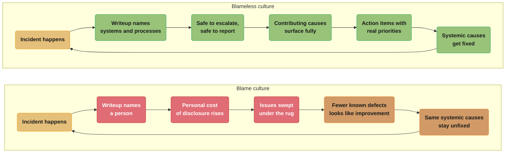
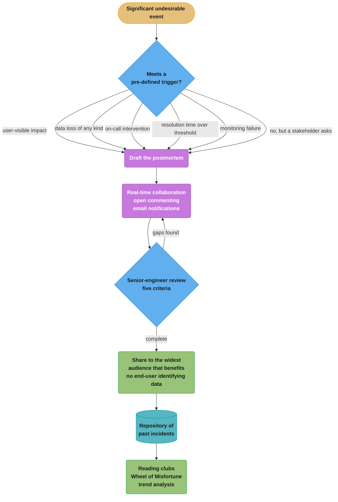
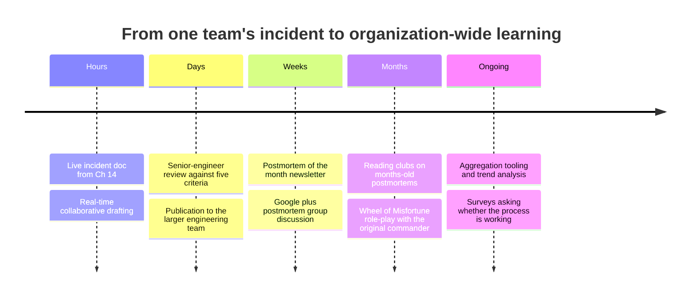

# Chapter 15: Postmortem Culture: Learning from Failure

> Part III — Practices · Site Reliability Engineering: How Google Runs Production Systems
> (Beyer, Jones, Petoff & Murphy, eds., O'Reilly 2016) · builds on Ch 14 (Managing Incidents),
> leads to Ch 16 (Tracking Outages)

## Chapter Map

Chapter 14 ended with an incident closed and a postmortem started. This chapter, written by John
Lunney and Sue Lueder and edited by Gary O'Connor, is about what happens next — and its central
claim is that the hard part is not the document, it is the **culture that makes the document
honest**. The chapter opens with Devin Carraway's epigraph, *"The cost of failure is education,"*
and states the problem in one sentence: incidents and outages are inevitable at Google's scale and
velocity of change, and **unless there is some formalized process of learning from them, they may
recur ad infinitum**. Left unchecked, incidents can multiply in complexity or even cascade,
overwhelming a system and its operators.

The chapter is unusual in the book for being mostly about people. Its three substantive sections
move outward in scope: what a postmortem *is* and why it must be blameless, how it is *written and
reviewed* collaboratively, and how you *introduce and sustain* the practice in an organization that
does not have it.

**TL;DR:**
- A **postmortem** is defined as a written record of an incident, its impact, the actions taken to
  mitigate or resolve it, the root cause(s), and the follow-up actions to prevent recurrence.
- **Blameless does not mean consequence-free.** The chapter's argument is causal: naming individuals
  produces **concealment** — "if a culture of finger pointing and shaming prevails, people will not
  bring issues to light for fear of punishment" — so a blameless writeup names systems and
  processes because that is what can actually be fixed.
- The chapter gives **five common postmortem triggers** and insists they be **defined before an
  incident occurs**, plus the rule that **any stakeholder may request one**.
- Collaboration is a tooling requirement, not a virtue: **real-time collaboration**, an **open
  commenting/annotation system**, and **email notifications**, followed by **formal review** against
  five explicit criteria and publication to the widest useful audience.
- **"An unreviewed postmortem might as well never have existed."** Review is the step the chapter
  guards with its own named best practice.
- Culture is built with concrete rituals — **postmortem of the month**, a **Google+ postmortem
  group**, **postmortem reading clubs**, and the **Wheel of Misfortune** — and sustained by
  **visibly rewarding** the behaviour and **surveying** whether the process is actually working.

## The Big Question

Every organization already knows it should learn from failure. Almost none of them do it reliably,
and the reason is not that they lack a template. The reason is that the most useful information
about an incident lives in the head of the person who feels most exposed by it — the engineer who
pushed the change, approved the config, or misread the dashboard. Any process that puts that person
at risk is a process that will be routed around, politely and permanently, and what you get back is
a document that is accurate about timestamps and useless about causes. So the question is: what
makes it *safe* to write down what really happened?

**Analogy:** aviation and medicine got here first, and the chapter says so — "blameless culture
originated in the healthcare and avionics industries where mistakes can be fatal." An airline that
punishes the pilot who reports a near-miss stops receiving reports of near-misses. It does not stop
having near-misses; it stops *knowing about them*, right up until one becomes a crash. The
industries that made flying safe did it by making the report the thing you are rewarded for filing,
and by directing the investigation at the system that let the mistake happen rather than at the
person who made it. The chapter's line is the software version: **"You can't 'fix' people, but you
can fix systems and processes to better support people making the right choices."**

---

## 15.1 Google's Postmortem Philosophy

### What a postmortem is

The chapter's definition, given plainly: a postmortem is **a written record of an incident, its
impact, the actions taken to mitigate or resolve it, the root cause(s), and the follow-up actions
to prevent the incident from recurring.** Five components, and the last one is the only one that
changes the future.

The concept is noted as well known in the technology industry, and the chapter is careful to scope
itself: a detailed survey of root-cause analysis techniques is explicitly out of scope, and Google
teams "use a variety of techniques for root-cause analysis and choose the technique best suited to
their services." There is no single prescribed methodology here — only the requirement that the
causes be *well understood*.

### When to write one

**Postmortems are expected after any significant undesirable event.** But the chapter immediately
acknowledges the countervailing pressure: *"The postmortem process does present an inherent cost in
terms of time or effort, so we are deliberate in choosing when to write one."* Teams have some
internal flexibility, but common triggers include:

| Trigger | What it catches |
|---|---|
| **User-visible downtime or degradation beyond a certain threshold** | The obvious case, with the threshold stated in advance rather than argued afterwards |
| **Data loss of any kind** | Note "of any kind" — no threshold at all applies to this one |
| **On-call engineer intervention** (release rollback, rerouting of traffic, etc.) | A human had to touch production, so automation did not cover it |
| **A resolution time above some threshold** | Slow recovery is a defect even when impact was small |
| **A monitoring failure** (which usually implies manual incident discovery) | You found out from a human, not a page |

Two details are easy to skim past. **"Data loss of any kind"** carries no qualifier, unlike every
other trigger — the chapter thresholds downtime and resolution time but not this. And **a monitoring
failure is itself a trigger**: the chapter parenthesizes that it "usually implies manual incident
discovery," making "how did we find out about this?" a first-class postmortem question rather than
a footnote.

The governing rule around all five: *"It is important to define postmortem criteria before an
incident occurs so that everyone knows when a postmortem is necessary."* Deciding afterwards turns
every borderline event into a negotiation, and negotiations are won by whoever least wants the
document to exist. In addition to the objective triggers, **any stakeholder may request a postmortem
for an event** — an escape hatch that costs nothing and catches the cases the criteria did not
anticipate.

### The blameless argument, stated precisely

*"Blameless postmortems are a tenet of SRE culture."* The chapter's definition is operational rather
than sentimental:

> For a postmortem to be truly blameless, it must focus on identifying the contributing causes of
> the incident **without indicting any individual or team for bad or inappropriate behavior**. A
> blamelessly written postmortem **assumes that everyone involved in an incident had good intentions
> and did the right thing with the information they had.**

That assumption — good intentions, right action *given the information available* — is the load
bearing part, and it is the same assumption Chapter 14 makes about Mary, Josephine and Malcolm.

The justification is a causal claim about behaviour, not an appeal to kindness:

> **If a culture of finger pointing and shaming individuals or teams for doing the "wrong" thing
> prevails, people will not bring issues to light for fear of punishment.**

Read that as an engineering statement about a feedback loop. Blame raises the personal cost of
disclosure; higher cost lowers the disclosure rate; a lower disclosure rate means fewer known
defects, which management reads as improvement, which reduces the perceived need to change
anything. The organization gets quieter and more dangerous at the same time, and the sidebar makes
the endpoint explicit: an atmosphere of blame *"risks creating a culture in which incidents and
issues are swept under the rug, leading to greater risk for the organization."*

**Where the idea comes from.** Blameless culture originated in **healthcare and avionics**, "where
mistakes can be fatal." The chapter describes what those industries built: an environment where
**every "mistake" is seen as an opportunity to strengthen the system**. And it states the shift
precisely — when postmortems move *from allocating blame* to *investigating the systematic reasons
why an individual or team had incomplete or incorrect information*, effective prevention plans can
be put in place.

That phrase repays attention. The object of investigation is not "why did Alice do the wrong thing"
but **"why did Alice have incomplete or incorrect information."** The second question has fixable
answers — a missing dashboard, an ambiguous runbook, a config flag whose name lies about what it
does, an alert that fires for two unrelated conditions. The first question has only one answer,
Alice, and Alice is not a component you can redesign.

### Blameless is not toothless

This is the most misread part of the chapter, so it is worth stating what the text actually says.
A blameless postmortem is **not** a document that avoids criticism:

> While a blameless postmortem doesn't simply vent frustration by pointing fingers, **it should call
> out where and how services can be improved.**

The chapter demonstrates with two versions of the same underlying complaint:

**Pointing fingers**

> "We need to rewrite the entire complicated backend system! It's been breaking weekly for the last
> three quarters and I'm sure we're all tired of fixing things onesy-twosy. Seriously, if I get
> paged one more time I'll rewrite it myself…"

**Blameless**

> "An action item to rewrite the entire backend system might actually prevent these annoying pages
> from continuing to happen, and the maintenance manual for this version is quite long and really
> difficult to be fully trained up on. I'm sure our future on-callers will thank us!"

Compare them carefully, because the difference is not politeness. Both versions want the same
outcome — rewrite the backend. The second version is *more* actionable than the first, not less:

| | Pointing fingers | Blameless |
|---|---|---|
| The proposal | Rewrite the backend | Rewrite the backend — identical |
| Framed as | A complaint about being paged | An action item with a stated benefit |
| Evidence offered | "breaking weekly for three quarters" | Same fact, plus a second: the maintenance manual is long and hard to train on |
| Who it targets | The system, implicitly the people who own it, delivered as frustration | The system's properties, explicitly |
| What a reader can do with it | Sympathize, or get defensive | Prioritize the item and also fix the manual |

The blameless version surfaces a contributing cause the angry version buried entirely — documented
procedure that is too long to learn — which is a smaller, cheaper action item sitting inside the
large one. That is the practical case for the discipline: blame compresses a multi-cause failure
into a single accusation, and the accusation is the least useful of the causes.

**Also not punishment.** *"Writing a postmortem is not punishment — it is a learning opportunity for
the entire company."* The sidebar adds the corollary teams get wrong: **"it is also important not to
stigmatize frequent production of postmortems by a person or team."** A team that writes many
postmortems is either operating something hard or looking honestly at it; treating the count as a
performance signal converts it into an incentive to write fewer.

**And not a formality.** *"When an outage does occur, a postmortem is not written as a formality to
be forgotten."* The chapter's stated frame is that engineers see it as an opportunity not only to
fix a weakness but **to make Google more resilient as a whole** — the audience is the company, not
the team.

> **Best Practice: Avoid Blame and Keep It Constructive.** Blameless postmortems can be challenging
> to write, because the postmortem format clearly identifies the actions that led to the incident.
> Removing blame from a postmortem gives people the confidence to escalate issues without fear.

Note the honesty in that first clause. The chapter does not claim blamelessness is easy or natural;
it concedes that the format inherently surfaces *who did what*, and that writing it without
indictment is a skill. The payoff it claims is specific — **confidence to escalate without fear** —
which is the same property Chapter 14's "Introspect" best practice depends on.

---

## 15.2 Collaborate and Share Knowledge

*"We value collaboration, and the postmortem process is no exception. The postmortem workflow
includes collaboration and knowledge-sharing at every stage."*

### The tooling requirements

Google's postmortem documents are **Google Docs with an in-house template** (the book's Appendix D
is an Example Postmortem). The chapter is deliberately tool-agnostic about the rest — *"regardless
of the specific tool you use, look for the following key features"*:

| Feature | The chapter's stated reason |
|---|---|
| **Real-time collaboration** | Enables the rapid collection of data and ideas. **Essential during the early creation of a postmortem.** |
| **An open commenting/annotation system** | Makes crowdsourcing solutions easy and **improves coverage**. |
| **Email notifications** | Can be directed at collaborators within the document, or used to loop in others to provide input. |

The word **coverage** in the middle row is the interesting one. Open commenting is not there to
gather opinions — it is there so that the people who hold facts the author does not have can attach
them to the exact line where they belong. An engineer who knows the real reason a flag existed, or
that the same failure happened eighteen months ago, may never write a paragraph but will leave a
comment.

"Essential during the early creation" points at a specific window: the hours right after an
incident, when several people each hold a fragment of the timeline and none holds all of it. A tool
that serializes contributions loses that window.

### Formal review

Writing a postmortem also involves **formal review and publication**. In practice, teams **share the
first draft internally and solicit a group of senior engineers to assess the draft for
completeness.** The chapter's five review criteria:

- **Was key incident data collected for posterity?**
- **Are the impact assessments complete?**
- **Was the root cause sufficiently deep?**
- **Is the action plan appropriate and are resulting bug fixes at appropriate priority?**
- **Did we share the outcome with relevant stakeholders?**

Each of these targets a specific way postmortems go wrong. Data not captured at the time is gone
forever, so *posterity* is a deadline. Impact assessments get written from the monitoring the team
already had, so incomplete ones systematically understate the classes of harm nobody measured. "Root
cause sufficiently deep" is the guard against stopping at the proximate trigger — the bad config
push — instead of asking why the config could be pushed without validation. Action-item *priority*
is called out separately from action-item *appropriateness* because the classic failure is a correct
list of fixes filed at a priority that guarantees none of them ship.

### Publication

Once the initial review is complete, the postmortem is **shared more broadly, typically with the
larger engineering team or on an internal mailing list.** The stated goal: *"share postmortems to
the widest possible audience that would benefit from the knowledge or lessons imparted."*

With one hard constraint. **Google has stringent rules around access to any piece of information
that might identify an end-user, and even internal documents like postmortems never include such
information.** This is a real design pressure on the format: the incident that broke one specific
user's data has to be describable, and reviewable, without that user appearing in the document.

> **Best Practice: No Postmortem Left Unreviewed.** *"An unreviewed postmortem might as well never
> have existed."* To ensure each completed draft is reviewed, Google encourages **regular review
> sessions**. In these meetings it is important to **close out any ongoing discussions and
> comments**, to **capture ideas**, and to **finalize the state**.

The failure mode this guards against is specific and extremely common: a draft that is 90% written,
carries eleven unresolved comment threads, and sits in that state indefinitely because the incident
stopped being urgent. The remedy is a *recurring meeting*, not a reminder — someone's calendar,
recurring, whose agenda is finishing drafts.

Once those involved are satisfied with the document and its action items, the postmortem is **added
to a team or organization repository of past incidents**. The chapter footnotes a starting point for
teams without one: **Etsy has released Morgue, a tool for managing postmortems.** *"Transparent
sharing makes it easier for others to find and learn from the postmortem."*

The repository is what turns a pile of documents into an asset. It is the precondition for the
reading clubs in 15.3, for the Wheel of Misfortune, and for the trend analysis in 15.4 — none of
which are possible if postmortems live in their authors' drive folders.

---

## 15.3 Introducing a Postmortem Culture

*"Introducing a postmortem culture to your organization is easier said than done; such an effort
requires continuous cultivation and reinforcement."*

The chapter's structural claim about where the motivation comes from is worth quoting exactly,
because it cuts both ways: Google reinforces the culture through **senior management's active
participation in the review and collaboration process**, but **"management can encourage this
culture, blameless postmortems are ideally the product of engineer self-motivation."** Mandate alone
produces compliance documents. Enthusiasm alone does not survive a quarter where everyone is busy.
The chapter wants both, with management supplying air cover and engineers supplying the actual
motivation.

### Four rituals

In the spirit of nurturing the culture, SREs **proactively create activities that disseminate what
we learn about system infrastructure**:

| Activity | What it is | What it fixes |
|---|---|---|
| **Postmortem of the month** | In a monthly newsletter, an interesting and well-written postmortem is shared with the entire organization. | Good writeups otherwise reach only the team that wrote them |
| **Google+ postmortem group** | A group that shares and discusses **internal and external** postmortems, best practices, and commentary about postmortems. | Isolation — including from other companies' public incident reports |
| **Postmortem reading clubs** | Teams host regular clubs where an interesting or impactful postmortem is brought to the table (**along with some tasty refreshments**) for open dialogue with participants, nonparticipants, and new Googlers about what happened, what lessons it imparted, and the aftermath. **Often the postmortem being reviewed is months or years old.** | Lessons decaying with staff turnover |
| **Wheel of Misfortune** | New SREs are treated to this exercise (see Disaster Role Playing), in which **a previous postmortem is reenacted with a cast of engineers playing roles as laid out in the postmortem**. **The original incident commander attends** to help make the experience as "real" as possible. | Knowledge that is readable but not rehearsed |

Three details in that table are the ones teams drop when they copy the list.

**"Often the postmortem being reviewed is months or years old."** A reading club is not an
incident review — it is deliberately decoupled from urgency. An old postmortem can be discussed
without anyone being defensive, and the group discovers whether the action items actually shipped.

**"Participants, nonparticipants, and new Googlers."** The audience explicitly includes people who
were not there, which is the entire point: the value of a postmortem is proportional to how many
people learn from an incident they did not attend.

**"The original incident commander attends."** The Wheel of Misfortune is the direct bridge to
Chapter 14 — it is the role-play that chapter recommends for keeping incident management proficiency
from atrophying, and having the real commander present is what stops it from becoming a quiz.

### The objection, and three answers

*"One of the biggest challenges of introducing postmortems to an organization is that some may
question their value given the cost of their preparation."* The chapter offers three strategies:

- **Ease postmortems into the workflow.** A trial period with several complete and successful
  postmortems may help prove their value, and helps identify what criteria should initiate one. Note
  the second benefit — the trial is how you discover your own trigger thresholds from 15.1, rather
  than guessing them.
- **Make writing effective postmortems a rewarded and celebrated practice** — both publicly through
  the social methods above, and **through individual and team performance management.** That second
  clause is the one with teeth: recognition that never reaches a performance review is a preference,
  not an incentive.
- **Encourage senior leadership's acknowledgment and participation.** *"Even Larry Page talks about
  the high value of postmortems!"*

### Reward the behaviour, visibly

> **Best Practice: Visibly Reward People for Doing the Right Thing.**

The chapter's worked example is specific enough to be worth carrying whole. Google's founders host
**TGIF**, a weekly all-hands held live in Mountain View and broadcast to Google offices around the
world. **A 2014 TGIF focused on "The Art of the Postmortem,"** featuring SRE discussion of
high-impact incidents.

One SRE discussed a release he had recently pushed. **Despite thorough testing, an unexpected
interaction inadvertently took down a critical service for four minutes.** The incident **only
lasted four minutes because the SRE had the presence of mind to roll back the change immediately**,
averting a much longer and larger-scale outage.

What happened to him:

- He **received two peer bonuses** immediately afterward — Google's Peer Bonus program lets
  colleagues recognize each other with a token cash reward — **in recognition of his quick and
  level-headed handling of the incident**.
- He **received a huge round of applause from the TGIF audience**, which included the company's
  founders and **an audience of Googlers numbering in the thousands**.

The chapter adds that Google has an array of internal social networks that drive peer praise toward
well-written postmortems and exceptional incident handling, and that recognition "comes from peers,
CEOs, and everyone in between."

The signal being sent is precise, and it is not "outages are fine." The engineer whose change broke
a critical service was applauded **in front of the founders** for the *quality of his response* and
for *talking about it publicly*. Every engineer watching learns that the safe move after breaking
something is to roll back fast and say so loudly. That is the behaviour an organization actually
wants, and it is exactly the behaviour a blame culture suppresses.

### Ask whether it is working

> **Best Practice: Ask for Feedback on Postmortem Effectiveness.**

Google **regularly surveys teams on how the postmortem process is supporting their goals and how it
might be improved**, asking questions such as:

- **Is the culture supporting your work?**
- **Does writing a postmortem entail too much toil?** (a direct link back to Chapter 5)
- **What best practices does your team recommend for other teams?**
- **What kinds of tools would you like to see developed?**

*"The survey results give the SREs in the trenches the opportunity to ask for improvements that will
increase the effectiveness of the postmortem culture."*

The toil question is the sharpest of the four. A postmortem process that becomes toil will be
complied with and not believed — and Chapter 5's whole argument is that toil is a thing to engineer
away, which here means better templates, more automation, and fewer manual fields, not fewer
postmortems.

The section closes with the claim that postmortem practice has been **woven into the culture at
Google: it's now a cultural norm that any significant incident is followed by a comprehensive
postmortem.**

---

## 15.4 Conclusion and Ongoing Improvements

Google's stated result: *"thanks to our continuous investment in cultivating a postmortem culture,
Google weathers fewer outages and fosters a better user experience."*

**The "Postmortems at Google" working group** is offered as evidence of that continuous investment.
It coordinates postmortem efforts across the company by:

- **pulling together postmortem templates**,
- **automating postmortem creation with data from tools used during an incident**, and
- **helping automate data extraction from postmortems so we can perform trend analysis.**

The second bullet is the tooling ambition that follows directly from Chapter 14: if the incident was
run in a bot-logged command post with a live incident document, much of the postmortem's timeline is
already machine-readable and should not be retyped.

The working group has collaborated on best practices from products as disparate as **YouTube, Google
Fiber, Gmail, Google Cloud, AdWords, and Google Maps** — a list chosen to make the point that
however different the products are, they all conduct postmortems "with the universal goal of
learning from our darkest hours."

**Scale changes the tooling problem.** With a large number of postmortems produced each month across
Google, **tools to aggregate postmortems are becoming more and more useful** — they help identify
**common themes and areas for improvement across product boundaries**, which no single team can see
from its own incidents. To facilitate comprehension and automated analysis, Google **recently
enhanced its postmortem template with additional metadata fields**. Structured metadata is the
precondition for aggregation: prose does not aggregate, fields do.

**Stated future work**, as of the book's writing: **machine learning to help predict weaknesses,
facilitate real-time incident investigation, and reduce duplicate incidents.**

---

## Beyond the book — what the argument looked like afterwards

> The chapter presents blamelessness as a settled tenet and does not engage with any critique of it.
> It also predates the industry conversation about whether "root cause" is the right frame at all,
> and the 2018 *Site Reliability Workbook*'s expanded postmortem material. Everything in this
> section is repo commentary, not the authors'.

Two threads are worth knowing about when this chapter comes up in an interview, because both are
often raised as objections to it.

**"Blameless" versus "blame-aware."** A recurring critique after 2016 was that some teams read
"blameless" as "no one may be held accountable for anything," which is not what the chapter says —
the text is about what goes in the *writeup* and about the assumption of good intent, not about
whether an organization may ever act on repeated negligence. Some practitioners now prefer the term
*blame-aware* to make that distinction explicit. The chapter's own text already supports the
narrower reading: a blameless postmortem "should call out where and how services can be improved,"
and the two-quote comparison shows a blameless document being *more* pointed about the system's
defects, not less.

**"Root cause" as a frame.** The chapter uses "root cause(s)" — plural, notably — and explicitly
declines to prescribe a root-cause-analysis technique. The subsequent resilience-engineering
literature pushed harder, arguing that complex systems fail through combinations of conditions and
that naming one cause is an artifact of where the investigation stopped. In practice the chapter's
own review criterion, "was the root cause sufficiently deep," is asking a compatible question; the
plural in "cause(s)" and the multi-step causal chain in Chapter 22's resource-exhaustion example
both suggest the authors were not committed to a single-cause model.

One thing that has *not* aged: the concealment argument in 15.1 is a claim about incentives, and
incentives have not changed. Every organization that has replaced a blame culture reports the same
first-order effect the chapter predicts — the incident count appears to go *up*, because incidents
that were previously invisible start being reported.

---

## Visual Intuition

### The two feedback loops



*Both loops close. The difference is what circulates: the left one recycles the same systemic causes
while the reported defect count falls, which is why the chapter warns that blame leads to "greater
risk for the organization" rather than merely to hurt feelings.*

### The postmortem lifecycle, trigger to repository



*The loop from review back to collaboration is the one the "No Postmortem Left Unreviewed" best
practice exists to keep moving. A draft parked in that loop with unresolved comments is the chapter's
named failure mode: it "might as well never have existed."*

### Where each cultural ritual acts



*Every ritual after "Days" operates on postmortems the participants did not write, which is the
chapter's actual objective: an incident that teaches one team is a cost, an incident that teaches the
organization is an investment.*

### Blame and disclosure, as a curve

```
  Known                                      What management SEES
  defects   |
  reported  | ####
            | #######
            | ##########
            | #############                  What is actually HAPPENING
            | ################---------------------------------------
            | ####################
            | ########################
            +--------------------------------------------------------
              low blame                                    high blame

  As blame rises, the reported line falls and the real line does not.
  The gap between them is the organization's blind spot, and it is
  widest exactly where management feels best about the numbers.
```

*This is the chapter's concealment argument drawn once. It also predicts the counterintuitive
first-order effect of adopting blameless postmortems: the reported count goes up while the real rate
is unchanged or falling.*

---

## Key Concepts Glossary

| Term | Definition as the chapter uses it |
|---|---|
| **Postmortem** | A written record of an incident, its impact, the actions taken to mitigate or resolve it, the root cause(s), and the follow-up actions to prevent recurrence. |
| **Blameless postmortem** | A postmortem that identifies contributing causes without indicting any individual or team, assuming everyone had good intentions and did the right thing with the information they had. |
| **Postmortem trigger** | A pre-defined condition that requires a postmortem: user-visible impact beyond a threshold, data loss of any kind, on-call intervention, resolution time above a threshold, or a monitoring failure. |
| **Stakeholder request** | The rule that any stakeholder may request a postmortem for an event, independent of the objective triggers. |
| **Contributing cause** | A condition that helped produce the incident. The chapter uses "root cause(s)" in the plural and declines to prescribe a single analysis technique. |
| **Formal review** | Assessment of the first draft by a group of senior engineers against five completeness criteria before broad publication. |
| **No postmortem left unreviewed** | The named best practice that an unreviewed postmortem might as well never have existed, enforced with regular review sessions. |
| **Repository of past incidents** | The team or organization archive where finished postmortems are stored so others can find and learn from them. Etsy's Morgue is the chapter's footnoted example tool. |
| **Postmortem of the month** | A monthly newsletter sharing one interesting, well-written postmortem with the entire organization. |
| **Google+ postmortem group** | An internal group discussing internal and external postmortems, best practices, and commentary. |
| **Postmortem reading club** | A regular team gathering to discuss an interesting or impactful postmortem, often months or years old, open to participants, nonparticipants, and new hires. |
| **Wheel of Misfortune** | A disaster role-playing exercise reenacting a previous postmortem with engineers playing the documented roles, with the original incident commander attending. |
| **TGIF** | Google's weekly all-hands, broadcast globally. A 2014 edition, "The Art of the Postmortem," is the chapter's worked example of visible reward. |
| **Peer Bonus** | Google's program letting colleagues recognize each other with a token cash reward. Two were given to the SRE in the TGIF story. |
| **Postmortems at Google working group** | The cross-company group coordinating templates, automated postmortem creation from incident tooling, and automated data extraction for trend analysis. |
| **Postmortem metadata fields** | Structured fields added to the template to make comprehension and automated aggregate analysis possible. |
| **Toil** | Chapter 5's term, invoked here in the survey question asking whether writing postmortems entails too much of it. |

---

## Tradeoffs & Decision Tables

### Writing a postmortem versus not writing one

| | Write it | Skip it |
|---|---|---|
| Cost | Real: the chapter concedes an inherent cost in time or effort | Zero today |
| Benefit if the cause is systemic | Prevention plan, action items, organization-wide learning | The incident "may recur ad infinitum" |
| Effect on the culture | Reinforces that reporting is expected and safe | Each skip narrows the criteria a little further |
| Chapter's position | Expected after any significant undesirable event, with pre-defined triggers | Legitimate only against criteria set in advance, never argued afterwards |

### Blameless versus blaming, on the axes that matter

| Axis | Blaming writeup | Blameless writeup |
|---|---|---|
| Object of investigation | Why did this person do the wrong thing | Why did this person have incomplete or incorrect information |
| Fixability of the answer | You cannot "fix" people | You can fix systems and processes |
| Effect on future disclosure | People will not bring issues to light for fear of punishment | Confidence to escalate issues without fear |
| Criticism of the service | Often loud, delivered as frustration | Explicitly required — "should call out where and how services can be improved" |
| Contributing causes found | Compressed into one accusation | Enumerated, including small cheap ones like an unlearnable manual |
| Organizational risk | Incidents swept under the rug, greater risk overall | Known defect count rises, real risk falls |

### Choosing postmortem tooling

| Requirement | Why the chapter asks for it | What fails it |
|---|---|---|
| Real-time collaboration | Essential during early creation, when the timeline is spread across several heads | A doc one person edits and mails around |
| Open commenting/annotation | Crowdsources solutions and improves coverage | Comments disabled, or review by email reply |
| Email notifications | Pull in collaborators and loop in others for input | A tool nobody is notified about |
| Template support | Consistency, and the precondition for aggregation | Freeform documents |
| Structured metadata | Needed for automated extraction and trend analysis | Prose-only writeups |
| Repository | Makes postmortems findable, enables reading clubs and role-play | Documents in personal drives |

### Which ritual to adopt first

| If your problem is… | Adopt | Why |
|---|---|---|
| Postmortems get written but nobody outside the team reads them | Postmortem of the month | Cheapest distribution mechanism in the chapter |
| Drafts stall at 90% with open comments | Regular review sessions | The one practice the chapter guards with "might as well never have existed" |
| Lessons are lost to staff turnover | Reading clubs on old postmortems | Explicitly includes nonparticipants and new hires |
| People can read incidents but freeze during one | Wheel of Misfortune | Rehearsal, with the original commander present |
| Engineers think postmortems are punishment | Visible reward, up to and including performance management | The TGIF example is the chapter's own demonstration |
| Nobody knows if any of it is working | Surveys on effectiveness and toil | Turns the culture itself into something measured |

---

## Common Pitfalls / War Stories

- **Reading "blameless" as "no accountability."** The chapter is about what goes in the writeup and
  about assuming good intent given available information — it never says an organization may not act
  on anything. The tell that a team has over-corrected is a postmortem so carefully neutral that it
  names no defect at all; the chapter's own example shows a blameless document being *more* specific
  about what is wrong with the service than the angry one.

- **Deciding the criteria after the incident.** "Was that big enough to warrant a postmortem?" is a
  question with a predictable answer when asked by tired people who would rather not write one. The
  chapter's rule is to define criteria before an incident occurs so everyone knows in advance, and
  to let any stakeholder request one regardless.

- **Thresholding data loss.** Four of the five triggers carry a threshold. Data loss does not — "of
  any kind." Teams that apply a uniform "significant impact" bar to all five quietly opt out of the
  one category the chapter refused to threshold.

- **Never treating a monitoring failure as postmortem-worthy.** If a human told you before the
  monitoring did, the detection path is broken even when the incident was small. The chapter makes
  this a trigger in its own right precisely because it does not correlate with impact.

- **The 90%-written draft.** Eleven unresolved comments, no owner, no deadline, and the urgency gone.
  "An unreviewed postmortem might as well never have existed." The fix in the chapter is structural —
  a recurring review session whose job is to close discussions and finalize state — not a reminder
  to the author.

- **Action items filed at a priority that guarantees they never ship.** The review criterion asks
  whether resulting bug fixes are at *appropriate priority*, separately from whether the plan is
  appropriate. A postmortem with a perfect action list at the lowest priority tier has produced a
  document and no change.

- **Stigmatizing the team that writes the most postmortems.** The sidebar warns against this
  explicitly. Counting postmortems as a quality metric turns "write fewer" into a rational strategy,
  which is precisely the concealment the chapter is trying to prevent.

- **Rewarding the postmortem without rewarding the response.** The TGIF engineer got two peer bonuses
  and applause from thousands for rolling back immediately and then talking about it publicly. The
  organization that praises the document but treats the person who broke production as diminished has
  sent the louder signal.

- **Copying the rituals without the repository.** Reading clubs, Wheel of Misfortune, trend analysis
  and postmortem of the month all read from an archive. Without a shared repository of past incidents,
  each of them degrades into "does anyone remember a good one?"

- **Letting the process become toil.** The chapter's own survey asks this directly. A team that finds
  the template burdensome will produce compliant, shallow documents — and the correct response is
  Chapter 5's response to toil, which is to engineer it down with better templates and automation,
  not to write fewer postmortems.

---

## Real-World Systems Referenced

- **Google Docs** — where Google's postmortems live, with an in-house template (Appendix D is the
  book's Example Postmortem).
- **Google+ postmortem group** — the internal group discussing internal and external postmortems.
- **TGIF** — Google's weekly all-hands, live in Mountain View and broadcast globally. The 2014 "The
  Art of the Postmortem" edition is the chapter's visible-reward example.
- **Google Peer Bonus program** — colleague-to-colleague recognition with a token cash reward.
- **Etsy's Morgue** — the open-source postmortem management tool the chapter footnotes for teams
  starting their own repository.
- **YouTube, Google Fiber, Gmail, Google Cloud, AdWords, Google Maps** — the disparate products the
  Postmortems at Google working group has collaborated across.
- **Healthcare and avionics** — the industries the chapter credits as the origin of blameless
  culture, "where mistakes can be fatal."
- **Devin Carraway** — source of the chapter's epigraph, "The cost of failure is education."

---

## Summary

The chapter's argument in one line: incidents are inevitable, so the only variable an organization
controls is whether it learns from them — and whether it learns depends on whether people can afford
to tell the truth.

A postmortem is a written record of an incident, its impact, the mitigations applied, the root
cause(s), and the follow-up actions. It is expected after any significant undesirable event, against
criteria defined in advance: user-visible impact beyond a threshold, data loss of any kind, on-call
intervention, excessive resolution time, or a monitoring failure — plus a request from any
stakeholder. It is not punishment, and frequent production of postmortems by a person or team must
not be stigmatized.

Blamelessness is the chapter's central tenet and is defended causally rather than morally: a writeup
that indicts individuals raises the personal cost of disclosure, and people stop bringing issues to
light, so the organization ends up with fewer reports and the same risk. The productive question is
not why someone did the wrong thing but why they had incomplete or incorrect information, because
that question has fixable answers — you cannot "fix" people, but you can fix systems and processes.
Blameless is not toothless: the chapter's own paired examples show the blameless version being more
specific and more actionable about the service's defects than the finger-pointing one.

The workflow is collaborative by design — real-time editing, open commenting for coverage, email
notifications — then formally reviewed by senior engineers against five criteria, then published as
widely as anyone would benefit, minus anything that could identify an end user, and archived in a
repository. Review is guarded by its own best practice, because an unreviewed postmortem might as
well never have existed.

Culture is the part that requires ongoing work: postmortem of the month, a discussion group,
reading clubs on postmortems that are often years old, and the Wheel of Misfortune role-play with the
original incident commander present. It is sustained by visibly rewarding the right behaviour — the
TGIF engineer who broke a critical service for four minutes, rolled it back immediately, and
discussed it in front of the founders received two peer bonuses and an ovation — and by surveying
whether the process is helping or has become toil. Google's stated result is fewer outages and a
better user experience, with tooling now moving toward automated postmortem creation and
cross-product trend analysis.

---

## Interview Questions

**Q: Does "blameless postmortem" mean nobody is ever held accountable?**
**Short:** No — the chapter's position is about what the writeup names, requiring it to identify contributing causes without indicting individuals or teams.

The definition given is that a blameless postmortem focuses on contributing causes without indicting
any individual or team for bad or inappropriate behavior, and assumes everyone had good intentions
and did the right thing with the information they had. It says nothing about waiving all
organizational consequence, and it explicitly requires the document to "call out where and how
services can be improved." The failure mode on the other side is a postmortem so neutral it names no
defect, which is not what the chapter asks for.

**Q: Why does the chapter argue that blaming individuals actively makes an organization less safe?**
**Short:** Because the book's claim is that under finger pointing and shaming, people will not bring issues to light for fear of punishment.

This is a causal claim about a feedback loop rather than an appeal to kindness. Blame raises the
personal cost of disclosure, disclosure falls, and the sidebar names the endpoint — incidents and
issues get swept under the rug, "leading to greater risk for the organization." The
counterintuitive operational consequence is that a team adopting blameless postmortems should expect
its *reported* incident count to rise while the real rate is unchanged, because previously invisible
events start being written down.

**Q: What are the five common postmortem triggers, and which one has no threshold?**
**Short:** User-visible impact, data loss, on-call intervention, resolution time, and monitoring failure — data loss "of any kind" carries no threshold.

The others are all thresholded or conditional: downtime or degradation "beyond a certain threshold,"
a resolution time "above some threshold," an on-call intervention such as a rollback or traffic
reroute, and a monitoring failure that usually implies manual incident discovery. Data loss is
written as "of any kind," and teams that apply a uniform significance bar across all five quietly
opt out of the one the chapter refused to qualify. Whatever your thresholds, the rule is to define
them before an incident so nobody negotiates afterwards.

**Q: What does the chapter mean by "you can't 'fix' people, but you can fix systems and processes"?**
**Short:** It reframes the investigation from why someone did the wrong thing to why they had incomplete or incorrect information.

The second question has answers you can act on — a missing dashboard, an ambiguous runbook, a flag
whose name misleads, an alert that fires for two unrelated conditions — while the first has only one
answer and that answer is not a component you can redesign. The chapter says effective prevention
plans become possible precisely when postmortems shift from allocating blame to investigating the
systematic reasons the information was wrong or absent. In practice this is the sentence to reach
for when a review is drifting toward "who approved this."

**Q: The chapter contrasts a "pointing fingers" and a "blameless" version of the same complaint. What is the real difference?**
**Short:** The blameless version is more actionable, not more polite — it proposes the same rewrite and surfaces an extra contributing cause the angry version buried.

Both versions want the backend rewritten. The blameless one frames it as an action item with a
stated benefit and adds a second fact — the maintenance manual is long and difficult to be fully
trained on — which is a smaller, cheaper fix sitting inside the large one. That is the practical
argument for the discipline: blame compresses a multi-cause failure into a single accusation, and
the accusation is the least useful of the causes. Use this example when someone claims blamelessness
means softening the findings.

**Q: Where does the chapter say blameless culture came from, and why does the origin matter?**
**Short:** From healthcare and avionics, industries where mistakes can be fatal and every mistake is treated as a chance to strengthen the system.

The origin matters because those industries did not adopt it for morale — they adopted it because
punishing reporters destroys the reporting stream you need to prevent fatalities. An airline that
punishes the pilot who files a near-miss report stops receiving near-miss reports without having
fewer near-misses. Chapter 33, "Lessons Learned from Other Industries," makes the general version of
this borrowing argument across the whole book.

**Q: What does "An unreviewed postmortem might as well never have existed" mean in practice?**
**Short:** A draft that is never formally reviewed and finalized delivers no value, so Google guards review with a named best practice and regular sessions.

The failure it targets is specific: a document that is 90% written, carries a dozen unresolved
comment threads, and stalls because the incident stopped being urgent. The chapter's remedy is
structural — recurring review sessions whose explicit job is to close out ongoing discussions and
comments, capture ideas, and finalize the state — not a nudge to the author. Only after that does
the postmortem go into the repository where reading clubs and trend analysis can reach it.

**Q: What five criteria do senior engineers use when reviewing a postmortem draft?**
**Short:** Key data collected for posterity, complete impact assessments, sufficiently deep root cause, appropriate action plan and bug priorities, and outcome shared with stakeholders.

Each targets a distinct failure. Data not captured at the time is unrecoverable, so posterity is a
deadline. Impact assessments written from existing monitoring systematically miss harm nobody was
measuring. "Sufficiently deep" guards against stopping at the proximate trigger. And note that
*priority* is called out separately from *appropriateness* — a perfect list of action items filed at
the lowest tier produces a document and no change.

**Q: What tooling features does the chapter require of a postmortem system, and what is the reason for each?**
**Short:** Real-time collaboration for rapid early data collection, open commenting to improve coverage, and email notifications to loop people in.

The chapter is deliberately tool-agnostic — Google uses Google Docs with an in-house template, but
says to look for the features regardless of tool. "Essential during the early creation" points at
the specific window right after an incident when several people each hold a fragment of the timeline
and none holds all of it. And open commenting is about *coverage*, not opinions: someone who will
never write a paragraph will still attach the fact that this same failure happened eighteen months
ago to the exact line where it belongs.

**Q: What is the Wheel of Misfortune, and what does it connect to?**
**Short:** A disaster role-play reenacting a previous postmortem with engineers playing the documented roles, with the original incident commander attending.

It is the bridge between this chapter and Chapter 14: incident management proficiency atrophies when
it is not in constant use, and the Wheel of Misfortune is the rehearsal that keeps it current for
new SREs. Having the original commander present is what stops it becoming a quiz about a document —
they supply the ambiguity and time pressure the writeup smoothed out. It also demonstrates the
chapter's larger point that a postmortem's value is realized long after it is filed.

**Q: What are the four cultural activities the chapter lists for spreading postmortem learning?**
**Short:** Postmortem of the month, a Google+ postmortem group, postmortem reading clubs, and the Wheel of Misfortune.

Postmortem of the month puts a well-written one in a company-wide newsletter; the group discusses
internal *and external* postmortems; reading clubs bring an interesting or impactful one to open
dialogue with participants, nonparticipants and new Googlers, often months or years after the fact;
the Wheel of Misfortune reenacts one. The common property is that each operates on postmortems the
audience did not write, which is the actual objective — an incident that teaches one team is a cost,
one that teaches the organization is an investment.

**Q: The chapter says teams sometimes question whether postmortems are worth the cost. What three strategies does it offer?**
**Short:** Ease them into the workflow with a trial period, make writing them a rewarded and celebrated practice, and get senior leadership to participate.

The chapter concedes the objection is fair — there is an inherent cost in time or effort. The trial
period does double duty: it demonstrates value and it reveals what your own trigger criteria should
be. The reward strategy has a clause teams skip, "through individual and team performance
management" — recognition that never reaches a performance review is a preference rather than an
incentive. And the leadership point is illustrated with "Even Larry Page talks about the high value
of postmortems!"

**Q: Why does the chapter tell an entire story about an SRE who took down a critical service for four minutes?**
**Short:** To show what visibly rewarding the right behaviour looks like — he got two peer bonuses and an ovation for rolling back immediately and discussing it publicly.

The outage only lasted four minutes because he had the presence of mind to roll the change back at
once, averting a much longer and larger-scale one. He then discussed it at a 2014 TGIF on "The Art
of the Postmortem," in front of the founders and thousands of Googlers. The signal is not that
outages are fine — it is that the safe move after breaking something is to roll back fast and say so
loudly, which is precisely the behaviour a blame culture suppresses.

**Q: What questions does Google survey teams with about the postmortem process, and why is the toil question the sharp one?**
**Short:** Whether the culture supports their work, whether writing postmortems is too much toil, what practices to recommend, and what tools they want.

The toil question links directly to Chapter 5, and it is sharp because a process that becomes toil
gets complied with rather than believed — producing shallow, box-ticking documents that pass review
and teach nothing. The chapter's implied response is Chapter 5's response to toil generally: engineer
it down with better templates, automation, and fewer manual fields, rather than writing fewer
postmortems. The survey exists so the SREs actually doing the work can ask for those improvements.

**Q: Why does the chapter say management can encourage a postmortem culture but not create it?**
**Short:** Google reinforces it through senior management's active participation, but the chapter says blameless postmortems are ideally the product of engineer self-motivation.

Mandate alone produces compliance documents — accurate about timestamps, empty about causes — because
the information that matters is voluntarily disclosed. Enthusiasm alone does not survive a busy
quarter. The chapter wants both: management supplying visible participation and air cover, engineers
supplying the motivation, which is why its reward mechanisms are mostly *peer* mechanisms (peer
bonuses, internal social networks, reading clubs) rather than top-down ones.

**Q: What constraint does Google place on postmortem content, and why does it shape the format?**
**Short:** Even internal postmortems never include information that might identify an end user, under Google's stringent access rules.

This is a real design pressure rather than a footnote: the whole point of the chapter is to share
postmortems with the widest possible audience that would benefit, and that goal is in direct tension
with incidents whose details are inherently user-specific. The format therefore has to make an
incident describable, reviewable and teachable without the affected user appearing in it. Teams
adopting this practice should settle the anonymization rules before the first sensitive incident,
not during it.

**Q: What is the "Postmortems at Google" working group doing, and what does its agenda tell you?**
**Short:** Pulling together templates, automating postmortem creation from incident tooling data, and automating extraction for trend analysis.

The agenda tells you the bottleneck moved. Once a large number of postmortems are produced each
month, the constraint stops being whether they get written and becomes whether anyone can see across
them — which is why aggregation tools that identify common themes across product boundaries became
valuable, and why the template was enhanced with additional metadata fields. Structured fields
aggregate, prose does not, and the second bullet follows directly from Chapter 14: an incident run in
a bot-logged command post with a live document has a timeline that should not be retyped by hand.

**Q: How is the postmortem trigger list connected to Chapter 14's incident declaration criteria?**
**Short:** They are separate lists answering different questions — one decides whether to spin up incident command, the other whether to write the document afterwards.

Chapter 14 declares an incident if you need a second team, the outage is customer-visible, or an hour
of concentrated analysis has not solved it. Chapter 15 requires a postmortem for user-visible impact
beyond a threshold, any data loss, on-call intervention, excessive resolution time, or a monitoring
failure. They overlap but neither implies the other — a monitoring failure discovered by a user may
warrant a postmortem without ever having needed incident command, and a declared incident with a
simple fix may fall under every postmortem threshold. Define both lists in advance.

**Q: A team says it writes postmortems but nothing ever changes. Which parts of this chapter would you check first?**
**Short:** Review completeness, action-item priority, and whether the finished documents reach a shared repository and an audience.

Start with the review criteria: is the root cause sufficiently deep, or is it stopping at the
proximate trigger, and are the resulting bug fixes filed at a priority that lets them ship. Then check
whether review actually happens on a recurring cadence rather than whenever someone remembers, since
an unreviewed postmortem might as well never have existed. Finally check distribution — reading
clubs, postmortem of the month, and trend analysis all read from a repository, and without one the
document teaches only the people who already knew.

---

## Cross-links in this repo

- [devops/incident_management_and_oncall/incident_management_and_oncall.md](../../../devops/incident_management_and_oncall/incident_management_and_oncall.md) — the repo's on-call and incident-response deep dive, including postmortem practice.
- [devops/sre_principles_and_slos/sre_principles_and_slos.md](../../../devops/sre_principles_and_slos/sre_principles_and_slos.md) — SLOs and error budgets, which supply the thresholds the postmortem triggers refer to.
- [backend/observability_and_monitoring/observability_and_monitoring.md](../../../backend/observability_and_monitoring/observability_and_monitoring.md) — the detection path whose failure is itself a postmortem trigger in this chapter.
- [backend/chaos_engineering/chaos_engineering.md](../../../backend/chaos_engineering/chaos_engineering.md) — deliberately-induced failure, the other way to generate learning without waiting for an outage.
- [devops/disaster_recovery_and_resilience/disaster_recovery_and_resilience.md](../../../devops/disaster_recovery_and_resilience/disaster_recovery_and_resilience.md) — the disaster role-playing context the Wheel of Misfortune belongs to.
- [book/site_reliability_engineering/14_managing_incidents/14_managing_incidents.md](../14_managing_incidents/14_managing_incidents.md) — the incident structure that produces the live document this chapter turns into a postmortem.
- [book/site_reliability_engineering/22_addressing_cascading_failures/22_addressing_cascading_failures.md](../22_addressing_cascading_failures/22_addressing_cascading_failures.md) — a failure mode whose multi-step causal chains are exactly what "root cause sufficiently deep" is asking about.

---

## Further Reading

- Chapter 14, "Managing Incidents" — the incident management framework that produces the live
  incident state document this chapter converts into a postmortem.
- Chapter 16, "Tracking Outages" — what happens once postmortems become data to aggregate.
- Chapter 5, "Eliminating Toil" — the concept invoked by the survey question on postmortem burden.
- Chapter 28, "Accelerating SREs to On-Call and Beyond" — the Disaster Role Playing material the
  Wheel of Misfortune points at.
- Appendix D, "Example Postmortem" — the book's own postmortem template.
- Etsy's Morgue — the open-source postmortem management tool the chapter footnotes.
- The chapter's own bibliography references on postmortems, blame culture, and root-cause analysis
  ([All12], [Boy13], [Roo04]).
