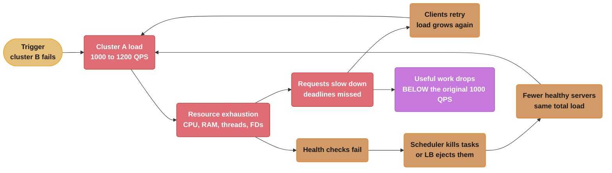
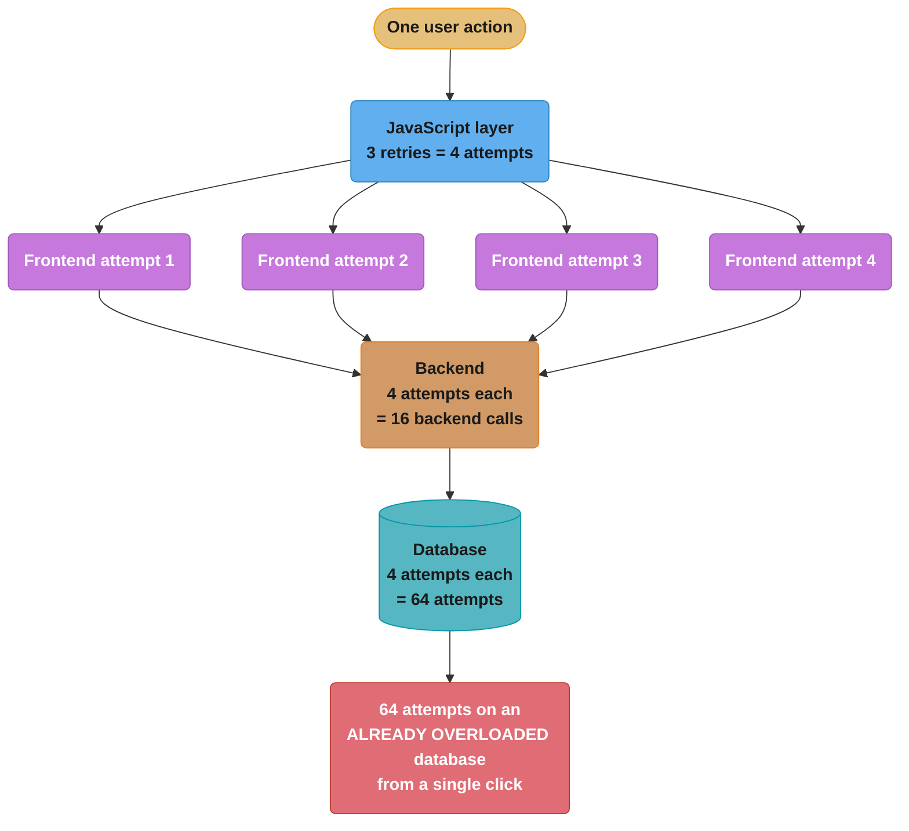
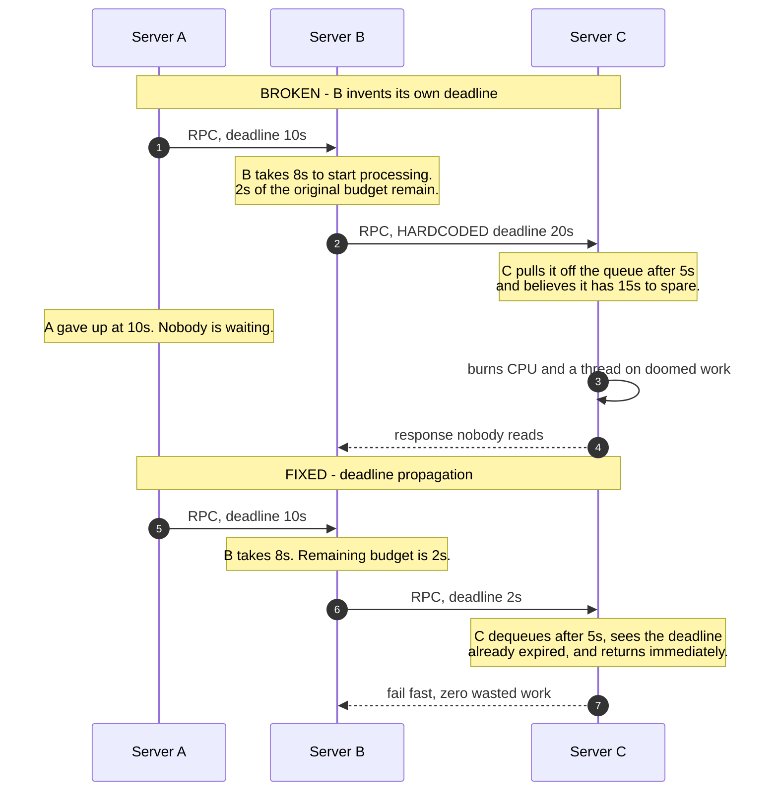

# Chapter 22: Addressing Cascading Failures

> Part III — Practices · Site Reliability Engineering: How Google Runs Production Systems
> (Beyer, Jones, Petoff & Murphy, eds., O'Reilly 2016) · builds on Ch 21 (Handling Overload),
> leads to Ch 23 (Managing Critical State)

## Chapter Map

Chapter 21 covered handling overload in a single service. This chapter, written by Mike Ulrich, is
about what happens when overload stops being contained — when the failure of one part of a system
*raises the probability that other parts fail*, and the whole thing walks itself down. Its
definition is precise and is the key to everything that follows:

> **A cascading failure is a failure that grows over time as a result of positive feedback.**

That is a control-theory statement, footnoted to positive feedback, and it explains why cascading
failures behave so unlike ordinary outages: they are self-sustaining. Removing the original trigger
does not stop them. The chapter's most instructive single fact is that a service healthy at 10,000
QPS which cascades at 11,000 QPS may not recover when load drops to 9,000 — you may have to go all
the way down to **1,000 QPS**, a tenth of its healthy capacity, before it can stand up again.

Two epigraphs frame the chapter, and both are jokes with teeth: *"If at first you don't succeed,
back off exponentially"* (Dan Sandler) and *"Why do people always forget that you need to add a
little jitter?"* (Ade Oshineye). The examples run on the book's Shakespeare search service.

**TL;DR:**
- The definition is **positive feedback**: a portion of the system failing increases the probability
  that other portions fail. **Server overload** is the most common cause, and most other causes are
  variations on it.
- **Resource exhaustion** — CPU, memory, threads, file descriptors — produces secondary symptoms
  that look like root causes. The chapter walks a **nine-step causal chain** starting at badly tuned
  GC and ending at health-check failure, and notes it is "unlikely that the causal chain will be
  fully diagnosed during an outage."
- Prevention is a **priority-ordered list**, and the first item is not a design pattern: **load test
  the server's capacity limits and test the failure mode for overload**.
- **Retries are the classic amplifier.** Three layers each doing 3 retries — 4 attempts — is
  **4³ = 64 attempts** on the database from one user action. The fixes are randomized exponential
  backoff, a per-request cap, a **server-wide retry budget** (the chapter's example: 60 retries per
  minute per process), and retrying at exactly one layer.
- **Deadline propagation** stops servers doing work nobody is waiting for: *"you don't get credit
  for late assignments with RPCs."* Without it, a server can spend 15 seconds on a request whose
  originator gave up 5 seconds ago.
- **Bimodal latency** is the subtlest trap: 5% of requests hanging on a 100-second deadline turns
  into an **80.4% error rate** through pure thread exhaustion.
- Recovery is **hysteretic**. Because the crash loop is self-sustaining, the immediate steps —
  increase resources, stop health-check deaths, restart servers, drop traffic, degrade, kill batch
  load, kill bad traffic — often mean dropping to a fraction of normal load and ramping back slowly.

## The Big Question

Every reliability mechanism in this chapter's list is something a sensible engineer would add to
improve the normal case. Retry on failure, so a transient blip is invisible. Health-check and
restart unhealthy servers, so wedged processes get replaced. Move load away from servers returning
errors, so users hit healthy ones. Add a cache, so responses are fast. Each is unambiguously good in
steady state.

The chapter's closing remark is that **every one of them can also be the mechanism by which a small
problem becomes a total outage.** Retries amplify load exactly when there is none to spare.
Health-check restarts kill the servers that were about to recover. Load-balancing away from erroring
backends concentrates traffic on the survivors and erodes them next. A cache that quietly became
load-bearing turns a restart into a capacity failure. So the question is not "how do I make my
service more reliable" — it is: **which of my reliability mechanisms are positive feedback loops
waiting for a trigger, and what is my system's actual behaviour past its breaking point?**

**Analogy:** a crowded building with one exit. In normal conditions the exit is more than adequate,
and each individual's decision to head for it is correct. Under panic, everyone's individually
correct decision — move faster toward the exit — produces a crush that reduces throughput to near
zero, and the crush sustains itself long after whatever caused the panic has gone. The fix is not to
tell people to be calm; it is to design a building whose throughput degrades gracefully under load
rather than collapsing, and to know in advance where its breaking point is. That is this chapter:
find the breaking point deliberately, make behaviour past it *degrade* rather than *collapse*, and
remove the feedback loops that would otherwise keep the crush going.

---

## 22.1 Causes of Cascading Failures and Designing to Avoid Them

*"Well-thought-out system design should take into account a few typical scenarios that account for
the majority of cascading failures."* The chapter names three: server overload, resource exhaustion,
and service unavailability — with the second and third largely being consequences of the first.

### Server Overload

*"The most common cause of cascading failures is overload. Most cascading failures described here
are either directly due to server overload, or due to extensions or variations of this scenario."*

The worked example is deliberately simple. The frontend in **cluster A** is handling **1,000 QPS**.
**Cluster B fails.** Requests to cluster A rise to **1,200 QPS**.

The frontends in A cannot handle 1,200 QPS, so they start running out of resources, which causes
them to **crash, miss deadlines, or otherwise misbehave**. The result the chapter emphasizes is the
non-obvious one:

> As a result, **the rate of successfully handled requests in A dips well below 1,000 QPS.**

That is the whole chapter in one sentence. Cluster A was comfortably serving 1,000 QPS. Push it 20%
past capacity and it does not serve 1,000 and reject 200 — it serves *fewer than 1,000*. Useful work
goes *down* as offered load goes up. A system with that property will eat any surge, and the extra
capacity you were relying on evaporates precisely when you need it.

**And it spreads.** *"This reduction in the rate of useful work being done can spread into other
failure domains, potentially spreading globally."* The chapter's mechanism: local overload in one
cluster leads to its servers crashing; in response, the **load balancing controller sends requests
to other clusters**, overloading their servers, leading to a service-wide overload failure.

The timescale is the alarming part. *"It may not take long for these events to transpire — e.g., on
the order of a couple minutes — because the load balancer and task scheduling systems involved may
act very quickly."* Your automation is the propagation medium, and it is fast.

### Resource Exhaustion

Running out of a resource results in **higher latency, elevated error rates, or the substitution of
lower-quality results** — and the chapter is careful to say *"these are in fact desired effects of
running out of resources: something eventually needs to give as the load increases beyond what a
server can handle."*

The problem is not that something gives. It is *what* gives, and how violently. Depending on which
resource is exhausted and how the server is built, exhaustion can render the server less efficient
**or cause it to crash, prompting the load balancer to distribute the resource problems to other
servers.**

#### CPU

If there is insufficient CPU for the request load, **typically all requests become slower.** The
secondary effects the chapter enumerates:

| Secondary effect | Mechanism |
|---|---|
| **Increased number of in-flight requests** | Requests take longer, so more are handled concurrently — affecting memory, active threads, file descriptors, and backend resources, each with further effects of its own |
| **Excessively long queue lengths** | Insufficient steady-state capacity saturates queues, so latency increases and the queue itself uses more memory |
| **Thread starvation** | A thread cannot progress because it is waiting for a lock, so **health checks may fail if the health check endpoint can't be served in time** |
| **CPU or request starvation** | Internal **watchdogs** detect the server isn't making progress and crash it — either from CPU starvation, or from request starvation if watchdog events are triggered remotely and processed as part of the request queue |
| **Missed RPC deadlines** | Responses arrive after the client's deadline. **The work the server did is wasted, and clients may retry, leading to even more overload** |
| **Reduced CPU caching benefits** | More CPU use raises the chance of spilling onto more cores, decreasing local cache usage and CPU efficiency |

The chapter footnotes the watchdog definition: a thread that wakes periodically to see whether work
has been done since it last checked, and kills the server if not — or, in the remote form, a
known-type request sent at regular intervals whose absence indicates failure.

Two rows in that table are the ones that turn a slowdown into a cascade. **Health checks failing
because of thread starvation** hands your cluster scheduler a reason to kill servers that are merely
slow. **Missed deadlines producing retries** closes the positive-feedback loop directly: the server
does work, gets no credit for it, and is rewarded with more work.

#### Memory

More in-flight requests consume more RAM for request, response, and RPC objects. The effects:

- **Dying tasks.** A task might be evicted by the container manager for exceeding resource limits,
  or application-specific crashes may kill it.
- **Increased garbage collection in Java, raising CPU usage.** The chapter names the loop
  explicitly: *"less CPU is available, resulting in slower requests, resulting in increased RAM
  usage, resulting in more GC, resulting in even lower availability of CPU. This is known
  colloquially as the **GC death spiral**."*
- **Reduction in cache hit rates.** Less available RAM lowers application-level cache hit rates,
  producing more RPCs to backends, possibly overloading them.

The GC death spiral is worth naming precisely because it is a positive feedback loop *inside a single
process* — the same structure as the whole-system cascade, one scale down.

#### Threads

Thread starvation can **directly cause errors or lead to health check failures.** If the server adds
threads as needed, **thread overhead can use too much RAM.** And in extreme cases, thread starvation
can also cause you to **run out of process IDs** — a system-wide limit, which means one misbehaving
server can take down unrelated processes on the same machine.

#### File descriptors

Running out of file descriptors leads to the **inability to initialize network connections**, which
in turn **can cause health checks to fail.** Note the recurring destination: three of the four
resource types the chapter lists end at the same place, a failing health check, which is the trigger
that turns "degraded" into "killed."

#### Dependencies among resources

*"Many of these resource exhaustion scenarios feed from one another — a service experiencing overload
often has a host of secondary symptoms that can look like the root cause, making debugging
difficult."*

The chapter's worked chain, in its own order:

```
  1. Java frontend has poorly tuned GC parameters
        |
  2. Under HIGH BUT EXPECTED load, frontend runs out of CPU due to GC
        |
  3. CPU exhaustion slows completion of requests
        |
  4. More in-progress requests  -->  more RAM used to process them
        |
  5. Memory pressure + fixed process memory allocation
        |
  6. Less RAM available for caching  -->  fewer entries AND lower hit rate
        |
  7. More cache misses  -->  more requests fall through to the backend
        |
  8. Backend runs out of CPU or threads
        |
  9. Lack of CPU causes basic health checks to FAIL  -->  cascade begins

  Note step 2: the load was EXPECTED. Nothing unusual happened at the top
  of this chain. And the visible symptom is at step 9, in a different
  service, quite possibly owned by a different team.
```

*The chapter's own conclusion about this chain: in situations this complex "it's unlikely that the
causal chain will be fully diagnosed during an outage," and it may be very hard to determine that a
backend crash was caused by a decreased cache rate in the frontend — "particularly if the frontend
and backend components have different owners."*

That last clause is an organizational observation dressed as a technical one, and it is the strongest
argument in the chapter for the cross-team postmortem culture of Chapter 15. A causal chain that
crosses an ownership boundary will not be diagnosed by either owner alone.

### Service Unavailability

Resource exhaustion can lead to servers crashing — for example, when too much RAM is allocated to a
container. Once a couple of servers crash on overload, load on the remaining servers increases,
causing them to crash as well. *"The problem tends to snowball and soon all servers begin to
crash-loop."*

**Why it is hard to escape:** *"as soon as servers come back online they're bombarded with an
extremely high rate of requests and fail almost immediately."*

The chapter's numeric example is the most quotable fact in the chapter:

> If a service was healthy at **10,000 QPS**, but started a cascading failure due to crashes at
> **11,000 QPS**, dropping the load to **9,000 QPS will almost certainly not stop the crashes.**

The reason: **the service is handling increased demand with reduced capacity**, and only a small
fraction of servers will be healthy enough to serve. That fraction depends on:

- how quickly the system is able to start the tasks,
- how quickly the binary can start serving at full capacity, and
- how long a freshly started task is able to survive the load.

**In the chapter's example, if 10% of the servers are healthy enough to handle requests, the request
rate would need to drop to about 1,000 QPS for the system to stabilize and recover.** Ten percent of
the load that broke it. This asymmetry — the load at which you *fall over* is far above the load at
which you can *get back up* — is hysteresis, and it is why "just reduce traffic a bit" is almost
always the wrong instinct during a cascade.

**Lame ducks and unhealthy-looking servers.** Servers can appear unhealthy to the load balancing
layer without crashing — going into "lame duck" state or failing health checks. The effect is very
similar: more servers appear unhealthy, healthy servers accept requests for a very brief period
before becoming unhealthy themselves, and fewer servers participate in handling requests.

**And the load balancer can make it worse.** *"Load balancing policies that avoid servers that have
served errors can exacerbate problems further — a few backends serve some errors, so they don't
contribute to the available capacity for the service. This increases the load on the remaining
servers, starting the snowball effect."*

Read that carefully, because it indicts a feature almost everyone wants. Steering traffic away from
erroring backends is correct when the errors are *local* to those backends. It is exactly wrong when
the errors are caused by *load*, because it concentrates the same total load on fewer servers.

---

## 22.2 Preventing Server Overload

The chapter gives a list *"in rough priority order"*, and the ordering is itself the lesson.

**1. Load test the server's capacity limits, and test the failure mode for overload.**

*"This is the most important exercise you should conduct in order to prevent server overload."* The
justification is epistemic: *"Unless you test in a realistic environment, it's very hard to predict
exactly which resource will be exhausted and how that resource exhaustion will manifest."*

The first item on a list of design patterns is not a design pattern. It is a measurement, because
every other item on the list depends on knowing a number you cannot derive from first principles.

**2. Serve degraded results.** Serve lower-quality, cheaper-to-compute results. *"Your strategy here
will be service-specific."*

**3. Instrument the server to reject requests when overloaded.** *"Servers should protect themselves
from becoming overloaded and crashing. When overloaded at either the frontend or backend layers,
**fail early and cheaply**."*

"Fail early and cheaply" is the phrase to keep. The cost of a rejection is not zero, and in a
cascade the cost of rejecting is what determines whether you can dig out — see the retry discussion
in 22.5, where a backend spending significant resources on requests that will ultimately fail stays
overloaded even after load drops.

**4. Instrument higher-level systems to reject requests, rather than overloading servers.** With an
important caveat stated immediately: *"because rate limiting often doesn't take overall service
health into account, it may not be able to stop a failure that has already begun. Simple
rate-limiting implementations are also likely to leave capacity unused."*

Where rate limiting can go:

| Layer | What it does there |
|---|---|
| **Reverse proxies** | Limit request volume by criteria such as IP address, to mitigate attempted denial-of-service attacks and abusive clients |
| **Load balancers** | Drop requests when the service enters **global** overload. Can be indiscriminate — "drop all traffic above X requests per second" — or selective: "drop requests that aren't from users who have recently interacted with the service," or "drop requests for low-priority operations like background synchronization, but keep serving interactive user sessions" |
| **Individual tasks** | Prevent random fluctuations in load balancing from overwhelming the server |

**5. Perform capacity planning.** *"Good capacity planning can reduce the probability that a
cascading failure will occur"*, and should be coupled with performance testing to determine the load
at which the service will fail.

The chapter's arithmetic: if every cluster's breaking point is **5,000 QPS**, load is evenly spread
across clusters, and the service's peak load is **19,000 QPS**, then approximately **six clusters**
are needed to run at **N + 2**. (19,000 / 5,000 = 3.8, so four clusters carry peak; N + 2 gives six.
The chapter footnotes that "evenly spread" is often a bad assumption due to geography.)

**And capacity planning is explicitly not sufficient.** *"When you lose major parts of your
infrastructure during a planned or unplanned event, no amount of capacity planning may be sufficient
to prevent cascading failures. Load balancing problems, network partitions, or unexpected traffic
increases can create pockets of high load beyond what was planned."* Some systems can grow tasks on
demand, which may prevent overload — but proper capacity planning is still needed.

---

## 22.3 Queue Management

Most thread-per-request servers use a **queue in front of a thread pool**. Requests arrive, sit on
the queue, and threads pick them off. **Usually, if the queue is full, the server will reject new
requests.**

The chapter's first observation is counterintuitive: *"If the request rate and latency of a given
task is constant, there is no reason to queue requests: a constant number of threads should be
occupied."* Under that idealized model, **requests are only queued if the steady-state arrival rate
exceeds the processing rate** — which saturates both the thread pool and the queue. A queue does not
smooth a sustained overload; it delays the moment you notice one.

**Queued requests consume memory and increase latency**, and the chapter quantifies it:

> If the queue size is **10x the number of threads**, and the time to handle a request on a thread is
> **100 milliseconds**, then when the queue is full **a request will take 1.1 seconds to handle** —
> most of which is spent on the queue.

One hundred milliseconds of work, 1,000 milliseconds of waiting. That request will very likely
exceed its deadline, at which point the server does 100 ms of real work for nothing (22.6), and the
client may retry (22.5). The deep queue converted a capacity problem into wasted capacity.

**The recommendation, split by traffic shape:**

| Traffic shape | Recommended queue | Rationale |
|---|---|---|
| **Fairly steady over time** | Small relative to the thread pool — **50% or less** | The server rejects requests early when it cannot sustain the incoming rate |
| **Bursty, drastically fluctuating** | Sized from the current number of threads in use, per-request processing time, and the size and frequency of bursts | A burst that fits in the queue is absorbed rather than rejected |

The chapter's named example: *"Gmail often uses queueless servers, relying instead on failover to
other server tasks when the threads are full."* Zero queue is a legitimate design point, and it is
the extreme case of "reject early."

---

## 22.4 Load Shedding and Graceful Degradation

**Load shedding** *"drops some proportion of load by dropping traffic as the server approaches
overload conditions."* The goal is stated as keeping the server from running out of RAM, failing
health checks, serving with extremely high latency, or any of the other overload symptoms — *"while
still doing as much useful work as it can."*

### Mechanisms

**Per-task throttling** based on CPU, memory, or queue length — limiting queue length as in 22.3 is
itself a form of this. The chapter's concrete example: *"return an HTTP 503 (service unavailable) to
any incoming request when there are more than a given number of client requests in flight."*

**Change the queueing discipline.** Moving from **FIFO to LIFO**, or using the **controlled delay
(CoDel)** algorithm or similar, *"can reduce load by removing requests that are unlikely to be worth
processing."* The chapter's justification is a user-behaviour argument:

> If a user's web search is slow because an RPC has been queued for 10 seconds, there's a good chance
> the user has given up and refreshed their browser, issuing another request: **there's no point in
> responding to the first one, since it will be ignored!**

LIFO looks unfair and is not: under overload, FIFO serves the *oldest* requests first, and the oldest
requests are precisely the ones whose clients have already left. LIFO serves the newest, which are
the ones someone might still be waiting for. The chapter notes this *"works well when combined with
propagating RPC deadlines throughout the stack"* — see 22.6.

**More sophisticated approaches** include identifying clients to be more selective about what work is
dropped, or prioritizing more important requests. *"Such strategies are more likely to be needed for
shared services."*

### Graceful degradation

*"Graceful degradation takes the concept of load shedding one step further by reducing the amount of
work that needs to be performed."* In some applications you can significantly decrease the work or
time needed by decreasing response quality — the chapter's examples: **a search application might
only search a subset of data stored in an in-memory cache rather than the full on-disk database, or
use a less-accurate but faster ranking algorithm when overloaded.**

Three design questions the chapter says to answer:

- **Which metrics** determine when shedding or degradation kicks in — CPU usage, latency, queue
  length, threads used? Does the service degrade automatically or does a human intervene?
- **What actions** are taken in degraded mode?
- **At what layer** is this implemented? Every layer in the stack, or one high-level choke point?

### The five warnings

The chapter attaches an unusually pointed set of cautions, because this is a mechanism that can
become the hazard:

- **Graceful degradation shouldn't trigger very often** — usually only in cases of a capacity
  planning failure or unexpected load shift. **Keep the system simple and understandable,
  particularly if it isn't used often.**
- ***"Remember that the code path you never use is the code path that (often) doesn't work."*** In
  steady state degraded mode is unused, so you have much less operational experience with it and its
  quirks, which increases risk. **The fix: regularly run a small subset of servers near overload to
  exercise this code path.**
- **Monitor and alert when too many servers enter these modes.**
- **Complex load shedding and graceful degradation can cause problems themselves** — excessive
  complexity may trip the server into degraded mode when undesired, or enter feedback cycles at
  undesired times.
- **Design a way to quickly turn off complex graceful degradation or tune its parameters.** Storing
  this configuration in a consistent system each server watches, such as **Chubby**, increases
  deployment speed — *"but also introduces its own risks of synchronized failure."*

That last clause is a small masterpiece of engineering honesty: the mechanism that lets you turn off
a misbehaving safety feature everywhere in seconds is the same mechanism that can turn it *on*
everywhere in seconds.

---

## 22.5 Retries

The chapter opens with code. A frontend talking to a backend, retrying naively, capped at 10 backend
RPCs per logical request, in Go with gRPC:

```go
func exampleRpcCall(client pb.ExampleClient, request pb.Request) *pb.Response {
    // Set RPC timeout to 5 seconds.
    opts := grpc.WithTimeout(5 * time.Second)

    // Try up to 10 times to make the RPC call.
    attempts := 10
    for attempts > 0 {
        conn, err := grpc.Dial(*serverAddr, opts...)
        if err != nil {
            // Something went wrong in setting up the connection. Try again.
            attempts--
            continue
        }
        defer conn.Close()

        // Create a client stub and make the RPC call.
        client := pb.NewBackendClient(conn)
        response, err := client.MakeRequest(context.Background, request)
        if err != nil {
            // Something went wrong in making the call. Try again.
            attempts--
            continue
        }

        return response
    }

    grpclog.Fatalf("ran out of attempts")
}
```

**What is wrong with it.** No backoff — retries fire immediately. No jitter. No distinction between
retriable and permanent errors. No budget. `defer conn.Close()` inside a loop, so connections
accumulate until the function returns. Every one of these matters under load, and none matters in
testing.

### How 100 QPS of overload becomes a meltdown

The chapter's step-by-step, with its numbers:

- The backend has a known limit of **10,000 QPS per task**, after which all further requests are
  rejected in an attempt at graceful degradation.
- The frontend calls `MakeRequest` at a constant **10,100 QPS**, overloading the backend by
  **100 QPS**, which the backend rejects.
- **Those 100 failed QPS are retried every 1,000 ms**, and probably succeed. But the retries are
  themselves added to the requests sent to the backend, which now receives **10,200 QPS** — 200 QPS
  of which fail due to overload.
- **The volume of retries grows: 100 QPS of retries leads to 200, then 300, and so on.** Fewer and
  fewer requests succeed on their first attempt, so **less useful work is being performed as a
  fraction of requests to the backend.**
- If the backend cannot handle the increase — consuming file descriptors, memory, and CPU time — **it
  can melt down and crash under the sheer load of requests and retries.** That crash redistributes
  its requests across the remaining backend tasks, further overloading those.

The chapter acknowledges simplifying assumptions but insists the point stands: **retries can
destabilize a system**, and *"both temporary load spikes and slow increases in usage can cause this
effect."*

### Why reducing load may not fix it

*"Even if the rate of calls to `MakeRequest` decreases to pre-meltdown levels (9,000 QPS, for
example), depending on how much returning a failure costs the backend, the problem might not go
away."* Two factors:

- **If the backend spends significant resources processing requests that will ultimately fail due to
  overload, the retries themselves may be keeping the backend in an overloaded mode.**
- **The backend servers themselves may not be stable.** Retries can amplify the effects from 22.1.

If either holds, *"in order to dig out of this outage, you must dramatically reduce or eliminate the
load on the frontends until the retries stop and the backends stabilize."* This is the same hysteresis
as the 10,000/11,000/1,000 QPS example, arriving by a different route.

The chapter notes this pattern has contributed to several cascading failures across quite different
shapes: RPC frontends and backends, **client JavaScript issuing XmlHttpRequest calls and retrying on
failure**, and **offline sync protocols that retry aggressively on failure**. The last one is
particularly nasty, because the retrying clients are outside your infrastructure entirely.

### The six rules for automatic retries

| Rule | The chapter's wording and rationale |
|---|---|
| **Apply the backend protections from 22.2** | Testing highlights problems, and graceful degradation reduces the effect of retries on the backend |
| **Always use randomized exponential backoff** | *"If retries aren't randomly distributed over the retry window, a small perturbation — e.g., a network blip — can cause retry ripples to schedule at the same time, which can then amplify themselves."* Cited to "Exponential Backoff and Jitter" in the AWS Architecture Blog |
| **Limit retries per request** | Don't retry a given request indefinitely |
| **Consider a server-wide retry budget** | *"For example, only allow **60 retries per minute** in a process, and if the retry budget is exceeded, don't retry — just fail the request."* This *"can be the difference between a capacity planning failure that leads to some dropped queries and a global cascading failure"* |
| **Decide whether you need retries at that level at all** | **Avoid amplifying retries by issuing them at multiple levels** — see the arithmetic below |
| **Use clear response codes** | Separate retriable and nonretriable errors. **Don't retry permanent errors or malformed requests**, they will never succeed. **Return a specific status when overloaded** so clients and other layers back off |

### The multiplication that gets people

The chapter's own arithmetic, quoted exactly:

> If the database can't service requests because it's overloaded, and the backend, frontend, and
> JavaScript layers all issue **3 retries (4 attempts)**, then a single user action may create
> **64 attempts (4³)** on the database.

Sixty-four. From one click. And every layer's retry policy is, in isolation, defensible — three
retries is a perfectly ordinary setting. The multiplication is invisible in every individual code
review because no layer can see the others.

Two subtleties worth carrying into an interview. First, the base is **attempts, not retries**: 3
retries means 4 attempts, so the factor per layer is 4, not 3. Getting this wrong understates the
amplification by more than half — 3³ is 27, 4³ is 64. Second, this is **multiplicative in depth**, so
adding a layer to your architecture multiplies rather than adds. A four-deep chain at the same
setting is 4⁴ = **256 attempts**.

The chapter's closing note on retries is diagnostic: **in an emergency it may not be obvious that an
outage is due to bad retry behaviour.** Graphs of retry rates can indicate it, *"but may be confused
as a symptom instead of a compounding cause."* Mitigation is a special case of the
insufficient-capacity problem, with the extra caveat that you must **either fix the retry behaviour
(usually requiring a code push), reduce load significantly, or cut requests off entirely.**

---

## 22.6 Latency and Deadlines

*"When a frontend sends an RPC to a backend server, the frontend consumes resources waiting for a
reply. RPC deadlines define how long a request can wait before the frontend gives up, limiting the
time that the backend may consume the frontend's resources."*

Note whose resources the deadline protects: **the caller's**. That framing is what makes the rest of
the section make sense.

### Picking a deadline

*"It's usually wise to set a deadline."* The chapter states both failure directions:

- **No deadline, or an extremely high one** — *"may cause short-term problems that have long since
  passed to continue to consume server resources until the server restarts."* High deadlines result
  in resource consumption in **higher** levels of the stack when **lower** levels are having
  problems.
- **Short deadlines** — *"can cause some more expensive requests to fail consistently."*

*"Balancing these constraints to pick a good deadline can be something of an art."* The chapter does
not pretend there is a formula.

### Missing deadlines

> *"A common theme in many cascading outages is that servers spend resources handling requests that
> will exceed their deadlines on the client. As a result, resources are spent while no progress is
> made: **you don't get credit for late assignments with RPCs.**"*

The example: an RPC has a **10-second deadline** set by the client. The server is very overloaded, so
it takes **11 seconds** to move from a queue to a thread pool. **At this point the client has already
given up.** Under most circumstances it would be unwise for the server to attempt to handle the
request — it would be doing work for which no credit will be granted.

**The prescription for multi-stage handling:** if a request is handled over multiple stages — a few
callbacks and RPC calls — **the server should check the deadline left at each stage** before doing
more work. The chapter's example splits a request into **parsing, backend request, and processing**
stages, checking there is enough time left before each.

This is a stronger requirement than "set a timeout." It means the deadline is a *budget the request
carries with it*, consulted repeatedly, not a stopwatch checked once at the boundary.

### Deadline propagation

> *"Rather than inventing a deadline when sending RPCs to backends, servers should employ **deadline
> propagation**."*

The mechanism: **a deadline is set high in the stack** — for example in the frontend — and **the tree
of RPCs emanating from an initial request will all have the same absolute deadline.**

The chapter's worked chain:

| Hop | Time spent before the call | Deadline on the outgoing RPC |
|---|---|---|
| Server A receives the request | — | **30 seconds** selected |
| A processes 7 seconds, then calls B | 7 s | **23 seconds** |
| B handles for 4 seconds, then calls C | 4 s | **19 seconds** |
| …and so on | | *"Ideally, each server in the request tree implements deadline propagation."* |

**The broken version, in the chapter's own steps:**

- Server A sends an RPC to server B with a **10-second deadline**.
- Server B takes **8 seconds** to start processing, then sends an RPC to server C.
- **If B used deadline propagation it should set a 2-second deadline** — but suppose it instead uses
  a **hardcoded 20-second deadline** for the RPC to C.
- Server C pulls the request off its queue after **5 seconds**.

*"Had server B used deadline propagation, server C could immediately give up on the request because
the 2-second deadline was exceeded. However, in this scenario, **server C processes the request
thinking it has 15 seconds to spare, but is not doing useful work**, since the request from A to B
has already exceeded its deadline."*

C is not slow, misconfigured, or broken. C is working hard on something nobody will read, and it is
consuming exactly the capacity needed to serve requests someone *is* waiting for. Multiply that
across a fleet under load and the wasted work is what keeps the overload alive.

**Two refinements the chapter adds:**

- **Reduce the outgoing deadline a bit** — e.g. a few hundred milliseconds — to account for network
  transit times and post-processing in the client.
- **Consider setting an upper bound for outgoing deadlines**, limiting how long the server waits for
  noncritical backends or for backends that typically complete quickly. But **be sure to understand
  your traffic mix**, or you might inadvertently make particular request types fail all the time —
  the examples given are requests with large payloads, or requests requiring a lot of computation.

**And one sanctioned exception:** a server may wish to continue past the deadline if, for example, it
is performing an expensive catchup operation with periodic checkpoints — *"it would be a good idea to
check the deadline only after writing the checkpoint, instead of after the expensive operation."*
Abandoning work mid-checkpoint wastes more than finishing it does.

### Cancellation propagation

*"Propagating cancellations reduces unneeded or doomed work by advising servers in an RPC call stack
that their efforts are no longer necessary."*

The motivating case is **hedged requests**: to reduce latency, some systems send an RPC to a primary
server and then, some time later, send the same request to other instances in case the primary is
slow. **Once the client has received a response from any server, it sends messages to the other
servers to cancel the now-superfluous requests.** Those requests may themselves transitively fan out
to many other servers, *"so cancellations should be propagated throughout the entire stack."*

The second use is subtler and is the one that prevents a resource leak. Consider an initial RPC with
a **long** deadline, whose deeper critical RPCs either receive errors that cannot succeed on retry or
have short deadlines and time out. *"Using only simple deadline propagation, the initial call
continues to use server resources until it eventually times out, despite being **doomed to
failure**."* The remedy: **sending fatal errors or timeouts up the stack and cancelling other RPCs in
the call tree prevents unneeded work if the request as a whole can't be fulfilled.**

So deadline propagation flows *down* and bounds the maximum waste; cancellation propagation flows
*up and then down* and eliminates waste that is already known to be pointless. You want both.

### Bimodal latency

The most instructive arithmetic in the chapter, because the outcome is wildly out of proportion to
the input.

**The setup.** The frontend consists of **10 servers, each with 100 worker threads** — **1,000
threads of capacity** in total. In usual operation the frontends serve **1,000 QPS** and requests
complete in **100 ms**, so **100 worker threads are occupied** out of 1,000 (1,000 QPS × 0.1 s).

Note that the system is running at **10% thread utilization**. It looks enormously
over-provisioned.

**The event.** Something causes **5% of requests to never complete** — the chapter's example is
unavailability of some Bigtable row ranges, rendering requests to that keyspace unservable. So **5%
of requests hit the deadline** while the remaining **95% take the usual 100 ms**.

**The arithmetic, with a 100-second deadline:**

| Quantity | Calculation | Result |
|---|---|---|
| Threads consumed by the hanging 5% | 50 QPS × 100 s | **5,000 threads** |
| Threads consumed by the healthy 95% | 950 QPS × 0.1 s | **95 threads** |
| Total demanded | 5,000 + 95 | **5,095 threads** |
| Actually available | 10 × 100 | **1,000 threads** |
| Fraction of requests servable | 1,000 / 5,095 | **19.6%** |
| **Resulting error rate** | 100% − 19.6% | **80.4%** |

> *"Therefore, instead of only 5% of requests receiving an error (those that didn't complete due to
> keyspace unavailability), **most requests receive an error**."*

A 5% backend fault became an 80.4% user-facing failure with no additional traffic, no crash, and no
retry storm — purely through thread accounting. The mechanism is that **a hanging request holds a
thread for 1,000 times longer than a healthy one** (100 s versus 100 ms), so 5% of requests can
demand fifty times the fleet's entire thread capacity.

**The chapter's four guidelines:**

- **Detecting this is very hard.** It may not be clear that bimodal latency is the cause when you are
  looking at **mean** latency. *"When you see a latency increase, try to look at the **distribution**
  of latencies in addition to the averages."* Here the mean is a fiction: no request takes the
  average, they take either 100 ms or 100 s.
- **Return errors early rather than waiting the full deadline.** *"If a backend is unavailable, it's
  usually best to immediately return an error for that backend, rather than consuming resources until
  the backend is available. **If your RPC layer supports a fail-fast option, use it.**"*
- **Deadlines several orders of magnitude longer than the mean request latency are usually bad.** In
  this example the deadline was **three orders of magnitude** larger than the normal mean, which is
  what turned a small number of hanging requests into thread exhaustion.
- **Limit in-flight requests per keyspace or client.** When using shared resources that can be
  exhausted by some keyspace, consider limiting in-flight requests by that keyspace or using other
  abuse tracking. The chapter's concrete suggestion: *"you might consider only allowing **25% of your
  threads** to be occupied by any one client in order to provide fairness in the face of heavy load
  by any single client misbehaving."*

---

## 22.7 Slow Startup and Cold Caching

*"Processes are often slower at responding to requests immediately after starting than they will be
in steady state."* Two causes:

- **Required initialization** — setting up connections upon receiving the first request that needs a
  given backend.
- **Runtime performance improvements in some languages, particularly Java** — just-in-time
  compilation, hotspot optimization, and deferred class loading.

**Cold caches are the bigger version of the same problem.** *"In the case of some of Google's
services, most requests are served out of caches, so requests that miss the cache are significantly
more expensive. In steady-state operation with a warm cache, only a few cache misses occur, but when
the cache is completely empty, **100% of requests are costly**."* Other services use caches to keep
user state in RAM, achieved through hard or soft stickiness between reverse proxies and frontends.

*"If the service is not provisioned to handle requests under a cold cache, it's at greater risk of
outages and should take steps to avoid them."*

**Three scenarios that produce a cold cache:**

| Scenario | The chapter's note |
|---|---|
| **Turning up a new cluster** | A recently added cluster will have an empty cache |
| **Returning a cluster to service after maintenance** | The cache may be stale |
| **Restarts** | Filling a restarted task's cache takes time. *"It may be worthwhile to move caching from a server to a separate binary like **memcache**, which also allows cache sharing between many servers, albeit at the cost of introducing another RPC and slight additional latency"* |

### The distinction that matters: latency cache versus capacity cache

This is the chapter's most transferable idea in this section, and it deserves stating exactly:

> **When a latency cache is employed, the service can sustain its expected load with an empty cache,
> but a service using a capacity cache cannot sustain its expected load under an empty cache.**

*"Service owners should be vigilant about adding caches to their service, and make sure that any new
caches are either latency caches or are sufficiently well engineered to safely function as capacity
caches. Sometimes caches are added to a service to improve performance, but actually wind up being
hard dependencies."*

The footnote makes the failure vivid: *"Sometimes you find that a meaningful proportion of your actual
serving capacity is as a function of serving from a cache, and if you lost access to that cache, you
wouldn't actually be able to serve that many queries."*

Nobody decides to build a capacity cache. A latency cache becomes one silently, when traffic grows
and the hit rate stays high, and the only way to find out is to test with the cache cold — which is
the chapter's first prevention item all over again.

**Three strategies where caching significantly affects the service:**

- **Overprovision the service** — with the latency/capacity distinction above driving how much.
- **Employ general cascading failure prevention techniques.** In particular, servers should reject
  requests when overloaded or enter degraded modes, and testing should cover **how the service
  behaves after events such as a large restart.**
- **When adding load to a cluster, slowly increase the load.** The initially small request rate warms
  the cache, and once warm, more traffic can be added. *"It's a good idea to ensure that all clusters
  carry nominal load and that the caches are kept warm."*

That last sentence rules out a tempting design: keeping a standby cluster idle as spare capacity. An
idle cluster has a cold cache, so at the moment you fail over to it, it is at its weakest.

---

## 22.8 Always Go Downward in the Stack

In the Shakespeare service, the frontend talks to a backend, which talks to the storage layer. *"A
problem that manifests in the storage layer can cause problems for servers that talk to it, but
fixing the storage layer will usually repair both the backend and frontend layers."* Layered
dependencies have a repair order.

**But suppose the backends cross-communicate among each other** — for instance, proxying requests to
one another to change who owns a user when the storage layer cannot service a request. The chapter
gives three problems with this intra-layer communication:

**1. Susceptibility to distributed deadlock.** *"Backends may use the same thread pool to wait on
RPCs sent to remote backends that are simultaneously receiving requests from remote backends. Suppose
backend A's thread pool is full. Backend B sends a request to backend A and uses a thread in backend
B until backend A's thread pool clears. This behavior can cause the thread pool saturation to
spread."* Saturation becomes contagious between peers, which cannot happen in a strictly layered
system.

**2. Mode switching under load.** *"If intra-layer communication increases in response to some kind
of failure or heavy load condition — e.g., load rebalancing that is more active under high load —
intra-layer communication can quickly switch from a low to high intra-layer request mode when the
load increases enough."*

The chapter's example: a user has a primary backend and a predetermined **hot standby secondary
backend in a different cluster**. The primary proxies requests to the secondary in response to errors
from the lower layer, or heavy load on the master. *"If the entire system is overloaded, primary to
secondary proxying will likely increase and add even more load to the system, due to the additional
cost of parsing and waiting on the request to the secondary in the primary."*

This is a positive feedback loop hiding inside a failover mechanism: the busier the system gets, the
more work the failover path creates, which makes the system busier.

**3. Bootstrapping complexity.** *"Depending on the criticality of the cross-layer communication,
bootstrapping the system may become more complex."* A system whose peers depend on each other has no
obvious order in which to start it up.

**The rule:** *"It's usually better to avoid intra-layer communication — i.e., possible cycles in the
communication path — in the user request path. Instead, **have the client do the communication**. For
example, if a frontend talks to a backend but guesses the wrong backend, **the backend should not
proxy to the correct backend. Instead, the backend should tell the frontend to retry its request on
the correct backend**."*

Redirect, do not proxy. The redirect costs a round trip and keeps the dependency graph acyclic; the
proxy saves a round trip and installs a cycle. Under load, the cycle is what kills you.

---

## 22.9 Triggering Conditions for Cascading Failures

*"When a service is susceptible to cascading failures, there are several possible disturbances that
can initiate the domino effect."*

The framing matters: susceptibility and trigger are separate. The trigger is often trivial, and
hunting it is far less valuable than removing the susceptibility.

### Process Death

Server tasks may die, reducing available capacity. Causes named: **a Query of Death** — an RPC whose
contents trigger a failure in the process — **cluster issues**, **assertion failures**, or others.
*"A very small event — e.g., a couple of crashes or tasks rescheduled to other machines — may cause a
service on the brink of falling to break."*

### Process Updates

*"Pushing a new version of the binary or updating its configuration may initiate a cascading failure
if a large number of tasks are affected simultaneously."* Prevention:

- **Account for necessary capacity overhead** when setting up the service's update infrastructure, or
- **push off-peak**, or
- **dynamically adjust the number of in-flight task updates** based on request volume and available
  capacity.

### New Rollouts

*"A new binary, configuration changes, or a change to the underlying infrastructure stack can result
in changes to request profiles, resource usage and limits, backends, or a number of other system
components that can trigger a cascading failure."*

The operational guidance is direct: *"During a cascading failure, it's usually wise to **check for
recent changes and consider reverting them**, particularly if those changes affected capacity or
altered the request profile."* And the prerequisite: *"Your service should implement some type of
**change logging**, which can help quickly identify recent changes."*

### Organic Growth

*"In many cases, a cascading failure isn't triggered by a specific service change, but because a
growth in usage wasn't accompanied by an adjustment to capacity."*

The only trigger with no event at all. There is nothing to revert and nothing to blame, which is why
capacity planning is on the prevention list.

### Planned Changes, Drains, or Turndowns

*"If your service is multihomed, some of your capacity may be unavailable because of maintenance or
outages in a cluster."* Similarly, a critical dependency may be drained — resulting in **reduced
capacity for the upstream service due to drain dependencies**, or **increased latency from having to
send requests to a more distant cluster.**

#### Request profile changes

A backend may receive requests from different clusters because a frontend **shifted its traffic due
to load balancing configuration changes, changes in the traffic mix, or cluster fullness.** The
**average cost to handle an individual payload** may have changed due to frontend code or
configuration changes. And the data itself may have changed organically through increased or
differing usage — the chapter's example: *"both the number and size of images, per user, for a photo
storage service tend to increase over time."*

Your QPS graph can be flat while the cost per query doubles. Capacity is measured in work, not
requests.

#### Resource limits

Some cluster operating systems allow **resource overcommitment**. *"CPU is a fungible resource;
often, some machines have some amount of slack CPU available, which provides a bit of a safety net
against CPU spikes. The availability of this slack CPU differs between cells, and also between
machines within the cell."*

**The warning:** *"Depending upon this slack CPU as your safety net is dangerous. Its availability is
entirely dependent on the behavior of the other jobs in the cluster, so it might suddenly drop out at
any time."* The worked example: **a team starts a MapReduce that consumes a lot of CPU and schedules
on many machines**, so the aggregate slack CPU suddenly decreases and **triggers CPU starvation
conditions for unrelated jobs.**

The rule: *"When performing load tests, make sure that you remain within your committed resource
limits."* A load test that unknowingly borrows slack CPU measures a capacity you do not actually own.

---

## 22.10 Testing for Cascading Failures

*"The specific ways in which a service will fail can be very hard to predict from first principles."*
Which is the whole argument for testing rather than reasoning.

### Test Until Failure and Beyond

*"Understanding the behavior of the service under heavy load is perhaps the most important first step
in avoiding cascading failures."* Knowing how the system behaves when overloaded helps identify which
engineering tasks matter most for long-term fixes, and *"at the very least, this knowledge may help
bootstrap the debugging process for on-call engineers when an emergency arises."*

**Load test components until they break.** The chapter states the pass/fail criterion crisply:

> As load increases, a component typically handles requests successfully until it can't handle more.
> **At this point it should ideally start serving errors or degraded results in response to
> additional load, but not significantly reduce the rate at which it successfully handles
> requests.** A component highly susceptible to cascading failure will start **crashing or serving a
> very high rate of errors** when overloaded; **a better designed component will instead be able to
> reject a few requests and survive.**

That is a testable acceptance criterion, and it is the one from 22.1: does useful work *plateau* past
the breaking point, or does it *collapse*?

Load testing also reveals where the breaking point is — *"fundamental to the capacity planning
process"* — enabling regression testing, provisioning for worst-case thresholds, and trading off
utilization against safety margins.

**Test both ramp shapes.** *"Because of caching effects, gradually ramping up load may yield
different results than immediately increasing to expected load levels. Therefore, consider testing
both gradual and impulse load patterns."*

**Test the recovery, not just the failure.** You should test and understand how the component behaves
as it returns to nominal load after being pushed well beyond it, answering questions such as:

- **If a component enters a degraded mode on heavy load, is it capable of exiting that mode without
  human intervention?**
- **If a couple of servers crash under heavy load, how much does the load need to drop for the system
  to stabilize?**

The second question is exactly the 10,000/11,000/1,000 QPS hysteresis, asked as a test rather than
discovered as an outage. Every team should know their own number.

**Stateful services need correctness checks.** *"If you're load testing a stateful service or a
service that employs caching, your load test should track state between multiple interactions and
check correctness at high load, which is often where subtle concurrency bugs hit."*

**Test components separately.** *"Individual components may have different breaking points, so load
test each component separately. You won't know in advance which component may hit the wall first, and
you want to know how your system behaves when it does."*

**Production testing, carefully.** If you believe your system has proper overload protections,
consider **failure tests in a small slice of production** to find the real failure point under real
traffic. *"These limits may not be adequately reflected by synthetic load test traffic, so real
traffic tests may provide more realistic results than load tests, at the risk of causing user-visible
pain."* Be careful: **make sure you have extra capacity available in case your automatic protections
don't work and you need to manually fail over.** Suggested production tests:

- **Reducing task counts quickly or slowly over time**, beyond expected traffic patterns
- **Rapidly losing a cluster's worth of capacity**
- **Blackholing various backends**

### Test Popular Clients

*"Understand how large clients use your service."* Specifically, you want to know if clients:

- **Can queue work while the service is down**
- **Use randomized exponential backoff on errors**
- **Are vulnerable to external triggers that can create large amounts of load** — the chapter's
  example: *"an externally triggered software update might clear an offline client's cache"*

*"Depending on your service, you may or may not be in control of all the client code that talks to
your service. However, it's still a good idea to have an understanding of how large clients that
interact with your service will behave."* The same principles apply to large internal clients:
**stage system failures with the largest clients to see how they react**, and **ask internal clients
how they access your service and what mechanisms they use to handle backend failure.**

The synchronized-cache-clear example is worth dwelling on: a client-side event you do not control can
produce a coordinated thundering herd against your service with no change on your side at all.

### Test Noncritical Backends

*"Test your noncritical backends, and make sure their unavailability does not interfere with the
critical components of your service."*

The example: a frontend with critical and noncritical backends, where a request includes both
critical components (**query results**) and noncritical ones (**spelling suggestions**). *"Your
requests may significantly slow down and consume resources waiting for noncritical backends to
finish."*

**And test the harder case.** In addition to testing when the noncritical backend is *unavailable*,
**test how the frontend behaves if the noncritical backend never responds — for example if it is
blackholing requests.** *"Backends advertised as noncritical can still cause problems on frontends
when requests have long deadlines. The frontend should not start rejecting lots of requests, running
out of resources, or serving with very high latency when a noncritical backend blackholes."*

Unavailable and unresponsive are different tests with different outcomes. An unavailable backend
returns an error fast; a blackholing one holds a thread until the deadline — which is bimodal latency
(22.6) arriving through a component you labelled unimportant.

---

## 22.11 Immediate Steps to Address Cascading Failures

*"Once you have identified that your service is experiencing a cascading failure, you can use a few
different strategies to remedy the situation — and of course, a cascading failure is a good
opportunity to use your incident management protocol"* — an explicit pointer to Chapter 14.

### Increase Resources

*"If your system is running at degraded capacity and you have idle resources, adding tasks can be the
most expedient way to recover from the outage. However, **if the service has entered a death spiral
of some sort, adding more resources may not be sufficient to recover.**"*

First option, and explicitly not a guaranteed one — because a self-sustaining loop is not a capacity
shortage.

### Stop Health Check Failures/Deaths

*"Some cluster scheduling systems, such as **Borg**, check the health of tasks in a job and restart
tasks that are unhealthy. **This practice may create a failure mode in which health-checking itself
makes the service unhealthy.**"*

The chapter's example: *"if half the tasks aren't able to accomplish any work because they're
starting up and the other half will soon be killed because they're overloaded and failing health
checks, **temporarily disabling health checks may permit the system to stabilize until all the tasks
are running.**"*

**And the design fix, which is one of the chapter's most reusable ideas:**

> **Process health checking** ("is this binary responding at all?") and **service health checking**
> ("is this binary able to respond to this class of requests right now?") are two conceptually
> distinct operations. **Process health checking is relevant to the cluster scheduler, whereas service
> health checking is relevant to the load balancer.** Clearly distinguishing between the two types of
> health checks can help avoid this scenario.

Conflating them is what makes "too busy to answer right now" mean "kill this process." Separate them
and an overloaded server can be pulled out of the load balancer's rotation — which is what you want —
without being executed by the scheduler, which is what you do not.

### Restart Servers

*"If servers are somehow wedged and not making progress, restarting them may help."* When to try:

- **Java servers in a GC death spiral**
- **In-flight requests with no deadlines consuming resources**, leading them to block threads
- **Deadlocked servers**

**The cautions are heavy.** *"Make sure that you identify the source of the cascading failure before
you restart your servers. Make sure that taking this action won't simply shift around load. **Canary
this change, and make it slowly.** Your actions may amplify an existing cascading failure if the
outage is actually due to an issue like a cold cache."*

Restarting is the intervention most likely to be reached for and most likely to be wrong. If the
problem is a cold cache (22.7), restarting is the mechanism that caused it.

### Drop Traffic

*"Dropping load is a big hammer, usually reserved for situations in which you have a true cascading
failure on your hands and you cannot fix it by other means."*

The four-step procedure, verbatim in structure:

- **Address the initial triggering condition** — by adding capacity, for example.
- **Reduce load enough so that the crashing stops.** *"Consider being aggressive here — if the entire
  service is crash-looping, only allow, say, **1% of the traffic** through."*
- **Allow the majority of the servers to become healthy.**
- **Gradually ramp up the load.**

*"This strategy allows caches to warm up, connections to be established, etc., before load returns to
normal levels."*

**The honesty about cost:** *"Obviously, this tactic will cause a lot of user-visible harm."* Whether
you can or should drop traffic indiscriminately depends on how the service is configured — *"if you
have some mechanism to drop less important traffic (e.g., prefetching), use that mechanism first."*

**And the essential caveat:** *"this strategy enables you to recover from a cascading outage **once
the underlying problem is fixed**. If the issue that started the cascading failure is not fixed —
e.g., insufficient global capacity — then the cascading failure may trigger shortly after all traffic
returns. Therefore, before using this strategy, consider fixing (or at least papering over) the root
cause or triggering condition. For example, if the service ran out of memory and is now in a death
spiral, adding more memory or tasks should be your first step."*

Dropping traffic without fixing the trigger buys you one clean recovery followed by an identical
outage.

### Enter Degraded Modes

*"Serve degraded results by doing less work or dropping unimportant traffic. **This strategy must be
engineered into your service**, and can be implemented only if you know which traffic can be degraded
and you have the ability to differentiate between the various payloads."*

You cannot invent this during the incident. It is on the emergency list only because it was built
during 22.4.

### Eliminate Batch Load

*"Some services have load that is important, but not critical. Consider turning off those sources of
load. For example, if **index updates, data copies, or statistics gathering** consume resources of
the serving path, consider turning off those sources of load during an outage."*

Usually the cheapest real lever available: it recovers capacity with zero user-visible harm, unlike
dropping traffic. It only works if you know which of your load is batch, which is a labelling job to
do in advance.

### Eliminate Bad Traffic

*"If some queries are creating heavy load or crashes — e.g., **queries of death** — consider blocking
them or eliminating them via other means."*

### Case study: Cascading Failure and Shakespeare

The chapter closes its practices with a scenario worth reading as a checklist of everything above.

**The trigger.** A documentary about Shakespeare's works **airs in Japan** and explicitly points to
the Shakespeare service as an excellent place to conduct further research. Traffic to the **Asian
datacenter surges beyond the service's capacity** — and this is **compounded by a major update to the
Shakespeare service occurring simultaneously in that datacenter** (22.9's Process Updates, landing at
exactly the wrong moment).

**What the safeguards did.** The **Production Readiness Review** process had identified issues the
team already addressed:

- Developers **built graceful degradation into the service**: as capacity becomes scarce, the service
  **no longer returns pictures alongside text, or small maps illustrating where a story takes place**.
- Depending on its purpose, **an RPC that times out is either not retried** — as with the pictures —
  **or is retried with a randomized exponential backoff**.

**What happened anyway.** *"Despite these safeguards, the tasks fail one by one and are then restarted
by Borg, which drives the number of working tasks down even more."* That is 22.11's health-check
death loop, live.

**The response.** Some graphs on the service dashboard turn an alarming shade of red and **SRE is
paged**. SREs **temporarily add capacity to the Asian datacenter by increasing the number of tasks
available for the Shakespeare job**, restoring the service in the Asian cluster.

**Afterwards.** The SRE team **writes a postmortem** detailing the chain of events, what went well,
what could have gone better, and action items — Chapter 15's process. Two action items are named:
**in the case of a service overload, the GSLB load balancer will redirect some traffic to neighboring
datacenters**, and the team **turns on autoscaling** so task count increases automatically with
traffic.

The scenario is honest about a real limitation: good degradation design, correct retry policy, and a
readiness review did not prevent the outage. They limited it — the response was capacity addition
rather than a global meltdown.

---

## 22.12 Closing Remarks

*"When systems are overloaded, something needs to give in order to remedy the situation. **Once a
service passes its breaking point, it is better to allow some user-visible errors or lower-quality
results to slip through than try to fully serve every request.** Understanding where those breaking
points are and how the system behaves beyond them is critical for service owners who want to avoid
cascading failures."*

And the warning the whole chapter has been building toward:

> *"Without proper care, some system changes meant to reduce background errors or otherwise improve
> the steady state can expose the service to greater risk of a full outage. **Retrying on failures,
> shifting load around from unhealthy servers, killing unhealthy servers, adding caches to improve
> performance or reduce latency: all of these might be implemented to improve the normal case, but
> can improve the chance of causing a large-scale failure.** Be careful when evaluating changes to
> ensure that one outage is not being traded for another."*

Four named mechanisms, each a best practice, each a documented cascade amplifier:

| Mechanism | Steady-state benefit | Cascade role |
|---|---|---|
| **Retrying on failures** | Transient blips become invisible | Multiplies load exactly when there is none spare (22.5) |
| **Shifting load away from unhealthy servers** | Users hit healthy backends | Concentrates load on survivors when the cause is load itself (22.1) |
| **Killing unhealthy servers** | Wedged processes get replaced | Kills servers that were slow but recovering, and the ones still warming up (22.11) |
| **Adding caches** | Lower latency, less backend load | Becomes a capacity cache, so a restart is now a capacity failure (22.7) |

---

## Beyond the book — patterns the chapter's vocabulary predates

> The chapter names none of the following: **circuit breakers**, **bulkheads**, **service meshes**,
> **adaptive concurrency limits**, or **retry budgets as a client-library default**. It describes
> mechanisms that later acquired these names, and it describes some that these patterns do not cover.
> Everything below is repo commentary, not the authors'.

**Circuit breakers are the chapter's "fail cheap and early," moved to the client.** The chapter puts
overload protection in the server ("instrument the server to reject requests when overloaded") and in
higher-level systems (rate limiting at proxies and load balancers). A circuit breaker is the same
idea placed in the caller: after a threshold of failures, stop sending, fail immediately, and probe
occasionally. It directly attacks the "returning a failure still costs the backend resources" problem
in 22.5, since a tripped breaker means the request never arrives. What it does *not* solve is the
chapter's harder cases — a breaker keyed on error rate does not see bimodal latency in a *noncritical*
backend, and a breaker per-client does not prevent the 4³ multiplication across layers.

**Retry budgets became defaults.** The chapter's "60 retries per minute in a process" was a suggestion
in 2016; equivalent client-side budgets are now built into common RPC stacks and cloud SDKs, usually
expressed as a ratio of retries to primary requests. The chapter's other retry rules — randomized
exponential backoff, per-request caps, retriable versus permanent error codes, and a specific status
meaning "overloaded, back off" — map almost one-to-one onto what those libraries implement.

**Deadline propagation is now a context object.** What the chapter describes manually is what a
request-scoped context with an absolute deadline does automatically, propagated across process
boundaries by the RPC layer. The trap the chapter warns about survives intact, though: the moment any
hop *invents* a fresh timeout instead of deriving one from what it received, the chain is broken from
there down, and the servers below it burn capacity on doomed work exactly as server C does.

**Adaptive concurrency limits are the chapter's queue-management advice, closed-loop.** The chapter
prescribes a static queue length of 50% or less of the thread pool for steady traffic, and a
burst-derived size otherwise. Later work replaced the constant with a controller that infers the
concurrency limit from observed latency, which removes the tuning problem the chapter leaves to
judgment. The measurement it depends on is still the one the chapter demands first: you must have
load tested to the breaking point to know what the controller is converging toward.

**Service meshes moved several of these to infrastructure.** Retries, timeouts, outlier detection
(ejecting hosts that return errors), and per-client concurrency limits are now often configured in a
sidecar rather than written in each service. That is genuinely useful and introduces a new instance
of a hazard the chapter names twice: a mesh-wide retry policy applied at every hop is exactly the
"amplifying retries by issuing them at multiple levels" failure, now enabled by a single YAML field
rather than by three teams independently. And "outlier detection" is precisely the load-balancing
policy the chapter warns *"can exacerbate problems further"* when the errors are caused by load.

**What has not changed at all.** The three most valuable ideas in the chapter are independent of any
of this: load test past the breaking point because you cannot predict which resource goes first;
useful work must plateau rather than collapse past that point; and recovery is hysteretic, so know
the load you need to drop to before you need to know it.

---

## Visual Intuition

### The positive feedback loop



*Three separate return edges feed load back into itself — retries, health-check kills, and load
balancer ejection — and each of them is a feature someone deliberately added. Remove the original
trigger and all three keep running, which is exactly what "grows over time as a result of positive
feedback" means.*

### Retry amplification: one click, 64 attempts



*The chapter's own arithmetic: three layers each doing 3 retries — 4 attempts — is 4³ = 64 attempts
on the database. The base is attempts, not retries, which is why the answer is 64 and not 27, and why
a fourth layer would make it 256. No individual layer's setting looks unreasonable in review.*

### Retry amplification, drawn against a healthy service

```
  Attempts reaching the database from ONE user action

  no retries anywhere      | #                                   1
  DB layer only, 3 retries | ####                                4
  backend + DB             | ################                   16
  JS + backend + DB        | ################################   64
                           +-------------------------------------
                             each block = 2 attempts

  Retry ONCE, at ONE layer, and the number is 4.
  Retry three times at three layers and it is 64 -- a 16x difference
  produced entirely by WHERE the retries live, not by how many.
```

*The chapter's rule "think about the service holistically and decide if you really need to perform
retries at a given level" is worth this much amplification. Depth multiplies, it does not add.*

### Deadline propagation: the wasted work, then the fix



*"You don't get credit for late assignments with RPCs." In the broken half, server C is not slow,
misconfigured, or broken — it is working perfectly on something nobody will read, consuming exactly
the capacity that live requests need. Multiply that across a fleet and the wasted work is what keeps
the overload alive.*

### Bimodal latency: how 5% becomes 80.4%

```
  FLEET: 10 servers x 100 worker threads = 1,000 threads

  STEADY STATE                        1,000 QPS, all complete in 100ms
  threads used = 1000 x 0.1 = 100     [##........................] 10% utilised
                                       ^ looks massively over-provisioned

  EVENT: 5% of requests never complete, deadline = 100 seconds

  healthy 95%   950 QPS x 0.1s  =    95 threads  [#]
  hanging  5%    50 QPS x 100s  = 5,000 threads  [##############################...]
                                  -------------
                        demanded   5,095 threads
                       available   1,000 threads

  servable fraction = 1000 / 5095 = 19.6%   -->   ERROR RATE 80.4%

  WHY: a hanging request holds a thread 1,000x longer than a healthy one
       (100s vs 100ms), so 5% of traffic can demand 50x the whole fleet.
       The MEAN latency hides this completely -- no request takes the mean.
```

*The chapter's own arithmetic. Nothing crashed, no extra traffic arrived, and no retry fired: a 5%
backend fault became an 80.4% user-facing failure through thread accounting alone. The deadline was
three orders of magnitude larger than the mean latency, which is the defect.*

### Hysteresis: the load you fall over at is not the load you get up at

```
  Useful
  work    |
  (QPS)   |          . - - - - - .
    10k   |      .                 `.
          |    .                     `.  <-- breaking point ~11k QPS
     8k   |  .                         X
          | .                           \
     6k   |.                             \    past the breaking point,
          |                               \   useful work COLLAPSES
     4k   |                                \  rather than plateauing
          |                                 \
     2k   |                                  \
      1k  |...................................\____ crash-loop floor
          +---------------------------------------------------
          0     2k    4k    6k    8k   10k   12k   offered load

  Going UP:   healthy at 10,000 QPS, cascades at 11,000 QPS.
  Coming DOWN: 9,000 QPS does NOT stop the crashing.
               With ~10% of servers healthy, you must drop to ~1,000 QPS.

  The gap between 11,000 (fall over) and 1,000 (get back up) is an
  11x asymmetry. "Reduce traffic a bit" is almost always wrong.
```

*A well-designed component would flatten out past the breaking point — rejecting a few requests and
surviving — instead of collapsing. The chapter's load-testing acceptance criterion is exactly "which
of these two curves does my service draw?", and the answer is only obtainable by measurement.*

### Immediate response: what to reach for, in what order

```mermaid
flowchart TD
    CASC([Cascading failure identified<br/>declare an incident, Ch 14]) --> BATCH{Batch or noncritical<br/>load running?}
    BATCH -->|yes| KILLB(Eliminate batch load<br/>index updates, data copies, stats<br/>zero user-visible harm)
    BATCH -->|no| BAD{Queries of death or<br/>identifiable bad traffic?}
    KILLB --> BAD
    BAD -->|yes| BLOCK(Block the bad traffic)
    BAD -->|no| RES{Idle resources<br/>available?}
    BLOCK --> RES
    RES -->|yes| ADD(Increase resources<br/>may not be enough<br/>in a death spiral)
    RES -->|no| HC{Health checks<br/>killing tasks?}
    ADD --> HC
    HC -->|yes| DISHC(Temporarily disable health checks<br/>separate process from service checks)
    HC -->|no| DEG{Degraded mode<br/>engineered in?}
    DISHC --> DEG
    DEG -->|yes| ENTER(Enter degraded mode)
    DEG -->|no| WEDGE{Servers wedged<br/>GC spiral or deadlock?}
    ENTER --> WEDGE
    WEDGE -->|yes| RESTART(Restart slowly, canary first<br/>NOT if the cause is a cold cache)
    WEDGE -->|no| DROP(Drop traffic<br/>the big hammer<br/>fix the trigger FIRST, then 1 percent, then ramp)
    RESTART --> DROP

    classDef start fill:#e5c07b,stroke:#f39c12,color:#1a1a1a,font-weight:bold
    classDef q fill:#61afef,stroke:#2e86c1,color:#1a1a1a,font-weight:bold
    classDef cheap fill:#98c379,stroke:#27ae60,color:#1a1a1a,font-weight:bold
    classDef mid fill:#c678dd,stroke:#9b59b6,color:#fff,font-weight:bold
    classDef risky fill:#d19a66,stroke:#e67e22,color:#1a1a1a,font-weight:bold
    classDef hammer fill:#e06c75,stroke:#c0392b,color:#fff,font-weight:bold
    class CASC start
    class BATCH,BAD,RES,HC,DEG,WEDGE q
    class KILLB,BLOCK cheap
    class ADD,DISHC,ENTER mid
    class RESTART risky
    class DROP hammer
```



*Ordered by user-visible harm rather than by the book's presentation order. Eliminating batch load
recovers capacity for free, dropping traffic is explicitly "a big hammer" that "will cause a lot of
user-visible harm", and the chapter's caveat applies to the whole chart: drop traffic without fixing
the triggering condition and the cascade returns as soon as traffic does.*

---

## Key Concepts Glossary

| Term | Definition as the chapter uses it |
|---|---|
| **Cascading failure** | A failure that grows over time as a result of positive feedback: part of a system failing increases the probability that other parts fail. |
| **Server overload** | The most common cause of cascading failure. Offered load exceeds capacity, and the rate of *successfully* handled requests drops below the pre-overload rate. |
| **Resource exhaustion** | Running out of CPU, memory, threads, or file descriptors, producing higher latency, elevated errors, lower-quality results, or a crash. |
| **Watchdog** | A thread that wakes periodically to check whether work has been done and kills the server if not, or a remote equivalent using regularly-sent known requests. |
| **GC death spiral** | The Java loop where less CPU causes slower requests, causing higher RAM use, causing more garbage collection, causing even less available CPU. |
| **Service unavailability** | The state where crashed servers push load onto survivors until all servers crash-loop, and restarted tasks are immediately bombarded and fail. |
| **Lame duck state** | A server that appears unhealthy to the load balancing layer without crashing, reducing effective load-balancing capacity. |
| **Queue management** | Sizing the request queue in front of a thread pool. Steady traffic wants a queue at 50% or less of thread-pool size, bursty traffic a burst-derived size. |
| **Load shedding** | Dropping some proportion of traffic as the server approaches overload, to keep it doing as much useful work as it can. |
| **Graceful degradation** | Reducing the amount of work performed by lowering response quality — a cached subset instead of the full corpus, or a faster less-accurate ranker. |
| **CoDel** | The controlled delay algorithm, cited alongside LIFO as a queueing change that removes requests unlikely to be worth processing. |
| **Fail early and cheaply** | The chapter's instruction that an overloaded server should reject requests at minimal cost rather than accepting work it cannot complete. |
| **Randomized exponential backoff** | The required retry schedule. Without randomization, a small perturbation causes retry ripples that schedule together and amplify. |
| **Retry budget** | A server-wide cap on retries, e.g. 60 per minute per process, after which requests fail rather than retry. |
| **Retry amplification** | Multiplication of attempts across layers: 3 retries at each of 3 layers is 4³ = 64 attempts from one user action. |
| **RPC deadline** | How long a request may wait before the caller gives up, bounding the time a backend may consume the caller's resources. |
| **Deadline propagation** | Setting the deadline high in the stack and deriving every downstream RPC's deadline from the time remaining, so the whole RPC tree shares one absolute deadline. |
| **Cancellation propagation** | Advising servers in an RPC call stack that their work is no longer needed, used for hedged requests and for terminating calls already doomed to fail. |
| **Hedged requests** | Sending the same request to additional replicas after a delay to reduce latency, cancelling the superfluous ones once any response arrives. |
| **Bimodal latency** | A latency distribution split between fast and hung requests. The chapter's example turns a 5% never-completing rate into an 80.4% error rate. |
| **Fail-fast option** | An RPC-layer setting that returns an error immediately when a backend is unavailable rather than waiting out the deadline. |
| **Latency cache** | A cache whose service can still sustain expected load with an empty cache. |
| **Capacity cache** | A cache whose service *cannot* sustain expected load when the cache is empty — a hard dependency, often created accidentally. |
| **Cold cache** | The state after a cluster turn-up, post-maintenance return, or restart, where 100% of requests are expensive. |
| **Always go downward in the stack** | The rule against intra-layer communication in the user request path — redirect the client rather than proxying between peers. |
| **Query of Death** | An RPC whose contents trigger a failure in the process handling it. |
| **Change logging** | A record of recent binary, configuration, and infrastructure changes, needed to identify what to revert during a cascade. |
| **Resource overcommitment** | Cluster scheduling that allows jobs to use slack CPU beyond their commitment — a safety net that can vanish when another job claims it. |
| **Test until failure and beyond** | Load testing components past their breaking point, checking that useful work plateaus rather than collapsing, and testing the return to nominal load. |
| **Process health checking** | "Is this binary responding at all?" — relevant to the cluster scheduler. |
| **Service health checking** | "Is this binary able to respond to this class of requests right now?" — relevant to the load balancer. |
| **Drop traffic** | The emergency of last resort: fix the trigger, cut to as little as 1% of traffic, let servers become healthy, then ramp up gradually. |

---

## Tradeoffs & Decision Tables

### Queue depth

| Queue size | Effect under a burst | Effect under sustained overload | Chapter's guidance |
|---|---|---|---|
| **None** (Gmail-style) | Burst is rejected or fails over to other tasks | Immediate, cheap rejection | A legitimate design point, relying on failover |
| **50% or less of thread pool** | Small bursts absorbed | Server rejects early when it cannot sustain the rate | Recommended for fairly steady traffic |
| **10x thread pool** | Large bursts absorbed | 100 ms of work takes 1.1 s, mostly queueing — deadlines missed, work wasted, retries triggered | The chapter's cautionary example |

### Retry configuration

| Choice | Cost | Benefit | Chapter's position |
|---|---|---|---|
| No retries | Transient failures reach the user | No amplification | Acceptable — "decide if you really need to perform retries at a given level" |
| Retries without backoff | Retry ripples synchronize and amplify | None | Rejected — always use randomized exponential backoff |
| Backoff without jitter | A network blip synchronizes the whole client fleet | Partial | Rejected — the epigraph is literally about forgetting jitter |
| Per-request cap only | Bounded per request, unbounded in aggregate | Prevents infinite retry | Necessary but insufficient |
| Per-request cap + server-wide budget | Some requests fail without retrying | Contains the aggregate effect | Recommended, e.g. 60 retries per minute per process |
| Retries at every layer | 4³ = 64 attempts from one action | None over retrying at one layer | Explicitly warned against |

### Deadline length

| Deadline | Failure mode | Chapter's note |
|---|---|---|
| **None or very high** | Short-term problems keep consuming resources until restart, and higher stack levels are held hostage by lower ones | Explicitly discouraged |
| **Several orders of magnitude above mean latency** | Bimodal latency exhausts threads — the 100 s deadline against 100 ms mean produced an 80.4% error rate | "Usually bad" |
| **Well-chosen, propagated** | Requests fail predictably, wasted work is bounded | The target. Reduce by a few hundred ms per hop for transit |
| **Too short** | Expensive requests fail consistently | The chapter warns about large payloads and computation-heavy requests |

### Cache classification

| | Latency cache | Capacity cache |
|---|---|---|
| Can the service sustain expected load with the cache empty? | Yes | No |
| What a restart costs | Extra latency until warm | A capacity outage |
| What a cluster turn-up costs | Slower responses briefly | A cold cluster that falls over on arrival |
| Chapter's guidance | Safe | Must be "sufficiently well engineered", and owners should be vigilant that a latency cache has not silently become one |
| How you find out which you have | Test with the cache cold — there is no other way | |

### Emergency levers, by cost

| Lever | User-visible harm | Recovers capacity | Risk |
|---|---|---|---|
| **Eliminate batch load** | None | Yes | Delayed index updates, stats, copies |
| **Eliminate bad traffic** | Only for the blocked queries | Yes | Must be able to identify it |
| **Increase resources** | None | Yes, if idle capacity exists | "May not be sufficient" in a death spiral |
| **Stop health check deaths** | None directly | Stops losing capacity | Genuinely wedged tasks now survive too |
| **Enter degraded modes** | Lower-quality results | Yes | Must have been engineered in advance |
| **Restart servers** | Brief | Sometimes | Amplifies the cascade if the cause is a cold cache. Canary it |
| **Drop traffic** | "A lot" — explicitly | Yes, decisively | Cascade returns when traffic does, unless the trigger is fixed |

### Health check separation

| Design | Overloaded server's fate | Consequence |
|---|---|---|
| One health check used by both scheduler and load balancer | Fails the check, gets killed | Capacity drops, load concentrates, cascade accelerates |
| **Process check** for the scheduler, **service check** for the load balancer | Ejected from rotation, kept alive | Server sheds load and can recover |

---

## Common Pitfalls / War Stories

- **Assuming useful work plateaus past the breaking point.** It usually collapses. Cluster A handling
  1,000 QPS pushed to 1,200 QPS serves *fewer than 1,000* successfully. Any capacity plan built on
  "we will just serve what we can and reject the rest" is a plan that has not been load tested.

- **"Just reduce the traffic a bit."** The chapter's headline number: healthy at 10,000 QPS, cascading
  at 11,000, and 9,000 will almost certainly not stop the crashes — you may need 1,000. Every service
  owner should know their own recovery threshold, and the way to learn it is the load test question
  "if a couple of servers crash under heavy load, how much does the load need to drop to stabilize?"

- **Three teams, three reasonable retry policies, 64 attempts.** No individual code review catches
  this because no layer can see the others. The defences are architectural — retry at exactly one
  layer — and organizational: someone has to own the end-to-end attempt count.

- **Retries without jitter.** The chapter's second epigraph exists for this. Exponential backoff alone
  keeps the fleet synchronized; a single network blip schedules every client's retry into the same
  millisecond, forever, in waves.

- **A hop that invents its own timeout.** Server B receiving a 10-second deadline and issuing a
  hardcoded 20-second one downstream breaks propagation for the entire subtree. Server C then works
  for 15 seconds on a request abandoned 5 seconds ago. This is a one-line bug with fleet-wide
  consequences and it will never show up in a functional test.

- **Watching mean latency during a bimodal event.** No request takes the mean. Look at the
  distribution: the chapter's example is 95% at 100 ms and 5% at 100 s, and the mean tells you
  nothing useful about either population while the error rate sits at 80.4%.

- **A noncritical backend that blackholes rather than failing.** "Noncritical" describes the *result*,
  not the *resource cost*. A spelling-suggestion backend that never responds holds a frontend thread
  until the deadline exactly as a critical one would. Test unavailable *and* unresponsive; they are
  different tests.

- **The cache that quietly became load-bearing.** Nobody designs a capacity cache. A latency cache
  becomes one as traffic grows and the hit rate stays high, and you discover it during the restart
  that was supposed to be routine.

- **The idle standby cluster.** "Keep all clusters carrying nominal load and the caches warm" rules
  this out. A cold standby is at its weakest at the exact moment you fail over to it.

- **Health checks as an execution order.** Half the tasks starting up, half about to be killed for
  failing checks under load — and the scheduler helpfully keeping the loop running. Separate process
  health checking (scheduler) from service health checking (load balancer), and be prepared to
  temporarily disable health checks to let a fleet stabilize.

- **Load balancing away from erroring backends.** Correct when the errors are local to those backends,
  actively harmful when the errors are caused by load, because it concentrates the same load on fewer
  servers. The chapter says so explicitly.

- **Peer-to-peer proxying between backends.** Distributed deadlock through shared thread pools, a
  proxy rate that rises with load, and a bootstrap order that does not exist. Redirect the client
  instead: "the backend should tell the frontend to retry its request on the correct backend."

- **Restarting first.** The most-reached-for lever and often the wrong one. If the cause is a cold
  cache, restarting is what caused the problem. Identify the source first, canary the restart, and do
  it slowly.

- **Depending on slack CPU.** Overcommitment gives you a safety net owned by other teams. A large
  MapReduce scheduling across many machines can withdraw it instantly and starve unrelated jobs. Load
  test within your committed limits or you are measuring capacity you do not have.

- **Flat QPS, rising cost per query.** Request profile changes — larger images per user, a different
  traffic mix, a frontend change altering payload cost — grow the work without moving the request
  graph. Capacity is measured in work, not requests.

- **Degraded mode that has never run.** "The code path you never use is the code path that often
  doesn't work." Exercise it deliberately by running a small subset of servers near overload, and
  monitor and alert when too many servers enter these modes.

- **Dropping traffic without fixing the trigger.** You get one clean recovery and then the identical
  outage as traffic returns. Fix or paper over the triggering condition first — the chapter's example
  is adding memory before recovering from an OOM death spiral.

---

## Real-World Systems Referenced

- **Shakespeare search service** — the book's running sample service, used for the chapter's
  production configuration figure and its closing cascading-failure scenario.
- **Borg** — Google's cluster scheduler, named as the system whose health checking can create the
  "health checks kill the service" failure mode, and which restarts the failing Shakespeare tasks.
- **Bigtable** — the source of unavailable row ranges in the bimodal latency example.
- **Chubby** — named as a consistent configuration store each server can watch for degradation
  parameters, "but also introduces its own risks of synchronized failure."
- **GSLB** — Google's load balancer, which the Shakespeare postmortem configures to redirect traffic
  to neighbouring datacenters on service overload.
- **Gmail** — cited as often using queueless servers, relying on failover when threads are full.
- **memcache** — suggested as a separate caching binary allowing cache sharing between servers.
- **gRPC / Go** — the RPC stack and language of the chapter's naive-retry code example.
- **Java** — named repeatedly for JIT/hotspot/class-loading warmup and for the GC death spiral.
- **CoDel** — the controlled delay algorithm, cited for removing requests not worth processing.
- **HTTP 503** — the chapter's concrete load-shedding response code.
- **AWS Architecture Blog, "Exponential Backoff and Jitter"** — cited directly for the backoff rule.
- **Production Readiness Review** — the Google process credited with catching issues before the
  Shakespeare incident.
- **Dan Sandler and Ade Oshineye** — sources of the chapter's two epigraphs.

---

## Summary

A cascading failure is one that grows through positive feedback, and the chapter's whole structure
follows from that definition. Because the loop is self-sustaining, removing the trigger does not stop
it, and the load at which a service falls over is far above the load at which it can stand back up —
healthy at 10,000 QPS, cascading at 11,000, possibly needing 1,000 to recover.

Overload is the dominant cause, and its signature is that **useful work goes down as offered load goes
up**. Overload exhausts CPU, memory, threads, and file descriptors, and three of those four routinely
end at a failing health check, which converts "slow" into "killed". The resource-exhaustion chain the
chapter walks — poorly tuned GC to CPU starvation to memory pressure to a shrunken cache to backend
overload to health-check failure — is nine steps long, crosses ownership boundaries, and will
probably not be fully diagnosed during the outage.

Prevention is a priority-ordered list whose first item is a measurement, not a pattern: **load test to
the breaking point and test the failure mode**, because you cannot predict which resource goes first.
Then serve degraded results, reject requests when overloaded — failing early and cheaply — rate-limit
at proxies, load balancers and tasks, and plan capacity, remembering that capacity planning alone
cannot save you. Queues should be short for steady traffic, because a queue 10x the thread pool turns
100 ms of work into 1.1 seconds of latency. Load shedding and graceful degradation must be simple,
monitored, disableable, and regularly exercised, since the code path you never use is the one that
does not work.

Retries are the classic amplifier: a mere 100 QPS of overload becomes a meltdown as retries stack, and
retries at three layers multiply one user action into 64 database attempts. Use randomized exponential
backoff, cap retries per request, keep a server-wide budget, distinguish retriable from permanent
errors, and retry at one layer. Deadlines protect the caller's resources and must be *propagated*, so
every RPC in a request tree shares one absolute deadline — otherwise servers do work nobody is waiting
for, which is what keeps an overload alive. Cancellation propagation kills work already known to be
doomed. And bimodal latency is the trap that looks like nothing: 5% of requests hanging on a
100-second deadline exhausts a fleet running at 10% utilization and produces an 80.4% error rate.

Slow startup and cold caches make a restart dangerous, and the distinction between a latency cache and
a capacity cache determines whether a restart is slow or fatal. Intra-layer communication introduces
cycles, distributed deadlock, and a proxy rate that rises with load — always go downward in the stack
and redirect the client instead. Triggers are usually mundane: a process death, an update, a rollout,
organic growth, a drain, a request-profile change, or slack CPU withdrawn by someone else's MapReduce.

Testing is how you find all of it: test until failure and beyond, test both gradual and impulse ramps,
test the return to nominal load, test each component separately, test how popular clients behave, and
test noncritical backends both unavailable and unresponsive. When a cascade is live, use the incident
protocol from Chapter 14 and work the levers by cost: eliminate batch load and bad traffic, add
resources, stop health-check deaths, degrade, restart carefully, and — as the big hammer — drop traffic
to as little as 1%, but only after fixing the triggering condition.

The closing warning is the one to remember. Retrying on failure, shifting load off unhealthy servers,
killing unhealthy servers, and adding caches are all improvements to the normal case, and all four are
documented cascade amplifiers. Be careful that one outage is not being traded for another.

---

## Interview Questions

**Q: What exactly makes a failure "cascading" rather than just a large outage?**
**Short:** The chapter defines it as a failure that grows over time as a result of positive feedback, where one part failing raises the probability that others fail.

The distinguishing property is self-sustenance: the loop keeps running after the original trigger is
gone, which is why removing the trigger is necessary but not sufficient to recover. The chapter's
canonical example is a replica failing under overload, which increases load on the remaining replicas
and increases their probability of failing, in a domino effect. Practically, this is the difference
between an outage you fix by fixing the cause and one where you must also break the feedback loop —
usually by dropping load far below normal.

**Q: A service is healthy at 10,000 QPS and cascades at 11,000. Why won't dropping to 9,000 fix it?**
**Short:** Because the service is now handling reduced demand with reduced capacity — only a small fraction of servers are healthy enough to serve.

The chapter's own numbers: if roughly 10% of servers are healthy enough to handle requests, load must
drop to about 1,000 QPS for the system to stabilize. The fraction that stays healthy depends on how
quickly tasks start, how quickly the binary reaches full serving capacity, and how long a freshly
started task survives the load — servers coming back are immediately bombarded and fail almost at
once. This 11x asymmetry between the fall-over point and the recovery point is why "reduce traffic a
bit" is almost always wrong, and why the chapter tells you to determine your own recovery threshold by
load testing.

**Q: Three layers each retry 3 times. How many attempts reach the database from one user action?**
**Short:** 64, by the chapter's own arithmetic — 3 retries means 4 attempts, and three layers multiply to 4 cubed.

The chapter's example is a JavaScript layer, a frontend, and a backend all issuing 3 retries against
an overloaded database. The two things people get wrong are the base and the growth: the base is
*attempts*, not retries, so it is 4 and not 3, and the effect is multiplicative in depth, so a fourth
layer would take it to 256. No individual layer's setting looks unreasonable in code review, which is
exactly why the chapter's rule is to think about the service holistically and decide whether you need
retries at a given level at all.

**Q: Why does the chapter insist on jitter and not just exponential backoff?**
**Short:** Because without randomization over the retry window, a small perturbation like a network blip synchronizes retries that then amplify themselves.

Plain exponential backoff preserves whatever phase relationship the failures created: every client
that failed at the same instant retries at the same instant, then again together, in waves. The
chapter cites the AWS Architecture Blog's "Exponential Backoff and Jitter" for this, and one of its
two epigraphs is literally "Why do people always forget that you need to add a little jitter?" In
practice, randomizing the delay across the window is what turns a synchronized retry storm into a
smooth trickle the backend can absorb.

**Q: What is deadline propagation, and what breaks if one hop skips it?**
**Short:** Setting a deadline high in the stack and deriving every downstream deadline from the time remaining, so the whole RPC tree shares one absolute deadline.

The chapter's chain: A picks 30 seconds, spends 7, so its RPC to B carries 23 seconds; B spends 4, so
its RPC to C carries 19. In the broken version, B receives a 10-second deadline, spends 8, then uses
a hardcoded 20-second deadline for C — so C dequeues after 5 seconds believing it has 15 to spare and
works hard on a request A abandoned 5 seconds ago. C is not slow or misconfigured; it is burning
exactly the capacity live requests need, which is what keeps an overload alive.

**Q: What does "you don't get credit for late assignments with RPCs" mean operationally?**
**Short:** A server that finishes work after the client's deadline has spent resources for nothing, so it should check the remaining deadline before doing more.

The chapter's example is a request with a 10-second deadline that takes 11 seconds just to move from
the queue to a thread pool: the client has already given up, so handling it is pure waste. The
prescription is that multi-stage handling — parsing, backend request, processing — should check the
remaining deadline before each stage, which makes the deadline a budget the request carries rather
than a stopwatch checked once. The sanctioned exception is expensive checkpointed work, where you
check the deadline after writing the checkpoint rather than after the expensive operation.

**Q: How does a 5% failure rate turn into an 80.4% error rate?**
**Short:** Through thread exhaustion — 5% of requests hanging on a 100-second deadline demand 5,000 threads from a fleet that has 1,000.

The chapter's arithmetic: 10 servers with 100 threads each is 1,000 threads, and at 1,000 QPS with
100 ms responses only 100 are normally in use, so the fleet looks massively over-provisioned. When 5%
of requests hang, they consume 50 QPS times 100 seconds equals 5,000 threads while the healthy 95%
need 95, so only 1,000 of 5,095 threads' worth of work can be served — 19.6%, an 80.4% error rate.
The mechanism is that a hanging request holds a thread a thousand times longer than a healthy one, and
the mean latency hides it completely, which is why the chapter tells you to look at the distribution.

**Q: The chapter's prevention list is priority-ordered. What is first, and why is that surprising?**
**Short:** Load test the server's capacity limits and test the failure mode for overload — a measurement, not a design pattern.

The justification is epistemic: unless you test in a realistic environment it is very hard to predict
exactly which resource will be exhausted and how that exhaustion will manifest. Every other item on
the list — degraded results, rejecting when overloaded, rate limiting, capacity planning — depends on
knowing numbers you cannot derive from first principles. The acceptance criterion is also stated:
past the breaking point a component should start serving errors or degraded results without
significantly reducing the rate of successfully handled requests, whereas a fragile one crashes or
serves a very high error rate.

**Q: Why is a deep request queue a liability rather than a buffer?**
**Short:** The chapter's example — a queue 10x the thread pool with 100 ms of work — makes a request take 1.1 seconds, nearly all of it waiting.

The deeper point is that if arrival rate and latency are constant there is no reason to queue at all,
so a persistently full queue means the steady-state arrival rate exceeds the processing rate — a
capacity problem a queue cannot fix, only delay noticing. Worse, those queued requests will likely
exceed their deadlines, so the server does real work for no credit and the client may retry.
Recommendation: 50% of the thread pool or less for fairly steady traffic, a burst-derived size for
bursty traffic, and Gmail's queueless-with-failover design as a legitimate extreme.

**Q: Why might LIFO be better than FIFO for a request queue under overload?**
**Short:** Because FIFO serves the oldest requests first, and under overload the oldest requests are the ones whose users have already given up.

The chapter's reasoning is about user behaviour: if a search has been queued for 10 seconds there is a
good chance the user refreshed and issued a new request, so responding to the first one is wasted work
that will be ignored. LIFO serves the newest requests, which are the ones someone may still be waiting
for. The chapter groups this with CoDel as approaches that remove requests unlikely to be worth
processing, and notes it works especially well combined with propagating RPC deadlines throughout the
stack.

**Q: What is the difference between a latency cache and a capacity cache, and why does it matter?**
**Short:** A service with a latency cache can sustain its expected load with an empty cache; a service with a capacity cache cannot.

That single property decides whether a restart, a cluster turn-up, or a post-maintenance return is a
brief slowdown or an outage — with a cold cache, 100% of requests are expensive. The trap is that
nobody designs a capacity cache: a latency cache becomes one silently as traffic grows and the hit
rate stays high, until the cache is a hard dependency the service was never provisioned to survive
without. The chapter tells owners to be vigilant that new caches are latency caches or are engineered
well enough to be safe capacity caches, and the only way to know which you have is to test with the
cache cold.

**Q: Why does the chapter warn against keeping an idle standby cluster?**
**Short:** Its guidance is to ensure all clusters carry nominal load and caches are kept warm, because a cold cluster is weakest exactly when you fail over.

An idle cluster has an empty cache and cold JIT state, so at the moment it receives full production
traffic it is operating in the most expensive regime it will ever be in. The chapter's related advice
is that when adding load to a cluster you should increase it slowly, letting the small initial request
rate warm the cache before adding more traffic. Combine those two and the design falls out: keep every
cluster serving something, and ramp rather than switch.

**Q: What does "always go downward in the stack" prohibit, and what do you do instead?**
**Short:** It prohibits intra-layer communication in the user request path — instead of proxying between peers, redirect the client.

The chapter's example is a frontend that guesses the wrong backend: the backend should not proxy to
the correct one, it should tell the frontend to retry against the correct one. Peer-to-peer
communication brings three problems: distributed deadlock, because backends wait on each other using
the same thread pools so saturation spreads; a proxy rate that *increases* with load, since failover
and rebalancing get more active exactly when the system is overloaded; and a bootstrapping order that
no longer exists. Redirecting costs a round trip and keeps the dependency graph acyclic, which is the
trade the chapter wants.

**Q: How can health checking itself cause a cascading failure, and what is the design fix?**
**Short:** A scheduler that restarts tasks failing health checks kills overloaded-but-recoverable servers, and the fix is to separate process from service health checks.

The chapter's scenario: half the tasks cannot do work because they are starting up, the other half are
about to be killed for failing checks while overloaded, and the scheduler keeps the loop turning.
Temporarily disabling health checks may let the system stabilize until all tasks are running. The
durable fix is conceptual — process health checking ("is this binary responding at all?") belongs to
the cluster scheduler, service health checking ("can it serve this class of request right now?")
belongs to the load balancer — so an overloaded server gets pulled from rotation rather than executed.

**Q: Why can load balancing away from erroring backends make a cascade worse?**
**Short:** Because when the errors are caused by load, ejecting those backends concentrates the same total load onto fewer servers.

The chapter states it directly: a few backends serve some errors, so they no longer contribute
available capacity, which increases load on the remaining servers and starts the snowball. The policy
is correct when errors are *local* to a backend — a bad disk, a corrupt shard — and precisely wrong
when they are a symptom of the very overload the ejection makes worse. This is one of the four
mechanisms the closing remarks name as steady-state improvements that raise the chance of a
large-scale failure.

**Q: What is a server-wide retry budget and what class of failure does it prevent?**
**Short:** A cap such as 60 retries per minute in a process, after which requests simply fail — containing retry amplification across the whole server.

Per-request retry limits bound each request but not the aggregate: ten thousand requests each retrying
three times is still thirty thousand extra calls. The budget bounds the total, so a partial outage
produces some dropped queries rather than an amplifying storm. The chapter's own framing is that this
"can be the difference between a capacity planning failure that leads to some dropped queries and a
global cascading failure", which is a large claim for a single counter.

**Q: What is cancellation propagation, and how is it different from deadline propagation?**
**Short:** Cancellation advises servers in an RPC call stack that their work is no longer needed, while deadlines bound how long work is allowed to take.

Deadlines flow downward and cap the maximum waste; cancellation flows up and then down and eliminates
waste already known to be pointless. The chapter gives two uses: hedged requests, where a client sends
duplicate RPCs to guard against a slow primary and must cancel the losers throughout the entire
transitive fan-out, and the leakage case where an initial call with a long deadline continues
consuming resources despite deeper critical RPCs having already failed unrecoverably. Sending fatal
errors or timeouts up the stack and cancelling the rest of the call tree prevents work on a request
that cannot be fulfilled.

**Q: What triggering conditions does the chapter list, and why does it distinguish trigger from susceptibility?**
**Short:** Process death, process updates, new rollouts, organic growth, and planned changes or drains — including request profile changes and resource limits.

Triggers are usually trivial — a Query of Death, a couple of crashes, a rollout landing at peak, a
drain, or slack CPU withdrawn when someone else starts a large MapReduce. The chapter's point is that
a service on the brink can be pushed over by almost anything, so hunting the trigger is far less
valuable than removing the susceptibility. Organic growth is the sharpest illustration: there is no
event to revert at all, only usage that grew without a matching capacity adjustment.

**Q: A service's QPS graph is flat but it is running out of capacity. What does the chapter suggest?**
**Short:** Request profile changes — the average cost to handle a payload can rise without the request rate moving at all.

The chapter names several causes: a frontend shifting traffic between clusters due to load balancing
configuration, changes in the traffic mix, cluster fullness, frontend code or configuration changing
the cost per payload, and organic data growth such as the number and size of images per user in a
photo storage service. The lesson is that capacity is measured in work, not requests, so a
QPS-only dashboard will show a healthy flat line right up to the failure. It also argues for
re-running capacity load tests periodically rather than treating the number as fixed.

**Q: Why does the chapter say to test both gradual and impulse load patterns?**
**Short:** Because caching effects mean ramping load up gradually can yield different results from jumping straight to the expected level.

A gradual ramp warms caches as it goes, so the service may pass a test it would fail if the same load
arrived at once against a cold cache — which is exactly what happens after a restart, a cluster
turn-up, or a failover. The chapter also asks you to test the *return* to nominal load, with two
specific questions: can a component exit degraded mode without human intervention, and how far must
load drop for a crashed system to stabilize. And it says to test components separately, since you
cannot predict in advance which one hits the wall first.

**Q: What extra test does the chapter demand for noncritical backends?**
**Short:** Test not only when the noncritical backend is unavailable, but when it never responds at all — for example if it is blackholing requests.

Those are different failures with different costs. An unavailable backend errors quickly, while a
blackholing one holds a frontend thread until the deadline expires, which is bimodal latency arriving
through a component you labelled unimportant. The chapter's criterion is that the frontend should not
start rejecting lots of requests, running out of resources, or serving with very high latency because
a noncritical backend went silent — and it names spelling suggestions alongside query results as the
concrete example.

**Q: In an active cascade, which emergency lever should you generally reach for first, and which is the big hammer?**
**Short:** Eliminating batch load is usually the cheapest — it recovers capacity with no user-visible harm — and dropping traffic is explicitly the big hammer.

The chapter's levers are increase resources, stop health-check deaths, restart servers, drop traffic,
enter degraded modes, eliminate batch load, and eliminate bad traffic. Batch load — index updates,
data copies, statistics gathering — costs nothing user-visible to shed, whereas dropping traffic
"will cause a lot of user-visible harm" and may mean allowing as little as 1% through, letting servers
become healthy, then ramping gradually. The essential caveat applies to the hammer: fix or paper over
the triggering condition first, or the cascade returns as soon as traffic does.

**Q: Why is restarting servers described as risky, and when is it right?**
**Short:** It is right for GC death spirals, deadlocks, and in-flight requests with no deadlines blocking threads — and wrong if the cause is a cold cache.

The chapter's cautions are heavy: identify the source of the cascading failure first, make sure the
action will not simply shift load around, canary the change, and make it slowly. The trap is that a
restart is the *cause* of the cold-cache problem in section 22.7, so restarting into a cold-cache
cascade amplifies it. Restarting is the lever most people reach for first and one the chapter deliberately
hedges more than any other except dropping traffic.

**Q: The chapter's closing remarks name four steady-state improvements that can cause large-scale failures. What are they?**
**Short:** Retrying on failures, shifting load off unhealthy servers, killing unhealthy servers, and adding caches to improve performance or latency.

Each is a genuine best practice with an unambiguous benefit in normal operation, and each has a
documented cascade role: retries multiply load when there is none spare, load-shifting concentrates
traffic on survivors when load is the cause, killing unhealthy servers removes ones that were merely
slow or still warming up, and caches become hard dependencies that turn a restart into a capacity
outage. The chapter's instruction is to "be careful when evaluating changes to ensure that one outage
is not being traded for another" — which is a good closing line for any interview answer on this
chapter.

**Q: What happened in the Shakespeare cascading failure scenario, and what did the safeguards actually buy?**
**Short:** A Japanese documentary drove traffic past capacity while a major update was rolling out, and the safeguards limited the outage rather than preventing it.

The service had graceful degradation built in — dropping pictures and small maps as capacity became
scarce — and differentiated retry policy, with timed-out picture RPCs not retried and others retried
with randomized exponential backoff, all identified through a Production Readiness Review. Tasks still
failed one by one and Borg restarted them, driving working task count down further, until SREs paged
in and added capacity to the Asian datacenter. The postmortem's action items were GSLB redirecting
traffic to neighbouring datacenters on overload, and turning on autoscaling — a good illustration that
good design bounds a cascade rather than eliminating it.

---

## Cross-links in this repo

- [hld/resilience_patterns/resilience_patterns.md](../../../hld/resilience_patterns/resilience_patterns.md) — circuit breakers, bulkheads and timeouts, the pattern vocabulary that grew up around this chapter's mechanisms.
- [hld/resilience_patterns/backpressure_and_load_shedding.md](../../../hld/resilience_patterns/backpressure_and_load_shedding.md) — the repo's dedicated deep dive on the topic of section 22.4.
- [backend/fault_tolerance_patterns/fault_tolerance_patterns.md](../../../backend/fault_tolerance_patterns/fault_tolerance_patterns.md) — retries, backoff, jitter and failure isolation at the service level.
- [backend/rate_limiting_in_depth/rate_limiting_in_depth.md](../../../backend/rate_limiting_in_depth/rate_limiting_in_depth.md) — the rate-limiting layer the chapter places at reverse proxies, load balancers and individual tasks.
- [hld/rate_limiting/rate_limiting.md](../../../hld/rate_limiting/rate_limiting.md) — the algorithm-level view of the same control.
- [hld/load_balancing/load_balancing.md](../../../hld/load_balancing/load_balancing.md) — including outlier detection, the policy this chapter warns can exacerbate a load-caused cascade.
- [backend/caching_strategies_deep_dive/caching_strategies_deep_dive.md](../../../backend/caching_strategies_deep_dive/caching_strategies_deep_dive.md) — cache warming and the latency-versus-capacity-cache distinction from section 22.7.
- [backend/load_and_performance_testing/load_and_performance_testing.md](../../../backend/load_and_performance_testing/load_and_performance_testing.md) — how to run the "test until failure and beyond" exercise the chapter puts first.
- [backend/chaos_engineering/chaos_engineering.md](../../../backend/chaos_engineering/chaos_engineering.md) — blackholing backends and rapidly losing a cluster's capacity, as production experiments.
- [backend/service_mesh_and_service_discovery/service_mesh_and_service_discovery.md](../../../backend/service_mesh_and_service_discovery/service_mesh_and_service_discovery.md) — where retries, timeouts and outlier detection are configured today.
- [devops/incident_management_and_oncall/incident_management_and_oncall.md](../../../devops/incident_management_and_oncall/incident_management_and_oncall.md) — the incident protocol the chapter explicitly tells you to use during a cascade.
- [book/site_reliability_engineering/14_managing_incidents/14_managing_incidents.md](../14_managing_incidents/14_managing_incidents.md) — the framework behind that pointer.
- [book/site_reliability_engineering/15_postmortem_culture/15_postmortem_culture.md](../15_postmortem_culture/15_postmortem_culture.md) — the postmortem process the Shakespeare scenario ends with, and the cross-team review a nine-step causal chain requires.

---

## Further Reading

- Chapter 21, "Handling Overload" — single-service overload handling, which this chapter extends to
  the multi-service case.
- Chapter 20, "Load Balancing in the Datacenter" — lame duck state and the load-balancing behaviour
  referenced throughout section 22.1.
- Chapter 14, "Managing Incidents" — the incident protocol the chapter tells you to invoke during a
  cascade.
- Chapter 15, "Postmortem Culture" — the postmortem that closes the Shakespeare scenario.
- Chapter 27, "Reliable Product Launches at Scale" — the Production Readiness Review process credited
  in that scenario.
- "Exponential Backoff and Jitter", AWS Architecture Blog — the chapter's own cited reference for the
  retry-backoff rule.
- Nichols and Jacobson on the controlled delay (CoDel) algorithm — the queueing discipline cited in
  section 22.4.
- Dean and Barroso, "The Tail at Scale" — the source the chapter cites for hedged requests.
