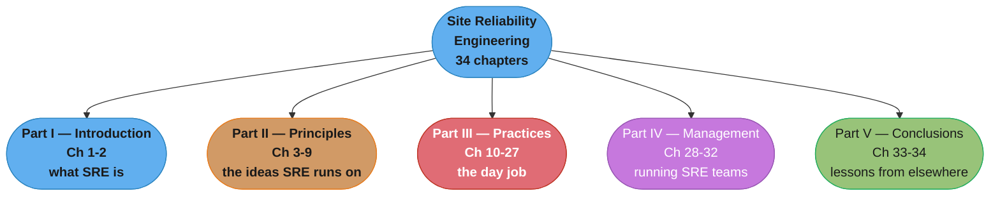
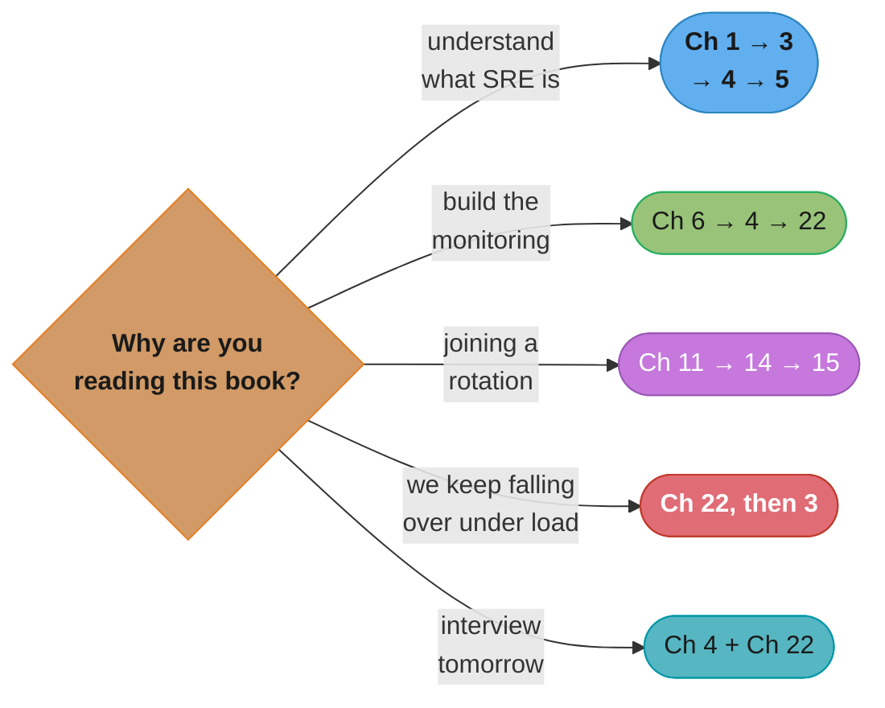

# Site Reliability Engineering: How Google Runs Production Systems

> Betsy Beyer, Chris Jones, Jennifer Petoff & Niall Richard Murphy (eds.) ·
> **1st edition, O'Reilly, April 2016** · 552 pages · ISBN 9781491929124 ·
> Freely readable in full at <https://sre.google/sre-book/table-of-contents/>.
> A **selected**, chapter-by-chapter summary — see "What This Folder Covers, and Why" below
> for exactly which of the book's 34 chapters are here and which are deliberately not.

---

## The Book's Thesis

Ben Treynor Sloss's one-line definition is the whole book compressed: SRE is "what happens when
you ask a software engineer to design an operations team." Everything else follows from taking
that sentence literally rather than treating it as a recruiting slogan.

The argument runs in one direction. A traditional operations team scales **linearly** with the
service it runs — twice the traffic, twice the machines, roughly twice the humans — because the
work is manual and the work grows with the system. That is not a staffing inconvenience, it is a
structural ceiling, and it arrives at exactly the moment a company can least afford it. Google's
answer is to staff operations with people who will not tolerate doing the same thing twice, cap
the fraction of their time that manual work is allowed to consume, and require the remainder be
spent engineering that work away.

Three mechanisms carry that principle from aspiration to practice, and they are the ideas the
rest of this repository cross-links to most:

- **The error budget.** Reliability is a *target*, not a maximum. `1 − SLO`, over a window, is a
  concrete quantity of failure the service is permitted to spend, and both the development team
  and the SRE team optimise against that same number. It converts a recurring political argument
  ("ship faster" versus "stop breaking things") into arithmetic that either team can check.
- **The toil cap.** At most 50% of an SRE's time may go to operational work; if a team exceeds it
  the excess is pushed back onto the development team, by policy, not by negotiation. The cap is
  what makes the automation actually get written.
- **Blameless postmortems.** A postmortem names systems and processes, never people — not out of
  politeness but because naming people reliably produces concealment, and a culture that conceals
  incidents cannot learn from them.

The book's most quietly radical claim is the one in Chapter 3: **100% availability is the wrong
target for essentially every service.** Each additional nine costs nonlinearly more while the
user's own device, home network, and ISP put a ceiling on what they can perceive anyway.
Reliability engineered past that ceiling is pure cost.

---

## The Five Parts (Part Map)

*Part II is where the book's transferable ideas live and this folder covers it almost entirely;
Part III is eighteen chapters of Google-specific practice from which this folder takes the six
that generalise; Parts IV and V are organisational and are summarised only in passing.*

The book's own arc: Part I says what SRE is and where it came from. Part II states the
principles — risk, SLOs, toil, monitoring, automation, release engineering, simplicity — and is
the part with the highest ratio of idea to Google-specific detail. Part III is the practice: how
Google actually pages, troubleshoots, runs incidents, writes postmortems, load-balances, and
survives overload. Part IV is management: onboarding, interrupts, embedding, communication,
engagement models. Part V looks outward at other high-reliability industries and closes.

---

## What This Folder Covers, and Why

**This is a selected subset — 11 of 34 chapters — and the selection is deliberate.**

Full coverage of a 552-page book would spend most of its length on Google-internal
infrastructure (Borg, Chubby, Bigtable, Rapid, MPM, Sisyphus, Viceroy) that a reader outside
Google cannot act on, and on management practices that only make sense inside Google's
particular org chart. The chapters below are the ones whose ideas the *rest of this repository*
actually cross-links to — the SLO vocabulary, the toil cap, the four golden signals, the
postmortem, the incident command structure, the cascading-failure playbook. Those ideas turn up
in `devops/`, `hld/`, and `backend/` modules repeatedly, and this folder is where they are
grounded in their source.

**Covered (11 chapters):**

| # | Chapter | Why it earned a slot |
|---|---------|----------------------|
| 1 | Introduction | The definition and the eight tenets everything else assumes |
| 3 | Embracing Risk | Where the error budget is actually derived; the "100% is the wrong target" argument |
| 4 | Service Level Objectives | The single most cross-referenced chapter in this repo — SLI/SLO/SLA |
| 5 | Eliminating Toil | The toil definition and the 50% cap; the mechanism that makes SRE differ from ops |
| 6 | Monitoring Distributed Systems | The four golden signals; symptoms vs causes; page/ticket/log |
| 8 | Release Engineering | Hermetic builds and the self-service release model — the most portable build idea in the book |
| 9 | Simplicity | Short, and quoted constantly: the virtue of boring, negative lines of code |
| 11 | Being On-Call | On-call as an engineering practice, with real numbers; and operational *underload* |
| 14 | Managing Incidents | Incident command, the roles, and the anti-patterns of an unmanaged incident |
| 15 | Postmortem Culture | What "blameless" does and does not mean, and how to make the culture stick |
| 22 | Addressing Cascading Failures | The deepest and most transferable chapter in Part III |

**Deliberately not covered, and the reason:**

| Chapters | Why not |
|----------|---------|
| 2 (The Production Environment at Google) | A tour of Borg, Chubby, GFS and Google's network. Interesting, but nothing in it transfers as *practice* — this repo's `devops/kubernetes_architecture/` covers the descendant ideas directly |
| 7 (The Evolution of Automation at Google), 16-21, 23-27 | Part III's Google-specific practice chapters: Borg-era automation history, Google's own outage tracker, its testing infrastructure, its frontend and datacenter load balancers, its cron, its pipelines. The *general* versions of load balancing, overload handling and consensus already have dedicated repo modules that go deeper than a summary would |
| 10 (Practical Alerting), 12 (Effective Troubleshooting), 13 (Emergency Response) | Real chapters, but heavily overlapped by Ch 6 (monitoring) and Ch 14 (incidents), which are covered. Worth adding later if the folder is extended |
| 28-32 (Part IV, Management) | Org design, interrupt handling, embedding an SRE, engagement models. This repo puts leadership and organisational material in `soft_skills/` instead |
| 33-34 (Part V, Conclusions) | Retrospective and outward-looking; no new mechanism |

If the folder is ever extended, the highest-value additions in order are **Ch 12 (Effective
Troubleshooting)**, **Ch 21 (Handling Overload)** as the natural partner to Ch 22, and
**Ch 17 (Testing for Reliability)**.

---

## Chapter Index

| # | Chapter | Part | Folder | One-line summary | Repo deep-dive |
|---|---------|------|--------|------------------|----------------|
| 1 | Introduction | I | [01_introduction/](01_introduction/01_introduction.md) | Sysadmin ops scales linearly; SRE staffs ops with engineers; the eight tenets | [devops/sre_principles_and_slos/](../../devops/sre_principles_and_slos/sre_principles_and_slos.md) |
| 3 | Embracing Risk | II | [03_embracing_risk/](03_embracing_risk/03_embracing_risk.md) | 100% is the wrong target; measuring risk as request success rate; the error budget | [devops/sre_principles_and_slos/](../../devops/sre_principles_and_slos/sre_principles_and_slos.md) |
| 4 | Service Level Objectives | II | [04_service_level_objectives/](04_service_level_objectives/04_service_level_objectives.md) | SLI vs SLO vs SLA; picking targets; percentiles; SLOs as a lever | [devops/case_studies/cross_cutting/slo_error_budget_math.md](../../devops/case_studies/cross_cutting/slo_error_budget_math.md) |
| 5 | Eliminating Toil | II | [05_eliminating_toil/](05_eliminating_toil/05_eliminating_toil.md) | The six-part toil definition, the 50% cap, what counts as engineering | [devops/sre_principles_and_slos/](../../devops/sre_principles_and_slos/sre_principles_and_slos.md) |
| 6 | Monitoring Distributed Systems | II | [06_monitoring_distributed_systems/](06_monitoring_distributed_systems/06_monitoring_distributed_systems.md) | Four golden signals; symptoms vs causes; black-box vs white-box; page/ticket/log | [devops/observability_metrics_prometheus/](../../devops/observability_metrics_prometheus/observability_metrics_prometheus.md) |
| 8 | Release Engineering | II | [08_release_engineering/](08_release_engineering/08_release_engineering.md) | Self-service, high velocity, hermetic builds, enforced policy | [devops/ci_cd_fundamentals/](../../devops/ci_cd_fundamentals/ci_cd_fundamentals.md) |
| 9 | Simplicity | II | [09_simplicity/](09_simplicity/09_simplicity.md) | Stability vs agility; the virtue of boring; negative lines of code; minimal APIs | [backend/microservices_fundamentals/](../../backend/microservices_fundamentals/microservices_fundamentals.md) |
| 11 | Being On-Call | III | [11_being_on_call/](11_being_on_call/11_being_on_call.md) | Balanced on-call, the 2-incidents-per-shift target, feeling safe, operational underload | [devops/incident_management_and_oncall/](../../devops/incident_management_and_oncall/incident_management_and_oncall.md) |
| 14 | Managing Incidents | III | [14_managing_incidents/](14_managing_incidents/14_managing_incidents.md) | Incident command, the four roles, the live state document, when to declare | [devops/incident_management_and_oncall/](../../devops/incident_management_and_oncall/incident_management_and_oncall.md) |
| 15 | Postmortem Culture | III | [15_postmortem_culture/](15_postmortem_culture/15_postmortem_culture.md) | Blameless does not mean consequence-free; triggers; making the culture stick | [devops/incident_management_and_oncall/](../../devops/incident_management_and_oncall/incident_management_and_oncall.md) |
| 22 | Addressing Cascading Failures | III | [22_addressing_cascading_failures/](22_addressing_cascading_failures/22_addressing_cascading_failures.md) | Overload, retry amplification, deadline propagation, load shedding, the recovery playbook | [backend/fault_tolerance_patterns/](../../backend/fault_tolerance_patterns/fault_tolerance_patterns.md) |

---

## Recommended Reading Path

- **The canonical four, in order:** Ch 1 → 3 → 4 → 5. This is the smallest set that makes the
  word "SRE" mean something specific rather than "ops with a better title." Ch 3 and Ch 4 are one
  argument split across two chapters — read them together or neither.
- **"I have to build the monitoring":** Ch 6 → Ch 4 → Ch 22. Golden signals first, then the SLO
  they should be measuring against, then the failure mode your alerting has to catch before it
  becomes unrecoverable.
- **"I am about to be on call":** Ch 11 → Ch 14 → Ch 15. What the rotation should feel like, what
  to do when it fires, what to do afterwards. Ch 11's *operational underload* section is the one
  most readers skip and the one that explains why a quiet rotation is also a problem.
- **"We keep falling over under load":** Ch 22 alone, then Ch 3 to decide how much falling over
  you are actually willing to buy. Ch 22 is self-contained and is the highest-yield single
  chapter in the book for a system-design interview.
- **Interview prep, minimum viable:** Ch 4 (SLI/SLO/SLA and error budgets) and Ch 22 (cascading
  failures, retry amplification, deadline propagation, load shedding). Between them they cover
  most of what an interviewer means by "tell me about reliability."

*Five goals over the same eleven chapters. Ch 4 and Ch 22 appear in three paths each — they are
the two the rest of this repository leans on hardest.*

---

## The Ideas Worth Carrying Out of This Folder

| Idea | Chapter | The one-sentence version |
|------|---------|--------------------------|
| Error budget | 3, 4 | `1 − SLO` is a budget both teams spend from, which replaces the ship-fast-versus-stay-up argument with arithmetic |
| SLI / SLO / SLA | 4 | An SLI is the measurement, the SLO is the target you hold yourself to, the SLA is the one with money attached — and the SLO must be tighter than the SLA |
| Toil, and its 50% cap | 5 | Manual, repetitive, automatable, tactical, no enduring value, scales with the service — capped by policy so the automation gets written |
| Four golden signals | 6 | Latency, traffic, errors, saturation — if you can only have four dashboards, have these |
| Symptoms over causes | 6 | Page on what the user experiences, not on what you guess causes it |
| Hermetic builds | 8 | A build that depends only on versioned, checked-in inputs, toolchain included, so an old revision rebuilds identically |
| Negative lines of code | 9 | Deleted code cannot break; removing a feature is a legitimate reliability win |
| At most 2 incidents per 12-hour shift | 11 | A concrete staffing constraint, not a vibe — exceed it and the postmortems stop being written |
| Operational underload | 11 | A rotation that never pages loses competence; that is why Google runs Wheel of Misfortune and DiRT |
| Incident command | 14 | Separate command, operational work, communication and planning — the failure mode is one hero doing all four |
| Blameless postmortem | 15 | Name systems, not people, because naming people produces concealment |
| Retry amplification | 22 | Retries multiply down the call chain — three levels retrying three times is up to 27x the backend load |
| Deadline propagation | 22 | Pass the remaining deadline down the chain so a backend never does work for a request that already timed out |

---

## Build Manifest

Per-file build status for this book. Update the row to `done` the moment a chapter file is
completed and diagram-linted.

| # | File | Status |
|---|------|--------|
| 1 | `01_introduction/01_introduction.md` | done |
| 3 | `03_embracing_risk/03_embracing_risk.md` | done |
| 4 | `04_service_level_objectives/04_service_level_objectives.md` | done |
| 5 | `05_eliminating_toil/05_eliminating_toil.md` | done |
| 6 | `06_monitoring_distributed_systems/06_monitoring_distributed_systems.md` | done |
| 8 | `08_release_engineering/08_release_engineering.md` | done |
| 9 | `09_simplicity/09_simplicity.md` | done |
| 11 | `11_being_on_call/11_being_on_call.md` | done |
| 14 | `14_managing_incidents/14_managing_incidents.md` | done |
| 15 | `15_postmortem_culture/15_postmortem_culture.md` | done |
| 22 | `22_addressing_cascading_failures/22_addressing_cascading_failures.md` | done |

Chapter numbers are the **book's** numbers, deliberately left non-contiguous. A reader who sees
`04_` next to `22_` should be able to open the book at that chapter and find the same material;
renumbering the folders 1-11 would break that and hide the fact that this is a subset.

---

## Cross-Reference Map (SRE book → repo deep dives)

| Book concept | Primary deep-dive module |
|--------------|--------------------------|
| SRE as a discipline, tenets, error budgets | [devops/sre_principles_and_slos/](../../devops/sre_principles_and_slos/sre_principles_and_slos.md) |
| SLI/SLO/SLA arithmetic, error-budget burn rates | [devops/case_studies/cross_cutting/slo_error_budget_math.md](../../devops/case_studies/cross_cutting/slo_error_budget_math.md) |
| Metrics collection, golden signals in practice | [devops/observability_metrics_prometheus/](../../devops/observability_metrics_prometheus/observability_metrics_prometheus.md) |
| Alerting design, dashboards | [devops/visualization_and_alerting/](../../devops/visualization_and_alerting/visualization_and_alerting.md) |
| Distributed tracing, the causes half of symptoms-vs-causes | [devops/observability_tracing_and_otel/](../../devops/observability_tracing_and_otel/observability_tracing_and_otel.md) |
| On-call rotations, incident command, postmortems | [devops/incident_management_and_oncall/](../../devops/incident_management_and_oncall/incident_management_and_oncall.md) |
| Release pipelines, hermetic builds, artifact promotion | [devops/ci_cd_fundamentals/](../../devops/ci_cd_fundamentals/ci_cd_fundamentals.md), [devops/artifact_and_registry_management/](../../devops/artifact_and_registry_management/artifact_and_registry_management.md) |
| Progressive rollout, canaries, rollback | [devops/deployment_strategies/](../../devops/deployment_strategies/deployment_strategies.md) |
| Retries, backoff, circuit breakers, bulkheads | [backend/fault_tolerance_patterns/](../../backend/fault_tolerance_patterns/fault_tolerance_patterns.md), [hld/resilience_patterns/](../../hld/resilience_patterns/resilience_patterns.md) |
| Load shedding, graceful degradation, overload | [hld/rate_limiting/](../../hld/rate_limiting/rate_limiting.md), [backend/rate_limiting_in_depth/](../../backend/rate_limiting_in_depth/rate_limiting_in_depth.md) |
| Deliberately injecting failure to find cascades | [backend/chaos_engineering/](../../backend/chaos_engineering/chaos_engineering.md) |
| Load testing to the breaking point | [devops/performance_and_load_testing/](../../devops/performance_and_load_testing/performance_and_load_testing.md), [backend/load_and_performance_testing/](../../backend/load_and_performance_testing/load_and_performance_testing.md) |
| DR, backups, the reliability floor under all of this | [devops/disaster_recovery_and_resilience/](../../devops/disaster_recovery_and_resilience/disaster_recovery_and_resilience.md) |
| Simplicity and service boundaries | [backend/microservices_fundamentals/](../../backend/microservices_fundamentals/microservices_fundamentals.md) |

---

## Further Reading

- The full book, free: <https://sre.google/sre-book/table-of-contents/>
- *The Site Reliability Workbook* (Beyer, Murphy, Rensin, Kawahara & Thorne, eds., O'Reilly 2018)
  — the companion volume of worked examples, also free at
  <https://sre.google/workbook/table-of-contents/>. It is where the SLO material of Ch 4 gets its
  step-by-step implementation treatment.
- *Building Secure and Reliable Systems* (Adkins et al., O'Reilly 2020), free at
  <https://sre.google/books/building-secure-reliable-systems/> — the security-and-reliability
  intersection the 2016 book leaves mostly untouched.
- O'Reilly catalog page: <https://www.oreilly.com/library/view/site-reliability-engineering/9781491929117/>
