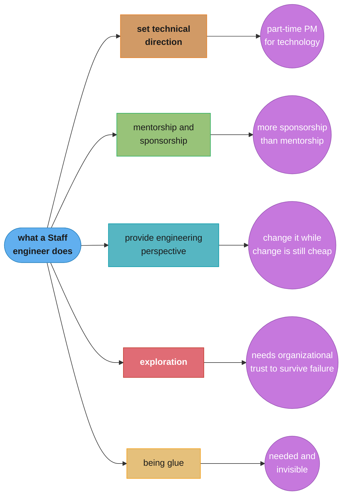
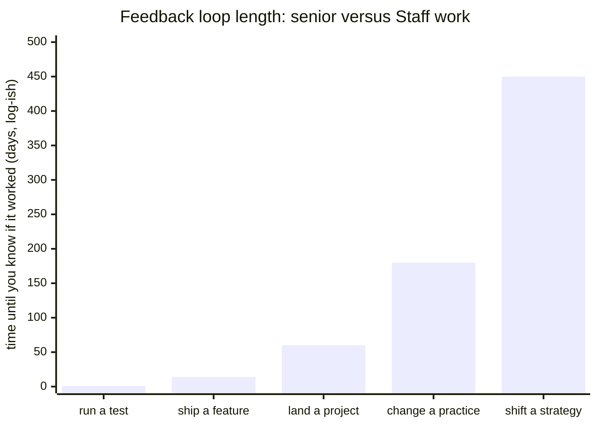

# Part 1: Overview

> Part 1 of 5 · Staff Engineer: Leadership Beyond the Management Track (Larson, 2021) · opens the book, leads to Part 2 (operating at Staff)

## Chapter Map

The book opens by naming the problem it exists to solve: there is a technical leadership track
that does not go through management, and the industry has documented it badly. A Senior engineer
who does not want to manage is told a Staff track exists, handed a career ladder written in
abstractions, and given no account of what the job actually consists of or how anyone got there.
Larson's response is not to write down his own experience — he is explicit that one person's
account is not general enough to be useful — but to interview more than a dozen Staff-plus
engineers across the industry and report the variation. Part 1 is the survey: what the roles are,
what the work is, and whether the title is worth wanting.

**TL;DR:**
- The book addresses the **pervasive ambiguity** around Staff-plus roles (Staff, Principal,
  Distinguished), and is built from interviews rather than from the author's own career alone.
- **"Staff engineer" is at least four different jobs**: **Tech Lead**, **Architect**, **Solver**,
  and **Right Hand**. They share a band and share very little else, and most industry arguments
  about "what Staff engineers do" are people describing different archetypes past each other.
- The work itself is **setting technical direction, mentorship and sponsorship, providing
  engineering perspective, exploration, and being glue** — and most of it runs on a feedback loop
  of weeks to years rather than the tight loop of writing code.
- The title is **material but not magic**: it buys you out of constantly re-proving your
  seniority, gets you into rooms, pays more, and grants some agency — and it does not make the
  hard parts easy, and the job it grants may not be the job you enjoyed.

## The Big Question

Should you want this, and if you do, which version of it are you actually asking for?

The framing problem Larson identifies is that the industry treats "Staff engineer" as one
destination, so the advice about it is contradictory. One person says Staff engineers stop coding;
another says the best ones code constantly. One says the job is deep technical ownership of a
domain; another says it is being an executive's technical proxy. Both are reporting accurately —
about different archetypes. The overview's job is to break the single word into its component
roles so that everything after it can be specific about which one it means, and so a reader can
tell which one their company actually hires for before they spend two years pursuing it.

---

## 1.1 Introduction

Larson states the scope and the method up front. The book covers **Staff-plus roles** — Staff,
Principal, and Distinguished engineer titles — as a single family, on the grounds that the shape
of the work is continuous across them even though the levels differ.

**The audience is two groups.** People already in Staff-plus roles, who mostly want validation
that the strange, low-feedback thing they are doing is the job; and people pursuing such a role,
who want practical aid in the pursuit. The second group is the one the industry serves worst,
because the available guidance is either a career ladder written to be legally defensible or one
successful person's idiosyncratic story presented as a method.

**The method is interviews.** Larson compiled the accounts of more than a dozen Staff-plus
engineers across the industry rather than generalizing from his own path. This is a load-bearing
choice, not modesty: the book's central finding — that the role varies enormously by company — is
only visible from many accounts, and would have been invisible from one.

**The organization is six sections**, and the book explicitly invites non-linear reading:
*"You can read this book cover to cover, but please jump around if you want. There's no right or
wrong way to read it."* The sections are Overview, Operating at Staff, Getting the title where
you are, Switching companies to get the title, Stories, and Resources.

---

## 1.2 Staff Archetypes

This is the book's most-cited section and the frame the rest of it runs on. Larson's caveat comes
first and is worth taking seriously: **"career ladders are a tool that applies better against
populations than people."** The archetypes describe recognizable shapes that Staff roles tend to
take; they are not boxes, and real people straddle them.

### Tech Lead

**The most common archetype.** A Tech Lead guides a single team, or a small cluster of teams,
through complex work. Larson notes they typically **partner closely with a single manager, but
sometimes with two or three**, and that the role emerges naturally in agile-focused organizations
where teams need someone holding technical direction across sprints. His rough density figure:
roughly **one Tech Lead per eight engineers**.

What the job consists of: maintaining the team's technical context, coordinating delivery,
defining and defending the technical vision — and deliberately delegating hands-on implementation
rather than hoarding it, because the coding work is how teammates grow.

### Architect

**Common in larger organizations.** An Architect owns direction, quality, and approach for a
critical domain — API design, storage, the frontend platform, infrastructure — rather than for a
team. The role requires combining **"in-depth knowledge of technical constraints, user needs, and
organization level leadership."**

Larson pushes back explicitly on the ivory-tower stereotype: effective Architects are not isolated
from the work. They maintain an **"intimate understanding of the business' needs, their users'
goals, and the relevant technical constraints"** — an Architect who has stopped touching the
system is producing decisions with no grounding, which is the failure mode the stereotype is
actually describing.

### Solver

**Common at companies that trust individuals over process.** A Solver is deployed onto whichever
knotty problem leadership has currently decided matters most: they go deep, resolve it, and move
on to the next one. The work is problem-shaped rather than team-shaped or domain-shaped.

The cost Larson names is **"the feeling of transience"** — the Solver leaves once the problem is
solved, and the team that inherits the solution did not build it and may not have the context to
maintain it. Relationships are correspondingly shallower than a Tech Lead's or an Architect's.

### Right Hand

**The rarest, and found only in very large organizations.** A Right Hand functions as an extension
of a senior leader — they **"operate with the borrowed authority of a senior leader"** and work on
problems at **"the intersection of the business, technology, people, culture, and process."**

The defining characteristic is the authority source: it is loaned, not earned locally, which makes
the role extremely effective and entirely dependent on the relationship with that executive. The
work is rarely purely technical.

### Choosing Between Them

Larson's practical advice: **match the archetype to what energizes you.** Tech Leads and Architects
build deep, ongoing relationships with teams and domains. Solvers and Right Hands trade that for
stronger executive alignment, broader scope, and more transactional, transient relationships with
the teams they touch. Neither is more senior; they are differently shaped.

---

## 1.3 What Do Staff Engineers Actually Do?

Having split the title into archetypes, the book describes the work that recurs across all of
them. Five activities, plus a hard look at how much code is involved.

### Setting Technical Direction

Staff engineers are the organization's advocate for its technology — Larson's image is that they
are **like the Lorax, who speaks for the trees.** But the guide immediately narrows what that
means: the job is **"far more about understanding and solving the real needs of the organization"**
than about advancing technologies you personally find exciting. The framing he lands on is
**"part-time product manager for technology"** — technical direction is a product problem, with
users (the engineers), requirements (what the business actually needs), and a roadmap.

The disposition required is **"pragmatic, deliberate, and focus[ed] more on the long-term trend of
progress"** than on winning any individual decision.

### Mentorship and Sponsorship

Larson's claim is unambiguous: you **"change your company's long-term trajectory by growing the
engineers around you,"** not by personal heroics. Mentorship is **"sharing your experience and
advice, along with building an ongoing relationship."**

The specific correction he makes is on the ratio. Effective Staff engineers pair a **moderate
amount of mentorship with considerably more sponsorship** — actively spending their own standing
to advance colleagues, rather than only advising them. Advice is cheap and comfortable to give;
sponsorship costs something, which is precisely why it moves people.

### Providing Engineering Perspective

Organizations make consequential decisions — reorganizations, hiring plans for scarce roles,
vendor choices, deadline commitments — in rooms that often have no engineer in them. A Staff
engineer's value here is timing: getting to **"inject the engineering context and perspective into
a decision while it's still possible to change the outcome."** These moments are usually
unscheduled and time-sensitive; the ability to give a useful answer immediately, on incomplete
information, is the skill.

### Exploration

Most engineering work is hill-climbing: incremental, well-defined improvement of something that
exists. Exploration is the opposite — taking on an **"ambiguous, important problem"** whose shape
is not yet known. Larson calls it the **most rewarding and riskiest work** available, and is
specific about the prerequisite: it requires substantial **organizational trust**, because the
organization must accept that failure here reflects the problem's difficulty rather than your
capability. An engineer without that trust cannot be given exploratory work, no matter how capable.

### Being Glue

Larson borrows **Tanya Reilly's** framing directly: glue work is the **"needed, but often
invisible, tasks to keep the team moving forward."** Noticing the gap, writing the summary,
chasing the decision nobody owns, unblocking two teams who have stopped talking. It is unglamorous
and high-impact, and its invisibility is the reason it is distributed unevenly.

### Do Staff Engineers Write Code?

The honest answer the interviews produce: **occasionally, and far less than before.** Katie
Sylor-Miller describes writing **"little bits of JS or PHP here and there, but it's mostly to
unblock teams."** Joy Ebertz observes that **"the higher you get, the more your job becomes about
mentoring"** rather than about writing code.

Larson's sharpest line here is a diagnostic rather than a rule: if you are getting regular full
weeks of coding, that is a signal you may be working on **"something comfortable rather than
important."** The point is not that coding is beneath the role — it is that coding is the
comfortable default, and the work with the highest leverage rarely looks like it.

### Timeframes

The structural change nobody warns you about: Staff work operates on **"weeks, months, and
years."** A senior engineer's feedback loop is a test run. A Staff engineer's is a strategy that
either did or did not change how the organization builds things, eighteen months later. Larson
notes this **"can feel surprisingly demoralizing"** at first — and reports that of the engineers
he interviewed, **none regretted the transition.**

---

## 1.4 Does the Title Even Matter?

The section that keeps the book honest, because the answer is qualified. Larson gives four
concrete arguments for the title and then two real caveats.

### Four Reasons It Matters

**1. It bypasses the informal seniority gauge.** Without a title, you re-prove your seniority in
every new room, with every new colleague, on every new project. With one, as one interviewee puts
it, **"you don't have to spend so much energy putting your credentials on the table."** Larson
notes this benefit is largest for people whose background does not match the ambient stereotype of
an experienced engineer — for them the informal gauge is not merely tiring, it is systematically
miscalibrated.

**2. It gets you a seat at the table.** The title provides **"a seat at the table in higher-level
engineering discussions that occur at a level above individual projects and teams"** — the rooms
where a decision is still cheap to influence, which is the same leverage argument as "providing
engineering perspective" above.

**3. Compensation.** Most companies set a Staff band meaningfully above Senior, and the effect
compounds over a career — particularly if you choose employers that price the distinction well.

**4. Agency over what you work on.** Not universal, and usually paired with correspondingly higher
accountability, but real: Staff engineers often get more latitude in choosing their problems.

### The Caveats

**Material but not magic.** The title removes friction; it does not solve problems. An engineer
expecting the title to make people agree with them will be disappointed — Part 2 opens on exactly
that misconception.

**It is a different job.** This is the caveat that matters most and gets the least attention. The
Staff role is not more of what you were doing; it is other work. If what energized you about
engineering was the tight loop of building things, the promotion may remove the part of the job you
liked and replace it with meetings, documents, and eighteen-month feedback cycles. That is a
legitimate reason not to pursue it, and Larson treats it as one rather than as a failure of
ambition.

---

## Beyond the book — what has and hasn't held up since 2021

> Everything above is what the 2021 book says. This section is not the author's; it records where
> the industry has moved since publication, which a 2021 text obviously cannot. The archetypes
> and the "material but not magic" argument are unchanged; the market conditions the book's
> Part 4 assumes are not.

The **four archetypes have aged well** and are now the common vocabulary for the role — they show
up in company career ladders, in job descriptions, and in Reilly's 2022 book, which does not use
Larson's exact four but covers overlapping ground with its "what shape is your role?" section.

Two of the book's background assumptions have moved:

- **The hiring market.** Part 4's core tactic — keep interviewing until you find a company willing
  to grant the title — was written in and for a market where Staff-plus openings were plentiful
  and competition for senior engineers was intense. The 2022-2024 correction made that strategy
  slower and more selective. The *logic* still holds (the title is granted for circumstantial
  reasons and interviewing arbitrages that), but the expected timeline does not.
- **What the work includes.** The book predates the widespread adoption of LLM-based tooling in
  engineering organizations. "Do Staff engineers write code?" reads differently when a substantial
  share of routine implementation is delegated to a model — if anything it sharpens Larson's
  diagnostic, since the comfortable-coding trap is now cheaper to fall into.

Nothing in this section contradicts the book. This repo's
[soft_skills/ai_era_engineering_leadership/](../../../soft_skills/ai_era_engineering_leadership/ai_era_engineering_leadership.md)
covers the second point as its own subject.

---

## Visual Intuition

The archetypes differ along two axes that are easy to state and easier to see: how broad the scope
is, and where the authority comes from.

```
                        WHERE AUTHORITY COMES FROM

              earned locally                    borrowed from a leader
            (your track record)                  (an exec's mandate)
          +--------------------------+--------------------------+
   narrow | TECH LEAD                |                          |
   scope  |   one team or a small    |                          |
   (one   |   cluster                |                          |
   thing  |   ~1 per 8 engineers     |                          |
   at a   |   deep team bonds        |                          |
   time)  +--------------------------+--------------------------+
          | ARCHITECT                | SOLVER                   |
   broad  |   one critical domain    |   whichever problem is    |
   scope  |   (API, storage, infra)  |   currently most urgent   |
          |   deep domain bonds      |   transient by design     |
          +--------------------------+--------------------------+
   org-   |                          | RIGHT HAND               |
   wide   |                          |   an exec's extension     |
          |                          |   business + tech + people|
          |                          |   rarest; very large orgs |
          +--------------------------+--------------------------+

   Relationships:  TECH LEAD, ARCHITECT  ->  deep, ongoing
                   SOLVER, RIGHT HAND    ->  transactional, transient
```

Caption: the four archetypes are not four rungs — they are four positions on the scope and
authority axes. Larson's advice to pick by what energizes you is really advice about which column
you want to live in, since the relationship style follows from it.



Caption: the five recurring activities and the one-line correction Larson attaches to each. Every
correction pushes in the same direction — away from the version of the activity that feels like
senior engineering, toward the version that is organizational.



Caption: the structural change Larson says nobody warns you about. The satisfying part of
engineering was the left-hand bar; Staff work lives on the right, which is why the transition
"can feel surprisingly demoralizing" before it feels like anything else.

---

## Key Concepts Glossary

- **Staff-plus** — the family of titles above Senior that are not management: Staff, Principal,
  Distinguished. Treated as one continuous role shape throughout the book.
- **Pervasive ambiguity** — Larson's name for the problem the book exists to solve: the technical
  leadership track is real, widely offered, and almost entirely undocumented.
- **Tech Lead** — the most common archetype; guides one team or a small cluster, partners closely
  with one to three managers, roughly one per eight engineers, delegates implementation.
- **Architect** — owns direction and quality for a critical domain; must keep an intimate
  understanding of business needs, user goals, and technical constraints, not retreat from them.
- **Solver** — deployed onto whichever hard problem leadership deems most urgent; deep, then
  gone; carries "the feeling of transience."
- **Right Hand** — an executive's extension, operating with borrowed authority at the intersection
  of business, technology, people, culture and process; rarest, largest organizations only.
- **Part-time product manager for technology** — Larson's framing of setting technical direction:
  users, requirements, and a roadmap, aimed at the organization's real needs rather than your
  interests.
- **Sponsorship over mentorship** — the ratio correction: effective Staff engineers pair moderate
  mentorship with considerably more sponsorship, because sponsorship costs you something.
- **Engineering perspective** — injecting technical context into an organizational decision while
  it is still cheap to change the outcome.
- **Exploration** — taking on an ambiguous, important problem whose shape is unknown; the most
  rewarding and riskiest work, and it requires organizational trust to be survivable.
- **Being glue** — Reilly's term, adopted here: the needed but invisible work that keeps a team
  moving.
- **"Comfortable rather than important"** — Larson's diagnostic for regular full weeks of coding
  at Staff level.
- **Material but not magic** — the honest accounting of the title: it removes friction, it does
  not solve problems.

---

## Tradeoffs & Decision Tables

| Archetype | Scope | Authority | Relationships | Thrives when you like… |
|---|---|---|---|---|
| Tech Lead | One team or small cluster | Earned locally | Deep, ongoing | Shipping with a team you know well |
| Architect | One critical domain | Earned locally, domain-wide | Deep, domain-shaped | Owning a thing properly, over years |
| Solver | Whatever's most urgent | Earned, re-proved each time | Transient | Hard problems more than steady context |
| Right Hand | Organization-wide | Borrowed from an executive | Transactional | Operating at the business/tech boundary |

| The title gives you | The title does not give you |
|---|---|
| Freedom from re-proving your seniority constantly | Agreement — people still have to be convinced |
| Access to rooms where decisions are still cheap | The ability to make a decision alone |
| A higher compensation band, compounding | The job you had before, with a better name |
| Some agency over what you work on | Lower accountability; usually the opposite |

| Signal | What it probably means |
|---|---|
| You get regular full weeks of coding | You may be on something comfortable, not important |
| Nobody asks you into unscheduled decisions | You are not yet providing engineering perspective |
| You are given exploratory work | You have organizational trust; protect it |
| You feel no feedback for months | Normal for the level; not evidence you're failing |

---

## Common Pitfalls / War Stories

- **Arguing about "what Staff engineers do" without naming an archetype.** Two people describing a
  Tech Lead and a Right Hand will disagree about everything and both be right. Larson's split is
  useful mostly as a way to make these conversations specific.
- **Joining a company whose Staff roles are a different archetype than the one you want.** Most
  companies only hire one or two archetypes. An Architect-shaped engineer at a company that only
  has Solvers will be repeatedly told they are not delivering.
- **Retreating into architecture.** The ivory-tower Architect is a real failure mode, and Larson's
  correction is precise: it is not caused by thinking too abstractly, it is caused by losing
  contact with business needs, user goals, and current technical constraints.
- **Mentoring instead of sponsoring.** Advice is comfortable to give and easy to give a lot of.
  Sponsorship costs standing, which is why it is rationed, and why the ratio drifts toward
  mentorship without deliberate correction.
- **Treating the promotion as more of the same.** The single most common regret pattern the book
  is guarding against: pursuing the title because it is next, getting it, and finding the part of
  the job you loved has been removed.
- **Reading the slow feedback loop as failure.** A Staff engineer three months into a strategy has
  no evidence it is working, because evidence takes eighteen months. Interpreting the absence of a
  fast signal as a bad signal is a well-documented way to abandon the work early.
- **Being handed exploratory work without the trust to fail at it.** Exploration where the
  organization will read failure as incompetence is not exploration; it is a trap with a
  flattering description.

---

## Real-World Systems Referenced

The interviews behind Part 1 name working engineers and their employers directly, which is the
book's method rather than decoration. Quoted here: **Katie Sylor-Miller** (Frontend Architect at
Etsy) on how little code she writes, and **Joy Ebertz** (Senior Staff Software Engineer at Split)
on the shift from coding to mentoring. The **"being glue"** framing is credited to **Tanya
Reilly**, whose talk and essay of that name predates this book and whose own book
([`the_staff_engineers_path/`](../../the_staff_engineers_path/the_staff_engineers_path.md)) she
would publish the following year — she also wrote this book's foreword. The **Lorax** image for
technical advocacy is Larson's own borrowing from Dr. Seuss. The full set of interviews lives in
Part 5 and at <https://staffeng.com/stories/>.

---

## Summary

Part 1 exists because the Staff-plus track is real, widely offered, and badly documented, and
Larson's method is to fix that with interviews rather than autobiography. Its central contribution
is splitting the single title into four archetypes: the **Tech Lead**, the most common, guiding one
team or a small cluster at roughly one per eight engineers and deliberately delegating the code;
the **Architect**, owning a critical domain and required to stay close to business needs, user
goals and technical constraints rather than retreating from them; the **Solver**, deployed onto
whichever hard problem is most urgent and carrying the feeling of transience as a structural cost;
and the **Right Hand**, an executive's extension operating on borrowed authority at the boundary of
business, technology, people and process. Across all four the recurring work is the same five
things — setting technical direction as a part-time product manager for technology, pairing
moderate mentorship with considerably more sponsorship, injecting engineering perspective into
decisions while they are still cheap to change, exploring ambiguous important problems in a way
that requires real organizational trust, and being glue. Most Staff engineers write far less code
than they used to, and regular full weeks of coding is Larson's diagnostic for working on
something comfortable rather than important. The structural change is the feedback loop, which
stretches from a test run to eighteen months and can feel demoralizing before it feels like
anything else — though none of the engineers interviewed regretted the transition. On whether the
title is worth wanting, the answer is four concrete yeses — you stop re-proving your seniority, you
get into rooms where change is still cheap, you get paid more, and you get some agency — with two
honest caveats: it is material but not magic, and it is a genuinely different job that may not
contain the part of engineering you loved.

---

## Interview Questions

**Q: What are Larson's four Staff engineer archetypes, and what distinguishes them?**
**Short:** Tech Lead, Architect, Solver, and Right Hand — they differ in scope and where authority comes from.
The Tech Lead guides one team or a small cluster and is the most common. The Architect owns direction and quality for a critical domain like API design or storage. The Solver is deployed onto whichever hard problem leadership currently considers most urgent, then moves on. The Right Hand acts as an executive's extension on borrowed authority. Larson's caveat is that career ladders apply better against populations than people, so these are recognizable shapes rather than boxes.

**Q: Why does Larson say the ivory-tower Architect stereotype misses what actually goes wrong?**
**Short:** The failure isn't abstraction, it's losing contact with business needs, user goals, and real constraints.
Effective Architects maintain an intimate understanding of what the business needs, what users are trying to do, and what the technical constraints currently are. An Architect who has stopped touching the system produces decisions with no grounding — and that ungrounded output is what people actually mean when they complain about ivory towers. The fix is contact with reality, not less architectural thinking.

**Q: What does Larson mean by calling a Staff engineer a "part-time product manager for technology"?**
**Short:** Technical direction is a product problem with users, requirements, and a roadmap.
Setting technical direction is not advancing technologies you find exciting; it is far more about understanding and solving the real needs of the organization. Treating it as a product problem makes that concrete — the engineers are the users, the business's actual constraints are the requirements, and the disposition required is pragmatic, deliberate, and focused on the long-term trend of progress rather than on winning any individual argument.

**Q: What is Larson's correction on the ratio of mentorship to sponsorship?**
**Short:** Effective Staff engineers pair moderate mentorship with considerably more sponsorship.
Mentorship is sharing experience and advice within an ongoing relationship; it is comfortable to give and easy to give a lot of. Sponsorship is spending your own standing to advance someone, which costs you something and is therefore rationed. Larson's point is that the ratio drifts toward mentorship by default precisely because it is cheap, and that the thing which actually changes a colleague's trajectory is the expensive one.

**Q: What does Larson say about how much code Staff engineers write, and what's the diagnostic he attaches to it?**
**Short:** Occasionally and far less than before — and regular full weeks of coding signals comfortable rather than important work.
The interviews are consistent: Katie Sylor-Miller writes little bits of JS or PHP mostly to unblock teams, and Joy Ebertz notes the job becomes more about mentoring the higher you go. Larson's addition is a diagnostic rather than a prohibition. Coding is the comfortable default for someone who got here by being good at it, and the highest-leverage work at this level rarely looks like it — so a steady diet of coding weeks is worth investigating.

**Q: Why does Larson say exploration requires organizational trust?**
**Short:** The organization must read failure as the problem being hard, not as you being incapable.
Exploration means taking on an ambiguous, important problem whose shape is not yet known, which he calls the most rewarding and riskiest work available. Its risk is not technical — it's that ambiguous problems frequently do not resolve. An engineer without accumulated trust who fails at one is read as having failed personally, so exploration handed to someone without that standing is a trap wearing a flattering description.

**Q: What is "being glue," and where does the term come from?**
**Short:** Tanya Reilly's term for the needed but often invisible work that keeps a team moving forward.
Larson adopts it directly. Glue work is noticing the gap, writing the summary nobody asked for, chasing the decision that has no owner, unblocking two teams who stopped talking. It is unglamorous and genuinely high-impact, and its invisibility is precisely why it gets distributed unevenly across a team — which is a theme both this book and Reilly's own return to.

**Q: What changes about the feedback loop at Staff level, and why does Larson warn about it?**
**Short:** Work moves to a weeks-to-years timescale, which can feel surprisingly demoralizing at first.
A senior engineer's loop is a test run or a shipped feature. A Staff engineer's is a strategy that either did or did not change how the organization builds things, visible eighteen months later. Larson names the demoralization explicitly because the natural reading of "no feedback for months" is "I am failing," when it is simply the level's normal texture — and he notes that none of the engineers he interviewed regretted the transition.

**Q: What are Larson's four arguments that the Staff title matters?**
**Short:** It ends constant re-proving of seniority, gets you in the room, pays more, and grants some agency.
First, you stop spending energy putting your credentials on the table in every new context — a benefit that is largest for people whose background doesn't match the ambient stereotype of a senior engineer. Second, it buys a seat in higher-level discussions above individual projects, where input is still cheap to incorporate. Third, most companies set a meaningfully higher band, and the effect compounds. Fourth, more latitude in choosing your work, usually paired with higher accountability.

**Q: What does "material but not magic" mean, and what's the second caveat Larson attaches to the title?**
**Short:** The title removes friction but solves nothing — and it grants a genuinely different job.
Material but not magic means people still have to be convinced; the title buys attention, not agreement. The second caveat gets less attention and matters more: the Staff role is not more of what you were doing, it is other work. If the tight loop of building things is what energized you, the promotion may remove exactly that and replace it with documents, meetings, and eighteen-month feedback cycles — which Larson treats as a legitimate reason to decline rather than as a failure of ambition.

**Q: Why did Larson build the book from interviews rather than from his own career?**
**Short:** The book's central finding — that the role varies enormously by company — is invisible from one account.
He is explicit that one person's experience, including his own, isn't general enough to be useful for a role this poorly documented. The method is load-bearing rather than modest: the archetypes only become visible once you have more than a dozen accounts side by side and can see that people are describing structurally different jobs under one title. A single-author account would have produced a confident, narrow, and misleading description.

**Q: What is "providing engineering perspective," and why is timing the whole point?**
**Short:** Injecting technical context into an organizational decision while changing the outcome is still possible.
Reorganizations, hiring plans for scarce roles, vendor choices and deadline commitments get decided in rooms that frequently contain no engineer. The value isn't having the perspective — it's delivering it before the decision has hardened, which is usually unscheduled and time-sensitive. The skill being tested is giving a useful answer immediately on incomplete information, which is why access to the room is a prerequisite rather than a perk.

**Q: How should you choose which archetype to aim for?**
**Short:** By what energizes you — the archetypes differ in relationship style, not in seniority.
Tech Leads and Architects build deep, ongoing relationships with a team or a domain and get the satisfaction of owning something properly over years. Solvers and Right Hands trade that for broader scope and stronger executive alignment, at the cost of transient, transactional relationships with the teams they touch. Neither pair is more senior. Larson's practical addition is that most companies only hire one or two archetypes, so check which ones exist before committing years to pursuing another.

**Q: What is the "pervasive ambiguity" the book exists to address?**
**Short:** The technical leadership track is real and widely offered, and almost entirely undocumented.
A Senior engineer who does not want to manage is told a Staff track exists, handed a career ladder written in abstractions general enough to be legally defensible, and given no account of what the job consists of or how anyone reached it. The available alternative is one successful person's idiosyncratic story presented as a method. The book's two audiences follow from this: people already in the role wanting validation, and people pursuing it wanting practical aid.

**Q: What does Larson mean by the Staff engineer as "the Lorax who speaks for the trees"?**
**Short:** Someone has to advocate for the technology itself, since nothing else in the org will.
The image captures why technical direction needs an owner: product advocates for features, the business advocates for revenue, and the state of the systems has no natural constituency. But Larson narrows it immediately — the advocacy is for the organization's real technical needs, not for technologies you personally find exciting, and the disposition required is pragmatic and long-term rather than adversarial.

**Q: Which archetype is most common, and roughly how many does an organization have?**
**Short:** Tech Lead, at roughly one per eight engineers, emerging naturally in agile-focused companies.
It is the archetype most organizations recognize and staff by default, because teams running sprints need someone holding technical direction across them. Larson's density figure of about one Tech Lead per eight engineers is worth knowing because it explains why the other three archetypes are rarer: they aren't scaled to headcount the same way, so Architects appear only in larger organizations and Right Hands only in very large ones.

---

## Cross-links in this repo

- [soft_skills/staff_plus_archetypes/ — the archetypes as their own subject, beyond this book](../../../soft_skills/staff_plus_archetypes/staff_plus_archetypes.md)
- [soft_skills/mentorship_and_sponsorship/ — the ratio correction in depth](../../../soft_skills/mentorship_and_sponsorship/mentorship_and_sponsorship.md)
- [soft_skills/scope_impact_and_ownership/ — what scope means as seniority increases](../../../soft_skills/scope_impact_and_ownership/scope_impact_and_ownership.md)
- [soft_skills/engineering_career_ladders/ — the ladders Larson says apply to populations, not people](../../../soft_skills/engineering_career_ladders/engineering_career_ladders.md)
- Next part: [Part 2 — Operating at Staff](../02_operating_at_staff/02_operating_at_staff.md)
- Companion book: [The Staff Engineer's Path (Reilly) — Ch 1 What Would You Say You Do Here?](../../the_staff_engineers_path/01_what_would_you_say_you_do_here/01_what_would_you_say_you_do_here.md), which covers the same "what is this role" ground with a different frame.

## Further Reading

- The guides behind this part, free: <https://staffeng.com/guides/staff-archetypes/> ·
  <https://staffeng.com/guides/what-do-staff-engineers-actually-do/> ·
  <https://staffeng.com/guides/does-the-title-even-matter/>
- Reilly, Tanya — "Being Glue" — the source of the glue-work framing this part adopts.
- Larson, Will — *An Elegant Puzzle: Systems of Engineering Management* (Stripe Press, 2019) — the
  management-track predecessor by the same author.
