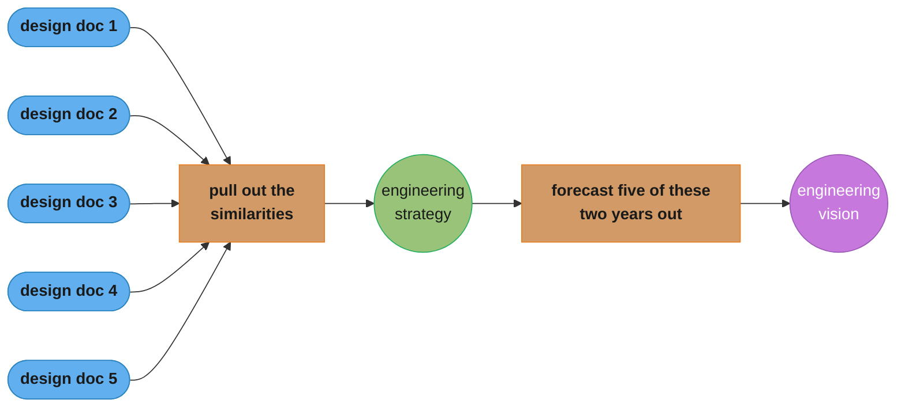
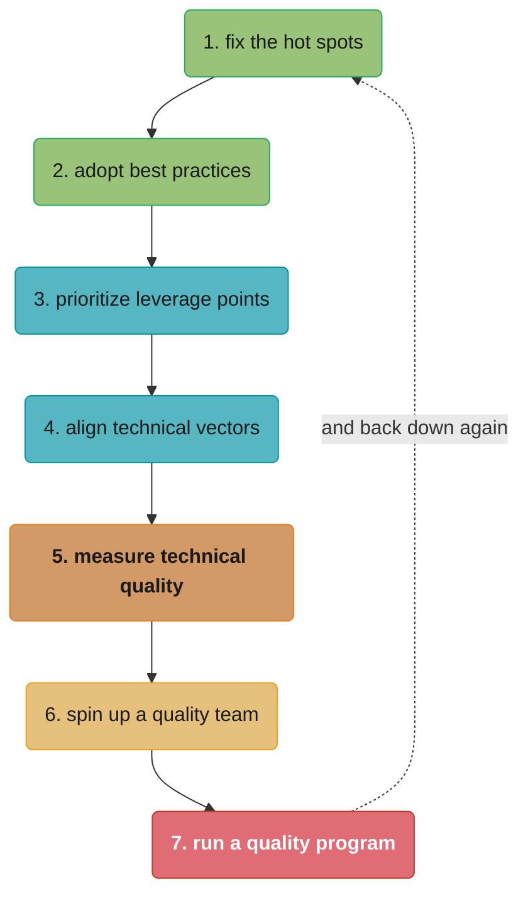

# Part 2: Operating at Staff

> Part 2 of 5 · Staff Engineer: Leadership Beyond the Management Track (Larson, 2021) · builds on Part 1 (what the role is), leads to Part 3 (getting the title where you are)

## Chapter Map

Part 1 described what Staff engineers are. Part 2 is the only part of the book about actually
doing the work, and it is the longest — ten guides, of which one is an overview and eight are the
competencies it names. The organizing observation is a correction: there is a misconception that
you become a Staff engineer and then everyone listens to you, and the reality is the reverse. The
role demands competencies that earlier stages of the career neither taught nor rewarded, and
several of them — following, not being wrong, creating space for others — are the *opposite* of
what got you promoted.

**TL;DR:**
- The transition is a **learning curve, not a scaling-up**: less hands-on coding, more mentorship,
  relationships, and strategy, on a much slower feedback cycle than the visceral coding loop.
- The **eight competencies** are: work on what matters, write engineering strategy, curate
  technical quality, stay aligned with authority, learn to follow, learn to never be wrong, create
  space for others, and build a network of peers.
- **"Work on what matters"** is the most quotable guide in the book: avoid **snacking** (easy and
  low-impact), stop **preening** (visible and low-impact), stop **chasing ghosts** (your last
  company's problems), and instead do existential work, work where there is room and attention,
  growth, editing, finishing things, and what only you can do.
- **Engineering strategy has a recipe**: write five design documents and pull out the
  similarities; that is your strategy. Write five strategies and forecast them two years out;
  that is your vision.
- Your authority at this level is **loaned**, chiefly from your manager — so never surprise them,
  don't let them surprise you, and feed them context.

## The Big Question

You have the title. Nobody is doing what you say. What now?

Larson's answer is that the title never conferred the thing you assumed it did, and the
competencies that actually produce influence at this level are largely unlike the ones that
produced results at the previous one. A senior engineer succeeds by being right and fast. A Staff
engineer who optimizes for being right and fast produces a stream of correct decisions that nobody
implements, alienates the peers whose cooperation the work requires, and becomes the bottleneck on
every project they touch. The eight competencies are, viewed together, a systematic transfer of
the source of your effectiveness — from your own output to other people's.

---

## 2.1 Operating at Staff

The overview guide sets expectations before listing anything. The misconception it names directly:
that you become a Staff engineer and then everyone will listen to you. What actually happens is a
**significant learning curve**, because the work changes character.

**What changes.** Hands-on coding recedes; mentorship, relationship-building, and strategy expand.
The feedback cycle becomes **much slower** than the **visceral coding REPL** that made earlier
work satisfying, which Larson says can feel **quite demoralizing** at first — the same warning
Part 1 gives about timeframes, restated here as an operating condition rather than a curiosity.

**The eight competencies**, in the guide's order:

1. **Work on what matters** — prioritize high-impact work, especially as life commitments grow.
2. **Write engineering strategy** — guide the organization's technical decisions and structure.
3. **Curate technical quality** — keep architecture and software quality viable as systems grow.
4. **Stay aligned with authority** — your authority is proxied from managerial leaders; alignment
   is what keeps it.
5. **Learn to follow** — blend your vision with peers' rather than imposing it.
6. **Learn to never be wrong** — shift from proving correctness to understanding and
   communicating, which reduces relationship friction.
7. **Create space for others** — build the team's strength beyond your individual contribution.
8. **Build a network of peers** — for honest feedback and decision support.

The guide notes that **mentorship, sponsorship, and being glue** are equally essential and points
readers to the canonical treatments of each rather than duplicating them — which is why they
appear in Part 1's description of the work rather than as competencies here.

---

## 2.2 Work on What Matters

The book's most-quoted guide, and the one whose vocabulary escaped into the industry. Its
structure is four anti-patterns followed by five positive patterns.

### The Three Traps

**Snacking.** Choosing easy, low-impact work over hard, high-impact work. Snacking is genuinely
pleasant — tasks complete, tickets close, the day feels productive — and it teaches you almost
nothing while occupying the hours that could have gone somewhere that mattered. Larson's remedy is
unglamorous: deliberately track how your time splits between high-impact and low-impact work,
because the feeling of productivity is not a signal you can trust at this level.

**Preening.** Low-impact but *high-visibility* work. Worse than snacking, because organizations
frequently confuse visibility with impact and will reward it — for a while. The long-run problem
is that accountability eventually arrives, and a reputation built on preening does not survive it.
The framing Larson uses: optimize for the intersection of **valued work and self-growth**, not for
your company's pathologies, because the pathologies change and your skills do not.

**Chasing ghosts.** A new leader arrives and invests heavily in solving their *previous*
company's problems. The pattern is common and sincere — you genuinely learned those lessons — and
it produces solutions to problems the current organization does not have, while ignoring the ones
it does. Larson's rule: **"taking the time to understand the status quo before shifting it will
always repay diligence with results."**

### The Five Positive Patterns

**Existential issues.** Companies are in an **"iterative elimination tournament"** — surviving each
round is the precondition for having a future to invest in. When a genuine existential threat is
live (running out of money, a stability crisis that is losing customers), it is the legitimate
priority and everything else waits. The corollary matters too: most "urgent" work is not
existential, and treating it as such is how organizations exhaust themselves.

**Work where there's room and attention.** The counterintuitive one. Leadership's top priority
already has everyone's attention and everyone's headcount, so your marginal contribution there is
small. The higher-leverage move is a priority that will **become** critical soon and currently has
room for someone to actually do something. This is a bet, and the bet is on your reading of where
the organization is heading.

**Foster growth.** Mentoring and onboarding are chronically under-invested in, and Larson's claim
is quantitative in spirit: they are **at least as impactful as hiring** to your company's
engineering velocity. Hiring gets a budget, a recruiter, and a dashboard; onboarding gets a wiki
page from 2019.

**Edit.** Small changes, quick modifications, and short conversations that redirect work already
in flight. Editing uses your organizational privilege and accumulated experience for
disproportionate impact — a five-minute comment on a design doc that changes six months of a
team's direction is the archetype. It requires being early and being trusted.

**Finish things.** Completing a stalled project converts it **"from risk to leverage."** An
80%-done project is pure liability: it consumes maintenance attention, blocks the things behind
it, and delivers nothing. This is why the *time* you spend finishing has value out of proportion
to the work remaining.

**Do what only you can.** Work at the intersection of your exceptional capabilities and your
genuine interests — the tasks that **"simply won't happen if you don't do them."** Not everything
you are uniquely good at qualifies; the test is whether it would otherwise go undone.

### Why It Matters

Larson's closing argument is about what actually compounds. Career advancement at this level runs
on accumulated expertise and reputation rather than on a documented list of shipped projects,
which makes genuinely valuable work **"the only viable long-term bet"** — preening pays faster and
stops paying.

---

## 2.3 Writing Engineering Strategy

The guide that turns "write a strategy" from an intimidating abstraction into a procedure.

### Definitions

**Strategy** consists of **diagnosis and guiding policies** — it explains the reasoning behind
decisions, and it functions as a **tool of proactive alignment that empowers teams to move quickly
and with confidence.** The purpose is speed, not control: a team that understands the reasoning
can make consistent decisions without asking.

**Vision** extrapolates strategy forward. It takes several strategies and projects how they
interact over **two to three years**, producing **"a robust belief in the future"** that people
can plan against.

### The Five Design Documents Method

The book's most practically useful recipe, and it is two sentences:

> **"Write five design documents, and pull the similarities out. That's your engineering
> strategy."**
>
> **"Write five engineering strategies, and forecast their implications two years into the
> future. That's your engineering vision."**

The reason this works is that design documents are concrete — a specific problem, a survey of
options, a chosen approach with reasoning. Strategy extracted from five of them is grounded in
decisions that were actually made, which is what stops teams from reading an abstract strategy
document five different ways.

### Writing Design Documents

- **"Start from the problem."** Clarity about the problem makes the solution mostly obvious;
  ambiguity about it makes every solution defensible.
- **"Gather and review together, write alone."** Collect input widely, then have exactly one
  author. Committee-written documents lose their argument.
- **"Prefer good over perfect."** A document that ships and gets used beats a better one that
  arrives two months later.

### Writing Strategy

- **"Start where you are"** — the ambiguity does not resolve before you write, it resolves because
  you write.
- **"Write the specifics. Write until you start to generalize, and then stop."** The single best
  line in the guide, and the most-violated: generalization is where strategy documents go to
  become unfalsifiable.
- **"Be opinionated"** and **"show your work"** — the opinion is what makes it useful, and the
  reasoning is what lets someone modify it correctly later when circumstances change.

### Writing Vision

Write **two to three years out**. **Ground it in your business and your users**, not in
technology trends. Stay **concrete and specific**, in **one to two pages**. And expect the
reception to be muted — a vision document does not produce applause. Larson's success metric is
indirect and better: **the design documents that get written afterward improve.**

---

## 2.4 Manage Technical Quality

Presented as a staircase of seven approaches, ordered from cheapest to most elaborate, with a
strong instruction to climb it slowly.

| # | Approach | What it is | When it's the right rung |
|---|---|---|---|
| 1 | **Fix the hot spots** | Measure, find where the bulk of the pain is, fix precisely that | Always start here |
| 2 | **Adopt best practices** | Roll out version control, trunk-based development, CI/CD, observability | A known-good practice is genuinely missing |
| 3 | **Prioritize leverage points** | Invest deliberately in interfaces, stateful systems, and data models | The recurring damage traces to a few structures |
| 4 | **Align technical vectors** | Get the org pulling one direction — feedback, strategy, tooling, onboarding, Conway's Law | Teams are locally sensible and globally incoherent |
| 5 | **Measure technical quality** | Define quality precisely enough to count it | You need to know whether anything is working |
| 6 | **Spin up a quality team** | A dedicated 3–6 person team on developer productivity and tooling | The work is continuous and nobody owns it |
| 7 | **Run a quality program** | Org-wide initiative with program management, goals, dashboards, nudges | The problem spans every team at once |

### The Rungs in Detail

**1. Fix the hot spots.** Larson's instruction is to **"don the performance engineer's
mindset. Measure the problem at hand, identify where the bulk of the issue occurs, and focus on
precisely that area."** The mistake this replaces is reaching for a process change — an
accountability ritual, a new review gate — when the actual problem is a slow test suite or one
error-prone design that everything routes through.

**2. Adopt best practices.** The critical qualifier: **"a good process is evolved"** rather than
mandated. The rollout that works is study how others did it, experiment with an engaged team,
refine on their feedback, then expand gradually. And **limit yourself to one practice at a time** —
concurrent rollouts compete for the same limited organizational patience.

**3. Prioritize leverage points.** Three structures repay deliberate investment because mistakes
in them are expensive to reverse: **interfaces**, **stateful systems**, and **data models**. For
interfaces, the concrete test is to **integrate half a dozen clients against a mocked
implementation** before committing to the design. For stateful systems, **exercise the failure
modes** rather than the happy path. The reasoning behind singling out state: **"state gets complex
faster than other systems."**

**4. Align technical vectors.** The levers are direct feedback, a refined engineering strategy,
deliberate tooling choices, onboarding and training, and organizational design — because
**"organizations build software that reflects their structure"**, which makes Conway's Law itself
a quality lever rather than only an observation.

**5. Measure technical quality.** Move from proxy metrics to definitions precise enough to count.
Larson's examples are deliberately narrow: **"what percentage of code is statically typed?"** and
**"how many hot files exist which are changed in more than half of pull requests?"** The principle:
**"the more detailed you can get your definition of quality, the more useful it becomes to measure
a codebase."**

**6. Spin up a technical quality team.** Three to six people on developer productivity and
tooling. Operating principles: trust the metrics over intuition, stay embedded in real code so
your understanding stays current, do genuine user research on the tools you build, and — the one
most such teams violate — **"do fewer things, but do them better,"** because a quality team
shipping many half-finished tools drags the whole organization down.

**7. Run a quality program.** Org-wide, with dedicated program management: find a sponsor,
generate sustainable metrics, set team-specific goals with a visible path to success, build the
supporting tools, publish transparent dashboards, send programmatic nudges, and review progress
with leadership. The warning attached: **"the program isn't the goal. The goal is to create
technical quality."**

### The Two Framing Rules

**"Do the quick stuff first!"** Start with the lightest approach that could work, because
elaborate solutions built before simple ones were tried are expensive and frequently unnecessary.

**Nobody climbs this linearly.** Larson is explicit: **"you're more likely to fix a quality hot
spot, roll out a best practice, start running an architecture review, abolish that architecture
review, and go back to hot-spotting for a bit."** And the closing frame: **"Technical quality is a
long-term game. There's no such thing as winning, only learning."**

---

## 2.5 Staying Aligned with Authority

The guide that names the structural fact underneath every other competency: **your authority at
this level is loaned, not inherent.** It flows from association with organizational authority,
chiefly your direct manager, and it is withdrawable.

### Beyond the Safety Net

The support systems that carried you through earlier career stages are gone. Nobody is
constructing a development plan for you or ensuring you are set up to succeed. At this level you
**align the pieces around you for your own success** — which sounds like a burden and is also the
thing that makes the role autonomous.

### Serving at the Pleasure of the President

Three alignment practices, in Larson's order of importance:

**1. Never surprise your manager.** **"Nothing destroys trust faster than surprising your
manager."** The strong version of this is procedural: when a surprise does happen, treat it as an
incident — figure out what information path failed and repair the path, not just the relationship.

**2. Don't let your sponsor surprise you.** The reciprocal, and the one people neglect. Managers
do not reliably relay everything relevant; assuming they will is a failure of your own information
gathering. The fix is proactive — weekly written updates that invite correction, and direct
questions in 1:1s rather than waiting to be told.

**3. Feed your manager's context.** Share what you are seeing across the organization, with data
and specific observations. The framing matters: you are **providing useful information**, not
handing them a problem to solve. A Staff engineer who only ever escalates becomes a source of
work; one who supplies context becomes a source of leverage.

### Influencing Without Too Much Friction

The synthesis: keep your own perspective, and merge it with the senior leaders' vision rather than
substituting for it. Larson's claim is that this compounds — you can **influence your
organization's leaders immensely over time** precisely by staying **in tight alignment at each
step along the way.** The engineer who is right and misaligned gets one loud disagreement and
diminishing access; the one who stays aligned gets a hundred small corrections that add up to more.

---

## 2.6 To Lead, You Have to Follow

The competency that reads as a paradox and is the book's clearest statement of what changes at
this level: **"the most effective leaders spend more time following than they do leading."**

### The Paradox

A strong leader with a clear vision attracts followers who depend on that vision staying
consistent — which is exactly what makes the approach hit a ceiling. Larson's formulation:
**"continued growth requires learning to incorporate your worldview into the worldviews of those
around you, accelerating overall progress around you even if it means tolerating a detour from
your vision."** A leader who will not follow concentrates decision-making in themselves and stunts
the organization's capacity to produce other leaders.

### Three Practices

**Selective prioritization.** Ask: **"Will what we do here matter to me in six months?"** If not,
let someone else lead it. Most decisions do not survive that filter, and the ones that do deserve
your full attention precisely because you stopped spending it on the others.

**Support trustworthy leaders quickly.** **"Give your support quickly to other leaders who are
working to make improvements. Even if you disagree with their initial approach, someone trustworthy
leading a project will almost always get to a good outcome."** This is a bet on the person over the
plan, and it is what makes fast delegation possible.

**Non-blocking feedback.** Make it explicit when a suggestion is optional — language that clarifies
you are **sharing perspective rather than necessarily asking them to change their approach.** Given
the weight a Staff engineer's comment carries, silence about optionality reads as instruction.

The closing line: **"What you can accomplish alone is far from what you can accomplish by creating
leaders."**

---

## 2.7 Learn to Never Be Wrong

The title is deliberately provocative and the content is its opposite: the guide is about how to
be right *without dominating the room*, by pairing technical depth with deep pragmatism. The
paradox it names is holding strong perspectives while staying genuinely skeptical of your own
assumptions.

### Listen, Clarify, and Read the Room

**Listen through questions.** **"Good questions are asked with the desire to learn, and they are
specific."** A specific question asked to learn creates psychological safety and shifts the power
dynamic in a contentious meeting away from whoever is currently talking loudest.

**Define the purpose.** State the goal explicitly: *"Just to check, our goal here is to decide
whether to postpone launching the project by two weeks?"* This routinely saves an hour. The caveat
is real — overusing it turns every conversation into a procedural negotiation, so it is a tool for
meetings that have drifted, not a ritual.

**Read the room.** Notice when participants are too far apart to converge in this format, and
respond structurally: identify the subgroup that needs a deeper conversation, or escalate. Larson's
image: **"If there's simply too much stuff in the drawer, stop trying to shove it shut."**

### How to Practice

These are weekly skills, not annual ones. Document reviews, meetings, and pull requests are
constant, low-stakes venues for practicing all three.

### Handling Difficult People

For someone genuinely uncooperative, the guide is unsentimental: either include an authority figure
in the meeting, or invest heavily in pre-meeting alignment so the meeting is not where the
disagreement happens. If the behavior persists, document it and escalate through proper channels —
this is a management problem and pretending otherwise absorbs your time indefinitely.

---

## 2.8 Create Space for Others

The competency about deliberately becoming less essential — moving from being the go-to person to
building an organization that does not need one. Larson's reframe of a successful meeting: **one
where your presence wasn't necessary.**

### Discussions

- **Ask questions** rather than supplying answers — **"asking the right questions helps avoid
  missteps"** and pulls more people into the conversation.
- **Pull in individuals** one at a time. Directly inviting one specific person's view raises
  participation far more reliably than a general invitation to the room.
- **Take notes.** It normalizes note-taking, and it occupies you enough that others fill the space.
- **Invite missing voices** — notice who wasn't there and get them into the next one.

### Decisions

- **Document your thinking.** Writing down how you approached a problem lets others learn the
  method, not just the conclusion.
- **Gather feedback early**, before your position has crystallized, so the input can actually
  change something.
- **Distinguish style from substance.** Do not nitpick decisions that will not materially change
  the outcome; the cost of the nitpick is other people's willingness to decide anything.
- **Resist proving your value.** The pull to weigh in on everything is about your own standing,
  not the decision's quality.
- **Change your mind publicly.** Visibly updating on someone else's input is the strongest
  available signal that input is genuinely wanted.

### Sponsorship

The final step is transferring the critical work itself. Not involving someone in your project —
**make the work theirs.** Identify who would grow from a significant assignment, hand it over, back
them, and then let them run it their way. The consequence of not doing this is stated plainly: an
organization capped by one person's capacity, which cannot sustain long-term success.

---

## 2.9 Build a Network of Peers

Short guide, four practices, one theme: this is the competency that supplies honest feedback,
because your manager's feedback is shaped by their responsibilities and your reports' by the power
difference.

**Be visible.** Make yourself findable as a Staff-plus engineer — write about the work, speak at
conferences, or start smaller in industry Slacks and on social platforms. One interviewee's
account: **"Mostly, I enjoyed the people I met at conferences. Later the speaker networks led to
job opportunities for me."**

**Internal networks too.** Relationships across teams inside your own company form naturally
through the work, improve collaboration immediately, and eventually become external network as
those colleagues move on.

**Ambient networks.** Following industry leaders and reading widely. Lower cost, lower impact, and
a genuine option for people uncomfortable with active networking — Larson does not pretend it
substitutes for real relationships.

**Quality over quantity.** The concrete opening move: **"Find someone you respect and send them a
short 1-2 paragraph email or DM with a specific question asking for advice."** If they reply,
follow up occasionally, offer help when you can, and accept silence gracefully. Authentic
relationships with people you actually respect beat contact volume by a wide margin.

---

## 2.10 Present to Executives

The last competency, and the one with the highest cost of failure.

### Why It's Hard

Executives consume information in **preprocessed** ways, and each one is fluent in a particular
style. A pattern-matching executive needs detailed questions to engage; a data-driven one dismisses
an unsupported claim outright. Mismatching the style produces miscommunication — and the
distinguishing feature of this venue is that **you rarely get a second chance**, because the
meeting ends and the decision moves on.

### How to Communicate Effectively

**Know your purpose.** Planning, status reporting, or resolving a misalignment are three different
meetings. And the goal is usually to **extract the executive's perspective**, not to change their
mind.

**SCQA** — the opening-paragraph structure:

| Element | What goes here |
|---|---|
| **S**ituation | The relevant context, briefly |
| **C**omplication | Why that situation is a problem |
| **Q**uestion | The core question it raises |
| **A**nswer | Your best answer to it |

Barbara Minto's underlying claim, quoted in the guide: **"Controlling the sequence in which you
present your ideas is the single most important act necessary to clear writing."**

**The Pyramid Principle** — the advanced form. Group your argument hierarchically: three top-level
points, up to three sub-arguments each, ordered by importance rather than by chronology or by how
you discovered them.

**Nemawashi** — pre-align with stakeholders individually before the meeting, so the meeting
confirms rather than discovers. Gather peer feedback on the material first, and prioritize an
engaged discussion over completing your agenda.

### Mistakes to Avoid

- **Never fight feedback.** Receiving it badly costs more than the feedback itself.
- **Don't evade responsibility or hide a problem.** Executives are unusually well practised at
  detecting this.
- **"Don't present a question without an answer."** Bringing a problem with no proposed answer
  reads as delegation upward.
- **Don't present academically** — building slowly to a conclusion loses the room before you get
  there.
- **Don't fixate on your preferred outcome.** Decisions at this level are revisited more often
  than they are reversed, and treating one as final makes you harder to work with.

---

## Visual Intuition

The "work on what matters" guide is a two-axis grid, and drawing it makes the difference between
snacking and preening immediate.

```
                              IMPACT
                    low                     high
              +------------------+------------------------+
              |  PREENING        |  THE TARGET            |
      high    |                  |                        |
   visibility |  looks great,    |  existential issues    |
              |  does nothing    |  finish things         |
              |                  |  edit                  |
              |  rewarded until  |  what only you can do  |
              |  it isn't        |                        |
              +------------------+------------------------+
              |  SNACKING        |  QUIET LEVERAGE        |
      low     |                  |                        |
   visibility |  easy, pleasant, |  foster growth         |
              |  teaches nothing |  work where there's    |
              |                  |    room and attention  |
              |  feels like a    |                        |
              |  productive day  |  under-rewarded, and   |
              |                  |  it compounds          |
              +------------------+------------------------+

   CHASING GHOSTS is not on this grid: it is high-effort work aimed at
   a problem this company does not have. It can land in any quadrant and
   is worthless in all of them.
```

Caption: snacking and preening are both low-impact and are usually discussed as one mistake. They
are not — snacking fools you, preening fools the organization, and the organization's reward
signal is what makes preening the more durable trap.



Caption: Larson's recipe drawn out. The reason it works is direction of travel — strategy is
*extracted from* concrete decisions rather than *imposed on* them, which is what stops five teams
reading the same abstract document five different ways.



Caption: seven rungs, cheapest first — and the dashed edge is the point. Larson's own description
is that you fix a hot spot, roll out a practice, start an architecture review, abolish it, and go
back to hot-spotting. There is no winning, only learning.

---

## Key Concepts Glossary

- **Snacking** — choosing easy, low-impact work over hard, high-impact work; pleasant, feels
  productive, teaches nothing.
- **Preening** — low-impact but high-visibility work; more dangerous than snacking because the
  organization rewards it until accountability arrives.
- **Chasing ghosts** — solving your previous employer's problems at your current one; the fix is
  understanding the status quo before shifting it.
- **Iterative elimination tournament** — Larson's model of a company's existence: surviving this
  round is the precondition for any future round, which is what makes existential work legitimate.
- **Work where there's room and attention** — target the priority that will *become* critical
  rather than the one already crowded with leadership attention and headcount.
- **Edit** — small changes, quick modifications, and short conversations that redirect work
  already in motion, using organizational privilege for disproportionate impact.
- **Finish things** — completing a stalled project converts it from risk to leverage, which is why
  the remaining time has value out of proportion to the remaining work.
- **Do what only you can** — the intersection of your exceptional capabilities and your genuine
  interests; the test is whether it would otherwise not happen.
- **Strategy** — diagnosis plus guiding policies; a tool of proactive alignment so teams can move
  quickly and confidently without asking.
- **Vision** — several strategies extrapolated two to three years forward into a robust belief
  about the future; one to two concrete pages.
- **The five design documents method** — write five design docs and extract the similarities;
  that is your strategy. Five strategies forecast two years out is your vision.
- **"Write until you start to generalize, and then stop"** — the specificity rule that keeps a
  strategy document falsifiable.
- **Leverage points** — interfaces, stateful systems, and data models: the three structures where
  quality investment repays most, because state gets complex faster than other systems.
- **Aligning technical vectors** — getting the organization pulling one direction via feedback,
  strategy, tooling, onboarding, and org design, since organizations build software that reflects
  their structure.
- **Loaned authority** — a Staff engineer's authority is proxied from managerial leaders, not
  inherent, which is why alignment is a competency rather than a courtesy.
- **Never surprise your manager** — the first alignment rule; treat a surprise as an incident and
  repair the information path.
- **Non-blocking feedback** — explicitly marking a suggestion as optional, because a Staff
  engineer's unmarked comment reads as instruction.
- **SCQA** — Situation, Complication, Question, Answer: the opening-paragraph structure for
  executive communication.
- **Pyramid Principle** — Minto's hierarchical argument structure: three top-level points, up to
  three sub-arguments each, ordered by importance.
- **Nemawashi** — pre-aligning with stakeholders individually before the meeting, so the meeting
  confirms rather than discovers.

---

## Tradeoffs & Decision Tables

| Anti-pattern | Who it fools | Why it persists | The replacement |
|---|---|---|---|
| Snacking | You | Tickets close; the day feels productive | Track your high- vs low-impact time split |
| Preening | The organization | Visibility gets rewarded, for a while | Optimize valued work and self-growth |
| Chasing ghosts | Both | The lessons were real, at the last company | Understand the status quo first |

| Quality rung | Cost | Reach | Use when |
|---|---|---|---|
| Fix hot spots | Days | One pain point | Always first |
| Adopt best practices | Weeks | One team, then more | A known-good practice is missing |
| Leverage points | Months | Structural, long-lived | Damage traces to interfaces, state, or data models |
| Align vectors | Quarters | Whole org direction | Teams locally sensible, globally incoherent |
| Measure quality | Weeks to set up | Visibility only | You can't tell whether anything is working |
| Quality team | Ongoing headcount | Continuous | Nobody owns the work and it never ends |
| Quality program | Ongoing, plus PM | Every team at once | The problem genuinely spans the organization |

| Situation | The reflex | Larson's move |
|---|---|---|
| A peer's plan differs from yours | Correct it | Ask if it'll matter in six months; if not, follow |
| You disagree with a trustworthy leader's approach | Block or debate | Support quickly; trusted people converge |
| You have a suggestion in review | State it | State it *and* mark it non-blocking |
| A meeting is going in circles | Push harder for your answer | Name the goal out loud; or read the room and split it |
| Your manager will hear bad news elsewhere | Wait and see | Tell them first; a surprise is an incident |
| An exec asks about a problem | Present the problem | Present it with your answer attached |

---

## Common Pitfalls / War Stories

- **A productive-feeling quarter with nothing to show.** The signature of snacking: every day
  ended with things completed, and no single item mattered. It is invisible from the inside, which
  is why Larson's remedy is mechanical time tracking rather than reflection.
- **The engineer everyone can name and nobody can point to an outcome from.** Preening, at maturity.
  It survives right up until an accountability moment, and then it does not survive at all.
- **The confident new hire's first six months.** Chasing ghosts is the specific failure: their
  previous employer's architecture, process, and vocabulary imported wholesale into an organization
  with different constraints — usually with genuine expertise behind it, which is what makes it
  persuasive and hard to stop.
- **Piling onto the CEO's top priority.** It already has everyone's attention and everyone's
  headcount, so your marginal contribution is near zero. The room is one priority over.
- **The strategy document that generalizes.** Written until it stops being specific, at which point
  it becomes unfalsifiable, agreeable to everyone, and changes nobody's behavior. "Write until you
  start to generalize, and then stop" is the guardrail.
- **Rolling out three best practices at once.** They compete for the same finite organizational
  patience, all three land half-adopted, and the org concludes that process changes do not work.
- **The quality team doing eight things.** "Do fewer things, but do them better" exists because a
  small team shipping many half-finished tools makes the whole organization slower, which is the
  opposite of its charter.
- **Surprising your manager, then apologizing.** The apology fixes the moment. The information
  path that let it happen is still broken and will produce the next one; treating it as an
  incident is what actually fixes it.
- **The unmarked suggestion that halted a project.** A Staff engineer's offhand comment in review
  is read as a requirement unless explicitly marked otherwise, and the author will not ask.
- **Bringing an executive a problem with no answer.** It reads as delegating upward, and it burns
  the scarcest resource you have in that room, which is their willingness to engage next time.

---

## Real-World Systems Referenced

The engineering-strategy guide's structural debt is to **Richard Rumelt's** *Good Strategy / Bad
Strategy* — the diagnosis-plus-guiding-policy definition is Rumelt's, applied here to engineering.
The executive-communication guide is explicit about its source: **Barbara Minto's** *The Pyramid
Principle*, both for SCQA and for the hierarchical argument structure, and it quotes her directly
on sequence being the single most important act in clear writing. **Nemawashi** is borrowed from
Japanese consensus-building practice. **Conway's Law** appears as an active lever in the
align-technical-vectors section rather than as an observation. The technical-quality guide's
best-practice list — version control, trunk-based development, CI/CD, production observability —
is the standard modern set, and Larson's own *An Elegant Puzzle* (Stripe Press, 2019) is the
management-side companion for the organizational-design material. The **"being glue"** framing the
overview defers to is **Tanya Reilly's**.

---

## Summary

Part 2 is the book's only part about doing the work, and it opens by demolishing the assumption
that the title makes people listen. What actually arrives is a learning curve: less coding, more
mentorship and strategy, and a feedback loop far slower than the visceral coding REPL, which can
feel demoralizing before it feels like anything. The eight competencies are a systematic transfer
of where your effectiveness comes from — from your own output to other people's. **Work on what
matters** supplies the vocabulary: avoid snacking (easy, low-impact, fools you), stop preening
(visible, low-impact, fools the organization and gets rewarded until it doesn't), stop chasing
ghosts (your last company's problems), and aim instead at existential issues, work where there is
room and attention rather than crowding leadership's top priority, fostering growth, editing,
finishing things — which converts a project from risk to leverage — and doing what only you can.
**Engineering strategy** has an actual recipe: write five design documents and pull out the
similarities; write five strategies and forecast two years out for a vision. Start from the
problem, gather together but write alone, be opinionated, show your work, and write until you start
to generalize, then stop. **Technical quality** is a seven-rung staircase from fixing hot spots to
running an org-wide program, climbed cheapest-first and never linearly — there is no winning, only
learning. **Alignment** matters because your authority is loaned: never surprise your manager,
don't let them surprise you, and feed them context rather than problems. **Following** is the
competency that reads as paradox — the most effective leaders spend more time following than
leading, they support trustworthy people quickly even when they'd have done it differently, and
they mark their suggestions non-blocking. **Never being wrong** is about listening with specific
questions, naming the meeting's goal out loud, and reading when the room cannot converge.
**Creating space** means a successful meeting is one you didn't need to be in, and its endpoint is
sponsorship: making the work theirs. **Peer networks** supply the honest feedback your manager and
reports structurally cannot. And **presenting to executives** runs on SCQA, the Pyramid Principle,
and nemawashi — with the standing rule that you never present a question without an answer.

---

## Interview Questions

**Q: What are snacking and preening, and why does Larson treat preening as the more dangerous one?**
**Short:** Snacking is easy low-impact work; preening is visible low-impact work that the organization rewards.
Snacking fools you — tasks complete, the day feels productive, and you learn nothing. Preening fools the organization, which frequently conflates visibility with impact and pays for it. That reward signal is exactly why preening is more durable: snacking at least feels vaguely unsatisfying, while preening is reinforced until an accountability moment arrives, at which point a reputation built on it does not survive.

**Q: What is "chasing ghosts," and what's the rule that prevents it?**
**Short:** Solving your previous company's problems at your current one; understand the status quo before shifting it.
A new leader arrives with hard-won lessons and invests heavily in solutions to problems this organization does not have, while missing the ones it does. What makes it persuasive and hard to stop is that the expertise is genuine. Larson's rule is that taking the time to understand the status quo before shifting it will always repay diligence with results — the diligence is the whole intervention.

**Q: What is Larson's five-design-documents method for writing engineering strategy?**
**Short:** Write five design documents and pull out the similarities — that is your strategy.
Extend it the same way for vision: write five engineering strategies and forecast their implications two years into the future. It works because of the direction of travel. Design documents are concrete — a specific problem, options surveyed, a choice with reasoning — so a strategy extracted from five of them is grounded in decisions actually made, which is what stops five teams reading one abstract strategy document five different ways.

**Q: What does "write until you start to generalize, and then stop" protect against?**
**Short:** Generalization is where a strategy document becomes unfalsifiable and stops changing behavior.
A specific strategy makes claims someone could disagree with, act on, or later discover was wrong. Generalizing it produces something everyone agrees with and nobody can apply, which is why strategy documents so often generate approval and no change. The companion rules push the same direction: be opinionated, and show your work so a future reader can modify it correctly when circumstances change.

**Q: What are Larson's three leverage points for technical quality, and why single out state?**
**Short:** Interfaces, stateful systems, and data models — because state gets complex faster than other systems.
These three repay deliberate investment because mistakes in them are expensive to reverse: everything downstream is built on the shape you chose. His concrete tests are to integrate half a dozen clients against a mocked implementation before committing to an interface, and to exercise the failure modes rather than the happy path for stateful systems. State is singled out because its complexity growth outruns everything else in the system.

**Q: Why does Larson say a good process is "evolved" rather than mandated, and what's the limit on rollouts?**
**Short:** Study, experiment with an engaged team, refine on feedback, expand — and roll out only one practice at a time.
A mandated practice arrives without the local adaptation that makes it work, so it gets complied with rather than adopted. The evolved rollout starts with a team that actually wants it, which produces both the refinements and the internal evidence that persuades everyone else. The one-at-a-time limit exists because concurrent rollouts compete for the same finite organizational patience and all land half-adopted.

**Q: What does it mean that a Staff engineer's authority is "loaned"?**
**Short:** It's proxied from managerial leaders rather than inherent, which makes alignment a competency not a courtesy.
You have no reports and no formal decision rights, so the weight your input carries flows from association with organizational authority — chiefly your direct manager. That authority is real and it is withdrawable. The practical consequences are the three alignment rules: never surprise your manager, don't let them surprise you, and feed their context with data and observations rather than escalating problems for them to solve.

**Q: Why does Larson say "nothing destroys trust faster than surprising your manager," and what's the fix beyond apologizing?**
**Short:** Treat a surprise as an incident — repair the information path, not just the relationship.
A manager surprised by something in your area learns that their picture of your work is unreliable, which is a costlier lesson than whatever the news was. Apologizing addresses the moment and leaves the mechanism intact, so the next surprise is already scheduled. The incident framing asks what information path failed and fixes it. The reciprocal rule matters equally: proactively pull information via weekly updates and direct questions rather than assuming your manager relays everything relevant.

**Q: What does "the most effective leaders spend more time following than they do leading" mean in practice?**
**Short:** Growth requires incorporating your worldview into others' — even tolerating a detour from your vision.
A strong leader with a consistent vision attracts followers who depend on that consistency, which caps the organization at one person's decision-making. The three practices are: filter with "will what we do here matter to me in six months," and let go of everything that fails it; support trustworthy leaders quickly even when you'd have started differently, because a trusted person almost always converges on a good outcome; and mark your feedback explicitly non-blocking.

**Q: Why does non-blocking feedback need to be marked explicitly?**
**Short:** A Staff engineer's unmarked comment reads as a requirement, and the author will not ask.
The title gives your offhand observation weight the author has no way to discount, and the power difference makes "did you mean that as a blocker?" an awkward question to raise. So an unmarked suggestion becomes an unintended instruction, and you have quietly taken over a decision you meant to comment on. Language clarifying you're sharing perspective rather than asking for a change is what restores it to optional.

**Q: What is SCQA and why does it work for executive communication?**
**Short:** Situation, Complication, Question, Answer — the answer arrives before attention runs out.
The structure gives the relevant context, why it's a problem, the core question, and your best answer, in that order and in the opening. It works because executives consume information preprocessed and the venue rarely offers a second chance: an academic build-up to a conclusion loses the room before the conclusion. Minto's underlying claim is that controlling the sequence in which you present ideas is the single most important act necessary to clear writing.

**Q: What does Larson mean by "don't present a question without an answer"?**
**Short:** A problem with no proposed answer reads as delegating upward, and burns the room's willingness to engage.
Bringing an unresolved problem to an executive without a recommendation transfers the work rather than the decision, which is the opposite of what a Staff engineer is for. Having an answer does not mean insisting on it — the goal in most of these meetings is to extract the executive's perspective, not to win. But the answer is what makes the conversation a decision rather than an assignment handed in the wrong direction.

**Q: What does "create space for others" mean concretely, and what is its endpoint?**
**Short:** A successful meeting is one your presence wasn't necessary for; the endpoint is sponsorship.
In discussions: ask questions instead of answering, pull in one specific person at a time, take notes so others fill the space, and invite the voices that were missing. In decisions: document your reasoning, gather feedback before your position hardens, don't nitpick style, resist the pull to prove your value on every topic, and change your mind publicly. The endpoint is transferring critical work outright — not involving someone in your project, but making the work theirs.

**Q: What is "work where there's room and attention," and why is leadership's top priority often the wrong target?**
**Short:** The top priority is already crowded, so target the priority that will become critical next.
Everyone's attention and headcount are already on the CEO's stated priority, which drives your marginal contribution toward zero no matter how good you are. The higher-leverage position is one priority over — something that will matter soon and currently has room for a person to change its trajectory. It is explicitly a bet, and what you are betting on is your own reading of where the organization is heading.

**Q: Why does Larson say finishing a stalled project has value out of proportion to the work remaining?**
**Short:** Completion converts a project from risk to leverage; an 80%-done project delivers nothing.
An unfinished project is pure liability — it consumes maintenance attention, blocks whatever was sequenced behind it, and produces no value at all until it lands. So the last stretch of time buys the entire value of everything already invested, which is why "finish things" appears as its own high-leverage pattern rather than as ordinary diligence.

**Q: What is the seven-rung technical quality staircase, and why does Larson say nobody climbs it linearly?**
**Short:** Hot spots, best practices, leverage points, aligned vectors, measurement, a quality team, a quality program.
The order is cheapest-first, and the instruction is to do the quick stuff first because elaborate solutions built before simple ones were tried are expensive and frequently unnecessary. Larson's own description of real life is that you fix a hot spot, roll out a best practice, start an architecture review, abolish that review, and go back to hot-spotting. The closing frame is that technical quality is a long-term game with no winning, only learning.

**Q: How does the "learn to never be wrong" guide say to handle a meeting that is going in circles?**
**Short:** Name the goal out loud, and if the room can't converge, split it or escalate rather than pushing harder.
Stating the purpose explicitly — "just to check, our goal here is to decide whether to postpone the launch by two weeks?" — routinely saves an hour, though overusing it turns every conversation into procedure. If participants are genuinely too far apart for the format, the structural response is to identify the subgroup that needs a deeper conversation or to escalate. Larson's image: if there's simply too much stuff in the drawer, stop trying to shove it shut.

---

## Cross-links in this repo

- [soft_skills/scope_prioritization_and_saying_no/ — snacking, preening, and choosing what to work on](../../../soft_skills/scope_prioritization_and_saying_no/scope_prioritization_and_saying_no.md)
- [soft_skills/design_docs_rfcs_and_adrs/ — the design documents the strategy recipe is built from](../../../soft_skills/design_docs_rfcs_and_adrs/design_docs_rfcs_and_adrs.md)
- [soft_skills/executive_communication/ — SCQA, the Pyramid Principle, and executive audiences](../../../soft_skills/executive_communication/executive_communication.md)
- [soft_skills/upward_and_async_communication/ — never surprising your manager, in practice](../../../soft_skills/upward_and_async_communication/upward_and_async_communication.md)
- [soft_skills/difficult_conversations_and_conflict/ — reading the room and handling uncooperative people](../../../soft_skills/difficult_conversations_and_conflict/difficult_conversations_and_conflict.md)
- [soft_skills/mentorship_and_sponsorship/ — "make the work theirs"](../../../soft_skills/mentorship_and_sponsorship/mentorship_and_sponsorship.md)
- [devops/platform_engineering_and_idp/ — the paved-road end of the technical quality staircase](../../../devops/platform_engineering_and_idp/platform_engineering_and_idp.md)
- Previous part: [Part 1 — Overview](../01_overview/01_overview.md) · Next part: [Part 3 — Getting the Title Where You Are](../03_getting_the_title_where_you_are/03_getting_the_title_where_you_are.md)
- Companion book: [The Staff Engineer's Path (Reilly) — Ch 3 Creating the Big Picture](../../the_staff_engineers_path/03_creating_the_big_picture/03_creating_the_big_picture.md) covers vision and strategy from the other book's angle, and [Ch 4 Finite Time](../../the_staff_engineers_path/04_finite_time/04_finite_time.md) covers "work on what matters".

## Further Reading

- The guides behind this part, free: <https://staffeng.com/guides/operating-at-staff/> ·
  <https://staffeng.com/guides/work-on-what-matters/> ·
  <https://staffeng.com/guides/engineering-strategy/> ·
  <https://staffeng.com/guides/manage-technical-quality/> ·
  <https://staffeng.com/guides/staying-aligned-with-authority/> ·
  <https://staffeng.com/guides/to-lead-follow/> ·
  <https://staffeng.com/guides/learn-to-never-be-wrong/> ·
  <https://staffeng.com/guides/create-space-for-others/> ·
  <https://staffeng.com/guides/network-of-peers/> ·
  <https://staffeng.com/guides/present-to-executives/>
- Minto, Barbara — *The Pyramid Principle* — the source of SCQA and the hierarchical argument
  structure the executive guide teaches.
- Rumelt, Richard — *Good Strategy / Bad Strategy* — the diagnosis-and-guiding-policy definition of
  strategy this part applies to engineering.
- Larson, Will — *An Elegant Puzzle: Systems of Engineering Management* (Stripe Press, 2019) — the
  companion on the organizational-design material behind aligning technical vectors.
