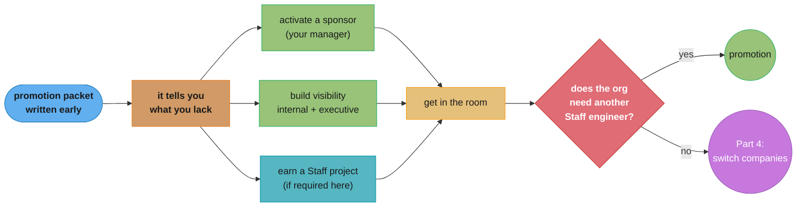
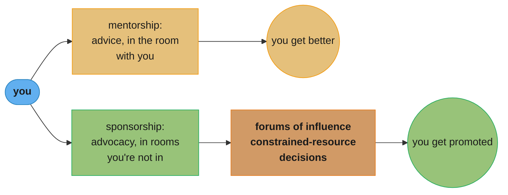

# Part 3: Getting the Title Where You Are

> Part 3 of 5 · Staff Engineer: Leadership Beyond the Management Track (Larson, 2021) · builds on Part 2 (operating at Staff), leads to Part 4 (switching companies to get the title)

## Chapter Map

Parts 1 and 2 answered what the role is and how to do it. Part 3 is about a separate problem
entirely: getting the organization to say so. Larson treats these as genuinely distinct problems
rather than as effort and reward, because at this level the promotion is substantially
organizational — budget, headcount, an existing sponsor, an open need, and who the leadership team
already reads as one of them. The five guides in this part are the tools for working that problem
deliberately, and the section's honesty about who has to work harder at it is one of the reasons
the book is trusted.

**TL;DR:**
- **Senior is where most ladders stop expecting anything.** Most companies treat Senior as the
  terminal "career level," so past it the promotion system stops carrying you and starts requiring
  you to drive.
- **A Staff engineer is not a better Senior engineer** — it is someone who moved into one of the
  archetypes. Promotion committees evaluating "more of what got them to Senior" will not find it.
- **Opportunity is unevenly distributed**, and organizations frequently claim otherwise.
  Infrastructure work is commonly read as more complex than product work regardless of difficulty,
  and people who already look like the existing leadership team have a materially easier time.
  About **half the women Larson interviewed had to change companies** to get the title.
- The five tools: a **promotion packet** written years early as a working document, an activated
  **sponsor**, **getting in the room** where decisions happen, a **Staff project** if your company
  requires one, and deliberate **visibility** — internal, executive, and sometimes external.

## The Big Question

You are doing Staff-level work. Why hasn't anything happened?

Larson's answer is that the mechanism you are relying on does not exist. Getting to Senior was
largely automatic: do good work for enough years, and a system built to advance people advanced
you. Above Senior there is no such system in most companies, because most ladders treat Senior as
the level you can stay at forever. What replaces it is a discretionary decision made by people who
need to be convinced, in a budget that has to have room, for a role the organization has to
actually need — and every one of those is a thing you can work on, or fail to, independently of
how good your engineering is.

---

## 3.1 Getting the Title Where You Are

The section introduction, and the part that sets the tone by refusing to pretend the process is
meritocratic.

### Senior Is the Terminal Level

Most companies treat **Senior engineer as the "career level"** — the rung at which no further
advancement is expected and a long career is entirely legitimate. This is a structural fact with a
consequence: the promotion machinery that reliably moved you from junior to mid to Senior stops
being pointed at you. Past that point, promotion systems **often impede progress rather than
facilitate it**, and advancing requires deliberate, self-directed control of your own career in a
way nothing earlier did.

### Why It's Structurally Hard

Larson lists the obstacles without softening them:

**The job changes.** **"A Staff engineer isn't a better Senior engineer, but someone who's moved
into fulfilling one of the Staff archetypes."** An engineer who has spent two years becoming
markedly better at the Senior job has produced evidence for the wrong claim.

**Incumbents resist dilution.** Existing Staff engineers have an interest in the title continuing
to mean something, which is a legitimate concern and also a headwind.

**Organizations worry about the mix.** Budget, team composition, and how many Staff-level people a
group can absorb are all real constraints that have nothing to do with you.

**Opportunity is unevenly distributed.** **"Opportunity at any given company is unevenly
distributed"** — infrastructure work is routinely read as more complex than product work
regardless of actual difficulty, so identical capability in different parts of the org produces
different promotion odds. Larson's note is that this is frequently obscured by organizational
claims of equity.

**Who already looks the part.** The bluntest line in the section: **"folks with the privilege of
seeming like they are already part of the existing leadership team have a much easier time."** And
the datum behind it — roughly **half the women he interviewed had to change companies** to get the
Staff title, which is the empirical bridge to Part 4.

### The Toolkit

Five tools, all of which have to be used more deliberately than anything earlier in the career: a
promotion packet, a Staff project if your company requires one, getting into the rooms where
decisions get made, and building internal and executive visibility.

---

## 3.2 Promotion Packets

The single most practical artifact in the book, and the guidance about it is counterintuitive:
**write it years before you are nominated.**

### What It Is

A document mapping your journey toward the Staff-plus role. Larson's framing is that it should
start life as a **"brag document"** and function as a **roadmap** rather than as paperwork you
assemble once someone tells you to. Written early, it does the useful thing a promotion packet can
do — it tells you what you do not yet have.

### The Seven Sections

| Section | What goes in it |
|---|---|
| **Staff projects** | Brief descriptions with links to the design documents; emphasize complexity and impact |
| **Organizational improvements** | High-leverage contributions to how the company works, not just what it shipped |
| **Quantifiable impact** | Measurable results — revenue, latency, support tickets eliminated |
| **Mentorship** | The people you've developed, and what *they* went on to accomplish |
| **Glue work** | The organization-supporting activity that has no ticket, and why it mattered |
| **Advocate network** | The teams and leaders who support your work, with data where you have it |
| **Gaps** | Real or perceived weaknesses, each with a one-sentence mitigation |

The Gaps section is the one that distinguishes a packet from a brag list. Naming a weakness with a
mitigation is what turns the document into a plan; omitting it means the committee finds the gap
without your framing attached.

### The Process

**Start with your why.** Larson quotes a contributor on what the process actually demands: **"it
takes a certain amount of fortitude to try again and again after many rounds of feedback."**
Without a clear reason for wanting it, the attrition of the process wins.

**Manage your expectations about time.** Promotions at this level develop over **"quarters,
halves, and years,"** not review cycles.

**Involve your manager early** — raise it in 1:1s and ask for guidance rather than presenting a
finished case at the deadline.

**Iterate with peers, then with your manager.** Get feedback first from trusted colleagues already
at Staff level, who can tell you what the bar actually looks like, then bring the improved version
up.

**Review it regularly**, and especially **after a manager change** — a new manager arrives with no
memory of your last two years, and the packet is the only artifact that carries it.

The goal is that the working document becomes the formal packet through **editing** rather than
through archaeology.

---

## 3.3 Getting in the Room, and Staying There

Access to the rooms where decisions are made is a prerequisite for most Staff work — Part 1's
"providing engineering perspective" only exists if you are present while the decision is still
cheap to change.

### Four Requirements to Get In

1. **Bring something useful** — **"details on a critical project, context from a critical team,
   subject matter expertise"** or similar distinct value.
2. **Offer a perspective that isn't already there.** Specifically **"a perspective that isn't
   already present within the room"** — being the second person with the same view adds nothing.
3. **Secure a sponsor.** Someone must spend their own credibility to get you included.
4. **Make your interest known.** **"Your sponsor needs to know you want to be there"** — a
   surprising number of people wait to be invited to something nobody knows they want.

### Increasing Your Value Once You're There

- **Stay aligned with your manager** — demonstrate consistency with the organization's direction.
- **Optimize globally**, for the whole organization rather than your team or yourself.
- **Speak clearly and concisely** — the room is time-constrained and brevity is the multiplier on
  everything else you bring.
- **Reduce friction** — handle difficult conversations without making them harder.
- **Prepare thoroughly** — do the pre-reads, organize your thinking beforehand.
- **Show engagement** — stay attentive; disengagement is visible and expensive.
- **Volunteer for low-status tasks** — the unglamorous work is a cheap and reliable way to
  demonstrate you are useful rather than decorative.

### Staying In

The ways people lose the seat, which are mostly not about competence:

- **Misunderstanding what the room is actually for**, as opposed to what it appears to be for.
- **Becoming dogmatic** rather than flexible.
- **Withholding consent** — blocking the group's progress as a way of exercising influence.
- **Taking too much of the discussion time.**
- **Embarrassing your sponsor**, who spent credibility to get you in and can spend it only so often.
- **Not showing up** — missing meetings or being inconsistently present.

Larson's closing note is against anxiety about it: rather than worrying about staying, evaluate
whether this particular room still merits your continued investment. Some rooms do not.

---

## 3.4 Find Your Sponsor

The guide that names the single relationship the promotion depends on.

### Mentorship vs Sponsorship

Mentors give advice and guidance. **Sponsors advocate for you in "forums of influence"** and when
**"advocating for constrained resources (like the budget for salary increases)."** The distinction
is where the activity happens: mentorship happens with you in the room, sponsorship happens when
you are not. Only one of them moves a promotion.

**Your direct manager is your essential sponsor.** Not your only one — a skip-level relationship is
valuable and worth building — but the primary one, because they are in the rooms where your case
gets made and the budget gets allocated.

### Activating Your Sponsor

**Say what you want, explicitly.** Ritu Vincent's advice, quoted in the guide: **"be super open and
honest with your manager about what you want from your career."** A sponsor cannot advocate for a
goal they are inferring.

**Ask targeted questions, not vague ones.** Requesting "larger, high impact technical projects"
gives your manager nothing to act on. Presenting a concrete example and asking **"How could I have
handled this project more effectively?"** produces specific, usable feedback and demonstrates the
self-awareness the role requires.

**Make the relationship reciprocal.** Sponsorship is not a transaction you activate at review time.
Volunteer for working groups, support your sponsor's initiatives, be useful across the year —
managers notice people who appear only before promotion cycles, and the noticing is not favourable.

**Give a broken relationship time.** If there is friction with your manager, Larson's guidance is
to invest roughly **six months** in repairing it before considering a transfer. If it remains
broken after genuine effort, use your skip-level to find a different team rather than treating the
company as the problem.

---

## 3.5 Staff Projects

The guide that punctures a widespread assumption.

### What a Staff Project Is

A complex, high-stakes initiative that demonstrates Staff-level capability. The characteristics
Larson lists: **"Complex and ambiguous"** problems, **"Numerous and divided stakeholders,"** and a
**"Named bet where failure matters."** All three are load-bearing — a large but unambiguous project
with one stakeholder and no downside is a big project, not a Staff project.

Ritu Vincent's Dropbox example gives the scale: a project that **"stretched from the kernel all
the way to the user interface"** and consumed **"most of the Desktop Client team's resources for
quite a while."**

### Most Engineers Don't Need One

The correction, stated plainly: **"most engineers don't complete one as part of reaching a Staff
role, although a large minority do."** The alternatives are a **track record of success over a
longer period**, or switching companies.

Some leaders question the requirement outright. Nelson Elhage is quoted noting that Staff engineers
include **"people who don't necessarily run grand projects themselves"** but are **"incredibly
effective gurus and routers"** — a shape of value the Staff-project framing does not capture at all.

### How to Earn Access to One

Three prerequisites, and notice that only two are within your control:

1. **Alignment with leadership** — via the same practices as "getting in the room" and "staying
   aligned with authority."
2. **Technical visibility** — demonstrated aptitude for this specific kind of challenge.
3. **Organizational need** — the company must actually have a Staff-level problem to solve, which
   is **largely outside your control.**

### When to Pursue One

Larson's guidance is conditional: pursue a Staff project if you are **"looking to get promoted
within your current company and haven't previously held a Staff or management title before."** In
that situation the demonstration is genuinely needed. Otherwise, weigh whether the personal growth
justifies the cost — these are **"some of the most challenging work"** available and will
**"stretch and develop you into a better engineer"**, which is a good reason to want one and a
different reason than promotion.

---

## 3.6 Being Visible

The uncomfortable guide, and Larson handles the discomfort directly rather than telling you to
network harder.

### Why Visibility Matters

Staff-plus roles are leadership positions, and existing leaders must trust a newcomer before
granting one. Katie Sylor-Miller's version: **"A big part of being promoted to Staff is making sure
that your work is visible."**

The structural problem: **less-inclusive organizations effectively restrict visibility to
aggressive self-promoters**, because the only channels available are the ones you make for
yourself. Inclusive organizations deliberately build exposure mechanisms — forums, rotations,
published updates — so that visibility is not a proxy for self-promotion appetite.

### Internal Visibility

The most effective approach is not a promotion tactic at all: **work on the things that matter to
your company and company leadership.** Visibility follows importance more reliably than it follows
effort.

Beyond that:

- Create **long-lived documents** — architecture specifications, technical documentation people
  keep returning to.
- **Lead company forums** — architecture review, an all-hands segment.
- **Celebrate peers' accomplishments** publicly on shared channels.
- Publish a **weekly summary** of your work, distributed to stakeholders.
- Contribute to the **company blog**.
- Host **office hours** for your team or domain.

The guidance explicitly acknowledges that discomfort with self-promotion is normal, and directs you
to find approaches that match your actual strengths rather than performing an extroversion you do
not have.

### Executive Visibility

The most consequential kind, because executives approve Staff-plus promotions. Building a
relationship with your **manager's manager** is the highest-value single investment here — leaders
**"rarely support folks whose work they don't know."**

### External Visibility

Optional. Many successful Staff engineers have no external presence at all. Where it helps, it
helps in a specific way: external work provides room for **"creating a niche and name for
yourself"** without competing directly against your internal peers for the same finite internal
attention.

### How Much Is Enough

The prioritization rule ties the guide back to 3.2: use the **promotion packet exercise** to
identify where your visibility is actually short, clear that specific threshold, and stop. Visibility
is instrumental and has a target; **"learning and developing yourself is a permanent one"** and
deserves the leftover time.

---

## Visual Intuition



Caption: the packet is first because its real function is diagnostic — it names the gaps the other
four tools then close. And the last node is the honest one: organizational need is a prerequisite
you do not control, which is exactly why the book has a Part 4.

```
   WHAT'S IN YOUR CONTROL          WHAT ISN'T

   the packet you write            whether the org needs another Staff eng
   the gaps you close              the budget this half
   activating your sponsor         whether your manager has standing
   the work you choose             whether your area is read as "complex"
   how visible you make it         whether you already look like leadership

     ------------------------------------------------------------
     Larson's data point: about half the women he interviewed had
     to change companies to get the title. That is the right-hand
     column deciding outcomes, not the left.
     ------------------------------------------------------------
```

Caption: the section's honesty is structural rather than encouraging. Both columns are real, only
one is actionable, and knowing which is which is what stops a stalled promotion from being read as
a verdict on your work.



Caption: both are valuable and only one changes a title. The distinction is not the content of the
help, it is whether you are present — which is why a manager who mentors you generously can still
not be sponsoring you at all.

---

## Key Concepts Glossary

- **Senior as the "career level"** — most companies expect no advancement past Senior, so the
  promotion machinery that carried you there stops being pointed at you.
- **"A Staff engineer isn't a better Senior engineer"** — the promotion requires evidence of having
  moved into an archetype, not evidence of doing the previous job better.
- **Uneven opportunity distribution** — some parts of an organization are read as more complex
  than others regardless of actual difficulty, so identical capability produces different odds.
- **Promotion packet** — a working "brag document" started years early, functioning as a roadmap
  and a gap-finder rather than as paperwork assembled at nomination.
- **The Gaps section** — the part that turns a packet from a brag list into a plan: each real or
  perceived weakness with a one-sentence mitigation.
- **Advocate network** — the teams and leaders who support your work, listed with data where
  available; part of the packet because sponsorship breadth is itself evidence.
- **Sponsor** — someone who advocates for you in forums of influence and constrained-resource
  decisions; distinguished from a mentor by whether you are in the room.
- **Activating your sponsor** — telling your manager explicitly what you want, asking specific
  rather than vague questions, and keeping the relationship reciprocal year-round.
- **Getting in the room** — securing presence where decisions are made, which requires useful
  content, a perspective not already present, a sponsor, and your interest being known.
- **Withholding consent** — blocking group progress as a form of influence; one of the fastest
  ways to lose the seat.
- **Staff project** — complex and ambiguous, with numerous and divided stakeholders, and a named
  bet where failure matters; a large minority of Staff engineers complete one, not a majority.
- **"Gurus and routers"** — Nelson Elhage's counterexample: highly effective Staff engineers whose
  value is not running grand projects at all.
- **Visibility threshold** — visibility is instrumental and has a target set by your packet's
  gaps; clear it and return the time to actually developing yourself.

---

## Tradeoffs & Decision Tables

| Tool | What it produces | Time horizon | Blocked by |
|---|---|---|---|
| Promotion packet | A gap list and a case | Start years early | Nothing — write it today |
| Sponsor | Advocacy where you aren't | Months to build | A broken manager relationship |
| Getting in the room | Perspective at decision time | Months | Having nothing new to bring |
| Staff project | An unambiguous demonstration | 6–18 months | Organizational need, which you don't control |
| Visibility | Leaders knowing your work exists | Ongoing | Working on things nobody cares about |

| If your packet's gap is… | The tool is… |
|---|---|
| No demonstrable large-scope project | A Staff project, if the org has one to give |
| Leadership doesn't know your work | Internal and executive visibility |
| Nobody advocates for you when you're absent | Activating your sponsor; a skip-level relationship |
| You're not in decisions until they're final | Getting in the room |
| Impact is real but unquantified | The quantifiable-impact section; go instrument it |
| You keep being told "not yet" with no specifics | Ask targeted questions about a concrete example |

| Signal | Reading |
|---|---|
| Your manager mentors you generously, nothing moves | You have a mentor, not a sponsor |
| Repeated feedback with no concrete gap named | Ask about a specific project you actually ran |
| The org has no open Staff headcount | The blocker is structural; Part 4 exists for this |
| You're in the room but rarely speak usefully | You'll lose the seat; prepare, or step out of it |
| A new manager arrives | Re-share the packet; your history left with the old one |

---

## Common Pitfalls / War Stories

- **Writing the packet when nominated.** By then it is archaeology — you are reconstructing two
  years from memory and Slack search, and the gaps you find have no time left to close. Written
  early it is a roadmap; written late it is a transcript.
- **Omitting the Gaps section.** The committee will find the gap regardless. The only question is
  whether it arrives with your framing and mitigation attached or as a discovery.
- **Confusing a generous mentor with a sponsor.** A manager who gives excellent advice, invests
  real time, and says nothing in the promotion forum is a mentor. The relationship feels
  supportive and the outcome does not move, which is a genuinely confusing combination.
- **Asking for "bigger projects."** It is unactionable and reads as entitlement. Presenting a
  concrete project you ran and asking how you could have handled it better produces usable
  feedback and demonstrates the self-awareness being evaluated.
- **Waiting to be invited to the room.** Your sponsor cannot advocate for a seat they do not know
  you want, and a surprising number of people never say it out loud.
- **Withholding consent to demonstrate seniority.** Blocking progress feels like exercising
  judgment and reads as obstruction; it is one of the fastest ways to lose a seat you spent a
  year earning.
- **Embarrassing the sponsor who got you in.** They spent credibility, they have a finite amount,
  and the cost of a bad showing lands on them as much as on you.
- **Chasing a Staff project the organization doesn't have.** Two of the three prerequisites are
  yours; organizational need is not. Waiting indefinitely for a project that does not exist is a
  common way to lose two years.
- **Treating a stalled promotion as a verdict on your engineering.** Half the inputs are
  structural — budget, headcount, who already looks like leadership. Larson's data on how many
  women had to switch companies is the section's evidence that the structural column decides real
  outcomes.
- **Not re-sharing the packet after a manager change.** The new manager has no memory of your last
  two years, and nothing else in the organization carries it.

---

## Real-World Systems Referenced

The named voices in this part are the book's method rather than decoration. **Ritu Vincent**
(Staff Engineer at Dropbox) supplies both the Staff-project example — a project stretching from
the kernel to the user interface and consuming most of the Desktop Client team's resources — and
the guidance on being openly honest with your manager about what you want. **Nelson Elhage**
(formerly Staff Engineer at Stripe) supplies the counterargument to the Staff-project requirement,
describing effective Staff engineers as gurus and routers who do not necessarily run grand
projects. **Katie Sylor-Miller** (Frontend Architect at Etsy) supplies the visibility argument.
The mentorship-versus-sponsorship framing is shared with **Lara Hogan's** widely cited writing on
sponsorship and with **Tanya Reilly's** treatment in
[`the_staff_engineers_path/`](../../the_staff_engineers_path/the_staff_engineers_path.md). The full
interviews live in Part 5 and at <https://staffeng.com/stories/>.

---

## Summary

Part 3 separates doing the work from being recognized for it, and argues the second is a distinct,
substantially organizational problem. Most companies treat Senior as the terminal career level, so
past it the promotion machinery stops carrying you and starts requiring you to drive — and what it
is looking for is not a better Senior engineer but someone who has moved into one of the
archetypes. Larson refuses to present this as meritocratic: incumbents have an interest in
protecting the title, budget and team composition are real constraints unrelated to you,
opportunity is unevenly distributed with infrastructure work read as more complex than product
work regardless of difficulty, and people who already look like the existing leadership team have
a materially easier time — with roughly half the women he interviewed having had to change
companies to get the title. Against that, five tools. The **promotion packet** is written years
early as a working brag document, in seven sections — Staff projects, organizational improvements,
quantifiable impact, mentorship, glue work, advocate network, and gaps with one-sentence
mitigations — and its real function is diagnostic. A **sponsor**, distinguished from a mentor by
advocating in rooms you are not in, is activated by saying explicitly what you want, asking
targeted rather than vague questions, and keeping the relationship reciprocal all year. **Getting
in the room** requires bringing something useful, a perspective not already present, a sponsor
willing to spend credibility, and your interest being known — and is lost through dogmatism,
withholding consent, dominating the time, or embarrassing your sponsor. A **Staff project** is
complex and ambiguous with divided stakeholders and a named bet where failure matters, and most
engineers reach Staff without one; access to one depends on organizational need you do not
control. **Visibility** follows importance more reliably than effort, executive visibility matters
most because executives approve the promotion, external visibility is optional, and the whole thing
has a threshold rather than a maximum — clear the gaps your packet named and put the rest of the
time into actually getting better.

---

## Interview Questions

**Q: Why does Larson say the promotion system stops helping you above Senior?**
**Short:** Most companies treat Senior as the terminal "career level," with no further advancement expected.
The machinery that reliably moved you from junior to mid to Senior is built around an expectation of progression that simply stops at Senior — a long career at that level is entirely legitimate and the systems are designed for it. Past that point Larson says promotion processes often impede rather than facilitate progress, and advancing requires deliberate self-directed control of your own career in a way nothing earlier in it did.

**Q: What does "a Staff engineer isn't a better Senior engineer" mean for a promotion case?**
**Short:** Evidence of doing the Senior job better is evidence for the wrong claim.
The promotion is for having moved into one of the Staff archetypes — Tech Lead, Architect, Solver, Right Hand — which are structurally different jobs rather than more demanding versions of the same one. An engineer who spent two years becoming markedly more productive, more technically deep, and more reliable has built a strong case for a raise and a weak one for the title, because none of that evidence speaks to the archetype question.

**Q: When should you write your promotion packet, and why?**
**Short:** Years early, as a working brag document — its real function is telling you what you lack.
Written at nomination it is archaeology: reconstructing two years from memory and Slack search, with any gaps it surfaces having no time left to close. Written early it is a roadmap that names the specific things missing while there is still runway to go get them. Larson's framing is that the working document should become the formal packet through editing rather than through excavation.

**Q: What are the seven sections of a promotion packet, and which one distinguishes it from a brag list?**
**Short:** Staff projects, org improvements, quantifiable impact, mentorship, glue work, advocates, and gaps — gaps is the distinguishing one.
The first six accumulate evidence: projects with links to design docs, high-leverage contributions to how the company works, measurable results, people you developed and what they accomplished, the invisible work with no ticket, and the teams and leaders who back you. Gaps lists each real or perceived weakness with a one-sentence mitigation, which turns the document into a plan — and the committee will find those gaps regardless, so the only choice is whether your framing arrives with them.

**Q: What is the difference between a mentor and a sponsor, and why is it the difference that matters for promotion?**
**Short:** A mentor advises with you in the room; a sponsor advocates in rooms you are not in.
Sponsors advocate in forums of influence and when constrained resources like salary-increase budget are being allocated — the decisions that actually move a title. Mentors improve you, which is genuinely valuable and does not by itself change anything organizationally. The confusing case is a manager who mentors generously, invests real time, and says nothing in the promotion forum: the relationship feels supportive and the outcome never moves.

**Q: How do you "activate" your sponsor?**
**Short:** Say explicitly what you want, ask targeted rather than vague questions, and keep it reciprocal year-round.
Ritu Vincent's version is to be super open and honest with your manager about what you want from your career, because a sponsor cannot advocate for a goal they are inferring. Asking for "larger, high impact technical projects" is unactionable; presenting a concrete project you ran and asking how you could have handled it more effectively produces usable feedback. And it is a relationship, not a transaction — managers notice people who appear only before promotion cycles.

**Q: What are the four requirements for getting into the room where decisions get made?**
**Short:** Bring something useful, offer a perspective not already present, secure a sponsor, and make your interest known.
Useful means concrete: details on a critical project, context from a critical team, subject matter expertise. The perspective requirement is why simply being senior isn't enough — being the second person with the same view adds nothing to a time-constrained room. Someone has to spend their credibility to include you, and they need to know you want it, which a surprising number of people never say out loud while waiting to be invited.

**Q: What are the main ways people lose a seat in the room?**
**Short:** Misreading the room's purpose, dogmatism, withholding consent, dominating time, embarrassing your sponsor, not showing up.
Notice how few of these are about competence. Withholding consent — blocking group progress as a way of exercising influence — feels like exercising judgment and reads as obstruction. Embarrassing your sponsor matters because they spent finite credibility to get you in. Larson's closing note is against anxiety about staying: rather than worrying, evaluate whether that particular room still merits your continued investment, because some do not.

**Q: What makes a project a "Staff project," and do you need one?**
**Short:** Complex and ambiguous, numerous divided stakeholders, a named bet where failure matters — and most engineers don't complete one.
All three characteristics are load-bearing: a large but unambiguous project with one stakeholder and no downside is a big project, not a Staff project. Larson is direct that most engineers don't complete one on the way to Staff, though a large minority do. The alternatives are a track record of success over a longer period, or switching companies. Nelson Elhage goes further, noting that some highly effective Staff engineers are gurus and routers who never run grand projects.

**Q: What are the three prerequisites for getting a Staff project, and which one is out of your control?**
**Short:** Leadership alignment, technical visibility, and organizational need — the last is largely outside your control.
Alignment comes from the same practices as getting in the room and staying aligned with authority. Technical visibility means demonstrated aptitude for this specific kind of challenge. Organizational need means the company must actually have a Staff-level problem available, and it does not always. This is why waiting indefinitely for a project the organization doesn't have is a documented way to lose two years, and why the book's Part 4 exists.

**Q: Why does Larson say opportunity is unevenly distributed, and what does he point at specifically?**
**Short:** Infrastructure work is routinely read as more complex than product work regardless of actual difficulty.
Identical capability in different parts of the same organization produces different promotion odds, because some areas carry an assumption of complexity and others don't. Larson's note is that this is frequently obscured by organizational claims of equity — the ladder says the same words apply everywhere while the outcomes say otherwise. The practical implication is that where you sit is itself a variable worth considering, not merely a context you accept.

**Q: What is Larson's evidence that the promotion is structural rather than purely meritocratic?**
**Short:** About half the women he interviewed had to change companies to obtain the Staff title.
He states the mechanism alongside the data: folks with the privilege of seeming like they are already part of the existing leadership team have a much easier time. Combined with incumbents' interest in protecting the title, budget and team-composition constraints, and uneven opportunity by area, the picture is that a substantial share of the inputs to the decision have nothing to do with the quality of your engineering — which is what makes it the bridge into Part 4.

**Q: What's the most effective way to build internal visibility?**
**Short:** Work on the things that matter to your company and its leadership — visibility follows importance more reliably than effort.
The other levers are real and secondary: long-lived documents like architecture specs, leading forums such as architecture review, celebrating peers publicly, publishing weekly summaries to stakeholders, contributing to the company blog, holding office hours. Larson explicitly acknowledges that discomfort with self-promotion is normal and directs you to approaches that match your actual strengths rather than performing an extroversion you don't have.

**Q: Why is executive visibility singled out as the most important kind?**
**Short:** Executives approve Staff-plus promotions, and they rarely support people whose work they don't know.
The decision happens in a room you are not in, made by people who need to already have a picture of your work — and that picture doesn't assemble itself from a packet read once. Larson's highest-value single investment here is a relationship with your manager's manager, because the skip-level is close enough to see your work and senior enough to be in the room where it gets discussed.

**Q: How much visibility is enough, and how do you tell?**
**Short:** Use the packet's gaps to find the specific shortfall, clear that threshold, and stop.
Visibility is instrumental — it has a target, not a maximum, and time spent past the threshold has better uses. The packet exercise is what makes the threshold legible: it names where leaders don't know your work rather than leaving you to maximize an unbounded quantity. Larson's contrast is that learning and developing yourself is a permanent investment, which is where the reclaimed time should go.

**Q: What does Larson say about a broken relationship with your manager, given they're your primary sponsor?**
**Short:** Invest about six months in repairing it before considering a transfer.
Because the direct manager is the essential sponsor — in the rooms where the case is made and the budget allocated — a broken relationship blocks the promotion regardless of your work. The guidance is to give repair genuine time rather than treating friction as terminal. If it stays broken after real effort, the move is to use your skip-level relationship to find a different team, which treats it as a relationship problem rather than as evidence the company is wrong.

---

## Cross-links in this repo

- [soft_skills/performance_reviews_and_promotions/ — promotion packets and the review process in depth](../../../soft_skills/performance_reviews_and_promotions/performance_reviews_and_promotions.md)
- [soft_skills/mentorship_and_sponsorship/ — the distinction this part turns on](../../../soft_skills/mentorship_and_sponsorship/mentorship_and_sponsorship.md)
- [soft_skills/engineering_career_ladders/ — what ladders actually say above Senior](../../../soft_skills/engineering_career_ladders/engineering_career_ladders.md)
- [soft_skills/scope_impact_and_ownership/ — the scope evidence a packet has to demonstrate](../../../soft_skills/scope_impact_and_ownership/scope_impact_and_ownership.md)
- [soft_skills/upward_and_async_communication/ — activating a sponsor without being tiresome about it](../../../soft_skills/upward_and_async_communication/upward_and_async_communication.md)
- Previous part: [Part 2 — Operating at Staff](../02_operating_at_staff/02_operating_at_staff.md) · Next part: [Part 4 — Switching Companies](../04_switching_companies/04_switching_companies.md)
- Companion book: [The Staff Engineer's Path (Reilly) — Ch 9 What's Next?](../../the_staff_engineers_path/09_whats_next/09_whats_next.md), which covers the stay-or-go decision from the other direction.

## Further Reading

- The guides behind this part, free:
  <https://staffeng.com/guides/getting-the-title-where-you-are/> ·
  <https://staffeng.com/guides/promo-packets/> ·
  <https://staffeng.com/guides/getting-in-the-room/> ·
  <https://staffeng.com/guides/find-your-sponsor/> ·
  <https://staffeng.com/guides/staff-projects/> ·
  <https://staffeng.com/guides/being-visible/>
- Hogan, Lara — writing on sponsorship, the widely cited companion treatment of the distinction
  this part depends on.
- Reilly, Tanya — *The Staff Engineer's Path* (O'Reilly, 2022) — deliberately leaves the title
  mechanics out, which is why the two books are usually read together.
