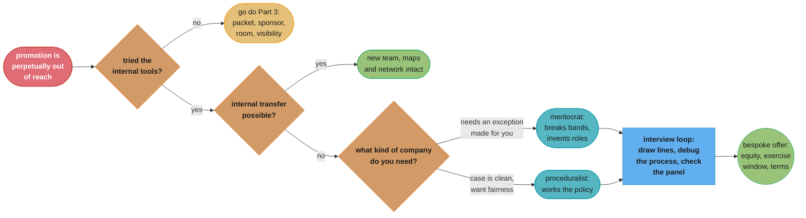
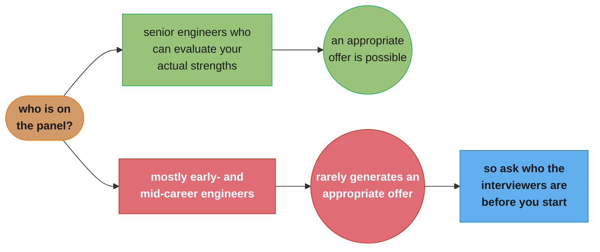

# Part 4: Switching Companies to Get the Title

> Part 4 of 5 · Staff Engineer: Leadership Beyond the Management Track (Larson, 2021) · builds on Part 3 (getting the title where you are), leads to Part 5 (stories and resources)

## Chapter Map

Part 3 ended on an uncomfortable number: roughly half the women Larson interviewed had to change
companies to get the Staff title. Part 4 is the strategy that number implies. Its argument is not
that loyalty is foolish — it is that the title is granted for substantially circumstantial reasons,
and that interviewing lets you sample many sets of circumstances instead of waiting for one to
improve. Four guides: deciding to leave at all, choosing where to go, surviving an interview loop
nobody has standardized, and negotiating an offer that has become negotiable for the first time.

**TL;DR:**
- Your current company knows your strengths best, and **awarding the title still depends on
  circumstances** — an internal sponsor, budget, an organizational need, a senior team that
  attributes your impact to you rather than to peers.
- Switching gives you **an automatic sponsor: the hiring manager**, whose incentives are never
  more aligned with yours than during the interview process. It also allows **bias arbitrage** —
  finding an organization that uniquely values what you have.
- Choose a company that **disproportionately values you**, and read whether it is a
  **meritocrat** (exception-heavy) or a **proceduralist** (works the policy). Check which
  archetypes it hires, whether growth will open roles, and whether a sponsor exists at all.
- **Staff-plus interview loops are not standardized** — the same loop as a Senior role, a manager
  loop with a coding question bolted on, or something else entirely. Draw your lines first, debug
  the process, and check who is actually on the panel.
- Offers cross a threshold here: companies become willing to make a **bespoke offer rather than a
  system-driven one**, which opens equity terms, exercise windows, deferred compensation, and
  working arrangements — and asking for frivolous things sends a signal.

## The Big Question

If you are already doing the work, why is leaving a serious strategy rather than an admission of
failure?

Larson's answer is a claim about mechanisms, not about loyalty. Internal promotion requires several
things to be true at once — an available headcount, a manager with the standing to advocate, an
organizational need for another Staff engineer, and a leadership team that reads your contribution
as yours. Each is plausible on its own; all four simultaneously is not guaranteed by any amount of
good work. Interviewing changes the shape of the problem: instead of waiting for one company's four
conditions to align, you sample many companies until you find one where they already do. The line
he lands on is the section's hardest: **at some point, you have to hear what your current company
is telling you.**

---

## 4.1 Deciding to Switch Companies

### Why Leaving Works

The starting concession is genuine: your current company knows your strengths better than any
company evaluating you in a five-hour loop ever will. But **"actually awarding the role depends on
so many circumstantial factors that this isn't how it works out in practice."**

The internal barriers Larson names:

- A senior team that **attributes your impact to your peers** rather than to you.
- Your manager's **budget constraints**.
- **No internal sponsor** willing to spend credibility on your case.
- **No organizational need** for another Staff engineer at all.

None of these is a statement about your work, and none of them is reliably fixable by working
harder.

**The mechanics of switching favour you in two specific ways.**

First, you can **keep interviewing until you find a company able to grant the title**, and you can
deliberately target earlier-stage companies where the constraint is looser. This turns a single
gated decision into a sampling problem.

Second, and more subtly, a job change comes with **"an automatic sponsor with it — the hiring
manager — whose incentives will never be more aligned with yours than in the interview process."**
Part 3 spent a whole guide on finding and activating a sponsor. Changing companies hands you one
whose entire current objective is to get you hired at the level you are interviewing for.

Larson also names **"bias arbitrage"**: interviewing widely surfaces organizations that uniquely
value your specific expertise or background. The same profile that reads as "narrow" at one
company reads as "exactly what we're missing" at another, and the only way to find the second kind
is to look.

### Things to Try Before Leaving

**Internal transfers.** A different team inside the same parent company keeps your network,
your organizational maps, and your accumulated credibility while giving you fresh problems. Larson
notes some engineers **switch roles every two-to-three years within the same parent company** and
find it an effective way to stay engaged.

**Sabbaticals.** At larger organizations, negotiating a sabbatical is a real alternative to leaving
outright when the issue is exhaustion rather than opportunity.

### Leaving Without a Job

If you are badly burned out, Larson gives a checklist rather than encouragement — leaving without a
next role is a legitimate choice with concrete preconditions:

- **Visa status** that supports a gap in employment.
- **Financial security for at least a year.**
- **Access to job markets**, or the flexibility to work remotely.
- **Strong interview skills** — the gap is a bad time to discover they have atrophied.
- **A coherent narrative** about why you left.
- **Positive references** available.

### Taking the Plunge

The decision rule. If promotion has been perpetually out of reach despite sustained effort, **"at
some point, you have to hear what your current company is telling you."** Conversely, if you are
otherwise satisfied where you are, exhaust the internal strategies from Part 3 — the packet, the
sponsor, the room — before paying the full cost of a move.

---

## 4.2 Finding the Right Company

Having decided to look, the question becomes what you are looking *for*. This guide is the book's
best contribution to that question, because it names a company property most candidates never think
to evaluate.

### Find a Place That Disproportionately Values You

The target is an organization whose gaps are your strengths. Larson's distinction is sharp:
**well-run organizations value you for what you're good at**, while poorly run ones may value
surface-level identity traits instead. The former produces disproportionate impact from you; the
latter produces a role that looks right and does nothing.

### Meritocrats and Proceduralists

The guide's most useful frame, and it is diagnosable during the interview process itself.

| | **Meritocrats** | **Proceduralists** |
|---|---|---|
| Philosophy | Exception-heavy; concentrate resources on favoured individuals | Work the policy rather than the exceptions |
| Compensation | Will break the band for the right person | Stick to the band |
| Roles | Create a custom role around a person | Hire to a planned, pre-defined position |
| Interviews | Ad-hoc, varies by candidate | Structured, consistent evaluation |
| Best for you if | You are unusual and need an exception made | You fit the ladder cleanly and want fairness |

The practical use is not that one type is better. It is that **your situation determines which one
can help you.** A candidate who needs the title granted at hire, or a role invented around their
shape, is asking for an exception — and a proceduralist company genuinely cannot grant it no matter
how much they like you. Conversely, if your case is clean and you want the process to protect you
from a hiring manager's whim, a proceduralist is the safer bet.

### Archetypes

**"Most companies only hire one or two of the Staff archetypes."** So investigate the Staff
engineers a company already has — what do they do, what are they known for, which archetype do
they fit? A Solver-shaped engineer joining a company that only has Tech Leads will spend a year
being told they are not delivering, for reasons neither side will identify correctly.

### Growth

Slower-growing companies frequently lack both the budget and the emerging opportunities that create
new Staff roles. Fast-growing companies **organically open up** Staff positions over time, simply
because the problems get bigger and the organization gets more complex. This is a straightforward
odds calculation and it favours growth.

### Sponsorship

The same requirement as Part 3, imported: **"Without an empowered leader within a company who's
willing to invest their organizational capital in you, you can't get a leadership role."** The
practical implication for a candidate is to build external visibility — presentations, writing —
because that is how a leader at a company you have never worked at comes to know your work well
enough to invest in you.

### Durability and Pace

Two closing checks. **Durability**: verify the company will still exist, because a title from a
company that folds in eighteen months is worth what the market thinks it is worth. **Pace**: make
sure the expected working pace matches your current capacity, because leadership roles require you
to model a sustainable rhythm and you cannot model one you are not living.

---

## 4.3 Interviewing for Staff-plus Roles

### There Is No Standard Loop

The defining property of Staff-plus interviewing, and the source of most of its difficulty:
**"it might be the same exact interview you'd get for a Senior engineer role. It might be an
engineering manager loop with a programming question added. It might be something else entirely."**
Unlike Senior interviews, which have converged on a recognizable shape across the industry, nobody
has standardized this one.

### Draw Your Lines First

Before engaging, decide what evaluation methods you are willing to be assessed by. Larson's example
of a principled decline is not squeamishness but inference: **a company that cares about fast
programming is likely to misuse its Staff-plus engineer** — the thing they are testing for tells
you what they think the job is, and if that reading is wrong, the job will be wrong too. The
interview process is data about the role, not merely a gate in front of it.

### Debug the Process

At this level, asking detailed questions about the process is expected. Larson goes further: **"it's
almost a point of concern if you don't ask for more details."** Three things to establish:

1. **The interview formats and the evaluation criteria** — what are they actually assessing?
2. **What preparation is expected** — a presentation, a design exercise, prior reading.
3. **Who the interviewers are** — by name and by level.

The third is the one candidates skip and the one that predicts outcomes. Verify the panel includes
senior engineers capable of evaluating your expertise: **panels composed primarily of early-career
and mid-level engineers rarely generate appropriate offers**, because the signal you are strongest
on is one they are not equipped to recognize.

### Finish Strongly

**"Always negotiate the details."** Brief your references thoroughly rather than listing them and
hoping. Send follow-ups. Engage thoughtfully in the closing conversations, which are frequently
where the level is actually settled.

### The Reframe

Larson's closing move turns the whole problem around: **"Getting comfortable navigating ambiguity
is a core part of the Staff-plus role."** An unstandardized, poorly specified interview process is
therefore an authentic sample of the job. Handling it well — asking the clarifying questions,
establishing the criteria, adapting to what you find — is itself a demonstration of the competency
being hired for.

---

## 4.4 Negotiating Your Offer

### The Threshold Shift

The structural change: at this level **"offer negotiations shift, and companies are willing to
engage in a bespoke offer rather than a system-driven offer."** Below it, compensation is a formula
with a band and a small adjustment range. At Staff-plus, the offer becomes a document that can be
edited.

### What Becomes Negotiable

**Equity and cash.** Companies are more flexible on the equity component at senior levels than on
base.

**Non-standard terms** — the part most candidates never ask about, with Larson's own examples:

- An **extended exercise window** for vested equity — five years instead of the standard three
  months after departure.
- **Early exercise** programs for senior staff engineers.
- **Deferred compensation** plans for tax reasons.
- **Additional vacation days.**
- **Work-from-home arrangements** and alternative employment structures.

### Three Rules

**Know the company's size.** Smaller firms — roughly **20 to 500 employees** — rarely customize
offers unless the role is quasi-executive; there simply is not the machinery or the precedent.
Larger companies with few Staff-level positions are more likely to be flexible, because each such
hire is already an exception.

**Prioritize carefully.** Negotiating over frivolous benefits **sends a negative signal about your
values**, and it spends the goodwill you will want for the thing that actually matters to you.

**Frame the request as a narrative.** Rather than demanding cash, contextualize the ask in your
circumstances. Larson's worked example: framing a request for an extended exercise window around a
recent home purchase and previously exercised equity made it **"a lot more palatable"** than the
same request stated bare. The narrative is not manipulation — it supplies the reason that lets the
person on the other side justify the exception internally.

---

## Beyond the book — the market this strategy assumes

> Everything above is the 2021 book's argument, reported as it stands. This section is not
> Larson's. It records a change in background conditions that a book published in February 2021
> could not address, and it changes the *timeline* of the strategy rather than its logic.

Part 4's core tactic — keep interviewing until you find a company able to grant the title — was
written in and for a hiring market with abundant Staff-plus openings and intense competition for
senior engineers. The 2022-2024 correction inverted several of its inputs: fewer open Staff
requisitions, more candidates per opening, more down-levelling at offer stage, and a general shift
away from creating custom roles.

What still holds and what has moved:

| The book's claim | Status |
|---|---|
| The title is granted for circumstantial reasons, and interviewing arbitrages that | **Holds** — the mechanism is structural, not cyclical |
| The hiring manager is an automatic sponsor | **Holds** — their incentives are unchanged |
| Meritocrats vs proceduralists, and what each can grant you | **Holds** — and matters more when exceptions are scarcer |
| Fast-growing companies organically open Staff roles | **Holds**, with fewer companies growing that fast |
| Keep interviewing until you find one | **Slower** — the expected search is materially longer |
| Offers become bespoke at this level | **Narrower** — non-standard terms are harder to obtain |

The honest summary: the reasoning survives, the throughput assumption does not. Treat "keep
interviewing" as a multi-quarter campaign rather than a few weeks of loops, and weight Part 3's
internal strategies correspondingly higher than the 2021 text does.

---

## Visual Intuition

```
   INTERNAL PROMOTION                      SWITCHING COMPANIES
   (all four must be true here)            (find one place where they are)

   [ ] an internal sponsor with standing   -> the hiring manager IS your sponsor,
   [ ] budget available this half             and never more aligned than now
   [ ] an organizational NEED for one      -> you sample companies until you
       more Staff engineer                    find one that has the need
   [ ] leadership attributes the impact    -> "bias arbitrage": somewhere your
       to YOU, not to your peers              exact profile is what's missing

        AND, not OR                              OR, across many attempts
        one company                              n companies

   ---------------------------------------------------------------------
   Larson's rule when the AND never resolves: at some point you have to
   hear what your current company is telling you.
   ---------------------------------------------------------------------
```

Caption: the two routes differ in logical structure, not in effort. Internal promotion needs four
independent conditions to hold simultaneously at one employer; switching needs them to hold at any
one of many. That difference is the whole argument for Part 4.



Caption: the part's actual decision sequence. The two branches that people skip are the first
("have you actually run the internal playbook?") and the internal transfer, both of which cost far
less than a full reset.



Caption: the one process question candidates most often skip. Your strongest signal at this level
is one an early-career panel is not equipped to recognize, which makes the panel's composition a
better predictor of the outcome than your preparation.

---

## Key Concepts Glossary

- **Circumstantial factors** — the internal conditions that gate a promotion independently of your
  work: sponsor standing, budget, organizational need, and who gets credited for impact.
- **The hiring manager as automatic sponsor** — a job change supplies the sponsor Part 3 spends a
  guide finding, with incentives never more aligned with yours than during the interview process.
- **Bias arbitrage** — interviewing widely to find the organization that uniquely values your
  specific expertise or background, where the same profile reads as an asset rather than a limit.
- **Meritocrats** — exception-heavy companies that break compensation bands, invent roles, and run
  ad-hoc interviews; they can grant exceptions and concentrate resources on favoured individuals.
- **Proceduralists** — companies that work the policy rather than the exceptions: fixed bands,
  planned positions, structured evaluation; safer if your case is clean, unable to help if it isn't.
- **Archetype fit** — most companies only hire one or two Staff archetypes, so investigate the
  Staff engineers a company already has before assuming your shape will land there.
- **Durability and pace** — verify the company will still exist, and that the expected working
  rhythm is one you can actually model for others.
- **Draw your lines first** — decide what evaluation methods you'll accept before engaging, because
  what a company tests for reveals what it thinks the job is.
- **Debug the process** — establish formats and criteria, expected preparation, and who the
  interviewers are; at this level not asking is itself a concerning signal.
- **Panel composition** — panels of primarily early-career and mid-level engineers rarely generate
  appropriate Staff-plus offers, regardless of the candidate.
- **Bespoke versus system-driven offer** — the threshold at which compensation stops being a
  formula and becomes an editable document.
- **Non-standard terms** — extended exercise windows, early exercise, deferred compensation, extra
  vacation, and working arrangements: the negotiable surface most candidates never ask about.
- **Narrative framing** — contextualizing a request in your circumstances so the person granting it
  has a reason they can justify internally.

---

## Tradeoffs & Decision Tables

| Route | What it costs | What it buys |
|---|---|---|
| Wait for internal promotion | Time, possibly indefinite | Keeps maps, network, credibility |
| Internal transfer | A partial reset within known walls | Fresh problems, most context intact |
| Sabbatical | Income for a period; a gap to explain | Recovery without a full career move |
| Switch companies | Full reset of maps and relationships | An automatic sponsor and a chance at the title |
| Leave without a job | Income and negotiating leverage | Immediate relief when burnout is the actual problem |

| Company type | Can grant you… | Cannot grant you… |
|---|---|---|
| Meritocrat | An exception: a band break, an invented role, a title at hire | Consistency, or protection from a manager's whim |
| Proceduralist | A predictable, defensible, fair process | An exception, however much they like you |

| Interview-process signal | What it tells you about the job |
|---|---|
| Heavy emphasis on fast programming | They think Staff is "Senior but faster"; likely to misuse you |
| Panel is mostly early- and mid-career | Your strongest signal won't be recognized |
| They can't state the evaluation criteria | The level is undefined internally too |
| The loop is a manager loop plus code | They may be hiring a Tech Lead, not what you assumed |
| They welcome detailed process questions | They've thought about what the role is |

| Negotiation ask | Company size where it's plausible |
|---|---|
| Base within band | Any |
| Equity component | Most, at this level |
| Extended exercise window | Larger companies; startups occasionally |
| Early exercise | Startups with the program already in place |
| Deferred compensation | Larger companies with the machinery |
| Custom role or invented title | Meritocrats; quasi-executive roles at small firms |

---

## Common Pitfalls / War Stories

- **Reading a stalled promotion as a verdict on your work.** Four conditions have to hold at once
  and only one of them is about you. The engineer who responds by working harder is optimizing the
  variable that was never binding.
- **Leaving before running the internal playbook.** A full reset is expensive, and a large share of
  people who leave over a stalled promotion never wrote a packet, never told their manager plainly
  what they wanted, and never asked what specifically was missing.
- **Skipping the internal transfer.** It solves the common case — a team, a manager, or a domain
  rather than the company — while keeping most of your maps and credibility.
- **Asking a proceduralist for an exception.** They will like you, they will want to help, and they
  structurally cannot break the band or invent the role. Diagnosing the type early prevents a
  three-month process ending in a level you already knew was coming.
- **Not asking who is on the panel.** The single highest-value process question and the one most
  candidates consider rude. A panel that cannot evaluate your strengths produces a down-level
  regardless of how well you perform.
- **Accepting the loop as a neutral gate.** What a company chooses to test reveals what it thinks
  the job is. A process built around fast programming is telling you, in advance, how they will
  use a Staff engineer.
- **Leaving without a job and without the checklist.** Visa, a year of runway, market access,
  current interview skills, a coherent story, and references — all six, not four of six.
- **Negotiating for something small because you can.** It spends goodwill you will want for the
  thing that matters and signals your priorities badly, which is a bad first impression to make
  from a position you have not yet occupied.
- **Asking bare rather than with a narrative.** The same request lands differently with the
  circumstances attached, because the person granting it needs a reason they can defend internally.
- **Joining a company whose Staff engineers are all a different archetype.** A year of being told
  you are not delivering, for a mismatch neither side will name correctly.

---

## Real-World Systems Referenced

This part draws on the same interview corpus as the rest of the book — the accounts in Part 5 and
at <https://staffeng.com/stories/> — for its claims about how people actually reached the title,
including the finding from Part 3 that roughly half the women interviewed changed companies to get
it. The **meritocrats-versus-proceduralists** distinction is Larson's own framing and does not
appear elsewhere in the staff-plus literature under that name. The **extended exercise window**
discussion reflects a real and contested industry practice: the default 90-day post-termination
exercise window versus the extended windows some companies adopted, an issue that was widely
debated in the years before the book. Larson's **An Elegant Puzzle** (Stripe Press, 2019) covers
the hiring-side view of several of these processes. Reilly's
[`the_staff_engineers_path/`](../../the_staff_engineers_path/the_staff_engineers_path.md) Chapter 9
covers the same decision from the career-planning side and, notably, reaches a more
stay-friendly default.

---

## Summary

Part 4 is the strategy implied by Part 3's admission that the title is granted for substantially
circumstantial reasons. Your current company knows your strengths best, and awarding the role still
depends on an internal sponsor with standing, available budget, an actual organizational need, and
a leadership team that credits your impact to you — four conditions that must hold simultaneously
and that no amount of good work guarantees. Switching converts that AND into an OR across many
companies, and supplies two things internal promotion cannot: an automatic sponsor in the hiring
manager, whose incentives are never more aligned with yours than during the loop, and bias
arbitrage — the chance to find an organization where your exact profile is what's missing rather
than what's unusual. Before leaving, try the cheaper moves: an internal transfer keeps your maps
and network, and a sabbatical addresses exhaustion without a career move. If you leave without a
job, the checklist is visa, a year of runway, market access, current interview skills, a coherent
narrative, and references. Choosing where to go turns on finding a place that disproportionately
values you and on reading whether it is a **meritocrat** — exception-heavy, breaks bands, invents
roles — or a **proceduralist**, which works the policy and structurally cannot grant you an
exception however much it wants to. Check which archetypes it already hires, whether growth will
organically open roles, and whether an empowered leader exists who will invest capital in you.
The interview loop is not standardized and may be a Senior loop, a manager loop with code bolted
on, or something else — so draw your lines first, debug the process, and above all ask who is on
the panel, since a panel of early- and mid-career engineers rarely produces an appropriate offer.
And the offer itself crosses a threshold here from system-driven to bespoke, opening equity,
exercise windows, deferred compensation, vacation and working arrangements — negotiated carefully,
prioritized deliberately, and framed as a narrative rather than as a demand.

---

## Interview Questions

**Q: What are the circumstantial factors Larson says block internal promotion regardless of your work?**
**Short:** No internal sponsor, no budget, no organizational need, or a senior team crediting your impact to peers.
Your current company knows your strengths best, and awarding the role still depends on factors that have nothing to do with the quality of your engineering. Each is plausible on its own; all four holding at once is not guaranteed by any amount of good work. This is the structural point of the whole part — the engineer who responds to a stalled promotion by working harder is optimizing a variable that was never the binding constraint.

**Q: What does Larson mean by the hiring manager being an "automatic sponsor"?**
**Short:** Their incentives will never be more aligned with yours than during the interview process.
Part 3 spends an entire guide on finding and activating a sponsor internally, because someone must be willing to spend organizational capital advocating for you in rooms you're not in. Changing companies hands you one for free: the hiring manager's current objective is literally to get you hired at the level you're interviewing for. It's a temporary alignment and it covers exactly the moment when the level is decided.

**Q: What is "bias arbitrage"?**
**Short:** Interviewing widely to find the organization where your exact profile is what's missing rather than what's odd.
The same background that reads as narrow or unusual at one company reads as precisely the gap another has been unable to fill. Larson's point is that this variance is large and invisible from inside a single employer — you cannot discover which organizations uniquely value your expertise without looking, and staying put means being evaluated forever against one company's particular set of assumptions about what a Staff engineer looks like.

**Q: What's the difference between a meritocrat and a proceduralist company, and why does it matter for you specifically?**
**Short:** Meritocrats are exception-heavy and can break bands or invent roles; proceduralists work the policy and cannot.
Meritocrats concentrate resources on favoured individuals, will break a compensation band for the right person, create custom roles, and run ad-hoc interviews. Proceduralists stick to bands, hire to planned positions, and use structured evaluation. Neither is better in the abstract — what matters is whether your case needs an exception made. A proceduralist that genuinely likes you still cannot grant the title at hire, and diagnosing that early prevents a three-month process with a predictable ending.

**Q: How can you tell whether a company is a meritocrat or a proceduralist during the interview process?**
**Short:** Watch compensation flexibility, whether they create custom roles, and how structured the interviews are.
The signals are visible before you have an offer. Meritocrats break bands and will discuss it; proceduralists state the band as a fact. Meritocrats create a role around an interesting person; proceduralists hire to a position that already existed on a plan. Meritocrats run interviews that vary by candidate; proceduralists run the same structured evaluation for everyone. All three are observable in how they handle you specifically.

**Q: Why does Larson say the interview process tells you about the job, not just about the gate?**
**Short:** What a company tests for reveals what it thinks the role is — fast programming means they'll misuse you.
His example of a principled decline is inference rather than squeamishness: a company that evaluates Staff-plus candidates primarily on programming speed thinks Staff means "Senior but faster," and will staff the role accordingly. Drawing your lines before engaging is therefore not just about protecting your time; it uses the loop as free information about how the role will actually be used once you're in it.

**Q: What three things does Larson say to establish about an interview process, and which do candidates skip?**
**Short:** The formats and criteria, the expected preparation, and who the interviewers are — the panel is the skipped one.
At this level asking is expected; Larson goes so far as to say it's almost a point of concern if you don't ask for more details. Panel composition is the question candidates consider rude and that most predicts the outcome: panels composed primarily of early-career and mid-level engineers rarely generate appropriate offers, because your strongest signal at this level is one they aren't equipped to recognize.

**Q: Why does Larson reframe the unstandardized Staff-plus interview loop as an advantage?**
**Short:** Getting comfortable navigating ambiguity is a core part of the role, so the loop is an authentic sample.
There's no standard format — it might be the same interview as a Senior role, an engineering manager loop with a programming question added, or something else entirely. Rather than treating that as unfairness, he treats it as representative: asking the clarifying questions, establishing what's being evaluated, and adapting to what you find is a live demonstration of exactly the competency being hired for.

**Q: What changes about offer negotiation at the Staff-plus level?**
**Short:** Companies become willing to make a bespoke offer rather than a system-driven one.
Below this threshold compensation is a formula with a band and a small adjustment range, so negotiation is mostly about where in the band you land. At Staff-plus the offer becomes an editable document, which opens equity components, extended exercise windows, early exercise, deferred compensation, additional vacation, and non-standard working arrangements — most of which candidates never ask about because they don't know the threshold was crossed.

**Q: What are Larson's three rules for negotiating a Staff-plus offer?**
**Short:** Know the company's size, prioritize carefully, and frame the request as a narrative.
Smaller firms of roughly 20 to 500 employees rarely customize offers unless the role is quasi-executive, while larger companies with few Staff positions are more flexible because each hire is already an exception. Negotiating over frivolous benefits sends a negative signal about your values and spends goodwill. And contextualizing a request in your circumstances — his example frames an extended exercise window around a recent home purchase — makes it materially more palatable.

**Q: What should you try before leaving, according to this part?**
**Short:** An internal transfer, and at larger companies a negotiated sabbatical.
An internal transfer keeps your network, your organizational maps, and your accumulated credibility while giving you fresh problems — Larson notes some engineers switch roles every two to three years within the same parent company and find it an effective way to stay engaged. A sabbatical addresses exhaustion specifically, which is a different problem from blocked opportunity and shouldn't be solved with a career move.

**Q: What's the checklist for leaving without a job lined up?**
**Short:** Visa support, a year of financial runway, market access, current interview skills, a coherent story, and references.
Larson treats leaving without a next role as a legitimate choice with concrete preconditions rather than as a failure or an emergency. All six matter, and two are easy to overlook: interview skills atrophy and a gap is a bad time to discover it, and the narrative about why you left has to be coherent before you need it rather than assembled under pressure in a first conversation.

**Q: What's Larson's decision rule for when to stop trying internally?**
**Short:** At some point you have to hear what your current company is telling you.
The rule applies when promotion has been perpetually out of reach despite sustained, genuine effort — not after one disappointing cycle. Its counterpart matters equally: if you're otherwise satisfied where you are, exhaust the Part 3 strategies first, because the packet, the sponsor, the room and the visibility work all cost far less than the full reset of changing employers.

**Q: Why does company growth rate matter when choosing where to go for a Staff title?**
**Short:** Fast-growing companies organically open Staff roles; slow-growing ones lack the budget and the problems.
It's a straightforward odds calculation. Growth creates bigger problems and more organizational complexity, which is what generates a genuine need for another Staff engineer — the very "organizational need" that Part 3 identified as the prerequisite you cannot manufacture. A slower-growing company may value you highly and still have no seat to give you, which reproduces exactly the situation you left.

**Q: Why does Larson say to investigate which archetypes a company already hires?**
**Short:** Most companies only hire one or two of the four, and a mismatch is diagnosed by neither side.
If a company's Staff engineers are all Tech Leads and you're Solver-shaped, you'll spend a year being told you aren't delivering — while both sides misattribute the problem to performance rather than to fit. The investigation is concrete: look at the Staff engineers who already work there, find out what they actually do and what they're known for, and check whether the shape matches what you want to be doing.

**Q: What does "find a place that disproportionately values you" mean, and how does Larson distinguish good from bad versions of it?**
**Short:** Join where your strengths are their gaps — well-run organizations value what you're good at, poorly run ones value surface traits.
The target is an organization whose missing capability is your particular strength, which produces impact out of proportion to the effort. Larson's warning is that a company can appear to value you for the wrong reason: poorly run organizations sometimes value surface-level identity traits rather than capability, which produces a role that looks right on paper and accomplishes nothing, and which does not survive the first change in leadership.

---

## Cross-links in this repo

- [soft_skills/negotiation_for_engineers/ — the offer negotiation, in depth](../../../soft_skills/negotiation_for_engineers/negotiation_for_engineers.md)
- [soft_skills/behavioral_interview_systems/ — preparing for the behavioural half of a Staff-plus loop](../../../soft_skills/behavioral_interview_systems/behavioral_interview_systems.md)
- [soft_skills/story_portfolio_and_star_frameworks/ — the stories a Staff-plus loop will ask for](../../../soft_skills/story_portfolio_and_star_frameworks/story_portfolio_and_star_frameworks.md)
- [soft_skills/interviewing_as_the_interviewer/ — the panel-composition problem from the other side](../../../soft_skills/interviewing_as_the_interviewer/interviewing_as_the_interviewer.md)
- [soft_skills/engineering_career_ladders/ — what "the band" actually is when you negotiate against it](../../../soft_skills/engineering_career_ladders/engineering_career_ladders.md)
- Previous part: [Part 3 — Getting the Title Where You Are](../03_getting_the_title_where_you_are/03_getting_the_title_where_you_are.md) · Next part: [Part 5 — Stories & Resources](../05_stories_and_resources/05_stories_and_resources.md)
- Companion book: [The Staff Engineer's Path (Reilly) — Ch 9 What's Next?](../../the_staff_engineers_path/09_whats_next/09_whats_next.md), whose paths-from-here menu reaches a more stay-friendly default from the same evidence.

## Further Reading

- The guides behind this part, free: <https://staffeng.com/guides/deciding-to-switch/> ·
  <https://staffeng.com/guides/finding-the-right-company/> ·
  <https://staffeng.com/guides/interviewing-staff-plus-roles/> ·
  <https://staffeng.com/guides/negotiating-the-offer/>
- The companion resource on how companies should *run* these loops:
  <https://staffeng.com/guides/staff-plus-interview-process/>
- Larson, Will — *An Elegant Puzzle: Systems of Engineering Management* (Stripe Press, 2019) — the
  hiring-side view of several processes this part approaches as a candidate.
