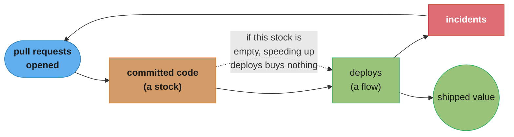
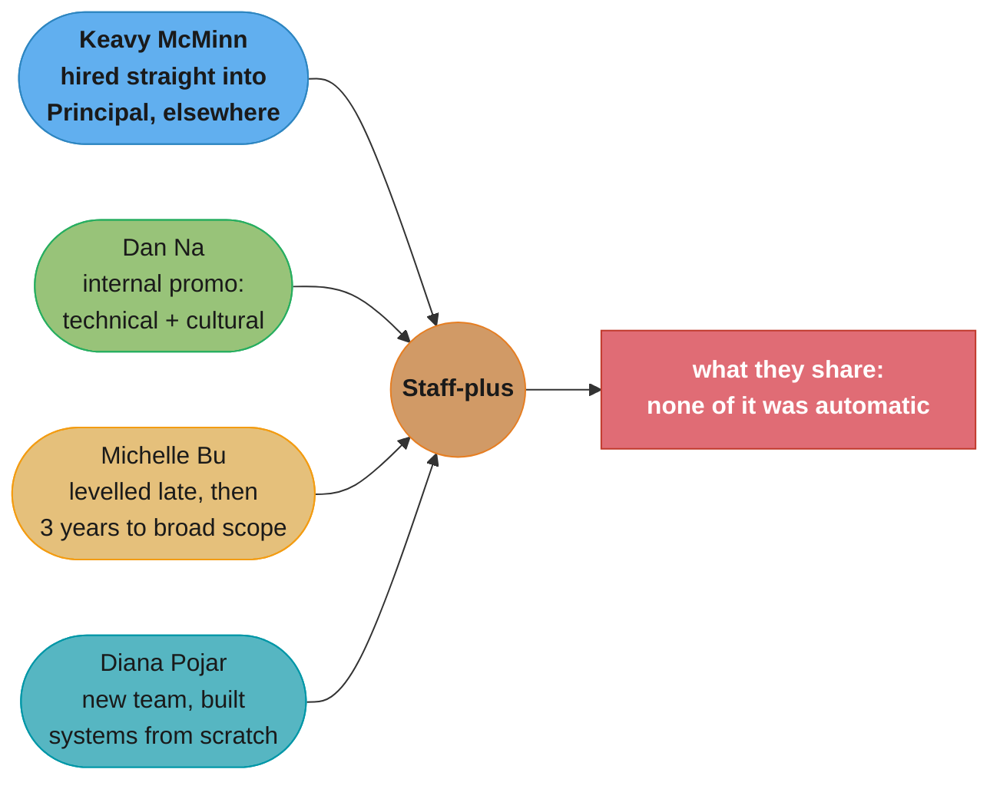

# Part 5: Stories & Resources

> Part 5 of 5 · Staff Engineer: Leadership Beyond the Management Track (Larson, 2021) · builds on Parts 1–4 · this folder covers the book's final TWO sections (Stories and Resources) — see the note below

## Chapter Map

Parts 1 through 4 are conclusions. Part 5 is the evidence they were drawn from, plus the appendix
material for the people on the other side of the table. The **Stories** section is the book's
method made visible: **14 interviews** with named Staff-plus engineers at named companies, each
answering the same underlying questions — what do you actually do, how did you get the title, what
would you tell someone chasing it. The **Resources** section is six short guides aimed less at the
aspiring Staff engineer and more at the organization: how to manage Staff-plus engineers, where
they should report, how to run an interview process for them, what career ladders can and cannot
do, and a primer on systems thinking.

> **This folder covers two of the book's six sections.** The book's Stories section is fourteen
> interviews with no argumentative spine of its own, and Resources is a short appendix; splitting
> them would produce one very thin folder. The `## 5.x` headings below map to the Resources guides
> individually and treat Stories as a single span, which is the one place this folder's mapping is
> coarser than the book's structure.

**TL;DR:**
- The **Stories** are why the book's claims generalize. They are the reason the archetypes exist
  as a frame at all — the variation only becomes visible across many accounts.
- Four findings recur across the interviews: **what got you to Senior will not get you to Staff**,
  **the paths are genuinely different from each other**, **it gets lonely**, and **pursue work you
  find energizing rather than work that looks promotable**.
- **Managing Staff-plus engineers** is its own skill: sponsor more than you direct, give unrefined
  problems rather than solutions, give constant feedback because the role has no natural feedback
  loop, and never let someone linger in "Staff purgatory."
- **Where they report** follows the archetype — Tech Leads to a team manager, Architects to a
  manager of managers, Right Hands to a VP-level leader, Solvers variously or into an Office of
  the CTO. Reaching for the Office of the CTO early is usually avoidance of a fixable problem.
- **Interview processes** fail in seven recognizable ways, most of them versions of testing for
  "a Senior engineer, but better." The principle that fixes them: **asking someone about their
  work is never as helpful as watching them do the work.**

## The Big Question

Why should you believe any of the preceding four parts?

The honest answer is the Stories section. A single practitioner writing about Staff engineering
produces a confident, coherent, and narrow account — and the book's central finding is that the
role is *not* narrow, which means a single account could not have found it. The interviews are what
make "there are four archetypes" a report rather than an opinion, and they are also what make the
book's uncomfortable claims credible: that opportunity is unevenly distributed, that roughly half
the women interviewed changed companies to get the title, and that the paths people took have
almost nothing in common except that none of them were automatic.

---

## 5.1 Stories: Fourteen Paths to the Same Title

> **A sourcing note.** The book contains **14 interviews**; the companion site
> <https://staffeng.com/stories/> has continued to publish and now carries substantially more
> (25 at the time of writing). Which exact fourteen appear in the print edition is not established
> from the sources available here, so the accounts summarized below are identified as published
> narratives rather than asserted to be the print book's specific selection.

### The Roster

The published narratives span archetypes, company sizes, and domains deliberately. A partial list,
with the titles as published: **Keavy McMinn** (Senior Principal Engineer, Fastly), **Dan Na**
(Staff Engineer and Team Lead, Squarespace), **Joy Ebertz** (Senior Staff Software Engineer,
Split), **Ritu Vincent** (Staff Engineer, Dropbox), **Nelson Elhage** (formerly Staff Engineer,
Stripe), **Duretti Hirpa** (formerly Staff Engineer, Mailchimp), **Diana Pojar** (Staff Data
Engineer, Slack), **Rick Boone** (Strategic Advisor to Uber's VP of Infrastructure), **Michelle
Bu** (Payments Products Tech Lead, Stripe), **Silvia Botros** (Senior Principal Engineer, Twilio),
**Bert Fan** (Senior Staff Engineer, Slack), **Dmitry Petrashko** (Tech Advisor to the Head of
Infra, Stripe), **Ras Kasa Williams** (Staff Engineer, Mailchimp), and **Katie Sylor-Miller**
(Frontend Architect, Etsy).

The spread is the point. Rick Boone's and Dmitry Petrashko's titles alone — "Strategic Advisor to
a VP," "Tech Advisor to the Head of Infra" — are the Right Hand archetype visible in the job title,
and they sit in the same list as a Frontend Architect and a Data Platform tech lead.

### Four Recurring Findings

**1. What got you to Senior will not get you to Staff.** Diana Pojar states it flatly:
**"What got you to senior level will not get you to Staff+"**, because the role demands more than
coding — it requires **"driving change and impact in your organization."** Michelle Bu says the
same thing from the other side: **"Being a Staff-plus Engineer, especially a broad-scoped
Staff-plus Engineer, is a very different job than being a Senior Engineer."** This is the
interviews independently reproducing Part 1's central claim.

**2. The paths have almost nothing in common.** Keavy McMinn was **hired directly into a Principal
role** — changing companies was the decisive factor, and she credits **"someone that was a strong
advocate for hiring me specifically,"** despite never having worked with them. Dan Na was promoted
internally on a case combining a large technical project with *cultural* contributions — an
alternative frontend translation architecture, plus founding a coffee-pairing Slack room and an
engineering management book club, which his manager built into a single promotion case. Michelle Bu
levelled *below* her peers early, spent years on product knowledge and relationships rather than
technical advancement, and then went from Senior to Staff to a broad-scoped role in three years.
Diana Pojar joined a newly formed team as a mid-level engineer and reached Staff in three years by
building systems from scratch — her first major project moved **25% of production database load**
to the data warehouse.

**3. It gets lonely.** McMinn's advice to newly promoted Staff engineers is to **"find your peers
or support network,"** because **"it gets lonely the higher up you go."** This is the interview
evidence behind Part 2's "build a network of peers" competency — it is not a nice-to-have, it is
the replacement for the peer group the promotion removed.

**4. Chase energizing work, not promotable-looking work.** Bu's version: **"pursue work that you
find energizing, even if on paper it doesn't seem like it'd get you to a Staff-plus."** McMinn
warns specifically against the hero narrative, noting **"there are so many different directions one
can make it."** Both are pushing back on the same failure — optimizing for the appearance of a
Staff case rather than for the work, which Part 2 calls preening.

### Other Claims Worth Keeping

**On scope.** Dan Na's formulation of what each promotion actually adds: **"every rung up the
ladder means you care about another layer of abstraction, in addition to caring about all the
layers beneath."** And his definition of the Staff engineer's territory: **"What are the biggest
problems holding back engineering teams that fall between the cracks of team ownership? Those are
your problems now."**

**On the management/IC dichotomy.** Na rejects the forced choice, crediting Charity Majors' **"the
Engineer/Manager Pendulum"**, and gives the reason: **"I'm a better manager because I know how
terrible it is to be an IC on a poorly planned project."** Diana Pojar arrives at the same place
from the IC side, arguing Staff engineers need **"many of the core management skills, even though
you are not a manager."**

**On what the title buys.** McMinn: **"as a principal, you have the trust, the time and the space
to try something out"** — a luxury a regular engineer on a project schedule does not have. And on
how she uses authority: **"steering and influencing more than saying, 'I've got the authority to
just tell you what to do.'"**

**On mentorship.** Bu advocates a **"build-your-own-mentor approach"** — assembling peers who are
each excellent at one thing you currently need, rather than looking for a single mentor who covers
everything.

**On mindset.** Pojar's answer for the single most important factor: **believe that you can do it,
and don't let impostor syndrome win.** It reads as a platitude until you notice how many of the
interviews contain a version of it.

**On whether Staff projects are required.** Nelson Elhage's counterexample, quoted in Part 3 and
sourced here: Staff engineers include **"people who don't necessarily run grand projects
themselves"** but who are **"incredibly effective gurus and routers."**

---

## 5.2 Additional Resources on Staff-plus Engineering

A curated reading list, and the framing sentence is a claim about how people actually get here:
**"Most got there either through voracious reading or building a powerful network of colleagues."**
The concrete network recommendation is the **`#staff-principal-engineering` channel in the Rands
Leadership Slack**.

The list is grouped by what you need it for: what Staff-plus engineers do (with pieces by Nicky
Wrightson, Jessie Frazelle, Amy Unger, Tanya Reilly, John Allspaw, Julia Evans and Joy Ebertz),
becoming one (Kristina Fox, Jesse Pollak, Ryn Daniels, and Charity Majors on the engineer/manager
pendulum and on engineering levels), operating as one (Reilly, Elhage, Cindy Sridharan, McMinn,
Larson), writing technical specifications, engineering strategy with worked examples, thirteen
books ranging from *The Pragmatic Programmer* to *Thinking in Systems*, Sridharan's curated talk
lists, and nineteen foundational computer-science papers.

The list's shape is itself an argument: roughly half of it is about writing and organizational
reasoning rather than about engineering.

---

## 5.3 Managing Staff-plus Engineers

The guide aimed at the manager, and the most useful thing in the Resources section for anyone who
has one reporting to them.

### The Core Shift

**Sponsor and support more than you direct.** Daily instruction is the wrong mode; weekly feedback
and active championing of their initiatives is the right one.

**Redefine what success feels like.** Staff-plus roles lack the immediate positive feedback loops
of product engineering — the work runs through conflict, longer timeframes, and competing
priorities, which requires new strategies to stay motivated. A manager who does not name this
leaves the engineer to interpret the silence themselves, usually badly.

**Give constant, specific feedback.** **"Nothing is more stressful for a high performer than not
knowing how they're"** doing. The feedback should be frequent and specific about priorities and
approach — especially about their best work, which is the part most likely to go unremarked because
it needs no correction.

### Information and Decisions

**Share context deliberately and reproducibly.** Build a mechanism — a team chat update, a weekly
email summary — rather than relying on 1:1s, which are lossy and irregular.

**Include them in planning.** Involving them in prioritization means they understand the competing
work and can advocate effectively for technical initiatives rather than lobbying blindly.

**Give unrefined problems, not solutions.** Hand over a problem space rather than a specified task,
so their technical judgment is applied to identifying the right challenge — which is the actual
value they add.

### Developing the Leader

**Agree on how to stay aligned while acting independently.** Larson's diagnostic is elegant:
occasional unexpected decisions indicate you have delegated sufficiently, while *frequent* surprises
indicate you need clearer controls. Both directions are actionable.

**Balance deep thinking with engagement.** Protect their time for the long-horizon work, and
simultaneously prevent them from detaching from organizational reality. Shield them from excessive
firefighting, which is the default consumer of an unprotected calendar.

**Hold them fully accountable.** Address leadership or behavioural gaps directly and do not allow
an underperformer to linger in **"Staff purgatory"** — a state that is bad for them, bad for the
title's meaning, and bad for everyone who is measured against it.

### Organizational Consequences

**Remind them they're a role model.** Engineers observe which behaviours are rewarded at the Staff
level and calibrate accordingly — the same argument Reilly's Chapter 7 makes at book length.

**Cede ownership explicitly.** Transfer whole responsibility areas — technical quality oversight,
for instance — rather than consulting them on yours. Ownership is what creates leverage.

**Minimize manager overflow.** Offloading management work onto a Staff engineer should be temporary
and exceptional; making it permanent quietly converts an IC role into an unpaid management one.

**Appreciate proactively.** **"Ignoring your most important people"** is a form of managerial
procrastination — maintain the 1:1s especially during crises, when they are the first thing to get
cancelled.

**Keep them aligned with the business.** A Staff engineer who models technical superiority over
business needs creates organizational toxicity; their leadership credibility depends on visible
commitment to the business.

**Don't treat meeting attendance as status.** Share meeting responsibilities rather than
duplicating attendance across every gathering.

---

## 5.4 Where Do Staff-plus Engineers Fit into the Org?

Reporting lines, and the answer is **it depends on the archetype** — which is the archetypes
earning their keep as an operational tool rather than a taxonomy.

| Archetype | Typically reports to | Why |
|---|---|---|
| **Tech Lead** | The team's manager | They operate at the same scope as that manager |
| **Architect** | A manager of managers | The work is horizontal across that whole area — "data modeling", say |
| **Solver** | Varies: a team manager, or an Office of the CTO/CEO | The work follows problems, not org boundaries |
| **Right Hand** | A senior leader (VP or equivalent) | The authority is that leader's, borrowed across their span |

### The Office of the CTO

A structure placing **two to eight Staff-plus engineers** reporting directly to a CTO or CEO.
Larson's caution is pointed: **"if you find yourself reaching for it _early_ in a company's
evolution, ask yourself if you're avoiding a problem you should be fixing instead."** The structure
is a legitimate answer to genuine scale and a very convenient way to avoid confronting a
dysfunctional reporting relationship.

### Three Recommendations

**Make the change immediately** rather than staging it, because **"delaying forces folks to
navigate two transitions"** instead of one.

**Always set a timeline** if an immediate change is genuinely impossible, so the interim state has
an end date rather than becoming permanent by default.

**Take the multi-year view:** **"you should look at this as a problem you want to make progress on
_over years_, rather than one that'll get fixed overnight."**

Larson's closing realism: actual org structures rarely match the theoretical ideal, and managers
often react defensively to reporting-structure conversations — which is a fact to plan around
rather than a reason to avoid the conversation.

---

## 5.5 Staff-plus Interview Processes

The counterpart to Part 4's candidate-side guide, written for the company. Its value to a candidate
is that it explains *why* the loops they encounter are so often bad.

### Seven Failure Modes

1. **Overemphasis on programming speed.** Treating the role as *"A senior engineer, but better"*
   and expecting faster coding — when Staff engineers code less and are therefore often *slower* at
   rote programming tasks.
2. **Underestimating impact.** The opposite error: accepting slower programming without ever
   capturing **"what makes these sorts of engineers exceptionally impactful."**
3. **Title inflation without role change.** Companies struggling to hire Senior engineers inflate
   titles without adjusting expectations, which corrodes what Staff-plus means everywhere.
4. **Familiarity bias.** Asking whether the candidate **"feel[s] like they'd be a natural part of
   this team"** anchors on arbitrary confidence signals rather than capability.
5. **Interviewer-level mismatch.** Early-career interviewers undervalue the candidate's actual
   strengths, and Larson notes this affects women and minority candidates disproportionately.
6. **Deterrent formats.** **"Whiteboard algorithmic interviews"** and panels dominated by
   early-career engineers cause strong candidates to opt out — invisibly, so the company never
   learns it happened.
7. **Title sensitivity.** Accomplished candidates avoid appearing **"overly career or title
   motivated,"** which makes first-time Staff-plus hiring conversations awkward on both sides.

### Five Signals Worth Assessing

**Self-awareness** (accountability and demonstrated growth), **judgment** (strategic foresight and
navigating ambiguity), **collaboration** (partnering across experience levels and functions),
**communication** (listening, clarity, flexibility of format), and **development** (growing others
and improving organizational systems).

Larson's note on the list: these are **not "explicitly technical skills"** — they are expertise
applied through critical behaviours, which is why a loop built entirely of technical exercises
measures none of them.

### Formats That Actually Work

| Format | What it reveals |
|---|---|
| Structured presentation (20–30 min) | Clarity of thinking; how they communicate with peers |
| Code review exercise | Empathy and how they give constructive feedback |
| System design with evolving requirements | Architecture thinking under changing constraints |
| Domain expertise interview | Practical problem-solving — debugging, cross-functional work |
| Mentorship panel | A group of potential mentees asks questions; reveals coaching ability |

The organizing principle behind all five: **"asking them about their work is never as helpful as
watching them do the work."**

### Implementation

Larson deliberately declines to provide a template. The instruction instead is to **test them,
gather candidate feedback, and keep evolving them** against your own context and signals — which
is the same "a good process is evolved" argument from Part 2's technical-quality guide.

---

## 5.6 Staff-plus Career Ladders

Short and mostly a caution. The advice for anyone designing one is to study several existing
examples first; the ones referenced are **Rent the Runway**, **Kickstarter**, and **Patreon**, with
**progression.fyi** as a broader catalogue and **Charity Majors'** guide to engineering levels
alongside.

The caveat is the substance: **career ladders only apply effectively against populations of
individuals**, and treating one as a literal map rather than an aspirational framework fails
hardest exactly where Staff-plus lives, because the population at those levels is tiny. Ladders are
**essential** and they do not describe how advancement actually functions in practice — a
disconnect that is acute at Staff-plus and mild below it.

---

## 5.7 Introduction to Systems Thinking

The most unexpected inclusion, and Larson justifies it directly: **systems thinking is "the most
universally useful toolkit"** for leaders working on leveraged problems — more broadly applicable
than product management skills.

### The Concepts

**Stocks and flows.** A **stock** is an accumulation over time (trained managers, committed code,
technical debt); a **flow** is the rate that changes a stock. **Information links** show how the
size of a stock affects the rate of a flow. The reason to model this at all: **"the links between
events are often more subtle than they appear."**

**Feedback loops.** Larson's worked example is developer velocity: pull requests become committed
code, committed code deploys, deploys sometimes produce incidents, and incidents generate new pull
requests. That circularity is the point — **"a feedback loop, where the system's downstream
behavior impacts its upstream behavior."**

**Modeling for insight.** The payoff is discovering that your intuition was wrong about which lever
matters. Larson's example is sharp: **"if you don't have a backlog of ready commits, then speeding
up your deploy rate may not be valuable."** Every organization has spent a quarter optimizing a
stage that was not the constraint.

### Why It's in the Book

The framing sentence explains why this belongs in a career book at all: systems thinking creates
**"an arena for quickly testing hypothesis about how things work, without having to do the
underlying work beforehand."** For a Staff engineer whose feedback loops run in months, the ability
to reason a hypothesis through before committing a quarter to it is the highest-leverage skill
available.

---

## Visual Intuition



Caption: Larson's own worked example. The dashed link is the insight the model produces and
intuition does not — optimizing the deploy rate is worthless if the commit stock upstream of it is
empty, which is the kind of misdirected quarter systems thinking is meant to prevent.

```
   REPORTING LINE FOLLOWS ARCHETYPE

   Tech Lead   ->  the team's manager
                   (same scope as that manager)

   Architect   ->  a manager of managers
                   (work is horizontal across the whole area)

   Solver      ->  a team manager, OR an Office of the CTO/CEO
                   (work follows problems, not org boundaries)

   Right Hand  ->  a VP-level leader
                   (the authority IS that leader's, borrowed)

   ------------------------------------------------------------
   Office of the CTO: 2-8 Staff-plus engineers reporting to the
   CTO or CEO. Larson: reaching for it EARLY in a company's
   evolution usually means avoiding a problem you should fix.
   ------------------------------------------------------------
```

Caption: this is the archetypes doing operational work rather than descriptive work. If you cannot
say which archetype a Staff engineer is, you cannot say where they should report — which is a
practical test of whether the role was defined before it was filled.



Caption: four published paths, no shared mechanism. This is the Stories section's actual argument
and the reason the rest of the book is written as a survey rather than as a method.

---

## Key Concepts Glossary

- **The Stories section** — 14 interviews with named Staff-plus engineers at named companies; the
  evidence base that makes the archetypes a report rather than an opinion.
- **"What got you to senior level will not get you to Staff+"** — Diana Pojar's formulation of the
  book's central claim, arrived at independently by several interviewees.
- **Build-your-own-mentor** — Michelle Bu's approach: assemble several peers each excellent at one
  thing you currently need, rather than seeking one mentor who covers everything.
- **Engineer/Manager Pendulum** — Charity Majors' concept, credited by Dan Na: alternating between
  IC and management roles strengthens both rather than forcing a permanent choice.
- **"Problems between the cracks of team ownership"** — Dan Na's definition of a Staff engineer's
  territory.
- **Staff purgatory** — a Staff-plus engineer with an unaddressed leadership or behavioural gap
  left in the role indefinitely; the management guide's instruction is not to allow it.
- **Unrefined problems** — giving a Staff engineer a problem space rather than a specified
  solution, so their judgment is applied to picking the right challenge.
- **The delegation diagnostic** — occasional unexpected decisions mean you delegated enough;
  frequent surprises mean you need clearer controls.
- **Office of the CTO** — two to eight Staff-plus engineers reporting directly to a CTO or CEO;
  legitimate at scale, and a convenient way to avoid fixing a reporting problem when reached for
  early.
- **The seven interview failure modes** — programming-speed emphasis, unmeasured impact, title
  inflation, familiarity bias, interviewer-level mismatch, deterrent formats, title sensitivity.
- **"Watching them do the work"** — the principle behind every recommended interview format:
  asking about past work is never as informative as observing current work.
- **Ladders apply to populations, not people** — career ladders are essential and describe
  aggregate patterns; at Staff-plus the population is tiny, so the map fits worst exactly there.
- **Stock** — an accumulation that changes over time (committed code, trained managers,
  technical debt).
- **Flow** — the rate that changes a stock; **information links** describe how a stock's size
  affects a flow's rate.
- **Feedback loop** — where a system's downstream behaviour affects its upstream behaviour, as
  incidents generate the pull requests that generate incidents.

---

## Tradeoffs & Decision Tables

| Managing a Staff-plus engineer | Do | Don't |
|---|---|---|
| Direction | Sponsor and support; weekly feedback | Give daily instruction |
| Problems | Hand over an unrefined problem space | Hand over a specified solution |
| Context | Build a reproducible sharing mechanism | Rely on 1:1s to transmit everything |
| Time | Protect deep-thinking time; shield from firefighting | Let the calendar fill itself |
| Accountability | Address gaps directly | Allow "Staff purgatory" |
| Management work | Temporary and exceptional overflow | A permanent unpaid management role |
| Meetings | Share attendance responsibilities | Treat attendance as status |

| Interview format | Signal it produces | What it does NOT measure |
|---|---|---|
| Whiteboard algorithms | Recall under pressure | Anything on the five-signal list |
| Structured presentation | Clarity of thinking; peer communication | Hands-on debugging ability |
| Code review exercise | Empathy; constructive feedback | System-level judgment |
| Evolving system design | Architecture thinking under change | How they grow other people |
| Mentorship panel | Coaching ability, from the mentees' side | Technical depth |
| Domain expertise interview | Practical problem-solving | Strategic foresight |

| Signal about a company's Staff-plus process | Reading |
|---|---|
| The loop is a Senior loop with more difficulty | They think Staff is "Senior but better" |
| Panel is mostly early-career | Your strengths won't register |
| They can't articulate what they're assessing | The level isn't defined internally |
| Everyone's Staff title arrived in a hiring crunch | Title inflation without role change |
| They welcome process questions and iterate on feedback | They've actually thought about the role |

---

## Common Pitfalls / War Stories

- **Reading one Staff engineer's story as the method.** The Stories section exists precisely
  because a single path generalizes badly — McMinn was hired in at Principal, Na was promoted on a
  case half made of cultural work, Bu levelled late and then moved fast. Copying any one of them is
  copying a set of circumstances, not a strategy.
- **Optimizing for a promotable-looking portfolio.** Bu's warning against it is the interview
  evidence for Part 2's "preening": work chosen because it will look good in a packet reliably
  produces a packet and unreliably produces the capability the packet is supposed to demonstrate.
- **Managing a Staff engineer like a very good Senior engineer.** Daily direction, specified tasks,
  and no explicit context-sharing mechanism together produce an expensive IC doing ordinary work.
- **Letting the 1:1 be the context channel.** It is irregular, lossy, and the first thing cancelled
  during a crisis — which is when context matters most.
- **Cancelling the 1:1s during a crunch.** Larson names ignoring your most important people as a
  form of managerial procrastination, and the crunch is exactly when it happens.
- **Permanent manager overflow.** Handing ongoing management work to a Staff engineer converts the
  role into an unpaid, untitled management job that nobody agreed to and that shows up as
  underperformance against the IC ladder.
- **Reaching for an Office of the CTO early.** It is frequently the org-design equivalent of a
  workaround: a structure invented so that a specific broken reporting relationship never has to
  be confronted.
- **Running a Staff-plus loop with an early-career panel.** It produces down-levels and rejections
  that the company reads as candidate quality, and it disproportionately affects women and minority
  candidates — a bias with a purely structural cause.
- **Losing strong candidates invisibly.** Whiteboard algorithmic loops and junior-heavy panels
  cause opt-outs the company never sees, so the process never generates the feedback that would
  correct it.
- **Treating a career ladder as a literal map.** It describes populations, and the Staff-plus
  population at any one company is a handful of people — the level at which the abstraction fits
  worst is exactly the level it is most often quoted at.
- **Optimizing the stage that isn't the constraint.** The systems-thinking guide's own example:
  speeding up deploys when there is no backlog of ready commits. Modeling the stocks and flows
  first is what prevents a quarter spent on the wrong bottleneck.

---

## Real-World Systems Referenced

This part is almost entirely real-world reference, which is its purpose. Named engineers and
employers: **Keavy McMinn** (Fastly, Office of the CTO), **Dan Na** (Squarespace,
Internationalization Platform), **Michelle Bu** (Stripe — Stripe Radar and Stripe Elements as her
Staff projects), **Diana Pojar** (Slack Data Platform), **Joy Ebertz** (Split), **Ritu Vincent**
(Dropbox), **Nelson Elhage** (Stripe), **Duretti Hirpa** and **Ras Kasa Williams** (Mailchimp),
**Rick Boone** (Uber), **Silvia Botros** (Twilio), **Bert Fan** (Slack), **Dmitry Petrashko**
(Stripe), and **Katie Sylor-Miller** (Etsy). Career ladders referenced: **Rent the Runway**,
**Kickstarter**, **Patreon**, and the **progression.fyi** catalogue. **Charity Majors** is cited
twice — for the **Engineer/Manager Pendulum** and for her guide to engineering levels. The
community recommendation is the **`#staff-principal-engineering`** channel in the **Rands
Leadership Slack**. The systems-thinking primer's lineage runs to **Donella Meadows'** *Thinking
in Systems*, which is on the guide's own book list. **Tanya Reilly**, **John Allspaw**, **Julia
Evans**, **Cindy Sridharan**, **Jessie Frazelle**, **Amy Unger**, **Nicky Wrightson**, **Kristina
Fox**, **Jesse Pollak** and **Ryn Daniels** appear in the reading list.

---

## Summary

Part 5 is the book's evidence and its appendix. The **Stories** are fourteen interviews with named
Staff-plus engineers at named companies, and they are the reason the preceding four parts read as a
survey rather than as one person's method — the archetypes are only visible across many accounts,
and so are the uncomfortable findings about who gets the title. Four things recur: what got you to
Senior will not get you to Staff, because the job is different rather than harder (Pojar, Bu); the
paths share no mechanism at all — McMinn was hired straight into Principal at a new company, Na was
promoted on a case built half from cultural contributions, Bu levelled below her peers and then
moved fast, Pojar built systems from scratch on a brand-new team; it gets lonely, which is why
building a peer network is a competency and not a nicety; and pursue work you find energizing
rather than work that looks promotable. The **Resources** are for the other side of the table.
**Managing** a Staff-plus engineer means sponsoring rather than directing, giving unrefined
problems rather than solutions, sharing context through a real mechanism rather than through 1:1s,
protecting deep-thinking time while preventing detachment, giving constant feedback because the
role supplies none naturally, and never allowing Staff purgatory. **Reporting lines** follow the
archetype, with the Office of the CTO available at genuine scale and suspect when reached for
early. **Interview processes** fail in seven recognizable ways, most of them variations on treating
Staff as "Senior but better," and the five signals worth assessing — self-awareness, judgment,
collaboration, communication, development — are not technical skills, which is why watching someone
work beats asking them about work. **Career ladders** are essential and apply to populations, which
means they fit worst exactly at Staff-plus. And **systems thinking** closes the book because, for
someone whose feedback loops run in months, an arena for testing a hypothesis before spending a
quarter on it is the highest-leverage tool available.

---

## Interview Questions

**Q: Why does the book include fourteen interviews rather than presenting the author's own account?**
**Short:** The central finding — that the role varies enormously by company — is invisible from a single account.
Larson is explicit that one person's experience, including his own, isn't general enough for a role this poorly documented. The method is load-bearing rather than modest. The four archetypes only become visible once you have a dozen accounts side by side and can see people describing structurally different jobs under one title; a single-author book would have produced a confident, coherent, and narrow description that happened to be wrong about the shape of the role.

**Q: What is the single claim that recurs most across the interviews?**
**Short:** What got you to Senior will not get you to Staff, because the job is different rather than harder.
Diana Pojar states it directly and adds why — the role requires driving change and impact in your organization, not more coding. Michelle Bu arrives at the same place: being a Staff-plus engineer, especially a broad-scoped one, is a very different job than being a Senior engineer. The interviews reproducing Part 1's central claim independently is what makes it a finding rather than a thesis.

**Q: What do the published paths to Staff have in common?**
**Short:** Almost nothing except that none of them were automatic.
Keavy McMinn was hired directly into a Principal role elsewhere, crediting a strong advocate who had never worked with her. Dan Na was promoted internally on a case combining a large technical project with cultural work — a coffee-pairing Slack room and a book club. Michelle Bu levelled below her peers early, spent years on product knowledge and relationships, then went Senior to Staff to broad scope in three years. Diana Pojar joined a new team as a mid-level engineer and built systems from scratch.

**Q: What does Dan Na say a Staff engineer's problems are?**
**Short:** The biggest problems holding back engineering teams that fall between the cracks of team ownership.
His framing is that ownership gaps are the Staff engineer's territory by definition — the problems nobody's team charter covers are the ones that persist, and they persist precisely because no team is accountable. He pairs it with a model of what each promotion adds: every rung up the ladder means you care about another layer of abstraction, in addition to all the layers beneath it.

**Q: Why does McMinn tell newly promoted Staff engineers to find their peers, and what does that connect to?**
**Short:** It gets lonely the higher up you go — which is why building a peer network is a competency, not a nicety.
The promotion removes your peer group: the people who did your old job are no longer doing your job, and there may be only two or three people at your level in the entire company. Part 2 lists building a network of peers as one of the eight competencies for exactly this reason — it supplies the honest feedback and the sanity check that your manager, structurally, and your former peers, socially, can no longer give you.

**Q: What is Michelle Bu's "build-your-own-mentor" approach?**
**Short:** Assemble several peers each excellent at one thing you currently need, rather than one mentor for everything.
The single-mentor model assumes one person is ahead of you on every dimension you care about, which is rarely true and becomes less true as you get more senior and more specialized. The alternative is to identify the specific growth area, find the person who is genuinely strong on that, and build a narrow relationship — repeated across areas. It also spreads the ask, which makes each individual request easier to grant.

**Q: What's the core shift a manager has to make with a Staff-plus report?**
**Short:** Sponsor and support more than you direct — weekly feedback and championing, not daily instruction.
Direction is the wrong mode because the value they add is judgment applied to which problem to solve, and daily instruction removes exactly that. The complementary move is to give unrefined problems rather than specified solutions, handing over a problem space so their technical judgment identifies the right challenge. A manager who directs a Staff engineer closely ends up with an expensive IC doing ordinary work.

**Q: Why does Larson say a Staff-plus engineer needs constant feedback specifically?**
**Short:** The role has no natural feedback loop, and nothing is more stressful for a high performer than not knowing how they're doing.
Product engineering supplies its own signal — the feature ships, the metric moves. Staff work runs through conflict, competing priorities, and timeframes measured in quarters, so silence is the default state and the engineer will interpret it themselves, usually pessimistically. The feedback should be frequent and specific about their priorities and approach, especially about their best work, which is most likely to go unremarked because it needs no correction.

**Q: What is Larson's diagnostic for whether you've delegated enough to a Staff engineer?**
**Short:** Occasional unexpected decisions mean you delegated enough; frequent surprises mean you need clearer controls.
It's elegant because both directions are actionable and it converts a vague management anxiety into an observable rate. Zero surprises means you have not actually delegated — you are being consulted on everything. A steady stream of them means the alignment mechanism is missing rather than that the person is wrong. The underlying instruction is to agree explicitly on how to stay aligned while acting independently.

**Q: What is "Staff purgatory," and what's the instruction about it?**
**Short:** Leaving a Staff-plus engineer with an unaddressed leadership or behavioural gap in the role indefinitely.
The management guide says to address gaps directly and not allow it. The reason it happens is that a technically strong person with a behavioural problem is uncomfortable to confront and easy to leave alone. The cost lands three ways: on the person, who never gets the feedback that would let them fix it; on the title, which visibly stops meaning anything; and on everyone measured against a standard that is not being enforced.

**Q: How do reporting lines for Staff-plus engineers follow the archetypes?**
**Short:** Tech Leads to a team manager, Architects to a manager of managers, Right Hands to a VP, Solvers variously.
The Tech Lead reports to the team's manager because they operate at the same scope. The Architect reports higher because the work is horizontal across a whole area. The Right Hand reports to the senior leader whose authority they are borrowing. Solvers vary — a team manager, or collected into an Office of the CTO. The practical use is diagnostic: if you can't say which archetype someone is, you can't say where they should report.

**Q: What is the Office of the CTO, and what's Larson's caution about it?**
**Short:** Two to eight Staff-plus engineers reporting to the CTO or CEO — and reaching for it early usually means avoiding a fixable problem.
It's a legitimate structure at genuine scale, particularly for Solvers whose work follows problems rather than org boundaries. His warning is about timing: if you find yourself reaching for it early in a company's evolution, ask whether you're avoiding a problem you should be fixing instead — most often a specific reporting relationship nobody wants to confront directly.

**Q: What are the main ways Staff-plus interview processes fail?**
**Short:** Mostly variations on treating the role as "a senior engineer, but better."
The seven are: overemphasis on programming speed (Staff engineers code less and are often slower at rote tasks), failing to capture what makes them impactful, title inflation without role change, familiarity bias dressed up as culture fit, interviewer-level mismatch, deterrent formats like whiteboard algorithms, and title sensitivity making the conversation awkward. Several compound: junior-heavy panels and algorithmic loops cause strong candidates to opt out invisibly, so the process never gets the feedback that would fix it.

**Q: What five signals does Larson say a Staff-plus loop should assess, and what's notable about them?**
**Short:** Self-awareness, judgment, collaboration, communication, and development — none of them explicitly technical.
Self-awareness means accountability and demonstrated growth. Judgment means strategic foresight and navigating ambiguity. Collaboration means partnering across levels and functions. Communication means listening, clarity, and format flexibility. Development means growing others and improving organizational systems. Larson's note is that these are expertise applied through behaviours rather than technical skills, which is why a loop made entirely of technical exercises measures none of them.

**Q: What's the organizing principle behind the interview formats Larson recommends?**
**Short:** Asking someone about their work is never as helpful as watching them do the work.
Every recommended format is an activity rather than a recounting: a structured 20-30 minute presentation shows clarity of thinking and peer communication, a code review exercise shows empathy and how they give feedback, a system design with evolving requirements shows architecture thinking under change, and a mentorship panel of potential mentees reveals coaching ability from the mentees' side. He declines to provide a template — the instruction is to test formats, gather candidate feedback, and keep evolving them.

**Q: What is Larson's caution about career ladders?**
**Short:** They apply effectively against populations of individuals, which means they fit worst exactly at Staff-plus.
Ladders describe aggregate patterns, and any single company has a handful of Staff-plus engineers — so the abstraction that works reasonably across fifty Senior engineers describes almost nobody at the level above. He calls ladders essential and simultaneously says they don't reflect how advancement actually functions in practice. The recommendation for anyone designing one is to study several existing examples first: Rent the Runway, Kickstarter, Patreon, and progression.fyi.

**Q: Why does a book about staff engineering careers end with a systems-thinking primer?**
**Short:** It's an arena for testing hypotheses about how things work without doing the underlying work first.
Larson calls systems thinking the most universally useful toolkit for leaders working on leveraged problems, more broadly applicable than product management skills. For a Staff engineer whose feedback loops run in months, reasoning a hypothesis through a model before committing a quarter to it is the highest-leverage thing available. His own example makes the case: if you don't have a backlog of ready commits, speeding up your deploy rate may not be valuable at all.

**Q: What are stocks, flows, and feedback loops as the guide defines them?**
**Short:** Stocks accumulate over time, flows are the rates that change them, and feedback loops let downstream behaviour affect upstream.
A stock is an accumulation — committed code, trained managers, technical debt. A flow is the rate changing it, and information links describe how a stock's size affects a flow's rate. Larson's worked example is developer velocity: pull requests become committed code, code deploys, deploys sometimes produce incidents, and incidents generate new pull requests. The circularity is the point — the system's downstream behaviour impacts its upstream behaviour.

---

## Cross-links in this repo

- [soft_skills/staff_plus_archetypes/ — the archetypes doing operational work, including reporting lines](../../../soft_skills/staff_plus_archetypes/staff_plus_archetypes.md)
- [soft_skills/engineering_career_ladders/ — ladders, and what they can and cannot describe](../../../soft_skills/engineering_career_ladders/engineering_career_ladders.md)
- [soft_skills/interviewing_as_the_interviewer/ — running a loop, from the seven failure modes onward](../../../soft_skills/interviewing_as_the_interviewer/interviewing_as_the_interviewer.md)
- [soft_skills/mentorship_and_sponsorship/ — "sponsor and support more than you direct"](../../../soft_skills/mentorship_and_sponsorship/mentorship_and_sponsorship.md)
- [soft_skills/giving_and_receiving_feedback/ — the constant-feedback requirement, in practice](../../../soft_skills/giving_and_receiving_feedback/giving_and_receiving_feedback.md)
- [cs_fundamentals/ — the foundational papers the reading list points at](../../../cs_fundamentals/README.md)
- Previous part: [Part 4 — Switching Companies](../04_switching_companies/04_switching_companies.md) · Book index: [Staff Engineer (Larson)](../staff_engineer_larson.md)
- Companion book: [The Staff Engineer's Path (Reilly) — Ch 7 You're a Role Model Now](../../the_staff_engineers_path/07_youre_a_role_model_now/07_youre_a_role_model_now.md), which is a book-length version of the management guide's "remind them they're a role model."

## Further Reading

- The narratives: <https://staffeng.com/stories/> · the Resources guides:
  <https://staffeng.com/guides/learning-materials/> ·
  <https://staffeng.com/guides/managing-staff-plus-engineers/> ·
  <https://staffeng.com/guides/where-should-staff-plus-eng-report/> ·
  <https://staffeng.com/guides/staff-plus-interview-process/> ·
  <https://staffeng.com/guides/staff-career-ladders/> ·
  <https://staffeng.com/guides/systems-thinking/>
- Meadows, Donella — *Thinking in Systems* — the standard introduction behind the systems-thinking
  primer, and on the guide's own book list.
- Majors, Charity — "The Engineer/Manager Pendulum" and her writing on engineering levels — cited
  by the interviews and by the ladders guide.
- progression.fyi — the catalogue of published engineering career ladders the guide points to.
