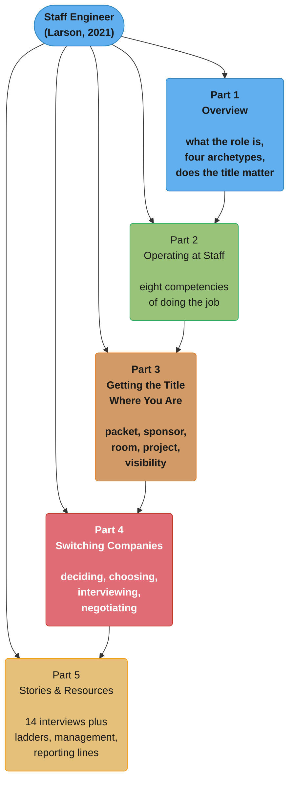
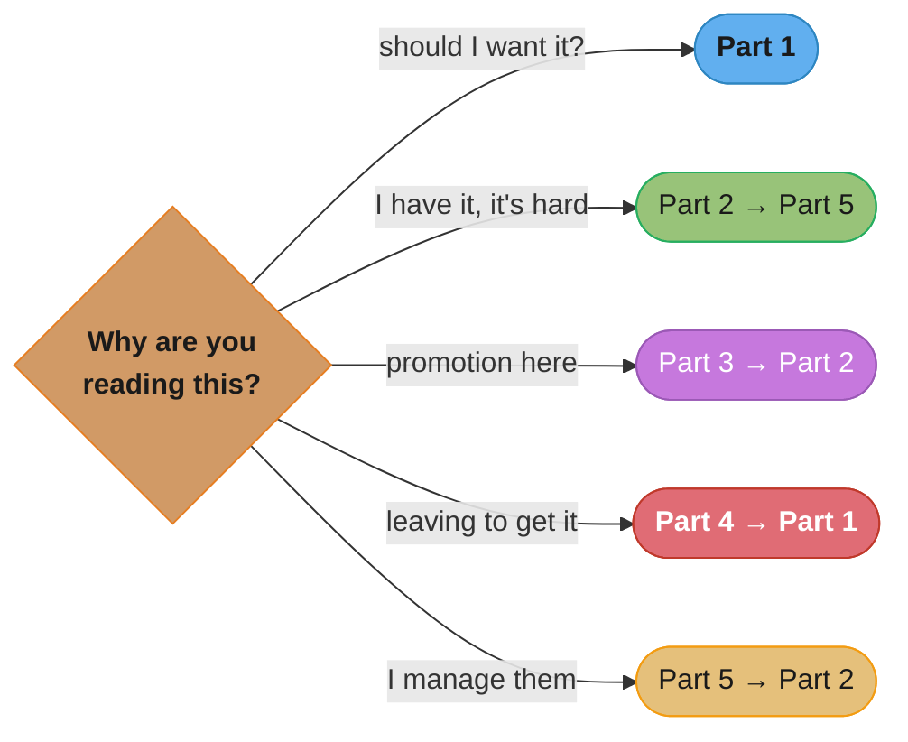

# Staff Engineer: Leadership Beyond the Management Track

> Will Larson · **2021** (Early Edition 28 January 2021; Final Edition 7 February 2021) ·
> self-published · **28 guides and 14 interviews**. The great majority of the text is free to read
> at <https://staffeng.com/book> and <https://staffeng.com/guides/>; the foreword (by Tanya
> Reilly) and the closing section are print-only. A section-by-section, in-depth summary — read
> this folder in order and you have read the book.

> **This is a summary, answerable to its source.** Everything under a `## N.x` heading is reported
> as what the book says, including where a claim is contestable or has dated since 2021. Material
> the book does not contain is disclosed in a `## Beyond the book` section or tagged inline.

> **This folder is organized by PART, not by chapter — five folders for the book's six sections.**
> The book is not a chapter narrative; it is a set of short guides grouped into sections, plus a
> set of interviews. Each folder here is one section, and each `## N.x` heading inside it is one
> of the book's actual guides, in the book's order — so the completeness guarantee still holds at
> the guide level. The book's Stories and Resources sections are combined into a single folder
> (`05_stories_and_resources/`), because the Stories section is fourteen interviews with no
> argumentative spine of its own and Resources is a short appendix; splitting them would produce
> one very thin folder. Do not "fix" this back to six folders.

---

## The Book's Thesis

There is a technical leadership track that does not go through management, and almost nobody
writes down how it works. Larson's starting observation is the **pervasive ambiguity** around it:
Senior engineers who do not want to manage are told a Staff track exists, are given no description
of what the job is, no account of how anyone reached it, and a career ladder written in language
too abstract to act on. The book's response is to interview more than a dozen Staff-plus engineers
across the industry and write down what they actually do — on the explicit grounds that one
person's experience of this role, including the author's, is not general enough to be useful.

Three claims carry the book:

- **"Staff engineer" is not one job.** It is at least four recognizably different jobs — Tech
  Lead, Architect, Solver, Right Hand — that share a title and a compensation band and very
  little else. Most of the confusion in the industry about what Staff engineers do is people
  describing different archetypes to each other.
- **The work changes shape, not just size.** Staff work runs on "weeks, months, and years"
  instead of the tight feedback loop of writing code, and Larson is direct that the slower loop
  can feel demoralizing at first. Most Staff engineers write meaningfully less code than they used
  to, and regularly getting a week of coding is a signal you may be working on something
  comfortable rather than something important.
- **Getting the title is a separate problem from doing the job**, and it is substantially
  organizational rather than meritocratic. Two of the book's five sections are about the title
  specifically: earning it where you are, and the case for leaving to get it.

The book's own framing of the title is the line worth keeping: it is **material but not magic** —
it removes friction, it does not solve problems.

---

## The Five Parts (Part Map)

*Part 1 answers "what is this and do I want it." Part 2 is the only part about doing the work.
Parts 3 and 4 are the two routes to the title — stay or leave — and are deliberately separate
because the tactics barely overlap. Part 5 is the evidence base: the interviews the rest of the
book is built from, plus the appendix material for managers and ladder-writers.*

---

## Part Index

| # | Part | Folder | Guides inside | One-line summary |
|---|------|--------|---------------|------------------|
| 1 | Overview | [01_overview/](01_overview/01_overview.md) | 4 | What Staff-plus is; the four archetypes; what the work actually is; whether the title matters |
| 2 | Operating at Staff | [02_operating_at_staff/](02_operating_at_staff/02_operating_at_staff.md) | 10 | The eight competencies: what matters, strategy, quality, authority, following, never being wrong, space for others, peers, executives |
| 3 | Getting the Title Where You Are | [03_getting_the_title_where_you_are/](03_getting_the_title_where_you_are/03_getting_the_title_where_you_are.md) | 6 | Promotion packet, sponsor, getting in the room, Staff projects, visibility |
| 4 | Switching Companies to Get the Title | [04_switching_companies/](04_switching_companies/04_switching_companies.md) | 4 | Deciding to leave, picking the right company, Staff-plus interview loops, negotiating |
| 5 | Stories & Resources | [05_stories_and_resources/](05_stories_and_resources/05_stories_and_resources.md) | 14 interviews + 6 | The interviews the book is built from, plus ladders, managing Staff-plus, and reporting lines |

---

## The Four Archetypes

The book's single most-cited contribution, introduced in Part 1 and referenced everywhere after.
Larson's own caveat comes first: **"career ladders are a tool that applies better against
populations than people"** — the archetypes describe recognizable shapes, not boxes you must fit.

| Archetype | Where it's common | What the job is | Relationship style |
|---|---|---|---|
| **Tech Lead** | Everywhere; the most common | Guides one team or a small cluster through complex work; partners closely with one manager, sometimes two or three | Deep, ongoing team relationships |
| **Architect** | Larger organizations | Owns direction and quality for a critical domain — API design, storage, infrastructure | Deep, but domain-shaped rather than team-shaped |
| **Solver** | Companies that trust individuals over process | Dropped onto whichever knotty problem leadership has decided matters most; moves on when it's solved | Transient by construction |
| **Right Hand** | Very large organizations; rarest | Operates with a senior leader's borrowed authority on problems at the intersection of business, technology, people, culture and process | Transactional with teams, tight with the executive |

Larson's practical advice around them: **most companies only hire one or two of these archetypes**,
so investigate which ones exist at a company you are considering. And pick for what energizes you —
Tech Leads and Architects build deeper team bonds; Solvers and Right Hands trade that for stronger
executive alignment and more transience.

---

## How to Read This (Reading Paths)

- **Cover to cover:** Parts 1 → 5. The book explicitly says it is fine to jump around, and it
  means it — the guides are self-contained.
- **"Should I even want this?":** Part 1 only. Archetypes, what the work actually is, and the
  honest accounting of what the title buys.
- **"I have the title and I'm struggling":** Part 2, then Part 5's interviews. The eight
  competencies, then a dozen accounts of other people finding the same things hard.
- **"I want the promotion here":** Part 3 → Part 2. Packet, sponsor, room, visibility — then the
  competencies the packet has to demonstrate.
- **"I'm leaving to get it":** Part 4 → Part 1. The switching tactics, then archetypes as the lens
  for evaluating whether a given company's Staff role is one you want.
- **"I manage Staff engineers":** Part 5's Resources, then Part 2. What managing them requires,
  then what they are supposed to be doing.

*Only one path starts at the beginning. The book is a reference organized as a book, and reading
it as a reference is the intended use.*

---

## Relationship to Reilly's *The Staff Engineer's Path*

This repo summarizes both standard books on the staff-plus career. Larson wrote first and Reilly
wrote his foreword; the two answer adjacent questions and are usually read together.

| | Larson, *Staff Engineer* (2021) | Reilly, *The Staff Engineer's Path* (2022) |
|---|---|---|
| Central question | What **is** this job, and how do I get it? | How do I **do** this job well? |
| Organizing device | Four archetypes | Three pillars: big picture, execution, levelling up |
| Getting the title | Two of five parts | Largely out of scope |
| Form | Short guides plus 14 named interviews | A continuous practitioner's manual |
| Strongest on | Variation across companies; the politics of the title | The craft — strategy documents, project mechanics, scaled influence |
| Read it when | You are deciding whether to pursue the role | You are in the role, or nearly |

The companion summary lives at
[`the_staff_engineers_path/`](../the_staff_engineers_path/the_staff_engineers_path.md).

---

## Build Manifest

Per-file build status for this book. Update the row to `done` the moment a part file is completed
and diagram-linted.

| # | File | Status |
|---|------|--------|
| 1 | `01_overview/01_overview.md` | done |
| 2 | `02_operating_at_staff/02_operating_at_staff.md` | done |
| 3 | `03_getting_the_title_where_you_are/03_getting_the_title_where_you_are.md` | done |
| 4 | `04_switching_companies/04_switching_companies.md` | done |
| 5 | `05_stories_and_resources/05_stories_and_resources.md` | done |

---

## Cross-Reference Map (book concept → repo deep dives)

| Concept from the book | Primary deep-dive module |
|---|---|
| The four archetypes | [soft_skills/staff_plus_archetypes/](../../soft_skills/staff_plus_archetypes/staff_plus_archetypes.md) |
| Work on what matters; snacking, preening, chasing ghosts | [soft_skills/scope_prioritization_and_saying_no/](../../soft_skills/scope_prioritization_and_saying_no/scope_prioritization_and_saying_no.md) |
| Writing engineering strategy and vision | [soft_skills/design_docs_rfcs_and_adrs/](../../soft_skills/design_docs_rfcs_and_adrs/design_docs_rfcs_and_adrs.md) |
| Managing technical quality; leverage points and paved roads | [devops/platform_engineering_and_idp/](../../devops/platform_engineering_and_idp/platform_engineering_and_idp.md) |
| Staying aligned with authority; never surprise your manager | [soft_skills/upward_and_async_communication/](../../soft_skills/upward_and_async_communication/upward_and_async_communication.md) |
| Learn to never be wrong; reading the room | [soft_skills/difficult_conversations_and_conflict/](../../soft_skills/difficult_conversations_and_conflict/difficult_conversations_and_conflict.md) |
| Create space for others; sponsorship | [soft_skills/mentorship_and_sponsorship/](../../soft_skills/mentorship_and_sponsorship/mentorship_and_sponsorship.md) |
| Present to executives; SCQA and the Pyramid Principle | [soft_skills/executive_communication/](../../soft_skills/executive_communication/executive_communication.md) |
| Promotion packets; ladders | [soft_skills/performance_reviews_and_promotions/](../../soft_skills/performance_reviews_and_promotions/performance_reviews_and_promotions.md) |
| Career ladders across companies | [soft_skills/engineering_career_ladders/](../../soft_skills/engineering_career_ladders/engineering_career_ladders.md) |
| Interviewing for Staff-plus roles | [soft_skills/behavioral_interview_systems/](../../soft_skills/behavioral_interview_systems/behavioral_interview_systems.md) |
| Negotiating the offer | [soft_skills/negotiation_for_engineers/](../../soft_skills/negotiation_for_engineers/negotiation_for_engineers.md) |
| Influence without formal authority | [soft_skills/influence_without_authority/](../../soft_skills/influence_without_authority/influence_without_authority.md) |

---

## Further Reading

- The book, free: <https://staffeng.com/book> · the guides: <https://staffeng.com/guides/> · the
  interviews: <https://staffeng.com/stories/>
- Larson, Will — *An Elegant Puzzle: Systems of Engineering Management* (Stripe Press, 2019) — the
  management-side predecessor, and the source of several frames this book reuses.
- Reilly, Tanya — *The Staff Engineer's Path* (O'Reilly, 2022) — the craft counterpart; Larson's
  foreword author, summarized in this repo at
  [`the_staff_engineers_path/`](../the_staff_engineers_path/the_staff_engineers_path.md).
- Minto, Barbara — *The Pyramid Principle* — the source of the SCQA structure the
  "present to executives" guide teaches.
