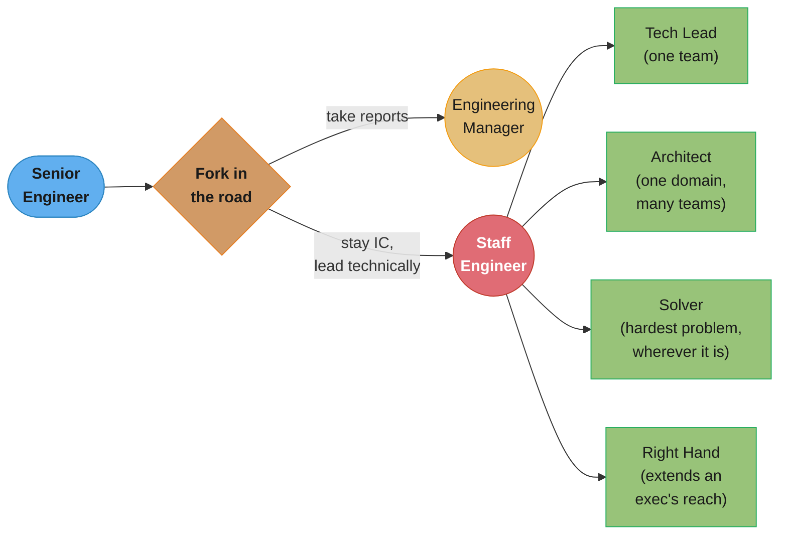

# Chapter 1: What Would You Say You Do Here?

> Part I — The Big Picture · The Staff Engineer's Path (Reilly, 1st ed., O'Reilly 2022) ·
> opens the book, leads to Ch 2 (Three Maps)

## Chapter Map

The book opens by refusing to hand you a job description, because there isn't one that
travels between companies. "Staff engineer" is a real level on most large tech-company
ladders (typically the rung above senior, and below principal or distinguished), but the
day-to-day content of the role varies more than any other title at that level of seniority
— two staff engineers at the same company can have almost nothing in common in what they
actually spend their week doing. Chapter 1 is Reilly's attempt to give the role a shape you
can recognize, without pretending it has only one shape.

**TL;DR:**
- Staff engineer is a **leadership** role, not "senior engineer with a bigger paycheck" —
  the job changes in kind, not just in degree, and the change is usually **instead of** your
  old senior workload, not **in addition to** it.
- Four recurring **archetypes** — Tech Lead, Architect, Solver, Right Hand — describe most
  staff-plus jobs in practice; naming yours clarifies what "doing the job well" even means.
- The deepest justification for the role is **avoiding local maxima**: an organization made
  of teams each optimizing their own corner can still be badly suboptimal as a whole, and
  someone has to be paid to look at the whole board.
- **Scope** — what you own, how deep you go, and who you report to — is the lever that
  makes the job tractable; both too broad and too narrow a scope quietly break it.
- The work splits across **four disciplines** (technical, product, project, and people
  management) that a staff engineer practices without formal authority over any of them.

## The Big Question

> "What would you say... you do here?" is the question from *Office Space* the chapter
> title borrows, and it's not a joke — it's the actual, honestly-asked question a staff
> engineer's own manager, peers, and skip-level frequently cannot answer about them. If the
> job can't be described in a sentence the way "the backend team builds and runs the
> payments service" can, how do you know if you're doing it well, or doing it at all?

Analogy: a senior engineer's job is like being an excellent player on a sports team — you
have a position, you know what "good" looks like at that position, and a scoreboard tells
you whether you're winning. A staff engineer's job is closer to being handed a walkie-talkie
and told to wander the stadium looking for the places where the team is about to lose for
reasons no single player can see from the field — a blocked gate, a scoreboard that's wrong,
two players about to collide because nobody told them the play changed. There's no position
called "walk around and notice things," which is exactly why the role needs its own chapter
before anything else in the book makes sense.

---

## 1.1 What Even Is a Staff Engineer?

Reilly's working definition: a staff engineer is a **senior person who has moved from
individual execution to influencing the technical direction, practices, or connectedness of
a larger group** — a team, several teams, or an entire organization — while remaining, at
core, an engineer rather than a manager. That single sentence hides three questions every
new staff engineer gets asked, and needs an answer for.

### Are You a Manager?

No — that's the fork in the road the whole book assumes you've already taken. Past senior,
engineers usually face a genuine choice: take on direct reports and become a manager, whose
job includes performance reviews, hiring and firing decisions, and being legally and
organizationally responsible for people's careers; or become a staff engineer, a technical
leadership role with **no direct reports** and none of that formal authority. The two roles
converge on similar activities — both spend real time on alignment, communication, and
unblocking other people's work — but a manager's authority comes from the org chart and a
staff engineer's has to be earned every time, from technical credibility and relationships.
This is not a demotion in either direction: it is a split into two different levers on the
same organization, and most large companies deliberately keep both because neither lever
alone is sufficient.

### Do You Write Code?

Usually, but less over time, and that's expected rather than a warning sign. Early in the
role a staff engineer often still owns meaningful code — a 20-30% coding allocation is a
common informal target at several companies Reilly cites conversations with — but the more
of the job is strategy, standards-setting, mentoring, and cross-team alignment, the less
room is left for heads-down implementation, and that's not the job going wrong, it's the job
working as designed. The trap is treating declining coding time as a personal failure to
"stay technical" — Reilly's answer is that staying technical means staying sharp enough to
evaluate tradeoffs and dive into a gnarly problem when it matters, not logging a fixed number
of commits a quarter. A staff engineer who writes zero code for two quarters because they
were needed elsewhere, and can still credibly review a design doc's data-model choice, is
technical; one who ships steadily but can't reason about the system beyond their own module
is not doing the job, however many commits they have.

### Does the Title Matter?

Yes, practically, even though the book is explicit that the title itself changes nothing
about your skill. A title is a **trust shortcut**: it tells strangers, at a glance, roughly
how much authority to extend you before they've had the chance to build trust the slow way.
Without the title, a genuinely staff-level engineer has to re-earn credibility in every new
room — a new team, a new exec review, a new company — the hard way, one demonstrated
judgment call at a time. With it, people extend a starting balance of trust, which is a real
resource: it means your "can we slip this deadline" gets heard as a considered risk
assessment instead of an excuse, on the first ask rather than the fifth. Titles also carry
real compensation and negotiating consequences, so "the title doesn't matter, only the work
does" is true as advice about where to focus your energy, and false as a description of how
the rest of the organization will actually treat you.

---

## 1.2 The Four Archetypes

Not every staff engineer's day looks the same, and Reilly borrows a widely used shape (the
same one popularized on Will Larson's staff-eng.com) to describe the recurring patterns
rather than inventing a fifth. Naming your own archetype is diagnostic, not aspirational —
none of the four is "more senior" than another, and a single person can shift between them
as they change teams or as the organization's needs change.

| Archetype | Scope | What the day looks like | Failure mode if misapplied |
|---|---|---|---|
| **Tech Lead** | One team | Sets technical direction *and* helps run the team day to day; close partner to that team's product/eng manager; delegates by default to grow teammates | Becomes a bottleneck the team can't function without, or quietly does the manager's job unpaid |
| **Architect** | Several teams, one domain | Owns direction, quality, and approach for a critical technical area (a platform, a subsystem); combines deep technical constraints with organizational awareness | Designs in a vacuum, disconnected from the teams who have to live with the architecture day to day |
| **Solver** | Wherever the fire is | Goes deep on one hard, often ambiguous problem until it's solved, then moves to the next one; some stay in one area for years, others jump hotspot to hotspot | Becomes a single point of failure — nobody else learns the hard problem because the Solver always arrives to solve it first |
| **Right Hand** | An executive's whole org | Extends a senior leader's attention and judgment across a large organization the leader can't personally cover; borrows the leader's scope and some of their authority | Becomes a proxy for the executive's opinions rather than an independent technical voice, losing the org's trust |

The table's right column is the reason naming your archetype matters in practice: each one
has a *distinct* way of quietly going wrong, and the fix for a Tech Lead who's become a
bottleneck (delegate harder, name a backup) is close to useless advice for a Solver who's
become one (the fix there is closer to "write down how you solve things, and teach it").
Knowing which archetype you're in tells you which failure mode to actually watch for.

---

## 1.3 Why Do We Need Big-Picture Engineers?

### Avoiding Local Maxima

The core justification for paying someone to think about the whole system rather than one
piece of it: a set of teams, each rationally optimizing their own corner, can converge on a
combined outcome that's worse than what a coordinated view would have produced — a **local
maximum**. Three concrete shapes this takes, drawn from the chapter's own examples:

1. **Misaligned priorities.** Team A ships a feature the org doesn't need this quarter
   because it was the most interesting problem on Team A's own backlog, while a genuinely
   urgent cross-team dependency sits unowned because it belongs to nobody's roadmap.
2. **Habituation to problems.** A team living inside a painful deploy process for two years
   stops seeing it as painful — it's just "how deploys work here" — while a newcomer or an
   engineer visiting from another team notices immediately that the 45-minute manual deploy
   checklist is not normal.
3. **Losing sight of purpose.** A team can hit every sprint commitment and still be building
   toward a product direction the company quietly abandoned six months ago, because nobody
   with the whole picture told them.

Reilly's test for whether you're stuck in a local maximum: **"What will you regret in a
year? In three years, what will you wish you'd done?"** — a question deliberately aimed past
the current sprint, because local maxima are, by definition, invisible from inside the
sprint that's optimizing them.

A related, subtler failure: **management authority overshadowing technical judgment**. A
director with strong opinions and formal authority can push an organization toward a
technically worse decision simply because no one in the room has the standing to push back —
not because the director is wrong on purpose, but because authority and correctness are
different axes, and only one of them shows up on the org chart. Part of the staff engineer's
job is being a voice in that room with enough credibility to say "I don't think that's
right" and be heard on the merits.

### Keeping Things Moving

A second, more mundane justification: organizations get stuck. A decision that needs five
teams to agree stalls for eight weeks not because anyone disagrees, but because nobody owns
convening the conversation. A staff engineer's cross-team relationships and standing let them
unstick exactly this kind of gridlock — not by out-ranking anyone, but by being the person
who calls the meeting, drafts the doc that forces a decision, or simply asks the blocking
question in the room where it will finally get answered.

---

## 1.4 Why Do We Need Engineers Who Are a Good Influence?

Work carries weight beyond its literal content, and a respected senior voice sets norms
whether or not that's the explicit job description. If a widely respected engineer skips
code review, writes no tests, or dismisses a junior engineer's question in a meeting, that
behavior propagates — not because anyone copies it consciously, but because "what the
respected people actually do" is a stronger behavioral signal than any written standard.
Chapter 7 (*You're a Role Model Now (Sorry)*) returns to this at length; Chapter 1 plants it
early because it's part of *why* the role exists, not only part of how to do it well: an
organization benefits from having some of its most technically credible people also be
consistently, visibly the kind of engineer others want to work like.

---

## 1.5 This Is Not in Addition to the Workload of a Senior Engineer

The single most common way new staff engineers burn out: treating the title as a stack of
new responsibilities piled on top of the old senior-engineer job, rather than a genuine
**reframing** of what the job is. Reilly's framing is deliberately blunt — becoming staff is
"instead of," not "in addition to." A staff engineer who is still expected to be the fastest
individual contributor on the team *and* run cross-team alignment *and* mentor three junior
engineers *and* write the technical strategy doc is not doing four jobs well; they're doing
one job badly across four fronts, and something (usually sleep, or the strategy doc) gives
first.

### Common Attributes

Across all four archetypes, a few attributes recur regardless of which one you are:

- **Leader, not manager.** Staff engineers act like leaders whether or not they feel like
  one and whether or not anyone reports to them — waiting to feel qualified before acting
  with authority is a trap, because the confidence tends to arrive *after* the practice, not
  before it.
- **"Someone should do something here."** Reilly's heuristic for autonomous scope-finding:
  whenever you notice yourself thinking "someone should really fix this," there's a
  reasonable chance the someone is you. This is deliberately different from waiting to be
  assigned work — staff-level impact is disproportionately generated by noticing unowned
  problems, not by executing assigned ones faster.
- **A technical role, first.** Staff engineers understand real tradeoffs (not just
  buzzwords), can dive into a hard problem hands-on when it matters, ask the clarifying
  question nobody else asked, and care more about outcomes than about being the one who
  personally produced them.
- **An aim to be autonomous.** Nobody hands a staff engineer a fully-specified backlog — they
  build their own list of high-impact work from context gathered across the organization,
  and they actively **defend and structure their own time**, because time is the one
  resource that never comes back. "Use your no to protect your yes" — declining low-leverage
  asks is not selfishness, it's the only way the high-leverage ones get done.
- **On technical decisions.** A staff engineer's job regarding a hard technical decision is
  to make sure it **happens, happens well, and gets documented** — not necessarily to make
  the decision personally. Good technical decision-making is explicitly framed as a team
  effort; the staff engineer's contribution is often process (convening the right people,
  forcing a deadline, writing down the rationale) as much as it is the technical call itself.
- **Reporting chains matter.** Where a staff engineer reports — inside a single team, at the
  org level, directly to a VP — measurably changes the support they receive, the information
  they're exposed to, how they're perceived by others, and the practical scope they can
  affect. A staff engineer buried three levels inside one team's reporting line will
  struggle to influence a sibling team's roadmap no matter how good their ideas are, purely
  because they're structurally invisible to it.

---

## 1.6 On Scope

**Scope** is what a staff engineer owns: a domain, a set of teams, a technical area. Getting
it right is one of the highest-leverage things a staff engineer's manager can do for them,
because scope failures in either direction quietly cap someone's impact without ever showing
up as an explicit complaint.

### Too Broad

A scope stretched across too many teams or domains produces:

- **Loss of impact through distraction** — spread across six teams, an engineer's attention
  on any one of them shrinks to something close to useless.
- **Becoming a bottleneck** — if every cross-team decision routes through one person by
  default, that person's calendar becomes the organization's throughput ceiling.
- **Decision fatigue** — the sheer number of context-switches between unrelated problems
  degrades judgment quality on all of them.
- **Missing relationships** — depth of trust with any one team's engineers requires
  repeated contact; spread too thin, a staff engineer becomes a stranger to everyone.

### Too Narrow

A scope confined too tightly produces the opposite failures:

- **Reduced impact** — the staff-level toolkit (cross-team influence, big-picture framing)
  goes mostly unused on a problem small enough for one team to solve alone.
- **Real opportunity cost** — a senior organizational asset spends its time on work a
  mid-level engineer could have done just as well.
- **Overshadowing others** — a staff engineer camped inside one team's day-to-day work can
  unintentionally starve that team's own senior engineers of the growth opportunities the
  staff engineer is soaking up instead.
- **Overengineering** — with nothing bigger to worry about, attention drifts toward
  polishing a corner of the system well past the point of diminishing returns.

Scope should flex during a genuine crisis (an incident, a critical deadline) — the rule is
not rigidity, it's that the default, steady-state scope needs to be deliberately sized, and
"whatever's on fire this week" is not a scope, it's an absence of one.

---

## 1.7 What Shape Is Your Role?

Reilly's closing frame for the chapter: your job may legitimately be an odd shape, and that
is fine as long as it's an odd shape *for a reason* — aligned to real organizational need —
rather than an accidental shape nobody chose. Two structural choices worth naming
explicitly:

- **Depth-first vs. breadth-first.** A depth-first staff engineer goes deep on one hard
  area for a long stretch (closer to the Solver or Architect archetype); a breadth-first one
  ranges across many surface areas, trading depth for coverage (closer to the Right Hand).
  Neither is more "senior" — they fit different organizational gaps.
- **Delayed gratification and manager-track connections.** Staff-level work often pays off
  on a longer horizon than a sprint or even a quarter — a technical strategy written this
  quarter may not visibly change outcomes for two more. Staying meaningfully connected to
  the management track (attending the manager staff meeting as a guest, keeping a close peer
  relationship with your manager counterpart) keeps a staff engineer's plans grounded in
  what leadership is actually deciding, rather than drifting into technically interesting
  work that nobody upstream asked for.

### The Four Disciplines

Underneath any archetype and any scope, the actual work draws on four distinct disciplines,
none of which a staff engineer holds formal authority over:

| Discipline | What it covers | Staff engineer's version of it |
|---|---|---|
| **Core technical skills** | System design, code quality, architecture | Deep enough expertise to be trusted on hard technical calls |
| **Product management** | Deciding what needs doing, and why, and telling that story | Identifying real user/business needs a purely technical view misses |
| **Project management** | Identifying and removing blockers, tracking progress | Making sure the right work is unblocked, without owning a Gantt chart full-time |
| **People management** | Building teams, developing careers, mentoring | Growing people's skills and judgment with none of the formal authority a manager has |

The job, in short: your title says "engineer," but the actual work is a blend across all
four disciplines, practiced by influence rather than authority — which is precisely why the
rest of the book spends so little time on code and so much time on maps, documents, and
relationships.

---

## Visual Intuition



Caption: the fork happens once, past senior; four archetypes then describe *where* the staff
engineer's influence concentrates — one team, one domain across many teams, one hard problem
wherever it surfaces, or the reach of one executive.

```
  SCOPE, SIZED CORRECTLY                    SCOPE, TOO BROAD OR TOO NARROW

  too narrow <--------- right size ---------> too broad

  |-- reduced impact -----[ SWEET SPOT ]------- lost to distraction ------|
  |-- opportunity cost                          bottleneck on everything  |
  |-- overshadows team's own seniors            decision fatigue         |
  |-- risk of overengineering                   no time to build trust   |

  The sweet spot is not fixed -- it moves with organizational need,
  and a crisis is allowed to widen it temporarily. A scope that never
  gets re-examined is a scope that was never deliberately sized.
```

Caption: both edges of the scope axis fail quietly — nobody files a complaint titled "my
scope is wrong," the symptoms just look like burnout on one side and boredom on the other.

---

## Key Concepts Glossary

- **Staff engineer** — a senior technical leadership role with no direct reports, whose
  influence works through credibility and relationships rather than formal authority.
- **Archetype** — one of four recurring shapes a staff-plus role takes: Tech Lead,
  Architect, Solver, Right Hand.
- **Tech Lead** — a staff-level archetype scoped to one team, close partner to that team's
  manager, sets technical direction and helps run the team day to day.
- **Architect** — a staff-level archetype scoped to one technical domain spanning several
  teams, owning direction, quality, and approach in that area.
- **Solver** — a staff-level archetype that goes deep on the organization's hardest,
  most ambiguous problems, wherever they currently are.
- **Right Hand** — a staff-level archetype that extends a senior executive's attention and
  judgment across an organization too large for the executive to personally cover.
- **Local maximum** — an outcome that's optimal for one team or component in isolation but
  suboptimal for the organization as a whole.
- **Title as trust shortcut** — the practical effect of a formal title: it grants a starting
  balance of credibility before it's been individually earned.
- **"Instead of," not "in addition to"** — Reilly's framing that staff work replaces, rather
  than stacks onto, the prior senior-engineer workload.
- **"Someone should do something here"** — the heuristic that autonomous, unassigned
  problem-noticing is a primary source of staff-level impact.
- **Scope** — the domain, team set, or technical area a staff engineer is responsible for
  influencing.
- **Scope too broad** — a scope wide enough to cause distraction, bottlenecking, decision
  fatigue, and shallow relationships.
- **Scope too narrow** — a scope tight enough to waste staff-level leverage, create
  opportunity cost, overshadow a team's own seniors, or invite overengineering.
- **Depth-first vs. breadth-first role** — whether a staff engineer concentrates on one hard
  area for a long stretch, or ranges across many surface areas.
- **The four disciplines** — technical, product management, project management, and people
  management, practiced together without formal authority over any of them.

---

## Tradeoffs & Decision Tables

| | Manager | Staff Engineer |
|---|---|---|
| Direct reports | Yes | No |
| Source of authority | Org chart | Earned credibility + relationships |
| Owns performance reviews/hiring | Yes | No |
| Primary lever | People decisions | Technical direction + alignment |
| Both needed? | Yes — neither lever alone is sufficient at scale | Yes |

| Archetype | Best organizational fit | Weakest fit |
|---|---|---|
| Tech Lead | A team that needs steady technical direction plus day-to-day help | An org-wide cross-cutting problem no single team owns |
| Architect | A critical domain spanning several teams with real technical stakes | A fast-moving area where the "architecture" is still being discovered |
| Solver | Genuinely ambiguous, high-stakes, non-recurring problems | A team that needs steady day-to-day presence, not episodic rescue |
| Right Hand | A large org whose executive needs their attention multiplied | An org that needs an independent technical voice, not a proxy |

| Scope size | Symptom | Fix |
|---|---|---|
| Too broad | Bottleneck, distraction, decision fatigue | Narrow to fewer teams/domains; delegate the rest |
| Too narrow | Boredom, opportunity cost, overshadowing | Widen scope; explicitly hand day-to-day ownership back to the team |
| Right-sized | Neither symptom, periodically re-checked | Revisit on org change, not on a fixed calendar |

---

## Common Pitfalls / War Stories

- **The "in addition to" burnout.** A newly promoted staff engineer keeps every senior-level
  commitment (on-call, feature ownership, being the fastest coder on the team) while adding
  cross-team strategy work on top. Within two quarters something breaks — usually either the
  strategy work never gets written, or the engineer burns out trying to do both jobs at full
  intensity. The fix has to happen at promotion time: an explicit conversation about what
  gets handed off, not an assumption it'll sort itself out.
- **Waiting to feel qualified.** New staff engineers who wait for a feeling of authority
  before acting like a leader can wait indefinitely — the confidence tends to arrive only
  after repeated practice acting with authority, not before it. Waiting is itself a choice,
  and it's usually the wrong one.
- **The unnamed archetype.** A staff engineer whose actual day-to-day work is Solver-shaped
  (bouncing between organizational fires) but who is evaluated against Tech Lead-shaped
  expectations (steady presence on one team) looks like they're underperforming on both,
  when the real problem is a mismatch nobody named.
- **Scope creep by accumulation.** Nobody hands a staff engineer six teams on day one — it
  happens one reasonable-sounding request at a time ("can you also just look at..."), until
  the scope is silently too broad and nobody remembers deciding that.
- **Mistaking title for competency, or the reverse.** Extending full staff-level trust to
  someone purely because of the title, without verifying judgment on the actual decision at
  hand, is exactly as much of a mistake as refusing to extend any trust to someone doing
  staff-level work who hasn't yet gotten the title.
- **Deciding technical calls alone because "it's faster."** A staff engineer who makes a
  consequential technical decision solo, without convening the people who'll have to live
  with it, may move faster in the moment but usually pays for it later in the form of
  unbought-in teams quietly working around the decision instead of with it.

---

## Real-World Systems Referenced

This chapter is unlike most of this repo's other book summaries in that it names very few
production systems — it's a people-and-process book, and its worked examples are mostly
composite or fictional rather than drawn from a single named company's public incident. The
concrete references the chapter itself leans on:

- **The four-archetype framework** (Tech Lead, Architect, Solver, Right Hand), which Reilly
  explicitly draws from the widely cited staff-plus taxonomy popularized by Will Larson's
  staff-eng.com resource, rather than presenting it as an original invention.
- The **"someone should do something here"** and **local-maximum** framings recur across the
  rest of the book (most directly in Chapter 2's locator map and Chapter 3's vision/strategy
  material), rather than being one-off Chapter 1 concepts.

---

## Summary

A staff engineer is a senior technical leader with no direct reports, whose job is to see
and act on the whole system in a way individual team ownership structurally can't — catching
local maxima, keeping stuck decisions moving, and setting a technical and behavioral example
other engineers follow. The role isn't one shape: it splits into (at least) four recurring
archetypes — Tech Lead, Architect, Solver, Right Hand — each with a different scope and a
different way of quietly going wrong. Becoming staff replaces the prior senior workload
rather than adding to it, and the job draws on four disciplines (technical, product, project,
and people management) practiced entirely through influence rather than formal authority.
Scope is the central tuning knob: too broad scatters impact and creates a bottleneck; too
narrow wastes staff-level leverage and can crowd out a team's own growing seniors. Chapter 2
picks up directly from here, giving the concrete tool — three maps — for actually building
the big-picture view this chapter argues you need.

---

## Interview Questions

**Q: Why does Reilly insist staff-level work is "instead of," not "in addition to," a senior engineer's workload?**
**Short:** Reilly argues stacking staff work on unchanged senior duties is a burnout pattern, not ambition.
Because the job genuinely changes in kind — cross-team alignment, technical strategy, and mentoring at scale take real hours that have to come from somewhere, and pretending they're free time layered on top of an unchanged senior workload is what produces the most common new-staff-engineer burnout pattern. Reilly's framing forces an explicit conversation at promotion time about what gets handed off, rather than leaving it to be silently discovered two quarters later when something breaks.

**Q: What's the practical difference between a manager and a staff engineer, given both spend real time on alignment and unblocking?**
**Short:** A manager's authority comes from the org chart; a staff engineer's has to be earned every time.
A manager has direct reports and the formal authority that comes with the org chart — performance reviews, hiring and firing decisions, organizational responsibility for people's careers — while a staff engineer has none of that and instead relies on earned technical credibility and relationships to get the same kind of cross-team traction. The two roles converge on similar day-to-day activities but draw on structurally different sources of authority, which is why companies keep both rather than treating one as a strict upgrade of the other.

**Q: Does the staff engineer title actually matter if the underlying skill is the same either way?**
**Short:** Reilly argues yes practically — a title is a trust shortcut, not just a label.
A title functions as a trust shortcut: it tells strangers, at a glance, how much authority to extend before they've had time to build trust the slow way, which is a genuinely useful resource in a new room, a new exec review, or a new company. Without it, an engineer doing identical work has to re-earn that credibility one demonstrated judgment call at a time — so while the title changes nothing about actual skill, it changes a great deal about how quickly that skill gets recognized and acted on by others.

**Q: What are the four staff engineer archetypes, and why does naming yours matter?**
**Short:** Tech Lead, Architect, Solver, and Right Hand each fail in a different, specific way.
The four archetypes are Tech Lead (one team, technical direction plus day-to-day help), Architect (one domain across several teams), Solver (the organization's hardest, most ambiguous problems wherever they surface), and Right Hand (extending a senior executive's reach across a large org) — none ranked above the others, describing where influence concentrates rather than how senior someone is. Naming which one you are matters because each has a distinct failure mode: a Tech Lead risks becoming an unremovable bottleneck, while a Solver risks becoming a single point of failure because nobody else ever learns to solve the hard problem — and the fix for one does almost nothing for the other.

**Q: What does "avoiding local maxima" mean in Reilly's framing, and why can't individual teams fix it themselves?**
**Short:** Teams each optimizing their own corner can jointly land on a worse overall outcome.
A local maximum is an outcome that looks optimal from inside one team's own priorities but is suboptimal for the organization as a whole — misaligned team priorities, habituation to a painful process nobody outside the team still notices, or steady sprint completion toward a direction leadership has quietly abandoned. Individual teams can't reliably fix this because the problem is, by construction, invisible from inside the local optimization; it requires someone deliberately looking at the whole system, which is the structural justification for the staff engineer role existing at all.

**Q: How does Reilly's "someone should do something here" heuristic differ from waiting to be assigned work?**
**Short:** It treats noticing an unowned problem as a stronger signal of staff-level impact than executing assigned work faster.
The heuristic says that whenever you notice yourself thinking "someone should really fix this," there's a reasonable chance the someone is you — it deliberately reframes autonomous problem-finding, not faster execution of a handed-down backlog, as the primary source of staff-level impact. This matters because nobody hands a staff engineer a fully specified list of high-leverage work; building that list from context gathered across the organization is itself part of the job, not a prerequisite skipped once you're senior enough.

**Q: What is a staff engineer's actual role in a hard technical decision, according to the chapter?**
**Short:** Ensuring the decision happens, happens well, and gets documented — not always making it personally.
Reilly frames it explicitly as making sure a consequential technical decision happens, happens well, and gets documented, which is often a process contribution (convening the right people, forcing a deadline, writing down the rationale) as much as it is personally supplying the technical answer. Good technical decision-making is described as a team effort, and a staff engineer who makes the call solo without involving the people who'll have to live with it may move faster in the short term but often pays for it later when unbought-in teams quietly work around the decision.

**Q: How does a staff engineer's reporting chain affect their actual impact, independent of their skill?**
**Short:** Reporting chain changes support, information access, perception, and practical scope.
Where a staff engineer reports — buried inside one team, at an org-wide level, or directly under a VP — measurably changes the support they receive, what information reaches them, how others perceive their standing, and the practical scope they're structurally able to affect; a staff engineer nested three levels inside one team's line will struggle to influence a sibling team's roadmap no matter how good their ideas are, purely because they're structurally invisible to it. This is why reporting-chain placement is treated as a real organizational design decision rather than an administrative afterthought.

**Q: What goes wrong when a staff engineer's scope is too broad, and how is that different from being genuinely busy?**
**Short:** Too-broad scope produces distraction, bottlenecking, decision fatigue, and shallow relationships across every team.
A scope spread across too many teams or domains causes loss of impact through distraction (attention on any single team shrinks to near-uselessness), becoming an organizational bottleneck when every cross-team decision defaults to routing through one person, decision fatigue from constant unrelated context-switching, and an inability to build the depth of trust any one team's engineers need to actually rely on them. This differs from ordinary busyness because the symptoms surface as quietly reduced effectiveness everywhere rather than as an explicit complaint — nobody files a ticket titled "my scope is too broad."

**Q: What goes wrong when a staff engineer's scope is too narrow, and why is it a real cost rather than just being conservative?**
**Short:** Too-narrow scope wastes staff-level leverage, creates opportunity cost, and can crowd out a team's own seniors.
A scope confined too tightly wastes the staff-level toolkit — cross-team influence and big-picture framing — on a problem small enough for a mid-level engineer to solve alone, represents a real opportunity cost for a scarce organizational asset, can unintentionally starve a team's own senior engineers of growth opportunities the staff engineer absorbs instead, and, with nothing bigger to worry about, invites overengineering as attention drifts toward polishing one corner past the point of diminishing returns. It's a real cost, not caution, because the scarce resource (a staff engineer's attention) is being spent where its marginal value is lowest.

**Q: What are the four disciplines a staff engineer draws on, and why is "no formal authority over any of them" the key constraint?**
**Short:** Technical, product, project, and people management — all practiced without the formal authority each discipline normally carries.
The four disciplines are core technical skills, product management (identifying what needs doing and why), project management (identifying and removing blockers), and people management (developing skills and careers) — and a staff engineer draws on all four without holding the formal authority a specialist in any single one has (a PM's roadmap ownership, an EM's headcount authority). This constraint is the key one because it's exactly why the rest of the book is built around influence-based tools (documents, maps, relationships) instead of authority-based ones (org charts, headcount, sign-off power).

**Q: Why does Reilly say coding time declining over a staff engineer's tenure isn't itself a warning sign?**
**Short:** Declining coding time reflects the job's design, not a personal failure to stay technical.
As more of the job shifts toward strategy, standards-setting, mentoring, and cross-team alignment, less time is structurally left for heads-down implementation — and treating that decline as a personal failure to "stay technical" misdiagnoses a role change as a skill regression. The actual bar for staying technical is being sharp enough to evaluate real tradeoffs and dive into a hard problem hands-on when it genuinely matters, which a staff engineer who wrote no code for two quarters but can still credibly assess a design doc's data-model choice clearly satisfies.

**Q: What's the difference between depth-first and breadth-first staff roles, and why isn't one more senior than the other?**
**Short:** Depth-first concentrates on one hard area for a long stretch; breadth-first ranges across many surface areas.
A depth-first staff engineer stays on one hard area for an extended period (closer to the Solver or Architect archetype), trading coverage for expertise, while a breadth-first one ranges across many surface areas, trading depth for reach (closer to the Right Hand). Neither is more senior — they fill different organizational gaps, and a role's shape should be chosen for the gap it's meant to fill rather than assumed to track seniority.

**Q: Why does staying connected to the management track matter for a staff engineer who explicitly isn't a manager?**
**Short:** It keeps staff-level plans grounded in what leadership is actually deciding, not just technically interesting work.
Staff-level work often pays off on a horizon longer than a sprint or quarter, so staying meaningfully connected to the management track — attending a manager staff meeting as a guest, keeping a close peer relationship with a manager counterpart — grounds a staff engineer's longer-horizon plans in what leadership is actually deciding, rather than letting them drift toward technically interesting work nobody upstream actually asked for. Losing that connection is a common way ambitious multi-quarter technical work quietly becomes irrelevant to what the organization ends up prioritizing.

**Q: How should a staff engineer's scope be re-evaluated over time, according to the chapter?**
**Short:** On organizational change, not on a fixed calendar — scope drifts silently otherwise.
Scope should flex during a genuine crisis and otherwise stay deliberately sized, but the chapter's implicit warning is that scope creeps by accumulation — one reasonable-sounding "can you also just look at..." request at a time — until it's silently too broad and nobody remembers deciding that. The practical answer is to re-check scope when the organization itself changes (a reorg, a new exec, a team split) rather than assuming a scope set correctly once will stay correct indefinitely.

**Q: Why might extending full staff-level trust based purely on title be just as much a mistake as refusing to extend it to someone without the title?**
**Short:** Title is a strong prior, not a substitute for verifying judgment on the specific decision at hand.
A title is a genuinely useful trust shortcut — it says roughly how much authority to extend before individual trust is built — but treating it as a *complete* substitute for verifying judgment on a specific decision skips the actual evaluation a consequential call deserves, just as much as refusing any credit to someone doing clearly staff-level work who hasn't yet received the title fails to see the judgment that's actually present. Both errors mistake the shortcut for the thing it's shortcutting past.

---

## Cross-links in this repo

- [soft_skills/staff_plus_archetypes/ — a deeper treatment of the Tech Lead / Architect / Solver / Right Hand taxonomy](../../../soft_skills/staff_plus_archetypes/staff_plus_archetypes.md)
- [soft_skills/scope_impact_and_ownership/ — sizing and defending scope in more depth](../../../soft_skills/scope_impact_and_ownership/scope_impact_and_ownership.md)
- [soft_skills/engineering_career_ladders/ — how "staff" sits on real leveling ladders across companies](../../../soft_skills/engineering_career_ladders/engineering_career_ladders.md)
- [soft_skills/technical_leadership_and_execution/ — leading without direct authority, in practice](../../../soft_skills/technical_leadership_and_execution/technical_leadership_and_execution.md)
- [soft_skills/scope_prioritization_and_saying_no/ — defending your time, the discipline behind "use your no to protect your yes"](../../../soft_skills/scope_prioritization_and_saying_no/scope_prioritization_and_saying_no.md)
- Sibling chapters: [Ch 2 Three Maps](../02_three_maps/02_three_maps.md) · [Ch 3 Creating the Big Picture](../03_creating_the_big_picture/03_creating_the_big_picture.md)
- Book index: [the_staff_engineers_path.md](../the_staff_engineers_path.md)

## Further Reading

- Will Larson, *Staff Engineer: Leadership Beyond the Management Track* (2021) and
  staffeng.com — the source of the four-archetype taxonomy this chapter builds on.
- Camille Fournier, *The Manager's Path* (O'Reilly, 2017) — the management-track counterpart
  to this book's individual-contributor path.
- The book's companion site and reading group resources referenced in Reilly's own
  "Recommended Reading" notes for Part I.
