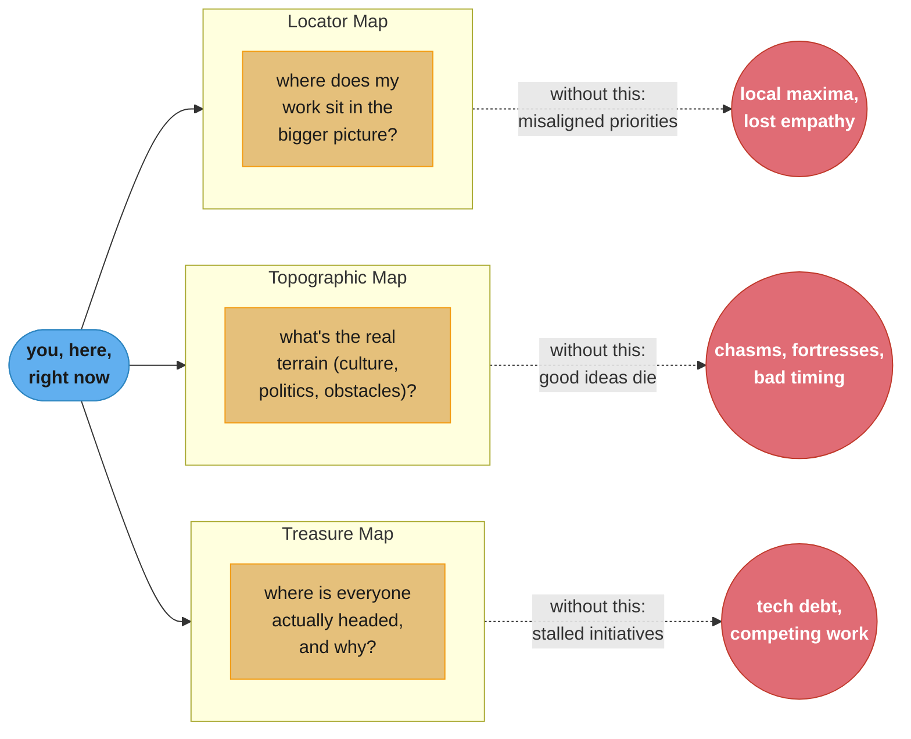

# Chapter 2: Three Maps

> Part I — The Big Picture · The Staff Engineer's Path (Reilly, 1st ed., O'Reilly 2022) ·
> builds on Ch 1 (the role), leads to Ch 3 (Creating the Big Picture)

## Chapter Map

Chapter 1 argued that a staff engineer's job is to see the whole system, not just their own
corner of it. Chapter 2 gives the concrete tool for actually building that view: three
maps, borrowed loosely from the idea of a hiker's map set — a **locator map** (where am I,
relative to everything else?), a **topographic map** (what's the terrain like between here
and where I want to go?), and a **treasure map** (where is everyone actually headed, and
why?). None of these are literal documents you're handed on day one; they're mental models
you build deliberately, over time, by paying attention to things a narrower role would let
you ignore.

**TL;DR:**
- The **locator map** places your work inside the organization's bigger context, guarding
  against four specific failure modes of staying too zoomed-in on your own team.
- The **topographic map** is the organization's real terrain — its culture, its informal
  power structures, and the specific obstacles ("points of interest") that slow down good
  ideas — which is very often different from its official org chart.
- The **treasure map** is the destination: where the company or team is actually headed, and
  why current work is a waypoint toward it rather than an end in itself.
- All three maps degrade without maintenance and have to be **redrawn periodically** as the
  organization changes — a map you built two reorgs ago can be actively misleading.
- Building these maps is a deliberate practice, not something that happens automatically from
  doing your job — it takes intentional habits: seeking outside perspectives, taking notes,
  and talking to people whose view of the organization differs from your own.

## The Big Question

> If you can only see as far as your own team's board, how do you know whether the thing
> you're building this quarter matters to anyone outside it — and how would you even notice
> if it stopped mattering?

Analogy: doing good work with only a locator, topographic, or treasure map alone is like
setting out on a hike with only one kind of map. A locator map alone tells you exactly where
you're standing, but nothing about the cliff ahead. A topographic map alone shows you every
obstacle in the county, but not which direction is actually worth walking. A treasure map
alone tells you the destination, but not the chasm between here and there that will turn a
two-hour hike into an unplanned overnight. A staff engineer without all three isn't lost —
they're confidently walking in a direction that only looks correct because two-thirds of the
picture is missing.

---

## 2.1 The Locator Map

The locator map answers a simple but easy-to-neglect question: **where does my work sit,
relative to everything else going on?** Zooming out from your own team to the org, and from
the org to the company, is what lets you tell whether a problem that feels urgent from where
you're standing actually registers at a scale that matters.

### Focus: Risk and Reward

Deep focus on one area is genuinely valuable — it's how expertise gets built — but sustained
focus carries specific, predictable risks if nothing ever pulls you back out to check the
bigger picture:

- **Misaligned priorities** — what feels like the most important problem in the world from
  inside your team's daily standup may be a rounding error at the company level, while a
  genuinely critical cross-team dependency goes unnoticed because it's outside your field of
  view.
- **Loss of empathy** — deep familiarity with your own domain's difficulty makes it easy to
  underestimate how hard another team's very different problem actually is, which quietly
  poisons cross-team collaboration.
- **Habituation to problems** — a painful process lived with daily stops registering as
  painful; it just becomes "how things work here," invisible to the people closest to it.
- **Losing sight of purpose** — hitting every sprint commitment can coexist with steadily
  building toward a direction the company has, in fact, moved on from.

### The Outsider View

New teammates — or an engineer temporarily loaned to another team — see problems the
long-tenured team has stopped seeing, precisely because habituation hasn't set in for them
yet. Reilly's recommended posture toward this fresh perspective is a balance: respect that
existing systems were usually built for real reasons under real constraints, while staying
genuinely curious rather than dismissive — asking "why was this built this way?" gets a
useful answer far more often than declaring "this is obviously wrong" does, and it preserves
the relationship you'll need for the next observation.

#### Escaping the Echo Chamber

A team that only talks to itself reinforces its own blind spots. The practical
countermeasure is deliberately seeking out disagreement and different perspectives —
building real relationships with staff engineers on *other* teams, who can act as allies
with a genuinely different vantage point on the same organization, rather than relying
solely on people who already see the world the way you do.

#### Always-True Objectives

Certain organizational goals hold regardless of team, project, or current strategy, and
Reilly calls these out because they're easy to lose sight of amid quarter-to-quarter noise:
the company needs to **keep existing**, stay **financially viable**, ship **functional
products**, and maintain real **customer demand**. A locator map that only shows your
project's local goals, and never these background constants, will eventually recommend
something that technically succeeds at the local goal while working against one of these —
a feature that ships on time but that no customer asked for is a failure by the always-true
objectives even if it's a success by the sprint board.

### What Do Customers Actually Care About?

A pointed reminder embedded in the locator-map section: customer satisfaction is not the
same thing as your internal technical metrics, however carefully you've tuned them. "Nines
don't matter when users aren't happy" — a service can hit 99.99% availability and still be a
product customers actively dislike using, and a staff engineer's locator map needs to
include the customer's actual experience as a distinct point, not assume that clean internal
dashboards imply a satisfied customer base.

---

## 2.2 The Topographic Map

Where the locator map tells you where you stand, the topographic map tells you what the
terrain between here and anywhere else actually looks like — and Reilly is explicit that the
real terrain of an organization is not the official org chart. Being technically correct is
necessary but nowhere near sufficient; getting anything done also requires understanding how
decisions actually get made, who has to be brought along, and what timing constraints are
already in flight that you can't see from your own team.

### Why Terrain Matters

Organizational landscape shifts continuously — reorgs, new leaders, shifting priorities —
and a good idea proposed at the wrong moment (competing with three other initiatives already
consuming the same review bandwidth) can fail for reasons that have nothing to do with the
idea's quality. Reading the terrain well enough to time a proposal is as much a part of the
job as writing the proposal itself.

### Understanding Your Organization's Culture

Culture includes autonomy, inclusivity, psychological safety, and interpersonal warmth, but
Reilly grounds it in a set of concrete, observable dimensions — each a spectrum an
organization sits somewhere along, and worth mapping explicitly because official statements
of "our values" frequently diverge from how the organization actually behaves day to day:

| Dimension | One end | Other end | What it changes about how you operate |
|---|---|---|---|
| Information flow | Secret | Open | Whether a plan needs to stay confidential until formally announced |
| Communication mode | Oral | Written | Whether a hallway conversation or a doc is the real decision record |
| Decision flow | Top-down | Bottom-up | Whether proposals need executive sponsorship first or can start anywhere |
| Pace | Fast | Deliberate | How much review a change needs before it's safe to ship |
| Channel | Back channels | Front doors | Whether the real conversation happens in DMs or in the official meeting |
| Resource model | Allocated | Available | Whether headcount/time is assigned top-down or claimed by whoever moves first |
| Structure | Liquid (merit-based) | Crystallized (hierarchical) | Whether influence tracks demonstrated judgment or formal level |

No organization sits at a pure extreme on any of these, and the same organization can sit at
different points on different dimensions simultaneously — a company can be almost entirely
written and bottom-up while still being fairly crystallized in who actually gets listened to.
Mapping where your organization sits on each axis is what turns "I don't understand why that
proposal died" into an actionable diagnosis: a beautifully written doc proposed into a
fast-and-oral culture may simply never get read.

### Points of Interest

The topographic map also marks specific obstacles a good idea can run into:

- **Chasms** — communication or decision-making gaps between teams that swallow good ideas
  crossing between them.
- **Fortresses** — well-intentioned gatekeepers whose review process, built for a real
  reason, now blocks change more than it protects anything.
- **Disputed territory** — areas two or more teams both believe they own, where getting
  anything done means resolving the ownership question first.
- **Deserts** — battles that are technically winnable but not worth fighting, because the
  cost of crossing exceeds any plausible payoff.
- **Paved roads and shortcuts** — the established, low-friction paths that exist precisely
  because someone already fought through the terrain once and left a map for the rest.

Knowing where these are before you propose something big is the difference between routing
around a fortress deliberately and discovering it exists only after your proposal has
already died inside it.

### Be a Bridge

A staff engineer with a well-drawn topographic map is positioned to actively connect people
who don't otherwise talk — introducing the engineer stuck at a chasm to the person on the
other side, or warning a colleague away from a desert before they spend a quarter on it.
Reilly frames this less as altruism and more as one of the highest-leverage things the map
is actually *for*: knowledge of terrain that stays entirely in your own head helps only you;
shared, it helps everyone who would otherwise have to rediscover the same obstacles the hard
way.

---

## 2.3 The Treasure Map

The treasure map answers the question the other two maps deliberately leave open: **where is
everyone actually going, and why?** It marks the destination and the intermediate waypoints
along the way, and clarifies whether the current project is the goal itself or a stepping
stone toward something bigger.

### Life Without a Treasure Map

Reilly lists the visible symptoms of a team or org operating without a shared treasure map:
difficulty maintaining a unified direction across teams that are each executing well
locally; big initiatives that stall out incomplete because no one owns carrying them to the
finish; steadily accumulating technical debt nobody has authority to prioritize fixing;
competing initiatives quietly working against each other because nobody coordinated them;
and engineers whose growth stalls because the problems available to them never scale past
"small project" shape — the treasure map is also, implicitly, what tells an ambitious
engineer where the bigger problems actually are.

### The Trail Map Approach

A useful reframing technique: narrate ongoing work as a story with a destination, not a list
of disconnected tasks. "We're migrating off the legacy queue" lands very differently — and
motivates very differently — when it's framed as one waypoint on the way to "a platform that
survives a 10x traffic spike without a 2am page," rather than presented as an isolated,
seemingly arbitrary migration project. The trail map is the difference between a team that
understands *why* this quarter's unglamorous work matters and a team quietly wondering when
they'll get to work on something that matters again.

---

## 2.4 Learning Your Maps Deliberately

None of the three maps assembles itself passively from doing your job well — ordinary daily
work captures fragments of each map, but building the complete picture takes deliberate
effort. Reilly's concrete practices:

- **Take active notes.** Treat context you pick up in a meeting, a hallway conversation, or a
  postmortem as map-building material worth writing down, not just information to act on in
  the moment and then forget.
- **Seek outsider viewpoints.** Deliberately ask engineers new to a team, or engineers on
  entirely different teams, what looks strange to them — their answer is exactly the kind of
  locator-map information habituation has hidden from you.
- **Talk to peer staff engineers.** Other staff-level engineers elsewhere in the org have
  been building their own three maps in parallel; comparing notes with them fills gaps
  neither of you would find alone.
- **Get non-engineering insight.** Product, design, sales, and support each see a different
  slice of the topographic and treasure maps — a support team's escalation patterns are
  treasure-map information about what customers actually value that an engineering-only view
  will never surface.
- **Understand the customer directly.** Reading support tickets, sitting in on a sales call,
  or watching a usability session builds locator- and treasure-map fidelity no internal
  dashboard can substitute for.
- **Stay aware of existing solutions.** Before treating a problem as novel, actively check
  whether another team already solved it, or already tried and failed at it — both are
  valuable topographic-map information that saves rediscovering the same terrain from
  scratch.

---

## Visual Intuition



Caption: the three maps answer three different questions, and each has its own distinct
failure mode when missing — the maps are complementary, not redundant, which is why building
only one of them still leaves you navigating blind on the other two axes.

```
  ORGANIZATIONAL CULTURE -- SEVEN SLIDERS, NONE FIXED AT AN EXTREME

  information   secret    [----*-------]    open
  communication oral      [--------*---]    written
  decisions     top-down  [-----*------]    bottom-up
  pace          fast      [---*--------]    deliberate
  channel       back-chan [------*-----]    front-door
  resources     allocated [----------*-]    available
  structure     liquid    [-*----------]    crystallized

  A proposal tuned for the WRONG position on any one slider can die
  for reasons that have nothing to do with its technical merit --
  e.g. a carefully written doc, proposed into a fast + oral culture,
  may simply never get read before the decision is already made.
```

Caption: the seven culture dimensions are independent — an organization's position on one
slider says nothing about its position on another, so a topographic map has to check all
seven rather than inferring the rest from one observed data point.

---

## Key Concepts Glossary

- **Locator map** — a mental model of where your work sits relative to the wider
  organization and company.
- **Topographic map** — a mental model of the organization's real terrain: culture, informal
  power structures, and specific obstacles between an idea and its adoption.
- **Treasure map** — a mental model of the organization's actual destination and the
  waypoints leading there.
- **Local maximum** (revisited) — an outcome optimal from inside one team's narrow view but
  suboptimal for the wider organization.
- **Echo chamber** — a team or group that only reinforces its existing perspective, having
  stopped seeking genuine outside disagreement.
- **Always-true objectives** — background organizational constants (existence, financial
  viability, functional products, customer demand) that hold regardless of current strategy.
- **Culture dimension / slider** — one of seven spectrums (secret/open, oral/written,
  top-down/bottom-up, fast/deliberate, back channels/front doors, allocated/available,
  liquid/crystallized) an organization sits somewhere along.
- **Chasm** — a communication or decision-making gap between teams that good ideas fail to
  cross.
- **Fortress** — a well-intentioned gatekeeping process that now blocks more change than it
  protects.
- **Disputed territory** — an area two or more teams each believe they own.
- **Desert** — a technically winnable battle not worth fighting, given its cost relative to
  payoff.
- **Paved road / shortcut** — an established low-friction path built by someone who already
  crossed the terrain once.
- **Being a bridge** — actively connecting people across a chasm or around an obstacle using
  your own topographic-map knowledge.
- **Trail map** — reframing ongoing work as a narrated journey toward a destination, rather
  than a list of disconnected tasks.
- **Deliberate map-learning** — the active practice (notes, outsider viewpoints, peer staff
  conversations, non-engineering insight, direct customer contact) needed to build all three
  maps, since none of them assembles itself from routine work alone.

---

## Tradeoffs & Decision Tables

| Map | Question it answers | What's missing without it |
|---|---|---|
| Locator | Where does my work sit in the bigger picture? | Misaligned priorities, lost empathy, habituation, lost purpose |
| Topographic | What's the real terrain between here and there? | Good ideas die in chasms and fortresses, bad timing |
| Treasure | Where is everyone actually headed, and why? | Stalled initiatives, accumulating debt, competing work, stunted growth |

| Culture position | Best-suited proposal style | Worst-suited proposal style |
|---|---|---|
| Secret + top-down | Quiet pre-alignment with the decision-maker first | A public open doc seeking broad input before sponsorship |
| Open + bottom-up | A shared doc inviting comment from anyone | A closed-door decision announced after the fact |
| Fast + oral | A short verbal pitch, decided in the room | A long written proposal awaiting async review |
| Deliberate + written | A thorough doc with time built in for review | A same-day verbal ask expecting an immediate yes |

| Point of interest | Recommended approach |
|---|---|
| Chasm | Deliberately bridge it — introduce the people on each side |
| Fortress | Understand the original reason for the gate before trying to remove it |
| Disputed territory | Resolve ownership explicitly before starting the actual work |
| Desert | Don't cross it — the cost exceeds any plausible payoff |
| Paved road | Use it — don't re-discover terrain someone already mapped |

---

## Common Pitfalls / War Stories

- **Mistaking a beautiful doc for the whole job.** A team wins the technical argument but
  loses the outcome because it never checked whether the *timing* was right — a genuinely
  correct proposal, launched into a quarter already saturated with three competing
  initiatives fighting for the same review bandwidth, dies for reasons that have nothing to
  do with its merits.
- **Confusing the org chart with the topographic map.** Following the official reporting
  lines to get a decision made, while the real decision actually happens through an informal
  back channel the org chart doesn't show, wastes weeks chasing the wrong approval path.
- **The habituated team.** A team that's lived with a manual, error-prone deploy process for
  two years has stopped seeing it as a problem worth raising — it takes an outsider,
  literally new to the team, to say the thing everyone stopped noticing.
- **Local maxima disguised as good sprint execution.** A team hits every commitment for two
  quarters straight while building steadily toward a product direction the company has
  quietly deprioritized — sprint velocity said everything was fine; the treasure map, had
  anyone checked it, would have said otherwise.
- **The desert nobody warned you about.** An engineer spends a full quarter trying to win a
  technically correct argument against a team with a firmly entrenched, differently-motivated
  position, when a colleague with a better topographic map could have flagged it as a desert
  not worth crossing before the quarter started.
- **Nines that nobody's customers care about.** A team proudly reports 99.99% availability
  on a service whose actual users are frustrated by something the availability metric never
  measured — a confusing UI flow, a slow but "up" response — because the locator map stopped
  at the internal dashboard instead of extending to the customer's real experience.

---

## Real-World Systems Referenced

As with Chapter 1, this chapter's material is framework- and practice-oriented rather than
built around named production incidents. The concrete references it draws on:

- The **hiking-map metaphor** itself (locator/topographic/treasure) is Reilly's own framing
  device for the chapter, used consistently as the chapter's organizing structure rather than
  attributed to an external source.
- The **seven culture dimensions** function as a lightweight, company-agnostic diagnostic —
  the chapter presents them as a tool to apply to *your* organization, not as a description
  of any one named company's culture.

---

## Summary

Building the big-picture view Chapter 1 argued for takes three distinct mental maps, none of
which builds itself automatically from doing good work. The locator map answers where your
work sits relative to the wider organization, guarding against misaligned priorities, lost
empathy, habituation, and lost purpose. The topographic map answers what the real terrain
looks like — the seven culture dimensions an organization sits along, and the specific
chasms, fortresses, disputed territory, deserts, and paved roads that determine whether a
good idea actually survives contact with the organization. The treasure map answers where
everyone is actually headed and why, turning individual projects into waypoints on a shared
journey rather than disconnected tasks, and its absence shows up as stalled initiatives,
accumulating technical debt, and engineers whose growth stalls for lack of bigger problems to
reach for. None of the three is optional, and none of them stays accurate forever — all three
need periodic redrawing as the organization itself changes. Chapter 3 turns these maps into
action: writing down a shared destination and the path to it, as an explicit technical vision
and strategy.

---

## Interview Questions

**Q: What question does each of the three maps answer, and why do you need all three rather than just one?**
**Short:** Locator answers "where am I," topographic answers "what's the terrain," treasure answers "where are we headed."
The locator map places your work relative to the wider organization, the topographic map describes the real terrain of culture and obstacles between an idea and its adoption, and the treasure map marks the shared destination and waypoints toward it — each answers a genuinely different question, so having only one still leaves you navigating blind on the other two axes, the way a hiker with only a destination marked but no terrain map can walk confidently into a chasm they never saw coming.

**Q: What four specific risks does staying too zoomed-in on your own team's work create, according to the locator-map section?**
**Short:** Misaligned priorities, lost empathy, habituation to problems, and losing sight of purpose.
Deep focus builds real expertise but, left unchecked, produces misaligned priorities (what feels urgent locally may be a rounding error company-wide), loss of empathy for how hard another team's very different problem actually is, habituation that makes a genuinely painful process stop registering as painful to the people living inside it daily, and losing sight of purpose — hitting every sprint commitment while quietly building toward a direction the company has already moved on from.

**Q: What are "always-true objectives," and why does the chapter call them out specifically?**
**Short:** Background constants — existence, financial viability, functional products, customer demand — that hold regardless of strategy.
Always-true objectives are organizational constants that hold no matter what team, project, or current strategy is in play: the company must keep existing, stay financially viable, ship functional products, and maintain real customer demand. They're called out specifically because quarter-to-quarter noise makes them easy to lose sight of, and a plan that technically succeeds at a narrow local goal while working against one of these — shipping on time a feature no customer wanted — is a genuine failure even though the sprint board says otherwise.

**Q: Why does the chapter say the real organizational terrain is often different from the official org chart?**
**Short:** Real decisions often route through informal channels the org chart never shows.
Because getting anything done depends on how decisions actually get made — who really has to sign off, which back channel carries more weight than the front-door meeting, what timing already has competing initiatives consuming the same review bandwidth — and none of that is visible on a document that only shows formal reporting lines. A staff engineer who follows the official chart to get a decision made, while the real decision is actually happening informally elsewhere, wastes real time chasing the wrong approval path.

**Q: List the seven culture dimensions the topographic map uses, and explain why no organization sits at a pure extreme on all of them.**
**Short:** Secret/open, oral/written, top-down/bottom-up, fast/deliberate, back-channel/front-door, allocated/available, liquid/crystallized.
The seven are: information flow (secret vs. open), communication mode (oral vs. written), decision flow (top-down vs. bottom-up), pace (fast vs. deliberate), channel (back channels vs. front doors), resource model (allocated vs. available), and structure (liquid/merit-based vs. crystallized/hierarchical) — and organizations don't sit at a pure extreme on all of them simultaneously because the dimensions are independent, so a company can be almost entirely written and bottom-up while still being fairly crystallized in who actually gets listened to, and mapping all seven separately is what makes the diagnosis actionable rather than a single vague "our culture is X" label.

**Q: Why might a "technically correct" proposal fail purely because of how it was communicated?**
**Short:** A proposal's format has to match the organization's actual culture sliders, not just be correct.
Because a proposal's success depends not only on its content being right but on matching the organization's position on the communication-mode and pace sliders — a carefully written, thorough doc proposed into a fast-and-oral culture may simply never get read before the decision has already been made verbally in a meeting, and a quick verbal pitch dropped into a deliberate-and-written culture may be dismissed as insufficiently considered regardless of how sound the underlying idea is.

**Q: What are the five named "points of interest" on the topographic map, and give the practical response to each?**
**Short:** Chasms (bridge them), fortresses (understand the gate's reason), disputed territory (resolve ownership first), deserts (don't cross), paved roads (use them).
Chasms are communication or decision-making gaps that swallow good ideas crossing between teams, best handled by deliberately connecting the people on each side; fortresses are well-intentioned gatekeeping processes now blocking more than they protect, worth understanding before attempting to remove; disputed territory is an area two teams both believe they own, needing ownership resolved before real work starts; deserts are technically winnable battles not worth fighting given the cost; and paved roads are established low-friction paths that should be used rather than re-discovered from scratch.

**Q: What does "being a bridge" mean in the context of the topographic map, and why is it framed as high-leverage rather than merely nice to do?**
**Short:** Sharing terrain knowledge multiplies its value; keeping it private only helps you.
Being a bridge means actively connecting people who don't otherwise talk — introducing an engineer stuck at a chasm to someone on the other side, or warning a colleague away from a desert before they spend a quarter on it — using topographic-map knowledge you've already built. It's high-leverage rather than merely nice because terrain knowledge that stays entirely in one person's head only helps that one person, while shared knowledge helps everyone who would otherwise rediscover the same obstacle the hard way, multiplying the value of a map that cost real time to build.

**Q: What symptoms show up in an organization operating without a shared treasure map?**
**Short:** Directionless teams, stalled big initiatives, unpriotitized debt, competing work, and stunted growth.
The listed symptoms are difficulty maintaining a unified direction across locally-well-executing teams, big initiatives that stall out incomplete because no one owns carrying them to the finish, technical debt that accumulates because nobody has authority to prioritize fixing it, competing initiatives quietly working against each other for lack of coordination, and engineers whose growth stalls because they never encounter problems bigger than "small project" shape.

**Q: What is the "trail map" reframing technique, and why does it change how a team experiences the same underlying work?**
**Short:** Narrating work as a journey toward a destination, not a list of disconnected tasks.
The trail map technique reframes ongoing work as a story with a destination rather than an isolated task list — "migrating off the legacy queue" motivates very differently once it's presented as one waypoint toward "a platform that survives a 10x traffic spike without a 2am page" rather than an arbitrary-seeming migration project. The underlying work is identical either way; what changes is whether the team understands why this quarter's unglamorous task connects to something that matters.

**Q: Why can't a locator, topographic, or treasure map be built once and trusted indefinitely?**
**Short:** Reorgs, new leaders, and shifting priorities make an old map actively misleading, not just stale.
Organizational terrain shifts continuously — a reorg moves the real decision-makers, a new leader changes which culture sliders the org sits at, priorities shift what counts as an always-true objective in practice — so a map drawn two reorgs ago isn't merely out of date, it can actively point toward the wrong destination or through a chasm that's since been bridged (or a paved road that's since washed out). Redrawing all three maps periodically is explicitly part of the practice, not a one-time setup cost.

**Q: What concrete habits does the chapter recommend for building the three maps deliberately, rather than passively?**
**Short:** Active notes, outsider viewpoints, peer staff conversations, non-engineering insight, and direct customer contact.
The recommended habits are taking active notes on context picked up in meetings or hallway conversations rather than letting it evaporate, deliberately asking newcomers or engineers from other teams what looks strange to them, comparing notes with peer staff engineers building their own maps in parallel, drawing on product/design/sales/support's different slices of the organization, and getting direct customer contact through support tickets, sales calls, or usability sessions — because none of these accumulate automatically from simply doing the work well.

**Q: Why does the chapter warn "nines don't matter when users aren't happy"?**
**Short:** Internal availability metrics can look perfect while the actual customer experience is poor.
A service can hit 99.99% availability by every internal dashboard while its actual users are frustrated by something the availability metric never captures at all — a confusing flow, a slow-but-technically-up response, a feature that works exactly as specified but not as needed. The locator map has to extend past internal technical metrics to the customer's real experience, because a team can be locally correct by every number it tracks and still be building the wrong thing.

**Q: How does "escaping the echo chamber" differ from simply talking to more people on your own team?**
**Short:** It specifically means seeking disagreement and outside perspective, not just more conversation.
Talking to more people on your own team still reinforces the same shared blind spots that team already has, since everyone in it has been shaped by the same local context; escaping the echo chamber specifically means deliberately seeking out disagreement and building relationships with staff engineers on *other* teams, whose vantage point on the same organization genuinely differs, precisely because that difference is what surfaces the blind spots a same-team conversation never would.

**Q: What's the difference between a "fortress" and a "desert" as points of interest, and why does mixing them up lead to the wrong response?**
**Short:** A fortress can be understood and worked around; a desert should simply not be crossed.
A fortress is a well-intentioned gatekeeping process now blocking more change than it protects — worth understanding and potentially navigating, since the original reason behind the gate is often still discoverable and sometimes still valid. A desert is a technically winnable battle whose cost exceeds any plausible payoff — the correct response isn't to understand and navigate it, it's to not fight it at all. Treating a desert like a fortress (spending effort trying to "get through" it) wastes a quarter on a battle that was never worth winning in the first place.

---

## Cross-links in this repo

- [soft_skills/scope_impact_and_ownership/ — sizing scope, which the locator map directly informs](../../../soft_skills/scope_impact_and_ownership/scope_impact_and_ownership.md)
- [soft_skills/cross_functional_collaboration/ — working across the chasms and fortresses the topographic map names](../../../soft_skills/cross_functional_collaboration/cross_functional_collaboration.md)
- [soft_skills/influence_without_authority/ — being a bridge without formal authority to force it](../../../soft_skills/influence_without_authority/influence_without_authority.md)
- [soft_skills/leadership_and_org_vocabulary/ — naming the org-culture dimensions precisely](../../../soft_skills/leadership_and_org_vocabulary/leadership_and_org_vocabulary.md)
- [soft_skills/upward_and_async_communication/ — matching a proposal's format to the culture sliders](../../../soft_skills/upward_and_async_communication/upward_and_async_communication.md)
- Sibling chapters: [Ch 1 What Would You Say You Do Here?](../01_what_would_you_say_you_do_here/01_what_would_you_say_you_do_here.md) · [Ch 3 Creating the Big Picture](../03_creating_the_big_picture/03_creating_the_big_picture.md)
- Book index: [the_staff_engineers_path.md](../the_staff_engineers_path.md)

## Further Reading

- Camille Fournier, *The Manager's Path* (O'Reilly, 2017) — a complementary treatment of
  organizational terrain from the management-track side.
- Will Larson's staffeng.com — interviews with staff-plus engineers describing their own
  locator/topographic/treasure equivalents in practice.
- The book's own "Recommended Reading" notes for Part I, referenced at the close of this
  chapter's source material.
