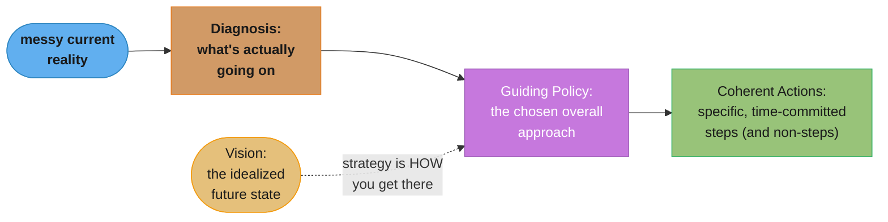

# Chapter 3: Creating the Big Picture

> Part I — The Big Picture · The Staff Engineer's Path (Reilly, 1st ed., O'Reilly 2022) ·
> builds on Ch 2 (Three Maps), closes Part I and leads into Part II (Execution, Ch 4)

## Chapter Map

Chapter 2 gave you the tools for *seeing* the organization clearly. Chapter 3 is about
*acting* on what you see when the picture is genuinely unclear or actively disputed —
writing down a **technical vision** (where should we end up?) and a **technical strategy**
(how do we actually get there?) as real documents, then doing the harder work of getting an
organization to actually believe in them. The chapter opens with a running case study —
a fictional company called **Sockmatcher** — used throughout to ground the abstract
framework in a concrete, if invented, example.

**TL;DR:**
- A **vision** describes an idealized future state, deliberately without prescribing how to
  get there; a **strategy** is the plan for reaching that future, including the hard choices
  a vision alone doesn't make.
- You need one of these documents precisely when decentralized, locally-optimal decisions
  are quietly adding up to an organizational **local maximum** or a **tragedy of the
  commons** — a shared problem nobody has the standing or incentive to fix alone.
- A good strategy follows Rumelt's **strategy kernel**: a **diagnosis** of the real
  situation, a **guiding policy** for responding to it, and **coherent actions** that follow
  directly from both.
- Writing the document is the easy half. The hard half — and the chapter's real subject — is
  **getting agreement**: finding a sponsor, assembling a small core group, and running a
  deliberate process to build buy-in before the document is ever presented as finished.
- Good strategy is often **boring** — obvious in hindsight, not clever — because a strategy
  that surprises everyone in the room usually means it skipped the alignment work that would
  have made it feel inevitable.

## The Big Question

> When nobody's individually wrong, and yet the organization is somehow still losing — whose
> job is it to say so, and what do they actually write down to fix it?

Analogy: an organization without a shared vision is like a group of rowers, each excellent at
rowing, each pulling hard, in a boat with no rudder and no agreed destination — the boat
moves, sometimes very fast, but not necessarily anywhere useful, and it can just as easily
spin in a circle as cross the lake. A technical vision is the destination called out loud so
everyone rows the same direction; a technical strategy is the specific set of strokes chosen
because of the current, the wind, and the obstacles actually in the water today — not a
generic rowing manual, but a plan built for *this* lake.

---

## 3.1 Case Study: Sockmatcher

The chapter's running example is a fictional company, Sockmatcher, used to make the
vision/strategy distinction concrete rather than purely abstract. The setup deliberately
illustrates a point the chapter returns to repeatedly: technical decisions often trace back
to non-technical motivations. A system built one way wasn't necessarily built badly — it was
often built exactly right for a constraint (a deadline, a team's size at the time, an
acquisition, a now-departed leader's now-outdated priority) that's no longer visible to the
people currently living with the consequences. Sockmatcher's engineers, disagreeing sharply
about how to fix a system causing repeated outages, aren't disagreeing about facts so much as
they're each operating from a different unstated picture of where the system should end up —
which is exactly the gap a written vision exists to close.

---

## 3.2 What's a Vision? What's a Strategy?

### How to Know You Might Need One

The trigger condition connects directly back to Chapter 1's local-maximum concept: when
decision-making is fully decentralized, each team optimizing its own corner can produce
excellent local outcomes that still add up to organizational harm — a **tragedy of the
commons**, where a shared resource or shared problem degrades because unclear ownership means
no single team has both the authority and the incentive to fix it alone. A cross-cutting
concern nobody explicitly owns doesn't get ignored out of laziness; it gets ignored because
fixing it would cost one team real effort for a benefit that accrues to everyone else, which
is a bad trade from that one team's local perspective even though it's an obviously good
trade for the organization as a whole.

### What Is a Technical Vision?

A vision describes **where the systems should be** at some future point, written as though
the necessary work is already finished — an idealized end state, not a roadmap for reaching
it. Its scope can range from an entire organization's technical landscape down to a single
team's area, though a narrower vision needs to stay aligned with any broader vision it sits
inside, rather than quietly contradicting it. What a good vision buys the organization:

- **Shared understanding** — a single reference point everyone can point at instead of
  re-litigating the destination in every individual design review.
- **Reduced ambiguity and conflict** — a written, agreed destination removes a large category
  of otherwise-recurring arguments about *where* to go, leaving only arguments about *how*.
- **Empowerment** — a team that knows the destination can choose its own path there without
  needing to check in on every step, which is precisely what lets an organization scale
  decision-making without funneling every choice through one person.

A vision is sometimes described, evocatively, as a "north star" or a "shining city on the
hill" — a fixed point distant and clear enough to navigate by, deliberately silent on which
specific road gets you there.

### What Is a Technical Strategy?

Where a vision says *where*, a strategy says **how** — the concrete plan for reaching the
envisioned future given the obstacles actually in the way, which necessarily means making
real choices and setting real priorities rather than deferring every hard call. Reilly
grounds the strategy-writing process in Richard Rumelt's **strategy kernel**, a three-part
structure borrowed directly from his work on strategy (*Good Strategy Bad Strategy*):

#### The Diagnosis

The first component distills the messy current reality down to its essential
characteristics — what's actually going on, stripped of the noise, disagreement, and
politically-convenient framing that usually surrounds a hard organizational problem.
Extracting a clean diagnosis from a genuinely confusing situation is real, difficult work:
different stakeholders often disagree not just about the solution but about what problem is
even being solved, and a diagnosis that only some of them would recognize as accurate isn't
finished yet.

#### The Guiding Policy

Once the diagnosis is settled, the guiding policy is the chosen overall approach to
addressing it — Rumelt's own description, which Reilly carries into this chapter, is that it
should function as **"a signpost, marking the direction forward"**: short, clear, and
specific enough that it visibly rules out some options while endorsing others. A guiding
policy vague enough that it's compatible with almost any subsequent action isn't actually
guiding anything.

#### Coherent Actions

With a diagnosis and a guiding policy in place, coherent actions are the specific,
time-committed steps the organization will actually take — and, just as importantly, the
ones it explicitly **won't** take. A strategy that lists only what to do, and never what to
stop doing or decline to do, hasn't made the hard trade-offs a real strategy requires; it's
still a wish list.

### What Makes a Strategy Good

A few properties the chapter calls out explicitly: a good strategy **leverages** genuine
organizational advantages rather than pretending they don't exist or wishing for different
ones; it stays **realistic** about real constraints (headcount, timeline, political capital)
rather than describing an idealized organization that doesn't actually exist; and, perhaps
counterintuitively, it's often **boring** to read — a strategy that feels obvious in
hindsight, once you've absorbed the diagnosis, is usually a *good* sign, not a sign it lacked
ambition. A strategy that reads as a surprising, clever twist frequently means the diagnosis
work that would have made the conclusion feel inevitable was skipped.

---

## 3.3 Do You Even Need One?

Not every problem justifies the overhead of a formal vision or strategy document — the
chapter is explicit that this is heavyweight machinery reserved for genuinely large,
genuinely contested, or genuinely cross-cutting problems, not a ritual to perform on every
project. The real signal that you need one: multiple reasonable engineers, each looking at
the same situation, are reaching genuinely different conclusions about what to do, and the
disagreement isn't resolving itself through normal team-level conversation. Once that's true,
the actual hard work — and the chapter's honest framing — isn't the writing. **It's achieving
agreement.** A vision or strategy document nobody actually believes in is a wasted quarter of
someone's time, however well-written its prose.

---

## 3.4 Building the Strategy: The Process

Reilly lays out a deliberate, largely social process for turning a proposed vision or
strategy into something an organization actually adopts — distinct from, and arguably more
important than, the writing itself.

### Step 1: Join Before You Start

Check first whether an initiative addressing the same problem already exists somewhere in
the organization. Joining an existing effort is almost always better than launching a
competing one — a second, independently-started vision doc for the same problem space
doesn't add coverage, it adds confusion about which one is authoritative.

### Step 2: Find a Sponsor

A sponsor is a senior leader whose backing gives the effort standing it wouldn't have on its
own. The practical test for whether you've found the right one: does the plan genuinely
address a problem *they* have, not just a problem you have? Having a tight, one-sentence
"elevator pitch" ready — one that connects the effort directly to something the sponsor
already cares about — is what turns a hallway conversation into real sponsorship rather than
polite acknowledgment.

### Step 3: Assemble a Core Group

A strategy written entirely alone is both harder to get right and harder to get adopted than
one built with a small group. Reilly's concrete sizing: **two to four people**, each
committing roughly **eight to twelve hours a week** for the duration of the effort — small
enough to move fast and stay coherent, large enough to catch blind spots one person alone
would miss. A deliberately provocative piece of advice: consider inviting a likely skeptic or
opponent into the core group itself, rather than leaving them outside it to be won over
later — someone who disagrees with your starting assumptions, brought in early, either
changes the strategy for the better or becomes one of its strongest advocates by the time
it's done, either of which beats discovering their objection after the document is already
"finished." Keep broader allies outside the core group informed as you go, so the group
stays small without the wider organization feeling shut out of the process.

### Step 4: Set the Scope

Decide explicitly how far the strategy's authority is meant to reach — one team, a whole
domain, the entire engineering organization — before writing begins, not as an
afterthought once a draft already exists.

### Step 5: Check It's Actually Achievable

Before committing real time to writing, sanity-check whether the intended scope is
realistically achievable given real constraints. If it isn't, cut the scope down to something
that is — or, if even a reduced scope isn't viable given the current organizational
appetite, be willing to abandon the effort rather than ship a document nobody can actually
execute against.

### Step 6: Formalize It

Once the above steps hold, give the effort an official status — a named initiative, a
tracked doc, visible sponsorship — so it reads as real organizational work rather than one
person's side project that anyone can quietly ignore.

---

## 3.5 Writing the Document

With process steps 1-6 in place, the actual writing draws on a small set of guiding
questions the chapter recommends asking repeatedly through drafting: **What's working right
now, and shouldn't change? What's actually important, separated from what's merely urgent
this week? And what would future-you wish present-you had addressed, looking back a year
from now?** That last question is a direct echo of Chapter 1's local-maximum test, applied
here specifically to the document's own scope and ambition.

Two process details the chapter emphasizes:

- **Pre-writing conversations.** Talking through the diagnosis and rough direction with key
  stakeholders *before* circulating a draft reduces the anchoring bias a polished first
  draft otherwise creates — once people see finished-looking prose, disagreement gets
  socially harder to raise, even when it's substantively warranted.
- **Final interviews.** Near the end of drafting, explicitly ask stakeholders "what else
  should this cover?" and "what did I miss?" — a deliberate final check against the
  document's own blind spots, asked as an open question rather than a closed one seeking
  simple approval.

---

## 3.6 Getting Agreement

### Making the Actual Decision

Reilly flags a specific, common facilitation trap: asking a group **"is everyone okay with
option A?"** invites silent, unenthusiastic compliance — nobody wants to be the lone
objector in a room, so genuine reservations go unspoken and surface later as quiet
resistance instead. The better question is **"can anyone not live with option A?"** — a
higher bar that surfaces real blockers explicitly, while implicitly signaling that mild
preference for a different option is not, by itself, a valid reason to block consensus.
Identifying a **tiebreaker** — who makes the final call if genuine disagreement remains after
real discussion — *before* it's needed avoids an ad hoc power struggle in the moment a
decision actually has to be made. And **not deciding is itself a decision**, usually a poor
one: a question left explicitly open in a strategy document doesn't stay neutral, it defaults
to whatever the status quo already was, chosen by default rather than on purpose. Every
significant decision, its considered alternatives, and its rationale should be written down
directly in the document — not only so today's readers understand the reasoning, but so a
reader eighteen months from now, when the context has faded, can tell whether the original
reasoning still holds.

### Alignment and Adoption

Getting a sponsor's agreement once, at the start, isn't sufficient — sponsor alignment needs
to be actively maintained at major checkpoints throughout drafting, since a sponsor's own
priorities and constraints can shift while the document is still being written. Reilly
invokes the Japanese business practice of **nemawashi** — informally building consensus with
each stakeholder individually, before any formal decision meeting — as the underlying
mechanism: by the time a strategy is formally presented for a vote or sign-off, the outcome
should already be effectively settled through the informal groundwork that preceded it, not
genuinely up for debate in the room for the first time.

A vision or strategy nobody has actually heard of carries close to zero practical value, no
matter how sound its content — so the chapter closes this section on distribution: find a
memorable **one-line summary** people can repeat to each other without the full document in
hand, and actively **staff real work** against the plan, because a document that never
translates into people's actual day-to-day priorities stays a personal artifact rather than
becoming genuine organizational belief.

---

## Visual Intuition



Caption: Rumelt's strategy kernel in sequence — a vision names the destination once and stays
fixed; the diagnosis, guiding policy, and coherent actions are the strategy that turns that
fixed destination into a specific, executable plan given today's actual obstacles.

```
  DECENTRALIZED, LOCALLY-OPTIMAL DECISIONS -- STILL A TRAGEDY OF THE COMMONS

  Team A: "not our problem, we ship on time either way"     -> locally correct
  Team B: "we don't own the shared service, so why fix it"  -> locally correct
  Team C: "fixing it costs US time, benefits EVERYONE else" -> locally correct

  Result: the shared problem never gets fixed, though every single
  team involved made a individually defensible, rational call.

  This is exactly the gap a written, SPONSORED vision/strategy closes:
  it gives ONE thing explicit ownership that no local optimization would.
```

Caption: the tragedy-of-the-commons pattern behind "how do you know you need a vision" —
every local decision can be individually reasonable while the aggregate outcome is still bad,
because nobody's local incentives include fixing the shared, cross-cutting problem.

---

## Key Concepts Glossary

- **Technical vision** — an idealized description of a future system state, written as
  though the necessary work is already complete, deliberately silent on implementation path.
- **Technical strategy** — the concrete plan for reaching a vision, including the hard
  choices and trade-offs a vision alone doesn't make.
- **Tragedy of the commons** (organizational) — a shared problem that degrades because no
  single team has both the authority and the local incentive to fix it alone.
- **Strategy kernel** (Rumelt) — the three-part structure of diagnosis, guiding policy, and
  coherent actions underlying a good strategy.
- **Diagnosis** — distilling a messy current situation down to its essential, agreed-upon
  characteristics.
- **Guiding policy** — the chosen overall approach to a diagnosis; a clear signpost, not a
  vague direction compatible with anything.
- **Coherent actions** — the specific, time-committed steps a strategy commits to, including
  explicit non-actions.
- **Sponsor** — a senior leader whose backing gives a vision/strategy effort organizational
  standing.
- **Core group** — the small (2-4 person) team that co-develops a vision or strategy,
  committing roughly 8-12 hours a week.
- **Nemawashi** — informally building individual consensus with stakeholders before a formal
  decision meeting, so the meeting's outcome is effectively settled beforehand.
- **Tiebreaker** — the person identified in advance to make the final call if genuine
  disagreement persists after real discussion.
- **"Can anyone not live with this?"** — Reilly's recommended consensus-check question,
  which surfaces real blockers instead of inviting silent, unenthusiastic compliance.
- **One-line summary (slogan)** — a memorable, repeatable distillation of a vision/strategy
  that travels without the full document.
- **Sockmatcher** — the chapter's fictional running case study company, used to ground the
  vision/strategy framework in a concrete example.

---

## Tradeoffs & Decision Tables

| | Technical Vision | Technical Strategy |
|---|---|---|
| Answers | Where should we end up? | How do we actually get there? |
| Prescribes implementation? | No, deliberately | Yes — specific, committed actions |
| Time horizon | Long, relatively fixed | Shorter, revisited as conditions change |
| Failure mode if missing | Teams optimize locally, no shared destination | Vision exists but nobody knows the concrete next step |

| Consensus-check phrasing | What it surfaces | Risk |
|---|---|---|
| "Is everyone okay with option A?" | Social pressure to comply silently | Real objections go unspoken, resurface as quiet resistance later |
| "Can anyone not live with option A?" | Genuine blockers, explicitly | None of the mild-preference noise; only real vetoes |

| Core group choice | Upside | Downside |
|---|---|---|
| 2-4 people, includes a likely skeptic | Blind spots caught early; skeptic becomes advocate or forces real change | Slower initial drafting; more friction inside the group |
| Solo author | Fast, coherent single voice | Higher risk of unchecked blind spots; harder to get adopted later |
| Large committee | Broad initial input | Slow, incoherent, often fails to reach a real decision at all |

---

## Common Pitfalls / War Stories

- **A strategy with no non-actions.** A document that lists everything the team should do,
  and nothing it should explicitly decline to do, hasn't actually made a strategic choice —
  it's a wish list wearing a strategy document's formatting, and it gives no one a way to
  say no to a reasonable-sounding but off-strategy request later.
- **The first draft that anchors the room.** Circulating a fully polished document before any
  informal pre-conversations makes genuine disagreement socially expensive to raise — reviewers
  default to minor wording comments instead of substantive pushback, once something already
  looks finished.
- **"Is everyone okay with this?" met with silence.** A room that nods along to that question,
  only for the same objections to resurface as slow-rolled execution and quiet workarounds
  two months later, is a predictable consequence of asking the wrong consensus question in
  the first place.
- **No tiebreaker named in advance.** A genuine disagreement that reaches the final review
  meeting with no pre-agreed decision-maker turns into an improvised power struggle in the
  room, decided by whoever pushes hardest that day rather than by a deliberately chosen
  process.
- **A vision nobody outside the writing group has heard of.** Months after a well-crafted
  vision document ships to a shared drive, most of the organization it was meant to guide has
  never read it and can't repeat its one-line summary — the writing succeeded and the
  distribution failed, which is functionally the same outcome as never writing it.
- **Scope set too late.** A group spends weeks drafting before realizing the intended scope
  (an entire engineering org) was never achievable given the current organizational appetite
  — work that a Step 5 sanity-check, done before writing began, would have caught for free.
- **Skipping the sponsor's actual problem.** A pitch to a potential sponsor framed entirely
  around the author's own concerns, without connecting to a problem the sponsor already has,
  reliably gets polite interest and no real backing — sponsorship follows the sponsor's
  incentives, not the pitcher's enthusiasm.

---

## Real-World Systems Referenced

This chapter names one deliberately invented example rather than a real production system:

- **Sockmatcher** — a fictional company used throughout the chapter to walk through the
  vision/strategy framework concretely, illustrating that a system built one way often
  reflects a real, now-invisible constraint rather than a simple engineering mistake.
- **Richard Rumelt's strategy kernel** (from *Good Strategy Bad Strategy*) — the external
  framework the chapter's diagnosis/guiding-policy/coherent-actions structure is explicitly
  built on, credited rather than presented as original to this book.
- **Nemawashi** — the named Japanese business consensus-building practice the chapter
  invokes for how alignment should actually happen before a formal decision meeting.

---

## Summary

Chapter 3 closes Part I by turning the three maps into action. A technical vision describes
an idealized future state without prescribing the path there; a technical strategy —
structured around Rumelt's diagnosis, guiding policy, and coherent actions — supplies that
path, including the real trade-offs a vision alone leaves unresolved. You need one of these
documents specifically when decentralized, locally-reasonable decisions are adding up to a
tragedy of the commons that no single team has the standing or incentive to fix alone. The
actual writing follows a deliberate process — join an existing effort before starting a new
one, find a sponsor whose own problem the plan addresses, assemble a small core group that
includes a real skeptic, set and sanity-check the scope, then formalize the effort — and
drafting itself leans on pre-writing conversations and final "what did I miss?" interviews to
avoid anchoring the room on a premature draft. But writing the document is the easy half;
getting real agreement — asking "can anyone not live with this?" instead of inviting silent
compliance, naming a tiebreaker in advance, documenting every real decision's rationale, and
building consensus individually (nemawashi-style) before any formal vote — is the harder half
that actually determines whether the vision becomes genuine organizational belief or a
well-written document nobody staffs against. Part II picks up from here: Chapter 4 turns to
the finite-time problem of actually executing against a strategy once it exists.

---

## Interview Questions

**Q: What's the precise difference between a technical vision and a technical strategy?**
**Short:** A vision says where to end up; a strategy says how to get there, including the trade-offs.
A vision describes an idealized future state as though the necessary work is already finished, deliberately without prescribing implementation — it says *where*. A strategy is the concrete plan for reaching that future given real obstacles, and unlike a vision it has to make actual trade-offs and priority calls, saying *how*. Confusing the two produces a document that either tries to prescribe implementation too early (a vision that's secretly a strategy) or one that describes a destination without ever committing to concrete next steps (a strategy that's secretly just a vision).

**Q: How does Reilly's "tragedy of the commons" framing explain why a genuinely good team can still ship a genuinely bad outcome?**
**Short:** Every team's local decision can be individually reasonable while the shared, cross-cutting problem stays unfixed.
Each team optimizing its own priorities can reach an individually defensible conclusion — "not our problem, we ship on time either way" — while a shared, cross-cutting concern nobody explicitly owns keeps degrading, because fixing it would cost one team real effort for a benefit that mostly accrues to everyone else, which is a bad trade from that team's local perspective even though it's an obviously good trade organization-wide. This is Chapter 1's local-maximum idea applied specifically to shared infrastructure or cross-team concerns rather than to one team's own roadmap.

**Q: What are the three components of Rumelt's strategy kernel, and what does each one actually contribute?**
**Short:** Diagnosis distills the real situation; guiding policy sets direction; coherent actions commit to specifics.
The diagnosis distills a messy, contested current reality down to its essential, agreed-upon characteristics; the guiding policy is the chosen overall approach to that diagnosis, meant to function as "a signpost, marking the direction forward" — specific enough to rule some options out; and coherent actions are the specific, time-committed steps taken (and explicitly not taken) that follow from both. A strategy missing any one component tends to fail predictably: no diagnosis means solving the wrong problem, no guiding policy means the actions feel arbitrary, and no coherent actions means the whole thing stays a wish list.

**Q: Why does Reilly say a good strategy is often "boring" to read, and why is that actually a good sign?**
**Short:** A strategy that feels inevitable after a solid diagnosis has done its real work upstream, not skipped it.
A strategy that reads as obvious in hindsight, once the diagnosis has been genuinely absorbed, is a sign the hard analytical work happened where it should have — in distilling the real situation — rather than being smuggled into a "clever twist" ending that surprises the reader. A strategy that reads as a surprising insight often means the diagnosis was skipped or superficial, and the surprise is really just the reader encountering the actual situation for the first time inside the strategy document instead of before it.

**Q: What signal tells you a problem actually needs a formal vision or strategy document, rather than a normal team-level conversation?**
**Short:** Multiple reasonable engineers reach genuinely different conclusions, and the disagreement isn't self-resolving.
The signal is that multiple reasonable, well-informed engineers looking at the same situation reach genuinely different conclusions about what to do, and ordinary team-level conversation isn't resolving it — this is deliberately a high bar, because the chapter is explicit that a formal vision/strategy process is heavyweight machinery reserved for genuinely large or contested problems, not a ritual to run on every project.

**Q: Why does Reilly recommend deliberately inviting a likely skeptic into the strategy's core group, rather than trying to win them over after a draft exists?**
**Short:** An early skeptic either improves the strategy or becomes an advocate — both beat a late objection.
Bringing in someone who disagrees with your starting assumptions early either surfaces a real flaw that changes the strategy for the better, or converts that person into one of its strongest advocates by the time the document ships, having watched their own objections get genuinely engaged with — either outcome is better than discovering the same objection for the first time after the document is presented as finished, when addressing it credibly is far harder.

**Q: What's wrong with asking a group "is everyone okay with option A?" when trying to reach a decision?**
**Short:** It invites silent compliance; real objections resurface later as quiet resistance instead.
That phrasing puts social pressure on anyone with reservations to stay quiet rather than be the lone objector in the room, so genuine disagreement goes unspoken in the meeting and instead resurfaces weeks later as slow-rolled execution or quiet workarounds — a much more expensive place to discover it than in the room where the decision was actually being made.

**Q: What question does Reilly recommend instead, and why does it work differently?**
**Short:** "Can anyone not live with option A?" — it surfaces genuine blockers, not mild preferences.
"Can anyone not live with option A?" sets a higher bar than mere agreement, explicitly separating a genuine blocker (a reason someone truly cannot accept the outcome) from an ordinary mild preference for a different option, which by itself isn't framed as a valid reason to block consensus — this surfaces the objections that actually matter while making clear that not every disagreement needs to be resolved before moving forward.

**Q: Why does the chapter insist on naming a tiebreaker before a decision meeting, rather than during it?**
**Short:** Naming one in advance avoids an improvised power struggle when real disagreement surfaces.
If genuine disagreement remains after real discussion and no tiebreaker has been pre-agreed, the decision devolves into an ad hoc power struggle decided by whoever pushes hardest in the room that day, rather than by a deliberately chosen process — naming the tiebreaker in advance, before anyone knows which side they'll be on, removes that dynamic and makes the eventual resolution feel legitimate rather than arbitrary.

**Q: Why does Reilly treat "not deciding" as itself a decision, and what does that imply for how a strategy document should handle open questions?**
**Short:** Leaving a question open defaults to the status quo, chosen implicitly rather than on purpose.
A question left explicitly unresolved in a strategy document doesn't stay neutral — it defaults to whatever the current state already is, which is a real choice made by default rather than deliberately, and often not the choice anyone would have made if it had been examined directly. The implication is that a strategy document should treat every significant open question as something to explicitly decide and document, including the rationale, rather than leaving it unaddressed and assuming that's neutral.

**Q: What is nemawashi, and why does the chapter say a formal decision meeting's outcome should already be effectively settled before it happens?**
**Short:** Informally building individual consensus beforehand, so the formal meeting just ratifies it.
Nemawashi is the practice of informally building consensus with each stakeholder individually before any formal decision meeting, so that by the time a vote or sign-off happens, the outcome is already effectively settled through the groundwork that preceded it rather than genuinely up for debate for the first time in the room. This matters because a formal meeting is a poor venue for working through real disagreement in real time — informal one-on-one conversations let each stakeholder's specific concern get addressed individually, which a group setting tends to suppress.

**Q: Why does a well-written vision document with no distribution plan carry close to zero practical value?**
**Short:** A vision nobody has heard of can't guide anyone's decisions, however sound its content.
A vision's entire value comes from actually shaping decisions across the organization it's meant to guide — if most of the organization never reads it and can't repeat even its one-line summary, it functions the same as if it had never been written, regardless of how sound its reasoning is on the page. This is why the chapter closes on distribution — a memorable slogan and staffed work against the plan — treating it as part of the actual deliverable, not an optional afterthought once "the real work" of writing is done.

**Q: Why does the chapter recommend checking for an existing initiative before starting a new vision or strategy effort?**
**Short:** A second, independent effort for the same problem adds confusion about which one is authoritative, not coverage.
Launching a competing vision or strategy document for a problem space someone else is already addressing doesn't add useful redundancy — it creates ambiguity about which document the organization should actually treat as authoritative, and can pit two well-intentioned efforts against each other for the same limited pool of stakeholder attention and sponsorship. Joining an existing effort, even an imperfect one, is almost always the higher-leverage move.

**Q: What's the practical test for whether you've found the right sponsor for a strategy effort?**
**Short:** Whether the plan addresses a problem the sponsor actually has, not just a problem you have.
The test isn't whether a senior leader is generally friendly or generally interested — it's whether the specific effort connects directly to something that leader is already accountable for or already worried about, which is what turns a polite hallway conversation into genuine backing. A tight, one-sentence pitch built around the sponsor's own problem is what makes that connection legible quickly, rather than requiring the sponsor to do the work of finding their own stake in it.

**Q: Why does the chapter specify roughly 8-12 hours a week and 2-4 people for a core group, rather than leaving group size unspecified?**
**Short:** Small enough to move fast and stay coherent; large enough to catch real blind spots.
A group any smaller than two loses the blind-spot-catching benefit of collaboration and reverts to the risks of a solo author; a group meaningfully larger than four tends to slow down and struggle to reach genuine decisions, closer to a committee than a working group. The 8-12 hour weekly commitment is specific enough to signal this is real, resourced work rather than a side-of-desk favor, which affects both the quality of the output and how seriously the organization treats the resulting document.

---

## Cross-links in this repo

- [soft_skills/design_docs_rfcs_and_adrs/ — the document-writing craft underneath a vision or strategy doc](../../../soft_skills/design_docs_rfcs_and_adrs/design_docs_rfcs_and_adrs.md)
- [soft_skills/technical_leadership_and_execution/ — driving a strategy from document to staffed reality](../../../soft_skills/technical_leadership_and_execution/technical_leadership_and_execution.md)
- [soft_skills/influence_without_authority/ — the sponsor/nemawashi alignment work in more depth](../../../soft_skills/influence_without_authority/influence_without_authority.md)
- [soft_skills/scope_prioritization_and_saying_no/ — coherent actions as explicit non-actions](../../../soft_skills/scope_prioritization_and_saying_no/scope_prioritization_and_saying_no.md)
- [soft_skills/cross_functional_collaboration/ — building a core group and keeping allies informed](../../../soft_skills/cross_functional_collaboration/cross_functional_collaboration.md)
- Sibling chapters: [Ch 1 What Would You Say You Do Here?](../01_what_would_you_say_you_do_here/01_what_would_you_say_you_do_here.md) · [Ch 2 Three Maps](../02_three_maps/02_three_maps.md)
- Book index: [the_staff_engineers_path.md](../the_staff_engineers_path.md)

## Further Reading

- Richard P. Rumelt, *Good Strategy Bad Strategy: The Difference and Why It Matters* (Crown
  Business, 2011) — the source of the diagnosis / guiding policy / coherent actions kernel
  this chapter builds its strategy-writing process on.
- Will Larson, *Staff Engineer: Leadership Beyond the Management Track* (2021) — a
  complementary treatment of technical vision documents from a different staff engineer's
  practice.
- The book's own "Recommended Reading" notes closing Part I, referenced at the end of this
  chapter's source material.
