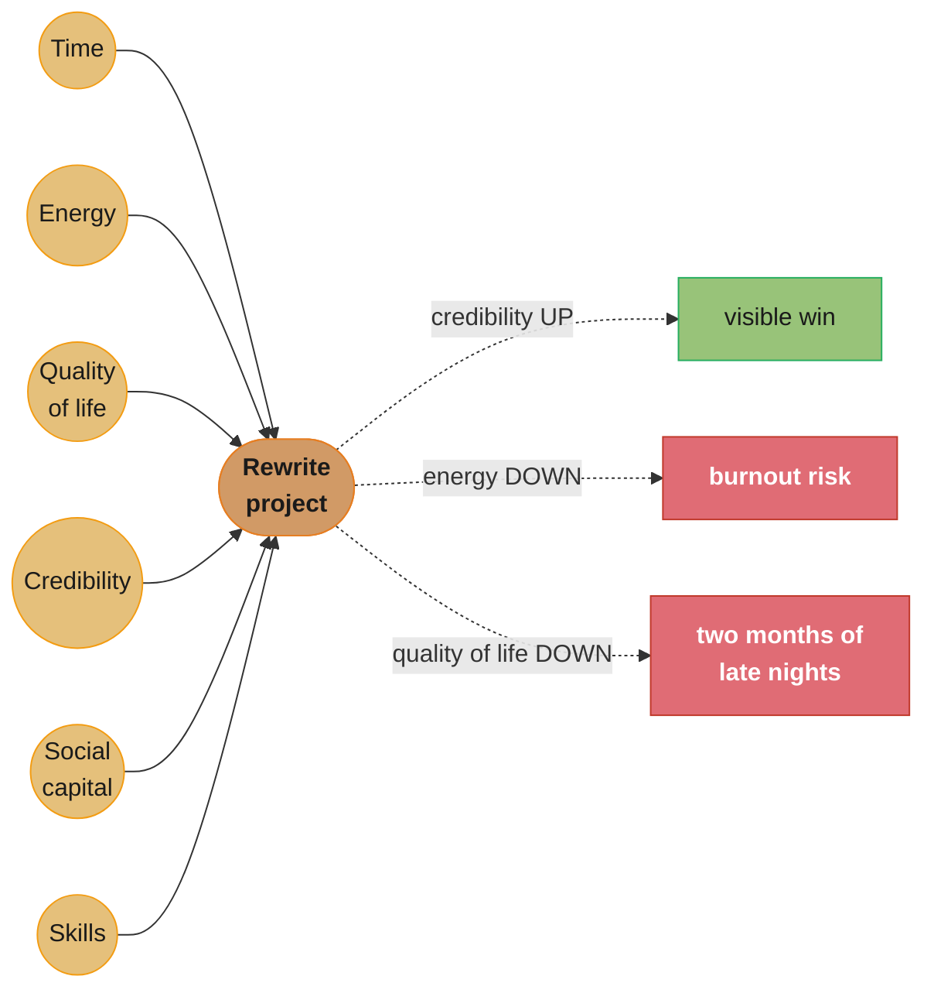

# Chapter 4: Finite Time

> Part II — Execution · The Staff Engineer's Path (Reilly, 1st ed., O'Reilly 2022) · builds on Ch 3 (the big picture), leads to Ch 5 (leading big projects)

## Chapter Map

Part I built the staff engineer's toolkit for *seeing* the organization — the maps, the big
picture, the gaps worth closing. Part II opens with the constraint that makes all of that
useless without discipline: you cannot work on everything you now know needs doing. A senior
engineer's job mostly comes to them; a staff engineer's job is largely self-directed, which
means the central skill Part II asks you to build is choosing — deliberately, and out loud —
what NOT to do. Chapter 4 is the resource-management chapter before Chapter 5 is the
execution chapter: it establishes the finite budget you spend once you say yes to a project.

**TL;DR:**
- Time is not the only scarce resource a staff engineer manages — Reilly frames five, and time
  is just the most visible one: **energy, quality of life, credibility, social capital, and
  skills**. Saying yes to a project spends more than hours.
- Projects don't arrive labeled with their true cost. **Where a project comes from** — an
  invitation, your own idea, a fire alarm, a grassroots effort — is itself a signal worth
  reading before you evaluate the work.
- The right filter for a new commitment is not "is this good work" (almost everything is) but
  three sharper questions: **is it important, is it something only you can do, and is it
  something you specifically should be doing** given your role and the org's needs right now.
- Protecting your time is an active, visible practice, not a passive default — it means
  scheduling the unscheduled parts of your job and saying no in a way that keeps trust intact
  rather than spending it.
- Saying yes to everything is not generous, it is a failure mode: it produces shallow
  involvement in many things instead of real impact on a few, and it teaches the people around
  you that your time is free to take.

## The Big Question

> A week has 168 hours. Subtract sleep, meals, commuting, and the rest of a life, and what's
> left for work is a small, fixed number that does not grow no matter how good your intentions
> are. So how do you decide, deliberately, which of the many good and worthwhile things
> competing for that number actually get it?

Analogy: think of your working life as a character sheet in a life-simulation game — the kind
with a row of bars along the top of the screen instead of a single "energy" meter. Every
activity moves more than one bar. Taking on a flashy, high-visibility rewrite might fill the
*credibility* bar while draining the *energy* and *quality of life* bars for two months
straight. Mentoring a junior engineer might barely move credibility at all while filling
*skills* and *social capital*. A staff engineer who only tracks one bar — usually "am I being
productive," which maps loosely to time — is playing the game half-blind. Chapter 4's real
subject is learning to read all five bars before agreeing to a project, not just the one that
shows up on your calendar.

---

## 4.1 Doing All the Things

The chapter opens from the trap every newly promoted staff engineer falls into: for the first
time, you can see the whole organizational map from Chapters 2 and 3, and *nearly everything on
it looks like it needs you*. Gaps are now visible that used to be invisible; problems that used
to be someone else's now look like things you could plausibly fix. The instinct that got you
promoted — noticing what's broken and jumping in to help — is exactly the instinct that, left
unchecked, overloads a staff engineer faster than any other role on the ladder, because nobody
above you is assigning your work the way a manager assigns a senior engineer's.

The trap has a specific shape: you say yes to a design review here, a mentoring relationship
there, a cross-team migration somewhere else, each individually reasonable, each individually
small — and the sum quietly becomes a second full-time job stacked on top of your actual
project. Reilly's framing is blunt about the consequence: **doing all the things means doing
none of them well.** Depth is what a staff-level contribution requires, and depth is exactly
what gets sacrificed first when attention is split across a dozen commitments. The fix the
chapter builds toward is not "work harder" or "get better at time management" in the abstract —
it's a concrete resource model (§4.2) and a concrete filter (§4.5) for saying yes to less, more
deliberately.

### Broken form, then the fix

**Broken:** an engineer newly leveled to staff joins the on-call rotation for their old team
(out of loyalty), agrees to review every RFC that lands in their inbox (out of thoroughness),
picks up a struggling project's tech lead role (because nobody else volunteered), and keeps
their existing project at full scope (because they don't want to seem like they're stepping
back). Four months later they are behind on all four, burned out, and the org still doesn't
have anyone clearly driving the one thing that most needed a staff engineer's attention.

**Fix:** the same engineer, using the filter in §4.5, keeps the on-call rotation only until a
named successor is trained (an explicit, dated handoff — not an open-ended "I'll help out"),
declines RFC review requests outside their domain with a pointer to a better reviewer, takes the
struggling project's tech-lead role *instead of* their existing project rather than alongside
it, and says so explicitly to their manager and the org. Fewer things, each done to a staff
standard, instead of many things done adequately.

---

## 4.2 The Bars: Your Five Finite Resources

Time is the resource everyone tracks because it's the one with a visible number on a calendar.
Reilly argues it is not the only one, and treating it as the only one is how engineers
accidentally trade away resources they can't easily get back. The chapter names five, modeled
on the resource bars of a life-simulation game — each one finite, each one drained or filled by
different kinds of work, and none of them substitutable for another:

| Resource | What drains it | What refills it |
|---|---|---|
| **Time** | Every commitment, meeting, and review | Saying no; delegating; finishing things |
| **Energy** | Context-switching, conflict, unfamiliar/hard problems | Work in your zone of competence; rest; variety after a slog |
| **Quality of life** | Late nights, weekend pages, travel, sustained crunch | Predictable hours; work that fits your life outside it |
| **Credibility** | Being visibly wrong, missing commitments, scope creep with no result | Delivering, especially publicly and on hard problems |
| **Social capital** | Spending favors, disagreeing publicly, being the bearer of bad news | Helping people with no immediate ask attached; reliability over time |
| **Skills** | (drains only by neglect / obsolescence) | Deliberate learning, working near more-skilled people, learning by doing |

Two properties make this model more than a cute metaphor. First, **a project can be net
positive on one bar and net negative on another at the same time** — the flashy rewrite that
builds credibility can simultaneously be an energy and quality-of-life drain, and whether it's
worth taking depends on which bar is currently lowest, not on whether the project is "good."
Second, **credibility and social capital are spendable, not just earnable** — a staff engineer
accumulates them precisely so they can be spent deliberately on a hard, unpopular, or
politically risky call later; hoarding them indefinitely is its own kind of waste. Skills are
the odd one out: the chapter names three concrete ways to build them — deliberate, structured
learning; working close to people who are better at something than you are; and learning by
doing, on the job, where the stakes force real competence rather than surface familiarity.

### Concrete example

An engineer weighing two possible Q3 projects: Project A is a well-scoped internal tooling
migration, three engineers, six weeks, low visibility, almost certain to ship on time. Project
B is a cross-org data-platform redesign, contested ownership, unclear scope, high visibility if
it succeeds and high reputational cost if it doesn't. Read purely on "impact," B looks like the
obvious pick. Read on the five bars: A refills skills (new tooling stack) and quality of life
(predictable six-week box) at low risk to everything else; B is a serious credibility and social
capital *gamble* — a win pays out heavily, a loss costs both bars for a long time, and either
way it will drain energy and quality of life for the duration. Neither choice is wrong in the
abstract; the bar model is what makes the trade-off visible enough to choose on purpose instead
of by default.

---

## 4.3 How Busy Do You Like to Be?

Not every engineer's ideal fill level for these bars is the same, and the chapter is explicit
that there's no universally correct amount of busy. Some people do their best work heavily
loaded with variety across several fronts; others do their best work with a single, deep focus
and treat every additional commitment as a tax on the one that matters. Neither preference is
more "staff-level" than the other — the mistake is not knowing your own answer and drifting into
someone else's default level of busy, usually upward, because the org will always find more work
to hand a capable person than that person can actually absorb.

The practical tool the chapter offers is noticing your own **volatility** — how much your
capacity swings week to week — rather than assuming a flat, constant bandwidth. A week that
looks fine on the calendar can still be a bad week to add a new commitment if it follows three
weeks of incident response, or precedes a launch that will eat every spare hour anyway.
Deciding "how busy do I like to be" is therefore not a one-time setting; it's a running check
you do before every new yes, informed by where your five bars currently sit, not just by
whether the calendar has an open slot.

---

## 4.4 Where Do Projects Come From?

Before evaluating whether to take a project, it helps to notice *how it arrived*, because the
source carries information about its real priority, its political weight, and how much room you
have to negotiate its scope. Reilly's list, in roughly descending order of how much say you have
over whether it happens at all:

1. **You're invited to join** — someone with authority over the work wants you specifically;
   usually the clearest signal of genuine priority, but also the easiest one to accept without
   asking what you'd be giving up.
2. **You ask to join** — you saw the work and requested a seat; your leverage to shape scope is
   highest here, since you're the one initiating.
3. **You have an idea** — nobody asked for this; you're proposing it, which means you also own
   selling it and defending its priority against everything already in flight.
4. **The fire alarm goes off** — an incident, an outage, a compliance deadline; not optional in
   the near term, but explicitly temporary, and worth naming as temporary so it doesn't quietly
   become a permanent part of your load.
5. **You're claiming a problem** — you noticed something broken that nobody owns and you decide
   to own it; valuable, but the easiest source to over-subscribe to, since the supply of unowned
   problems is effectively unlimited.
6. **Grassroots efforts** — a loose, bottom-up initiative with no formal sponsor yet; can become
   real work later but often lacks the organizational backing to justify displacing sponsored
   work today.
7. **Someone needs to…** — vague, diffuse organizational need with no specific owner identified;
   the vaguest source and the one most likely to expand indefinitely once you touch it.
8. **You're just meddling** — you're drawn to it out of curiosity or a sense that you could do
   it better, with no real mandate; occasionally worth a small amount of time, rarely worth a
   real commitment.

The list matters because a project's *source* and its *actual importance* are only loosely
correlated — an invited, sponsored project can still be low-impact busywork, and a
grassroots effort you noticed yourself can be the most important thing you do all year. Naming
the source is the first step toward evaluating the project honestly rather than reflexively.

---

## 4.5 Which Project Should You Take?

Once a project is on the table, the chapter narrows the decision to three questions, and the
order matters — each question filters harder than the last:

**Is it important?** Not "is it interesting to me" or "would it be nice to have," but does it
meaningfully move something the organization actually needs moved. Most proposed work clears
this bar at some level; it's a necessary filter, not a sufficient one.

**Is it something only you can do?** If several other engineers could do this work about as
well, taking it yourself is a poor use of a scarce staff-level skill set, even if you'd enjoy it
— you're the wrong bottleneck. This question is where the chapter pushes back hardest against
the instinct from §4.1: being *capable* of doing something is not the same as being the *right*
person to do it.

**Is it what you specifically should be doing right now?** Even work that's important and that
only you can do might still be the wrong call this quarter, if it competes with something more
important that also only you can do, or if taking it would blow through your current bar levels
from §4.2. This is the question that forces an explicit trade-off against everything else
already on your plate, rather than evaluating the new project in isolation.

A project that passes all three is worth strongly considering; a project that fails even one is
a candidate to decline, delegate, or negotiate down in scope — not necessarily to abandon
outright. The chapter is explicit that a "no" to the project as proposed is often better
expressed as a counter-proposal: a smaller version, a later start date, or someone else's name
attached instead of yours.

### Worked example

A director asks a staff engineer to lead a nine-month platform migration touching four teams.
Running the three questions: *important* — yes, it unblocks two other roadmap items. *Only this
engineer* — no, actually; a senior engineer on one of the four teams has deep context on the
legacy system and just needs staff-level air cover, not a staff-level driver. *Right thing for
this engineer right now* — no, they're mid-way through the exploration phase (Ch 5) of a
project that fails the "only you" test in the *opposite* direction — nobody else has the
cross-team relationships to unblock it. The counter-proposal: the senior engineer leads the
migration with the staff engineer as an advisor attending biweekly syncs, freeing the staff
engineer to stay on the project only they can finish. Same organizational outcome, better
allocation of a scarce resource.

---

## 4.6 Defend Your Time

Even with a good filter for saying yes, time evaporates without active protection, because a
staff engineer's calendar is disproportionately full of things *other people* scheduled — design
reviews, 1:1s, cross-team syncs — while the deep, unscheduled work that staff-level output
actually requires (writing, thinking, reading a design doc closely enough to give it a real
review) has no natural slot of its own. Reilly's practical fix: **put the unscheduled parts of
the job on the calendar explicitly** — a two-hour block for deep work, a slot for inbox and chat
triage, even a marked lunch — so a calendar that looks wide open to anyone scheduling a meeting
over you actually reflects the whole job, not just the parts other people already know about.

Saying no is the other half, and the chapter treats it as a skill with its own technique rather
than an act of willpower. A flat "no" spends social capital for no return; a **no with a
reason and, where possible, an alternative** — "I can't lead this, but X has the context and
I can advise" — declines the ask while leaving the relationship, and often the actual problem,
in better shape than silence or a reluctant yes would have. The chapter's closing warning is the
one worth carrying forward into Chapter 5: **the failure mode of saying yes to everything is not
that you fail at any one thing — it's that you become reliably shallow everywhere**, and an
organization that has learned your time is free to take will keep taking it, long after you've
run out of bars to spend.

---

## Beyond the book — adjacent prioritization frameworks

> This section is the summarizer's addition, not Reilly's. Chapter 4 does not name the
> Eisenhower Matrix, OKRs, or RICE scoring; it develops its own five-bar model and three-question
> filter as described above. The frameworks below are included because they solve an adjacent
> problem — general work prioritization — and readers coming from a product or program-management
> background may recognize the shape.

The classic **Eisenhower Matrix** (urgent/important, a 2×2 popularized decades before this book)
answers a narrower question than Reilly's three questions: it filters on urgency and importance
alone, with no equivalent of "is this something only you can do." A staff engineer's calendar
fills with work that is important and non-urgent (design reviews, mentoring, architecture) which
the matrix alone won't protect against being crowded out by merely-urgent noise — Reilly's
"defend your time" (§4.6) is doing similar work to the matrix's "important, not urgent" quadrant,
by a different route. Product-side **RICE scoring** (Reach, Impact, Confidence, Effort) and
OKR-driven prioritization operate at the team or org level rather than the individual level
Chapter 4 addresses, and neither has a direct equivalent of the five-bar resource model — they
score the *work*, not the *cost to the specific person doing it*, which is exactly the gap
Reilly's chapter fills for an individual contributor deciding what to personally take on.

---

## Visual Intuition



Caption: one project draws on every bar at once, and the draws are not symmetric — the same
rewrite that fills credibility can simultaneously drain energy and quality of life, which is
why "is this good work" is never a sufficient question on its own.

```
  the five bars, before and after taking Project B (§4.2 worked example)

  Energy         [########..] -> [####......]   drained: unfamiliar, contested domain
  Quality of life[#######...] -> [###.......]   drained: crunch risk if it slips
  Credibility    [#####.....] -> [########..]   filled IF it ships; DRAINED if it doesn't
  Social capital [######....] -> [####......]   spent: contested ownership fights
  Skills         [#####.....] -> [#######...]   filled: new domain exposure

  Project A (tooling migration), same starting bars:

  Energy         [########..] -> [########..]   flat: familiar domain
  Quality of life[#######...] -> [#######...]   flat: predictable six-week box
  Credibility    [#####.....] -> [######....]   small, reliable gain
  Social capital [######....] -> [######....]   flat: no contested ownership
  Skills         [#####.....] -> [#######...]   filled: new tooling stack
```

Caption: Project B is higher-variance on every bar that matters (credibility and social capital
can go either direction, sharply); Project A is a smaller, safer, more certain gain across the
board — neither is universally the right pick, but the bar model is what makes the trade-off
visible instead of a gut call.

---

## Key Concepts Glossary

- **The five bars** — Reilly's resource model: time, energy, quality of life, credibility,
  social capital, and skills, each independently finite and independently drained.
- **Energy** — the resource drained by context-switching, conflict, and unfamiliar hard
  problems; refilled by working in your zone of competence and by rest.
- **Quality of life** — the resource drained by late nights, on-call pages, and sustained
  crunch; distinct from time because it captures *when* and *how* time is spent, not just how
  much.
- **Credibility** — the resource built by delivering, especially publicly and on hard problems,
  and spent by being visibly wrong or missing commitments.
- **Social capital** — accumulated trust and goodwill, built by helping without an immediate
  ask, spent by disagreeing publicly or delivering bad news.
- **Skills** — the one bar that only drains through neglect; built through deliberate learning,
  proximity to more-skilled colleagues, and learning by doing.
- **Volatility (busy-ness)** — how much an individual's real capacity swings week to week,
  distinct from a flat calendar-based capacity assumption.
- **Project sources** — the eight-item taxonomy of where a project comes from (invited, asked,
  idea, fire alarm, claimed problem, grassroots, "someone needs to," meddling), used to read a
  project's real priority before evaluating it.
- **The three-question filter** — is it important; is it something only you can do; is it what
  you specifically should be doing right now — applied in that order.
- **Defending your time** — actively scheduling the unscheduled parts of the job (deep work,
  triage) rather than leaving them to be crowded out by other people's meetings.
- **No with a reason and an alternative** — the chapter's technique for declining work without
  spending social capital: state why, and where possible, name who else could do it.

---

## Tradeoffs & Decision Tables

| Bar | Refilled by | Drained by | How fast it recovers |
|---|---|---|---|
| Time | Saying no, finishing things | Every new commitment | Immediate (next slot freed) |
| Energy | Familiar work, rest, variety after a slog | Context-switching, conflict | Days to weeks |
| Quality of life | Predictable hours, work fitting your life | Crunch, travel, pages | Weeks (needs sustained relief) |
| Credibility | Delivering, especially publicly | Visible failure, missed commitments | Slow — months, asymmetric to lose vs. gain |
| Social capital | Unprompted help, reliability over time | Public disagreement, bad news | Slow — built over a long horizon |
| Skills | Deliberate learning, proximity, doing | Only neglect / obsolescence | Ongoing, compounding |

| Project source | Your leverage over scope | Typical trap |
|---|---|---|
| You're invited | Moderate | Accepting without asking what it displaces |
| You ask to join | High | Underestimating how much you're now on the hook for |
| You have an idea | High (framing), low (priority) | Nobody else agrees it's important yet |
| Fire alarm | Low (near-term), high (duration) | Letting "temporary" quietly become permanent |
| Claimed problem | High | Unlimited supply — no natural stopping point |
| Grassroots | Moderate | Lacks sponsorship to displace funded work |
| "Someone needs to…" | Low | Scope with no defined owner expands indefinitely |
| Just meddling | High | Curiosity masquerading as a real commitment |

| Response to an unwanted ask | Social capital cost | Outcome quality |
|---|---|---|
| Silent over-commitment (say yes, resent it) | Deferred, paid later at higher cost | Poor — shallow delivery, quiet burnout |
| Flat "no" | Moderate, immediate | Relationship strained, problem unaddressed |
| "No, and here's an alternative" | Low | Relationship intact, problem still gets addressed |
| Counter-proposal (smaller scope, later date) | Low | Preserves the relationship and often improves the project |

---

## Common Pitfalls / War Stories

- **The newly promoted staff engineer who says yes to everything.** Every individual yes looks
  reasonable in isolation; the sum is a second full-time job. The fix isn't willpower, it's the
  three-question filter applied *before* the yes, not regretted after it.
- **Confusing "capable of" with "should."** Being one of several engineers who could plausibly
  do a piece of work is not the same as being the right, scarce person for it — taking it anyway
  is a poor allocation of a staff-level skill set, even when the work itself is worthwhile.
- **Treating credibility as free.** Chasing a high-visibility win without weighing the downside
  spends credibility as if it were unlimited; a public failure costs far more than a quiet
  success gains, and the chapter's bar model exists precisely to make that asymmetry visible
  before committing, not after.
- **"Temporary" fire-alarm work that never ends.** An incident response or a compliance
  scramble is explicitly time-boxed at the start and then quietly absorbed into the ongoing
  workload because nobody formally closed it out or reassigned it.
- **A calendar that looks empty but isn't.** Not blocking time for deep work, triage, or
  thinking makes those hours invisible to anyone scheduling a meeting — the fix is putting the
  unscheduled parts of the job on the calendar explicitly, the same discipline as blocking time
  for a meeting anyone else asked for.
- **A flat "no" that costs more than it should.** Declining without a reason or an alternative
  reads as unhelpful even when the underlying judgment is correct, spending social capital for
  no benefit over a softer, equally firm decline.

---

## Real-World Systems Referenced

Chapter 4 stays close to individual practice rather than naming specific companies or products;
its central references are conceptual: the **life-simulation game bar metaphor** for the
five-resource model, and the general observation — drawn from the author's own staff-engineering
experience across companies including Google, Squarespace, and Fastly — that newly promoted
staff engineers reliably over-commit in the same predictable pattern described in §4.1. The
chapter's frameworks (the five bars, the project-source taxonomy, the three-question filter) are
Reilly's own constructions rather than named industry tools, which is part of the chapter's
point: existing prioritization frameworks (see *Beyond the book*, above) don't have a direct
answer to "what does this cost the specific person being asked."

---

## Summary

A staff engineer's day-to-day authority is mostly self-directed, which makes deliberate choice
about where to spend yourself the core skill Part II opens with. Time is one of five finite
resources — alongside energy, quality of life, credibility, and social capital — and a project
that looks free on the calendar can still be expensive on the other four. Projects arrive from
identifiable sources whose priority and negotiability differ, and evaluating a project well means
reading where it came from before applying the chapter's three-question filter: is it important,
is it something only you can do, and is it what you specifically should be doing right now.
Protecting the time that survives that filter is an active practice — scheduling the unscheduled
parts of the job, and saying no with a reason and an alternative rather than either silently
over-committing or bluntly refusing. The alternative to this discipline isn't failing at any one
project; it's becoming reliably shallow at all of them, which Chapter 5 assumes you've already
avoided by the time it starts covering how to actually run the big project you did choose to
take.

---

## Interview Questions

**Q: Why does Reilly say time is not the only resource a staff engineer manages, and what does that framing add over "time management"?**
**Short:** Reilly names five finite resources — time, energy, quality of life, credibility, social capital, skills.
Time-management advice treats hours as the only scarce input, but a staff engineer can have open calendar slots and still be out of capacity because energy, quality of life, credibility, or social capital are depleted — those don't show up on a calendar at all. The five-bar model forces evaluating a new commitment against all five before saying yes, catching the case where a project is "free" on time but expensive on credibility (a public, high-risk bet) or quality of life (sustained crunch), which pure time-blocking would miss entirely.

**Q: What's wrong with evaluating a new project only by asking "is this good, important work"?**
**Short:** Almost all proposed work clears "important" — it's a necessary filter, not a sufficient one.
Importance is the first of three questions the chapter asks, not the only one, because the pool of genuinely important, worthwhile work vastly exceeds what any one person can take on — passing that bar alone still leaves you needing to choose among many valid options. The two sharper filters are whether you're specifically the right person (is it something only you can do) and whether it's the right priority for you specifically right now, given everything else already on your plate; skipping straight to "is it good work" is how capable people end up overcommitted on entirely reasonable-sounding projects.

**Q: What's the difference between "is it something only you can do" and "am I capable of doing it"?**
**Short:** Being capable is necessary but not sufficient — the question is whether you're the scarce, right person.
Many engineers might be capable of leading a given piece of work reasonably well; taking it yourself when someone else could do it about as well is a poor use of a scarce staff-level skill set, even if you'd personally enjoy it or do it slightly better. The question pushes toward delegating or advising instead of directly leading whenever the real constraint is someone else's bandwidth or confidence rather than a capability only you possess — reserving your own direct involvement for the work that genuinely needs it.

**Q: Why does the chapter frame saying yes to everything as a failure mode rather than generosity?**
**Short:** Universal yes produces shallow involvement everywhere instead of real depth anywhere.
Depth is what staff-level contribution actually requires — a design review that gets real scrutiny, a mentoring relationship with sustained attention, a project driven to genuine completion — and depth is exactly what's sacrificed first when attention splits across many commitments. The organizational cost compounds too: once people learn a staff engineer's time is free to take, they keep taking it, so a pattern of over-availability doesn't just cost the individual, it trains the org to keep asking.

**Q: How should you respond to a request you don't want to take on, according to the chapter?**
**Short:** Decline with a reason and, where possible, an alternative — not a flat no or silent yes.
A bare "no" spends social capital for no return and a reluctant "yes" spends time, energy, and eventually credibility when the half-hearted result disappoints; the chapter's preferred move is naming the reason and, if one exists, pointing to a better-suited person or a smaller version of the ask. This preserves the relationship and often still gets the underlying problem addressed, which a silent over-commitment followed by burnout does not.

**Q: What does "defend your time" actually mean in practice, beyond generally trying to be less busy?**
**Short:** Put the unscheduled parts of the job — deep work, triage — explicitly on the calendar.
A staff engineer's calendar fills disproportionately with meetings other people scheduled, because deep work, thinking, and closely reviewing a design doc have no natural slot of their own and lose to anything with an explicit invite. Blocking that time on the calendar the same way a meeting would be blocked makes the whole job visible to anyone trying to book over it, converting an implicit, easily-overridden priority into an explicit, defensible one.

**Q: Why does the chapter list eight different sources a project can come from, and why does the source matter?**
**Short:** A project's source signals its real priority and how much scope you can negotiate.
An invited, sponsored project usually carries genuine organizational priority but little room to shrink its scope; a project you've claimed yourself because nobody else owns it has a lot of negotiating room but effectively unlimited potential scope, since the supply of unowned problems never runs out. Reading the source before evaluating the work — rather than treating every proposal identically — is what lets you spot, for example, that "someone needs to…" work is the vaguest and most expansion-prone category and treat it with proportionate caution.

**Q: Why is a "temporary" fire-alarm commitment specifically called out as risky?**
**Short:** Fire-alarm work is explicitly time-boxed at the start but often never formally closed out.
An incident, an outage, or a compliance deadline is genuinely non-optional in the near term, which makes it easy to accept without negotiating an end date — but because it was never framed with an exit condition, it tends to quietly become a permanent part of the workload once the acute crisis passes and nobody reassigns or retires it. Naming it as temporary at the moment you take it on, with an explicit handoff or end date, is what prevents that drift.

**Q: What does the chapter mean by "how busy do you like to be," and why isn't there one right answer?**
**Short:** Ideal workload varies by person — some thrive on breadth, others need deep single focus.
Some engineers do their best work with variety spread across several fronts at once; others do their best work with a single deep focus where every additional commitment is a direct tax on the thing that matters most, and neither preference is inherently more senior or more correct than the other. The practical risk is not knowing your own answer and drifting into whatever level of busy the organization defaults to handing a capable person, which tends to increase without bound unless actively resisted.

**Q: Why does the chapter treat credibility and social capital as things you're expected to spend, not just accumulate?**
**Short:** Hoarding credibility indefinitely wastes it — it exists to be spent on hard, risky calls.
A staff engineer accumulates credibility and social capital specifically so they have the standing to make an unpopular technical call, push back on a bad plan, or take a public risk when it matters — refusing to ever spend either, out of an instinct to protect them, means never actually using the influence they were built to provide. The skill is spending deliberately on the calls that are worth it, not spending never or spending carelessly.

**Q: In the worked migration example, why does the chapter favor a counter-proposal over an outright decline?**
**Short:** A counter-proposal often preserves the organizational outcome while fixing the allocation.
Declining a request outright can leave a genuinely important piece of work unowned, while accepting it as proposed can put the wrong person in the driver's seat; a counter-proposal — someone with better context leads, you advise — frequently gets the same organizational result with a better match between the work and the person doing it. This is why the chapter frames "no" less as a single word and more as a negotiation over who does the work and how.

**Q: How does the five-bar model explain why two projects with similar "impact" scores can be very different choices?**
**Short:** Impact alone ignores the volatility a project creates on credibility and quality of life.
A well-scoped, low-visibility project and a high-visibility, contested one can score similarly on raw organizational impact while differing sharply in variance — the contested project can swing credibility and social capital strongly positive or strongly negative depending on outcome, and will predictably drain energy and quality of life regardless of outcome, while the well-scoped project moves every bar only slightly and predictably. Choosing between them isn't just about expected impact, it's about how much risk on the other four bars you can currently absorb.

**Q: What's the relationship between skills and the other four bars in Reilly's model?**
**Short:** Skills is the one bar that drains only through neglect, not through the act of working.
Time, energy, quality of life, credibility, and social capital are all consumed by doing the work itself, at least in the short term, while skills mostly only erode through disuse or the field moving on without you — which is why the chapter treats skill-building (deliberate learning, proximity to more-skilled colleagues, learning by doing) as something worth actively investing in rather than assuming it happens automatically as a side effect of staying busy on other bars.

**Q: Why does "just meddling" appear on the project-source list at all, if it's rarely worth a real commitment?**
**Short:** Naming meddling as a source keeps curiosity-driven work from masquerading as a real priority.
Curiosity about a problem outside your actual scope is a normal impulse, and giving it an explicit, low-status category ("meddling") makes it easy to recognize and cap — a small amount of time is fine, but treating a meddling impulse as if it were an invited or claimed responsibility is how attention leaks into work nobody actually needs from you, at the expense of the sources higher on the list that carry real organizational weight.

**Q: What does the chapter's guidance imply about a staff engineer who has zero unscheduled time on their calendar?**
**Short:** An empty-looking calendar with no deep-work blocks is a sign the job isn't actually visible.
If the calendar shows only meetings other people scheduled, the deep, unscheduled portion of a staff engineer's real job — thinking, writing, closely reviewing designs — is invisible to anyone deciding what to book, which means it will keep losing to whatever has an explicit invite. A calendar with visible deep-work and triage blocks isn't evidence of being less busy; it's evidence the whole job, not just its externally-visible half, is being actively protected.

---

## Cross-links in this repo

- [soft_skills/scope_prioritization_and_saying_no/ — the repo's own treatment of scope filters and declining work](../../../soft_skills/scope_prioritization_and_saying_no/scope_prioritization_and_saying_no.md)
- [soft_skills/staff_plus_archetypes/ — what staff-level scope and self-direction look like across archetypes](../../../soft_skills/staff_plus_archetypes/staff_plus_archetypes.md)
- [soft_skills/team_health_and_sustainable_pace/ — the sustainable-pace angle on quality of life and burnout](../../../soft_skills/team_health_and_sustainable_pace/team_health_and_sustainable_pace.md)
- [soft_skills/scope_impact_and_ownership/ — evaluating whether a piece of work is genuinely yours to own](../../../soft_skills/scope_impact_and_ownership/scope_impact_and_ownership.md)
- [soft_skills/mentorship_and_sponsorship/ — a deeper treatment of the skills-bar's "proximity to more-skilled colleagues" mechanism](../../../soft_skills/mentorship_and_sponsorship/mentorship_and_sponsorship.md)
- Sibling chapters: [Ch 3 Creating the Big Picture](../03_creating_the_big_picture/03_creating_the_big_picture.md) · [Ch 5 Leading Big Projects](../05_leading_big_projects/05_leading_big_projects.md) · [Ch 7 You're a Role Model Now (Sorry)](../07_youre_a_role_model_now/07_youre_a_role_model_now.md)

## Further Reading

- Reilly, Tanya. *The Staff Engineer's Path: A Guide for Individual Contributors Navigating
  Growth and Change*, 1st ed., O'Reilly, 2022 — Chapter 4, "Finite Time."
- Reilly's public talks and writing on staff engineering (noidea.dog and conference talks
  referenced throughout the book's introduction) extend the same resource-management framing
  to the staff-plus role more broadly.
- The chapter's project-source taxonomy and three-question filter are original to this book;
  readers wanting adjacent, more general prioritization frameworks can compare the Eisenhower
  Matrix and RICE scoring, noted above as *not* part of the book's own text.
