# Chapter 5: Leading Big Projects

> Part II — Execution · The Staff Engineer's Path (Reilly, 1st ed., O'Reilly 2022) · builds on Ch 4 (finite time), leads to Ch 6 (why have we stopped)

## Chapter Map

Chapter 4 established the discipline of choosing what to work on; Chapter 5 assumes you've said
yes to something big and asks how to actually run it. "Big" here means a specific shape of
project, not just a long one: it crosses team boundaries, has no single obvious owner, and
starts genuinely ambiguous — nobody, including you, fully knows the goals, the constraints, or
who's responsible for which parts on day one. Reilly's core claim is that project leadership at
this scale is mostly a communication problem wearing a technical costume: the technical work
still has to happen, but what actually determines whether a big project succeeds is whether
information — goals, status, risk, decisions — flows to the right people at the right time.

**TL;DR:**
- A big project starts in a state of maximum ambiguity, and the instinct to resolve that
  ambiguity by rushing into a solution is exactly backwards — the chapter's advice is to
  deliberately not know yet, and spend the early, cheap period building context instead.
- **Building context** means mapping goals, customers, success metrics, stakeholders, fixed
  constraints, risks, history, and the team before design work starts, because a design built on
  a wrong assumption about any of these has to be redone once the assumption surfaces.
- **Giving the project structure** — defined roles (a RACI matrix), a recruited team, an agreed
  scope, and a real kickoff — turns a loose intention into something people can actually be
  accountable to.
- **Driving the project** moves through recognizable phases — explore, clarify, design, decide,
  code, communicate, navigate — and most of the failure modes the chapter warns about are a team
  skipping a phase, not a team lacking technical skill.
- A well-run RFC and a set of named **technical pitfalls** (underestimating a "seems easy"
  problem, deferring the hard part, building for a present or a distant future that's wrong
  either way) are the chapter's concrete tools for catching bad designs before they're built.

## The Big Question

> You've been asked to lead something that spans four teams, touches systems you don't fully
> understand, and has no clear owner yet. Where do you even start, and how do you keep dozens of
> people pointed at the same goal for months without a manager's formal authority to compel them?

Analogy: leading a big project is like being handed a set of hiking directions to a summit
nobody in the group has climbed before, with landmarks described by people who saw them from
different angles. Rushing straight up the first visible trail — the natural instinct — usually
means backtracking later, once it turns out the "summit" everyone pictured wasn't the same
peak. The chapter's early chapters of the project (§5.1–§5.2) are the part where you stop, get
everyone looking at the same map, and agree on what the summit actually is before anyone starts
climbing; the later phases (§5.3–§5.4) are the actual climb, where the job shifts from
mapmaking to keeping the party together, watching for the wrong trail, and making the calls that
keep everyone moving in the same direction.

---

## 5.1 The Start of a Project

The start of a big project is, by construction, the moment you know the least about it — and
the chapter's central piece of advice for this phase runs against instinct: **don't rush to
resolve the ambiguity.** The period where it's genuinely acceptable to not know the answer yet
is short and valuable; once you commit to a direction, admitting you don't understand something
basic becomes much more costly, both to the project's momentum and to your own credibility.
Reilly's line for this, worth carrying forward: *don't waste the brief period where it's easy to
not know.*

In practice this phase can feel overwhelming — you've been dropped into something with more
moving parts than you can hold in your head, and the honest first reaction is often something
closer to panic than confidence. The chapter's antidote is procedural rather than
motivational: start an **anchor document** — a running, evolving "second brain" for the project
that captures what you're learning as you learn it, rather than trying to hold the whole picture
in memory. It becomes the seed of the goals, context, and design documents that follow, and it
gives you somewhere concrete to put uncertainty instead of carrying all of it.

Two early moves matter specifically because they're easy to skip when you're eager to look
productive: **talk to your project's sponsor directly**, early, to hear the goals in their own
words rather than as filtered through a kickoff email — sponsors often carry context, constraints,
or unstated priorities that never made it into the written brief. And **decide, deliberately, who
gets your uncertainty** — some stakeholders need to hear "I don't fully understand this yet, I'm
working on it" as an honest, reassuring update; others need a more polished, confidence-inspiring
summary even while the underlying picture is still forming, and mismatching the two erodes trust
in exactly the group whose confidence you need to keep the project funded and staffed.

### Broken form, then the fix

**Broken:** a staff engineer is handed a vague, cross-team mandate ("modernize our data
pipeline") and, uncomfortable with the ambiguity, immediately starts sketching an architecture
diagram and drafting an RFC in the first week, based on their own read of the problem. Two months
in, a stakeholder mentions in passing that the real driver was a looming compliance deadline the
RFC never accounted for, and the design has to be substantially reworked.

**Fix:** the same engineer spends the first two weeks almost entirely on context — sponsor
conversations, an anchor document capturing every stated and half-stated goal, a pass through
recent related incidents and prior attempts at the same problem — and only starts the design once
the compliance driver, among other constraints, has surfaced and been written down. The RFC that
follows is written once, correctly, instead of twice.

---

## 5.2 Building Context

Building context is the structured version of the "don't rush" instinct from §5.1 — a checklist
of what you need to understand before a design can be trusted, and each item exists because
skipping it produces a specific, recognizable kind of project failure:

- **Goals** — what does success actually look like, in terms concrete enough that two different
  people would agree, after the fact, on whether it was achieved.
- **Customer needs** — who is this actually for, and what do *they* need, which is not always
  identical to what the project's sponsor initially describes.
- **Success metrics** — the measurable signal that tells you, and everyone watching, whether the
  project worked — set before the project ships, not invented afterward to justify the outcome.
- **Sponsors, stakeholders, and customers** — who has authority over the project's direction,
  who is affected by it, and who is simply interested; these are three different groups needing
  three different kinds of communication.
- **Fixed constraints** — the things genuinely not up for negotiation (a compliance deadline, a
  budget ceiling, a platform decision made above your level) versus things that only feel fixed
  because nobody has questioned them yet.
- **Risks** — what could make this fail or slip, named explicitly and early enough to plan around
  rather than discovered mid-project.
- **History** — what's been tried before, why it did or didn't work, and who remembers it; a
  surprising number of "new" big projects are a second or third attempt at the same underlying
  problem.
- **The team** — who's actually available, what they're good at, and what they need from you as
  the project's lead, distinct from who was nominally assigned.

This checklist does real work as a *diagnostic*: a design review that surfaces genuine surprise
about a stated goal, or a stakeholder who wasn't consulted, is evidence that context-building was
skipped or incomplete, not evidence that the design itself is bad. The chapter frames context as
cheap to build early and expensive to discover late — a missing constraint found in week two costs
a conversation; the same constraint found in month six costs a redesign.

---

## 5.3 Giving Your Project Structure

Context tells you what the project needs to accomplish; structure decides who does what and how
the group stays coordinated as it grows past the size where informal coordination works. Reilly's
components:

**Defining roles.** A **RACI matrix** — who is **R**esponsible (does the work), **A**ccountable
(owns the outcome), **C**onsulted (has input before a decision), and **I**nformed (told after) —
makes explicit what is otherwise a common source of big-project friction: two people both
assuming they own a decision, or a decision made with nobody consulted who should have been. On a
project spanning four teams, an unstated assumption about who's accountable for a shared
component is one of the most common causes of a slipped deadline nobody saw coming.

**Recruiting people.** A big project usually can't run on whoever happened to be assigned; part
of giving it structure is actively recruiting the specific expertise it needs — someone who
understands the legacy system being replaced, someone with authority to unblock a dependent team
— rather than working around gaps in the assigned roster.

**Agreeing on scope.** What's in, what's explicitly out, and — critically — what happens to
requests that arrive later wanting to expand it. An unscoped project accretes "just one more
thing" requests indefinitely; a scoped one has an explicit process (usually: written down, and
routed through the project's decision-making structure) for evaluating whether a new request
changes the plan.

**Estimating time.** Big-project estimates are notoriously unreliable this far from a finished
design, and the chapter's guidance is to estimate with those error bars explicit rather than
pretending to a false precision — a six-to-nine-month range communicated honestly holds up better
under scrutiny than a confident "six months" that slips.

**Agreeing on logistics.** The unglamorous machinery — meeting cadence, where decisions get
recorded, how status gets reported — decided deliberately up front rather than improvised ad hoc
once the project is already moving. A typical cadence for a multi-team, multi-month project:
a weekly sync with the core team, a biweekly or monthly update to sponsors and stakeholders, and
a lightweight async status note (in the anchor document from §5.1) updated continuously rather
than assembled from scratch before each report.

**Kickoff.** A real kickoff meeting — not a status update, but the moment goals, scope, roles,
and logistics are stated out loud to the assembled group and questioned before they're locked in
— is what converts a plan that exists in the lead's head (and the anchor document) into a shared
commitment the whole team can be held to.

---

## 5.4 Driving the Project

With context built and structure in place, driving the project is the ongoing work of moving it
forward — and the chapter breaks this into recognizable phases, most of which recur multiple
times across a long project rather than happening once in strict sequence.

### Explore, clarify, design

**Explore** is open-ended: understanding the problem space broadly, without committing to a
direction, before narrowing. A design whose goals are hard to articulate clearly is usually a
sign the exploration phase was cut short, not a sign the goals are genuinely unclear — pushing
back into exploration, rather than pushing forward into a design that can't explain itself, is
the correct response.

**Clarify** narrows exploration into something concrete enough to design against: agreeing on
**mental models** the team will share (a common way of picturing how the system works), a
**shared vocabulary** — Reilly's phrase is close to *ubiquitous language*, the same term this
repo's domain-modeling material uses — so "the queue" means the same thing to every person in
the room, and **pictures and diagrams** that make the shared model visible rather than leaving it
implicit in each person's head, where it inevitably diverges.

**Design** is where the RFC comes in — a written proposal circulated for review before
implementation starts, structured, per the chapter's template, as:

```
RFC — <project name>

Context           what problem this solves and why now
Goals             concrete, falsifiable statements of success
Design            the actual proposal
Security / privacy / compliance   explicit section, not an afterthought
Alternatives considered / prior art   what else was weighed, and why it lost

Optional:
  Background      deeper context for readers new to the area
  Trade-offs       what this design gives up in exchange for what it gains
  Risks            what could go wrong, and the mitigation if it does
  Dependencies     what this design needs from other teams or systems
  Operations       how this gets run, monitored, and eventually retired
```

A precision discipline the chapter calls out specifically for the Design section: **be clear
about who or what is doing the action for every single verb.** "The system retries the request"
hides a decision (which system? on what condition? how many times?) that a vaguer verb lets
slide past review unnoticed — precision here is what turns a design doc into something reviewers
can actually evaluate rather than approve on faith.

### Watch for these technical pitfalls

The chapter names a recurring set of ways a design goes wrong that have nothing to do with raw
technical skill and everything to do with framing:

| Pitfall | What it looks like |
|---|---|
| "This is a brand new problem" | It isn't — the team is unaware of a prior attempt or an adjacent system that already solved a similar problem |
| "This seems easy" | The stated scope hides real complexity discovered only once implementation starts |
| Building only for the present | The design solves today's scale/shape and needs a rewrite at the next order of magnitude |
| Building only for a distant future | Over-engineered for requirements that may never materialize, at real cost to the near-term timeline |
| "Every user just needs to…" | Assumes a single, uniform user when real usage is heterogeneous |
| Deferring the hard part | The genuinely difficult piece is pushed to "phase two," which quietly becomes never |
| Solving a small problem by worsening a big one | A local fix that degrades a more important, larger system property |
| "Not really a rewrite" | A project framed as incremental improvement that is, in scope and risk, actually a rewrite |
| Ignoring operability | The design covers building the thing but not running, monitoring, or eventually decommissioning it |
| Bike-shedding | The group spends disproportionate time on a low-stakes, easy-to-have-an-opinion-about detail while the load-bearing decisions get comparatively little scrutiny |

### Deciding, coding, communicating, navigating

**Deciding.** Not deciding is itself a decision, usually a bad one — a design question left open
past its useful window doesn't stay neutral, it defaults to whatever happens by accident, which is
rarely the best outcome. The chapter's advice mirrors Chapter 6's later treatment of decision
blocks: set a deadline for the decision, reduce the options under consideration, and make the
choice reversible wherever that's possible, so the cost of being wrong is lower and the group can
commit faster.

**Coding.** As the project's lead, the chapter's guidance is to **be an exemplar, but not a
bottleneck** — write code where it teaches the team the pattern you want followed or unblocks
something only you can unblock, but resist becoming the person every other engineer's work routes
through, which caps the whole project's throughput at your own.

**Communicating.** Ask the "stupid question" in the moment rather than nodding along and staying
confused — on a project this size, if you don't understand something, several other people in the
room probably don't either, and asking models that it's safe to say so. Status updates should be
framed in terms of *impact* ("this slip pushes the compliance deadline by two weeks") rather than
raw activity ("we're 60% done with the migration script"), because impact is what a sponsor or
stakeholder actually needs to act on.

**Navigating.** Big projects don't move in a straight line — new information, a competing
priority, or a stalled dependency will force a real course correction more than once across a
multi-month project, and part of driving the project is treating that as normal rather than as
evidence the plan (or the lead) has failed. Chapter 6 picks this thread up directly, for the
specific case where the project has stopped moving altogether.

---

## Beyond the book — Kripa Krishnan's "Avoid the lake!"

> This aside expands on a quote the chapter cites but does not itself elaborate at length; the
> attribution and the phrase are the book's, the additional framing below is the summarizer's.

The chapter quotes Kripa Krishnan — the Google engineering leader known for running the company's
internal disaster-recovery testing program — with the line **"Avoid the lake!"** as a compact
image for proactive risk management: it's better to steer the car around the lake you can see
coming than to have a brilliant plan for pulling it out afterward. Applied to the design pitfalls
in §5.4, the line reframes what a strong design review is actually for — not admiring how well
the proposal recovers from a failure mode, but pushing the group to notice the failure mode early
enough to design around it entirely. It's the same instinct as "don't rush to resolve ambiguity"
from §5.1, aimed at technical risk instead of scope ambiguity: the cheapest time to deal with a
risk is before it's load-bearing in the design.

---

## Visual Intuition

```mermaid
flowchart LR
    classDef io      fill:#61afef,stroke:#2e86c1,color:#1a1a1a,font-weight:bold
    classDef frozen  fill:#c678dd,stroke:#9b59b6,color:#fff
    classDef train   fill:#98c379,stroke:#27ae60,color:#1a1a1a
    classDef mathOp  fill:#d19a66,stroke:#e67e22,color:#1a1a1a,font-weight:bold
    classDef lossN   fill:#e06c75,stroke:#c0392b,color:#fff,font-weight:bold
    classDef req     fill:#56b6c2,stroke:#0097a7,color:#1a1a1a
    classDef base    fill:#e5c07b,stroke:#f39c12,color:#1a1a1a

    START(["ambiguous<br/>mandate"]) --> CTX["build context<br/>(§5.2)"]
    CTX --> STRUC["give structure<br/>(§5.3)"]
    STRUC --> EXPLORE["explore"]
    EXPLORE --> CLARIFY["clarify"]
    CLARIFY --> DESIGN["design (RFC)"]
    DESIGN --> DECIDE["decide"]
    DECIDE --> CODE["code"]
    CODE -.->|"course<br/>correction"| CLARIFY
    CODE --> SHIP(("shipped"))

    class START io
    class CTX,STRUC base
    class EXPLORE,CLARIFY,DESIGN train
    class DECIDE mathOp
    class CODE req
    class SHIP io
```



Caption: the phases run mostly in order but are not strictly linear — new information discovered
while coding routinely forces a return to clarify or design, which the chapter treats as normal
navigation (§5.4), not as a sign the process failed.

```
  RFC review, precision failure vs. fix — the "who's doing the action" discipline (§5.4)

  vague draft:     "The system retries the request until it succeeds."
                     ^^^^^^^^^^ ^^^^^^                  ^^^^^^^^^^
                     which system?  how many times?      succeeds by what definition?

  precise fix:     "The gateway service retries a failed write up to 3 times
                     with exponential backoff, then routes it to the dead-letter
                     queue for the on-call engineer to inspect."

  the vague draft is easy to approve because it hides its decisions;
  the precise draft is where a reviewer can actually disagree with something
```

Caption: every hidden verb in a design doc is a decision the author already made but didn't
expose for review — naming the actor and the exact condition is what turns "approve on faith"
into "approve because it's been checked."

---

## Key Concepts Glossary

- **Anchor document** — a running, evolving document capturing a project's context as it's
  discovered; the seed of later goals and design docs.
- **Building context** — the structured pass through goals, customer needs, success metrics,
  stakeholders, constraints, risks, history, and team before design work begins.
- **RACI matrix** — a role-clarity tool: Responsible, Accountable, Consulted, Informed, assigned
  per decision or workstream.
- **Scope agreement** — an explicit statement of what's in and out of a project, plus a process
  for evaluating later requests to expand it.
- **Kickoff** — the meeting where goals, scope, roles, and logistics are stated aloud and
  questioned before being locked in as a shared commitment.
- **Explore** — the open-ended phase of understanding a problem space before committing to a
  direction.
- **Clarify** — narrowing exploration into shared mental models, vocabulary, and diagrams.
- **Mental model** — a shared, simplified picture of how a system works, held in common across
  the team.
- **Ubiquitous-language-style shared vocabulary** — agreed terms so the same word means the same
  thing to everyone on the project.
- **RFC (Request for Comments)** — the chapter's structured design-proposal template, circulated
  for review before implementation.
- **"Who's doing the action" precision** — the discipline of naming the actor and exact condition
  behind every verb in a design, so hidden decisions surface for review.
- **Technical pitfalls** — the chapter's named list of recurring design-framing failures (seems
  easy, brand new problem, building for the wrong time horizon, deferred hard part, and others).
- **Bike-shedding** — spending disproportionate review time on a low-stakes, easy-to-opine-on
  detail while load-bearing decisions get comparatively little scrutiny.
- **"Be an exemplar, but not a bottleneck"** — the chapter's guidance for how much a project
  lead should personally code.
- **Impact-framed status** — reporting project status in terms of what it changes for
  stakeholders, not raw activity completed.
- **Navigating** — treating mid-project course correction as a normal, expected part of driving
  a big project rather than a sign of failure.
- **"Avoid the lake!"** — Kripa Krishnan's phrase for proactive risk avoidance over reactive
  recovery planning, quoted in the chapter.

---

## Tradeoffs & Decision Tables

| Project phase | Primary risk if skipped | Primary risk if over-invested |
|---|---|---|
| Building context (§5.2) | Design built on a wrong assumption, redone later | Analysis paralysis; sponsors lose patience waiting for a plan |
| Giving structure (§5.3) | Ownership ambiguity causes silent slippage | Process overhead slows a genuinely small project |
| Explore | Design can't articulate its own goals | Never converges on a concrete direction |
| Clarify | Team members hold different mental models silently | Excess time spent naming things precisely enough to satisfy everyone |
| Design (RFC) | Hidden decisions ship unreviewed | Bike-shedding on low-stakes details |
| Decide | Default-by-accident outcomes from undecided questions | Over-deliberating a reversible, low-stakes call |

| Estimate style | Perceived confidence | Actual reliability | Recommended by chapter |
|---|---|---|---|
| Single confident date | High | Low this early | No |
| Explicit range with stated assumptions | Moderate | Higher — sets correct expectations | Yes |
| No estimate given | None | N/A | No — stakeholders need something to plan against |

| RACI role | Typical failure if left unassigned |
|---|---|
| Responsible | Work stalls — nobody is clearly doing it |
| Accountable | Nobody owns the outcome when something goes wrong |
| Consulted | A decision ships without input that would have caught an issue |
| Informed | A stakeholder is blindsided by a change affecting them |

---

## Common Pitfalls / War Stories

- **Rushing into a design before building context.** The single most common failure the chapter
  warns against: a design built in week one on assumptions that turn out wrong in month two,
  forcing a costly rework that a few early sponsor conversations would have prevented.
- **A vague RFC verb hiding an unreviewed decision.** "The system retries the request" ships
  through review because it sounds reasonable; the actual decisions buried inside it (which
  system, how many retries, what happens on final failure) never got scrutinized because they
  were never made explicit.
- **The "brand new problem" that isn't.** A team spends real effort designing a solution to a
  problem an adjacent team already solved, because nobody checked history (§5.2) before starting.
- **Deferring the hard part to "phase two."** The genuinely difficult piece of a design gets
  pushed out of scope to hit a deadline, and phase two never gets funded — the project ships
  technically complete while the actual hard problem remains unsolved.
- **A project lead who becomes the bottleneck.** Writing too much of the implementation
  personally, out of a desire to move fast or maintain quality, caps the whole project's velocity
  at one person's throughput and stalls the rest of the team waiting on reviews or handoffs only
  the lead can provide.
- **Status reported as activity instead of impact.** "60% done with the migration script" tells a
  sponsor nothing actionable; "this slip pushes the compliance deadline by two weeks" tells them
  exactly what decision they need to make.
- **Bike-shedding a naming convention while the architecture goes unreviewed.** A design review
  spends forty minutes on a variable name and five minutes on the load-bearing architectural
  choice, because the naming question is easy to have — and defend — an opinion about.

---

## Real-World Systems Referenced

The chapter's central named references are practices rather than products: the **RACI matrix**
(a general project-management tool, not staff-engineering-specific); the **RFC** convention for
circulating a design proposal for review before implementation, in the tradition popularized
inside companies like Google and widely adopted across the industry; and **Kripa Krishnan**,
Google's engineering leader known for running the company's internal disaster-recovery ("DiRT")
testing program, quoted for "Avoid the lake!" The author draws on her own staff-engineering
experience across Google, Squarespace, and Fastly for the phase breakdown (explore, clarify,
design, decide, code, communicate, navigate) and the technical-pitfalls list, though the chapter
frames both as general patterns rather than as specific incidents at any one of those companies.

---

## Summary

A big project starts as an ambiguous mandate spanning teams and systems, and the temptation to
resolve that ambiguity immediately by jumping to a design is the chapter's first and biggest
warning: the early period where it's acceptable to not know yet is short, and spending it on
building context — goals, stakeholders, constraints, risks, history, the team — pays for itself
by catching wrong assumptions while they're still cheap to fix. Giving the project real structure
— defined roles via a RACI matrix, a recruited team, an agreed and negotiable scope, honest time
estimates, and a genuine kickoff — converts an intention into something people can be held
accountable to. Driving the project moves through recurring phases (explore, clarify, design,
decide, code, communicate, navigate), and most of the named technical pitfalls are framing
failures rather than skill failures: seeming-easy problems, deferred hard parts, building for the
wrong time horizon, and bike-shedding on low-stakes details while the load-bearing decisions get
comparatively little scrutiny. Project leadership at this scale is fundamentally a communication
discipline — precise design docs, impact-framed status, and honest uncertainty routed to the right
people — layered on top of the technical work, not separate from it. When a project stops making
progress despite all of this, Chapter 6 covers how to recognize why and restart it.

---

## Interview Questions

**Q: Why does the chapter advise against resolving ambiguity quickly at the start of a big project?**
**Short:** The period where it's acceptable to not know yet is brief and valuable — don't waste it.
Committing early to a direction before understanding goals, constraints, and stakeholders forecloses the cheap window where admitting uncertainty costs nothing; once a design is chosen, discovering a missed constraint costs a rework instead of a conversation. Reilly's guidance is to deliberately stay in "don't know yet" mode long enough to build real context, because the same uncertainty that feels uncomfortable early is expensive to surface later.

**Q: What is an anchor document, and what problem does it solve for a new project lead?**
**Short:** A running, evolving document capturing what you're learning, instead of holding it all in memory.
A big project's early phase produces more context than one person can reliably hold in their head — goals stated in different words by different stakeholders, half-remembered history, emerging constraints — and the anchor document gives that information a concrete home as it's discovered. It also becomes the direct seed for the goals section and later the RFC, so the effort of building it is not thrown away once the design phase starts.

**Q: Why does the chapter say project leadership is mostly a communication problem?**
**Short:** What determines success is whether goals, status, risk, and decisions reach the right people.
The technical work of a big project still has to happen, but a technically sound plan fails just as often from a stakeholder never being consulted, a status update that hides real risk behind raw activity numbers, or a design decision made without the person who needed to weigh in — all communication failures, not technical ones. The chapter's tools (RACI, impact-framed status, precise RFC language) are all aimed at getting the right information to the right person at the right time.

**Q: What does a RACI matrix add that an informal sense of "who's doing what" doesn't?**
**Short:** It makes role assumptions explicit, catching the case where two people both assume ownership.
Without an explicit matrix, a multi-team project routinely has silent, conflicting assumptions about who's accountable for a shared component or who needed to be consulted before a decision shipped — failures that only surface once something slips or ships wrong. Naming Responsible, Accountable, Consulted, and Informed per workstream forces those assumptions into the open before they cause a problem rather than after.

**Q: Why does the chapter insist on explicit, ranged time estimates instead of a single confident date?**
**Short:** A single confident estimate this early is false precision; a stated range holds up better.
This far from a finished design, a big project's true timeline carries real, unavoidable uncertainty, and presenting a single polished date manufactures a confidence the estimate doesn't actually have — when it inevitably slips, it costs credibility that an honestly-ranged estimate ("six to nine months, depending on X") would not have spent. Stakeholders can plan around a stated range; they can't plan around a false certainty that later turns out to be wrong.

**Q: What is the "who's doing the action" precision rule for RFCs, and why does it matter?**
**Short:** Name the actor and exact condition behind every verb, or hidden decisions ship unreviewed.
A sentence like "the system retries the request until it succeeds" hides several undecided or unstated design choices — which component retries, how many times, what "succeeds" means, what happens on final failure — that a vaguer phrasing lets slip past review without scrutiny. Forcing the actor and condition into the open is what converts a design doc from something reviewers approve on faith into something they can actually evaluate and disagree with.

**Q: What's the difference between the "brand new problem" pitfall and the "seems easy" pitfall?**
**Short:** One is unaware history repeating; the other is scope hiding real complexity.
"This is a brand new problem" means the team is unaware of a prior attempt or an adjacent system that already solved something similar, so they redo work that existed — a failure to check history (§5.2). "This seems easy" is a different failure: the team is aware of the scope as stated, but the stated scope itself hides complexity that only surfaces once implementation starts. Both waste effort, but the fixes differ — checking history for one, scoping more rigorously for the other.

**Q: Why does deferring the hard part of a design to "phase two" get singled out as a pitfall?**
**Short:** Phase two quietly never happens, so the genuinely hard problem stays unsolved.
Pushing the difficult piece of a design out of the initial scope is often a reasonable-sounding way to hit a deadline, but once the easier phase one ships and attention moves on, funding and momentum for phase two rarely materialize — the project is declared complete while its actual hard problem remains open, often discovered only much later when it becomes urgent again.

**Q: Why does the chapter warn a project lead against being "an exemplar, but not a bottleneck"?**
**Short:** Writing too much code personally caps the whole project's throughput at one person's pace.
A lead who writes code to demonstrate the right pattern or unblock something only they can unblock is using their technical skill well; a lead who ends up as the person every other engineer's work routes through — through excessive personal implementation or being the sole reviewer — becomes a bottleneck that limits the entire team's velocity to their own, which defeats the purpose of leading a team instead of doing the work alone.

**Q: Why does the chapter recommend framing status updates around impact rather than activity?**
**Short:** Impact tells a stakeholder what to decide; raw activity numbers don't.
"We're 60% done with the migration script" gives a sponsor no actionable information — it doesn't tell them whether to worry, escalate, or adjust a dependent plan. "This slip pushes the compliance deadline by two weeks" tells them exactly what's at stake and what decision might be needed, which is the information a sponsor or stakeholder actually needs a status update to contain.

**Q: What does the chapter mean by treating "not deciding" as itself a decision?**
**Short:** An undecided question doesn't stay neutral — it defaults to whatever happens by accident.
Leaving a design question open past its useful window doesn't preserve optionality; it means the outcome gets determined by whatever path the team happens to drift down, which is rarely the best available option and is much harder to trace or justify afterward. The chapter's fix — set a deadline, narrow the options, prefer reversible choices — treats indecision as a real cost rather than a safe default.

**Q: What is bike-shedding, and why is it a particular risk in design review?**
**Short:** Disproportionate review time spent on a low-stakes detail because it's easy to have an opinion about.
A naming convention or a minor formatting choice invites everyone in the room to weigh in with confidence, while a genuinely load-bearing architectural decision may be harder to evaluate and draws comparatively little scrutiny — the result is a review that feels thorough while the decisions that most need checking receive the least attention. Recognizing the pattern in the moment is what lets a lead redirect discussion time toward what actually matters.

**Q: Who is Kripa Krishnan, and what does "Avoid the lake!" mean in the chapter's context?**
**Short:** A Google engineering leader's phrase for steering around a visible risk instead of planning to survive it.
Krishnan, known for running Google's internal disaster-recovery testing program, is quoted for the image of avoiding a lake you can see the car heading toward, rather than having a great plan for what to do once you're in it — applied to design review, it argues for using the technical pitfalls list to notice a risk early enough to design around it entirely, rather than admiring how gracefully a design recovers from a foreseeable failure.

**Q: Why does the chapter treat mid-project course correction as normal rather than as a sign of failure?**
**Short:** New information routinely surfaces during implementation and legitimately should change the plan.
Big projects gather real information as they progress — a dependency turns out harder than scoped, a competing priority emerges, an assumption from the design phase proves wrong — and treating every such discovery as evidence the original plan or the lead failed discourages surfacing problems early, which is exactly the behavior a project needs. Framing navigation as an expected, ongoing part of driving the project (rather than an exception) is what keeps the team reporting new information honestly instead of hiding it to protect the appearance of a plan going smoothly.

**Q: What's the practical difference between "fixed constraints" and things that only feel fixed?**
**Short:** A fixed constraint is genuinely non-negotiable; an assumed one just hasn't been questioned yet.
A compliance deadline set by regulation or a budget ceiling set above your level are examples of genuinely fixed constraints; a technology choice nobody has revisited in years, or a scope boundary set by a prior team's habit, can feel equally immovable without actually being so. Building context (§5.2) means distinguishing the two explicitly, because treating a negotiable constraint as fixed can needlessly rule out the best available design.

---

## Cross-links in this repo

- [soft_skills/design_docs_rfcs_and_adrs/ — the repo's own deep dive on RFC and ADR structure and review practice](../../../soft_skills/design_docs_rfcs_and_adrs/design_docs_rfcs_and_adrs.md)
- [soft_skills/technical_leadership_and_execution/ — driving cross-team technical execution beyond this chapter's scope](../../../soft_skills/technical_leadership_and_execution/technical_leadership_and_execution.md)
- [soft_skills/scope_impact_and_ownership/ — scoping and ownership questions that parallel §5.2 and §5.3](../../../soft_skills/scope_impact_and_ownership/scope_impact_and_ownership.md)
- [soft_skills/upward_and_async_communication/ — the impact-framed status-reporting discipline in more depth](../../../soft_skills/upward_and_async_communication/upward_and_async_communication.md)
- [hld/case_studies/case_studies.md — worked system-design RFCs whose structure mirrors §5.4's Design phase](../../../hld/case_studies/case_studies.md)
- Sibling chapters: [Ch 4 Finite Time](../04_finite_time/04_finite_time.md) · [Ch 6 Why Have We Stopped?](../06_why_have_we_stopped/06_why_have_we_stopped.md) · [Ch 8 Good Influence at Scale](../08_good_influence_at_scale/08_good_influence_at_scale.md)

## Further Reading

- Reilly, Tanya. *The Staff Engineer's Path: A Guide for Individual Contributors Navigating
  Growth and Change*, 1st ed., O'Reilly, 2022 — Chapter 5, "Leading Big Projects."
- Krishnan, Kripa — Google's internal disaster-recovery testing program (DiRT), the source of
  the "Avoid the lake!" framing the chapter quotes.
- The RACI model and the RFC-for-design-review convention are general project-management and
  software-industry practices the chapter draws on rather than originates; readers wanting a
  fuller treatment of either can consult general project-management literature alongside this
  chapter's staff-engineering-specific framing.
