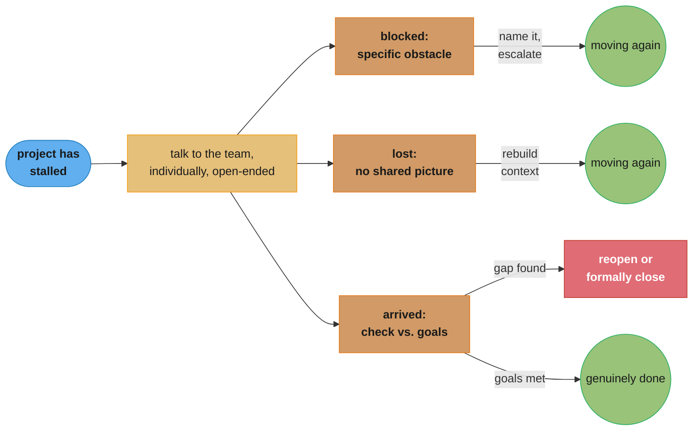

# Chapter 6: Why Have We Stopped?

> Part II — Execution · The Staff Engineer's Path (Reilly, 1st ed., O'Reilly 2022) · builds on Ch 5 (leading big projects), closes Part II, leads to Ch 7 (you're a role model now)

## Chapter Map

Chapter 5 covered how to run a big project when it's moving; Chapter 6 closes Part II with the
harder, more common case — the project that has stopped, or is quietly drifting, and nobody has
said so out loud yet. Reilly's framing separates two genuinely different failure shapes that get
lumped together as "the project is stuck": being **blocked**, where a specific, nameable obstacle
is stopping progress, and being **lost**, where there's no single obstacle but the group has lost
a shared sense of where it's going or how far along it is. The chapter then covers a third case
that isn't really a failure at all — a project that has technically **arrived**, but at a
destination that doesn't actually solve the problem it set out to solve.

**TL;DR:**
- The first job when a project has stalled is diagnosis, not motivation — figure out *which* of
  several distinct reasons it stopped before trying to fix it, because the fix for being blocked
  and the fix for being lost look nothing alike.
- Being **"stuck in traffic"** (blocked) breaks into named categories — blocked by another team,
  by an undecided decision, by a single approval, by a single person, by unassigned work, or by
  too many people needing to weigh in — each with its own targeted unblocking move.
- Being **"lost"** means the team no longer shares a clear picture of the destination, the route,
  or the current position — and the fix is re-establishing shared context, the same tool Chapter
  5 used to start a project, applied mid-project instead.
- A project that has technically **"arrived… somewhere"** — code complete but unused, built on a
  shaky foundation, or simply stopped short — is not automatically a success, and recognizing
  that requires checking the original goals, not just checking the task list.
- Restarting momentum after any of these diagnoses often needs the same small set of moves:
  investigate directly rather than assume, reduce the decision space, set a deadline, default to
  action, and celebrate the restart honestly once it happens.

## The Big Question

> A project that was moving has stopped, or is moving so slowly it might as well have. Everyone
> involved can feel it, but nobody has said so out loud, and the longer that silence lasts the
> harder the project is to restart. What's actually wrong, and what do you do about it?

Analogy: a stalled project is like a road trip where the car has stopped moving, and the first
useful question is not "how do we get moving again" but "why exactly are we stopped." Stuck in
traffic behind a specific obstacle is a completely different problem from being lost with no idea
which road you're even on — the traffic fix is patience, a detour, or clearing the obstacle; the
lost fix is pulling over and rebuilding the map from scratch. And sometimes the car actually did
arrive somewhere, just not at the destination anyone meant — which looks like success from inside
the car and only reveals itself as a wrong turn once someone checks the map against where they
actually are. Chapter 6 is a diagnostic manual for telling these apart before reaching for a fix.

---

## 6.1 You're Stuck in Traffic

"Stuck in traffic" is Reilly's name for the case where progress has stopped because of a
specific, identifiable obstacle — the project itself is fine, something concrete is in the way.
The diagnostic move that precedes any fix: **talk to the team directly, individually, with
open-ended questions**, rather than assuming you already know the obstacle from a status meeting
or a dashboard. What a project lead assumes is blocking a team and what's actually blocking them
are surprisingly often different things, and guessing wrong wastes the unblocking effort on the
wrong target.

The chapter names several recurring shapes this blockage takes, each with a different fix:

- **Blocked by another team.** A dependency owned elsewhere hasn't delivered. The fix is rarely
  "wait harder" — it's making the dependency, its owner, and its impact on your timeline visible
  enough that the other team's priorities can actually account for it, and escalating through the
  RACI structure from Chapter 5 if visibility alone doesn't move it.
- **Blocked by a decision.** Nobody has committed to an answer on something the project needs
  settled. The chapter's fix, echoing Chapter 5's "not deciding is a decision": set a deadline for
  the decision, reduce the options under consideration to two or three real candidates, prefer a
  reversible choice over a perfect one, and escalate to someone with the authority to break the
  tie if the group genuinely can't.
- **Blocked by a single button click** — the chapter's blunt name for the case where the actual
  obstacle is absurdly small: one person's sign-off, one deployment approval, one merge — but
  that person is unavailable, unaware they're the bottleneck, or simply hasn't gotten to it. The
  fix is making the ask specific, visible, and easy to act on, rather than assuming the small size
  of the ask means it will happen on its own.
- **Blocked by a single person.** Broader than the button-click case — one person, through
  unavailability, disagreement, or simply being overloaded, is the bottleneck for an entire
  workstream. The fix ranges from redistributing the load to escalating a genuine disagreement,
  depending on which underlying problem is actually causing it.
- **Blocked by unassigned work.** Nobody owns a piece of the project, so it isn't happening,
  and — critically — nobody is reporting it as blocked, because "unowned" doesn't show up on
  anyone's status report the way "blocked" does. The fix is the RACI gap this represents: name an
  owner, even if that owner is you temporarily.
- **Blocked by a huge crowd of people.** The inverse of the single-person case — too many people
  need to weigh in on a decision or a change for consensus to converge in reasonable time. The fix
  is narrowing the decision-making group deliberately (who's actually Accountable, per the RACI
  matrix, versus who's merely Consulted) rather than trying to satisfy everyone before moving.

### Broken form, then the fix

**Broken:** a project lead notices a workstream has stalled and, without investigating, assumes
the team is simply slow, and starts sending status-check pings that only add friction without
addressing anything. The real cause — a single required approval sitting in another director's
inbox for three weeks — never surfaces because nobody asked directly.

**Fix:** the lead has a short, individual, open-ended conversation with the workstream's engineer
("what's actually stopping you from moving on this?") and immediately identifies the specific
blocker. The fix is a two-line message to the right person naming exactly what's needed and by
when — a targeted unblock instead of generalized pressure that never touched the real obstacle.

---

## 6.2 You're Lost

Being lost is a different failure than being blocked: there's no single obstacle to point to, but
the team has lost a shared, working sense of the project's state. The chapter names three distinct
flavors of lost, and — as with the blocked categories — mistaking one for another wastes the fix:

- **You don't know where you're all going.** The goals have drifted, been forgotten, or were
  never actually shared consistently across the team — different people are quietly optimizing
  for different definitions of "done."
- **You don't know how to get there.** The destination is still agreed on, but the path to it
  isn't — the team has hit a genuine, unsolved technical or organizational question about how to
  proceed, distinct from simply being blocked on a known, specific obstacle.
- **You don't know where you stand.** Even with a shared goal and a plausible path, nobody has an
  accurate read on current progress — status has drifted out of sync with reality, often because
  status reporting stopped happening honestly once things started going less smoothly.

The fix for all three routes back through the same tool Chapter 5 used to *start* a project:
rebuild shared context. Re-articulate the goals out loud and check that everyone still agrees with
them (fixing the first kind of lost); bring the team back into an explicit explore-and-clarify pass
on the open technical question rather than continuing to push forward on an unclear path (fixing
the second); and get an honest, current status — through the same direct, individual
conversations used for diagnosing a blockage — rather than trusting a stale dashboard or an
optimistic status report (fixing the third). Being lost mid-project is, in this sense, not a
different problem from starting a project ambiguous — it's the same problem recurring, and it
responds to the same medicine.

---

## 6.3 You Have Arrived… Somewhere?

The third case is the one most likely to be missed entirely, because it doesn't look like a
stalled project — work visibly happened, and something got produced. The chapter's warning is
that arriving is not the same as arriving *correctly*, and it names several ways a project can
technically conclude without actually succeeding:

- **"But it's code complete!"** The code is written and merged, and the team considers the project
  done — but code complete is an implementation milestone, not the project's actual goal from
  Chapter 5's context-building. A project can be code complete and still have delivered nothing of
  the value it was funded to deliver.
- **It's done, but nobody is using it.** The thing shipped, but adoption never happened —
  frequently a sign that the "customer needs" step of building context (Ch 5, §5.2) was skipped or
  wrong, and the project solved a problem nobody with the power to adopt it actually had.
- **It's built on a shaky foundation.** The visible feature works, but it rests on a compromise,
  workaround, or piece of technical debt that was accepted to hit a deadline and never revisited —
  the project "shipped" while quietly deferring its hardest problem, the same pitfall Chapter 5
  names for design (deferring the hard part to a phase two that never comes).
- **The project just stops here.** Momentum simply runs out — the team drifts onto other
  priorities, the sponsor's attention moves elsewhere, and nobody makes an explicit decision to
  either finish or formally close the project; it just quietly stops being anyone's active concern.

The chapter's guidance for all four: check arrival against the *original goals* from Chapter 5's
context-building, not against the task list — a task list can show 100% complete while the
success metrics defined at the start show nothing achieved. Where the check reveals a genuine gap,
the response is the same toolkit as everywhere else in this chapter: diagnose specifically (is
this a blocked case, a lost case, or a genuinely finished-but-wrong-destination case), and treat
"we need to keep going" or "we need to formally close this and call it what it is" as equally
valid, deliberate outcomes — the failure mode the chapter warns against is not either of those
outcomes, it's drifting into neither.

---

## Beyond the book — ADRs and postmortems as adjacent close-out tools

> This section is the summarizer's addition. Chapter 6 does not name Architecture Decision
> Records or postmortem templates explicitly; it develops its own diagnostic categories as
> described above. The tools below are included because they formalize practices that echo the
> chapter's diagnostic instinct, and readers may recognize the pattern from adjacent literature.

An **Architecture Decision Record (ADR)** — a short, dated document recording a decision, its
context, and its consequences — is a natural companion to §6.1's "blocked by a decision" case: it
gives the decision a deadline-shaped artifact (a document that must eventually be written) and a
durable record for later, when someone needs to understand why the team went one way instead of
another. A lightweight **postmortem**, ordinarily associated with an incident rather than a
stalled project, maps closely onto §6.3's "arrived somewhere" cases — the same blameless,
investigate-what-actually-happened discipline (see this repo's incident-communication material)
applies just as well to asking why a shipped project isn't being used as it does to asking why a
service went down.

---

## Visual Intuition



Caption: three genuinely different diagnoses share one entry point — a direct, individual
conversation — but diverge sharply afterward; applying the blocked-team fix to a lost team (or
vice versa) burns effort on the wrong problem.

```
  the six "stuck in traffic" categories, by where the bottleneck sits

  another team    [ your team ]---X---[ their team ]        fix: visibility + escalation
  a decision      [ options open ]---X---[ no owner/deadline] fix: deadline, narrow, reversible
  a button click  [ everything ready ]---X---[ one approval ] fix: specific, visible ask
  a single person [ everyone else ]---X---[ one bottleneck ]  fix: redistribute or escalate
  unassigned work [ work exists ]---X---[ no owner at all ]   fix: name an owner (RACI gap)
  a huge crowd    [ decision needed ]---X---[ too many voices]fix: narrow to Accountable owner

  X marks where the fix must be aimed — every category needs a DIFFERENT X targeted
```

Caption: all six look like "the project is stuck" from the outside, but the actual obstacle sits
in a different place in each row — the diagnostic conversation in §6.1 exists to locate which row
you're actually in before spending effort on a fix.

---

## Key Concepts Glossary

- **Stuck in traffic** — the chapter's name for a project blocked by a specific, identifiable
  obstacle, as opposed to a project that is lost.
- **Blocked by another team** — a dependency owned elsewhere hasn't delivered; fixed with
  visibility and escalation, not passive waiting.
- **Blocked by a decision** — an undecided question is stopping progress; fixed with a deadline, a
  narrowed option set, and a preference for reversible choices.
- **Blocked by a single button click** — the smallest-scale blockage: one pending approval or
  sign-off, unblocked with a specific, visible, actionable ask.
- **Blocked by a single person** — one person's unavailability, disagreement, or overload stops an
  entire workstream.
- **Blocked by unassigned work** — a piece of work has no owner, so it silently doesn't happen and
  isn't reported as blocked.
- **Blocked by a huge crowd of people** — too many required voices prevent consensus from
  converging; fixed by narrowing to who's actually Accountable.
- **Lost** — the team has no single obstacle but has lost a shared sense of destination, path, or
  current position.
- **"You don't know where you're all going"** — the goals have drifted or were never consistently
  shared.
- **"You don't know how to get there"** — the destination is agreed, but the path to it is a
  genuinely open question.
- **"You don't know where you stand"** — status has drifted out of sync with reality.
- **Code complete** — an implementation milestone, distinct from the project's actual goal being
  achieved.
- **Shaky foundation** — a project that shipped its visible feature on top of an unresolved,
  deferred technical compromise.
- **"The project just stops here"** — momentum runs out with no explicit decision to finish or
  formally close the project.
- **Diagnostic conversation** — a direct, individual, open-ended conversation used to locate the
  real obstacle before applying a fix, rather than assuming it from a status report.

---

## Tradeoffs & Decision Tables

| Failure shape | What's actually wrong | Chapter's fix |
|---|---|---|
| Blocked by another team | Dependency owned elsewhere hasn't delivered | Visibility on impact + escalation through RACI |
| Blocked by a decision | No owner/deadline on an open question | Deadline, narrow options, prefer reversible |
| Blocked by a button click | One small pending approval | Specific, visible, easy-to-act-on ask |
| Blocked by a single person | One person is the bottleneck for everything | Redistribute load or escalate the underlying cause |
| Blocked by unassigned work | Nobody owns a piece of the project | Name an owner explicitly (fix the RACI gap) |
| Blocked by a crowd | Too many required voices for consensus | Narrow to who's actually Accountable |
| Lost — goals | Team no longer shares the destination | Re-articulate goals, confirm agreement |
| Lost — path | Destination agreed, route genuinely unknown | Explicit re-explore/clarify pass |
| Lost — status | Reported status diverged from reality | Direct, individual, honest status check |

| "Arrived" outcome | Looks like | Actually is | Check against |
|---|---|---|---|
| Code complete | Success | Implementation milestone only | Original success metrics (Ch 5, §5.2) |
| Shipped, unused | Success | Adoption failure | Original customer-needs analysis |
| Shaky foundation | Success | Deferred hard part, unresolved | Whether the deferred piece was ever revisited |
| Project just stops | Neutral | Unowned drift, no decision made | Whether anyone explicitly closed or reopened it |

| Response style to a stall | Effectiveness | Why |
|---|---|---|
| Generic status-check pressure | Low | Doesn't address the real, specific obstacle |
| Direct, individual, open-ended conversation | High | Surfaces the actual blocker before spending fix effort |
| Assuming the cause from a dashboard | Low | Dashboards show symptoms, not root causes |

---

## Common Pitfalls / War Stories

- **Applying the wrong fix to the right diagnosis.** A team that's actually lost gets treated as
  blocked — someone tries to "unblock" a decision that was never really the problem, while the
  deeper issue (no shared sense of the goal) goes unaddressed and the project stalls again shortly
  after the false fix.
- **The invisible "unassigned work" blockage.** A piece of work with no owner doesn't get reported
  as blocked, because nobody's status report covers it — it's simply absent, which makes it one of
  the harder blockages to notice without the direct, individual conversations the chapter
  recommends.
- **Mistaking code complete for done.** A team declares victory once the code merges, without
  checking it against the success metrics defined at the project's start — only for a stakeholder
  to point out, weeks later, that the actual goal was never met.
- **A shaky foundation nobody revisits.** A compromise accepted to hit a deadline becomes
  permanent by default, because "done" was declared the moment the visible feature shipped and
  nothing forced a return to the deferred piece.
- **Status pressure instead of status investigation.** Repeated "any update?" pings add friction
  without ever asking the open-ended question that would surface the real obstacle — the team
  feels micromanaged, and the actual blocker stays unaddressed.
- **A crowd-blocked decision mistaken for a hard technical problem.** The team assumes a stalled
  decision reflects genuine technical difficulty, when the real issue is simply too many required
  approvers with no clear Accountable owner — narrowing the decision-making group unblocks it
  immediately once correctly diagnosed.
- **A project that stops with no formal close.** Momentum quietly evaporates, the team drifts to
  other work, and months later nobody can say whether the project is paused, abandoned, or still
  technically active — an outcome the chapter treats as worse than an explicit decision either way.

---

## Real-World Systems Referenced

Chapter 6, like Chapter 4, stays close to individual and team practice rather than naming specific
companies or products; its diagnostic categories (the six "stuck in traffic" shapes, the three
"lost" shapes, the four "arrived somewhere" shapes) are Reilly's own taxonomy, built from
staff-engineering experience across the companies named in the book's introduction — Google,
Squarespace, and Fastly. The chapter's closing move, celebrating a restart honestly once momentum
returns, draws on the same communication discipline as Chapter 5's impact-framed status reporting
rather than referencing a specific named framework or tool.

---

## Summary

A stalled project is not one problem but at least three different ones wearing the same symptom,
and diagnosing which one you're facing — through direct, individual, open-ended conversations
rather than assumption — has to come before any fix. Being blocked means a specific, nameable
obstacle is in the way, and the chapter's six named shapes (another team, a decision, a button
click, a single person, unassigned work, or too large a crowd) each need a different targeted
unblock, most of them rooted in the same structural tools Chapter 5 introduced (RACI, escalation,
deadlines on decisions). Being lost means there's no single obstacle, but the team has lost a
shared picture of the goal, the path, or the current status — and the fix is rebuilding context,
the same tool used to start a project in the first place. A project that has technically arrived
still needs to be checked against its original goals, not its task list, because code complete,
shipped-but-unused, and built-on-a-shaky-foundation can all look like success from the inside
while missing the point the project was funded to address. Closing Part II on this chapter is
deliberate: leading a big project well, per Chapters 4 through 6 together, means choosing it
carefully, running it with real structure and communication discipline, and being honest — with
the team and with yourself — about whether and why it has stopped, so it can either restart with
real momentum or be closed out on purpose rather than by drift.

---

## Interview Questions

**Q: Why does the chapter insist on diagnosing "why" a project stalled before trying to fix it?**
**Short:** Being blocked and being lost need completely different fixes, so a wrong diagnosis wastes effort.
A stalled project can be blocked by a specific obstacle, lost with no shared sense of direction, or technically finished at the wrong destination — and the fix for one (escalating a blocker) does nothing for another (rebuilding shared context), so applying it without first diagnosing correctly burns effort without restoring momentum. The chapter's opening move for every case is the same: a direct, individual, open-ended conversation to find out which failure shape you're actually facing.

**Q: What's the difference between being "blocked" and being "lost," according to the chapter?**
**Short:** Blocked means a specific obstacle; lost means no shared sense of destination, path, or status.
Being blocked implies the project itself is fundamentally fine and something concrete — a dependency, a pending decision, an unassigned piece of work — is stopping it, so removing that specific thing restores progress. Being lost has no single obstacle to remove; the team has lost a shared, working picture of where it's going, how to get there, or how far along it is, and the fix is rebuilding that shared context rather than clearing an obstacle.

**Q: Why is "blocked by unassigned work" one of the harder blockages to notice?**
**Short:** Unowned work doesn't appear on anyone's status report, so it's simply absent, not flagged.
A workstream with a named owner who's stuck shows up clearly as blocked in a status update; a piece of work nobody owns at all doesn't generate a status update from anyone, because there's no one whose job it is to report on it — it just silently doesn't happen. Direct, individual conversations across the team are what surface this kind of gap, since a dashboard or aggregated status report structurally can't.

**Q: What's the recommended fix when a project is blocked by an undecided decision?**
**Short:** Set a deadline, narrow the options, and prefer a reversible choice over a perfect one.
Echoing Chapter 5's point that not deciding is itself a bad decision, the chapter's fix for a decision-blocked project is procedural: give the decision an explicit deadline, cut the option set down to two or three real candidates rather than leaving it open-ended, favor a choice that can be reversed if it turns out wrong, and escalate to someone with the authority to break the tie if the group still can't converge in time.

**Q: Why does the chapter call one blockage category "blocked by a huge crowd of people" and treat it as distinct from "blocked by a single person"?**
**Short:** Too many required voices prevents consensus, the opposite structural problem from one bottleneck.
A single-person block has one clear point of failure to redistribute or escalate; a crowd block has the opposite shape — a decision or change needs sign-off, input, or agreement from so many people that consensus can't converge in reasonable time, even though no individual person is deliberately obstructing it. The fix is narrowing who actually needs to be Accountable, per the RACI structure from Chapter 5, versus who's merely Consulted, rather than trying to satisfy every voice before moving forward.

**Q: What does "you don't know where you're all going" mean as a specific kind of lost, and how do you fix it?**
**Short:** The team's shared goal has drifted or was never consistently agreed on; fix by re-stating it aloud.
Different people on the project can quietly be optimizing toward different, unstated definitions of "done," a drift that happens gradually enough that nobody notices it as a single event. The fix is re-articulating the goals explicitly, out loud, to the whole group, and checking that everyone still actually agrees — the same context-building move Chapter 5 uses at a project's start, applied again mid-project once the shared picture has eroded.

**Q: Why does the chapter warn that "code complete" is not the same as done?**
**Short:** Code complete is an implementation milestone; the project's real goal may still be unmet.
A team can merge all the planned code and consider the project finished, while the actual success metrics defined during context-building (Chapter 5, §5.2) — adoption, a measurable outcome, a solved customer problem — remain unaddressed. Checking arrival against the original goals rather than the task list is what catches this gap before the project is prematurely declared a success.

**Q: What's the "shipped but nobody is using it" failure, and what earlier step does it usually trace back to?**
**Short:** It usually traces back to a skipped or wrong customer-needs analysis during context-building.
A project can complete its planned implementation and still fail to gain adoption if the original customer-needs step from Chapter 5 was skipped, or if it identified a problem nobody with the power to adopt the solution actually had. Recognizing this as a distinct failure — rather than filing it under "successfully shipped" — is what prompts investigating the adoption gap instead of moving on.

**Q: What is a "shaky foundation," and how does it connect to a pitfall named in Chapter 5?**
**Short:** A visible feature shipped on top of a deferred hard part that was never revisited — Ch 5's "phase two."
It's the same failure Chapter 5 warns about at the design stage — deferring the genuinely difficult piece to a "phase two" that quietly never gets funded — showing up at the arrival stage instead: the feature works and looks complete, but it rests on a compromise or workaround accepted under deadline pressure that was never subsequently fixed. The chapter's guidance is to check explicitly whether the deferred piece was ever actually revisited, not just whether the visible feature works.

**Q: Why does the chapter treat "the project just stops here" as worse than either finishing or explicitly killing it?**
**Short:** Silent drift with no formal decision is worse than either explicit outcome, per the chapter.
When momentum simply evaporates — the team drifts onto other priorities, the sponsor's attention moves on — without anyone making an explicit call to finish or formally close the project, nobody can later say with confidence whether it's paused, abandoned, or still technically active. The chapter treats deliberately deciding to keep going or deliberately deciding to close it as equally valid outcomes; drifting into neither is the actual failure mode.

**Q: Why does the chapter recommend individual, open-ended conversations over reading a status dashboard when diagnosing a stall?**
**Short:** Dashboards show symptoms; individual conversations surface the actual, specific cause.
A dashboard or aggregated status report can show that a workstream isn't progressing, but it can't distinguish whether that's because of a specific external blocker, a lost shared understanding, or an unowned gap in the plan — those all look identical from outside. A direct, individual, open-ended conversation with the people actually doing the work is what surfaces which failure shape is really happening, which is the necessary first step before any fix.

**Q: How does "blocked by another team" get fixed, and why isn't "wait longer" sufficient?**
**Short:** Make the dependency and its impact visible, then escalate — passive waiting doesn't move it.
A dependency owned by another team often isn't visible to that team as urgent, because they don't see the downstream impact on your timeline the way you do — simply waiting assumes they already understand the priority, which is often false. The fix is making the dependency, its owner, and its concrete impact on your schedule explicit and visible, and escalating through the RACI structure from Chapter 5 if that visibility alone doesn't move the other team's priorities.

**Q: What does the chapter mean by "blocked by a single button click," and why give such a small obstacle its own category?**
**Short:** Naming trivially small blockers keeps them from being assumed away as "surely handled by now."
A pending approval, sign-off, or single merge can stall a project for weeks not because it's hard to resolve, but because everyone assumes something that small will happen on its own, so nobody makes the ask specific and visible. Giving it a named category is a reminder that the size of an obstacle has nothing to do with how much it can stall a project, and that the fix — a direct, specific, easy-to-act-on request to the right person — is usually just as small as the obstacle itself.

**Q: Why does closing Part II on this chapter make sense, structurally, given Chapters 4 and 5?**
**Short:** Choosing well (Ch 4), running well (Ch 5), and diagnosing honestly (Ch 6) form one complete execution loop.
Chapter 4 is about deliberately choosing what to work on; Chapter 5 is about giving a chosen project real structure and driving it; Chapter 6 closes the loop by being honest about whether that structure and effort are actually producing progress, and diagnosing precisely why when they're not. Together they form the full execution cycle Part II is named for — choose carefully, execute with discipline, and recognize honestly when execution has stalled — before Part III shifts to the different subject of scaling your influence once you're consistently executing well.

**Q: What role does the chapter's "arrived somewhere" check play that a simple task-completion checklist doesn't?**
**Short:** It checks the outcome against the original goals, which a checklist of tasks structurally can't do.
A task checklist can show every planned item complete while the project still fails to deliver its actual value — the checklist only verifies that planned work happened, not that the work achieved what it was meant to. Checking arrival against the goals, success metrics, and customer needs established during Chapter 5's context-building step is what catches code-complete-but-not-done, shipped-but-unused, and shaky-foundation outcomes that a task list alone would mark as fully successful.

---

## Cross-links in this repo

- [soft_skills/difficult_conversations_and_conflict/ — the interpersonal skill behind the "single person" and "crowd" blockage fixes](../../../soft_skills/difficult_conversations_and_conflict/difficult_conversations_and_conflict.md)
- [soft_skills/incident_communication_and_postmortems/ — the blameless-investigation discipline this chapter's diagnostic conversations echo](../../../soft_skills/incident_communication_and_postmortems/incident_communication_and_postmortems.md)
- [soft_skills/technical_leadership_and_execution/ — restoring momentum on a stalled cross-team initiative](../../../soft_skills/technical_leadership_and_execution/technical_leadership_and_execution.md)
- [devops/incident_management_and_oncall/ — structured diagnosis and escalation practice for a "blocked" system in production terms](../../../devops/incident_management_and_oncall/incident_management_and_oncall.md)
- [devops/sre_principles_and_slos/ — checking outcomes against defined success criteria, the engineering-ops analog of §6.3's arrival check](../../../devops/sre_principles_and_slos/sre_principles_and_slos.md)
- Sibling chapters: [Ch 5 Leading Big Projects](../05_leading_big_projects/05_leading_big_projects.md) · [Ch 7 You're a Role Model Now (Sorry)](../07_youre_a_role_model_now/07_youre_a_role_model_now.md) · [Ch 8 Good Influence at Scale](../08_good_influence_at_scale/08_good_influence_at_scale.md)

## Further Reading

- Reilly, Tanya. *The Staff Engineer's Path: A Guide for Individual Contributors Navigating
  Growth and Change*, 1st ed., O'Reilly, 2022 — Chapter 6, "Why Have We Stopped?"
- The chapter's diagnostic categories build directly on Chapter 5's RACI and decision-making
  tools; reading the two chapters together is the book's own intended sequence.
- Readers interested in the adjacent, more formal tools noted above (ADRs, blameless postmortems)
  can consult general software-engineering process literature — the chapter itself does not name
  either by title.
