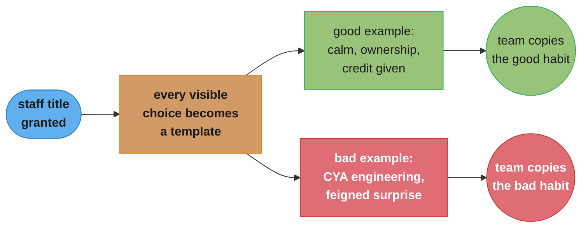
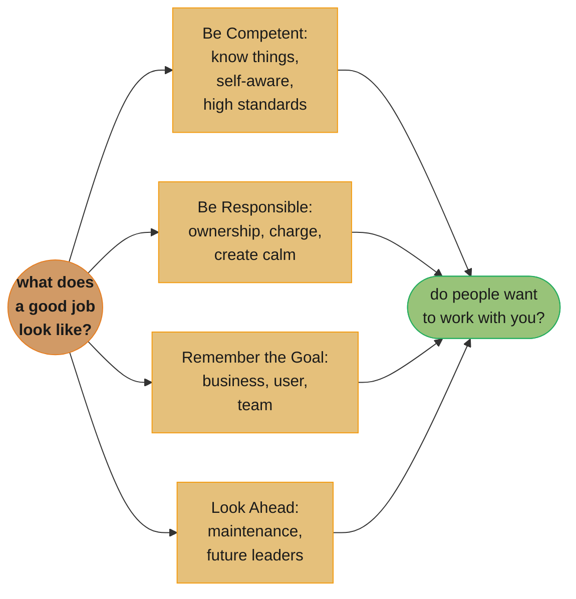

# Chapter 7: You're a Role Model Now (Sorry)

> Part III — Leveling Up · The Staff Engineer's Path (Reilly, 1st ed., O'Reilly 2022) · builds on Ch 6 (why a stalled project stalls), leads to Ch 8 (turning that visibility into scaled influence)

## Chapter Map

Parts I and II were about the work: seeing the big picture, running big projects, unsticking
stalled ones. Part III turns to something no staff engineer opts into — the job title itself
changes how other people read your behavior. Reilly opens the chapter with a friend's warning,
Carla Geisser's "Don't think out loud" — because a staff engineer's half-formed idea, said aloud
in a meeting, doesn't stay half-formed; a month later, people are treating it as an already-funded
project. The chapter's argument is that this isn't a special extra duty you can decline. It is a
structural fact of the title: **engineering norms are set by the behavior of the most respected
engineers on the project**, whether or not those engineers wanted to be setting them.

**TL;DR:**
- **You are a role model whether you want to be or not.** Titles carry implicit authority;
  whatever a staff engineer visibly does — including small, unglamorous choices — becomes a
  template other engineers copy, because **values are what you do**, not what's written on a wall.
- The chapter answers "what does doing a good job actually look like at this level?" with four
  attributes: **be competent** (know things, be self-aware, have high standards), **be
  responsible** (take ownership, take charge, create calm), **remember the goal** (there's a
  business, a user, a team behind the code), and **look ahead** (optimize for the system's whole
  lifetime, not just the day it ships).
- Several named anti-patterns recur across the four attributes — **Cover Your Ass (CYA)
  Engineering** (the opposite of taking ownership) and **Feigned Surprise** (the opposite of
  making it safe to ask questions) — each paired with the behavior Reilly says replaces it.
- The chapter's own closing metric for career success is not a title or a level: **"the degree to
  which other people want to work with you."**

## The Big Question

> "Don't think out loud," Carla Geisser warned Reilly when she became a staff engineer. "You'll
> find out a month later that people are talking about your half-baked idea like it's already a
> project."

How do you do good work when your job title has quietly turned every visible choice you make into
an example other people will copy? A junior engineer's sloppy shortcut stays local — a peer might
not even notice. A staff engineer's sloppy shortcut is a demonstration: it teaches everyone
watching that shortcuts are how this is done here. The chapter's analogy is architectural, not
motivational — a staff engineer is less like a coach giving instructions from the sideline and
more like a load-bearing wall that everyone else's renovations quietly depend on, whether it was
built to be one or not. You cannot opt out of being load-bearing once the title says you are; you
can only decide what kind of load-bearing wall to be.

---

## 7.1 What Does It Mean to Do a Good Job?

The chapter's opening move is to establish that being a role model is not optional cosplay for
extroverted staff engineers who enjoy the spotlight — it is a mechanical consequence of the title.
Reilly's framing: managers are formally responsible for setting culture and enforcing standards on
their teams, but the actual **engineering norms** — what "good" code, "good" review, "good"
incident response look like in practice — are set by the behavior of whichever engineers the rest
of the team most respects. A staff title makes you one of those engineers by default, regardless
of whether you asked for the influence.

### Values Are What You Do

A company's stated values are words on a wiki page; its **actual** values are visible in what
gets rewarded. Reilly's version of this: the clearest signal of what an organization values is
**what gets people promoted** — not the values deck, the promotion committee's actual decisions.
The same logic applies one level down, to an individual staff engineer: your team does not learn
your values from what you say you believe in a retro. They learn it from which pull requests you
approve, which corners you visibly cut under deadline pressure, and which corners you refuse to
cut even when it costs you a day. If a staff engineer says "we value quality" and then ships an
untested hotfix at 6pm on a Friday without comment, the team learns the second thing, not the
first — **actions are the only values statement that actually propagates.**

### But I Don't Want to Be a Role Model!

The reassurance half of the argument: being a role model does not require becoming a public
figure, giving conference talks, or leading loudly. Reilly's point is that role-modeling can be
quiet and incremental — a staff engineer who consistently writes clear PR descriptions, asks
thoughtful questions in review, and stays calm during an incident is role-modeling just as
powerfully as one who runs all-hands meetings. **"The more you practice, the easier it will be"**
— leadership behaviors (giving credit publicly, mentoring one person at a time, making a good
decision under uncertainty) are skills that improve with repetition like any other, not innate
traits some engineers have and others lack. The rest of the chapter is Reilly's answer to "practice
what, specifically?" — the four attributes below.

---

## 7.2 Be Competent

Competence, in Reilly's frame, is not raw technical brilliance — it is three learnable habits:
knowing things, being honest about the limits of what you know, and holding your own work to a
standard worth copying.

### Know Things

**Build experience.** There's no substitute for hands-on time — reading about a technology and
having shipped, debugged, and been paged for it produce different kinds of knowledge, and a staff
engineer's credibility rests on having enough of the second kind to be trusted with ambiguous
problems.

**Are You "Technical Enough"?** Reilly singles this phrase out as a trap. "Not technical enough"
sounds like a diagnosis, but it identifies no specific gap and offers no path forward. The fix is
to force the vague label into a concrete question: *have they not spent enough years doing
hands-on technical work? do they not yet know this specific domain? are they missing a specific,
nameable skill?* Only the concrete version is actionable — as feedback to someone else, or as a
self-assessment.

**Build domain knowledge, stay up to date, show that you're learning.** Domain knowledge — the
specifics of *this* business, *this* codebase, *this* set of constraints — is inseparable from
technical competence at the staff level; a brilliant generalist who doesn't know why the billing
service has three retry layers will make confidently wrong recommendations. Staying current and
visibly continuing to learn (asking questions in public, trying new tools) is itself a signal:
it demonstrates that competence is a practice, not a certificate earned once.

### Be Self-Aware

**Admit what you know. Admit what you don't know.** Overclaiming expertise erodes trust faster
than admitting a gap — and admitting a gap from a staff engineer gives everyone else permission
to do the same.

**Understand your own context.** The chapter's sharpest observation here inverts a common
assumption: *"It's much harder to explain something simply"* — simplifying a topic for someone
outside your specialty requires **more** understanding of it, not less, because you have to know
which details are load-bearing and which are incidental. Jargon-heavy explanations often signal
incomplete understanding dressed up as expertise, not the reverse.

### Have High Standards

**Seek out constructive criticism.** Reilly plays on the RFC acronym directly: when you "request
comments," don't secretly resent getting them — treat each one as a chance to improve the design,
not an attack. **"Your solutions are not you and they don't define you. Criticism of your work
isn't criticism of you."** — the standard-setting move here is separating ego from output, because
an engineer who visibly bristles at feedback teaches the whole team to stop giving it.

**Own your mistakes, be reliable.** When something you did breaks, the standard-setting response
is: admit what happened, fix it, communicate quickly and clearly so everyone has what they need.
**Be reliable** — be the kind of engineer people trust to actually finish what they say they will,
because reliability is the substrate all the other trust in this chapter is built on.

```
BROKEN                                    FIX (Reilly's standard)

review comment lands ->                   review comment lands ->
  defensiveness, "well actually..." ->      treat it as free design review ->
  reviewer stops commenting ->              reviewer keeps commenting ->
  bugs ship uncaught                        bugs caught before merge

  the review pipeline silently                the review pipeline stays a
  degrades to a rubber stamp                   real second pair of eyes
```

Caption: the broken form isn't a bug in the review tool — it's a learned response that trains
reviewers to stop reviewing; "seek out constructive criticism" is the one-sentence fix.

---

## 7.3 Be Responsible

Where "be competent" is about your own knowledge, "be responsible" is about how you act on it when
something needs deciding, someone needs to step up, or something has gone wrong.

### Take Ownership

**Make decisions.** Staff engineers are expected to weigh the options, choose decisively, and
explain the reasoning — not to escalate every ambiguous call upward, and not to hide behind
"it depends" indefinitely.

**Ask "obvious" questions.** A staff engineer asking a question the room assumes is obvious does
two things at once: it surfaces a genuine gap (often shared silently by several other people in
the room), and it models that asking is safe, which matters more the more senior the asker is.

**Don't delegate through neglect.** The named anti-pattern here is **Cover Your Ass (CYA)
Engineering** — technically doing your job while ensuring that if anything goes wrong, the blame
lands somewhere else: over-escalating trivial decisions, insisting on written sign-off for
everything, staying silent about a risk you noticed so it's "not your fault" later. The
replacement behavior is **radiating intent**: stating what you're about to do and why, out loud
or in writing, *before* you do it, so colleagues can object if something's wrong — without waiting
for permission you don't actually need. Radiating intent takes ownership visibly; CYA Engineering
diffuses it invisibly.

### Take Charge

**Step up in an emergency; ask for more information when everyone is confused; drive meetings; if
you see something, say something.** In a crisis or a stalled discussion, someone has to actually
take charge rather than waiting for consensus to spontaneously form — and a staff engineer is
expected to be someone who will.

**Feigned Surprise.** This is the chapter's second named anti-pattern: responding to a genuine
question with theatrical disbelief — *"You've seriously never used Linux?"* — which does nothing
except punish the person for asking and teach everyone watching to stop asking questions in front
of you. Reilly's fix mirrors "ask obvious questions" above: normalize the question instead of
performing surprise at it, because the cost of one person feeling briefly embarrassed is far
smaller than the cost of a team that has learned silence is safer than curiosity.

### Create Calm

**Defuse, don't amplify; avoid blame; be consistent.** During an incident or a tense discussion,
a staff engineer's visible emotional state becomes contagious — panic in the room amplifies panic
in the room, and calm, procedural focus does the same in the other direction. **Being
consistent and predictable** — behaving the same way under pressure as under none — is itself a
form of psychological safety: colleagues who know what to expect from you can plan around you,
which is a kind of calm all on its own.

| Anti-pattern | What it looks like | Reilly's replacement |
|---|---|---|
| Cover Your Ass (CYA) Engineering | Over-escalating trivial calls, demanding sign-off, staying silent on a risk so it's "not your fault" | Radiating intent — state what you're about to do and why, before doing it |
| Feigned Surprise | "You've seriously never used X?" | Treat the question as normal; answer it |
| Amplifying panic | Matching or escalating the room's anxiety during an incident | Defuse — stay calm and procedural; it's contagious in both directions |

---

## 7.4 Remember the Goal

The third attribute pulls the frame back out from "am I doing good engineering" to "what is the
engineering *for*." Reilly's summary line: **"the software is the means to those ends, not an end
in itself."**

### Remember There's a Business

**Adapt to the situation; be aware that there's a budget; spend resources mindfully.** Every
engineering decision competes for a finite budget of time, money, and — the chapter's sharpest
phrase for this — **innovation tokens**: an organization can only absorb so much novelty (new
languages, new infra, new architecture patterns) before the unfamiliarity itself becomes the
biggest source of risk. Spending an innovation token on a genuinely differentiating problem is
worth it; spending one reinventing a solved problem (a queue, an auth layer) usually isn't. **"Build
the most useful thing, not the thing that would be most fun to build."**

### Remember There's a User

A design that is elegant from the engineering side and confusing or slow from the user's side has
still failed — competence in the abstract doesn't substitute for checking what the person on the
other end of the system actually experiences.

### Remember There's a Team

The engineering isn't happening in isolation either: a technically optimal solution that no one on
the team can maintain, understand, or extend is a worse outcome than a slightly less optimal one
the team can actually own going forward.

---

## 7.5 Look Ahead

The fourth attribute is the chapter's most concrete: software outlives the sprint it was written
in, so a staff engineer's job includes optimizing for a future the current team may not be around
to see. **"Software engineering is programming integrated over time"** — Reilly's version of the
standard distinction between writing code and engineering a system that survives years of change.
**"Don't optimize for now at the cost of future velocity."**

### Anticipate What You'll Wish You'd Done

**Telegraph what's coming.** Announce a deprecation or migration before it lands, so teams
downstream aren't caught rebuilding on something about to disappear.

**Tidy up; keep your tools sharp.** Leave the system in a state a stranger could pick up: tests
passing, style consistent, gotchas documented. Investing in build speed, deploy reliability, and
test stability pays back every single day afterward, which is exactly why it's easy to
under-invest in under deadline pressure — the payoff is diffuse and future, the cost is immediate.

**Create institutional memory.** Every departure quietly deletes tribal knowledge from the
organization; the fix is writing down *why*, not just *what* — decisions, their context, and their
rejected alternatives — with keywords a future search will actually surface, so the reasoning
survives the person who had it in their head.

### Expect Failure

Things will break in ways nobody predicted. Preparation means testing error paths deliberately,
building monitoring before you need it, having an incident process before the incident, and
running drills so the disaster plan is tested before the disaster is real.

### Optimize for Maintenance, Not Creation

A system spends far more of its life being maintained than being created, so Reilly's advice is
to optimize for the majority phase, not the minority one.

**Make it understandable.** *"Any fool can write code that a computer can understand. Good
programmers write code that humans can understand."* Documentation and observability let a future
engineer understand the system without needing the original author in the room.

**Keep it simple.** *"Really, what we should want are simple solutions to complex problems. The
complexity of our work is a cost to bear, not something to maximize!"* — inherent complexity
(the problem itself) should be isolated so it doesn't leak into everything that touches it;
accidental complexity (the solution's own cleverness) should be removed outright.

**Build to decommission.** Design with clean interfaces and real modularity from the start, so
that when the component's time is up, replacing it is a bounded, plannable project rather than an
archaeological dig.

### Create Future Leaders

Junior engineers become senior engineers by being handed real, hands-on opportunities to learn —
not by watching a staff engineer solve every hard problem before anyone else gets a turn. Reilly
ties this directly back to the chapter's closing claim: **"The degree to which other people want
to work with you is a direct indication of how successful you'll be in your career as an
engineer."**

---

## Visual Intuition



Caption: the chapter's central mechanism — a staff title doesn't add a role-modeling *duty*, it
turns ordinary visible behavior into a template by default; the only real choice left is which
template you're setting.



Caption: Reilly's four attributes are not a checklist to complete once — they converge on a single
recurring test the chapter closes with: whether other people want to work with you.

---

## Key Concepts Glossary

- **Role model (staff engineer)** — an engineer whose title alone gives their visible behavior
  outsized influence over what the team treats as normal.
- **Values are what you do** — an organization's or an individual's real values are legible only
  in behavior and what gets rewarded, not in stated principles.
- **Radiating intent** — stating what you're about to do and why before doing it, so others can
  object, instead of waiting for permission.
- **Cover Your Ass (CYA) Engineering** — technically doing the job while structuring your actions
  so blame lands elsewhere if something goes wrong; the anti-pattern radiating intent replaces.
- **Feigned Surprise** — theatrical disbelief at a genuine question, which teaches people to stop
  asking; the anti-pattern "ask obvious questions" and "take charge" push against.
- **Create Calm** — staying procedurally calm during an incident or tense discussion, because
  panic and calm both propagate to everyone watching.
- **Innovation tokens** — an organization's finite tolerance for novelty; spend them on what
  actually differentiates the business, not on reinventing solved problems.
- **Telegraphing** — announcing an upcoming deprecation or migration before it lands, so
  downstream teams aren't caught building on something about to disappear.
- **Institutional memory** — written context (decisions, reasoning, rejected alternatives) that
  survives the departure of the person who had it in their head.
- **Optimize for maintenance, not creation** — designing and documenting for the system's much
  longer maintenance phase rather than only its creation moment.
- **Build to decommission** — designing with clean, modular interfaces so eventual replacement is
  a plannable project, not an archaeology dig.
- **Are you "technical enough"?** — a flagged vague-feedback trap; the fix is forcing it into a
  specific, actionable claim about experience, domain knowledge, or a named skill.

---

## Tradeoffs & Decision Tables

| Attribute | What it's about | Where it can go wrong if ignored |
|---|---|---|
| Be Competent | Knowing things, admitting limits, holding a high bar | Overclaiming expertise; defensive reaction to review feedback |
| Be Responsible | Owning decisions, stepping up, staying calm under pressure | CYA Engineering; feigned surprise; amplifying panic in an incident |
| Remember the Goal | Software serves a business, a user, and a team | Technically elegant work nobody asked for, or nobody can maintain |
| Look Ahead | Optimizing for the system's whole lifetime | Fast now, unmaintainable later; no institutional memory when people leave |

| Behavior under pressure | Anti-pattern | Standard-setting alternative |
|---|---|---|
| A question gets asked that "everyone should know" | Feigned Surprise | Answer it normally; treat asking as safe |
| A risky decision needs making | CYA Engineering (escalate everything, stay silent on risk) | Radiate intent; decide, explain reasoning |
| An incident is underway | Amplify the room's anxiety | Defuse; stay procedural and consistent |
| Feedback arrives on your design | Defensiveness, "well actually…" | Treat it as free design review; separate ego from output |

---

## Common Pitfalls / War Stories

- **The silent-shortcut trap.** A staff engineer who says "we value quality" but visibly ships an
  untested hotfix under deadline pressure has just taught the team the opposite lesson — the team
  learns from the shortcut, not the slogan, because values are what you do.
- **"Not technical enough" as a non-answer.** Handing someone this label as feedback gives them
  nothing to act on; it reads as a verdict rather than a diagnosis. The fix is forcing it into a
  specific claim (years of hands-on work, domain knowledge, or a named skill) before it's usable.
- **CYA Engineering disguised as diligence.** Insisting on written sign-off for every small
  decision looks like rigor but is often blame-avoidance in costume — it slows the team down while
  making the engineer doing it look, on paper, blameless.
- **Feigned Surprise from the most senior person in the room.** The more senior the person
  reacting with "you've never used X?", the more damage it does — juniors calibrate what's safe to
  ask by watching how the most respected engineers react, not by reading a values document.
- **Rushing past "tidy up" under deadline pressure.** Skipping cleanup to hit a date feels free in
  the moment; the cost lands later, on whoever inherits the system, and it lands as reduced future
  velocity rather than as a visible line item anyone notices in the moment.
- **Losing institutional memory silently.** A team that doesn't write down *why* a decision was
  made — only what was decided — re-litigates the same argument every time someone new joins,
  because the reasoning left with whoever originally had it.

---

## Real-World Systems Referenced

Reilly opens the chapter with a warning from her friend **Carla Geisser** — "Don't think out
loud" — about the outsized weight a staff engineer's casual, half-formed comments can carry.
The book's foreword is written by **Camille Fournier**, author of *The Manager's Path*, a
frequently cited companion text on engineering leadership. The chapter's "innovation tokens"
framing draws on the widely circulated industry concept of treating novelty adoption as a scarce,
spendable resource (popularized outside this book by Dan McKinley's "choose boring technology"
argument) — Reilly applies the same idea to a staff engineer's day-to-day resource-spending
decisions rather than only to technology-stack choices.

---

## Summary

Reilly's chapter argument is structural, not motivational: a staff title makes your visible
behavior a template for the team whether or not you intended it to be, because engineering norms
are set by the most respected engineers' actual conduct, not by posted values. "Values are what
you do" is the load-bearing sentence — a company's or an individual's real priorities show up in
what gets rewarded and what gets visibly tolerated, never in what gets said. Doing a good job at
staff level breaks into four learnable attributes: **being competent** (knowing things, being
honest about your limits, holding a high standard and taking feedback as a gift rather than an
attack), **being responsible** (owning decisions and radiating intent instead of practicing CYA
Engineering, stepping up instead of feigning surprise, staying calm instead of amplifying panic),
**remembering the goal** (software serves a business with a finite budget of resources and
innovation tokens, a user, and a team — not just an abstract engineering ideal), and **looking
ahead** (telegraphing change, tidying up, creating institutional memory, and optimizing for the
system's long maintenance phase rather than only its creation moment). The chapter closes on a
single test that ties all four together and doubles as its own metric for career success: whether
other people want to work with you.

---

## Interview Questions

**Q: Why does Reilly say a staff engineer can't opt out of being a role model?**
**Short:** Engineering norms are set by the most-respected engineers' visible behavior, by default.
Because titles carry implicit authority regardless of intent — the team learns what "good" looks like in practice from watching the most respected engineers on the project, not from a values document, so a staff engineer's ordinary visible choices (which shortcuts they take, how they react to a question) become a template whether or not they wanted the influence. Declining to think of yourself as a role model doesn't remove the effect; it just means you stop paying attention to what you're teaching.

**Q: What does "values are what you do" mean, and why is it the load-bearing sentence in this chapter?**
**Short:** Real values show up in behavior and what gets rewarded, never in stated principles.
A team doesn't learn its engineering values from a wiki page or a retro slogan — it learns them from which pull requests get approved, which corners get visibly cut under pressure, and which don't. If someone says "we value quality" and then ships an untested hotfix without comment, the team learns the hotfix lesson, not the quality slogan, because action is the only values statement that actually propagates through a team's behavior.

**Q: What is Cover Your Ass (CYA) Engineering, and what does Reilly say replaces it?**
**Short:** Structuring decisions so blame lands elsewhere; replaced by radiating intent.
CYA Engineering is technically doing the job while arranging things so that if something goes wrong, responsibility doesn't land on you — over-escalating trivial decisions, demanding sign-off for everything, or staying silent about a risk you noticed so it's "not your fault" later. Reilly's replacement is radiating intent: stating what you're about to do and why, before doing it, so colleagues have a chance to object — it takes ownership visibly instead of diffusing it invisibly.

**Q: What is Feigned Surprise, and why does Reilly single it out as damaging?**
**Short:** Theatrical disbelief at a genuine question, which teaches people to stop asking.
Feigned Surprise is responding to a question with exaggerated disbelief — "You've seriously never used Linux?" — and it does nothing except embarrass the asker while teaching everyone else watching that asking questions in front of this person is unsafe. The damage scales with seniority: the more respected the person reacting this way, the more strongly it calibrates what junior engineers believe is safe to ask, which is exactly the mechanism the whole chapter is about.

**Q: Why does Reilly say explaining something simply requires MORE expertise, not less?**
**Short:** Simplifying requires knowing which details are load-bearing and which are incidental.
"Understand your own context" argues that jargon-heavy, hard-to-follow explanations often signal incomplete understanding dressed up as expertise, because genuinely simplifying a topic for someone outside your specialty requires more self-awareness about what you know and don't, and more understanding of which parts of the explanation actually matter. The intuition that plain language is "dumbing it down" has it backward — plain language is the harder deliverable.

**Q: What's the "not technical enough" trap, and how does Reilly say to fix it?**
**Short:** It's a vague verdict with no actionable path; force it into a specific, nameable claim.
Calling someone "not technical enough" sounds like a diagnosis but identifies no specific gap and gives the person nothing to act on. The fix is turning it into a concrete question — have they not spent enough years doing hands-on technical work, do they not yet know this specific domain, or are they missing a specific, nameable skill — because only the concrete version is useful as feedback or as honest self-assessment.

**Q: What does "seek out constructive criticism" mean in the context of code review specifically?**
**Short:** Treat every review comment as free design improvement, not a personal attack.
Reilly plays on the RFC acronym directly: when you "request comments," don't secretly resent getting them. Her framing — "your solutions are not you and they don't define you" — is a deliberate separation of ego from output, because an engineer who visibly bristles at feedback trains their reviewers to stop giving it, which quietly degrades the whole team's review pipeline into a rubber stamp.

**Q: What's the difference between "take ownership" and "take charge" in the Be Responsible section?**
**Short:** Ownership is about deciding and radiating intent; taking charge is about acting when stuck.
Take Ownership is about making decisions, asking obvious questions, and not delegating through neglect — the ongoing discipline of not letting CYA Engineering creep in. Take Charge is more situational: stepping up specifically in an emergency, driving a stalled meeting, or speaking up when you notice a problem nobody else has raised — the moment-to-moment willingness to act rather than wait for someone else to.

**Q: What does "Create Calm" mean during an incident, and why does it matter beyond just feeling nicer?**
**Short:** A staff engineer's visible emotional state during an incident propagates to the room.
Reilly's guidance is to defuse rather than amplify — panic in the room spreads panic, and calm, procedural focus spreads the same way in the other direction. Being consistent and predictable under pressure is itself a form of safety: colleagues who know what to expect from you can plan around your reactions, which reduces the incident's overall chaos independent of any technical fix.

**Q: What are "innovation tokens," and how does Reilly apply the idea in "Remember There's a Business"?**
**Short:** An organization's finite tolerance for novelty, to be spent on what actually differentiates it.
Reilly argues that a business can only absorb so much unfamiliar technology or process before the novelty itself becomes the biggest source of risk, so innovation tokens should go toward the problems that genuinely differentiate the business rather than toward reinventing an already-solved problem like a queue or an auth layer. "Build the most useful thing, not the thing that would be most fun to build" is the same discipline applied to what you choose to spend effort on, not just what technology you choose.

**Q: Why does Reilly say to "remember there's a user" and "remember there's a team" as distinct points from "remember there's a business"?**
**Short:** Technical elegance alone can still fail the user's experience or the team's ability to own it.
A solution can be technically optimal by every engineering metric and still fail on either axis: confusing or slow for the person actually using it, or too clever for the team to maintain and extend once the original author moves on. Reilly treats these as separate checks because a design can satisfy the business case and still quietly fail the user or the team, and each failure mode needs its own explicit check rather than assuming it's covered by the others.

**Q: What does "optimize for maintenance, not creation" mean, and what three sub-practices does Reilly list under it?**
**Short:** Design for the system's long maintenance phase, not just the moment it ships.
A system spends far more of its life being maintained than being built, so the chapter argues for optimizing for that majority phase: make it understandable ("good programmers write code that humans can understand"), keep it simple (treat complexity as a cost to bear, not something to maximize), and build to decommission (clean, modular interfaces so eventual replacement is a plannable project rather than an archaeological dig).

**Q: What is "institutional memory," and why does Reilly connect it to people leaving?**
**Short:** Written context that survives the departure of the person who originally had it.
Every departure from a team quietly deletes tribal knowledge — the reasoning behind a decision, not just the decision itself — unless it was written down with enough context and searchable keywords for someone else to find later. Reilly frames documenting *why*, including rejected alternatives, as the specific defense against a team re-litigating the same argument every time someone new joins.

**Q: What does "telegraph what's coming" mean under "Anticipate What You'll Wish You'd Done"?**
**Short:** Announce a deprecation or migration before it lands, not after.
Telegraphing means giving downstream teams advance notice that something is going to change or be removed, so they don't invest further in something about to disappear. It's a specific instance of the chapter's broader "look ahead" attribute: treating a future engineer — even a future version of your own team — as a stakeholder whose wasted effort you can prevent right now.

**Q: What does the chapter mean by "create future leaders," and how does it connect to the chapter's final metric?**
**Short:** Junior engineers grow by getting real problems to solve, not by watching you solve everything.
Reilly argues that handing genuine, hands-on opportunities to less senior engineers — rather than personally solving every hard problem first — is how a team actually develops its next generation of senior engineers. This ties directly to the chapter's closing line, "the degree to which other people want to work with you is a direct indication of how successful you'll be in your career as an engineer" — creating future leaders is itself one of the behaviors that makes people want to work with you.

**Q: Why does the chapter's title include "(Sorry)"?**
**Short:** Being a role model isn't optional, and Reilly acknowledges that's an unwelcome surprise.
The parenthetical signals the chapter's honest premise up front: many engineers become staff engineers because they love the technical work, not because they wanted to become an example other people watch and copy — and the chapter's whole argument is that the title assigns that role automatically, regardless of preference, so the "(Sorry)" is Reilly's acknowledgment that this may be unwelcome news before she explains why it's true anyway.

---

## Cross-links in this repo

- [soft_skills/staff_plus_archetypes/ — what a staff-level role actually spans day to day](../../../soft_skills/staff_plus_archetypes/staff_plus_archetypes.md)
- [soft_skills/technical_leadership_and_execution/ — leading without formal authority, in more depth](../../../soft_skills/technical_leadership_and_execution/technical_leadership_and_execution.md)
- [soft_skills/scope_impact_and_ownership/ — what "taking ownership" means at increasing scope](../../../soft_skills/scope_impact_and_ownership/scope_impact_and_ownership.md)
- [soft_skills/giving_and_receiving_feedback/ — the mechanics behind "seek out constructive criticism"](../../../soft_skills/giving_and_receiving_feedback/giving_and_receiving_feedback.md)
- [soft_skills/incident_communication_and_postmortems/ — "create calm" and blameless response in practice](../../../soft_skills/incident_communication_and_postmortems/incident_communication_and_postmortems.md)
- Sibling chapters: [Ch 1 What Would You Say You Do Here?](../01_what_would_you_say_you_do_here/01_what_would_you_say_you_do_here.md) · [Ch 5 Leading Big Projects](../05_leading_big_projects/05_leading_big_projects.md) · [Ch 6 Why Have We Stopped?](../06_why_have_we_stopped/06_why_have_we_stopped.md) · [Ch 8 Good Influence at Scale](../08_good_influence_at_scale/08_good_influence_at_scale.md)

## Further Reading

- Fournier, Camille — *The Manager's Path* (O'Reilly, 2017) — the companion track's foreword author
  and a frequently cited counterpart on the engineering-management side of the same questions.
- McKinley, Dan — "Choose Boring Technology" — the source of the "innovation tokens" framing this
  chapter applies to a staff engineer's own resource-spending decisions.
- Larson, Will — *Staff Engineer: Leadership Beyond the Management Track* (2021) — the other
  widely cited book-length treatment of the staff engineer role, referenced in the book's own
  endorsements.
