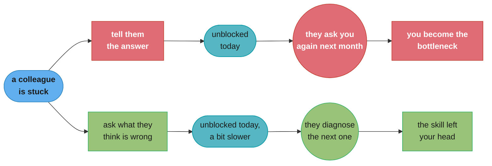
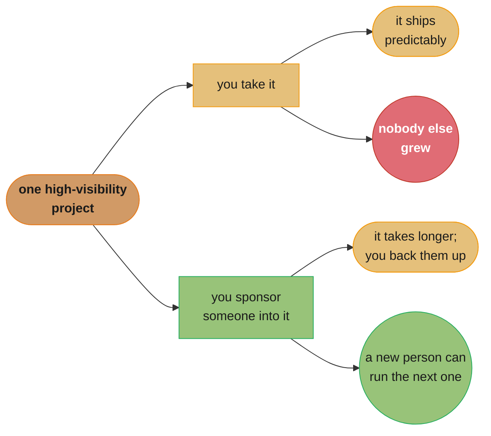

# Chapter 8: Good Influence at Scale

> Part III — Leveling Up · The Staff Engineer's Path (Reilly, 1st ed., O'Reilly 2022) · builds on Ch 7 (you are already a role model), leads to Ch 9 (what's next for your own career)

## Chapter Map

Chapter 7 established that a staff engineer's visible behavior is a template whether they meant
it to be or not. Chapter 8 asks the obvious follow-up: if your behavior already influences people
by accident, what does it look like to influence them *on purpose*, and how do you do it for more
than one person at a time? The chapter is structured as a grid rather than a list. One axis is
**how many people** your influence reaches — one person, a group, or the whole organization after
you've stopped pushing. The other axis is **what kind** of influence it is — advice, teaching,
guardrails, or opportunity. Every cell of that grid is a different concrete practice, and Reilly
works through all of them.

**TL;DR:**
- Influence comes in **three tiers**: the **individual** (one person, one conversation), the
  **group** (a team, a mailing list, a training session), and the **catalyst** — changes to the
  system itself that keep working after you stop paying attention.
- It comes in **four forms**: **advice** (sharing what you know when asked), **teaching**
  (building someone else's understanding, not just handing them the answer), **guardrails** (the
  reviews, checklists, linters and processes that let people move safely without you), and
  **opportunity** (the projects, sponsorship, and visibility you can hand to someone else).
- The distinction Reilly keeps returning to is **telling versus teaching**: telling transfers an
  answer, teaching transfers understanding, and only the second one scales past the moment.
- Two asymmetries make this chapter necessary. Advice from a staff engineer lands harder than the
  same advice from a peer, so **unsolicited advice needs a check first**. And opportunity is
  zero-sum in a way the other three are not: **every high-visibility project you take is one
  someone else did not get.**

## The Big Question

You have finite hours and the organization has more engineers than you will ever mentor. So how do
you help more people than you can personally sit down with — without turning that help into
bureaucracy nobody wants?

The chapter's answer is a shift in what you consider "the unit of work." A staff engineer who
answers the same design question well thirty times has done thirty good things. A staff engineer
who writes the answer down, gets it into the design-review template, and adds a linter rule that
catches the mistake has done one thing that keeps answering the question after they leave. That
second engineer is the **catalyst**: the influence continues without them being in the room. The
trap the chapter is guarding against is the opposite failure — a staff engineer so busy being
personally helpful that they become the organization's single point of knowledge, which feels
like influence and is actually a bottleneck wearing influence's clothes.

---

## 8.1 Good Influence

The chapter opens by naming the axis most people miss. Everyone understands that helping a
colleague is good. What Reilly adds is that the *same act of help* can be aimed at three very
different blast radii, and that a staff engineer who only ever operates at the first one will
plateau on impact no matter how good they get at it.

### The Three Tiers

**Individual.** One person, one conversation, one review comment. High bandwidth, high
context — you can tailor everything to this specific person's situation, and they can push back
in real time. It is also the most expensive form per person helped, and it does not survive you.

**Group.** A team, a guild, an internal talk, a document that many people read. Lower bandwidth
per person and less tailoring, but the cost no longer scales linearly with the number of people
reached. Reilly's framing is that the group tier is where you stop answering the question and
start answering *the class of question*.

**Catalyst.** Changing the system so the good outcome happens by default, without you. A linter
that makes the wrong thing hard to write, a template that asks the question a reviewer would have
asked, a norm that other people now enforce because it has become how things are done here. This
is the tier that keeps producing value after you have moved to another team or another company —
and it is the tier most staff engineers under-invest in, because its payoff is diffuse and slow
while individual help feels immediately good.

The chapter's argument is not that the catalyst tier is best and the others are beneath you. It
is that helping one person is genuinely valuable, and that if it is the *only* thing you do, your
impact is permanently capped by your calendar.

### Why Help at All

The self-interested version of the argument, which Reilly states plainly: making the engineers
around you better means you get to work with better engineers. The colleague you help debug a
tricky race condition today is the colleague who will not ship the next one. Scaled influence is
not charity you do on top of your real job; the quality of everyone else's work is a direct input
to how much of your own time gets spent on preventable problems.

---

## 8.2 Advice

Advice is the cheapest form of influence and the easiest to get wrong, because the thing that
makes it cheap — you already know the answer, so just say it — is exactly what makes it land badly.

### Individual Advice

**Ask before you give it.** Reilly's guidance on unsolicited advice is direct: *"if you're not
sure whether your advice will be welcome, ask them."* This is not politeness theater. A staff
engineer's advice carries the weight of the title, so an offhand "you should probably use a queue
here" can read to the recipient as a decision rather than a suggestion — which means you have
accidentally taken over their project instead of helping with it.

**Not every conversation is a request for advice.** Sometimes a colleague describing a frustrating
problem wants to think out loud, or wants someone to agree that the situation is genuinely
annoying. Jumping straight to a solution answers a question that was not asked and, worse, teaches
the person that talking to you means being handed instructions. The chapter's move here is to
check what kind of conversation you are in before deciding what to contribute.

**Feedback is advice with a deadline.** The specific case Reilly calls out is promotion feedback:
telling someone clearly *why* they are not at the next level yet, in terms concrete enough to act
on. Vague encouragement ("keep it up, you're doing great") feels kinder in the moment and is
functionally a refusal to help — it leaves the person with nothing to change. This is the same
"not technical enough" trap from Chapter 7, seen from the other side of the table.

### Scaling Your Advice to a Group

The same advice, given once to many: office hours where anyone can bring a design question, a
written FAQ, a talk, a "how we do X here" document, a mailing list or channel where you answer in
public rather than in DMs. Answering in public is the single highest-leverage habit in this
section — the same keystrokes serve one person and everyone who searches for it later.

### Being a Catalyst

The catalyst form of advice is **advice that no longer needs you present**: a written architecture
decision record that new engineers read instead of asking, a design-review checklist that asks
your question automatically, a documented default ("we use X for Y here unless there's a reason
not to") that removes the decision from the table entirely.

---

## 8.3 Teaching

The chapter's sharpest distinction lives in this section, and it is worth stating on its own:
**the difference between telling and teaching is understanding.** Telling someone the answer gets
the ticket closed. Teaching them means they can solve the next one without you, which is the only
version that compounds.

### Individual Teaching

Reilly's concrete methods:

**Pairing.** Working through a real problem side by side, where the learner watches how you
approach an unfamiliar system — the searching, the guessing, the backing out of a wrong path.
Much of what makes a senior engineer effective is invisible in the finished result and only
visible in the process, which is why pairing teaches things documentation cannot.

**Shadowing.** The learner sits in on the meeting, the incident, or the review and observes.
Lower intensity than pairing and useful for the parts of the job that are not code at all.

**Coaching through questions.** Rather than "you should add an index here," ask "what do you think
is making this query slow?" A question hands the reasoning back to the person doing the work; an
answer takes it away from them. The tradeoff is honest — coaching is slower than telling, and
there are moments in an outage when telling is correct.

**Code and design review as teaching.** A review can be a gate, or it can be a lesson. The
difference is largely in what the comments explain: a comment that says *what* to change teaches
nothing, a comment that says why it matters teaches the principle. Reilly's addition is that
reviews should also say what was **good** — naming the parts that worked builds the reviewee's
confidence and calibration, so they learn what to keep doing rather than only what to stop.

```
TELLING                                TEACHING

"Add an index on user_id."             "What do you think makes this
                                        query slow?"
  -> ticket closed today                 -> ticket closed today, slower
  -> same question next month            -> they diagnose the next one
  -> you are the index oracle              themselves
                                         -> the skill left your head
```

Caption: both paths close the ticket; only one of them changes what happens the next time. This is
the chapter's core reason for preferring the slower conversation.

### Scaling Your Teaching to a Group

Classes, internal training, brown-bag talks, onboarding curricula, written guides and tutorials,
and codelabs — anything that takes a lesson you have given more than twice and turns it into an
artifact many people can consume without your calendar being involved. The economics are simple:
the first delivery costs more than a one-on-one conversation, and every delivery after that costs
almost nothing.

### Being a Catalyst

Teaching becomes a catalyst when the *culture* of teaching changes rather than the amount of
teaching you personally do: an organization where reviews routinely explain reasoning, where
pairing is normal rather than remedial, where onboarding is somebody's actual job. At that point
teaching happens at a rate you are not the bottleneck for.

---

## 8.4 Guardrails

Advice and teaching both aim at making people better. Guardrails take a different tack: they let
people who are *not* expert in this particular thing proceed safely anyway. Reilly's framing is
that a guardrail is not a fence to keep people out — it is what lets you drive faster on a
mountain road.

### Individual Guardrails

At the individual scale, you *are* the guardrail: reviewing a design, being the second pair of
eyes on a risky migration, being the person a nervous engineer checks with before pressing the
button. This works and does not scale, and it has a failure mode worth naming — an engineer who
always checks with you never develops the judgment to not need to.

### Scaling Your Guardrails to a Group

The group forms are the ones most organizations already have names for:

| Guardrail | What it catches | What it costs |
|---|---|---|
| Code review | Correctness, style, missing edge cases | Reviewer time; latency on every change |
| Design review / RFC process | Architectural mistakes, before they're expensive | Author time; can become a rubber stamp |
| Written decisions (ADRs) | Re-litigating settled arguments; lost reasoning | Discipline to actually write them |
| Linters, formatters, type checks | The whole class of mistake, automatically | Setup; false positives that train people to ignore it |
| Tests and CI gates | Regressions | Maintenance; flaky tests erode trust in the signal |
| Checklists and templates | Forgotten steps under pressure | Goes stale if nobody owns it |

The chapter's important caveat is that **all guidelines are wrong sometimes.** A rule that is
right 95% of the time is enormously valuable and will still be wrong on a real case, and a
guardrail culture that treats its rules as laws produces engineers who follow them off a cliff.
The fix is not to abandon guidelines but to make the escape hatch explicit: state what the rule is
*for*, so someone can tell when their situation is genuinely the exception.

### Being a Catalyst

The catalyst version of a guardrail is automation and defaults: the linter rule that makes the
mistake impossible to commit, the library whose easiest usage is also the safe one, the paved road
where doing the right thing takes less effort than doing the wrong thing. A guardrail that depends
on a human remembering to apply it is a guardrail that will eventually not be applied.

---

## 8.5 Opportunity

The fourth form of influence is the one Reilly treats most carefully, because it differs from the
other three in an important way: **it is finite.** Advice and teaching are not zero-sum — helping
one engineer does not take help away from another. Opportunity is. There is one high-visibility
migration, one design that gets presented to leadership, one conference slot. Every one a staff
engineer takes is one that somebody else did not get, and by this point in the career that engineer
is usually the person who needs it least.

### Individual Opportunity

**Delegate the work that would grow someone.** The instinct is to delegate the work you find
boring, which is exactly backwards: growth comes from the hard, ambiguous, slightly-too-big
project, not the tedious one. Reilly's version of delegating well includes a safety net — you stay
available, you check in, you are prepared for it to take longer than it would have taken you, and
you are honest with yourself that the extra time is the tuition.

**Sponsorship, not just mentorship.** Mentorship is advice given to someone; sponsorship is
spending your own credibility on them when they are not in the room. The chapter breaks sponsorship
into concrete acts: **amplifying** their idea in a meeting so it is heard and correctly attributed,
**boosting** their reputation by talking about their work to people whose opinion matters,
**connecting** them to the person or room they need access to, and **defending** them when their
work or judgment is questioned unfairly. Each of those spends a little of your standing and
transfers it.

**Share the visible work.** Let the less senior engineer present the design, write the postmortem
summary, or take the customer call — with you in the room as backup rather than as the speaker.
This is the specific mechanism by which "getting in the room" propagates to people who are not
yet in it.

### Scaling Opportunity to a Group

The group form is about how opportunity gets distributed rather than who you personally hand it
to: rotating who runs the meeting, who is on call, who takes the interesting project; making the
selection criteria for a high-profile project explicit rather than tapping whoever comes to mind;
noticing when the same three names keep getting the good work. This connects to the "glue work"
argument that runs through the whole book — if the unglamorous, necessary work is distributed
unevenly, then the opportunity work is being distributed unevenly too, in the opposite direction.

### Being a Catalyst

The catalyst version is a system that hands out opportunity without you: a documented rotation, a
promotion process with legible criteria, an on-call schedule that spreads the learning, an
onboarding path that gives new engineers real work early. Reilly's underlying point is that
relying on individual generosity to distribute opportunity fairly is relying on the most
bias-prone mechanism available.

---

## Visual Intuition

The chapter's whole argument is a grid, so it is worth drawing as one. Four forms across, three
tiers down; each cell is a concrete practice.

```
                INDIVIDUAL              GROUP                   CATALYST
              (one person)        (a team, many people)   (the system, without you)
            +-------------------+-----------------------+-------------------------+
 ADVICE     | 1:1 mentoring     | office hours          | written defaults, ADRs  |
            | review comments   | FAQ, public answers   | review checklists       |
            | promo feedback    | internal talk         |                         |
            +-------------------+-----------------------+-------------------------+
 TEACHING   | pairing           | class, brown-bag      | a culture that teaches  |
            | shadowing         | onboarding curriculum | onboarding as a real job|
            | coaching by       | written guides        |                         |
            |   question        |                       |                         |
            +-------------------+-----------------------+-------------------------+
 GUARDRAILS | you review it     | code + design review  | linters, type checks     |
            | you're the second | RFC process           | safe-by-default libs     |
            |   pair of eyes    | checklists, templates | the paved road           |
            +-------------------+-----------------------+-------------------------+
OPPORTUNITY | delegate a        | rotations             | promotion criteria       |
            |   stretch project | explicit selection    | documented rotations     |
            | sponsor: amplify, |   criteria            | onboarding that gives    |
            |   boost, connect, | spread the glue work  |   real work early        |
            |   defend          |                       |                         |
            +-------------------+-----------------------+-------------------------+

            cost per person helped  ------------------------------->  falls
            tailoring to the person ------------------------------->  falls
            survives your departure ------------------------------->  rises
```

Caption: the same four kinds of help, aimed at three different blast radii. Moving right along any
row trades away personalization and buys reach plus durability — which is why the chapter argues a
staff engineer needs cells from every column, not just the leftmost one.



Caption: telling and teaching close the same ticket on the same day; they diverge entirely on what
happens the second time. Reilly's "the difference between telling and teaching is understanding"
is this fork drawn out.



Caption: opportunity is the one form of influence that is zero-sum — the reason Reilly treats
delegation and sponsorship as a deliberate spend rather than as generosity.

---

## Key Concepts Glossary

- **Three tiers of influence** — individual, group, and catalyst: the blast radius a given act of
  help reaches, from one conversation to a change in the system that outlasts you.
- **Catalyst** — influence that keeps working after you stop pushing, because it changed a default,
  a tool, or a norm rather than a person's immediate decision.
- **Advice** — sharing what you know so someone can act on it; the cheapest form of influence and
  the one most damaged by being unsolicited.
- **Teaching** — building someone's understanding rather than handing them an answer; the
  distinction Reilly draws as *telling versus teaching*.
- **Telling vs teaching** — telling transfers the answer and closes today's ticket; teaching
  transfers the reasoning and closes every future one.
- **Coaching through questions** — responding to a stuck engineer with a question about their
  reasoning rather than a solution, so the diagnosis stays theirs.
- **Pairing** — solving a real problem side by side, which transmits the invisible parts of senior
  practice (searching, guessing, backing out) that no document captures.
- **Shadowing** — observing a meeting, incident, or review, useful for the large part of the job
  that is not code.
- **Guardrails** — reviews, checklists, linters, templates and processes that let a non-expert
  proceed safely; a rail on a mountain road, not a fence to keep people out.
- **"All guidelines are wrong sometimes"** — a rule right 95% of the time is worth having and will
  still be wrong on a real case, so state what the rule is *for* and make the exception legible.
- **Opportunity** — the finite, zero-sum form of influence: the projects, visibility, and rooms
  you can give to someone else instead of taking yourself.
- **Sponsorship** — spending your own credibility on someone when they are not in the room, as
  distinct from mentorship, which is advice given directly to them.
- **Amplify / boost / connect / defend** — the four concrete acts of sponsorship: getting their
  idea heard and attributed, talking up their work, opening access, and backing them under
  challenge.
- **Delegating with a safety net** — handing over the stretch project while staying available,
  accepting that it will take longer, and treating that extra time as tuition.

---

## Tradeoffs & Decision Tables

| Tier | Reach | Tailoring | Survives you? | Best for |
|---|---|---|---|---|
| Individual | One person | Total | No | High-stakes, specific, sensitive situations |
| Group | A team or org | Some | Partly | Anything you've explained more than twice |
| Catalyst | Everyone, ongoing | None | Yes | Recurring mistakes; anything you want to stop policing |

| Form | Zero-sum? | Main failure mode |
|---|---|---|
| Advice | No | Unsolicited advice read as a decision because of your title |
| Teaching | No | Telling instead of teaching, because telling is faster today |
| Guardrails | No | Rules treated as laws; or so many gates nobody can move |
| Opportunity | **Yes** | You keep taking the interesting work because you'd do it fastest |

| Situation | Wrong move | Reilly's move |
|---|---|---|
| Colleague vents about a painful problem | Immediately propose the fix | Check what kind of conversation this is first |
| Someone isn't ready for promotion | "Keep it up, you're doing great" | Name the specific gap they can act on |
| The same mistake keeps reaching review | Comment on it again, patiently | Make it a linter rule or a template question |
| A juicy cross-team project appears | Take it — you'd do it best | Ask who would grow from it, and back them |
| A guideline doesn't fit this case | Follow it anyway; it's the rule | Know what the rule is for; document the exception |

---

## Common Pitfalls / War Stories

- **Becoming the human index.** An engineer who cheerfully answers every question in DMs builds a
  reputation for helpfulness and an organization that cannot function without them. The tell is
  that the same question arrives repeatedly from different people — a signal to move it to the
  group or catalyst tier, not to answer faster.
- **Unsolicited advice that lands as a directive.** A staff engineer musing "I'd probably not use
  a queue there" in a design review can quietly kill an approach the author had good reasons for.
  The title makes the musing heavy; asking first is what makes it a suggestion again.
- **Feedback so gentle it conveys nothing.** Telling someone they are doing great when they are
  not at the next level is comfortable for the speaker and useless to the listener — they will be
  surprised at the next promotion cycle, and the surprise will be your doing.
- **Delegating the boring work and calling it growth.** Handing over the tedious tasks while
  keeping the ambiguous, interesting one is delegation that grows nobody. The growth is in the
  ambiguity.
- **Guardrails that multiply into gates.** Each individual review, checklist and sign-off is
  defensible; the accumulated set can make a two-line change take a week. Guardrails have an
  ongoing cost that nobody re-examines because each one was added for a good reason.
- **A linter with false positives.** A rule that fires wrongly often enough trains everyone to
  suppress it reflexively, at which point it catches nothing and still costs time — worse than not
  having it, because the org believes it is protected.
- **Sponsoring only people who remind you of yourself.** Sponsorship runs on who comes to mind, and
  who comes to mind is exactly where bias operates. This is the specific argument for the catalyst
  tier: explicit criteria and rotations beat individual good intentions.

---

## Real-World Systems Referenced

The chapter's structure — needed but invisible work that keeps a team moving, and the observation
that it is distributed unevenly — draws on **Tanya Reilly's own "Being Glue"** talk and essay,
which predates the book and is the canonical reference for that term across the industry. The
mentorship-versus-sponsorship distinction the Opportunity section rests on is a widely used
framing in engineering-leadership writing, notably in **Lara Hogan's** work on sponsorship and in
**Will Larson's** *Staff Engineer* (2021), which argues for pairing a moderate amount of
mentorship with considerably more sponsorship — Reilly's four concrete acts (amplify, boost,
connect, defend) are her operationalization of the same idea. The guardrails section's
automation-over-policing argument is the same instinct behind industry practice around paved
roads and golden paths, though the chapter argues it in terms of a staff engineer's time rather
than platform-team strategy.

---

## Summary

Chapter 8 turns Chapter 7's accidental influence into deliberate influence, and organizes it as a
grid. The vertical axis is reach: **individual** help is high-bandwidth and perfectly tailored and
does not survive you; **group** help costs more up front and then serves everybody who reads it;
**catalyst** work changes a default, a tool, or a norm so the good outcome keeps happening after
you stop pushing. The horizontal axis is kind. **Advice** is the cheapest and the easiest to
misfire — a staff engineer's offhand suggestion carries the weight of the title, so unsolicited
advice needs a check first, and not every conversation about a problem is a request for a
solution. **Teaching** is separated from telling by understanding: telling closes today's ticket,
teaching closes every future one, and pairing, shadowing, coaching through questions, and reviews
that explain *why* (and name what was good) are how it is done. **Guardrails** — reviews, ADRs,
checklists, linters, safe-by-default libraries — let people who are not expert in this particular
thing proceed safely, with the standing caveat that all guidelines are wrong sometimes and the
exception has to remain legible. **Opportunity** is the form that is genuinely zero-sum: the
stretch project you take is one nobody else got, so the chapter argues for delegating the
ambiguous work with a safety net, for sponsorship (amplify, boost, connect, defend) as distinct
from mentorship, and for systems — rotations, explicit criteria — that distribute opportunity
without depending on who happens to come to mind.

---

## Interview Questions

**Q: What are the three tiers of influence in this chapter, and why does Reilly say a staff engineer needs all three?**
**Short:** Individual, group, and catalyst — helping one person at a time caps your impact at your calendar.
Individual influence is one person and one conversation: maximum tailoring, no durability. Group influence — a talk, a guide, office hours — costs more up front and then serves everyone who consumes it. Catalyst influence changes a default, a tool, or a norm so the good outcome happens without you. The argument isn't that the catalyst tier is superior; it's that an engineer who only ever operates at the individual tier has an impact ceiling set by how many hours they have, no matter how good they get.

**Q: What does Reilly mean by being a "catalyst," and why is it the tier most staff engineers under-invest in?**
**Short:** Changing the system so the good outcome happens by default, without you present.
A catalyst is a linter rule that makes the mistake impossible, a template that asks the question a reviewer would have asked, or a norm that others now enforce because it's simply how things are done here. It keeps producing value after you move teams. It's under-invested in because its payoff is diffuse and delayed while personally answering a question feels immediately good and visibly helpful — the same asymmetry that makes any long-horizon investment hard under deadline pressure.

**Q: What is the difference between telling and teaching, and why does it matter more at staff level?**
**Short:** Telling transfers the answer; teaching transfers the understanding that solves the next one.
Telling closes today's ticket and leaves you as the permanent oracle for that class of problem. Teaching is slower today and means the person can diagnose the next instance without you. It matters more at staff level because a staff engineer is usually the one with the answer, so defaulting to telling is both natural and the exact mechanism by which they become an organizational bottleneck while feeling maximally helpful.

**Q: Why does Reilly say to check before giving unsolicited advice?**
**Short:** A staff engineer's suggestion carries the title's weight and can read as a decision, not an option.
Her guidance is that if you're unsure whether your advice is welcome, ask. The reason is asymmetry: the same sentence from a peer is a suggestion and from a staff engineer can quietly end an approach the author had good reasons for. Asking first restores it to a suggestion. There's a second reason too — not every conversation about a problem is a request for a solution; sometimes the person wants to think out loud or hear that the situation is genuinely difficult.

**Q: Why is opportunity different from the other three forms of influence?**
**Short:** It is zero-sum — every high-visibility project you take is one someone else did not get.
Advice, teaching and guardrails are not scarce: helping one engineer takes nothing away from another. Opportunity is finite. There is one interesting migration, one design presented to leadership, one conference slot. A staff engineer is usually the person who would do it fastest and also the person who needs the growth least, which is why the chapter treats delegation and sponsorship as a deliberate spend rather than as generosity.

**Q: What is the difference between mentorship and sponsorship, and what are the four concrete acts of sponsorship?**
**Short:** Mentorship is advice given to someone; sponsorship spends your credibility on them when they're absent.
Mentorship happens in the room with the person: guidance, experience, an ongoing relationship. Sponsorship happens when they are not there, and it costs you something. The four acts Reilly names are amplifying (making sure their idea is heard and correctly attributed), boosting (talking up their work to people whose opinion matters), connecting (opening access to a person or a room), and defending (backing their judgment when it's challenged unfairly).

**Q: What does "all guidelines are wrong sometimes" mean, and what's the practical implication?**
**Short:** A rule right 95% of the time is worth having and will still be wrong on a real case.
The implication isn't to abandon guidelines — a highly reliable rule saves an enormous amount of collective judgment. It's that a guardrail culture treating its rules as laws produces engineers who follow them off a cliff. The fix is to make the escape hatch explicit by stating what the rule is *for*, so someone facing a genuine exception can recognize it as one and document why rather than either silently violating the rule or complying against their judgment.

**Q: What's wrong with delegating the work you find boring?**
**Short:** Growth comes from the ambiguous, slightly-too-big project, not the tedious one.
Delegating tedium offloads your calendar and develops nobody — the recipient learns only that they get the leftovers. The growth is in the ambiguity: deciding what the problem even is, navigating stakeholders, being wrong and recovering. Reilly's version of delegating well includes a safety net: stay available, check in, expect it to take longer than it would have taken you, and treat the extra time as tuition rather than as waste.

**Q: How should a code review comment be written if the goal is teaching rather than gatekeeping?**
**Short:** Explain why it matters, and name what was good, not only what to change.
A comment saying *what* to change transfers a diff; a comment saying why it matters transfers a principle the author can apply next time without you. Reilly adds a second half that's easy to skip: say what was good. Naming the parts that worked builds the reviewee's calibration so they learn what to keep doing, not just what to stop — and it makes the critical comments land as information rather than as a verdict.

**Q: What are the group-tier forms of advice, and what makes answering in public the highest-leverage habit?**
**Short:** Office hours, FAQs, talks, and public answers — the same keystrokes serve everyone who searches later.
The group tier turns "the answer to this question" into "the answer to this class of question": office hours anyone can bring a design to, a written FAQ, an internal talk, a documented default. Answering in a public channel rather than a DM is the cheapest version — it costs you nothing extra in the moment and creates a searchable artifact, which means the same effort helps the person asking and everyone who hits the problem after them.

**Q: What are the catalyst forms of guardrails, and why does Reilly prefer them to being the reviewer yourself?**
**Short:** Automation and safe defaults — a guardrail depending on a human to remember will eventually be forgotten.
The catalyst forms are the linter rule that makes the mistake uncommittable, the library whose easiest usage is the safe one, and the paved road where the right thing takes less effort than the wrong thing. Being the reviewer personally works and doesn't scale, and it has a second failure mode: an engineer who always checks with you never develops the judgment to stop needing to.

**Q: What's the self-interested argument for helping the engineers around you?**
**Short:** Better colleagues means less of your own time spent on preventable problems.
Reilly states it plainly rather than framing scaled influence as altruism: making the engineers around you better means you get to work with better engineers. The colleague you help debug a race condition today is the colleague who won't ship the next one. The quality of everyone else's work is a direct input to how your own week goes, so this isn't something you do on top of the real job.

**Q: What's the failure mode of a linter rule with false positives?**
**Short:** It trains everyone to suppress it reflexively, so it catches nothing while the org believes it's protected.
A rule that fires wrongly often enough teaches people that the correct response to this warning is to silence it, and that habit generalizes to the times the rule is right. The result is worse than not having the guardrail at all: the cost is still paid on every run, the protection is gone, and the organization's belief that the class of bug is handled means nobody looks for it another way.

**Q: How does the "glue work" idea connect to the Opportunity section?**
**Short:** If the invisible necessary work is distributed unevenly, opportunity is unevenly distributed too.
Glue work is the needed but low-visibility effort that keeps a project moving — the coordination, the documentation, the noticing. Reilly's connection is that the two distributions are the same distribution seen from opposite ends: the people doing disproportionate glue work are the people not doing the high-visibility projects, so a team that never examines who takes the unglamorous work also never examines who gets the career-making work.

**Q: Why does the chapter argue for explicit criteria and rotations instead of relying on individual generosity to distribute opportunity?**
**Short:** Opportunity distributed by who comes to mind is distributed by exactly the mechanism bias runs on.
A well-intentioned staff engineer handing out stretch projects still hands them to whoever they think of first, and who springs to mind is shaped by familiarity, proximity, and similarity. Making the selection criteria for a high-profile project explicit, rotating who runs the meeting or takes the interesting work, and noticing when the same names recur are catalyst-tier fixes: they distribute opportunity without depending on any individual's good intentions holding up under time pressure.

**Q: How does a staff engineer tell when they should move from the individual tier to the group or catalyst tier?**
**Short:** The same question arriving repeatedly from different people is the signal.
If you've explained something more than two or three times, the marginal cost of writing it once is already lower than the cost of explaining it again, and every explanation after that is free. The same applies to guardrails: the same mistake reaching review repeatedly means the fix is a linter rule or a template question, not another patient comment. The tell is repetition — not how busy you feel, which is a lagging indicator of the same problem.

---

## Cross-links in this repo

- [soft_skills/mentorship_and_sponsorship/ — the mentorship vs sponsorship distinction in depth](../../../soft_skills/mentorship_and_sponsorship/mentorship_and_sponsorship.md)
- [soft_skills/influence_without_authority/ — the mechanics behind scaling influence past your own team](../../../soft_skills/influence_without_authority/influence_without_authority.md)
- [soft_skills/giving_and_receiving_feedback/ — the promotion-feedback problem the Advice section names](../../../soft_skills/giving_and_receiving_feedback/giving_and_receiving_feedback.md)
- [soft_skills/design_docs_rfcs_and_adrs/ — the written-decision guardrail as an artifact](../../../soft_skills/design_docs_rfcs_and_adrs/design_docs_rfcs_and_adrs.md)
- [soft_skills/technical_writing_for_engineers/ — the group tier is mostly writing](../../../soft_skills/technical_writing_for_engineers/technical_writing_for_engineers.md)
- Sibling chapters: [Ch 7 You're a Role Model Now (Sorry)](../07_youre_a_role_model_now/07_youre_a_role_model_now.md) · [Ch 9 What's Next?](../09_whats_next/09_whats_next.md) · [Ch 1 What Would You Say You Do Here?](../01_what_would_you_say_you_do_here/01_what_would_you_say_you_do_here.md)
- Companion book: [Staff Engineer (Larson) — Operating at Staff](../../staff_engineer_larson/02_operating_at_staff/02_operating_at_staff.md), whose "create space for others" and "mentorship and sponsorship" guides cover the same ground from the other book's angle.

## Further Reading

- Reilly, Tanya — "Being Glue" (noidea.dog) — the talk and essay behind the glue-work framing the
  Opportunity section leans on.
- Hogan, Lara — writing on sponsorship and on the difference between mentoring and sponsoring — a
  frequently cited companion treatment of the distinction this chapter operationalizes.
- Larson, Will — *Staff Engineer: Leadership Beyond the Management Track* (2021) — its "create
  space for others" guide is the closest parallel to this chapter in the other standard text.
