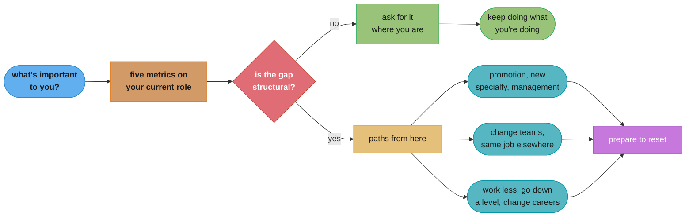
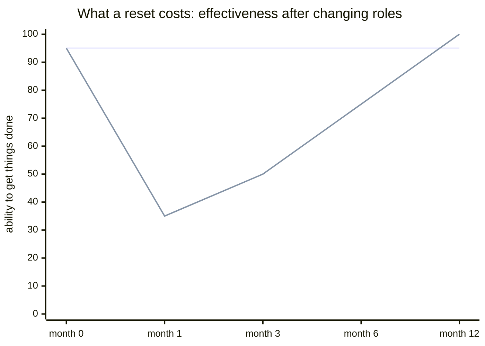

# Chapter 9: What's Next?

> Part III — Leveling Up · The Staff Engineer's Path (Reilly, 1st ed., O'Reilly 2022) · builds on Ch 8 (scaling your influence), closes Part III and the book

## Chapter Map

The last chapter turns the book's own tools on the reader. Chapters 2 and 3 argued that a staff
engineer needs a locator map, a topographical map, and a treasure map of their *organization*.
Chapter 9 asks the same three questions about a *career*: where are you, what is the terrain
actually like, and where are you trying to get to. Chapter 4's "finite time" argument reappears
here as well — a career, like a quarter, is a budget you are spending whether or not you decided
how. The chapter is deliberately not a promotion guide. Its structure moves from what you want,
to whether your current role can supply it, to the full menu of paths available, to the specific
mechanics of resetting when you take one, and closes on the argument that these choices are not
only about you.

**TL;DR:**
- Start with **what's important to you** before asking about the next level. The chapter's list of
  possible priorities — money and security, learning, flexibility, impact, prestige, enjoyment —
  is deliberately not ranked, because the ranking is the personal part.
- Your current role can be evaluated concretely. Reilly offers **five metrics to keep an eye on**:
  are you learning, are the skills transferable, would you recruit a friend into this job, is your
  confidence growing, and what is it costing you in stress and health.
- **Paths from here** is a long, flat, deliberately unranked menu — from "keep doing what you're
  doing" through promotion, working less, changing teams, building a new specialty, management,
  a different employer at the same, higher, or *lower* level, a startup, independence, and
  changing careers entirely.
- Whichever path you take, **prepare to reset**: the maps you built are of a specific
  organization, and the rules that made you effective there do not transfer intact. Reilly's
  guidance is not to try to do a new job using the previous job's rules.
- The book ends on **your choices matter** — the software you build affects real people, and the
  seniority that makes you effective also makes you responsible for what you choose to build.

## The Big Question

Every previous chapter asked how to be effective *in* a staff role. This one asks whether the role
you are in is the one you should be in — and it refuses to assume the answer is "climb."

The chapter's most useful move is to separate two questions that get collapsed together. "Am I
doing well?" and "am I in the right place?" are different questions with different evidence, and
conflating them produces the two classic career mistakes in opposite directions: staying somewhere
that has stopped paying you in anything you value because you are visibly succeeding at it, and
leaving somewhere good because a stream of other people's job-change announcements has made
stillness feel like failure. Reilly names the second one directly — the regular "new job"
announcements can make you feel like you should be moving too. Neither the industry's default
narrative of continuous upward motion nor the comfort of a role you have already mastered is an
answer to what you actually want.

---

## 9.1 Your Career

The chapter's opening move is to insist that "what's next" is unanswerable until you have said
what you are optimizing for. A staff engineer is good at asking this about systems and frequently
has never asked it about their own trajectory.

### What's Important to You?

Reilly's list of things a job can supply is deliberately unranked, because the ranking is the
personal part and it changes over a life:

| What a job can pay you in | What it looks like when this is your top priority |
|---|---|
| Money and financial security | Compensation band, equity, stability of the employer |
| Learning and growth | Unfamiliar problems, people better than you at things you want |
| Flexibility | Hours, location, the ability to absorb a life event without crisis |
| Impact | Work that changes something you care about |
| Prestige and recognition | Title, brand, external visibility |
| Enjoyment | Liking the work and the people, day to day |
| Autonomy | Choosing your own problems |
| Stability and predictability | Knowing what next quarter looks like |

The point of writing the list down is that these genuinely trade against each other. A role
optimizing hard for learning is usually not the one optimizing for predictability. Being explicit
about the ranking converts a vague dissatisfaction into a specific, checkable question.

### Where Are You Going?

The chapter borrows the **five-year** horizon as a thinking tool rather than as a plan: not "what
title will I have," but what kind of work do you want to be doing, and what would have to be true
for that to be possible. Reilly is explicit that this is not a commitment — plans change, and the
value is in noticing whether this year's work moves you toward it or is merely adjacent to it.

The related observation: **specialization usually happens by accident.** Nobody decides to become
the person who knows the billing system; they fix three bugs in it and inherit it. Choosing a
specialty deliberately is available to you and most people never exercise the option.

### What Do You Need to Invest In?

Working backward from where you want to be produces a short list of things that only grow if you
deliberately grow them. Reilly's categories:

**Skills.** The technical and non-technical abilities the destination requires. Note that at staff
level a meaningful share of these are not technical, and the ones you already have are the ones
you will keep practicing by default.

**Visibility.** Whether the people who make decisions about your work know what your work is. This
is the same argument the promotion literature makes, and Reilly's version is less about
self-promotion than about the observation that people cannot sponsor work they have never heard of.

**Relationships and network.** Both inside the company and outside it. The outside half is the one
that only pays off on a multi-year delay, which is exactly why it gets deferred indefinitely.

**Experience.** Some things are only learned by having done them — run a migration, led a project
that failed, been on call for a system you designed. If the destination needs one you do not have,
that is a thing to go get rather than a thing to read about.

The chapter's honest constraint on all four: **you cannot be an expert in everything.** Investment
is a budget, and choosing to deepen one area is choosing not to deepen another.

---

## 9.2 Your Current Role

Having established what you want, the chapter turns to whether the job you already have can
supply it — and it treats this as an empirical question with observable signals rather than a
matter of mood.

### Five Metrics to Keep an Eye On

Reilly's five checks on a current role, framed as things to watch over time rather than as a
one-time verdict:

| # | The check | What a bad reading looks like |
|---|---|---|
| 1 | Are you learning? | The last genuinely new thing you learned was a while ago |
| 2 | Are the skills transferable? | Deep expertise in something that exists only at this company |
| 3 | Would you recruit a friend into this job? | You hesitate, or you'd warn them |
| 4 | Is your confidence growing? | You feel less capable than you did a year ago |
| 5 | What is it costing you? | Stress, sleep, health, or life outside work |

The set is chosen so that no single reading is a verdict. A role can be light on learning and
excellent on flexibility during a year when flexibility is what you need, and that is a fine
trade made knowingly. What the list guards against is drift — several readings going bad slowly
enough that no individual month felt like the moment to notice.

Metric 2 deserves its own note because it is the one most easily missed while everything feels
good. Becoming irreplaceable at a company by accumulating knowledge that has no meaning anywhere
else is comfortable, well-rewarded, and a slowly closing door.

### Can You Get What You Want from Your Role?

With the priorities from 9.1 and the readings from the five metrics, the question becomes
answerable: is the gap something this role could supply if you asked for it, or is it structural?
The chapter's practical advice is to try asking first — a great deal of what people leave jobs
over is available inside them and was never requested, because the request felt presumptuous or
because nobody realized it was on offer.

### Should You Change Jobs?

Reilly's framing here is notably unenthusiastic about movement for its own sake. Staying is a
legitimate choice, made worse by the ambient pressure of other people's announcements. The real
questions are whether the gap is structural, whether you have actually tried to close it where
you are, and whether you are running toward something or only away from something.

---

## 9.3 Paths from Here

The centerpiece of the chapter is a menu, presented flat and unranked. The presentation is the
argument: these are options, not rungs, and several of them are lateral or downward moves that the
industry's default narrative does not treat as legitimate.

**Keep doing what you're doing.** First on the list on purpose. If the role is supplying what you
want, continuing is a decision and not a failure to decide.

**Work toward promotion.** The obvious one, and notably not the only one — and the chapter has
already spent eight chapters on what the next level actually requires, which is mostly not more
technical depth.

**Work less.** Deliberately reducing scope or hours, permanently or for a season. Legitimate, and
rarely discussed as a career move rather than as a failure.

**Change teams.** New domain, new people, most of your organizational maps still valid. Often the
highest-return-per-unit-of-disruption option available and the one people skip straight past on
their way to considering a new company.

**Build a new specialty.** Deliberately becoming the person who knows a thing, instead of
inheriting a specialty by accident.

**Explore.** A period of deliberately not committing: trying things, seeing what the work is
actually like before choosing.

**Take a management role.** Including for the first time. The chapter treats this as a genuine
change of job rather than a promotion — a different set of skills, a different feedback loop, and
a decision that is reversible more often than people assume.

**Find or invent your own niche.** Shaping a role that does not currently exist around what you
are unusually good at.

**Do the same job for a different employer.** Same level, new context. Underrated: a great deal of
what makes a role frustrating is organizational rather than about the work itself.

**Change employers and go up a level.** The well-known route when internal promotion is blocked
for reasons that have nothing to do with your work.

**Change employers and go down a level.** Explicitly on the list, which is the point. Trading
title for a domain you want, a company you believe in, or a life you want is a real trade that
people make and rarely admit to considering.

**Set up your own startup.** Or join a very early one.

**Go independent.** Consulting, contracting, or your own products.

**Change careers.** Out of engineering entirely, which the chapter includes without drama.

The list's shape carries the argument. Sixteen-ish options, of which exactly one is "get
promoted," and several are sideways or down. The staff role is a place you can stand, not only a
place you pass through.

---

## 9.4 Prepare to Reset

Whichever path you take, moving resets a large fraction of what made you effective — and the
chapter is specific about *what* resets, because underestimating this is the standard failure of
a strong senior person's first months somewhere new.

**Your maps expire.** The locator, topographical, and treasure maps from Chapters 2 and 3 were
maps of one organization. The new place has a different shape, different unwritten rules, and
different people who actually decide things regardless of the org chart.

**Your relationships do not transfer.** The network that let you get a decision made in a day was
built over years in a specific building. Elsewhere you are a stranger with a good title.

**Your credibility resets to the title.** Chapter 7's point runs both ways: your reputation was
earned locally and does not travel with you. What travels is the title, which buys attention but
not trust.

**The rules changed.** Reilly's advice on this is direct — do not try to do a new job using the
rules of the previous one. The specific practices that made you effective are adapted to an
environment, and applying them unchanged is Larson's "chasing ghosts" seen from the inside: you
are solving your last company's problems at your new one. The right first move is the same one
Chapter 2 recommended for a new staff engineer anywhere: build the maps before you start
redrawing them.

```
WHAT TRANSFERS                      WHAT RESETS

skills                              your maps of the org
judgment                            your relationships
experience                          your local credibility
the title on your badge             the unwritten rules
                                    what "good" means here

  -> you arrive genuinely             -> and genuinely unable to
     more capable                        get things done, for a while

  the gap between those two is what a reset feels like, and
  the mistake is reading it as evidence you have lost your edge
```

Caption: a strong senior person's first months somewhere new feel like a loss of ability. Reilly's
point is that ability was never the thing that moved — the surrounding infrastructure was, and it
has to be rebuilt.

---

## 9.5 Your Choices Matter

The book closes by widening the frame past the individual career. The argument is short and it is
the reason the chapter is not merely a career-planning appendix.

Software is not neutral. The systems engineers build decide who gets a loan, whose content is
seen, what data is retained about people who never consented to it, and which failures land on
users who have no recourse. A staff engineer is, by this point in the book, someone with unusual
leverage over what gets built and how — the maps, the projects, the reviews, the influence at
scale from Chapter 8 all add up to real power over outcomes.

Reilly's conclusion follows from that: the seniority that makes you effective also makes you
responsible. Choosing what to work on, what to refuse, what to raise in a room where nobody else
will, and who to hand opportunity to are ethical choices as well as career ones — and unlike most
people in the organization, a staff engineer is senior enough that raising an objection is
survivable. That is the note the book ends on: the choices are yours, they are consequential, and
having the standing to make them is itself an obligation.

---

## Beyond the book — the staff-plus literature this chapter sits inside

> Chapter 9 is Reilly's own, and everything above is hers. This section is not. It records where
> this chapter sits relative to the other standard texts on the same subject, which the chapter
> does not do — the book names Larson's *Staff Engineer* among its influences but does not
> compare its career framing to his, and the mapping below is this repo's reading, not Reilly's.

The two book-length treatments of the staff-plus career answer different questions and are
usually read together:

| Question | Reilly, *The Staff Engineer's Path* (2022) | Larson, *Staff Engineer* (2021) |
|---|---|---|
| What is the job? | Three pillars: big-picture thinking, project execution, being a good influence | Four archetypes: Tech Lead, Architect, Solver, Right Hand |
| Primary mode | A practitioner's manual — how to do the work well | A field guide plus interviews — how the role varies and how people got there |
| On getting the title | Largely out of scope; the book is about doing the job | An entire part, plus a second on switching companies to get it |
| On what's next | This chapter: an unranked menu including staying, working less, and going down a level | Framed around whether the title is worth pursuing at all, and what it costs |

Reilly's "paths from here" menu and Larson's "deciding to switch companies" guide reach compatible
conclusions from opposite directions: Reilly is unenthusiastic about movement for its own sake and
lists staying first; Larson observes that internal promotion frequently fails for circumstantial
reasons and that at some point you have to hear what your current company is telling you. Read
together they bracket the honest answer — try where you are first, and do not confuse loyalty with
a plan.

This repo's [soft_skills/engineering_career_ladders/](../../../soft_skills/engineering_career_ladders/engineering_career_ladders.md)
covers the ladder mechanics both books mostly assume, and
[soft_skills/staff_plus_archetypes/](../../../soft_skills/staff_plus_archetypes/staff_plus_archetypes.md)
covers Larson's archetypes in their own right.

---

## Visual Intuition



Caption: the chapter's actual sequence. Note that "ask for it where you are" is a real branch and
that every path except staying converges on the same reset — the two things the industry's default
career narrative leaves out.



Caption: the flat line is your skills and judgment, which do not move. The dipping line is what you
can actually accomplish, which collapses because the maps, relationships, and local credibility
underneath it were left behind. Reilly's warning is against reading the dip as a loss of ability.

---

## Key Concepts Glossary

- **What's important to you** — the unranked list of things a job can pay you in (money, learning,
  flexibility, impact, prestige, enjoyment, autonomy, stability); the ranking is personal and
  changes over a life.
- **Five metrics to keep an eye on** — are you learning; are the skills transferable; would you
  recruit a friend into this job; is your confidence growing; what is it costing you.
- **Transferable skills** — expertise that means something outside this employer, as distinct from
  deep company-specific knowledge that makes you irreplaceable here and unremarkable elsewhere.
- **Accidental specialization** — becoming the person who knows a system by fixing bugs in it,
  rather than by choosing it; the default, and an option most people never realize they can
  exercise deliberately.
- **Five-year horizon** — a thinking tool, not a plan: what kind of work do you want to be doing,
  and what would have to be true for that to be possible.
- **Paths from here** — the flat, unranked menu of next moves, including staying, working less,
  changing teams, going independent, and changing employers at a *lower* level.
- **Prepare to reset** — the recognition that a move invalidates your organizational maps,
  relationships, local credibility, and the unwritten rules you had learned.
- **Don't use the previous job's rules** — the specific practices that made you effective were
  adapted to one environment; applying them unchanged solves the last company's problems.
- **Your choices matter** — the closing argument: software affects real people, and a staff
  engineer's leverage over what gets built makes those choices ethical as well as strategic.

---

## Tradeoffs & Decision Tables

| If the five metrics say… | Likely reading | First move |
|---|---|---|
| Learning is flat, everything else fine | The role has been mastered | Ask for a harder problem before leaving |
| Skills are non-transferable | Comfortable, slowly closing door | Deliberately take work with portable skills |
| You wouldn't recruit a friend | Something is wrong you've normalized | Name it specifically; it may be fixable |
| Confidence is falling | Often environmental, not ability | Look at the environment before the self |
| The cost is health or life outside work | Not a career question yet | Reduce load first; decide later |

| Path | What it buys | What it costs |
|---|---|---|
| Keep doing what you're doing | Compounding local context and relationships | Skill drift if learning has stopped |
| Promotion | Scope, compensation, a different job | The job you liked may not survive it |
| Work less | Sustainability, life outside work | Slower advancement; needs to be said out loud |
| Change teams | New domain, maps mostly intact | Rebuilding relationships within the same walls |
| Management | Different leverage and feedback loop | A genuinely different skill set, not a promotion |
| Same job, new employer | Escapes an organizational problem, not the work | Full reset for a lateral gain |
| New employer, up a level | The title an internal path was blocking | Full reset plus performing at an unproven level |
| New employer, down a level | A domain, mission, or life you want | Compensation and status, knowingly traded |
| Independent / startup | Autonomy, ownership | Income stability; you now do every unglamorous job |

---

## Common Pitfalls / War Stories

- **Answering "what's next" before "what do I want."** Pursuing the next level because it is the
  next level produces people who get what they asked for and find that the job they liked is gone.
- **Announcement-driven career moves.** A steady feed of other people's job changes makes staying
  feel like stagnation. Reilly names this directly; the corrective is that stillness in a role
  that is paying you what you value is a decision, not a failure to make one.
- **Deep expertise in something that exists only here.** The most comfortable version of career
  damage: you are valued, hard to replace, and every year the outside market understands less of
  what you have been doing.
- **Skipping "change teams" on the way to "change companies."** An internal move keeps most of
  your maps and relationships and solves a large fraction of what makes a role frustrating, at a
  fraction of the reset cost. It is routinely not considered.
- **Treating management as the promotion.** It is a different job with a different feedback loop,
  and taking it as a level rather than a change of work is how organizations get unhappy managers
  who were excellent engineers.
- **Applying the old company's playbook.** The single most common failure of a strong hire's first
  six months: proposing the previous employer's solutions, confidently, to problems this one does
  not have — before building the maps that would have shown the difference.
- **Reading the post-move dip as lost ability.** The skills did not move. The maps, relationships,
  and local credibility did, and rebuilding them takes months. Mistaking the second for the first
  produces people who quit a good job four months in.

---

## Real-World Systems Referenced

The chapter's career-mapping structure is a deliberate callback to **Chapters 2 and 3** of the same
book — the locator, topographical, and treasure maps — applied to a career instead of an
organization, which is the chapter's own framing rather than an external reference. The
"prepare to reset" argument overlaps closely with **Michael D. Watkins'** *The First 90 Days*, the
standard treatment of role transitions, and with **Will Larson's** *Staff Engineer* (2021), whose
"chasing ghosts" warning describes the same failure from the arriving engineer's side. Reilly's
foreword-writer **Camille Fournier** (*The Manager's Path*) is the standard companion text for the
"take a management role" branch of the paths list. None of these are the chapter's citations; they
are the neighbouring literature a reader of this chapter usually encounters next.

---

## Summary

The book's last chapter turns its own instruments on the reader's career. It refuses to start with
"how do I get promoted" and starts instead with what a job can pay you in — money, learning,
flexibility, impact, prestige, enjoyment, autonomy, stability — on the grounds that these trade
against each other and the ranking is personal, changeable, and rarely written down. From there
it makes the current role empirically checkable with five metrics: are you learning, are the
skills transferable, would you recruit a friend into this job, is your confidence growing, and
what is it costing you in stress and health. No single bad reading is a verdict; the list exists
to catch drift, several readings going bad slowly enough that no month felt like the moment to
notice. If a gap appears, the chapter's first suggestion is to ask for what's missing where you
already are, because a great deal of what people leave jobs over was available inside them and
never requested. Only then comes "paths from here" — a flat, unranked menu of roughly sixteen
options in which exactly one is promotion and several are lateral or downward: keep doing what
you're doing, work less, change teams, build a new specialty, explore, take a management role,
go independent, change employers at the same, a higher, or a lower level, or leave engineering
altogether. Whatever you pick, prepare to reset: skills and judgment travel, but the
organizational maps, the relationships, the local credibility, and the unwritten rules do not, and
the standard failure of a strong hire's first six months is trying to do the new job using the
previous job's rules. The book closes past the individual career entirely, on the argument that
software decides real things about real people and a staff engineer's leverage over what gets
built makes those choices ethical as well as strategic — and that being senior enough to object is
itself an obligation to do so.

---

## Interview Questions

**Q: What are Reilly's five metrics for evaluating your current role?**
**Short:** Learning, skill transferability, would you recruit a friend, growing confidence, and what it costs you.
The five checks are: are you learning anything new; are the skills you're building transferable outside this employer; would you enthusiastically recruit a friend into this job; is your confidence growing rather than shrinking; and what is the role costing you in stress, health, and life outside work. They're framed as things to watch over time rather than as a one-time verdict, because the failure mode they guard against is slow drift rather than a single bad quarter.

**Q: Why does the chapter insist on asking "what's important to you" before asking about the next level?**
**Short:** The things a job pays you in trade against each other, so "next level" is unanswerable without a ranking.
Money, learning, flexibility, impact, prestige, enjoyment, autonomy and stability are genuinely in tension — a role optimizing hard for learning is usually not the one optimizing for predictability. Reilly leaves the list unranked deliberately, because the ranking is the personal part and it changes over a life. Pursuing the next level because it is next produces people who get exactly what they asked for and discover the job they liked no longer exists.

**Q: Why does Reilly single out transferable skills as a metric, and what's the comfortable failure mode?**
**Short:** Deep company-specific expertise makes you irreplaceable here and unremarkable everywhere else.
It's the metric most easily missed while everything feels good: you are valued, hard to replace, well compensated, and each year the outside market understands less of what you've been doing. The door closes slowly and comfortably, which is exactly why it needs to be an explicit check rather than something you'd notice by feel — the signals that would alert you (frustration, being overlooked) are all absent in this failure mode.

**Q: What is "prepare to reset," and what specifically does and doesn't transfer when you move?**
**Short:** Skills and judgment travel; your maps, relationships, local credibility and the unwritten rules do not.
What you carry is capability — skills, judgment, experience, and a title that buys attention. What stays behind is everything that converted capability into results: the locator and topographical maps of that specific organization, the relationships that let you get a decision made in a day, the credibility you earned locally, and the tacit knowledge of what "good" means there. The gap between arriving more capable and being temporarily unable to get anything done is what a reset feels like.

**Q: What does Reilly mean by not doing a new job using the rules of the previous one?**
**Short:** Practices that made you effective were adapted to one environment; applied unchanged they solve the old company's problems.
The specific things that worked — how you escalated, whose buy-in you got first, which reviews mattered, what a design doc looked like — were tuned to an organization's actual shape, not derived from first principles. Transplanting them wholesale is the classic strong-hire failure: confident proposals aimed at problems the new place doesn't have. The correct first move is the one Chapter 2 prescribes for any new staff engineer, which is to build the maps before redrawing anything.

**Q: Why is "keep doing what you're doing" first on the paths-from-here list?**
**Short:** Staying in a role that pays you what you value is a decision, not a failure to make one.
The placement is the argument. The industry's default narrative treats continuous movement as evidence of ambition, and Reilly names the specific pressure — the steady feed of other people's new-job announcements can make stillness feel like stagnation. If the five metrics read well and the role supplies what your priority list says you want, continuing is the correct answer and should be chosen deliberately rather than defaulted into or apologized for.

**Q: Why does the paths list explicitly include changing employers and going DOWN a level?**
**Short:** Trading title for a domain, a mission, or a life you want is a real trade people actually make.
Including it is the point of presenting the menu flat and unranked. The industry narrative has no legitimate slot for a downward move, so people who would benefit from one either don't consider it or don't admit to considering it. Reilly lists it beside promotion without editorial comment, alongside working less and changing careers entirely, because the staff role is a place you can stand rather than only a place you pass through.

**Q: What's the chapter's advice when the five metrics reveal a gap in your current role?**
**Short:** Try asking for what's missing where you already are, before treating the gap as structural.
The distinction is whether the gap is something this role could supply if requested or something the role structurally cannot provide. A great deal of what people leave jobs over — a different problem, a change of team, reduced scope, a specific opportunity — was available inside the company and was simply never asked for, because the request felt presumptuous or nobody realized it was on offer. Leaving without asking pays the full reset cost for something that may have been free.

**Q: What does the chapter say about accidental specialization?**
**Short:** Nobody decides to own the billing system; they fix three bugs in it and inherit it.
Specialization is usually the residue of what you happened to touch rather than a choice, and most engineers never notice that choosing deliberately is an available option. The chapter raises it in the context of "where are you going" because a specialty acquired by accident may or may not point at where you actually want to end up — and building a new specialty on purpose appears later as one of the paths from here.

**Q: How does "work less" function as a career path rather than as a failure?**
**Short:** Deliberately reducing scope or hours, permanently or for a season, is a legitimate listed option.
It sits on the same flat menu as promotion. The reason it needs stating is that reduced load usually happens by collapse rather than by choice, and is therefore experienced as failure rather than as a decision. Reilly's framing puts it alongside the five-metrics check on what the role is costing you: if the answer is health or life outside work, that isn't a career question yet — the load comes down first and the career decision waits.

**Q: Why does Reilly treat taking a management role as a change of job rather than a promotion?**
**Short:** It's a different skill set with a different feedback loop, and it's more reversible than people assume.
Framing management as the next rung produces organizations full of unhappy managers who were excellent engineers, promoted into work that shares almost nothing with what they were good at. Reilly puts it on the menu as one option among many, including taking reports for the first time, and treats the move as reversible far more often than the folklore suggests — which changes the decision from an irreversible bet into an experiment.

**Q: What is the "your choices matter" argument the book closes on?**
**Short:** Software decides real things about real people, and staff-level leverage makes those choices ethical ones.
The systems engineers build determine who gets a loan, whose content is seen, what data is kept about people who never consented. By this point in the book a staff engineer holds unusual leverage over what gets built — through the maps, the projects, the reviews, and Chapter 8's scaled influence. Reilly's conclusion is that the same seniority that makes you effective makes you responsible, and that being senior enough for an objection to be survivable is itself an obligation to raise it.

**Q: Why does the chapter say a career move's post-move dip shouldn't be read as lost ability?**
**Short:** Ability never moved; the maps, relationships and credibility underneath it did.
The dip is real and can be steep — a person who could get a decision made in a day now cannot find who decides. But skills, judgment and experience are exactly the things that transferred intact. What collapsed is the surrounding infrastructure that converted them into results, and rebuilding it takes months. Misreading the second as the first is how people quit a genuinely good new job four months in, and it's why the chapter names the reset in advance.

**Q: What does Reilly say you need to invest in, and what's the constraint on all of it?**
**Short:** Skills, visibility, relationships, and experience — bounded by the fact that you cannot be an expert in everything.
Working backward from where you want to be produces four categories that only grow deliberately: the skills the destination requires (many of them non-technical at this level), visibility so decision-makers know what your work is, relationships inside and outside the company, and experiences that can only be had by doing them. The constraint is that investment is a budget — choosing to deepen one area is choosing not to deepen another, and pretending otherwise is how all four get neglected equally.

**Q: Why is "change teams" described as an underused option?**
**Short:** It keeps most of your maps and relationships while solving what's usually an organizational problem.
A large fraction of what makes a role frustrating is about the specific team, manager, domain, or set of constraints rather than about the company or the work itself. An internal move addresses that at a fraction of the reset cost — the organizational maps stay mostly valid, the relationships mostly survive, and the credibility is already earned. People routinely skip past it on the way to considering a new employer, paying a full reset for something an internal transfer would have fixed.

**Q: How does the chapter connect back to Chapters 2 and 3?**
**Short:** It applies the three maps to a career instead of to an organization.
Chapters 2 and 3 argued a staff engineer needs a locator map (where am I in the wider landscape), a topographical map (what the terrain is really like, including the unwritten parts), and a treasure map (where we're actually going). Chapter 9 asks the same three questions of a career: where are you, what is this role actually like when measured rather than felt, and where are you trying to end up. "Prepare to reset" is the same idea in reverse — the maps were of one specific place and expire when you leave it.

---

## Cross-links in this repo

- [soft_skills/engineering_career_ladders/ — the ladder mechanics this chapter deliberately doesn't dwell on](../../../soft_skills/engineering_career_ladders/engineering_career_ladders.md)
- [soft_skills/performance_reviews_and_promotions/ — the promotion path as one item on the menu](../../../soft_skills/performance_reviews_and_promotions/performance_reviews_and_promotions.md)
- [soft_skills/staff_plus_archetypes/ — what the different shapes of a staff role look like](../../../soft_skills/staff_plus_archetypes/staff_plus_archetypes.md)
- [soft_skills/team_health_and_sustainable_pace/ — the fifth metric, "what is it costing you," in depth](../../../soft_skills/team_health_and_sustainable_pace/team_health_and_sustainable_pace.md)
- [soft_skills/negotiation_for_engineers/ — for the paths that involve a new offer](../../../soft_skills/negotiation_for_engineers/negotiation_for_engineers.md)
- Sibling chapters: [Ch 2 Three Maps](../02_three_maps/02_three_maps.md) · [Ch 4 Finite Time](../04_finite_time/04_finite_time.md) · [Ch 8 Good Influence at Scale](../08_good_influence_at_scale/08_good_influence_at_scale.md)
- Companion book: [Staff Engineer (Larson) — Switching Companies](../../staff_engineer_larson/04_switching_companies/04_switching_companies.md) covers the "change employers" branch of the paths list at length.

## Further Reading

- Larson, Will — *Staff Engineer: Leadership Beyond the Management Track* (2021) — the companion
  text on getting and evaluating the title, summarized in this repo at
  [`staff_engineer_larson/`](../../staff_engineer_larson/staff_engineer_larson.md).
- Fournier, Camille — *The Manager's Path* (O'Reilly, 2017) — the standard treatment of the
  "take a management role" branch, and the author of this book's foreword.
- Watkins, Michael D. — *The First 90 Days* — the standard reference on role transitions, which
  covers "prepare to reset" at book length.
