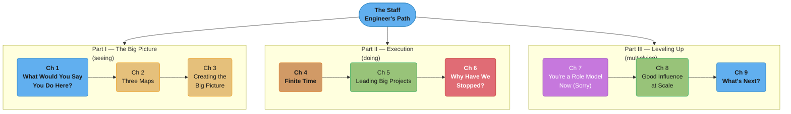
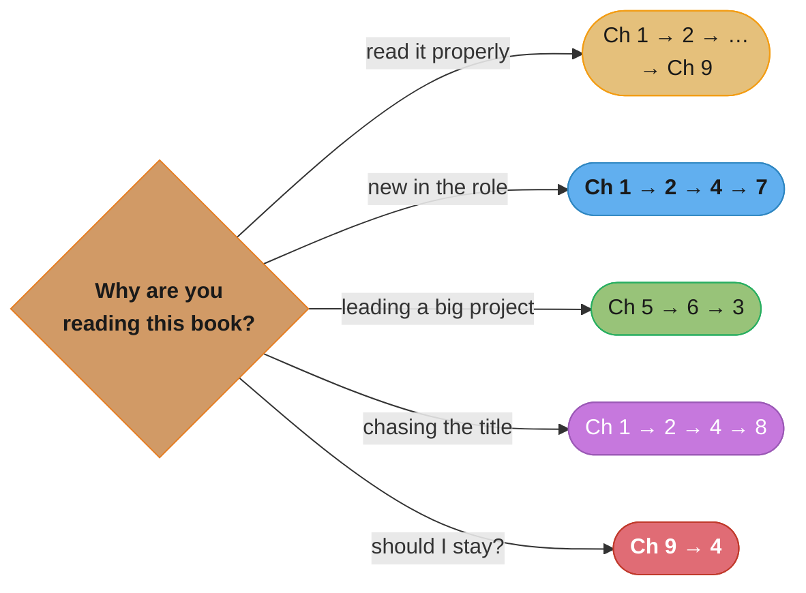

# The Staff Engineer's Path

> Tanya Reilly · **1st edition, O'Reilly Media, 2022** · 358 pages · ISBN 9781098118730 (print) ·
> subtitle: *A Guide for Individual Contributors Navigating Growth and Change* · foreword by
> Camille Fournier. A chapter-by-chapter, in-depth summary — read this folder in order and you
> have read the book.

> **This is a summary, answerable to its source.** Everything under a `## N.x` heading is
> reported as what the book says, including where a claim is contestable or has dated. Material
> the book does not contain is disclosed in a `## Beyond the book` section or tagged inline.

---

## The Book's Thesis

Senior engineering careers do not end at "very good at writing code." Past a certain point the
constraint on your impact stops being your technical ability and starts being everything around
it: whether you can see what the organization is actually trying to do, whether you can carry a
project across teams that do not report to you, and whether the people around you get better
because you are there. Reilly's argument is that these are **learnable, specific skills** — not
personality traits, not seniority arriving on its own — and the book is a manual for them.

Its organizing device is **three pillars** of staff engineering, which map exactly onto the
book's three parts:

- **Big-picture thinking** — seeing past your own project to what the organization needs, over a
  horizon longer than the current quarter.
- **Project execution** — getting large, cross-team, politically complicated work actually
  finished, without authority over most of the people involved.
- **Levelling up** — making everyone around you more effective, which is where a staff engineer's
  impact stops being bounded by their own hours.

The through-line: a staff engineer's job is **not** a senior engineer's job with more of it. It is
a different job, with different failure modes, and the transition is uncomfortable precisely
because the things that made you excellent as a senior engineer are no longer the things being
asked of you.

---

## The Three Parts (Part Map)

*Part I is about perception — what the role is, what your organization actually looks like, and
how to write down where it should go. Part II is about getting large work finished: your own
finite resources, the mechanics of leading a project across teams, and what to do when it stalls.
Part III is about everyone else — the influence you have whether you wanted it, how to aim it
deliberately, and finally what you want out of the career at all.*

---

## Chapter Index

| # | Chapter | Folder | One-line summary | Repo deep-dive |
|---|---------|--------|------------------|----------------|
| 1 | What Would You Say You Do Here? | [01_what_would_you_say_you_do_here/](01_what_would_you_say_you_do_here/01_what_would_you_say_you_do_here.md) | What a staff engineer is; the archetypes; scope; not "senior with more work" | [soft_skills/staff_plus_archetypes/](../../soft_skills/staff_plus_archetypes/staff_plus_archetypes.md) |
| 2 | Three Maps | [02_three_maps/](02_three_maps/02_three_maps.md) | Locator, topographical, and treasure maps of your organization | [soft_skills/scope_impact_and_ownership/](../../soft_skills/scope_impact_and_ownership/scope_impact_and_ownership.md) |
| 3 | Creating the Big Picture | [03_creating_the_big_picture/](03_creating_the_big_picture/03_creating_the_big_picture.md) | Vision vs strategy; whether you need one; writing it and getting agreement | [soft_skills/design_docs_rfcs_and_adrs/](../../soft_skills/design_docs_rfcs_and_adrs/design_docs_rfcs_and_adrs.md) |
| 4 | Finite Time | [04_finite_time/](04_finite_time/04_finite_time.md) | Five finite resources; where projects come from; defending your time | [soft_skills/scope_prioritization_and_saying_no/](../../soft_skills/scope_prioritization_and_saying_no/scope_prioritization_and_saying_no.md) |
| 5 | Leading Big Projects | [05_leading_big_projects/](05_leading_big_projects/05_leading_big_projects.md) | Starting, contextualizing, structuring, and driving cross-team work | [soft_skills/technical_leadership_and_execution/](../../soft_skills/technical_leadership_and_execution/technical_leadership_and_execution.md) |
| 6 | Why Have We Stopped? | [06_why_have_we_stopped/](06_why_have_we_stopped/06_why_have_we_stopped.md) | Diagnosing a stalled project: blocked, lost, or quietly finished | [soft_skills/cross_functional_collaboration/](../../soft_skills/cross_functional_collaboration/cross_functional_collaboration.md) |
| 7 | You're a Role Model Now (Sorry) | [07_youre_a_role_model_now/](07_youre_a_role_model_now/07_youre_a_role_model_now.md) | Be competent, responsible, goal-aware, forward-looking; CYA and feigned surprise | [soft_skills/technical_leadership_and_execution/](../../soft_skills/technical_leadership_and_execution/technical_leadership_and_execution.md) |
| 8 | Good Influence at Scale | [08_good_influence_at_scale/](08_good_influence_at_scale/08_good_influence_at_scale.md) | Advice, teaching, guardrails, opportunity × individual, group, catalyst | [soft_skills/mentorship_and_sponsorship/](../../soft_skills/mentorship_and_sponsorship/mentorship_and_sponsorship.md) |
| 9 | What's Next? | [09_whats_next/](09_whats_next/09_whats_next.md) | What you want; five metrics on your role; the unranked menu of paths; resetting | [soft_skills/engineering_career_ladders/](../../soft_skills/engineering_career_ladders/engineering_career_ladders.md) |

---

## The Three Pillars, and Where Each Is Taught

| Pillar | Part | Chapters | The question it answers |
|---|---|---|---|
| Big-picture thinking | I — The Big Picture | 1, 2, 3 | What is this organization actually doing, and where should it go? |
| Project execution | II — Execution | 4, 5, 6 | How does large cross-team work get finished without authority? |
| Levelling up | III — Levelling Up | 7, 8, 9 | How do the people around me get better, and what do I want next? |

The pillars are introduced in Chapter 1 and are the reason the book is structured the way it is —
Reilly's claim is that a staff engineer who is strong on one pillar and absent on the others is a
recognizable and common failure mode, not a specialization.

---

## How to Read This (Reading Paths)

- **Cover to cover (recommended):** Ch 1 → … → Ch 9. Short book, and the parts build.
- **"I just got the title and I'm lost":** Ch 1 → 2 → 4 → 7. What the job is, how to read your
  organization, how to protect your time, and what everyone is now reading into your behavior.
- **"I have to lead a big cross-team project":** Ch 5 → 6 → 3. Execution mechanics first, then the
  diagnostic for when it stalls, then vision/strategy for the version that needs one.
- **"I want to be promoted to staff":** Ch 1 → 2 → 4 → 8. What the role is, learning your maps,
  choosing work that matters, and scaling influence — then read Larson's book for the title
  mechanics this one deliberately leaves out.
- **"I'm burned out / wondering whether to leave":** Ch 9 → 4. The five metrics and the paths menu,
  then the finite-resources model behind why the role can consume you.

*Five goals, five subsets of the same nine chapters. Note that no path skips Chapter 2 except the
project-execution one — the maps are the book's most reusable single idea.*

---

## Relationship to Larson's *Staff Engineer*

This repo summarizes both standard books on the staff-plus career. They are complements, not
substitutes, and the split between them is clean:

| | Reilly, *The Staff Engineer's Path* (2022) | Larson, *Staff Engineer* (2021) |
|---|---|---|
| Central question | How do I **do** this job well? | What **is** this job, and how do I get it? |
| Organizing device | Three pillars: big picture, execution, levelling up | Four archetypes: Tech Lead, Architect, Solver, Right Hand |
| Getting the title | Largely out of scope | Two of five parts |
| Form | A practitioner's manual | Guides plus interviews with named engineers |
| Read it when | You are in the role, or nearly | You are deciding whether to pursue it |

Larson wrote the "Staff Engineer" guides that became his book; Reilly wrote that book's foreword.
The companion summary lives at
[`staff_engineer_larson/`](../staff_engineer_larson/staff_engineer_larson.md).

---

## Build Manifest

Per-file build status for this book. Update the row to `done` the moment a chapter file is
completed and diagram-linted.

| # | File | Status |
|---|------|--------|
| 1 | `01_what_would_you_say_you_do_here/01_what_would_you_say_you_do_here.md` | done |
| 2 | `02_three_maps/02_three_maps.md` | done |
| 3 | `03_creating_the_big_picture/03_creating_the_big_picture.md` | done |
| 4 | `04_finite_time/04_finite_time.md` | done |
| 5 | `05_leading_big_projects/05_leading_big_projects.md` | done |
| 6 | `06_why_have_we_stopped/06_why_have_we_stopped.md` | done |
| 7 | `07_youre_a_role_model_now/07_youre_a_role_model_now.md` | done |
| 8 | `08_good_influence_at_scale/08_good_influence_at_scale.md` | done |
| 9 | `09_whats_next/09_whats_next.md` | done |

---

## Cross-Reference Map (book concept → repo deep dives)

| Concept from the book | Primary deep-dive module |
|---|---|
| Staff archetypes, what the role spans | [soft_skills/staff_plus_archetypes/](../../soft_skills/staff_plus_archetypes/staff_plus_archetypes.md) |
| Scope, ownership, and impact at increasing seniority | [soft_skills/scope_impact_and_ownership/](../../soft_skills/scope_impact_and_ownership/scope_impact_and_ownership.md) |
| Vision and strategy documents; ADRs | [soft_skills/design_docs_rfcs_and_adrs/](../../soft_skills/design_docs_rfcs_and_adrs/design_docs_rfcs_and_adrs.md) |
| Defending your time; saying no | [soft_skills/scope_prioritization_and_saying_no/](../../soft_skills/scope_prioritization_and_saying_no/scope_prioritization_and_saying_no.md) |
| Leading without formal authority | [soft_skills/influence_without_authority/](../../soft_skills/influence_without_authority/influence_without_authority.md) |
| Driving cross-team projects | [soft_skills/technical_leadership_and_execution/](../../soft_skills/technical_leadership_and_execution/technical_leadership_and_execution.md) |
| Working across product, design, and other functions | [soft_skills/cross_functional_collaboration/](../../soft_skills/cross_functional_collaboration/cross_functional_collaboration.md) |
| Mentorship vs sponsorship; scaling influence | [soft_skills/mentorship_and_sponsorship/](../../soft_skills/mentorship_and_sponsorship/mentorship_and_sponsorship.md) |
| Feedback, including promotion feedback | [soft_skills/giving_and_receiving_feedback/](../../soft_skills/giving_and_receiving_feedback/giving_and_receiving_feedback.md) |
| "Create calm" and blameless incident response | [soft_skills/incident_communication_and_postmortems/](../../soft_skills/incident_communication_and_postmortems/incident_communication_and_postmortems.md) |
| Communicating upward and to executives | [soft_skills/executive_communication/](../../soft_skills/executive_communication/executive_communication.md) |
| Career ladders and the promotion process | [soft_skills/engineering_career_ladders/](../../soft_skills/engineering_career_ladders/engineering_career_ladders.md) |
| Sustainable pace; what the role is costing you | [soft_skills/team_health_and_sustainable_pace/](../../soft_skills/team_health_and_sustainable_pace/team_health_and_sustainable_pace.md) |

---

## Further Reading

- The author's own companion page for the book, including translations and related talks:
  <https://noidea.dog/staff>
- Reilly, Tanya — "Being Glue" — the essay and talk behind the glue-work framing that recurs
  through the book: <https://noidea.dog/glue>
- Larson, Will — *Staff Engineer: Leadership Beyond the Management Track* (2021), free at
  <https://staffeng.com/book>; summarized in this repo at
  [`staff_engineer_larson/`](../staff_engineer_larson/staff_engineer_larson.md).
- Fournier, Camille — *The Manager's Path* (O'Reilly, 2017) — the management-track counterpart,
  and this book's foreword author.
