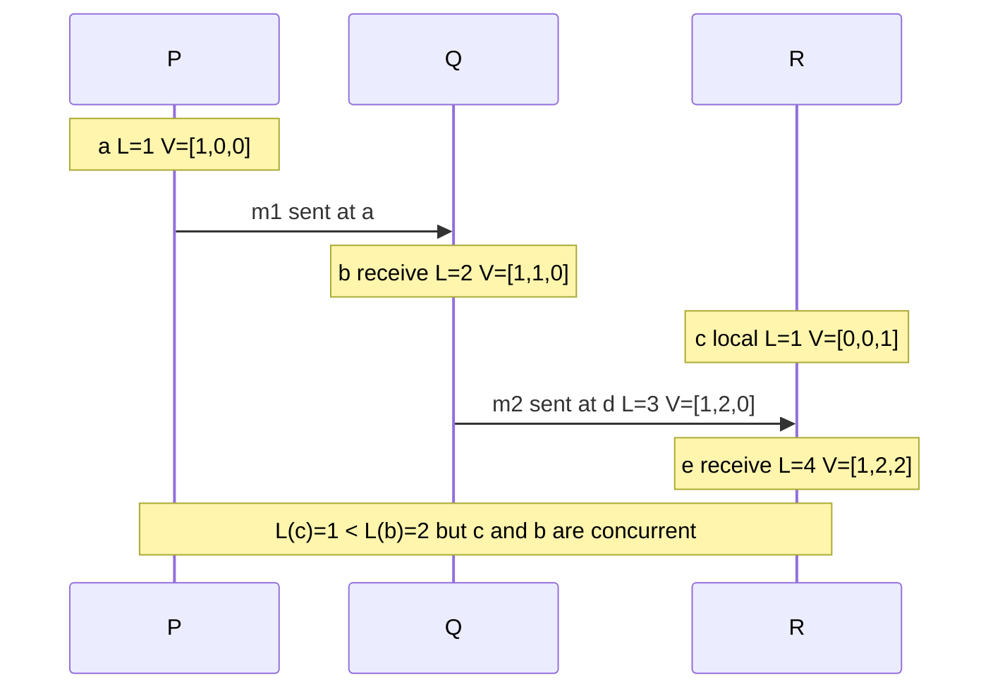
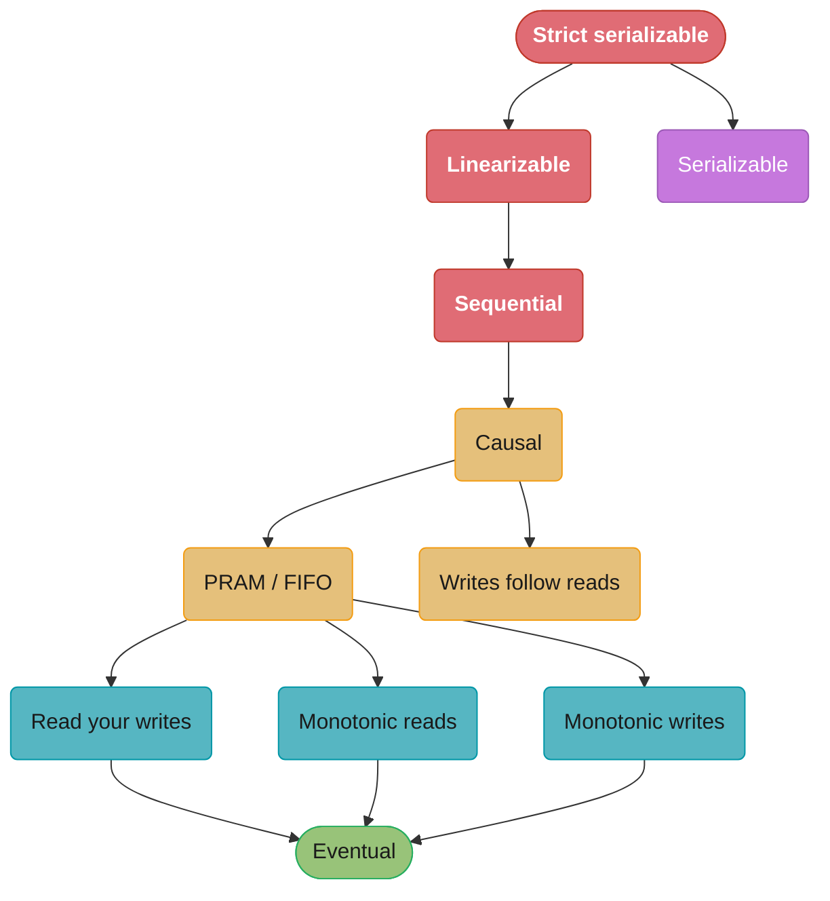
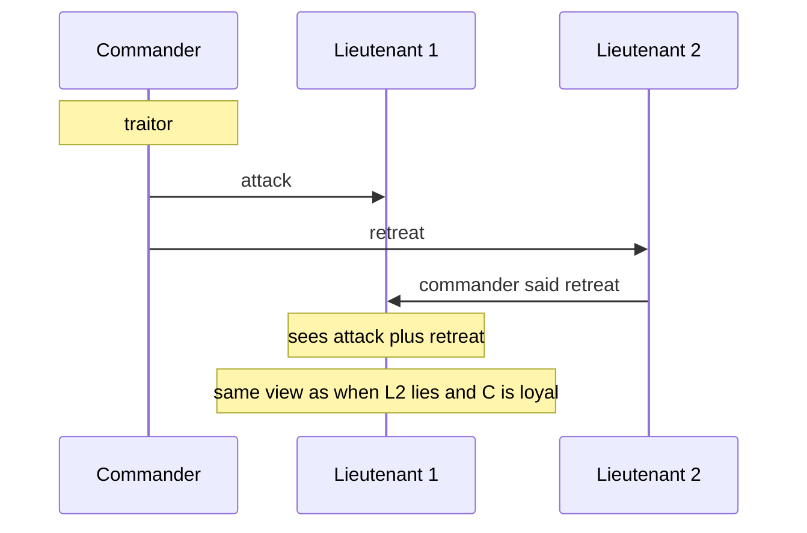
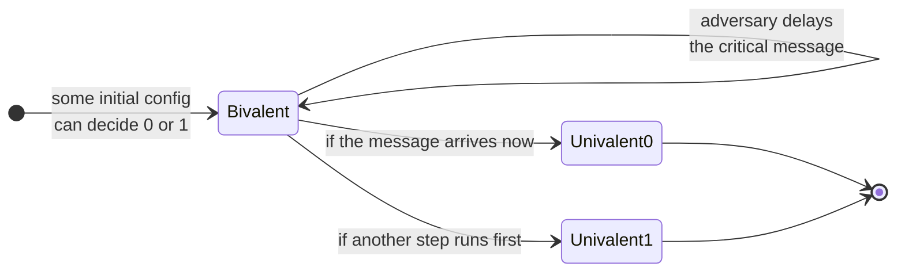
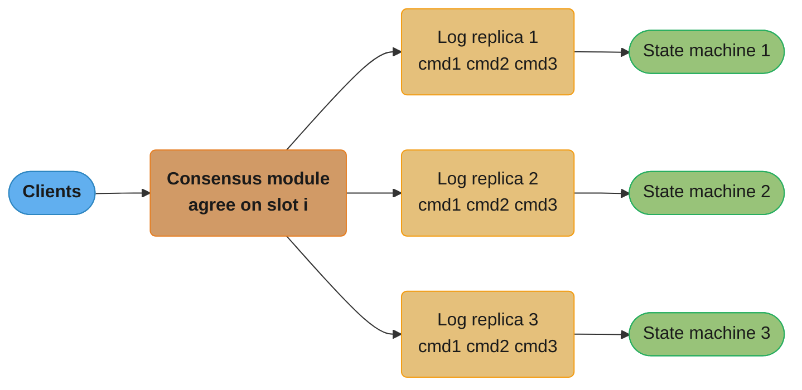

# Distributed Systems Theory

> A distributed system is one in which the failure of a computer you didn't even know existed can render your own computer unusable. (Leslie Lamport)

---

## 1. Concept Overview

**Distributed systems theory** is the set of models, impossibility results and correctness definitions that tell you what a group of computers connected by a network **can** and **cannot** guarantee. It is the reason an interviewer can ask "why does Raft need five nodes to tolerate two failures?" or "why can't you just use timestamps to order writes?" and expect a precise answer.

The theory answers four questions:

1. **What can go wrong?** The **system model**: how processes fail (crash, omission, Byzantine) and how timing behaves (synchronous, asynchronous, partially synchronous).
2. **How do we order events without a shared clock?** **Logical time**: Lamport clocks, vector clocks, hybrid logical clocks.
3. **What is impossible?** **FLP** (no deterministic consensus in an asynchronous system with even one crash), the **Two Generals** problem (no agreement over a lossy channel), and the **3f + 1** bound for Byzantine agreement.
4. **What does "correct" mean for replicated data?** **Consistency models**: linearizability, sequential consistency, causal consistency, eventual consistency, and the **replicated state machine** approach that implements the strongest of them.

This module teaches those foundations from the original papers and the reading list of MIT's graduate course 6.5840 (formerly 6.824). It deliberately stops short of algorithm walkthroughs: Paxos and Raft step by step live in [Consensus Algorithms](../../hld/consensus_algorithms/consensus_algorithms.md); CAP and PACELC tradeoffs live in [CAP Theorem](../../hld/cap_theorem/cap_theorem.md); NTP, TrueTime and clock engineering live in [Time, Clocks and Ordering](../../hld/time_clocks_and_ordering/time_clocks_and_ordering.md); and how databases expose these guarantees lives in [Consistency Models and Consensus](../../database/consistency_models_and_consensus/consistency_models_and_consensus.md).

---

## 2. Intuition

> **One-line analogy**: A distributed system is a group of people coordinating only by letters with no reliable postal service and no shared calendar. A letter can be delayed for an unknown time, and silence from a friend means either "slow post" or "they died", and you can never be sure which.

**Mental model**: every node has only **local knowledge**: its own state and the messages it has received. It cannot observe another node directly, and it cannot distinguish a crashed node from a slow one in an asynchronous network. Every theorem in this module is a consequence of that single fact:

- **No global clock** means "which write happened first?" has no physical answer across nodes; we define ordering by causality instead (Lamport, 1978).
- **No failure certainty** means any algorithm that must decide "is node B dead?" can be fooled. FLP turns that into an impossibility proof for consensus.
- **No trusted messages** (Byzantine faults) means a node can lie differently to different peers; you need enough honest nodes that liars cannot outvote them, which gives **n >= 3f + 1**.

**Why it matters**: every replicated database, coordination service, blockchain and message queue makes choices inside these limits. When a vendor claims "strongly consistent, always available, partition tolerant", the theory tells you which part of that sentence is false. When a production outage involves two nodes both believing they are the leader, the theory tells you which assumption failed (usually: a timeout was treated as proof of death).

**Key insight**: impossibility results are not reasons to give up, they are **maps of the escape routes**. FLP is circumvented in practice by assuming the network is *eventually* well-behaved (partial synchrony), by randomization, or by an unreliable failure detector. Raft and Paxos keep **safety always** and get **liveness only when the network behaves**. That split, never wrong but sometimes stuck, is the core design pattern of practical distributed systems.

---

## 3. Core Principles

**Safety vs liveness.** A safety property says "nothing bad ever happens" (two nodes never decide different values). A liveness property says "something good eventually happens" (every correct node eventually decides). Safety violations are visible in a finite prefix of an execution; liveness violations are not. Practical protocols are designed so that no timing assumption is needed for safety, only for liveness.

**Timing models.**
- **Synchronous**: known upper bounds on message delay, processing time and clock drift. Timeouts are perfect failure detectors. Consensus with `f` crash failures is solvable in `f + 1` rounds.
- **Asynchronous**: no bounds at all. A slow node and a dead node are indistinguishable. FLP applies.
- **Partially synchronous** (Dwork, Lynch and Stockmeyer, JACM 1988): bounds exist but are unknown, or hold only after an unknown **Global Stabilization Time (GST)**. Real networks are modelled this way, and Paxos, Raft and PBFT are designed for it.

**Failure models**, from benign to adversarial:

| Model | A faulty process may... | Replicas needed to tolerate f |
|-------|------------------------|-------------------------------|
| Crash-stop (fail-stop) | Halt and never return | 2f + 1 for consensus under partial synchrony (majority quorums) |
| Crash-recovery | Halt and later restart, with stable storage intact | 2f + 1, plus durable logs |
| Omission | Fail to send or receive some messages | 2f + 1 |
| Byzantine (arbitrary) | Do anything: lie, equivocate, collude | 3f + 1 |

**Happens-before.** Lamport defined `a -> b` ("a happened before b") as the smallest relation such that: `a` and `b` are on the same process and `a` comes first; or `a` is the send of a message and `b` is its receipt; or there is a `c` with `a -> c` and `c -> b`. Two events with neither `a -> b` nor `b -> a` are **concurrent**. This partial order, not wall-clock time, is what "before" means in a distributed system.

**Quorum intersection.** Any two majorities of `n` nodes share at least one node. That one overlapping node is how a new leader learns what the old leader committed, and it is the whole reason consensus tolerates `f` crashes with `2f + 1` nodes. With Byzantine nodes, the overlap must contain at least one **honest** node, which requires quorums of `n - f` with `2(n - f) - n >= f + 1`, that is, `n >= 3f + 1`.

**Consensus is equivalent to atomic broadcast.** Chandra and Toueg (JACM 1996) proved that in asynchronous systems with crash failures, consensus and atomic (totally ordered) broadcast reduce to each other. A replicated log is atomic broadcast, so building a replicated log is exactly as hard as consensus, no easier and no harder.

**The fallacies of distributed computing.** L. Peter Deutsch listed seven at Sun Microsystems in 1994, and James Gosling added the eighth around 1997: the network is reliable; latency is zero; bandwidth is infinite; the network is secure; topology doesn't change; there is one administrator; transport cost is zero; the network is homogeneous. Every one of them is a hidden assumption that breaks a design.

---

## 4. Types / Architectures / Strategies

### The impossibility and lower-bound results

| Result | Setting | Statement | Escape route used in practice |
|--------|---------|-----------|-------------------------------|
| Two Generals (Akkoyunlu, Ekanadham and Huber, 1975; named by Gray, 1978) | Two parties, lossy channel | No finite protocol guarantees both act together | Accept probabilistic agreement, idempotent retries, or a third party (a log) |
| Byzantine Generals (Lamport, Shostak and Pease, TOPLAS 1982) | Oral (unsigned) messages, f traitors | Agreement needs n >= 3f + 1 | Signatures, or 3f + 1 replicas (PBFT) |
| FLP (Fischer, Lynch and Paterson, JACM 1985) | Asynchronous, deterministic, 1 crash | No consensus protocol always terminates | Partial synchrony, randomization, failure detectors |
| f + 1 rounds | Synchronous, f crashes | Consensus needs at least f + 1 rounds in the worst case | Early-stopping protocols in good runs |
| CAP (Gilbert and Lynch, SIGACT News 2002) | Asynchronous network with partitions | No system is both linearizable and available for every request during a partition | Choose per operation; PACELC for the no-partition case |
| Weakest failure detector (Chandra, Hadzilacos and Toueg, JACM 1996) | Asynchronous, crash, majority correct | The eventually weak detector, written `<>W`, is the weakest that solves consensus | Leader election with timeouts (an Omega detector) |

### Logical clocks

| Clock | Size | Captures | Cannot capture | Used in |
|-------|------|----------|---------------|---------|
| Lamport scalar | 1 integer | If `a -> b` then `L(a) < L(b)` | The converse: `L(a) < L(b)` does not imply `a -> b` | Total-order tie-breaking, Lamport's mutual exclusion |
| Vector clock | n integers | `a -> b` iff `V(a) < V(b)`; detects concurrency | Scales with participants | Dynamo-style conflict detection, causal broadcast |
| Version vector | One entry per replica | Divergence between replicas of one object | Per-event causality | Riak, Dynamo-style stores |
| Hybrid logical clock (Kulkarni et al., OPODIS 2014) | Physical time + counter | Causality like Lamport, and stays close to wall-clock time | Concurrency detection | CockroachDB, YugabyteDB |
| TrueTime (Spanner) | Interval `[earliest, latest]` | Real-time ordering, by waiting out the uncertainty | Works only with bounded clock error | Google Spanner |

### Failure detectors (Chandra and Toueg)

| Class | Completeness | Accuracy | Notes |
|-------|-------------|----------|-------|
| Perfect `P` | Strong: every crashed process is eventually suspected by every correct process | Strong: no correct process is ever suspected | Needs synchrony |
| Strong `S` | Strong | Weak: some correct process is never suspected | Solves consensus with any number of crashes |
| Eventually perfect `<>P` | Strong | Eventually strong | Realistic with adaptive timeouts |
| Eventually strong `<>S` | Strong | Eventually weak: after some time, some correct process is never suspected | Solves consensus with a majority correct |
| Eventually weak `<>W` | Weak | Eventually weak | Weakest for consensus; equivalent in power to `<>S` |

### Consistency models (single-object and multi-object)

| Model | Guarantee | Available under partition? |
|-------|-----------|---------------------------|
| Strict serializability | Transactions appear in one order that respects real time | No |
| Linearizability (Herlihy and Wing, TOPLAS 1990) | Each operation appears to take effect atomically at a point between its invocation and response | No |
| Sequential consistency (Lamport, IEEE Trans. Computers 1979) | All processes see one total order consistent with each process's program order; real time ignored | No |
| Causal consistency | Causally related operations are seen in the same order by everyone; concurrent ones may differ | Yes, if clients stick to one replica |
| PRAM / FIFO | Each process's writes are seen in order | Yes |
| Read-your-writes, monotonic reads, monotonic writes | Session guarantees | Yes, with sticky sessions |
| Eventual consistency | If writes stop, replicas converge | Yes |

---

## 5. Architecture Diagrams

### Lamport clocks vs vector clocks on one execution


*Lamport timestamps order `c` before `b` (1 < 2) even though neither caused the other. Vector clocks expose it: `[0,0,1]` and `[1,1,0]` are incomparable, so `b` and `c` are concurrent.*

**Stated plainly.** "A Lamport timestamp is a one-way street: causality implies a smaller number, but a smaller number implies nothing." If you need to detect conflicts (two concurrent writes to the same key), you need vector clocks or version vectors; Lamport clocks only give you a consistent total order to break ties.

### The consistency hierarchy


*An arrow points from a stronger model to a weaker one it implies. Red models cannot stay available during a network partition; from causal downward they can, given sticky clients. Jepsen notes that real-time causal consistency is the strongest model an always-available system can provide.*

### Byzantine generals with three nodes


*L1's view is identical whether the commander is a traitor (this run) or L2 is a traitor lying about what it heard. With n = 3 and f = 1, L1 cannot decide safely; with n = 4 a majority of relayed reports outvotes one liar.*

### Quorum overlap: why 2f + 1 and 3f + 1

```
  Crash faults, n = 5, f = 2, quorum = majority = 3

    nodes:     [1] [2] [3] [4] [5]
    quorum A:  [1] [2] [3]
    quorum B:              [3] [4] [5]
    overlap:               [3]           >= 1 node: it remembers A's decision

  Byzantine faults, n = 4, f = 1, quorum = n - f = 3

    nodes:     [1] [2] [3] [X]           X may lie to everyone
    quorum A:  [1] [2] [X]
    quorum B:      [2] [3] [X]
    overlap:       [2]     [X]           2 nodes, at most 1 liar -> >= 1 honest

  Byzantine faults, n = 3, f = 1, quorum = n - f = 2

    quorum A:  [1] [X]
    quorum B:      [X] [3]
    overlap:       [X]                   the only overlap may be the liar -> unsafe
```
*Consensus safety is "two quorums always share a node that tells the truth". Crash faults need the overlap to be non-empty (`2q > n`); Byzantine faults need it to contain `f + 1` nodes so at least one is honest, which forces `n >= 3f + 1`.*

### FLP: why a slow message can stall forever


*FLP shows an initial configuration where the outcome is still open (bivalent), and that from any bivalent configuration the scheduler can always deliver messages in an order that leads to another bivalent one. Because a crashed process and a delayed one look the same, the protocol can never safely wait, and never safely stop waiting.*

---

## 6. How It Works: Detailed Mechanics

### Lamport clocks

Each process keeps an integer `L`. Before any local event or send, `L = L + 1`, and each message carries `L`. On receive, `L = max(L, L_msg) + 1`. Break ties by process id and you get a **total order consistent with causality**, which is enough to implement Lamport's mutual-exclusion algorithm or a totally ordered log of commands.

```python
from __future__ import annotations


class LamportClock:
    def __init__(self) -> None:
        self.t = 0

    def tick(self) -> int:                 # local event or send
        self.t += 1
        return self.t

    def recv(self, msg_t: int) -> int:
        self.t = max(self.t, msg_t) + 1
        return self.t


a, b = LamportClock(), LamportClock()
t1 = a.tick()                  # a sends with timestamp 1
for _ in range(3):
    b.tick()                   # b has done 3 local events: t = 3
t2 = b.recv(t1)                # max(3, 1) + 1 = 4
assert (t1, t2) == (1, 4)
```

### Vector clocks

Each of `n` processes keeps a vector `V` of `n` counters. Before a local event or send, `V[me] += 1`. On receive, take the element-wise max with the message's vector, then increment `V[me]`. Comparing two vectors classifies two events exactly:

```python
from __future__ import annotations


class VectorClock:
    def __init__(self, me: int, n: int) -> None:
        self.me, self.v = me, [0] * n

    def tick(self) -> list[int]:
        self.v[self.me] += 1
        return list(self.v)

    def recv(self, other: list[int]) -> list[int]:
        self.v = [max(a, b) for a, b in zip(self.v, other)]
        self.v[self.me] += 1
        return list(self.v)


def compare(a: list[int], b: list[int]) -> str:
    le = all(x <= y for x, y in zip(a, b))
    ge = all(x >= y for x, y in zip(a, b))
    if le and ge:
        return "equal"
    if le:
        return "a -> b"
    if ge:
        return "b -> a"
    return "concurrent"


p, q, r = VectorClock(0, 3), VectorClock(1, 3), VectorClock(2, 3)
e1 = p.tick()                  # [1, 0, 0]
e2 = q.recv(e1)                # [1, 1, 0]
e3 = r.tick()                  # [0, 0, 1]
assert compare(e1, e2) == "a -> b"
assert compare(e2, e3) == "concurrent"
```

The cost is size: one counter per participant. With 1,000 clients writing directly, every object carries 1,000 entries. Dynamo-style stores therefore keep **version vectors per replica** (3 entries for 3 replicas) and accept that two writes coordinated by the same replica are ordered by that replica.

### Hybrid logical clocks

An HLC timestamp is a pair `(l, c)`: `l` is the largest physical time the node has seen (its own or from a message), and `c` is a counter that orders events sharing the same `l`. It preserves the Lamport property (`a -> b` implies `hlc(a) < hlc(b)`), never drifts more than the clock-skew bound from physical time, and fits in 64 bits in practice. The algorithm, from Kulkarni et al.:

```python
from __future__ import annotations

from dataclasses import dataclass


@dataclass
class HLC:
    l: int = 0
    c: int = 0

    def now(self, pt: int) -> tuple[int, int]:          # local or send event
        old = self.l
        self.l = max(old, pt)
        self.c = self.c + 1 if self.l == old else 0
        return (self.l, self.c)

    def recv(self, pt: int, ml: int, mc: int) -> tuple[int, int]:
        old = self.l
        self.l = max(old, ml, pt)
        if self.l == old == ml:
            self.c = max(self.c, mc) + 1
        elif self.l == old:
            self.c += 1
        elif self.l == ml:
            self.c = mc + 1
        else:
            self.c = 0
        return (self.l, self.c)


h = HLC()
assert h.now(100) == (100, 0)
assert h.now(100) == (100, 1)              # same physical tick: counter breaks the tie
assert h.recv(99, 105, 3) == (105, 4)      # message from a node whose clock is ahead
assert h.now(101) == (105, 5)              # local clock behind: keep l, bump c
assert h.now(110) == (110, 0)              # physical time caught up: reset c
```

The trace shows the point: a message from a node 5 ms ahead pulls `l` forward to 105, and the local node keeps issuing increasing timestamps on 105 until its own physical clock passes it. CockroachDB and YugabyteDB use HLC timestamps for MVCC ordering.

### TrueTime and commit wait

Spanner's TrueTime API returns an interval `[earliest, latest]` guaranteed to contain true time. The OSDI 2012 paper reports the uncertainty `epsilon` as a sawtooth "varying from about 1 to 7 ms over each poll interval", about 4 ms most of the time, with a 30 s poll interval and an applied drift rate of 200 microseconds per second. A transaction picks commit timestamp `s = latest` and then **waits until `earliest > s`** before releasing locks (commit wait, about `2 * epsilon`). After the wait, every transaction that starts later in real time is guaranteed a larger timestamp, which gives external consistency (strict serializability) without exchanging messages to agree on time. The cost is paid in latency, and it is bounded only because Google invests in GPS and atomic clocks to keep `epsilon` small.

### FLP in more detail

FLP's model: asynchronous message passing, reliable channels (every message is eventually delivered), deterministic processes, and at most **one** process may crash. The proof has two lemmas:

1. Some **initial** configuration is bivalent (both 0 and 1 are still reachable decisions). Line up initial configurations differing in one process's input; somewhere the decision flips, and if the process whose input differs crashes at the start, the two neighbours are indistinguishable.
2. From any bivalent configuration and any pending message `e`, there is a reachable bivalent configuration in which `e` has been delivered. So an adversarial scheduler can postpone a decision forever while still delivering every message eventually.

What FLP does **not** say: it does not say consensus fails often, or that Raft is broken. It says no protocol can guarantee **termination** in every asynchronous execution while staying safe. The practical escapes:

| Escape | What it adds | Example |
|--------|-------------|---------|
| Partial synchrony (DLS 1988) | Eventually-holding timing bounds; safety never depends on them | Paxos, Raft, PBFT: leader election with timeouts |
| Randomization | Coin flips break symmetry; terminates with probability 1 | Ben-Or (1983); randomized asynchronous BFT protocols |
| Failure detectors | An oracle that eventually stops suspecting some correct process (`<>S`, `<>W`) | Chandra-Toueg consensus; leader-based protocols use an Omega leader oracle |

### Byzantine agreement and the 3f + 1 bound

Lamport, Shostak and Pease (TOPLAS 1982) show that with **oral** messages (a traitor can forward anything), agreement requires more than two-thirds of the generals to be loyal: `n >= 3f + 1`. Their `OM(m)` algorithm reaches agreement with `m` traitors in `m + 1` rounds, but the number of messages grows exponentially with `m`. With **signed** messages that cannot be forged, the paper's `SM(m)` algorithm tolerates any number of traitors in a synchronous system, because a traitor cannot misreport what the commander signed.

Practical Byzantine Fault Tolerance (Castro and Liskov, OSDI 1999) brought this to partially synchronous systems: `3f + 1` replicas, quorums of `2f + 1`, three phases (pre-prepare, prepare, commit) and `O(n^2)` messages per request. The paper reports a Byzantine-fault-tolerant NFS service only 3% slower than unreplicated NFS. Under partial synchrony the `3f + 1` requirement holds even with signatures, which is why every BFT blockchain consensus (Tendermint, HotStuff variants) runs `3f + 1` validators.

### Failure detection in practice: phi accrual

A fixed timeout makes a binary decision. The **phi accrual** detector (Hayashibara et al.), used by Akka and Cassandra, outputs a suspicion level instead. Akka's documentation gives the formula: `phi = -log10(1 - F(timeSinceLastHeartbeat))`, where `F` is the CDF of a normal distribution fitted to recent heartbeat intervals. A phi of 8 means the model puts the chance that the node is alive but slow at about `10^-8`. Cassandra's `phi_convict_threshold` defaults to 8.

```python
from __future__ import annotations

import math
import statistics
from collections import deque


class PhiAccrual:
    def __init__(self, window: int = 100, min_std: float = 0.1) -> None:
        self.intervals: deque[float] = deque(maxlen=window)
        self.last: float | None = None
        self.min_std = min_std

    def heartbeat(self, now: float) -> None:
        if self.last is not None:
            self.intervals.append(now - self.last)
        self.last = now

    def phi(self, now: float) -> float:
        if self.last is None or len(self.intervals) < 2:
            return 0.0
        mean = statistics.fmean(self.intervals)
        std = max(statistics.stdev(self.intervals), self.min_std)
        t = now - self.last
        p_later = 0.5 * math.erfc((t - mean) / (std * math.sqrt(2)))   # P(arrives after t)
        return -math.log10(max(p_later, 1e-300))


fd = PhiAccrual()
t = 0.0
for i in range(50):
    t += 1.0 + (0.05 if i % 2 else -0.05)     # heartbeats every ~1 s
    fd.heartbeat(t)
for silence in (1.0, 1.2, 1.5, 2.0):
    print(f"silence {silence:.1f}s phi {fd.phi(t + silence):.2f}")
# silence 1.0s phi 0.30
# silence 1.2s phi 1.63
# silence 1.5s phi 6.52
# silence 2.0s phi 23.07
```

The threshold is a tradeoff dial, not a truth detector: raise it and you detect real crashes later; lower it and you declare slow-but-alive nodes dead more often. Theory says no setting is ever certain in an asynchronous network.

### Linearizability vs sequential consistency, checked

A history is **linearizable** if the operations can be reordered into a legal sequential history that respects real time (if A finished before B started, A comes first). It is **sequentially consistent** if a legal order exists that respects only each client's own program order. A brute-force checker for a single register makes the difference concrete:

```python
from __future__ import annotations

import itertools
from dataclasses import dataclass


@dataclass(frozen=True)
class Op:
    client: str
    kind: str          # "w" or "r"
    value: int
    start: float
    end: float


def check(history: list[Op], real_time: bool = True, initial: int = 0) -> list[Op] | None:
    """Return a legal order or None. Brute force: fine for 8 or fewer ops."""
    for order in itertools.permutations(history):
        ok = True
        for i, a in enumerate(order):
            for b in order[:i]:                 # b is placed before a
                must_follow = (a.end < b.start) if real_time else (
                    a.client == b.client and a.end < b.start)
                if must_follow:
                    ok = False
                    break
            if not ok:
                break
        if not ok:
            continue
        reg = initial
        for op in order:
            if op.kind == "w":
                reg = op.value
            elif op.value != reg:
                ok = False
                break
        if ok:
            return list(order)
    return None


# A writes 1 during [0, 10]. B reads 1 during [1, 2]. Later, C reads 0 during [3, 4].
flip = [Op("A", "w", 1, 0, 10), Op("B", "r", 1, 1, 2), Op("C", "r", 0, 3, 4)]
assert check(flip) is None                     # not linearizable: new value, then old
assert check(flip, real_time=False) is not None   # but sequentially consistent
```

The `flip` history is the classic **new-old inversion**: once any reader has seen the new value, a linearizable system must never show the old value to a later reader, even though the write has not returned yet. A system that reads from a lagging replica produces exactly this history. Sequential consistency allows it because B and C are different clients. Real checkers (Knossos, Porcupine) use smarter search, since this problem is NP-complete in general.

**Linearizability is composable** (Herlihy and Wing call it a *local* property): if every object in a system is linearizable, the system as a whole is. Sequential consistency is not; two individually sequentially consistent objects can combine into a non-sequentially-consistent system.

### Replicated state machines

A **replicated state machine** (RSM) runs the same deterministic program on `n` replicas and feeds them the same commands in the same order. If the program is deterministic and the log is identical, the states are identical. The hard part is the identical log, which is atomic broadcast and therefore consensus. Every strongly consistent store is an RSM under the hood: etcd and Consul (Raft), ZooKeeper (Zab), Spanner and CockroachDB (Paxos or Raft per shard).


*Same deterministic program plus same ordered log gives the same state. Consensus decides only the order of the log; the application logic never needs to know replication exists.*

Determinism is a real constraint: a command that reads the wall clock, a random number, or iterates a hash map in arbitrary order makes replicas diverge. The fix is to resolve the non-determinism once (the leader picks the timestamp or seed) and put the result in the log entry.

---

## 7. Real-World Examples

**Google Spanner** uses TrueTime with an uncertainty of roughly 1-7 ms (OSDI 2012) and commit wait to offer externally consistent transactions across datacenters, with Paxos groups replicating each shard. It is the canonical example of buying stronger guarantees with clock hardware.

**CockroachDB and YugabyteDB** use hybrid logical clocks for MVCC timestamps. Without atomic clocks they cannot do Spanner-style commit wait cheaply, so they bound clock skew with a configured maximum offset and handle reads whose timestamps fall inside the uncertainty window by restarting or waiting.

**etcd, ZooKeeper and Consul** are replicated state machines over Raft or Zab. Kubernetes stores all cluster state in etcd, so a 3-node etcd cluster tolerates 1 failure and a 5-node cluster tolerates 2, exactly the `2f + 1` crash bound.

**Amazon Dynamo (2007) and its descendants** (Riak, Cassandra's lineage) chose availability over linearizability, used version vectors to detect concurrent writes, and pushed conflict resolution to the application (the famous shopping cart that could resurrect deleted items).

**Cassandra and Akka** use phi accrual failure detection; Cassandra's default conviction threshold is a phi of 8.

**PBFT and its successors** made Byzantine fault tolerance practical (Castro and Liskov, OSDI 1999); permissioned blockchains and many proof-of-stake chains run `3f + 1` validator sets on PBFT descendants such as Tendermint and HotStuff.

**MIT 6.5840** builds the theory into code: in the Spring 2026 schedule students implement MapReduce, a key/value server, Raft, a fault-tolerant key/value service on Raft, and a sharded key/value service, and they read Herlihy and Wing's linearizability paper for the consistency lecture.

**Jepsen** (Kyle Kingsbury) tests real databases against these definitions by injecting partitions and clock skew and checking histories for linearizability and serializability. Many published analyses found systems that violated their documented consistency claims, often through the exact new-old inversion shown in Section 6.

---

## 8. Tradeoffs

### Timing assumptions

| Assumption | What you can build | Risk |
|-----------|-------------------|------|
| Synchronous | Simple protocols with perfect timeouts, f + 1 rounds | One violated bound breaks safety |
| Partially synchronous | Paxos, Raft, PBFT: always safe, live after GST | Unavailable during long instability |
| Asynchronous | Only randomized or weaker-than-consensus protocols | High latency or no deterministic termination |
| Bounded clock error (TrueTime) | External consistency without coordination rounds | Requires investment in clock hardware; violated bound breaks safety |

### Failure models: cost of tolerating f faults

| Model | Replicas | Quorum | Messages per decision (leader-based) | Typical use |
|-------|----------|--------|--------------------------------------|-------------|
| Crash | 2f + 1 | f + 1 | O(n) | Datacenter coordination (etcd, ZooKeeper) |
| Byzantine | 3f + 1 | 2f + 1 | O(n^2) for PBFT, O(n) for HotStuff-style | Untrusted participants, blockchains |
| Byzantine (synchronous, signatures) | f + 2 or more | n/a | Many rounds | Avionics, rarely in services |

### Clocks

| Need | Choose | Why not the others |
|------|--------|-------------------|
| Total order consistent with causality | Lamport clock | Vector clocks are heavier than needed |
| Detect concurrent updates | Vector clock / version vector | Lamport hides concurrency |
| Timestamps near wall-clock time for MVCC and TTLs | HLC | Pure logical time drifts arbitrarily from real time |
| Real-time ordering across datacenters | TrueTime-style bounded uncertainty | Logical clocks know nothing about real time |
| Human-readable event time | Physical clock, never for correctness | Skew and NTP steps reorder events |

### Consistency models

| Model | Latency | Availability under partition | Programmer burden |
|-------|---------|------------------------------|-------------------|
| Linearizable | Quorum round trip per op | Lost on the minority side | Lowest: behaves like one copy |
| Sequential | Similar to linearizable | Lost | Low, but no real-time guarantee |
| Causal | Local reads and writes | Kept (sticky clients) | Medium: concurrent writes need merging |
| Eventual | Local | Kept | Highest: conflicts, anomalies, stale reads |

---

## 9. When to Use / When NOT to Use

**Reach for consensus (a replicated state machine) when:**
- you need a single source of truth: leader election, configuration, locks, schema metadata, a sequence or ID generator
- operations must be linearizable (compare-and-set, uniqueness constraints, "exactly one winner")
- the data is small enough that every write can wait for a quorum round trip

**Do not use consensus when:**
- the data is high-volume and commutative (counters, sets, likes): use CRDTs or eventually consistent replication
- you need writes to succeed on both sides of a partition (offline-first apps, multi-region active-active with local writes)

**Use Byzantine fault tolerance when:** participants do not trust each other (blockchains, cross-organisation ledgers) or you must survive arbitrary software or hardware corruption. **Do not** pay `3f + 1` replicas and `O(n^2)` messages inside a single trusted datacenter where crash faults are the realistic model.

**Use vector clocks / version vectors when:** you accept concurrent writes and must detect them to merge. **Use HLC when:** you need causally consistent timestamps close to wall-clock time. **Never use** raw wall-clock time to decide which of two writes wins if losing a write matters.

**Use the theory itself when:** someone proposes "just add a timeout" or "just compare timestamps". Name the model (asynchronous? partial synchrony?), the failure type, and which guarantee breaks.

---

## 10. Common Pitfalls

### Pitfall 1: last-writer-wins on wall-clock timestamps

```python
# BROKEN: node clocks differ by 300 ms. Client 1 writes at 10:00:00.200 on node A
# (clock fast by 300 ms -> stamped 10:00:00.500). Client 2 reads that value and
# writes an update at 10:00:00.400 on node B (accurate clock -> stamped .400).
# LWW keeps client 1's older write; the causally later update is silently lost.
def merge(a: tuple[float, str], b: tuple[float, str]) -> tuple[float, str]:
    return a if a[0] >= b[0] else b

print(merge((10.500, "v1 from A"), (10.400, "v2 from B, after reading v1")))
# (10.5, 'v1 from A')
```

```python
# FIX: stamp with a hybrid logical clock. B received v1 with HLC l=10.500, so its
# write gets (10.500, c+1), which sorts after v1 regardless of B's physical clock.
def merge_hlc(a: tuple[tuple[float, int], str], b: tuple[tuple[float, int], str]):
    return a if a[0] >= b[0] else b

print(merge_hlc(((10.500, 0), "v1 from A"), ((10.500, 1), "v2 from B, after reading v1")))
# ((10.5, 1), 'v2 from B, after reading v1')
```

HLC preserves causality (a write made after reading another always sorts after it). It does not resolve truly concurrent writes; for those you need version vectors and an explicit merge, or a CRDT.

### Pitfall 2: inferring causality from Lamport timestamps

```python
# BROKEN: "L(c) < L(b), so c caused b" -- wrong. In Section 5, L(c)=1 < L(b)=2 yet
# c and b are concurrent; a conflict detector built this way silently drops b's
# competing update as "already superseded".
def happened_before(la: int, lb: int) -> bool:
    return la < lb
```

```python
# FIX: only vector clocks (or version vectors) decide happened-before vs concurrent.
assert compare([0, 0, 1], [1, 1, 0]) == "concurrent"
```

### Pitfall 3: treating a timeout as proof of death

A primary pauses for 40 seconds in a stop-the-world garbage collection. The cluster's 10-second timeout fires, a new primary is elected, and clients fail over. The old primary wakes up still believing it holds the lease and accepts writes from clients that have not noticed the failover: split brain. FLP and failure-detector theory say a timeout is a *suspicion*, never knowledge. The fix is in Section 14: leases bounded by the old holder's own clock, and **fencing tokens** checked by the resource itself.

### Pitfall 4: an even number of consensus replicas

Teams deploy 4 etcd members "for extra safety". A majority of 4 is 3, so the cluster still tolerates only 1 failure, the same as 3 members, while every write now waits for 3 acknowledgements instead of 2, and a 2/2 network split leaves neither side with a quorum. Use odd sizes: 3 tolerates 1, 5 tolerates 2.

### Pitfall 5: reading from followers and calling it linearizable

A service writes through the Raft leader and reads from any replica "because Raft is strongly consistent". A follower lagging by 200 ms returns the old value after another client has already seen the new one: the new-old inversion from Section 6. Linearizable reads need a read through the leader with a quorum check (Raft's ReadIndex), a leader lease (which assumes bounded clock drift), or a log-position wait on the follower.

### Pitfall 6: forgetting determinism in a replicated state machine

A replicated job scheduler stores `next_run = now() + interval` inside its state machine. Each replica applies the same log entry at a slightly different wall-clock time, so replicas disagree on `next_run`, and a failover changes the schedule. Fix: the leader computes `next_run` once and puts the value in the log entry.

### Pitfall 7: believing the two generals can be beaten with more acknowledgements

An engineer adds "ACK of the ACK" to make two services commit together over an unreliable network. Every extra acknowledgement can itself be lost, so there is always a last message whose loss leaves one side unsure; the Two Generals proof is exactly this induction. The fix is to stop needing simultaneous action: make the operation idempotent and retry until acknowledged (at-least-once plus deduplication), or put a single durable log in the middle as the decider.

---

## 11. Technologies & Tools

| Tool / System | What it embodies | Notes |
|---------------|-----------------|-------|
| etcd, Consul | Raft replicated state machine | Linearizable reads via ReadIndex or leases |
| Apache ZooKeeper | Zab atomic broadcast | Linearizable writes; reads are sequentially consistent unless you `sync` |
| Google Spanner | Paxos + TrueTime | External consistency via commit wait |
| CockroachDB, YugabyteDB | Raft per range + HLC | Uncertainty intervals instead of atomic clocks |
| Cassandra, Riak | Leaderless replication, tunable quorums | Phi accrual failure detection in Cassandra |
| Tendermint / CometBFT, HotStuff | Byzantine fault-tolerant consensus | 3f + 1 validators |
| Jepsen, Knossos, Elle | History checkers for linearizability and transactional anomalies | Used to audit real databases |
| Porcupine | Fast linearizability checker (Go) | Used in MIT 6.5840 lab tests |
| TLA+ / PlusCal | Model checking protocol designs | Used for Paxos, Raft and at AWS |
| FoundationDB simulation, Antithesis | Deterministic simulation testing | Replays every interleaving and fault deterministically |

---

## 12. Interview Questions with Answers

**Q: What does the FLP impossibility result actually say?**
**Short:** In an asynchronous system with even one crash-prone process, no deterministic consensus protocol can guarantee termination while remaining safe.

Fischer, Lynch and Paterson (JACM 1985) proved that with no timing bounds, reliable channels, deterministic processes and at most one crash, an adversarial scheduler can always keep the system undecided, because a crashed process is indistinguishable from a slow one. It does not say consensus usually fails. Practical protocols such as Raft and Paxos keep safety unconditionally and rely on partial synchrony only for liveness, so they can stall during instability but never decide inconsistently.

**Q: Why does Byzantine agreement require n >= 3f + 1?**
**Short:** Two quorums must overlap in at least one honest node; with quorums of n - f this needs 2(n - f) - n >= f + 1, so n >= 3f + 1.

A Byzantine node can tell different peers different things. A correct node can wait for at most `n - f` replies, since `f` nodes may never answer. Two such quorums overlap in `2(n - f) - n` nodes, and up to `f` of those may be liars, so safety needs the overlap to be at least `f + 1`. Solving gives `n >= 3f + 1`. Lamport, Shostak and Pease showed the three-general case is impossible with one oral-message traitor; PBFT uses 4 replicas to tolerate 1 fault.

**Q: Why does crash-fault consensus need 2f + 1 nodes?**
**Short:** Progress requires a quorum of n - f live nodes, and safety requires any two quorums to intersect, which together force n >= 2f + 1.

If `f` nodes may be down, a node can wait for at most `n - f` responses. For a new leader to learn every committed value, any two quorums must share a node: `2(n - f) > n`, so `n > 2f`. That is why a 3-node etcd cluster tolerates 1 failure and a 5-node cluster tolerates 2, and why a 4-node cluster still tolerates only 1.

**Q: Can Lamport timestamps tell you whether two events are concurrent?**
**Short:** No: a happened before b implies L(a) < L(b), but L(a) < L(b) does not imply a happened before b, so concurrency is invisible.

Lamport clocks map the causal partial order into a total order of integers, losing information. Two concurrent events get different numbers and look ordered. Vector clocks fix this: `a -> b` exactly when `V(a) <= V(b)` element-wise with at least one strict, and incomparable vectors mean concurrent. Use Lamport clocks for a consistent total order; use vector clocks or version vectors to detect conflicts.

**Q: What is the difference between linearizability and sequential consistency?**
**Short:** Both require one total order of operations, but linearizability must also respect real time across clients, while sequential consistency only respects each client's own order.

Under linearizability, if operation A completes before B begins, A appears first, even if A and B are from different clients. Sequential consistency allows a later reader on another client to see an older value as long as some single order explains every client's view. Linearizability is also composable (a local property per Herlihy and Wing); sequential consistency is not. Reads from a lagging follower are typically sequentially consistent at best, not linearizable.

**Q: What is a hybrid logical clock and why do databases use it?**
**Short:** An HLC pairs the largest physical time seen with a logical counter, so timestamps respect causality yet stay within clock skew of wall time.

Each timestamp is `(l, c)`. On a local event `l` becomes the max of itself and physical time, and `c` increments only if `l` did not advance. On receive, `l` also takes the message's `l` into account. The result orders causally related events correctly like a Lamport clock, fits in 64 bits, and stays close to real time, which matters for MVCC snapshots and TTLs. CockroachDB and YugabyteDB use it because they lack Spanner's tightly bounded clocks.

**Q: How does Spanner use TrueTime to get external consistency?**
**Short:** It assigns a commit timestamp at the top of the clock uncertainty interval and waits until that time has certainly passed before making the commit visible.

TrueTime returns an interval guaranteed to contain true time; the 2012 paper reports an uncertainty of about 1-7 ms. A transaction takes `s = TT.now().latest` and waits until `TT.now().earliest > s` (commit wait). Any transaction starting afterwards in real time therefore gets a larger timestamp, which yields strict serializability without coordination rounds. If the clock error bound is ever violated, the guarantee breaks, so it depends on GPS and atomic-clock infrastructure.

**Q: What is the Two Generals problem and what does it imply for real systems?**
**Short:** Over a channel that can lose messages, no finite protocol lets two parties be certain they will both act, because the last message can always be lost.

Suppose a protocol works with `k` messages; drop the last one, and its sender cannot tell whether it arrived, so a correct protocol must already work with `k - 1`, and by induction with zero, which is absurd. In practice you stop requiring simultaneous action: retries plus idempotency give at-least-once delivery with deduplication, and a durable log or coordinator makes one party the decider. Two-phase commit has the same limit: a participant that voted yes can be stuck until the coordinator returns.

**Q: What is a failure detector in the Chandra-Toueg sense, and why does it matter?**
**Short:** It is an unreliable oracle that suspects crashed processes; consensus becomes solvable once it eventually stops suspecting some correct process.

Chandra and Toueg classified detectors by completeness (crashed processes are eventually suspected) and accuracy (correct processes are not suspected). With an eventually strong detector `<>S` and a majority of correct processes, consensus is solvable in an asynchronous system despite FLP, and Chandra, Hadzilacos and Toueg showed `<>W` is the weakest detector that works. Leader election with timeouts in Raft and Paxos is a practical implementation of this idea.

**Q: What are the system models, and which one do real datacenter systems assume?**
**Short:** Synchronous, asynchronous and partially synchronous timing, combined with crash, omission or Byzantine failures; datacenter systems usually assume partial synchrony with crash-recovery faults.

Synchronous systems have known bounds and perfect timeouts; asynchronous systems have none; partially synchronous systems have bounds that hold eventually, after an unknown GST (Dwork, Lynch and Stockmeyer, 1988). Failures range from crash-stop to crash-recovery (restart with stable storage) to omission to Byzantine. Raft, Paxos and ZooKeeper assume partial synchrony with crash-recovery, so they are always safe and live once the network behaves; BFT systems assume partial synchrony with Byzantine faults.

**Q: Why is consensus equivalent to atomic broadcast?**
**Short:** Given consensus you can agree on the next message in a log, and given a totally ordered broadcast you can decide the first value delivered; each builds the other.

To build atomic broadcast from consensus, run one consensus instance per log slot to choose which pending messages go next. To build consensus from atomic broadcast, every process broadcasts its proposal and decides the first one delivered, which is the same at every process. Chandra and Toueg proved the reduction for asynchronous crash-failure systems. That is why a replicated log, the heart of every replicated state machine, is exactly as hard as consensus.

**Q: What is a replicated state machine and what can break it?**
**Short:** Replicas run the same deterministic program over the same ordered log, so they reach the same state; non-determinism in commands breaks it.

Consensus agrees on the order of commands; each replica applies them in that order. If a command reads the local clock, a random number, environment state or unordered iteration, replicas diverge silently. The leader must resolve non-determinism once and record the result in the log entry. etcd, ZooKeeper, Spanner and CockroachDB are all replicated state machines.

**Q: Is causal consistency available during network partitions?**
**Short:** Yes, if clients stay attached to one replica; causal consistency is sticky available, unlike linearizability.

A replica can accept reads and writes locally and propagate them later with causal metadata, never violating causality as long as a client does not switch to a replica missing what it has already seen. Jepsen notes that real-time causal consistency is the strongest model achievable in an always-available system. That makes causal plus convergent replication the practical ceiling for multi-region active-active stores that must accept writes during partitions.

**Q: What are the fallacies of distributed computing?**
**Short:** Eight false assumptions from Sun: the network is reliable, latency is zero, bandwidth is infinite, it is secure, topology is fixed, there is one admin, transport is free, and it is homogeneous.

Peter Deutsch listed seven in 1994 and James Gosling added the eighth about 1997. Each maps to a concrete design failure: no retries or timeouts (reliability), chatty APIs (latency), unbounded payloads (bandwidth), plaintext internal traffic (security), hard-coded IPs (topology), uncoordinated changes (administrators), ignored egress costs (transport cost), and protocol assumptions that break across languages or versions (homogeneity). Use them as a design review checklist.

**Q: Why can't a leader lease alone guarantee a single writer?**
**Short:** A lease is measured on clocks and the holder can pause past its expiry without knowing, so the protected resource must also reject stale holders with fencing tokens.

The lock service sees the lease expire and grants it to someone else, but the old holder may be stalled in a GC pause or VM migration and resume believing it still holds the lease. Any check it makes before writing can be stale by the time the write arrives. Monotonically increasing fencing tokens, issued with each grant and checked by the storage system on every write, make the resource itself reject the older holder. That is the Section 14 case study.

**Q: How do you check whether a database is linearizable?**
**Short:** Record a concurrent history of invocations and responses under fault injection, then search for a sequential order that respects real time and the object's semantics.

Tools such as Jepsen's Knossos and the Porcupine checker take a history and look for a legal linearization. The search is NP-complete in general, so they use pruning and small, focused histories on single keys. The typical violation found is a stale or new-old-inverted read after a partition or leader change. A single passing run proves nothing; generate many histories with partitions, clock skew and process pauses.

---

## 13. Best Practices

1. **State the system model first.** Write down timing (partial synchrony?) and failure type (crash-recovery? Byzantine?) before designing a protocol or picking a product.
2. **Keep safety independent of timing.** Timeouts, leases and clocks may affect liveness and performance; correctness must not depend on them, or must depend on a measured bound you monitor (as Spanner does).
3. **Use odd cluster sizes** for consensus: 3 or 5, rarely 7. Even sizes add latency without adding fault tolerance.
4. **Never order writes by wall clock** when losing one matters. Use HLC for causal timestamps, version vectors for conflict detection, or consensus for a total order.
5. **Fence every lease.** Pair locks and leader leases with monotonically increasing tokens checked by the resource.
6. **Make commands deterministic** in replicated state machines; resolve time, randomness and iteration order on the leader.
7. **Pick the weakest consistency that is correct** per operation: linearizable for uniqueness and compare-and-set, causal or session guarantees for user-facing reads, eventual for counters and caches.
8. **Prefer idempotency over agreement** where you can: retries plus deduplication sidestep the Two Generals problem.
9. **Test with faults and history checkers** (Jepsen-style partitions, clock skew, pauses; deterministic simulation) instead of trusting a happy-path test suite.
10. **Treat failure detection as a dial**: tune phi or timeouts for the cost of false suspicion versus slow detection, and make false suspicion safe.

---

## 14. Case Study

### A distributed lock that survives process pauses

**Scenario.** A media pipeline runs 20 workers. Exactly one worker at a time may rewrite a large manifest file in object storage; two concurrent writers corrupt it. The team uses a lock service with 10-second leases. Twice a month the manifest is corrupted, always during periods of heavy garbage collection.

**First design.**

```python
# BROKEN: correctness depends on the holder knowing its lease is still valid.
from __future__ import annotations

from dataclasses import dataclass, field


@dataclass
class LockService:
    lease_ms: int = 10_000
    holder: str | None = None
    expires_at: int = 0
    token: int = 0

    def acquire(self, client: str, now_ms: int) -> int | None:
        if self.holder is None or now_ms >= self.expires_at:
            self.holder, self.expires_at = client, now_ms + self.lease_ms
            self.token += 1
            return self.token
        return None


@dataclass
class Storage:
    data: dict[str, str] = field(default_factory=dict)

    def write(self, key: str, value: str) -> None:
        self.data[key] = value


lock, store = LockService(), Storage()
lock.acquire("A", now_ms=0)               # A holds the lease until t = 10,000 ms
# A checks "lease valid", then pauses 15 s in a stop-the-world GC before writing.
lock.acquire("B", now_ms=12_000)          # lease expired: B acquires it
store.write("manifest", "B's data")
store.write("manifest", "A's stale data") # A wakes and finishes its write
print(store.data)                         # {'manifest': "A's stale data"}
```

**Why it fails, in theory terms.** The design assumes a synchronous model: that a process can check a condition and act on it before time moves on. In a partially synchronous system, a process can be paused for an unbounded time between any two instructions (GC, VM live migration, page faults on swapped memory, a SIGSTOP). The lock service correctly decided A's lease had expired, which is a failure detector's suspicion, and A had no way to observe that decision. No amount of "check the lease again right before writing" helps: the pause can happen after the check.

**Fix: fencing tokens.** Every lease grant carries a monotonically increasing token. The storage layer remembers the highest token it has seen and rejects writes carrying a smaller one.

```python
from __future__ import annotations

from dataclasses import dataclass, field


@dataclass
class FencedStorage:
    data: dict[str, str] = field(default_factory=dict)
    highest_token: int = 0

    def write(self, key: str, value: str, token: int) -> bool:
        if token < self.highest_token:
            return False                      # a newer holder has written: reject
        self.highest_token = token
        self.data[key] = value
        return True


lock, store = LockService(), FencedStorage()
t1 = lock.acquire("A", now_ms=0)          # token 1
t2 = lock.acquire("B", now_ms=12_000)     # token 2 after A's lease expired
assert store.write("manifest", "B's data", t2) is True
assert store.write("manifest", "A's stale data", t1) is False   # A is fenced off
print(store.data)                         # {'manifest': "B's data"}
```

**Why it works.** Safety moved from the client, which cannot know it has been paused, to the resource, which sees every write in order. The lock service now only needs to issue tokens in increasing order, which a consensus-backed service (etcd revision numbers, ZooKeeper's `zxid`) does naturally. Lease expiry still affects **liveness** (how fast B can take over after A dies) but no longer **safety**.

**Requirements on the resource.** The storage system must support a conditional write: "apply only if token >= the highest seen". Object stores support this through conditional requests (compare on a version or ETag) or a metadata record updated with compare-and-set. If the resource cannot check tokens at all, a lock cannot make it safe, and you need to restructure: route all writes through a single owner process chosen by consensus, or make the write itself idempotent and versioned.

**Choosing the lease length.**

| Lease | Failover time after a real crash | GC pauses that cause a second holder | With fencing tokens |
|-------|----------------------------------|-------------------------------------|---------------------|
| 2 s | about 2 s | Common (any pause > 2 s) | Safe; frequent rejected writes and retries |
| 10 s | about 10 s | Rare (pauses > 10 s) | Safe; occasional rejected write |
| 60 s | about 60 s | Very rare | Safe; slow failover |

With fencing, the lease length is purely a liveness and availability dial. Without fencing, no lease length is safe; a longer lease only makes the corruption rarer and harder to debug.

**Result.** After adding tokens and a conditional write, the two monthly corruptions became two logged rejected writes from paused workers, which retried, reacquired the lock, and re-read the manifest. The theory made the fix obvious once the question was phrased correctly: "in what system model is this lock correct?"

**Further reading in this repository.** Raft's leader election and log matching: [Consensus Algorithms](../../hld/consensus_algorithms/consensus_algorithms.md). Clock engineering and NTP: [Time, Clocks and Ordering](../../hld/time_clocks_and_ordering/time_clocks_and_ordering.md). Partition behaviour: [CAP Theorem](../../hld/cap_theorem/cap_theorem.md). Book-length treatments: [Designing Data-Intensive Applications](../../book/designing_data_intensive_applications/designing_data_intensive_applications.md) (Kleppmann discusses fencing tokens in its chapter on the trouble with distributed systems) and [Understanding Distributed Systems](../../book/understanding_distributed_systems/understanding_distributed_systems.md).

---

## See Also

- [Consensus Algorithms](../../hld/consensus_algorithms/consensus_algorithms.md): Paxos, Raft and Zab step by step
- [CAP Theorem](../../hld/cap_theorem/cap_theorem.md): partitions, availability and PACELC
- [Time, Clocks and Ordering](../../hld/time_clocks_and_ordering/time_clocks_and_ordering.md): NTP, PTP, TrueTime and clock-skew engineering
- [Failure Detection and Membership](../../hld/failure_detection_and_membership/failure_detection_and_membership.md): heartbeats, phi accrual and SWIM, the practical side of unreliable failure detectors
- [Consistency Models and Consensus](../../database/consistency_models_and_consensus/consistency_models_and_consensus.md): how databases expose these models
- [Replication and High Availability](../../database/replication_and_high_availability/replication_and_high_availability.md): leader-follower and leaderless replication
- [Distributed Transactions](../../database/distributed_transactions/distributed_transactions.md): two-phase commit and its blocking problem
- [Memory Models and Concurrency Theory](../memory_models_and_concurrency_theory/memory_models_and_concurrency_theory.md): linearizability and sequential consistency inside one machine
- [File Systems and Persistent Storage](../file_systems_and_persistent_storage/file_systems_and_persistent_storage.md): what "durable" means on a single node before replication
- [Designing Data-Intensive Applications](../../book/designing_data_intensive_applications/designing_data_intensive_applications.md) and [DDIA 2nd edition](../../book/ddia_2e/ddia_2e.md)
- [Understanding Distributed Systems](../../book/understanding_distributed_systems/understanding_distributed_systems.md)
