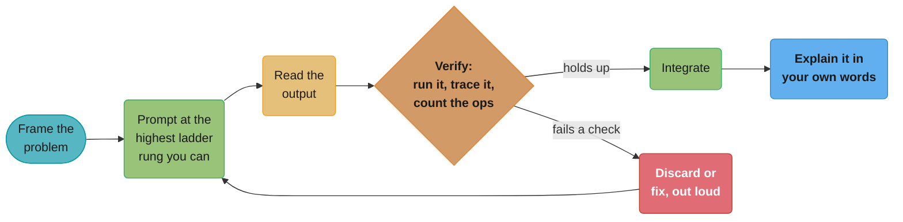

# The AI-Assisted Coding Round — Playbook

> This format changes faster than any other page in this section. The research behind it
> was done 2026-08-26 — before you rely on any specific tool, mode name, or vendor claim
> below, confirm the current format with your recruiter. A page like this one is a snapshot,
> not a policy document.

## Purpose & How to Use This Playbook

A new interview format has spread across large tech companies since late 2025: a coding
round where an AI assistant sits inside the editor and using it well is part of what gets
graded. [interview_execution_playbook.md](interview_execution_playbook.md) already teaches
UMPIRE, the L5 signal rubric, and the communication scripts that make your reasoning visible
to a human interviewer — this file is the AI-era companion to that one. The skills underneath
are unchanged: you still need to understand the problem, match a pattern, plan before typing,
and verify before declaring done. What has changed is the object you are directing and
verifying is no longer only your own head — sometimes it is a model that writes code for you,
often quickly, sometimes wrong in ways that look right.

The one-line thesis: **the assessment moved from "did you produce a correct solution" to
"can you direct and verify a tool that is often almost right."** A wrong-but-confident AI
suggestion is a bigger trap than a blank page, because a blank page announces that you're
stuck and an almost-right suggestion does not.

Read this file once before your first AI-enabled mock. Then use §2 as a pre-interview
checklist, §5 as your prompt-quality reference during practice, and §6 as your post-mock
review — did you fall into any of these traps, and did you recover the way the fix shows.

**The loop this whole format tests**, run every time you touch the AI, not once per round:



Every failure mode in §6 is this loop with one node skipped silently — most often `Verify`
or `Explain`. Graders cannot see a skipped node; they can only see whether the spoken
narration accounted for it.

---

## 1. Find Out Which Round You Are In — First

The market is genuinely split, not converging on one answer. Two opposite rules exist at
different companies, and touching the wrong action in the wrong round costs you the offer
either way:

- **AI-enabled round.** An assistant is built into the editor, using it is expected, and how
  you use it is graded. This is Meta's model: per Meta's own hiring-process page, "select
  roles now include an authorized AI assistant within CoderPad during technical interviews."
- **AI-banned round.** Touching an AI tool is treated as an integrity violation, full stop.
  Amazon and Goldman Sachs are reported — by Business Insider, GeekWire, and other secondary
  outlets, with no primary policy document publicly reachable — to explicitly ban AI tools in
  interviews, with Amazon's internal guidance reportedly calling AI-assisted responses "an
  unfair advantage" and disqualification the stated consequence.

A third pattern sits next to both: Google, Cisco, and McKinsey are reported (single-source,
weakly confirmed) to have reintroduced in-person, whiteboard-style rounds specifically to
defeat AI-assisted cheating. That is a third answer to "how do I handle AI in this round" —
you may not be allowed a screen full of tools at all.

**The single most actionable line in this playbook: ask your recruiter which round this is,
before the interview, in writing.** At Meta, per CoderPad's own blog (quoting a named Meta
engineer), candidates are told in advance which of their rounds is AI-enabled and which is
the classic AI-free algorithm round — it is one round of each, not a wholesale replacement.
Don't assume symmetry between companies, teams, or even two rounds at the same company on
the same day.

If you get no clear answer, default to caution: treat an unspecified round as AI-banned. The
cost of not using a permitted tool is a slower solve. The cost of using a banned one is
disqualification.

---

## 2. The Platforms and What They Actually Do

Each vendor implements "AI in the interview" differently, and the differences change how you
should prompt. The one thing every platform below shares: **the grader sees your prompts.**
That is not a side effect — it is closer to the point of the format. Prompting sloppily in
front of a recorded transcript is a worse mistake than prompting sloppily in private, because
the transcript is graded material.

| Platform | What the AI can do | Modes | Does the grader see your prompts? |
|---|---|---|---|
| CoderPad AI Assist | Chat, or direct write access to files | Ask (chat only), Edit (writes code), Plan (outlines steps first) | Yes — Shared mode shows candidate and interviewer the same history live; every session is reviewable afterward in playback mode |
| CodeSignal (Cosmo) | Embedded assistant, co-pilot or scaffolded | Full AI Co-Pilot Mode, Guided Support Mode | Yes — session replay captures every AI interaction for evaluators |
| HackerRank AI-enabled IDE | Inline completions, file-aware chat, agent mode | Plan mode, agent mode | Yes — evaluates both the solution and AI-collaboration effectiveness |
| Karat NextGen | Integrated AI assistant inside a human-led live interview | Assistant runs alongside a trained interviewer | Yes — a human interviewer is watching and scoring the interaction directly |

The correction worth internalizing about CoderPad specifically: **Edit mode gives the AI
write access to your code.** It is not "the AI can read every file but cannot touch the
editor, so you type every line" — that claim is wrong for CoderPad as documented. What is
true, and what actually matters for how you behave, is that every prompt and every response
is recorded and replayable, so the interviewer can reconstruct exactly what you asked for and
exactly what you accepted without changes. Assume the same is true on any platform that
advertises session replay: your prompt phrasing is not a private scratch space, it is
evidence.

---

## 3. What Is Actually Graded

Build the rubric from what vendors say about their own products, not from rumor. Two levels
of confidence apply here, and they are kept separate deliberately.

**Vendor-stated, high confidence.** CodeSignal's own release language says Cosmo evaluates
"how effectively candidates build solutions with AI assistants," capturing "decision-making,
problem-solving style, and AI collaboration skills." Karat's own description of NextGen
Interviews says it measures "how they frame problems, guide AI output, evaluate correctness,
explain tradeoffs, and make decisions under ambiguity." Those two independent vendor
statements converge on the same defensible common core:

1. **Problem framing** — did you understand and restate the problem before invoking the AI.
2. **Prompt quality** — was the request specific enough to be answerable correctly.
3. **Verification discipline** — did you check the output rather than accept it.
4. **Error detection** — did you catch what was wrong when the AI's answer was wrong.
5. **Integration and explanation** — can you explain, in your own words, code you did not
   type yourself.

**Reported, not confirmed — attribute if you repeat it.** Several anonymous-sourced prep
blogs, citing unnamed internal Meta sources, describe a specific five-dimension Meta rubric —
"prompt quality, task decomposition, error detection, verification discipline, output
integration" — and a quote instructing candidates to "use AI, but need to show you understand
the code... test before using... don't prompt your way out of it." No primary Meta document
confirms either the exact dimension list or the quote. Treat it as directionally consistent
with the vendor-stated core above, worth knowing, but say "prep sources report" if you cite
it — never write it as a fact about Meta's process.

Notice what both levels agree on regardless of source: **verification is graded as heavily as
generation.** Nobody's rubric — vendor-stated or rumored — rewards producing correct code
faster. All of them reward showing your checking work.

---

## 4. A Prompt-Quality Ladder

This is the highest-value section in this file. The same task, prompted at five different
quality levels, produces five different outcomes — and the gap between rung 1 and rung 5 is
usually the entire signal an AI-enabled round has to grade on.

**Task:** you are mid-implementation of a function that groups anagrams from a list of
strings, and you want the AI to help you finish a helper that canonicalizes a word for
grouping.

**Rung 1 — paste the problem statement verbatim.**
> "Group anagrams together."

What comes back: a full, generic solution from scratch, ignoring the code you already have,
often using a different data structure than the one you started with. You now have to decide
whether to throw away your own approach or reconcile two different designs mid-round — a
worse position than before you asked.

**Rung 2 — describe the goal, no constraints.**
> "Write a function that checks if two strings are anagrams of each other."

Better — scoped to the actual sub-problem — but still underspecified. You'll get *a* correct
implementation, but with no guarantee it matches your chosen approach (sorting the string vs.
a 26-length character-count array), and you'll spend time reconciling styles.

**Rung 3 — name the approach, ask for one piece.**
> "I'm grouping anagrams using a hashmap keyed by a canonical form. Write a function
> `canonical_key(word: str) -> str` that returns the same key for anagrams of the same word."

This gets you a function that fits the shape you already committed to. Still leaves the
complexity and edge-case handling (empty string, unicode, case sensitivity) to chance.

**Rung 4 — name the approach, the interface, and one edge case.**
> "Write `canonical_key(word: str) -> str` for an anagram-grouping hashmap. It must run in
> O(k) for a word of length k, not O(k log k) — I don't want sorting. Handle the empty string
> by returning `""`."

Now the response is constrained enough to be checkable against a stated spec in one glance:
does it avoid sorting, does it handle the empty case as specified.

**Rung 5 — state the invariant, the constraints, the edge cases you already found, and ask
for a specific transformation of code you already wrote.**
> "Here's my current `canonical_key`, which sorts the string — O(k log k):
> ```python
> def canonical_key(word: str) -> str:
>     return "".join(sorted(word))
> ```
> The invariant I need preserved: two words are anagrams iff `canonical_key` returns the same
> value for both. Rewrite this to run in O(k) using a fixed-size count array (words are
> lowercase a-z only, per the problem's stated constraints) instead of sorting. Keep the
> function signature identical so the rest of my code doesn't change."

This is the rung that actually gets graded well: you named the invariant that makes
correctness checkable, gave the exact constraint that licenses the O(k) approach (lowercase
a-z only — sorting is safe for any alphabet, a count array is not), and asked for a bounded
transformation instead of a rewrite. The response is now trivial to verify: does the
invariant still hold, does the signature match, is it actually O(k). You did the hard
thinking; the AI did the typing.

The ladder's lesson generalizes: **every rung up moves work from "verify a large surface" to
"verify a small, precisely bounded one."** Rung 1 makes you re-derive correctness for
50 unfamiliar lines. Rung 5 makes you check one invariant against 6 lines you specified
yourself.

---

## 5. The Verification Checklist

This is the part graders actually score, per §3's rubric — run down this list out loud, not
silently, every time the AI hands you code you did not type character-by-character.

1. **Run it.** On the platform's provided examples first, before you read a single line.
2. **Construct the adversarial input yourself** — don't wait for the interviewer to supply
   it: empty input, a single element, all-duplicate elements, the numeric overflow boundary,
   and the specific boundary the AI's loop condition implies (`<` vs `<=` at an index).
3. **State the invariant and check the code holds it.** If you can't state what's true at the
   top of every loop iteration, you can't verify the loop — regardless of who wrote it.
4. **Verify the claimed complexity by counting operations, not by trusting the comment.** An
   AI-authored `# O(n log n)` comment is a claim, not a proof — see §6 for the canonical trap.
5. **Diff what you asked for against what you got.** Did it use the data structure you named,
   respect the constraint you gave, keep the signature you specified. A response that "solves
   the problem" but silently changes your interface is a defect, not a bonus feature.
6. **Say each of the above out loud as you do it.** An unverified silent accept and a verified
   silent accept look identical to an interviewer watching a transcript — the checking only
   counts as signal if it's spoken, exactly as §2 of the sibling playbook already teaches for
   your own code.

---

## 6. Failure Modes Graders Punish

Each of these has a specific spoken recovery line — say it, don't just silently course-correct.

**Pasting unread code.** You ask, the AI answers, you paste it in and move on without reading
it first.
*Recovery:* "Let me read through this before I run it — I want to make sure I understand what
it's doing." Then actually read it before hitting run.

**Accepting a plausible but wrong complexity claim.** The canonical version: the AI writes a
nested loop that scans the array inside another scan and confidently comments `# O(n log n)`.
It is O(n^2). A candidate who repeats the claim without counting the loops has just failed
§5's checklist item 4 in the most visible way possible.
*Recovery:* "Wait — this has a loop inside a loop, both bounded by n. That's O(n^2), not
O(n log n) like the comment says. Let me either fix the comment or fix the algorithm."

**Not noticing a dropped edge case.** The AI's solution handles the general case and silently
skips the empty-input or single-element case you identified during Understand.
*Recovery:* "Let me check this against the edge case I wrote down earlier — empty input.
...It throws an IndexError. I need to add a guard for that."

**Letting the AI restructure code you were mid-way through explaining.** You're narrating your
own partial implementation, invoke Edit mode for one small piece, and it rewrites the whole
function.
*Recovery:* "That changed more than I asked for — let me revert and ask again with a narrower
scope, just the one function I named." Then actually narrow the next prompt (see §4 rung 4-5).

**Going silent while reading AI output.** The interviewer cannot score silence — a 90-second
pause reading a diff is exactly the same "no signal" failure the sibling playbook's §2 rubric
already penalizes for your own thinking.
*Recovery:* narrate the read the way you'd narrate typing: "Okay, this builds a frequency map
first... then does a heap push per element... let me check the pop condition..."

**Arguing with the AI instead of just writing the three lines yourself.** Re-prompting three
times for a one-line fix.
*Recovery:* "This is a small enough fix that it's faster for me to just write it" — then
write it. See §7.

---

## 7. When to Ignore the AI

A short, opinionated rule, because the format rewards judgment about when NOT to reach for
the tool as much as it rewards using it well.

- **If you already recognize the pattern and the fix is small, type it yourself.** A 15-line
  two-pointer loop you can write from memory is faster to type than it is to prompt for,
  wait on, and read carefully enough to trust. Prompting here doesn't save time, it spends it.
- **If the AI's third attempt at the same request is still wrong, the prompt is the problem,
  not the model.** Stop re-prompting and either write it yourself or drop down the §4 ladder
  to a lower, more constrained rung — name the exact invariant and the exact transformation
  instead of asking again in different words.
- **Budget rule:** if you've spent 5 minutes of a 60-minute round reading AI output without a
  single running, passing test to show for it, stop. Write the remaining piece yourself and
  come back to the AI only for the next well-scoped sub-task.

---

## 8. A Mock Transcript — AI-Enabled Round, Multi-File Task

Unlike a single-function LeetCode round, the AI-enabled format's whole point is usually a
small existing codebase — you are extending or fixing something, not writing from a blank
file. This transcript shows a realistic CoderPad Edit-mode session on a rate limiter bug fix,
with grading signals labeled.

```
[0:00] INTERVIEWER: "Here's a small token-bucket rate limiter with a bug — under
       concurrent load, it sometimes allows more requests than the configured
       limit. Find and fix it. You have access to AI Assist in Edit mode if you
       want it."

[0:15] CANDIDATE: "Let me read through the existing code first before I touch
       anything or ask the AI anything."
       [reads rate_limiter.py, refill logic, the acquire() method]
       "I see a check-then-act on self.tokens with no lock around it — that's my
       suspicion for the race. Let me confirm with a prompt rather than guessing."
                                                            [SIGNAL: problem framing
                                                             before invoking AI]

[1:30] CANDIDATE (prompts, Ask mode): "In this TokenBucket.acquire() method, is
       there a race condition between the tokens check and the decrement, under
       concurrent callers? Explain, don't fix yet."

[1:45] AI: [confirms — reads and decrements self.tokens without synchronization;
       two threads can both pass the check before either decrements]

[2:00] CANDIDATE: "That matches what I suspected. I want to fix this myself
       rather than have the AI rewrite the method — it's a small, well-understood
       fix and I want to control exactly what changes."
                                                            [SIGNAL: §7 judgment —
                                                             chose not to prompt]

       def acquire(self) -> bool:
           with self._lock:
               self._refill()
               if self.tokens >= 1:
                   self.tokens -= 1
                   return True
               return False

       "I added self._lock, a threading.Lock already available on the class but
       unused, around the whole check-refill-decrement sequence, so it's atomic."

[4:00] CANDIDATE: "Now let me verify this actually fixes it rather than assuming
       it does — let me ask the AI to help me write a concurrent stress test,
       since that's more tedious to hand-write correctly than the fix itself."
                                                            [SIGNAL: matching the
                                                             tool to the task]

[4:15] CANDIDATE (prompts, Edit mode): "Write a test that spawns 50 threads, each
       calling acquire() once on a TokenBucket with capacity 10 and 0 refill
       rate, and asserts that at most 10 return True. Add it as
       test_concurrent_acquire in the existing test file, don't touch anything
       else."
                                                            [SIGNAL: §4 rung 4-5 —
                                                             scoped, bounded prompt]

[4:45] AI: [writes the test, using threading.Thread and a shared counter]

[5:00] CANDIDATE: "Let me read this before running it... it spawns 50 threads,
       joins them all, counts True returns. That matches what I asked for. Let
       me run it."
                                                            [SIGNAL: §5 checklist —
                                                             read before run]

[5:20] CANDIDATE: "Test passes — exactly 10 True out of 50. Let me also run it
       against the ORIGINAL buggy code by temporarily reverting my lock, to make
       sure the test actually catches the bug rather than passing trivially."
                                                            [SIGNAL: verifying the
                                                             test itself, not just
                                                             the fix]

[6:00] CANDIDATE: "Reverting the lock: 13 True out of 50 on this run — confirms
       the test does catch the race. Restoring my fix now."

[6:30] INTERVIEWER: "Good. What's the AI's test missing, if anything?"

[6:35] CANDIDATE: "It only tests capacity 10 with zero refill — a stronger test
       would also cover the refill path under concurrency, since a bug could
       hide specifically in how _refill interacts with the lock. I didn't ask
       for that because it wasn't the bug in front of me, but I'd add it before
       calling this production-ready."
                                                            [SIGNAL: recognizing
                                                             the limits of AI-
                                                             generated verification,
                                                             unprompted]

[7:00] INTERVIEWER: "That's exactly the gap I was checking for."
```

What made this strong: the candidate read the existing code before prompting anything (§3
"problem framing"), used Ask mode to confirm a hypothesis instead of asking the AI to both
diagnose and fix in one step, chose to hand-write the actual fix because it was small and
well-understood (§7), used a scoped rung-4/5 prompt for the tedious concurrent test rather
than hand-writing it, verified the AI-written test against the pre-fix code to confirm it was
a real test and not a trivial pass, and proactively named a gap in AI-generated coverage when
asked — all of it spoken, none of it silent.

---

## 9. Cross-Links

- [interview_execution_playbook.md](interview_execution_playbook.md) — UMPIRE, the L5 signal
  rubric, and the communication scripts this file assumes throughout; this file is its
  AI-era companion, not a replacement for it
- [dsa_patterns.md](dsa_patterns.md) — the pattern-recognition engine; knowing the pattern
  yourself is what lets you judge whether the AI picked the right one, rather than trusting
  it by default
- [study_plans.md](study_plans.md) — once UMPIRE and the verification habits here are solid,
  use the study plan to drill problems in a structured order
- [../complexity_analysis_and_big_o/complexity_analysis_and_big_o.md](../complexity_analysis_and_big_o/complexity_analysis_and_big_o.md) —
  verifying a claimed complexity, per §5 and §6 above, is the single most common catch
  reported in this round; if you can't count loop nesting on sight, start there

---

## 10. Interview Q&A

**Q: The AI's solution is right but you cannot explain why — what do you do?**
**Short:** Say so directly and trace it line by line before moving on — never claim understanding of code you can't yet justify.
Say exactly that, out loud: "This works, but I don't yet see why — let me trace through it
before I move on." Then actually trace it against your test example, the same way you'd trace
your own code in the sibling playbook's Review phase. Claiming to understand code you can't
justify is worse than admitting you're still working through it — graders are specifically
watching for candidates who accept correct-looking output without being able to defend it.

**Q: The AI claims a solution is O(n log n) and you think it's O(n^2) — what now?**
**Short:** Count the actual loop nesting and operations yourself rather than trusting the comment, then state your own conclusion.
Don't trust the comment — count the loops. If there's a scan inside a scan, both bounded by
n, that's O(n^2) regardless of what the AI's comment says. State your correction plainly: "I
count two nested loops here, both over n — that's O(n^2), not O(n log n) as commented. Let me
either fix the comment to match reality, or find the O(n log n) approach if that's actually
achievable." This exact trap — a nested scan mislabeled as O(n log n) — is the canonical
failure mode graders report catching candidates missing.

**Q: Should you tell the interviewer you're about to use the AI, or just do it?**
**Short:** Say it out loud before you prompt — narrating the decision to invoke AI is itself part of the graded signal.
Say it out loud, the same way you'd narrate a decision to switch data structures: "I'm going
to ask the AI to help scaffold the test cases here, since that's more tedious than
informative to hand-write." Every platform in §2 records the prompt anyway, so silently
invoking it produces no extra privacy — it only produces less spoken signal. Treat "decided
to use the AI here, and here's why" as content, not overhead.

**Q: How do you know whether a round is AI-enabled or AI-banned if the recruiter doesn't say?**
**Short:** Ask explicitly and in writing before the interview; if you get no clear answer, default to treating it as AI-banned.
Ask explicitly, in writing, before the interview: "Will I have access to an AI assistant in
this round, or should I plan to code without one?" If you get no clear answer, default to the
conservative assumption — treat the round as AI-banned. A slower solve costs you some signal;
using a banned tool can cost you the offer outright, and the two outcomes are not
symmetric.

**Q: What's the actual difference between CoderPad's Ask, Edit, and Plan modes?**
**Short:** Ask only chats, Edit gives the AI direct write access to your files, and Plan has it outline steps before acting.
Ask mode is chat-only — the AI answers questions but never touches your code, which is the
safer mode for confirming a hypothesis (as in §8's transcript) without risking an unwanted
rewrite. Edit mode gives the AI direct write access to modify files, which is faster but
riskier — a loosely scoped prompt in Edit mode is what produces the "it rewrote more than I
asked for" failure in §6. Plan mode has the AI outline its intended steps before touching
anything, which is a useful middle ground when you want visibility before you commit to
letting it write.

**Q: Does using AI in an AI-enabled round make the interview easier?**
**Short:** No — it shifts the bottleneck from writing correct code to verifying code you didn't write, which many candidates find harder.
No — it shifts where the difficulty sits. Writing code from scratch tests whether you can
produce a correct solution; directing and verifying an AI's output tests whether you can
catch what's wrong in someone (something) else's code under time pressure, which many
candidates find harder, not easier. The rubric in §3 grades verification as heavily as
generation specifically because skipping verification is the easiest way to fail this format.

**Q: Is it fine to just accept the AI's first suggestion if it passes the given test cases?**
**Short:** No — passing the given examples is necessary but not sufficient; you still owe the adversarial inputs from your own edge-case list.
No. Passing the interviewer-supplied examples only proves the happy path. §5's checklist
requires constructing your own adversarial inputs — empty, single-element, all-duplicate, the
boundary implied by the loop condition — the same discipline the sibling playbook's Review
phase requires for your own code. An AI solution that passes the given cases and fails an
edge case you didn't check is graded the same as if you'd written the bug yourself.

**Q: What if the AI's fix conflicts with an approach you already started implementing?**
**Short:** Don't silently merge two designs — decide out loud which one you're keeping and say why.
Don't silently splice the two together. State the conflict and make a decision out loud: "The
AI's version uses a different data structure than the one I started with — let me decide
whether to switch to its approach or ask it to match mine, rather than merging both." This is
exactly the rung-1-vs-rung-3 problem from §4: an underspecified prompt gets you a different
design, and reconciling two designs live is a worse position than prompting more narrowly the
first time.

**Q: How much of the total time budget should verification take, roughly?**
**Short:** Treat it as comparable to the time spent generating the code, not an afterthought squeezed into the last minute.
Treat it as comparable to generation time, not an afterthought. If you spent two minutes
prompting and reading a response, budget close to that again for running it, constructing
adversarial inputs, and tracing the invariant — not thirty seconds. §7's budget rule — stop
and hand-write it if five minutes pass with no running, passing test — exists precisely
because verification is where candidates under-invest when a plausible-looking answer arrives
quickly.

**Q: Are session transcripts from AI-enabled rounds used anywhere besides live grading?**
**Short:** CoderPad states it will not use AI to make candidate decisions, but reviewable transcripts and playback exist on multiple platforms regardless.
CoderPad states directly, in its own careers documentation, that it will not use AI to make
candidate decisions — but the transcript itself is reviewable by human graders afterward via
playback mode, and CodeSignal's Cosmo separately captures full session replay for evaluators.
The practical implication is unchanged either way: assume whatever you type into the prompt
box is read by a human at some point, live or in review, and prompt accordingly.

**Q: If you're confident in your own solution, is there any reason to use the AI at all?**
**Short:** Only for genuinely tedious sub-tasks like test scaffolding — never to replace a solve you already have, per §7.
Per §7, no — if you already have a correct, well-understood solution, prompting for it adds
verification overhead without adding value. The legitimate uses are narrower: offloading
genuinely tedious sub-tasks (test scaffolding, as in §8's transcript) where writing it
yourself is slower than prompting and verifying, or using Ask mode to sanity-check a
hypothesis before committing time to it. Using the AI to replace a solve you already trust is
pure downside — it adds a review step for no benefit.

**Q: What's the biggest mindset shift from a normal coding round to an AI-enabled one?**
**Short:** Treat every AI suggestion as a claim to be checked, not an answer to be trusted, the same way you'd treat a hint from an unreliable source.
Treat every AI output as a claim requiring verification, not an answer to accept — the same
posture you'd take toward an interviewer hint you're not sure is correct (see the sibling
playbook's §3 "Responding to an interviewer hint"). The graders in §3 are explicitly scoring
whether you catch what's wrong, which means an AI-enabled round with zero AI-generated errors
in it gives you fewer opportunities to demonstrate the exact skill being measured — don't be
surprised if the assistant is sometimes deliberately imperfect.

**Q: The AI generated a helper function you did not ask for — should you keep it?**
**Short:** Keep it only if you can state what it does and why the solution needs it, otherwise delete it and say why out loud.
Keep it only if you can state, unprompted, what it does and why the solution needs it. An
unrequested helper is one of the cheapest places to lose signal: it costs the grader nothing
to point at it and ask "what happens if this gets an empty list?", and if you have not read it
you are now debugging code you did not write in front of an audience. The lazy correct move is
to delete anything you did not ask for and did not read, and to say so out loud — "I'm dropping
this helper, I didn't ask for it and I don't want to carry code I haven't verified" is a
positive signal under every rubric in §3, not an admission of weakness. If you do keep it, run
the §5 checklist against it exactly as you would against the main function; there is no
"probably fine" tier for code that will be attributed to you.

**Q: The AI misunderstood the problem because you pasted an ambiguous statement — whose fault is that graded as?**
**Short:** Yours — problem framing is an explicitly scored dimension, and an ambiguous prompt is the same defect as an unclarified requirement.
Yours, and that is not unfair. Problem framing is an explicitly scored dimension in every
vendor rubric quoted in §3, and pasting an ambiguous statement into the assistant is the same
defect as starting to code before clarifying requirements in a classic round — the UMPIRE
"Understand" phase in [interview_execution_playbook.md](interview_execution_playbook.md) did
not stop applying because there is a model in the pad. The recovery is the same too: notice
that the output answers a different question than the one you meant, say so, and re-prompt with
the constraint you left out. Doing that visibly is worth more than never having made the
mistake, because it demonstrates the failure mode you would actually hit on the job. What loses
the round is integrating an answer to the wrong question and then defending it.

**Q: Is it a red flag to write code by hand in an AI-enabled round?**
**Short:** No — using AI is permitted, not mandatory, and typing a short known solution yourself is usually faster than prompting and verifying it.
No. An AI-enabled round permits the assistant, it does not require it, and §7's budget rule
exists precisely because prompting-plus-verifying has a fixed overhead that a 15-line
two-pointer solution does not repay. What is a red flag is being unable to write anything
without the assistant, which is exactly what a grader learns when you prompt for something you
plainly already know. The strongest pattern in a mixed round is selective: hand-write the part
you know cold, delegate the mechanical or unfamiliar part (a parser, an API you have not used,
a refactor across four files), and narrate the choice — "I'll type the sliding window myself,
it's faster than describing it; I'll ask for the file-walking boilerplate." That narration is
itself the signal, because it shows you have a model of what the tool is good for.
