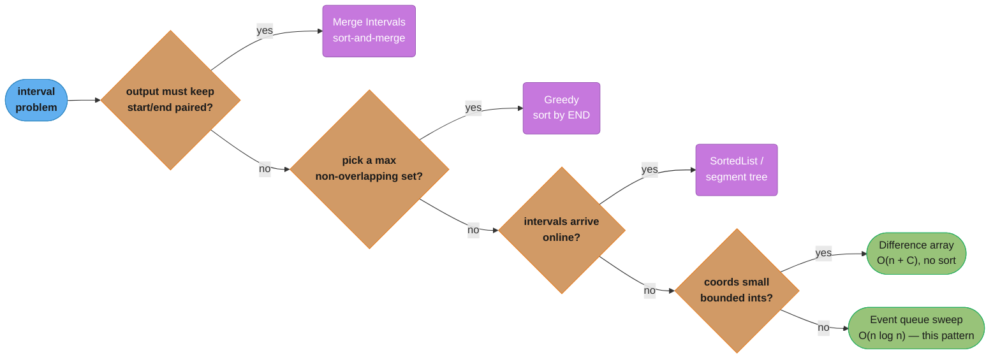

# Sweep Line (Event Queue and Difference Array)

## Pattern Snapshot

Stop thinking about intervals as objects and start thinking about the **boundaries** as timestamped events. Each interval `[start, end)` becomes two events — `+1` at `start` and `-1` at `end` — you sort all `2n` events by coordinate and walk left to right carrying a running count (or a heap, or a balanced structure). The answer is read off the running state, not off the intervals. **Cue**: "at any point in time", "maximum concurrent / minimum rooms", "how many are active at time t", "skyline", "range update then point query". **Typical complexity**: O(n log n) — the event sort dominates; the sweep itself is O(n). When coordinates are small bounded integers the sort disappears and it becomes an O(n + C) difference array.

---

## 1. Recognition Signals

**Reach for sweep line when you see:**

- **"Maximum number of X active at the same time"** — minimum meeting rooms, peak concurrent connections, most overlapping intervals. This is the signature problem.
- **"At every point / for each query time, how many are active?"** — flowers in bloom, population in a year, cars on the road.
- **"Range update, then read"** — add `k` to every index in `[l, r]`, repeated `m` times, then read the array once. The delta/difference-array form.
- **Geometry with a moving line** — skyline, union of rectangle areas, whether rectangles tile a region exactly.
- The problem gives you **starts and ends that do not need to stay paired**. That is the giveaway: if the answer never asks "which interval was it", you are free to shred the intervals into loose events and the problem gets easier.
- Coordinates are one-dimensional and ordered (time, x-position, index), and the state changes **only at the boundaries** — nothing happens strictly inside an interval.

**Anti-signals — looks like sweep line but isn't:**

- You must **produce merged intervals** as output, keeping start/end paired — "merge all overlapping intervals", "insert an interval". That is [merge_intervals.md](merge_intervals.md)'s sort-and-merge, which carries a `current` interval forward. Shredding into events throws away exactly the pairing that answer needs.
- You need to **select a maximum non-overlapping subset** — "minimum arrows to burst balloons", "non-overlapping intervals". That is a greedy: sort by *end*, take the earliest finisher. A sweep counts overlaps; it does not choose among them.
- The array is **static and you only need range sums** with no interval semantics — that is plain [prefix_sum.md](prefix_sum.md). Difference array is prefix sum's dual (range-update/point-query rather than point-update/range-query), so the boundary is which operation is the repeated one.
- Intervals arrive **online** and each query must be answered before the next arrives — you cannot sort what you have not seen. Use a balanced BST / `SortedList` or a segment tree over coordinates (this is why `My Calendar II`/`III` are harder than `Meeting Rooms II`).
- **Two sorted interval lists intersected pairwise** — that is a two-pointer walk, cheaper than building an event queue.

The defining test: **can you answer the question by walking a coordinate axis left to right, carrying only a running aggregate, and updating that aggregate only at interval boundaries?** If yes, sweep line. If the answer needs to know *which* intervals produced the state, you need to carry more than a counter — a heap or a multiset — but it is still a sweep.



*Every "yes" branch peels off to a sibling pattern named in the anti-signals; only "boundaries are all that matter, and you have every interval up front" survives to the event sweep.*

---

## 2. Mental Model & Intuition

A vertical line starts at `-infinity` and slides right. It carries one number: how many intervals it is currently cutting through. That number changes **only** when the line crosses a boundary — `+1` crossing a start edge, `-1` crossing an end edge — so the whole continuous problem collapses to `2n` discrete moments.

```
intervals:   A [0 ......................... 30)
             B      [5 .. 10)
             C                [15 .. 20)

axis:        0    5    10   15   20        30
             |    |    |    |    |          |
events:     +1   +1   -1   +1   -1         -1
             |    |    |    |    |          |
alive:       1    2    1    2    1          0
                 ^^^                ^^^
                 peak = 2 -- two rooms are enough
```

Two things fall out of the picture and both are load-bearing:

**The events are unordered garbage until you sort them.** Interval A contributes `(0, +1)` and `(30, -1)`; those two facts never need to meet again. Sorting is what re-imposes the timeline that the shredding destroyed, and it is the only O(n log n) step in the whole pattern.

**Ties at a single coordinate decide the answer.** At coordinate 10, meeting B ends and (in a different input) meeting D could start. For half-open intervals `[start, end)` — the convention that matches "a room frees at 10, the next meeting takes it at 10" — the `-1` must be applied **before** the `+1` or you invent a room you do not need. This is not a detail; it is the single most common bug in the pattern and §8 shows it failing.

```
half-open [start, end)          closed [start, end]
B ends 10, D starts 10          B ends 10, D starts 10

  ...B) [D...                     ...B]
       ^                              [D...
   -1 then +1                     +1 then -1
   alive: 1 -> 0 -> 1             alive: 1 -> 2 -> 1
   peak 1  (share one room)       peak 2  (they overlap AT 10)
```

Sorting the tuple `(coord, delta)` gets the half-open convention for free, because `-1 < +1`. For the closed convention you either sort `(coord, -delta)` or, more robustly, emit the end event at `end + 1` on an integer axis.

---

## 3. The Template

```python
def max_concurrent(intervals: list[tuple[int, int]]) -> int:
    """Peak number of half-open intervals [start, end) alive at any point.

    Sorting the full (coord, delta) tuple is deliberate: at a shared
    coordinate -1 sorts before +1, so an interval that ends where another
    begins releases its slot first. That IS the half-open convention.
    """
    events: list[tuple[int, int]] = []
    for start, end in intervals:
        events.append((start, +1))
        events.append((end, -1))
    events.sort()

    alive = peak = 0
    for _coord, delta in events:
        alive += delta
        if alive > peak:
            peak = alive
    return peak
```

The **difference-array** form, for when coordinates are small bounded integers — same idea, no sort, O(n + C):

```python
def concurrency_profile(intervals: list[tuple[int, int]], limit: int) -> list[int]:
    """How many half-open intervals cover each x in range(limit)."""
    delta = [0] * (limit + 1)          # +1 slot so delta[end] is always in range
    for start, end in intervals:
        delta[start] += 1
        delta[end] -= 1                # NOT end + 1 -- these are half-open

    running = 0
    profile: list[int] = []
    for x in range(limit):
        running += delta[x]
        profile.append(running)
    return profile
```

```
>>> concurrency_profile([(0, 3), (1, 4), (2, 3)], 6)
[1, 2, 3, 1, 0, 0]
```

Both forms answer the same question. Reach for the array whenever the coordinate space is bounded and dense (minutes in a day, 0-1000 kilometre markers); reach for the event queue whenever coordinates are sparse, huge, or not integers.

---

## 4. Annotated Walkthrough

**Meeting Rooms II** — `intervals = [(0, 30), (5, 10), (15, 20)]`, "minimum number of conference rooms required".

Shred into events, then sort:

```
raw events (insertion order)        sorted by (coord, delta)
  (0,  +1)   from (0, 30)             (0,  +1)
  (30, -1)                            (5,  +1)
  (5,  +1)   from (5, 10)             (10, -1)
  (10, -1)                            (15, +1)
  (15, +1)   from (15, 20)            (20, -1)
  (20, -1)                            (30, -1)
```

Sweep, carrying `alive` and `peak`:

```
  step   coord   delta   alive   peak   what just happened
  ----   -----   -----   -----   ----   ---------------------------------
    1       0      +1      1       1    meeting A opens; one room in use
    2       5      +1      2       2    B opens while A runs; second room
    3      10      -1      1       2    B ends; its room is now free
    4      15      +1      2       2    C opens; REUSES the room B freed
    5      20      -1      1       2    C ends
    6      30      -1      0       2    A ends; building empty
```

Answer: **2**. Note step 4 — the sweep never tracks *which* room, only *how many*. That is why a counter suffices where a naive simulation would want a room allocator. The peak of the running count is the minimum number of rooms, and the reason is a pigeonhole argument: at the instant `alive` hits its peak `k`, `k` meetings are simultaneously in progress and each needs its own room, so `k` is a lower bound; and greedily reusing any freed room never needs more than `k`, so it is also an upper bound.

---

## 5. Complexity

| Form | Time | Space | Dominated by |
|---|---|---|---|
| Event-queue sweep | **O(n log n)** | O(n) | sorting `2n` events |
| Difference array over bounded coords `C` | **O(n + C)** | O(C) | one pass to write deltas, one to prefix-sum |
| Sweep + heap (skyline, max-in-window) | **O(n log n)** | O(n) | sort plus `n` heap pushes/pops |
| Sweep + balanced BST / `SortedList` (online) | **O(n log n)** | O(n) | `n` inserts, each O(log n) |
| Sweep + segment tree (2D area union) | **O(n log n)** | O(n) | `n` range updates, each O(log n) |

### Decoding the complexity claim

`2n` events sorted is `O(2n log 2n)` = `O(n log n)`; the constant 2 and the `log 2` vanish into the notation. The sweep itself touches each event exactly once with O(1) work, so it contributes `O(n)`, strictly dominated. This is why the difference-array form is asymptotically better *when it applies* — it replaces the sort with array indexing, paying O(C) space to do it. Sizing that trade: at `n = 10^5` intervals over `C = 10^3` coordinates the array wins outright; at `n = 10^3` intervals over `C = 10^9` coordinates the array is impossible and the sort is nothing.

Space is O(n) for the event list. You can halve the constant by sorting starts and ends as two separate arrays and two-pointer-merging them (that is exactly what [merge_intervals.md](merge_intervals.md)'s Meeting Rooms II solution does), which is the same algorithm with the merge done by hand instead of by `sort`.

---

## 6. Variations & Sub-patterns

- **Weighted deltas.** Nothing requires `+1`/`-1`. Car Pooling pushes `+num_passengers` at pickup and `-num_passengers` at drop-off, and the constraint becomes "does the running total ever exceed capacity". Any additive quantity works.

  ```python
  def car_pooling(trips: list[tuple[int, int, int]], capacity: int) -> bool:
      """trips: (num_passengers, from_km, to_km); route is 0..1000 km."""
      delta = [0] * 1001
      for num, frm, to in trips:
          delta[frm] += num
          delta[to] -= num          # passengers leave AT `to`, freeing seats
      onboard = 0
      for d in delta:
          onboard += d
          if onboard > capacity:
              return False
      return True
  ```

- **Offline queries by binary search.** When you are asked "how many are active at each of `q` query times", you do not need an explicit sweep at all — sort starts and ends separately and binary search each query. Active at `t` = (started at or before `t`) − (already ended by `t`).

  ```python
  from bisect import bisect_right

  def full_bloom(flowers: list[tuple[int, int]], people: list[int]) -> list[int]:
      """flowers are CLOSED intervals [start, end]; count blooms at each time."""
      starts = sorted(s for s, _ in flowers)
      ends = sorted(e for _, e in flowers)
      return [bisect_right(starts, t) - bisect_right(ends, t - 1) for t in people]
  ```

  `bisect_right(ends, t - 1)` counts flowers whose end is strictly before `t`, which is the closed-interval convention — a flower blooming through `end` is still alive at `end`.

- **Sweep + max-heap: the skyline.** When the running state is "the tallest live building" rather than a count, a counter cannot express it and a heap can. Buildings are pushed as `(-height, right_edge)`; before reading the top, evict everything whose right edge is already behind the line (lazy deletion — cheaper than finding and removing an arbitrary heap element).

  ```python
  import heapq

  def skyline(buildings: list[tuple[int, int, int]]) -> list[list[int]]:
      """buildings: (left, right, height) -> key points [x, height]."""
      events: list[tuple[int, int, int]] = []
      for left, right, height in buildings:
          events.append((left, -height, right))   # start: taller sorts first
          events.append((right, 0, 0))            # bare end marker
      events.sort()

      result: list[list[int]] = []
      live = [(0, float("inf"))]                  # ground plane, never popped
      for x, neg_height, right in events:
          while live[0][1] <= x:                  # evict finished buildings
              heapq.heappop(live)
          if neg_height:
              heapq.heappush(live, (neg_height, right))
          tallest = -live[0][0]
          if not result or result[-1][1] != tallest:
              result.append([x, tallest])
      return result
  ```

  ```
  >>> skyline([(2,9,10), (3,7,15), (5,12,12), (15,20,10), (19,24,8)])
  [[2, 10], [3, 15], [7, 12], [12, 0], [15, 10], [20, 8], [24, 0]]
  ```

  Sorting starts as `-height` makes the taller of two buildings starting at the same `x` enter first, so the emitted key point is the real skyline height and not a spurious lower one. The `(0, inf)` sentinel means `live[0]` is never an empty-heap access.

- **Online / interleaved: no sort available.** `My Calendar II` and `III` book events one at a time and must answer after each. Keep a `SortedList` (or `dict` plus repeated sort, or a segment tree with coordinate compression) of deltas keyed by coordinate, and re-sweep the affected region. The pattern is identical; only the container changes because you have lost the ability to sort once at the start.

- **2D sweep.** Union of rectangle areas: sweep a vertical line across x, maintaining the total covered *y*-length of the live rectangles in a segment tree over compressed y-coordinates. Area accumulates as `covered_y_length * (x_next - x_current)` between consecutive events. Same skeleton, richer running state.

- **Difference array on a 2D grid.** The same delta trick with four corners (`+1` at top-left, `-1` at the two neighbours past the edges, `+1` at the far corner), then a 2D prefix sum — see [prefix_sum.md](prefix_sum.md) for the summed-area machinery this reuses.

---

## 7. Problem Bank

| Problem | Difficulty | Variation | Recognition cue / twist |
|---|---|---|---|
| [Points That Intersect With Cars (LC 2848)](https://leetcode.com/problems/points-that-intersect-with-cars/) | Easy | Difference array | Coordinates bounded by 100 — the array form is the whole solution |
| [Maximum Population Year (LC 1854)](https://leetcode.com/problems/maximum-population-year/) | Easy | Difference array, closed-ish | Death year is exclusive; get that wrong and every answer shifts by one |
| [Corporate Flight Bookings (LC 1109)](https://leetcode.com/problems/corporate-flight-bookings/) | Medium | Weighted difference array | Ranges are **closed** 1-indexed, so the `-seats` goes at `last + 1` |
| [Car Pooling (LC 1094)](https://leetcode.com/problems/car-pooling/) | Medium | Weighted delta + capacity check | Passengers get off **at** `to`, so `-num` goes at `to`, not `to + 1` |
| [Meeting Rooms II (LC 253)](https://leetcode.com/problems/meeting-rooms-ii/) | Medium (Premium) | Peak concurrency | The canonical problem; half-open ties decide it |
| [Divide Intervals Into Minimum Number of Groups (LC 2406)](https://leetcode.com/problems/divide-intervals-into-minimum-number-of-groups/) | Medium | Peak concurrency, closed intervals | Meeting Rooms II in disguise — but intervals are **inclusive**, so end events go at `end + 1` |
| [My Calendar II (LC 731)](https://leetcode.com/problems/my-calendar-ii/) | Medium | Online sweep, reject on triple | Cannot sort once — re-sweep a delta map per booking |
| [Number of Flowers in Full Bloom (LC 2251)](https://leetcode.com/problems/number-of-flowers-in-full-bloom/) | Hard | Offline queries via binary search | Closed intervals; the sweep degenerates into two `bisect` calls |
| [Meeting Rooms III (LC 2402)](https://leetcode.com/problems/meeting-rooms-iii/) | Hard | Sweep + two heaps | You must know *which* room, so a counter is not enough — see [two_heaps.md](two_heaps.md) |
| [My Calendar III (LC 732)](https://leetcode.com/problems/my-calendar-iii/) | Hard | Online peak concurrency | Return the running max `k`-booking after each insert |
| [Exclusive Time of Functions (LC 636)](https://leetcode.com/problems/exclusive-time-of-functions/) | Medium | Events already given, stack state | The events are handed to you as a log; the sweep carries a call stack instead of a counter |
| [Two Best Non-Overlapping Events (LC 2054)](https://leetcode.com/problems/two-best-non-overlapping-events/) | Medium | Sweep + suffix max | Sweep by start, look up the best event that fits after — combines with [prefix_sum.md](prefix_sum.md) |
| [The Skyline Problem (LC 218)](https://leetcode.com/problems/the-skyline-problem/) | Hard | Sweep + max-heap | Running state is a max, not a count; lazy-delete the heap |
| [Rectangle Area II (LC 850)](https://leetcode.com/problems/rectangle-area-ii/) | Hard | 2D sweep + segment tree | Sweep x, maintain covered y-length over compressed coordinates |
| [Perfect Rectangle (LC 391)](https://leetcode.com/problems/perfect-rectangle/) | Hard | Corner-counting sweep | Sweep is one solution; the corner-parity trick is the slicker one |
| [Merge Intervals (LC 56)](https://leetcode.com/problems/merge-intervals/) | Medium | Contrast — do **not** sweep | Output must keep pairs; use [merge_intervals.md](merge_intervals.md) |

---

## 8. Common Mistakes (BROKEN -> FIX)

**Mistake: sorting events by coordinate alone, so a tie between an end and a start is broken by insertion order instead of by convention.**

```python
# BROKEN — sorts on the coordinate only. Python's sort is stable, so two
# events at the same coordinate keep the order they were appended in, and
# that order depends on which interval happened to come first in the input.
def max_concurrent_broken(intervals: list[tuple[int, int]]) -> int:
    events = []
    for start, end in intervals:
        events.append((start, +1))
        events.append((end, -1))
    events.sort(key=lambda e: e[0])        # BUG: delta is not a sort key
    alive = peak = 0
    for _coord, delta in events:
        alive += delta
        peak = max(peak, alive)
    return peak
```

```python
# FIXED — sort the whole tuple. At a shared coordinate, -1 < +1, so the
# end is always applied before the start, which is exactly the half-open
# [start, end) convention: a room freed at 10 is available at 10.
def max_concurrent(intervals: list[tuple[int, int]]) -> int:
    events = []
    for start, end in intervals:
        events.append((start, +1))
        events.append((end, -1))
    events.sort()                          # FIX: (coord, delta)
    alive = peak = 0
    for _coord, delta in events:
        alive += delta
        peak = max(peak, alive)
    return peak
```

**Trigger**: `intervals = [(10, 20), (0, 10)]` — one meeting from 0 to 10, the next from 10 to 20. Correct answer is **1** room. The broken version appends `(10,+1), (20,-1), (0,+1), (10,-1)`; a stable sort on the coordinate alone yields `(0,+1), (10,+1), (10,-1), (20,-1)`, so `alive` climbs to 2 before falling back, and it returns **2**. Feed it the same two meetings in the other order and it returns 1 — the bug is input-order dependent, which is why it survives a casual test and dies in a hidden case. The fixed version returns 1 for both orderings.

Two follow-ons from the same root cause:

- **Closed intervals need the opposite tie-break.** If `[start, end]` means both endpoints are occupied (Divide Intervals Into Minimum Number of Groups), two intervals sharing coordinate 10 genuinely overlap. Emit the end event at `end + 1` on an integer axis, or sort `(coord, -delta)`. Do not silently keep the half-open template.
- **The difference array has the identical trap.** `delta[end] -= 1` is the half-open form; `delta[end + 1] -= 1` is the closed form — and if `end + 1` can reach the array bound, the array must be sized `limit + 1` or you get an `IndexError` on exactly the last interval.

---

## 9. Related Patterns & When to Switch

- **[Merge Intervals](merge_intervals.md)** — switch the moment the *output* is intervals rather than a number. Merge keeps `current.start`/`current.end` paired and extends them; a sweep has already destroyed that pairing. The two overlap in one place only: Meeting Rooms II can be solved either way, and merge_intervals.md's two-pointer-over-separate-sorted-arrays solution is literally this sweep with the merge hand-written.
- **[Prefix Sum](prefix_sum.md)** — the difference array is prefix sum run backwards: prefix sum answers many range queries over a static array, difference array applies many range updates then reads once. If a problem does both repeatedly, neither is enough — you want a Fenwick tree.
- **[Two Heaps](two_heaps.md)** — switch when the running state must identify *which* element, not just how many (Meeting Rooms III needs the lowest-numbered free room). The sweep skeleton survives; the counter becomes heaps.
- **[Greedy](greedy.md)** — "minimum arrows to burst balloons", "maximum non-overlapping intervals": sort by **end** and take greedily. A sweep counts overlaps and cannot choose between them, so a counting solution to a selection problem is a sign you picked the wrong pattern.
- **[Modified Binary Search](modified_binary_search.md)** — when the queries are offline and the intervals are static, sorted starts and ends plus `bisect` beat an explicit sweep in both code size and constant factor (the flowers-in-bloom form in §6).
- **Segment tree / Fenwick** (see [graphs_tries_and_advanced_structures](../graphs_tries_and_advanced_structures/graphs_tries_and_advanced_structures.md)) — the escalation when the running state is a range aggregate that must survive arbitrary insertion order, which is the 2D area-union case and the online-calendar case.

---

## 10. Cross-links

- Concept module: [sorting_and_searching](../sorting_and_searching/sorting_and_searching.md) — the O(n log n) sort is the whole cost of this pattern; stability and multi-key sort keys are exactly the §8 bug
- [arrays_strings_and_hashing](../arrays_strings_and_hashing/arrays_strings_and_hashing.md) — the difference array is a plain array trick; coordinate compression is a hashing trick
- [heaps_and_priority_queues](../heaps_and_priority_queues/heaps_and_priority_queues.md) — the skyline variant's max-heap and its lazy-deletion idiom
- [graphs_tries_and_advanced_structures](../graphs_tries_and_advanced_structures/graphs_tries_and_advanced_structures.md) — segment trees for the 2D and online forms
- Applied: [`../../database/sql_query_optimization/sql_query_optimization.md`](../../database/sql_query_optimization/sql_query_optimization.md) — a merge join is a two-list sweep over sorted inputs, and range predicates are planned on the same sorted-scan idea
- Applied: [`../../devops/sre_principles_and_slos/sre_principles_and_slos.md`](../../devops/sre_principles_and_slos/sre_principles_and_slos.md) — "peak concurrent requests" from a request log with start/duration is this exact sweep, and it is how you size a connection pool
- Sibling patterns: [merge_intervals.md](merge_intervals.md), [prefix_sum.md](prefix_sum.md), [two_heaps.md](two_heaps.md)
- Master index: [dsa_patterns/dsa_patterns.md](dsa_patterns.md)

---

## 11. Interview Q&A

**Q: What exactly does a sweep line "sweep", and why does turning intervals into events make the problem easier?**
**Short:** It sweeps a coordinate axis left to right carrying a running aggregate that changes only at interval boundaries, so a continuous problem collapses to 2n discrete events.
An imaginary line moves along one coordinate axis — time, x-position, index — and carries a running aggregate of everything it currently intersects. The key observation is that this aggregate can only change at an interval **boundary**; nothing happens strictly inside an interval. So `n` continuous intervals collapse to `2n` discrete moments, and once those moments are sorted the entire problem is a single linear pass. The reason it simplifies things is that it discards the pairing between a start and its end: you stop asking "which intervals overlap which" (a quadratic-looking question) and start asking "how many are open right now" (a running counter).

**Q: Why do you sort the tuple `(coordinate, delta)` rather than just the coordinate?**
**Short:** Sorting the full tuple makes `-1` sort before `+1` at a shared coordinate, which is exactly the half-open convention where an interval ending at t frees its slot for one starting at t.
Because the tie at a shared coordinate is the entire correctness question. If meeting A ends at 10 and meeting B starts at 10, do they need one room or two? Under the half-open convention `[start, end)` the answer is one, and sorting `(coord, delta)` gets that for free since `-1 < +1` puts the end first. Sorting on the coordinate alone leaves the tie to the sort's stability, which means the answer depends on the input order — the same two meetings return 1 or 2 depending on which was listed first. That is a bug that passes casual testing and fails a hidden case.

**Q: How do you adapt the template when intervals are closed, `[start, end]`, so that endpoints touching counts as an overlap?**
**Short:** Emit the end event at `end + 1` on an integer axis, or sort by `(coord, -delta)` so starts are applied before ends at a tie.
Two equivalent fixes. On an integer axis, emit the end event at `end + 1` — the interval is then genuinely open at `end + 1` and the standard half-open machinery works unchanged, which is also the safer choice because the code stays identical everywhere else. Alternatively sort by `(coord, -delta)` so `+1` is applied before `-1` at a tie. The `end + 1` trick does not work on a continuous axis (real-valued coordinates), where you must use the sort-key form. Whichever you pick, say out loud which convention the problem uses before you write the code — interviewers watch for it.

**Q: What is a difference array, and when is it better than the event-queue sweep?**
**Short:** A difference array stores deltas at interval boundaries in a fixed-size array, then prefix-sums once — O(n + C) with no sort, viable when coordinates are small bounded integers.
Instead of building a sorted event list, you allocate an array over the coordinate space and write `+k` at `start` and `-k` at `end` directly. One prefix-sum pass then reconstructs the value at every coordinate. It is O(n + C) rather than O(n log n) because array indexing replaces sorting, so it wins outright whenever the coordinate space `C` is small and dense — minutes in a day, 0-1000 kilometre markers, years in a century. It is unusable when coordinates are sparse, huge, or non-integer, which is when you fall back to the event queue. The relationship to prefix sum is exact duality: prefix sum is point-update/range-query, difference array is range-update/point-query.

**Q: Why is the peak of the running counter the minimum number of meeting rooms, rather than just an estimate?**
**Short:** It is both bounds at once — at the peak, k meetings are simultaneously live so k rooms are necessary, and greedily reusing any freed room never needs more than k.
It is a matching lower and upper bound. Lower bound: at the instant the counter reaches its peak `k`, there are `k` meetings simultaneously in progress, and by pigeonhole each needs its own room, so no schedule can use fewer than `k`. Upper bound: process events in order and assign each start to any currently free room; a room is only unavailable if its meeting is still live, so you never need to allocate a `(k+1)`-th room. Since `k` is both necessary and sufficient, it is exactly the minimum. Notice the sweep never tracks *which* room — it only needs the count, which is why a single integer replaces a room allocator.

**Q: When is sweep line the wrong pattern for an interval problem?**
**Short:** When the output must keep starts and ends paired (merging) or must select a maximum non-overlapping subset (greedy) — a sweep counts overlaps but cannot name or choose among them.
Three cases. If the output is a list of merged intervals, shredding into events throws away the pairing the answer needs — use sort-and-merge. If the task is selecting a maximum non-overlapping subset (minimum arrows, non-overlapping intervals), that is a greedy that sorts by *end* and takes the earliest finisher; counting overlaps tells you nothing about which to keep. And if intervals arrive online and each query must be answered before the next arrives, you cannot sort what you have not seen, so you need a `SortedList` or a segment tree instead. A useful smell test: if you find yourself trying to recover which interval an event came from, you have outgrown the counter.

**Q: What is the time and space complexity of the event-queue sweep, and what dominates?**
**Short:** O(n log n) time and O(n) space, entirely dominated by sorting the 2n events — the sweep itself is a single O(n) pass with O(1) work per event.
Building `2n` events is O(n), sorting them is O(2n log 2n) = O(n log n), and the sweep touches each event once with constant work, so O(n). The sort dominates and the constant 2 vanishes into the notation. Space is O(n) for the event list, which you can halve by keeping starts and ends as two separate sorted arrays and two-pointer-merging them — the identical algorithm with the merge written by hand. If the coordinate space is bounded you drop to O(n + C) time and O(C) space with the difference array, which is the only way to beat the `log n`.

**Q: How do you handle the skyline problem, where the running state is a maximum instead of a count?**
**Short:** Replace the counter with a max-heap of live building heights keyed by right edge, evicting finished buildings lazily before reading the top at each event.
A counter cannot express "the tallest live building", so the running state becomes a max-heap of `(-height, right_edge)`. At each event, first evict from the top everything whose right edge is already behind the sweep line — lazy deletion, because removing an arbitrary element from a binary heap is O(n) and popping the top is O(log n). Then push if the event is a start, and read the current top. Emit a key point only when the top changed. Two details carry the correctness: sort starts as `-height` so the taller of two buildings starting at the same x enters first, and seed the heap with a `(0, infinity)` ground plane so the top is never an empty-heap access.

**Q: The heap in the skyline solution accumulates dead entries. Does lazy deletion break the complexity?**
**Short:** No — each building is pushed once and popped at most once, so total eviction work is O(n log n) amortized even though a single event can pop many entries.
Each building is pushed exactly once and popped at most once across the entire sweep, so the total number of pops is bounded by `n` regardless of how they cluster. A single event may evict many entries, but that work is paid for by pushes that already happened — the standard amortization argument. The heap's size can transiently exceed the number of genuinely live buildings, which costs memory but not asymptotic time. The alternative, eagerly removing an arbitrary element, needs a heap with an index map or a `SortedList`, and buys you nothing asymptotically.

**Q: How would you count, for `q` query times, how many intervals are active at each — without simulating the sweep?**
**Short:** Sort starts and ends into two separate arrays and binary search each query: active(t) = (started by t) minus (ended before t).
Sort all starts into one array and all ends into another, then for each query time `t` compute `bisect_right(starts, t) - bisect_right(ends, t - 1)` for closed intervals. The first term counts intervals that have begun at or before `t`, the second counts those already finished strictly before `t`, and the difference is what is live. Total cost is O((n + q) log n) with no explicit event list. The exact `bisect` boundary encodes the interval convention, so get it wrong and you are off by the count of intervals ending exactly at `t` — worth stating your convention before writing it.

**Q: A colleague solves "maximum concurrent connections" by sorting intervals by start and simulating with a min-heap of end times. Is that the same algorithm?**
**Short:** Yes, asymptotically identical — the heap of end times is just an implicit event queue, and the sweep with a counter is the same algorithm with a smaller constant.
It is the same O(n log n) algorithm wearing different clothes. Sorting by start and popping ends off a min-heap whenever the next start is later is precisely a merge of the start stream and the end stream, which is exactly what sorting `2n` events does. The heap version keeps a smaller working set and generalizes better when you need to know *which* interval ended (Meeting Rooms III). The counter version is shorter and has a smaller constant factor. Say the equivalence out loud in an interview — recognizing that two solutions are the same algorithm is a stronger signal than producing either.

**Q: How does the sweep extend to two dimensions, for the union area of overlapping rectangles?**
**Short:** Sweep a vertical line across x and maintain the total covered y-length of live rectangles in a segment tree over compressed y-coordinates, accumulating area between consecutive x events.
Each rectangle becomes two vertical events at its left and right x-edges, carrying its y-span with a `+1`/`-1` sign. Sweep x in sorted order; between consecutive events the covered y-length is constant, so the area contributed is `covered_y_length * (x_next - x_current)`. Maintaining that covered length under range add/remove is the hard part: a segment tree over the compressed distinct y-coordinates, where each node stores a cover count and the covered length of its range, updates and reports in O(log n). Total O(n log n). The skeleton is unchanged — only the running state got richer, which is the general shape of every sweep-line escalation.

**Q: The problem says intervals can arrive one at a time and each must be answered immediately. What changes?**
**Short:** You lose the single up-front sort, so the delta map must live in a structure that stays ordered under insertion — a balanced BST, a `SortedList`, or a segment tree over compressed coordinates.
The sweep itself is unchanged; what breaks is the assumption that you can sort once. Keep the deltas in a structure that stays ordered under insertion — Python's `sortedcontainers.SortedList`, a `TreeMap` in Java, or a segment tree with lazy propagation over compressed coordinates. For a small number of bookings, re-walking a sorted `dict` of deltas after each insert is O(n) per booking and O(n^2) total, which is often accepted; the segment-tree version is O(log C) per booking. This is exactly the gap between `Meeting Rooms II` and `My Calendar III` — same question, offline versus online, and the online version is a whole difficulty tier harder for that reason alone.

**Q: What are the classic off-by-one traps in the difference-array form?**
**Short:** Putting the negative delta at the wrong index for the interval convention, and sizing the array without the extra slot that `end + 1` needs.
Two, and they compound. First, the negative delta goes at `end` for half-open `[start, end)` and at `end + 1` for closed `[start, end]` — Car Pooling is half-open (passengers leave *at* the drop-off), Corporate Flight Bookings is closed (the last flight is included), and the two problems look nearly identical. Second, if you use `end + 1` you must allocate the array with one extra slot or the last interval writes out of bounds — and it will be the last interval, so a test with a short input passes. Write the convention down as a comment on the line that does the subtraction; that is the line a reviewer checks.

**Q: Can you use a sweep line on something other than time or position?**
**Short:** Yes — any totally ordered axis works, including array indices, sorted values, and even the sorted query list, which is what "offline processing" means.
The pattern needs only a total order and state that changes at discrete points. Sweeping array indices gives you the difference-array range-update trick. Sweeping sorted *values* rather than positions is how "count pairs with difference at most k" style problems get solved. Sweeping the sorted query list — answering queries in an order you chose rather than the order given — is the definition of an offline algorithm, and it is what makes the flowers-in-bloom binary-search solution work. The recognizable shape is always the same: sort something, then make one pass carrying a running aggregate that only changes at boundaries.

**Q: In an interview, how do you decide between the sweep, the merge, and the greedy within the first minute?**
**Short:** Look at the required output — a number about simultaneity means sweep, a list of intervals means merge, a chosen subset means greedy sorted by end.
Read what the answer has to be, not what the input is. If the answer is a **count or a maximum about simultaneity** ("how many rooms", "peak concurrency", "value at time t"), sweep. If the answer is a **list of intervals** ("merge these", "insert this"), sort-and-merge, because a sweep destroys the pairing you need to emit. If the answer is a **chosen subset** ("fewest arrows", "most non-overlapping meetings"), greedy by end time. All three start with a sort, so committing early costs nothing — and stating the rule out loud is itself a strong signal, because it shows you are classifying rather than pattern-matching on the word "interval".
