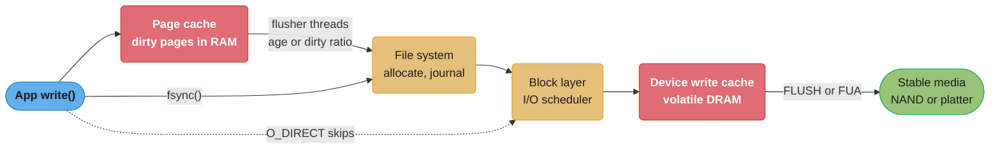
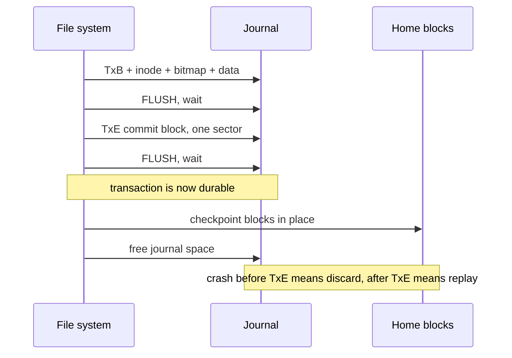
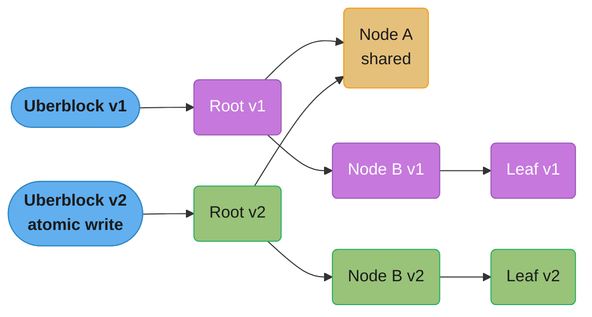
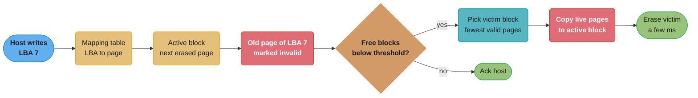
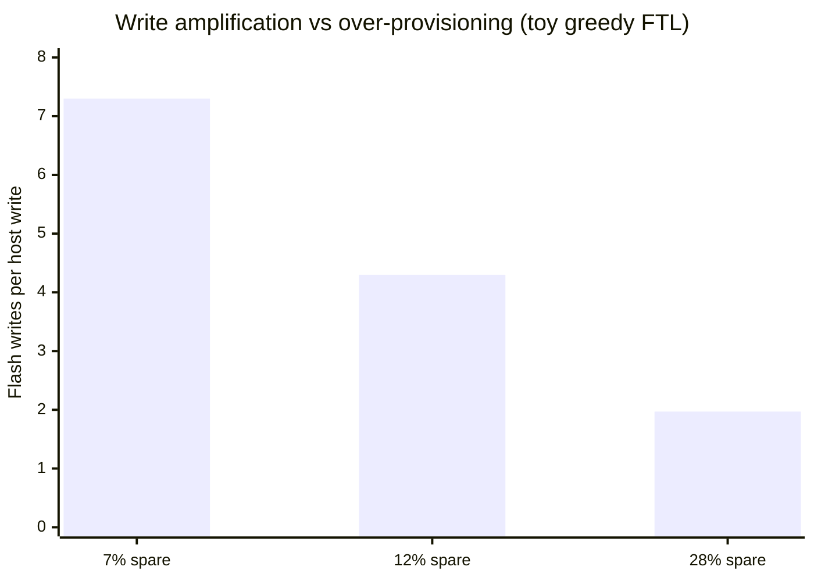

# File Systems and Persistent Storage

> A `write()` that returned success has promised you almost nothing. Durability is a protocol you run against the kernel, the file system, and the device, and every layer is allowed to keep your bytes in volatile memory until you ask it the right question.

---

## 1. Concept Overview

A **file system** turns a flat array of fixed-size device blocks into named, hierarchical, growable files that survive power loss. It owns four jobs: **naming** (directories map names to files), **allocation** (which free blocks a file gets), **metadata** (size, owner, timestamps, block map, kept in an **inode**), and **crash consistency** (after a power cut at any instant, the on-disk structures are still a valid file system).

**Persistent storage** is everything under the file system: the block layer, the device's volatile write cache, the SSD's flash translation layer (FTL) or the HDD's platters, and any redundancy layer (RAID, erasure coding) that spreads one logical block over several devices.

This module teaches the concepts at the operating-systems level, following the persistence part of OSTEP (file system implementation, crash consistency, log-structured and flash storage) and the Linux kernel documentation for ext4, XFS and btrfs. It covers:

- inodes, directories, links and the block map vs extent representation
- crash consistency: fsck, soft updates, journaling (ext4, XFS) and copy-on-write (ZFS, btrfs)
- the page cache, writeback, and the exact contracts of `fsync`, `fdatasync`, `O_DIRECT` and `rename`
- the 2018 "fsyncgate" lesson: what to do when `fsync` fails
- SSD internals: pages, erase blocks, the FTL, garbage collection and write amplification
- RAID levels and erasure coding, and their rebuild arithmetic
- file systems vs object stores

It deliberately stops at the boundary of the database. How a database builds a write-ahead log, an LSM-tree or a B+tree **on top of** these primitives lives in [Logging, Recovery and Checkpointing](../../database/logging_recovery_and_checkpointing/logging_recovery_and_checkpointing.md) and [Storage Engines Internals](../../database/storage_engines_internals/storage_engines_internals.md). The page-level mechanics of virtual memory that the page cache is built on live in [Memory Management and Virtual Memory](../memory_management_and_virtual_memory/memory_management_and_virtual_memory.md).

---

## 2. Intuition

> **One-line analogy**: A file system is a library catalogue. The shelves are disk blocks, the catalogue cards are inodes, and the directory is the index that maps titles to cards. A crash is a librarian fainting halfway through re-shelving a book: the catalogue must never point at an empty shelf, and a shelf must never hold a book that no card mentions.

**Mental model**: every file update is a multi-block update. Appending 4 KiB to a file touches at least three blocks: the data block, the inode (new size, new block pointer) and the free-space bitmap. The device makes only **one sector** atomic at a time. So the file system needs a protocol that turns "three independent writes, any subset of which might land" into "all three or none". There are two families of answer:

1. **Write-ahead (journaling)**: write the intended changes to a log first, mark them committed, then apply them in place. After a crash, replay committed log records. ext4, XFS, NTFS.
2. **Never overwrite (copy-on-write)**: write every changed block to a new location, then flip one root pointer atomically. The old tree stays valid until the flip. ZFS, btrfs, and (inside the drive) every SSD's FTL.

**Why it matters**: every database, message queue and configuration store you will design sits on these primitives. A system that loses acknowledged writes on power loss almost always does so because it assumed a layer below it was more durable than its contract says. The OSDI 2014 study "All File Systems Are Not Created Equal" analysed eleven widely-used systems (databases, key-value stores, version control, distributed systems, virtualization software) and found **60 crash vulnerabilities**: application update protocols that were correct only on some file systems.

**Key insight**: durability is not a property of a write, it is a property of a **barrier**. Data is durable when, and only when, a flush that covered it has completed and reported success. `write()` copies bytes into the page cache at memory speed; `fsync()` is the barrier that pushes them through the device cache to stable media. Everything else in this module is about where the barriers are, what they cost, and what happens when one fails.

---

## 3. Core Principles

**The inode is the file; the name is not.** An inode holds everything about a file except its name: type, permissions, owner, size, timestamps, link count, and the map from file offsets to device blocks. A directory is a special file whose contents are `(name, inode number)` entries. A **hard link** is a second directory entry pointing at the same inode; the link count tracks how many names point at it, and the blocks are freed only when the link count and the count of open file descriptors both reach zero. That is why you can `unlink()` a file another process still has open and the space is not reclaimed until it closes it.

**Block maps vs extents.** The classic Unix inode (ext2/ext3) holds 12 direct block pointers, then one single-, one double- and one triple-indirect pointer. With 4 KiB blocks and 4-byte pointers, that addresses `12 + 1,024 + 1,024^2 + 1,024^3 = 1,074,791,436` blocks, exactly the "Blocks Per File, Block Maps" limit in the ext4 documentation. ext4 replaces this with **extents**: a `(logical block, length, physical block)` record. One initialized extent covers up to 32,768 blocks (128 MiB at 4 KiB), and the inode's 60-byte `i_block` area holds the first four extents directly, so a contiguous 512 MiB file needs no extra metadata block.

**Crash consistency is about ordering, not speed.** A disk guarantees only that a single sector write is atomic. OSTEP's journaling chapter makes the journal commit block a single 512-byte write for exactly this reason. Everything above that is built by ordering writes and inserting flush barriers between them. The canonical journaling protocol: write the journal descriptor and changed blocks, **flush**, write the commit block, **flush**, then checkpoint the blocks to their home locations.

**The page cache decouples `write()` from the device.** On Linux, a buffered `write()` copies data into page-cache pages, marks them dirty and returns. Background flusher threads write dirty pages later, triggered by age (`vm.dirty_expire_centisecs`) and by the fraction of memory that is dirty (`vm.dirty_background_ratio`, `vm.dirty_ratio`). Until writeback and a device flush both complete, the data exists only in RAM.

**`fsync` is the durability contract.** The Linux `fsync(2)` man page says it flushes the file's modified data and metadata, "includ[ing] writing through or flushing a disk cache if present", and blocks until the device reports completion. It also says `fsync` on a file does **not** guarantee that the directory entry reached disk: a newly created or renamed file also needs an `fsync` on its parent directory.

**A failed `fsync` is not retryable.** Linux marks dirty pages clean after a writeback error. The PostgreSQL wiki's "Fsync Errors" page records that on Linux "retrying fsync() can falsely report success and the modified buffer can be thrown away at any time due to memory pressure". The only safe response to an `fsync` error on data you cannot reconstruct is to crash and recover from your own log.

**Flash cannot overwrite in place.** NAND flash is programmed in pages (a few KB, e.g. 4 KB) but erased only in whole blocks (typically 128 KB or 256 KB, per OSTEP). An SSD therefore never overwrites: its FTL writes new data to an erased page, remaps the logical block, and later garbage-collects blocks full of stale pages. The extra internal copying is **write amplification**.

**Redundancy is arithmetic over failures.** Mirroring stores `k` full copies and survives `k - 1` losses. Parity and erasure coding store `k` data fragments plus `m` coded fragments and survive any `m` losses at a storage cost of `(k + m) / k`. The HDFS documentation states it in one line: 3x replication costs 200% overhead, while a typical erasure-coded layout costs no more than 50%.

---

## 4. Types / Architectures / Strategies

### Crash-consistency strategies

| Strategy | How it stays consistent | Recovery cost | Examples |
|----------|------------------------|---------------|----------|
| fsck (no protocol) | Write in any order, scan the whole volume after a crash and repair | O(volume size): hours on a large disk | ext2, early FAT |
| Soft updates | Order every metadata write so on-disk state is always valid (data before the inode that points at it) | Background scan only to reclaim leaked blocks | FreeBSD UFS |
| Metadata journaling | Log metadata changes; data written in place before the commit (ordered) or unordered | Replay the journal: seconds | ext4 `data=ordered` (default), XFS, NTFS |
| Full data journaling | Log data and metadata; every byte written twice | Replay the journal | ext4 `data=journal` (deprecated in the kernel docs, removal scheduled for January 2028) |
| Copy-on-write | Never overwrite live blocks, flip a root pointer atomically | Mount the last committed root | ZFS, btrfs, APFS |
| Log-structured | The whole volume is a log; a cleaner reclaims old segments | Roll forward from the last checkpoint | LFS, F2FS, every SSD FTL |

### ext4 journaling modes

| Mode | What goes in the journal | Guarantee after crash | Cost |
|------|-------------------------|----------------------|------|
| `data=journal` | Data and metadata | File contents match committed metadata | Every data block written twice, no delayed allocation, no `O_DIRECT` |
| `data=ordered` (default) | Metadata only; data forced to disk before its metadata commits | A file never points at garbage blocks | Data flush ordered before each commit |
| `data=writeback` | Metadata only; data may land after metadata | A recently written file may contain stale data from a previous owner of the blocks | Fastest; the kernel docs call out the stale-data security exposure |

### Linux file systems you will be asked about

| File system | Consistency model | Distinguishing design | Integrity of user data |
|-------------|------------------|----------------------|-----------------------|
| ext4 | JBD2 journaling | Block groups (128 MiB each with 4 KiB blocks), extents, delayed allocation, htree directories | Metadata and journal checksums; no data checksums |
| XFS | Metadata journaling with delayed logging | Allocation groups that allocate in parallel, B+trees for free space and extents, built for large files and many cores | CRC32c on metadata blocks (v5 format); no data checksums |
| btrfs | Copy-on-write B-trees | Subvolumes, snapshots, reflinks, send/receive, built-in RAID | Data and metadata checksummed by default (crc32c; xxhash, sha256, blake2b since kernel 5.5) |
| ZFS (OpenZFS) | Copy-on-write with an intent log (ZIL) | Pooled storage, RAID-Z, checksums in parent block pointers, snapshots, send/receive | Checksummed by default (`checksum=on`, currently fletcher4) |
| F2FS | Log-structured | Designed for flash: multi-head logs separate hot, warm and cold data | Optional |

### Redundancy layouts

| Layout | Usable capacity (n disks) | Survives | Small random write cost |
|--------|--------------------------|----------|------------------------|
| RAID 0 (stripe) | n | 0 failures | 1 I/O |
| RAID 1 / RAID 10 (mirror) | n/2 | 1 per mirror pair | 2 I/Os |
| RAID 5 (single parity) | n - 1 | 1 failure | 4 I/Os: read old data, read old parity, write data, write parity |
| RAID 6 (double parity) | n - 2 | 2 failures | 6 I/Os |
| RAID-Z1/2/3 (ZFS) | n - p | p failures | Full-stripe copy-on-write: no read-modify-write, no write hole |
| Erasure code RS(k, m) | k / (k + m) of raw | any m fragments | Encode on write, read k fragments on a degraded read |

### Where the "file" abstraction lives

| Abstraction | Unit | Update model | Namespace | Examples |
|-------------|------|-------------|-----------|----------|
| Block device | Fixed-size block | Overwrite any block | None (LBA numbers) | NVMe namespace, EBS volume |
| POSIX file system | Byte-addressable file | Overwrite, append, truncate, rename | Hierarchical, atomic rename | ext4, XFS, NFS |
| Object store | Immutable object | Whole-object PUT, no partial overwrite | Flat keys with prefix listing | S3, GCS, Azure Blob, Ceph RGW |

---

## 5. Architecture Diagrams

### From `write()` to stable media


*Red boxes lose their contents on power failure. A buffered `write()` stops at the page cache; only `fsync()` (or `O_DIRECT` plus a flush) drives data through both volatile layers to stable media.*

**Stated plainly.** "There are two volatile caches between your program and the platter, and `fsync` is the call that empties both." `O_DIRECT` removes the first cache, not the second: a direct write can still sit in the drive's DRAM cache until a FLUSH or a Force Unit Access (FUA) write.

### The inode and its block map

```
  ext2/ext3-style inode, 4 KiB blocks, 4-byte block pointers (1,024 per block)

  +-------------------------+
  | mode, uid, size, times  |
  | link count = 2          |      direct: 12 x 4 KiB                       =   48 KiB
  +-------------------------+
  | ptr[0]  .. ptr[11] -----+----> data blocks
  | ptr[12] single indirect +----> [1,024 ptrs] -> data                     =    4 MiB
  | ptr[13] double indirect +----> [1,024] -> [1,024] -> data               =    4 GiB
  | ptr[14] triple indirect +----> [1,024] -> [1,024] -> [1,024] -> data    =    4 TiB
  +-------------------------+

  ext4 extent inode, same 60-byte i_block area:
  +-------------------------+
  | 12 B extent header      |      each extent: (logical, len <= 32,768, physical)
  | extent 0: 0..32767 @ P  |      4 extents x 32,768 x 4 KiB              =  512 MiB
  | extent 1..3             |      larger files: the header becomes an index node
  +-------------------------+
```
*The block map pays one pointer per 4 KiB block, so a 1 GiB file needs 262,144 pointers spread over indirect blocks. An extent pays one 12-byte record per contiguous run of up to 128 MiB, so the same file laid out contiguously needs 8 extents.*

### Journaling: the commit protocol


*The single-sector commit block is the atomic switch. Every crash point maps to "transaction absent" (no valid TxE) or "transaction present" (replay), never to half.*

### Copy-on-write: updating one leaf


*Changing one leaf rewrites its whole path to the root (leaf, B, root) into new blocks; unchanged subtree A is shared. Until the new uberblock lands, the old tree is intact, so a crash needs no replay. Keeping the old root around is a snapshot for free.*

### SSD flash translation layer


*Every page copied during garbage collection is a flash write the host never asked for. Write amplification is (host writes + GC copies) / host writes.*

### Write amplification vs over-provisioning

The toy FTL in Section 6 (256 blocks of 64 pages, greedy garbage collection, uniform random page overwrites, 200,000 host writes after one full fill) measured:


*Spare area is the garbage collector's breathing room. With 28% spare the victim block is mostly stale, so few live pages are copied; with 7% spare, every host write costs over seven flash writes in this simulation. Real drives do better with smarter victim selection and hot/cold separation, but the shape holds.*

---

## 6. How It Works: Detailed Mechanics

### Path resolution

Opening `/var/lib/db/data.0` is a walk: read the root directory's inode (inode 2 on ext4; inode 0 does not exist), read its directory blocks to find `var`, read that inode, and so on: one inode read plus one or more directory-block reads per component. The kernel caches results in the **dentry cache** (name to inode) and the **inode cache**, so a warm lookup touches no disk. Large ext4 directories use an **htree**, a balanced tree keyed on a hash of the name, whose interior nodes hide inside directory blocks that look empty to old ext2 code. That turns a linear scan of a 100,000-entry directory into one or two block reads.

### Buffered write and writeback

```
write(fd, buf, 4096) at offset 8192
  1. find or allocate the page-cache page for file page index 2
  2. memcpy 4 KiB from the user buffer                   ~1 us at memory bandwidth
  3. mark the page dirty, update i_size in the in-memory inode
  4. return 4096                                         nothing is on disk yet

later (flusher thread, fsync, or memory pressure):
  5. delayed allocation: choose physical blocks now, one extent if possible
  6. submit a bio to the block layer, device DMAs it into its write cache
  7. journal commit for the metadata (new extent, new size)
  8. FLUSH the device cache                              durable only after this
```

Delayed allocation (step 5) is why ext4 produces long extents: it waits until it knows how much data a file has before choosing blocks. It is also why a file rewritten without `fsync` can come back **zero-length** after a crash: the metadata (truncate, new size) was journaled before the data blocks were ever allocated. ext4's `auto_da_alloc` mount option (on by default) detects the replace-via-rename and replace-via-truncate patterns and forces those data blocks out before the rename commits. The kernel documentation describes the applications that need it as broken; it is a heuristic, not a contract.

### The durable-replace protocol

The portable way to atomically replace a file's contents:

```python
from __future__ import annotations

import os
import tempfile


def atomic_replace(path: str, data: bytes) -> None:
    """Replace path with data so that a crash leaves either the old or the new file."""
    directory = os.path.dirname(os.path.abspath(path))
    fd, tmp = tempfile.mkstemp(dir=directory, prefix=".tmp-")   # same file system
    try:
        with os.fdopen(fd, "wb") as f:
            f.write(data)
            f.flush()                 # Python buffer -> page cache
            os.fsync(f.fileno())      # page cache -> stable media (data + inode)
        os.replace(tmp, path)         # atomic rename over the old name
    except BaseException:
        try:
            os.unlink(tmp)
        except FileNotFoundError:
            pass
        raise
    if os.name == "posix":            # the rename lives in the directory: flush it too
        dfd = os.open(directory, os.O_RDONLY)
        try:
            os.fsync(dfd)
        finally:
            os.close(dfd)
```

Four rules are encoded here. The temp file must be in the **same directory** (rename is atomic only within one file system; across file systems it fails with `EXDEV`). The data must be fsynced **before** the rename, or the rename can become durable first and expose an empty file. The rename must be `os.replace` (atomic overwrite on POSIX and Windows; `os.rename` fails on Windows if the target exists). The **directory** must be fsynced after the rename, because the `fsync(2)` man page says the file's own `fsync` does not cover its directory entry.

### `fsync`, `fdatasync`, `O_SYNC`, `O_DIRECT`

| Call / flag | Flushes data | Flushes metadata | Bypasses page cache | Typical use |
|-------------|-------------|------------------|---------------------|-------------|
| `fsync(fd)` | Yes | All (size, mtime, block map) | No | Commit point for any file |
| `fdatasync(fd)` | Yes | Only what a later read needs (size, block map), not mtime/atime | No | WAL append into a preallocated file: avoids a journal commit per call |
| `O_SYNC` | Every `write` | Every `write` | No | Simple but slow: one flush per write |
| `O_DSYNC` | Every `write` | Data-retrieval metadata only | No | Per-write `fdatasync` semantics |
| `O_DIRECT` | DMA from the user buffer | No | Yes | Databases with their own buffer pool (InnoDB with `innodb_flush_method=O_DIRECT`) |
| `O_DIRECT` + `O_DSYNC` | Yes, via FUA or flush | Data-retrieval only | Yes | Durable direct I/O |
| `sync_file_range` | Starts writeback of a range | No | No | Smoothing writeback; **not** a durability call |

`O_DIRECT` alignment is not universal. The `open(2)` man page says alignment restrictions "vary by filesystem and kernel version", that misaligned direct I/O may fail with `EINVAL` or fall back to buffered I/O, and that since Linux 6.1 the real constraints can be queried with `statx(2)` and `STATX_DIOALIGN`. Linux 2.6 relaxed the old rule from file-system block size (typically 4,096 bytes) to the device's logical block size (typically 512 bytes).

### What a failed `fsync` actually means

When writeback of a dirty page fails (a dying disk, a thin-provisioned volume out of space, a removed USB stick), Linux records the error on the file's mapping and **marks the page clean**. As documented on the PostgreSQL "Fsync Errors" wiki page:

- Linux 4.13 introduced `errseq_t`, so a writeback error is reported to every file descriptor that was open on the file when the error was recorded.
- Linux 4.14 and 4.16+ also report the inode's first unseen error to a descriptor opened after the failure, but **only once**.
- In every version, the dirty data is gone from the cache's point of view. A second `fsync` returns 0 because there is nothing left to flush, and a later read may return the older on-disk version of the page.

PostgreSQL's checkpointer used to log the error and retry the checkpoint on its next cycle; the retry "succeeded", the WAL was later recycled, and the only copy of those changes was lost. A PostgreSQL 12 commit changed the behaviour to **PANIC on `fsync` failure**, back-patched to 11, 10, 9.6, 9.5 and 9.4. InnoDB and WiredTiger made similar changes. The USENIX ATC 2020 paper "Can Applications Recover from fsync Failures?" studies the general problem.

### Simulating crash consistency

A toy journal, crashed at every possible I/O step, always recovers to all-old or all-new:

```python
from __future__ import annotations

from dataclasses import dataclass, field


@dataclass
class Disk:
    blocks: dict[str, str] = field(default_factory=dict)   # home locations
    journal: list[tuple] = field(default_factory=list)     # append-only log


class CrashError(Exception):
    pass


def journaled_update(disk: Disk, txid: int, writes: dict[str, str], crash_at: int | None) -> None:
    step = 0

    def io(fn) -> None:
        nonlocal step
        if crash_at is not None and step == crash_at:
            raise CrashError(step)
        fn()
        step += 1

    io(lambda: disk.journal.append(("TxB", txid)))
    for k, v in writes.items():
        io(lambda k=k, v=v: disk.journal.append(("W", txid, k, v)))
    io(lambda: disk.journal.append(("TxE", txid)))          # commit point
    for k, v in writes.items():                              # checkpoint
        io(lambda k=k, v=v: disk.blocks.__setitem__(k, v))
    io(lambda: disk.journal.append(("FREE", txid)))


def recover(disk: Disk) -> None:
    committed: dict[int, list[tuple[str, str]]] = {}
    pending: dict[int, list[tuple[str, str]]] = {}
    for rec in disk.journal:
        if rec[0] == "TxB":
            pending[rec[1]] = []
        elif rec[0] == "W":
            pending[rec[1]].append((rec[2], rec[3]))
        elif rec[0] == "TxE":
            committed[rec[1]] = pending.pop(rec[1])
    for txid in sorted(committed):                           # redo is idempotent
        for k, v in committed[txid]:
            disk.blocks[k] = v
    disk.journal.clear()


old = {"inode": "v1", "bitmap": "v1", "data": "v1"}
new = {"inode": "v2", "bitmap": "v2", "data": "v2"}
for crash_at in range(10):
    d = Disk(dict(old))
    try:
        journaled_update(d, 1, new, crash_at)
    except CrashError:
        pass
    recover(d)
    assert set(d.blocks.values()) in ({"v1"}, {"v2"}), (crash_at, d.blocks)
print("every crash point recovers to all-old or all-new")
```

Two properties make this work: the commit record is a single atomic append, and redo is **idempotent** (replaying an already-checkpointed transaction writes the same values again). Drop the `TxE` check and recovery would apply half a transaction, which is the bug class journaling exists to prevent. A real journal also needs a flush barrier between the body and `TxE`: without it the device may persist `TxE` before the body, an ordering a Python list cannot exhibit.

### Copy-on-write mechanics

ZFS stores the checksum of every block **in the parent's block pointer**, not next to the block. A read verifies the child against the checksum held by its parent, all the way up to the uberblock, so a misdirected write or a silently flipped bit is detected rather than returned. With redundancy (mirror or RAID-Z) the bad copy is repaired from a good one. The cost is that every leaf update rewrites its path to the root. ZFS amortises this by batching changes into transaction groups and, for synchronous writes, logging them first to the **ZIL** (ZFS intent log) so `fsync` does not wait for a whole transaction group.

ZFS's `recordsize` defaults to 128 KiB. The OpenZFS workload-tuning guide recommends matching it to the application's I/O size, for example `recordsize=16K` for InnoDB data files, because a 16 KiB update inside a 128 KiB record forces a read-modify-write of the whole record.

### SSD write amplification, simulated

```python
from __future__ import annotations

import random


def ftl_write_amplification(blocks: int, pages_per_block: int, op: float,
                            host_writes: int, seed: int = 1) -> float:
    """Greedy-GC FTL under uniform random overwrites. Returns flash writes / host writes."""
    rnd = random.Random(seed)
    logical = int(blocks * pages_per_block * (1 - op))   # op = over-provisioned fraction
    valid = [set() for _ in range(blocks)]
    written = [0] * blocks
    where: dict[int, int] = {}
    free = list(range(1, blocks))
    active = 0
    flash_writes = 0

    def program(lpn: int) -> None:
        nonlocal active, flash_writes
        if written[active] == pages_per_block:
            active = free.pop()
        old = where.get(lpn)
        if old is not None:
            valid[old].discard(lpn)          # the previous copy becomes stale
        valid[active].add(lpn)
        where[lpn] = active
        written[active] += 1
        flash_writes += 1

    def gc() -> None:
        while len(free) < 2:
            victim = min((b for b in range(blocks) if b != active and written[b] == pages_per_block),
                         key=lambda b: len(valid[b]))
            for lpn in list(valid[victim]):  # copy live pages forward
                program(lpn)
            valid[victim].clear()
            written[victim] = 0              # erase
            free.insert(0, victim)

    for lpn in range(logical):               # fill once
        gc()
        program(lpn)
    flash_writes = 0
    for _ in range(host_writes):             # steady state
        gc()
        program(rnd.randrange(logical))
    return flash_writes / host_writes


for op in (0.07, 0.12, 0.28):
    wa = ftl_write_amplification(256, 64, op, 200_000)
    print(f"over-provisioning {op:.0%}: write amplification {wa:.2f}")
# over-provisioning 7%: write amplification 7.30
# over-provisioning 12%: write amplification 4.30
# over-provisioning 28%: write amplification 1.97
```

Three levers reduce write amplification in practice: more spare area (over-provisioning), **TRIM/discard** (telling the FTL which LBAs are free so GC stops copying deleted data), and writing sequentially or in large aligned chunks so whole erase blocks go stale together. Log-structured software on top of an SSD (LSM-trees, log-structured file systems) can compound the effect, since both layers garbage-collect: "log-on-log" amplification.

Flash wear turns amplification into a lifetime problem, not only a speed problem. OSTEP quotes manufacturer ratings of roughly 10,000 program/erase cycles for MLC blocks and 100,000 for SLC, and raw latencies of about 25-75 microseconds to read a page, 200-1,350 microseconds to program one, and 1.5-4.5 ms to erase a block across SLC, MLC and TLC. A write amplification of 4 uses up the rated cycles four times faster.

### RAID parity and rebuild

RAID 5 parity is XOR across the stripe. Any one missing block is the XOR of the survivors:

```python
from __future__ import annotations


def xor_blocks(*blocks: bytes) -> bytes:
    out = bytearray(len(blocks[0]))
    for b in blocks:
        for i, x in enumerate(b):
            out[i] ^= x
    return bytes(out)


d0, d1, d2 = b"\x10\x20", b"\x0f\x0f", b"\xaa\x55"
p = xor_blocks(d0, d1, d2)                 # parity b57a
assert xor_blocks(d0, d2, p) == d1         # disk 1 lost, rebuilt from the rest
```

A small write to `d1` cannot just write `d1`: it must read old `d1` and old `p`, compute `p' = p xor d1 xor d1'`, then write `d1'` and `p'`. That is the **4-I/O small-write penalty**. If power fails between the two writes, parity and data disagree, and a later rebuild silently produces garbage: the RAID 5 **write hole**. Fixes: a battery- or flash-backed controller cache, a write journal on a separate device (Linux md's raid5-cache write-through mode exists for exactly this), or never doing partial-stripe overwrites (ZFS RAID-Z). The btrfs status page still lists its own RAID56 profile as **unstable**.

**Rebuild arithmetic.** Rebuilding one failed disk means reading every surviving disk end to end. Take an 8-disk RAID 5 of 12 TB drives and suppose the spec sheet quotes one unrecoverable read error (URE) per 10^14 bits read:

```
  bits read during rebuild = 7 disks x 12e12 B x 8 bits     = 6.72e14 bits
  expected UREs            = 6.72e14 / 1e14                  = 6.72
  P(no URE), Poisson       = e^-6.72                         = 0.0012
```

Read literally, the rebuild almost certainly hits an unreadable sector with no parity left to repair it. A spec-sheet URE rate is a guaranteed bound, not a measured rate, so the absolute number is pessimistic. The direction is the lesson: single parity across large disks leaves a long, fragile rebuild window, which is why large arrays use RAID 6 or wider erasure codes.

### Erasure coding

Reed-Solomon RS(k, m) splits data into `k` fragments and computes `m` parity fragments such that **any** `k` of the `k + m` fragments reconstruct it. HDFS's `RS-6-3` policy stores a 6-block file in 9 blocks (1.5x) and tolerates 3 lost blocks, where 3x replication stores 18 blocks and tolerates 2. The costs: encoding CPU on write, and **reconstruction fan-in**, since rebuilding one lost fragment reads `k` fragments over the network. Local Reconstruction Codes (LRC), described in the USENIX ATC 2012 Windows Azure Storage paper, add local parity groups so that repairing a single failure reads fewer fragments.

---

## 7. Real-World Examples

**PostgreSQL fsyncgate (2018).** The mailing-list thread showed that PostgreSQL could lose data after a transient I/O error, because the checkpointer retried a failed `fsync` and Linux reported success the second time. The fix (PANIC, then recover from WAL) went into PostgreSQL 12 and was back-patched to 9.4. The lesson spread: InnoDB and WiredTiger were changed the same way.

**ext4 delayed allocation and zero-length files.** Desktop applications rewrote configuration files with `open(O_TRUNC)`, `write`, `close` and no `fsync`. Delayed allocation widened the window between the metadata commit and data allocation compared with ext3, and users saw empty files after crashes. ext4 added the `auto_da_alloc` heuristic, which its own documentation describes as a workaround for broken applications.

**The ALICE study (OSDI 2014).** A University of Wisconsin group built BOB to test file-system "persistence properties" and ALICE to find application crash vulnerabilities. Across eleven systems they found 60 vulnerabilities: protocols that relied on, for example, a rename being persisted in order after a preceding write, which holds on some file systems and not others.

**ZFS end-to-end checksums.** Because checksums live in parent block pointers, ZFS detects silent corruption (misdirected writes, lost writes, firmware bugs) that parity RAID cannot, since parity RAID cannot tell which copy is wrong when a drive returns bad data without an error. With a mirror or RAID-Z, a scrub repairs the bad copy.

**S3 and object storage.** AWS documents S3 as designed for 99.999999999% (eleven nines) durability and as providing strong read-after-write consistency for PUT and DELETE. It gets there with redundancy across devices and facilities, not with POSIX semantics: an object is written whole, never partially overwritten, and there is no atomic rename of a "directory". See the [Object Storage (S3) case study](../../hld/case_studies/design_object_storage_s3.md).

**HDFS erasure coding.** Hadoop 3 added striped erasure coding (policies such as `RS-6-3-1024k`) for warm and cold data, halving the raw footprint compared with 3x replication at the cost of network-heavy reconstruction.

**Kafka's durability stance.** Kafka's `flush.messages` default is `Long.MAX_VALUE`, and its own documentation says "we recommend you not set this and use replication for durability and allow the operating system's background flush capabilities". Durability comes from a record being on several brokers' page caches, not from per-message `fsync`. That is a deliberate trade: it survives single-node loss but not a correlated power loss across every replica.

---

## 8. Tradeoffs

### Journaling vs copy-on-write

| Dimension | Journaling (ext4, XFS) | Copy-on-write (ZFS, btrfs) |
|-----------|------------------------|---------------------------|
| Crash recovery | Replay the journal | Mount the last committed root |
| Write pattern | In place after commit; data written once (ordered mode) | Always to a new location; path to the root rewritten |
| Random overwrite of a large file | Stays contiguous | Fragments over time (each overwrite moves the block) |
| Snapshots | Not built in (LVM below) | Free: keep an old root |
| Data checksums | No (metadata only) | Yes, end to end |
| Databases on top | Natural fit | Tune `recordsize`, or disable CoW per file (btrfs `chattr +C`) |
| Space accounting | Simple | Snapshots and reflinks make "free space" subtle |

### Durability knobs

| Approach | Durability | Latency per commit | Throughput | Example |
|----------|-----------|--------------------|-----------|---------|
| No fsync | Lose up to the writeback window | ~1 us | Memory bandwidth | Caches, rebuildable data |
| fsync per commit | Every acked write survives | 1 device flush | Bounded by flush rate | Low-volume critical writes |
| Group commit | Every acked write survives | 1 flush per batch | Flush rate x batch size | Every serious database WAL |
| Periodic fsync | Lose up to the interval | ~1 us | High | Redis `appendfsync everysec` |
| Replication instead of fsync | Survives single-node loss, not correlated power loss | Network round trip | High | Kafka default (`flush.messages` unset, `acks=all`) |

### Redundancy: replication vs erasure coding

| Dimension | 3x replication | RS(6,3) erasure coding |
|-----------|---------------|------------------------|
| Raw storage per logical byte | 3.0x | 1.5x |
| Failures tolerated | 2 | 3 |
| Normal read | 1 fragment, any replica | k fragments (striped) or 1 (contiguous) |
| Degraded read | Another replica | Decode from k fragments |
| Rebuild one lost unit | Copy 1 unit | Read k = 6 units, decode |
| Small object efficiency | Fine | Poor: tiny fragments, metadata overhead |
| Best for | Hot data, small objects | Warm/cold data, large objects |

### File system vs object store

| Need | File system | Object store |
|------|------------|--------------|
| Partial in-place update | Yes | No: rewrite the object (or compose parts) |
| Atomic rename of a tree | Yes (one directory) | No: copy + delete per key |
| Listing millions of entries | Directory scan | Paginated prefix LIST |
| Latency | Microseconds (local) | Tens of milliseconds |
| Scale and durability | One host, or a cluster file system | Effectively unbounded, eleven nines by design (S3) |
| Typical fit | Databases, build trees, mmap | Media, backups, data-lake files, logs |

---

## 9. When to Use / When NOT to Use

**Use `fsync` (or `fdatasync`) when:**
- you acknowledge a write to a client and promise it survives a crash
- you write a WAL record, a commit marker, or a manifest that points at other files
- you replace a file atomically (fsync the file, rename, fsync the directory)

**Do not rely on `fsync` alone when:**
- the device has a volatile cache and acknowledges flushes it has not performed (some consumer drives, virtual disks with unsafe cache modes): you need power-loss-protected hardware or a known-honest flush path
- the data must survive the loss of the machine: you need replication or erasure coding across failure domains

**Use `O_DIRECT` when:**
- the application keeps its own buffer pool and double-caching in the page cache wastes RAM
- you need predictable latency without the kernel's writeback deciding when I/O happens

**Do not use `O_DIRECT` when:**
- you have no buffer pool of your own: you lose readahead and caching and gain nothing
- you cannot guarantee alignment on every file system you will run on

**Use a copy-on-write file system when:** you want snapshots, send/receive replication, and end-to-end checksums for data at rest (backup targets, VM image stores, NAS).

**Avoid CoW for:** heavily overwritten large files (VM disk images, database files) unless you tune record size or disable CoW for those files.

**Use an object store instead of a file system when:** objects are written once and read many times, the dataset outgrows one host, and you do not need rename, append or partial overwrite.

---

## 10. Common Pitfalls

### Pitfall 1: retrying a failed `fsync`

```python
# BROKEN: treats fsync failure as transient. On Linux the dirty pages were marked
# clean on failure, so the retry returns success while the data never reached disk.
import os
import time


def commit(fd: int) -> None:
    for attempt in range(3):
        try:
            os.fsync(fd)
            return
        except OSError:
            time.sleep(0.1)          # second fsync "succeeds": nothing left to flush
    raise RuntimeError("fsync failed")
```

```python
# FIX: an fsync error on non-reconstructible data is fatal. Crash, restart,
# and replay from your own durable log (what PostgreSQL 12+ does with PANIC).
import os
import sys


def commit(fd: int) -> None:
    try:
        os.fsync(fd)
    except OSError as e:
        sys.stderr.write(f"fsync failed, data state unknown: {e}\n")
        os._exit(70)                 # no later code path may ack this write
```

The production version of this bug was PostgreSQL's checkpointer before the fix: a thin-provisioned volume briefly ran out of space, writeback failed, the retry "succeeded", the WAL segment was recycled, and the change was gone.

### Pitfall 2: write-then-rename without fsync

```python
# BROKEN: the rename can become durable before the data. After a crash,
# config.json can exist with the new inode and empty contents.
with open("config.json.tmp", "w") as f:
    f.write(new_config)
os.rename("config.json.tmp", "config.json")
```

```python
# FIX: fsync the data, replace atomically, fsync the directory (atomic_replace, Section 6).
atomic_replace("config.json", new_config.encode())
```

### Pitfall 3: forgetting the directory fsync on create

A log-structured store creates segment `000124.log`, writes records, fsyncs the file and acknowledges clients. Power fails. On restart the directory has no entry for `000124.log`: the inode and data were durable, but the directory block that names them was not. Fix: after creating, renaming or deleting a file whose existence matters, `fsync` the parent directory before acknowledging anything that depends on it.

### Pitfall 4: misaligned `O_DIRECT` buffers

```python
# BROKEN: a Python bytes object has no alignment guarantee. On many file systems
# this raises EINVAL; on others it silently falls back to buffered I/O.
fd = os.open("data.bin", os.O_WRONLY | os.O_CREAT | os.O_DIRECT)
os.write(fd, b"x" * 4096)
```

```python
# FIX: use page-aligned memory (anonymous mmap is page-aligned), and sizes and
# offsets that are multiples of the logical block size (STATX_DIOALIGN on 6.1+).
import mmap
buf = mmap.mmap(-1, 4096)
buf.write(b"x" * 4096)
fd = os.open("data.bin", os.O_WRONLY | os.O_CREAT | os.O_DIRECT)
os.pwrite(fd, buf, 0)
```

### Pitfall 5: `nobarrier` and unsafe virtual disk caches

Teams disable write barriers (`barrier=0`) or run VMs with a hypervisor cache mode that acknowledges flushes from host RAM, because benchmarks get faster. The ext4 documentation says barriers are what make "volatile disk write caches safe to use" and that disabling them is safe only when the disks are battery-backed. After a host power loss, the journal commit block can land before the journal body; replay then applies a torn transaction.

### Pitfall 6: `fsync` per write with no batching

A service fsyncs after every 200-byte event. The device completes a flush in about 2 ms, so the service tops out near `1 / 2 ms = 500` writes per second no matter how many cores it has. Group commit (Section 14) puts concurrent commits behind one flush: 50 commits per 2 ms flush is 25,000 commits per second with the same durability.

### Pitfall 7: RAID treated as a backup

RAID protects against a device failure. It faithfully copies `rm -rf`, ransomware encryption and application corruption to every disk within milliseconds. Backups need a separate copy, ideally immutable and in a different failure domain (snapshots shipped elsewhere, object-store versioning with object lock).

### Pitfall 8: filling the SSD to 99%

A write-heavy service on SSDs slows by an order of magnitude after months in production. The drive is nearly full, TRIM was never enabled, and the FTL has almost no stale pages to reclaim cheaply, so write amplification climbs (the toy model in Section 6 goes from 1.97 at 28% spare to 7.30 at 7%). Fix: keep free space, run periodic `fstrim`, and size for spare capacity.

---

## 11. Technologies & Tools

| Tool / Command | Purpose | Notes |
|----------------|---------|-------|
| `stat`, `ls -i` | Show inode number, link count, size, blocks | Hard links share an inode number |
| `debugfs`, `dumpe2fs` | Inspect ext4 on-disk structures | Read-only use on a mounted fs |
| `filefrag -v` | Show a file's extents | Reveals fragmentation and CoW scattering |
| `xfs_info`, `xfs_db` | XFS geometry and debugging | Shows allocation groups and log size |
| `zpool status`, `zpool scrub` | ZFS pool health, checksum errors, scrub | Scrub reads every block and repairs |
| `btrfs scrub`, `btrfs device stats` | btrfs checksum verification and error counters | |
| `fio` | Synthetic I/O benchmarking | `--fsync=1`, `--direct=1`, `--rw=randwrite` |
| `iostat -x`, `blktrace`, `biolatency` (bcc) | Device utilisation, queue depth, latency histograms | |
| `fstrim` | Issue TRIM for free space | Commonly a weekly systemd timer |
| `smartctl`, `nvme smart-log` | Device health, media errors, wear | Watch percentage used and media errors |
| `dm-flakey`, `dm-log-writes` | Inject I/O errors, record and replay write ordering | How you test crash consistency |
| `strace -e trace=fsync,fdatasync,rename` | See what an application actually flushes | First step when auditing durability |
| `mdadm`, OpenZFS, Ceph, MinIO | Software RAID, CoW pools, distributed and erasure-coded storage | |

---

## 12. Interview Questions with Answers

**Q: Does a successful `write()` mean the data is on disk?**
**Short:** No: a buffered write only copies data into the page cache; it is durable only after fsync or fdatasync completes successfully.

No. On a buffered file a successful `write()` means the bytes were copied into page-cache pages and marked dirty. They reach the device later when flusher threads run, and even then may sit in the device's volatile write cache. Only a successful `fsync`/`fdatasync` (or a write on a descriptor opened with `O_SYNC`/`O_DSYNC`) means the data and the metadata needed to read it back are on stable media. Design rule: never acknowledge a durable write to a client before the flush that covers it returns.

**Q: Why should you not retry `fsync` after it returns an error?**
**Short:** Linux marks the failed dirty pages clean, so a retried fsync returns success with nothing written; the safe response is to crash and recover from a log.

After a writeback failure Linux records the error and clears the dirty state of the pages. The PostgreSQL wiki's fsync-errors page notes that a retried `fsync` can "falsely report success" and the modified buffer can be discarded under memory pressure. The error is also reported only once to a given descriptor. PostgreSQL's checkpointer used to retry and could lose data; since the PostgreSQL 12 fix (back-patched to 9.4) it PANICs and replays WAL. Treat `fsync` failure on non-reconstructible data as fatal.

**Q: After `fsync` on a newly created file, is the file guaranteed to exist after a crash?**
**Short:** Not necessarily: the directory entry is separate metadata, so you must also fsync the parent directory.

The `fsync(2)` man page states that `fsync` does not necessarily ensure the directory entry reached disk and that an explicit `fsync` on the directory is needed. Some file systems often persist it anyway as a side effect of journaling, which is why the bug survives testing. Any protocol that creates, renames or deletes files as part of a commit must fsync the parent directory.

**Q: What is the correct protocol for atomically replacing a file?**
**Short:** Write a temp file in the same directory, fsync it, rename it over the target, then fsync the directory.

Write to a temporary file in the same directory (rename is atomic only within one file system), flush user-space buffers, `fsync` the temp file, `rename` (or `os.replace`) it over the target, then `fsync` the directory. Skipping the first `fsync` lets the rename become durable before the data, producing a zero-length or garbage file after a crash. Skipping the last one can lose the rename itself.

**Q: What is the difference between `fsync` and `fdatasync`?**
**Short:** fdatasync skips metadata not needed to read the data back, such as mtime, so it avoids a journal commit when the file size does not change.

`fsync` flushes data plus all inode metadata. `fdatasync` flushes data plus only the metadata a later read needs: a size change or new block mapping is flushed, an mtime update is not. For a WAL written into a preallocated file, the size and block map never change, so `fdatasync` avoids a metadata journal commit on every call. That is why databases preallocate log segments.

**Q: Does `O_DIRECT` make writes durable?**
**Short:** No: O_DIRECT bypasses the page cache, but data can still sit in the device's volatile cache until a flush or FUA write.

`O_DIRECT` transfers data by DMA between the user buffer and the device, skipping the page cache. It does not flush the device's write cache and does not commit file-system metadata such as a size change. For durability you still need `fdatasync`, or `O_DSYNC` on the descriptor so the kernel can use Force Unit Access writes. `O_DIRECT` is a caching decision; durability is a separate one.

**Q: What is the difference between journaling and copy-on-write file systems?**
**Short:** Journaling logs changes then applies them in place and replays after a crash; copy-on-write writes new blocks elsewhere and atomically swaps a root pointer.

A journaling file system (ext4, XFS) writes intended changes to a log, writes a single-sector commit record, then checkpoints the blocks in place; recovery replays committed transactions. A CoW file system (ZFS, btrfs) never overwrites live blocks: it writes new copies, rewrites the path to the root, and atomically updates the root pointer, so the old tree is always valid. CoW gives free snapshots and end-to-end checksums but fragments randomly overwritten files.

**Q: What do ext4's `data=ordered`, `data=writeback` and `data=journal` modes guarantee?**
**Short:** Ordered (default) writes data before committing its metadata; writeback allows stale data exposure; journal logs data too, at double write cost.

All three journal metadata. `data=ordered` forces data blocks to disk before the metadata that references them commits, so a file never points at another file's old blocks. `data=writeback` drops that ordering, so after a crash a recently extended file can show stale data, which the kernel docs flag as a security exposure. `data=journal` also journals data, writing it twice and disabling delayed allocation and `O_DIRECT`; the kernel docs mark it deprecated with removal scheduled for January 2028.

**Q: What is an inode, and why can you delete a file that a process still has open?**
**Short:** An inode holds a file's metadata and block map but not its name; blocks are freed only when both the link count and the open-descriptor count reach zero.

The inode stores type, permissions, owner, size, timestamps, link count and the block map or extent tree. Directory entries map names to inode numbers. `unlink` removes a name and decrements the link count; the kernel frees the inode and blocks only when no names and no open descriptors remain. That is why deleting a 50 GB log file a daemon still holds open frees nothing until the daemon closes it, and why `df` and `du` disagree.

**Q: What is write amplification in an SSD and what reduces it?**
**Short:** It is flash writes divided by host writes, caused by garbage collection copying live pages; over-provisioning, TRIM and sequential writes reduce it.

Flash pages cannot be overwritten in place; blocks (typically 128-256 KB) must be erased as a unit. The FTL writes updates to fresh pages and garbage-collects blocks, copying their still-valid pages forward. Those copies are writes the host never issued. More spare area, TRIM so deleted data is not copied, and sequential or erase-block-aligned writes all reduce it. Lower amplification means higher sustained write throughput and longer drive life.

**Q: What is the RAID 5 write hole?**
**Short:** A crash between writing a data block and its parity leaves the stripe inconsistent, so a later rebuild silently reconstructs wrong data.

A partial-stripe write in RAID 5 updates a data block and the parity block in two separate device writes. If power fails between them, parity no longer equals the XOR of the data. Nothing notices until a disk fails and the rebuild uses stale parity to reconstruct garbage. Fixes: non-volatile controller cache, a write journal for the stripe update (Linux md's raid5-cache), or never doing partial-stripe overwrites (ZFS RAID-Z's full-stripe copy-on-write).

**Q: Why is RAID 6 or erasure coding preferred over RAID 5 for large disks?**
**Short:** Rebuilding a large disk reads every survivor end to end, so a second failure or unreadable sector in that long window loses data under single parity.

Rebuild time and bits read both scale with disk size. With 12 TB drives in an 8-disk RAID 5, a rebuild reads 6.72e14 bits; at a spec-sheet bound of one unrecoverable read error per 1e14 bits, that is up to about 6.7 expected errors with no redundancy left to correct them. Real drives often do better than the bound, but the window is still long. Double parity or wider erasure codes tolerate a second fault during the rebuild.

**Q: How does erasure coding compare with 3x replication?**
**Short:** RS(6,3) stores 1.5x raw and survives 3 losses, versus 3x raw surviving 2, at the cost of CPU and k-way reconstruction reads.

Reed-Solomon RS(k, m) lets any k of k + m fragments rebuild the data. The HDFS documentation compares a 6-block file: 18 blocks under 3x replication, 9 blocks under RS(6,3). The costs are encode/decode CPU, a read fan-in of k fragments to repair one, and poor efficiency for small objects. Use replication for hot or small data and erasure coding for large, warm or cold data.

**Q: How do ZFS checksums catch corruption that RAID cannot?**
**Short:** ZFS stores each block's checksum in its parent pointer, so a misdirected or silently corrupted block fails verification on read and is repaired from redundancy.

Parity RAID can rebuild a block it knows is missing, but it cannot tell which copy is wrong when a drive returns bad data without reporting an error. ZFS keeps the checksum of every block in the parent block pointer, forming a hash tree up to the uberblock. A mismatching block is detected even if the drive reported success, and with a mirror or RAID-Z the good copy is returned and the bad one rewritten. `zpool scrub` does this proactively.

**Q: What is the page cache and why does a busy Linux host show little free memory?**
**Short:** The page cache keeps file pages in otherwise idle RAM to serve reads and absorb writes; it is reclaimed on demand, so "available" matters, not "free".

Linux caches file data in page-cache pages and uses spare RAM for it. Clean pages can be dropped instantly when an application needs memory; dirty pages must be written back first. So a host showing 1 GB "free" and 40 GB "available" is healthy. The page cache also explains why re-reading a just-written file is fast and why buffered writes return in microseconds.

**Q: When is an object store a better choice than a file system, and what do you give up?**
**Short:** For write-once, read-many data at large scale; you give up partial overwrite, append, atomic directory rename and microsecond latency.

Object stores such as S3 scale to effectively unbounded size with very high designed durability (S3: eleven nines) and strong read-after-write consistency for PUT and DELETE. Objects are written whole; there is no in-place update, no POSIX locking, and a "directory rename" is a copy and delete per key. Data lakes on object stores use table formats (Iceberg, Delta Lake) that commit by atomically swapping a metadata pointer to get transactional semantics back.

**Q: What does `rename()` guarantee, and what does it not?**
**Short:** POSIX rename atomically replaces the target name within one file system, but it neither flushes the data nor makes the rename itself durable.

A concurrent observer sees either the old file or the new one at the target path, never neither and never a mix. That is a visibility guarantee. It says nothing about whether the renamed file's contents are on disk or whether the rename survives a crash; those need `fsync` on the file before and on the directory after. Across file systems `rename` fails with `EXDEV`.

**Q: How do you test that an application is crash consistent?**
**Short:** Record its writes with flush markers, replay every legal prefix and reordering between flushes, then check that recovery always yields a valid state.

Tools such as `dm-log-writes` record the block I/O stream with flush markers; a harness replays prefixes and permitted reorderings between flushes, mounts the result, runs the application's recovery and checks invariants. ALICE did this at the system-call level and found 60 vulnerabilities in eleven systems. Pulling the power cord on a test rig a few times exercises a handful of crash points out of millions; it is not a test.

---

## 13. Best Practices

1. **Name your commit point.** For every acknowledged write, be able to say which `fsync` made it durable. If you cannot, it is not durable.
2. **Fsync the directory** after creating, renaming or deleting any file whose presence is part of your state.
3. **Treat `fsync` failure as fatal** for data you cannot reconstruct: crash and recover from your log.
4. **Preallocate log files** and use `fdatasync`, so appends do not need a metadata commit.
5. **Batch flushes with group commit** instead of weakening durability to gain throughput.
6. **Know your device cache.** Prefer drives with power-loss protection for databases; never disable barriers on volatile caches; check hypervisor cache modes.
7. **Leave SSD headroom** and run `fstrim` regularly; watch wear indicators.
8. **Use double parity or erasure coding** for large-disk arrays, and remember RAID is not backup.
9. **Scrub regularly** on checksumming file systems so latent corruption is found while redundancy still exists.
10. **Match record size to I/O size** on CoW file systems that host databases (ZFS `recordsize=16K` for InnoDB data files).
11. **Test with fault injection** (`dm-flakey`, `dm-log-writes`), not with occasional power pulls.

---

## 14. Case Study

### Designing a durable append-only log for a message broker partition

**Requirements.** A single-node broker partition accepts producer messages (average 1 KiB), must not lose any acknowledged message on power loss, and should sustain 50,000 messages per second on one NVMe drive whose flush completes in about 0.5 ms. Recovery after a crash must finish in seconds.

**Layout.** The partition is a directory of segment files, each preallocated to 1 GiB, plus a small `checkpoint` file recording the last durable offset. Each record is `length | crc32 | payload`.

**First attempt.**

```python
# BROKEN: one fsync per message, and segment creation is never made durable.
import os
import struct
import zlib


class Log:
    def __init__(self, path: str) -> None:
        self.fd = os.open(path, os.O_WRONLY | os.O_CREAT | os.O_APPEND, 0o644)

    def append(self, payload: bytes) -> None:
        rec = struct.pack("<II", len(payload), zlib.crc32(payload)) + payload
        os.write(self.fd, rec)
        os.fsync(self.fd)          # 0.5 ms each: ceiling of 2,000 msg/s
```

Three problems. Throughput: one flush per message caps the partition at `1 / 0.5 ms = 2,000` messages per second, 25x short of the target. Durability: a new segment file is created but its parent directory is never fsynced, so after power loss the segment can vanish along with every message acknowledged into it. Cost: `fsync` on a growing file commits a size change through the journal on every call.

**Fix: group commit, preallocation, directory fsync.**

```python
from __future__ import annotations

import os
import struct
import threading
import zlib


class Log:
    SEGMENT_BYTES = 1 << 30

    def __init__(self, directory: str, name: str) -> None:
        path = os.path.join(directory, name)
        self.fd = os.open(path, os.O_RDWR | os.O_CREAT, 0o644)
        if hasattr(os, "posix_fallocate"):
            os.posix_fallocate(self.fd, 0, self.SEGMENT_BYTES)   # size fixed up front
        os.fsync(self.fd)
        if os.name == "posix":
            dfd = os.open(directory, os.O_RDONLY)
            try:
                os.fsync(dfd)                                     # segment name is durable
            finally:
                os.close(dfd)
        self.pos = 0
        self.lock = threading.Lock()
        self.cond = threading.Condition(self.lock)
        self.written = 0          # bytes written to the page cache
        self.durable = 0          # bytes covered by a completed flush
        self.flushing = False

    def append(self, payload: bytes) -> None:
        rec = struct.pack("<II", len(payload), zlib.crc32(payload)) + payload
        with self.lock:
            os.pwrite(self.fd, rec, self.pos)
            self.pos += len(rec)
            my_end = self.written = self.pos
            while self.durable < my_end:
                if not self.flushing:                 # become the leader for this batch
                    self.flushing = True
                    target = self.written
                    self.lock.release()
                    try:
                        os.fdatasync(self.fd) if hasattr(os, "fdatasync") else os.fsync(self.fd)
                    except OSError:
                        os._exit(70)                  # never retry a failed flush
                    finally:
                        self.lock.acquire()
                    self.durable = target
                    self.flushing = False
                    self.cond.notify_all()
                else:
                    self.cond.wait()                  # a flush is in flight; join the next one
```

**Why it works.** While one leader thread waits 0.5 ms in `fdatasync`, other producers keep writing into the page cache. When the flush returns, every record written before it started is durable; a waiter whose record arrived later becomes the leader for everything that arrived meanwhile. At 50,000 messages per second and 0.5 ms per flush, each batch carries about 25 messages, and the drive still performs only 2,000 flushes per second, the same flush count as the broken version, while carrying 25x the traffic. In a 16-thread test of this class (with `pwrite` simulated and a 0.5 ms sleep inside each flush), 6,400 appends needed 804 flushes and every record's CRC verified on read-back. Preallocation means the file size never changes, so `fdatasync` commits no metadata. The directory fsync makes the segment's existence durable before any message is acknowledged into it.

**Recovery.** On restart, read from the last checkpoint offset, validate each record's length and CRC, and truncate at the first invalid record. A torn tail (power lost mid-batch) is by construction a suffix of unacknowledged records, because nothing past `durable` was ever acknowledged. With a checkpoint every few seconds, recovery scans at most a few hundred megabytes.

**What the numbers say.**

| Design | Flushes/s | Max messages/s | Loses acked data on power loss? |
|--------|----------|----------------|-------------------------------|
| fsync per message | 2,000 | 2,000 | Yes (the segment's directory entry) |
| No fsync, rely on the page cache | 0 | Memory-bandwidth bound | Yes, up to the writeback window |
| Group commit + fdatasync + directory fsync | 2,000 | 50,000+ | No |

**Where it goes next.** A single node cannot survive losing the machine. Real brokers add replication; Kafka, for instance, recommends replication rather than per-message `fsync` for durability. That shifts the argument from "the flush completed" to "a quorum has it": see [Distributed Systems Theory](../distributed_systems_theory/distributed_systems_theory.md) for the failure models that argument needs, and [Logging, Recovery and Checkpointing](../../database/logging_recovery_and_checkpointing/logging_recovery_and_checkpointing.md) for WAL recovery in databases.

---

## See Also

- [Memory Management and Virtual Memory](../memory_management_and_virtual_memory/memory_management_and_virtual_memory.md): pages, mmap and the reclaim machinery the page cache uses
- [Database and Storage Fundamentals](../database_and_storage_fundamentals/database_and_storage_fundamentals.md): B+trees and LSM-trees at the concept level
- [Storage Engines Internals](../../database/storage_engines_internals/storage_engines_internals.md): how engines build on fsync, O_DIRECT and preallocation
- [Logging, Recovery and Checkpointing](../../database/logging_recovery_and_checkpointing/logging_recovery_and_checkpointing.md): WAL, checkpoints and group commit in databases
- [Design Object Storage (S3)](../../hld/case_studies/design_object_storage_s3.md): erasure coding and durability at datacenter scale
- [Computer Architecture and Memory Hierarchy](../computer_architecture_and_memory_hierarchy/computer_architecture_and_memory_hierarchy.md): latency numbers from L1 cache to disk
- [Distributed Systems Theory](../distributed_systems_theory/distributed_systems_theory.md): what "durable" means once a write must survive the loss of a whole node
- [Spatial and Persistent Data Structures](../spatial_and_persistent_data_structures/spatial_and_persistent_data_structures.md): path copying, the in-memory twin of copy-on-write file-system trees
