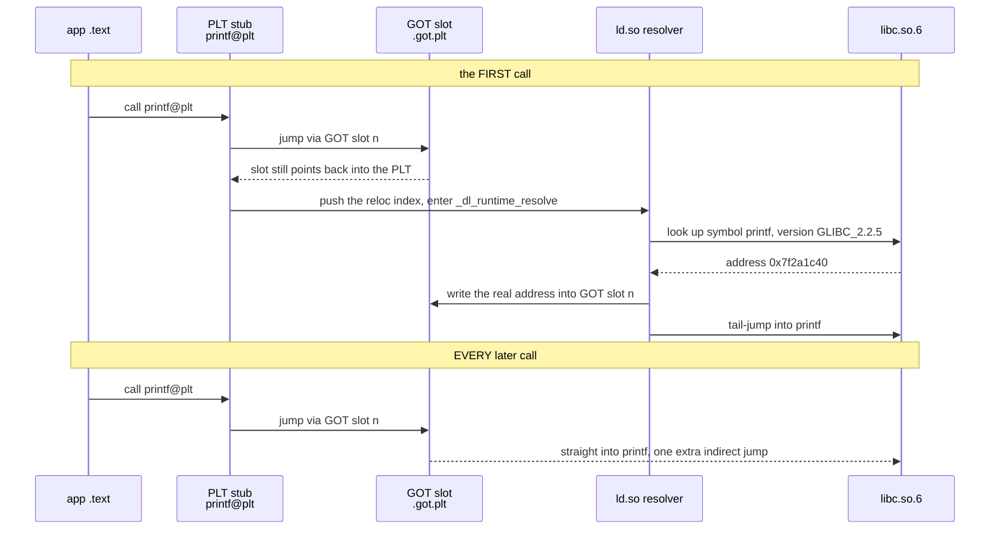
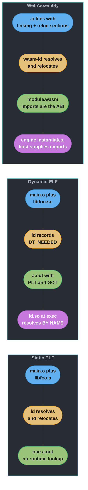

# ABIs, Linking, and the Wasm Model

> An API is a promise your compiler can check. An ABI is a promise your compiler cannot check, your linker will happily accept, and your process will discover at run time by reading the wrong bytes.

---

## 1. Concept Overview

[how_code_runs_compilers_and_interpreters](how_code_runs_compilers_and_interpreters.md) walks source text to running process, and its §6.8–§6.10 introduce the linker, the loader, and the fact that an ABI exists. This page is the part underneath: **what the ABI actually specifies, byte by byte and register by register, and how the three linking models — static, dynamic, and WebAssembly — resolve a name into an address.**

Three questions organise everything here:

1. **Who puts what where?** A calling convention fixes which register holds the first argument, who saves what across a call, how the stack is aligned, and how a struct too large for registers is returned. Two object files agree on this without ever seeing each other's source — that agreement *is* the ABI.
2. **When is a name turned into an address?** The static linker does it at build time and hands you one self-contained file. The dynamic linker does it at `execve` time (or later, at the first call) through an extra layer of indirection so that a shared library's code can stay identical across every process using it. The cost of that indirection is the PLT and the GOT.
3. **What happens when the target has no registers?** WebAssembly has no ABI-visible registers, no shared address space between modules, and a structured operand stack a program cannot address. Everything the System V ABI settles in registers, Wasm has to settle in *linear memory layout* and in the *import list* — which is why its ABI story splits into a low-level C ABI, a syscall ABI (WASI), and an interface ABI (the component model and WIT).

Its sibling [wasm_and_portable_bytecode](wasm_and_portable_bytecode.md) covers WebAssembly as an *execution strategy* — the validation-time sandbox, capability-based WASI, threaded interpreter dispatch, MLIR, running `.wasm` on Kubernetes. **This page does not re-explain any of that.** Wasm appears here only as the third act, and only as an answer to the ABI-and-linking questions above.

---

## 2. Intuition

**One-line analogy.** The API is the recipe printed in the cookbook. The ABI is the unwritten agreement about which shelf the salt lives on, how many grams a "cup" means in this kitchen, and who washes up. Rewrite the recipe and everyone notices. Move the salt and everyone keeps cooking, confidently, wrongly.

**Mental model.** Hold two failure modes side by side:

```
API BREAK                              ABI BREAK
  you change a signature                 you change a struct's field order
  every caller FAILS TO COMPILE          every caller compiles fine
  the compiler names the file and line   the linker resolves every symbol
  you fix it before lunch                the process reads field B as field A
                                         and crashes in production, elsewhere
```

**Why it matters.** Every shared library on the machine, every language's foreign-function interface, every plugin system, and every prebuilt binary wheel depends on an agreement that no tool in the normal build path verifies. The linker checks that a *name* resolves. It does not check that the *shape* behind the name is what the caller was compiled against. That single gap is the origin of DLL hell, of `undefined reference to std::__cxx11::basic_string`, of the Python wheel that segfaults on a different interpreter build, and of the reason WebAssembly's component model exists at all.

**Key insight.** An ABI is what lets separately compiled code cooperate — and every mechanism in this page is a way of paying for that cooperation. Static linking pays once, at build time, in binary size and patchability. Dynamic linking pays per process, at startup, in indirection and version fragility. Wasm refuses to share an address space at all and pays in copying across the boundary — buying, in exchange, the only one of the three where a mismatch is a *validation error* instead of a corrupted read.

---

## 3. Core Principles

1. **An API break stops the build. An ABI break ships.** The compiler enforces the API; nothing enforces the ABI. That asymmetry is why ABI compatibility has to be an explicit engineering discipline (sonames, symbol versioning, opaque structs) rather than something you notice.
2. **The calling convention belongs to the platform, not to the language.** The same C source compiled for Linux x86-64 and Windows x86-64 produces different register usage, different callee-saved sets, and a 32-byte shadow space on one and a 128-byte red zone on the other. A language can only choose which platform convention to speak.
3. **The linker resolves names; the loader resolves addresses.** Static linking collapses both into build time. Dynamic linking keeps them separate, which is exactly why a shared object's `.text` can be mapped read-only and shared by every process.
4. **Sharing costs indirection.** Position-independent code cannot hard-code addresses, so every cross-module data reference goes through the GOT and every cross-module call goes through the PLT. That indirection is the entire price of one physical copy of `libc` serving every process on the machine.
5. **Archives are processed in order; shared objects are not.** `libfoo.a` contributes only the members that satisfy symbols *currently* undefined when the linker reaches it. That makes link order semantically significant for static libraries, and it is the single most common "but the function is right there" build failure.
6. **A stable ABI is bought by hiding layout.** Opaque handles plus accessor functions, `Py_LIMITED_API`, PIMPL, Swift's resilient layout — all the same move. If callers never learn a struct's size or field offsets, you can change them.
7. **Wasm moves the whole argument up a level.** With no registers to allocate and no cross-module addresses, the low-level questions evaporate and the hard ones become "what is a string across a module boundary" — which is an *interface* question, and the component model answers it with types instead of with convention.

---

## 4. Types / Architectures / Strategies

### 4.1 Three calling conventions

| | System V AMD64 (Linux, macOS, BSD) | Windows x64 | AArch64 AAPCS64 |
|---|---|---|---|
| Integer/pointer args | `RDI RSI RDX RCX R8 R9` | `RCX RDX R8 R9` (positional — slot 3 is `R8` *or* `XMM2`, never both) | `X0`–`X7` |
| FP args | `XMM0`–`XMM7` | `XMM0`–`XMM3` | `V0`–`V7` |
| Integer return | `RAX` (`RDX:RAX` for 128-bit) | `RAX` | `X0` (`X0:X1` for 128-bit) |
| Large-struct return | hidden pointer in `RDI`, visible args shift right, pointer returned in `RAX` | hidden pointer in `RCX`, args shift right | hidden pointer in `X8` (does **not** shift the arg registers) |
| Callee-saved | `RBX RBP RSP R12`–`R15` | `RBX RBP RDI RSI RSP R12`–`R15`, `XMM6`–`XMM15` | `X19`–`X28`, `X29` (FP), `X30` (LR), low 64 bits of `V8`–`V15` |
| Caller-provided scratch | none | **32-byte shadow space** above the return address, always allocated even for 0-arg calls | none |
| Below-`SP` scratch | **128-byte red zone** | none | none in standard AAPCS64 |
| Stack alignment | 16 bytes at the `call` instruction, so `RSP % 16 == 8` on callee entry | 16 bytes | 16 bytes at any public interface |
| Variadic marker | `AL` = number of vector registers used | none — variadic FP args are duplicated into the integer register *and* `XMM` | see below |

**Apple's arm64 is a documented divergence, not a bug.** On Darwin, **variadic arguments are always passed on the stack** rather than in `X0`–`X7`, and stack argument slots are **naturally sized rather than padded to 8 bytes**. Code that casts a function pointer to a variadic type — a common trick that happens to work on Linux arm64 — corrupts its arguments on macOS. `X18` is also reserved by the platform on both Darwin and Windows-on-ARM, so a compiler may not allocate it.

### 4.2 Four linking models

| Model | Name resolution | Unit of sharing | Where a mismatch shows up |
|---|---|---|---|
| **Static (`.a`)** | build time, in link-line order | nothing — every consumer gets a copy | link time, as `undefined reference` |
| **Dynamic (`.so`/`.dll`/`.dylib`)** | `execve` time, or first call under lazy binding | one physical copy of `.text`, mapped into every process | anywhere from load time to a call an hour into the process |
| **Wasm static (`wasm-ld`)** | build time, over `linking` + `reloc.*` custom sections | nothing — one `.wasm` module | link time |
| **Wasm dynamic (`dylink.0`)** | instantiation time, over `GOT.mem` / `GOT.func` imports | one module instance, explicitly wired by the host | instantiation, as a missing-import error |
| **Wasm component (canonical ABI)** | composition time, over WIT-typed interfaces | nothing shared — values are *copied* across | composition/validation time, as a type error |

The last row is the interesting one: it is the only model in the table where a mismatch is caught by a machine rather than by a crash.

### 4.3 Name mangling

| Scheme | `int add(int, int)` becomes | Notes |
|---|---|---|
| C (ELF/Mach-O) | `add` (Mach-O prefixes an underscore: `_add`) | no overloading, so no encoding needed |
| Itanium C++ ABI (GCC, Clang, everything non-MSVC) | `_Z3addii` | `_Z` prefix, length-prefixed name, then argument type codes |
| MSVC | `?add@@YAHHH@Z` | different scheme entirely — GCC and MSVC objects cannot be linked together |

Mangling encodes the parameter types but **not the return type** in the Itanium scheme, which is why two functions differing only in return type cannot be overloaded in C++. It also means the mangled name is a coarse type check the linker performs for free — that is what catches a C++ caller that saw a stale header declaring `add(int, int)` when the definition became `add(long, long)`.

---

## 5. Architecture Diagrams

### An ELF file, and who reads each part

```
ELF64 FILE LAYOUT                             who actually reads it
+------------------------------------+
| ELF header               64 bytes  |  kernel: magic 7F 45 4C 46, e_type, e_entry
|   e_ident[16] .. e_shoff           |
+------------------------------------+
| Program header table  56 B/entry   |  LOADER: PT_LOAD, PT_INTERP, PT_DYNAMIC
+------------------------------------+
| .interp   "/lib64/ld-linux-..."    |  kernel: which dynamic linker to run first
| .gnu.hash / .dynsym / .dynstr      |  ld.so: symbol lookup at load time
| .gnu.version / .gnu.version_r      |  ld.so: symbol VERSIONING, e.g. GLIBC_2.34
| .rela.dyn / .rela.plt              |  ld.so: the relocations it must apply
| .init / .plt                       |  PLT stubs, 16 bytes each on x86-64
| .text                     <- code  |  the CPU
| .rodata                            |
+------------------------------------+
| .init_array / .fini_array          |  C runtime: static ctors, then dtors
| .dynamic                           |  ld.so: DT_NEEDED, DT_SONAME, DT_RUNPATH
| .got / .got.plt           <- data  |  ld.so writes here, then RELRO seals it
| .data / .bss                       |
+------------------------------------+
| .symtab / .strtab                  |  STATIC linker + debuggers. `strip` deletes.
| Section header table  64 B/entry   |  STATIC linker + debuggers. Loader ignores.
+------------------------------------+
```
*Two tables describe the same bytes for two different audiences: program headers say "map these segments" for the loader, section headers say "these are the pieces" for the linker. `strip` removes the second audience's data and the program still runs — proof they are genuinely independent.*

### One call, System V AMD64

```
SYSTEM V AMD64 AT A CALL BOUNDARY              (higher addresses at the top)

           caller's frame
        +----------------------------+
        |  args 7, 8, ...            |  anything past the 6th goes on the stack,
        |  (pushed right to left)    |  one 8-byte slot each
        +----------------------------+  <- RSP is 16-byte aligned HERE
        |  return address     8 B    |  pushed by `call`
        +----------------------------+  <- on entry: RSP % 16 == 8
        |  saved RBP          8 B    |  `push rbp` restores 16-byte alignment
        +----------------------------+  <- RBP
        |  saved RBX R12..R15        |  only the ones this callee actually uses
        |  locals and spill slots    |
        +----------------------------+  <- RSP inside the callee
        |  128-byte RED ZONE         |  a LEAF function may use this WITHOUT
        |                            |  moving RSP. Signal handlers and the
        |                            |  kernel must not clobber it.
        +----------------------------+
           lower addresses

  args 1-6   -> RDI RSI RDX RCX R8 R9      int return  -> RAX  (RDX:RAX if 128-bit)
  FP args    -> XMM0..XMM7                 FP return   -> XMM0 (XMM1 for the 2nd half)
  callee-saved: RBX RBP RSP R12 R13 R14 R15    everything else is caller-saved
  variadic call: AL = how many XMM registers hold arguments
  big-struct return: hidden pointer in RDI, real args shift to RSI RDX RCX R8 R9
```
*Alignment is the trap. `RSP % 16 == 8` on entry is not an accident — it is 16-byte alignment at the `call` minus the 8 bytes the `call` itself pushed. Emit a `movaps` against a stack slot after an odd number of pushes and it faults with `SIGSEGV`, which is the classic symptom of hand-written assembly that forgot to realign.*

### Lazy binding: the first call and every call after


*The resolver runs once per symbol, so the cost amortises to a single extra indirect jump. Hardened distribution defaults (`-Wl,-z,relro,-z,now`) turn this off — everything is resolved eagerly at load and the GOT is then `mprotect`ed read-only, which trades a slower `exec` for closing the most convenient GOT-overwrite exploit primitive.*

### Three models, one question


*The ELF rows resolve a flat namespace of strings against whatever happens to be on the machine. The Wasm row resolves an explicit import list the host must satisfy, so "the symbol was missing" becomes an instantiation error naming exactly what was not supplied — the same class of bug, caught two hours earlier.*

---

## 6. How It Works — Detailed Mechanics

### 6.1 The calling convention, in actual bytes

```c
/* abi_demo.c */
struct big { long a, b, c; };          /* 24 bytes: too large for registers */

long take6(long a, long b, long c, long d, long e, long f) { return a + f; }
struct big make(long x) { struct big r = { x, x, x }; return r; }
```

```
$ gcc -O2 -c abi_demo.c && objdump -d abi_demo.o

take6:
    lea    rax,[rdi+r9*1]      ; a is in RDI (arg 1), f is in R9 (arg 6)
    ret                        ; result in RAX

make:
    mov    rax,rdi             ; RDI is NOT x -- it is the HIDDEN return pointer
    mov    QWORD PTR [rdi],rsi ; x arrived in RSI, because the args shifted right
    mov    QWORD PTR [rdi+0x8],rsi
    mov    QWORD PTR [rdi+0x10],rsi
    ret                        ; and RAX must return that same pointer
```

Two rules are visible at once. A function of six integer arguments touches no stack at all. And a function returning a 24-byte struct silently gains a seventh, invisible parameter — which is why "returning a struct by value is slow" is a claim about *this* ABI: the caller allocates the space and passes its address, so the return is a memory write, not a register move. On AArch64 that pointer goes in `X8` and the visible arguments do **not** shift, which is a small but real source of hand-written-assembly bugs when porting.

### 6.2 Struct layout is part of the ABI, and it is not what you wrote

```c
struct a { char c; long l; char d; };   /* sizeof == 24 */
struct b { long l; char c; char d; };   /* sizeof == 16 */
```

Both hold the same three fields. `struct a` costs 8 more bytes because the compiler must insert 7 padding bytes after `c` to align `l` to 8, then pad the tail to a multiple of the strictest member's alignment. A C compiler is **forbidden** from reordering fields, so the layout is exactly what the declaration order implies — and that layout, including the padding, is frozen into every caller compiled against the header.

The consequence is the nastiest bug in this whole page:

```c
/* v1.0 header, shipped, compiled into 40 downstream binaries */
struct conn { int fd; int timeout_ms; };

/* v1.1: "just adding a field, it's the last one, that's safe" */
struct conn { int fd; int flags; int timeout_ms; };   /* NOT safe */
```

Every consumer built against v1.0 writes `timeout_ms` at offset 4. v1.1 reads offset 4 as `flags`. Nothing fails to link, nothing warns, and the library silently reads a timeout as a flag bitmask. Even *appending* is unsafe if callers allocate the struct themselves, because they allocate the old, smaller size and the library writes past it.

The fix is to stop exposing the layout at all:

```c
/* Opaque handle: callers only ever hold a pointer they cannot dereference. */
typedef struct conn conn_t;                  /* incomplete type */
conn_t *conn_open(const char *host);
void     conn_set_timeout(conn_t *, int ms); /* accessor, not a field */
```
This is exactly the move OpenSSL made when it made most of its structs opaque, and it is the same move as Python's `Py_LIMITED_API`, C++'s PIMPL idiom, and Swift's resilient layout. Hiding the layout is what buys the freedom to change it.

### 6.3 The C++ dual ABI, as a broken-then-fixed pair

The parent module's §6.10 covers `extern "C"` and name mangling. The harder case is when **both sides are C++ and both mangle**, and the mangled names still disagree.

**BROKEN** — a prebuilt vendor library compiled before GCC 5 (2015), linked against a modern application:

```
$ g++ -O2 main.cpp -lvendor -o app
/usr/bin/ld: main.o: in function `main':
main.cpp:(.text+0x2f): undefined reference to
    `vendor_lookup(std::__cxx11::basic_string<char, std::char_traits<char>,
                                              std::allocator<char> > const&)'
```

Everything compiled. `libvendor.so` is on the link line, `nm` shows it exports a `vendor_lookup`. The symbol it exports is `_Z13vendor_lookupRKSs` — the old, copy-on-write `std::string`. The application, built with a modern libstdc++, emits a call to `_Z13vendor_lookupRKNSt7__cxx1112basic_stringIcSt11char_traitsIcESaIcEEE` — the C++11-conforming, small-string-optimised `std::string`, which lives in the inline namespace `std::__cxx11`. Same C++ source, same signature in the header, two different types at the ABI level.

**FIX (short term)** — build the application against the old ABI so both sides agree:

```
$ g++ -D_GLIBCXX_USE_CXX11_ABI=0 -O2 main.cpp -lvendor -o app
```

**FIX (correct)** — get the library rebuilt, or stop passing standard-library types across the boundary at all:

```cpp
// A boundary that no standard-library ABI change can break.
extern "C" int vendor_lookup(const char *key, size_t key_len,
                             char *out, size_t out_cap);
```

The general rule: **never put a standard-library type in a shared-library's public signature.** `std::string`, `std::vector`, `std::unique_ptr` and friends have layouts owned by a toolchain you do not control, and the mangled name changes when they do.

### 6.4 Static linking: archives and why order matters

An object file is a container of sections plus a symbol table plus relocations — "at byte offset X in `.text`, once you know where symbol S lives, patch its address in." A `.a` archive is just `ar` glueing object files together with an index. The linker's rule for archives is the thing everyone learns the hard way:

> When the linker reaches an archive, it pulls in **only** those members that define a symbol which is **currently undefined**, and it never looks back.

**BROKEN** — the library comes before the code that needs it:

```
$ gcc -lm main.c -o prog
/usr/bin/ld: /tmp/ccXXXX.o: undefined reference to `sqrt'
```

At the moment the linker processed `libm`, nothing was undefined yet — `main.o` had not been read — so it took no members. By the time `sqrt` became undefined, the archive was behind it.

**FIX** — dependencies go to the right of the things that use them:

```
$ gcc main.c -lm -o prog
```

For genuinely circular static dependencies (`liba.a` needs `libb.a` needs `liba.a`), repeating one library works but is fragile; the tools provide an explicit form:

```
$ gcc main.c -Wl,--start-group -la -lb -Wl,--end-group -o prog
```
which re-scans the group until no new members are pulled in. Note that **shared objects do not behave this way** — a `.so` on the link line contributes its entire symbol table regardless of position, which is exactly why the same command line often works with `libfoo.so` and fails with `libfoo.a`, and why "it built on my machine" tracks which package flavour was installed.

### 6.5 Dynamic linking: three names for one library

```
libssl.so         -> libssl.so.3        linker name  (a symlink, dev package only)
libssl.so.3       -> libssl.so.3.0.14   soname       (what DT_NEEDED records)
libssl.so.3.0.14                        real name    (the actual file)
```

`-lssl` follows the *linker name*. The linker then reads that file's `DT_SONAME` and records **the soname**, not the filename, in the executable's `DT_NEEDED`. So the runtime dependency is on `libssl.so.3`, and the packaging system is free to swap `3.0.14` for `3.0.15` under the same soname. **A soname bump is a declaration that the ABI broke**; keeping the soname is a promise that it did not.

```
$ readelf -d app | head
 0x0000000000000001 (NEEDED)   Shared library: [libssl.so.3]
 0x0000000000000001 (NEEDED)   Shared library: [libc.so.6]
 0x000000000000001d (RUNPATH)  Library runpath: [$ORIGIN/../lib]
```

Search order at load time, in the order `ld.so` actually tries them:

1. `DT_RPATH` — **only** if the object has no `DT_RUNPATH`
2. `LD_LIBRARY_PATH`
3. `DT_RUNPATH`
4. `/etc/ld.so.cache` (built by `ldconfig`)
5. the default trusted directories (`/lib64`, `/usr/lib64`, …)

The RPATH/RUNPATH split is a real trap. Modern binutils defaults to `--enable-new-dtags`, so `-Wl,-rpath,...` emits **`DT_RUNPATH`**, which is searched *after* `LD_LIBRARY_PATH` — meaning a user's environment variable now overrides the path you baked in, where the legacy `DT_RPATH` would have won. If you are shipping a self-contained application directory, use `$ORIGIN`-relative RUNPATH and understand that it is overridable, or reach for `DT_RPATH` explicitly with `-Wl,--disable-new-dtags` and accept that it cannot be overridden even when someone needs to.

Two more facts worth carrying: glibc **2.34 (2021)** merged `libpthread`, `libdl`, `libutil` and `libanl` into `libc.so.6`, so `-lpthread` is a no-op stub on any modern system and a missing `pthread_create` on a new distro means something else is wrong. And `--as-needed` is the default on most distributions, so a `-l` flag whose library provides no needed symbol produces no `DT_NEEDED` at all — which is why `ldd` sometimes disagrees with the link line.

### 6.6 PIC, PIE, the GOT and the PLT

A shared library is mapped at a different base address in every process (ASLR guarantees it), so its `.text` cannot contain absolute addresses — otherwise it would need per-process patching and could not be shared. **Position-independent code** solves this by making every absolute reference indirect:

- **Data** goes through the **GOT** (Global Offset Table): the code does a RIP-relative load of a GOT slot, and `ld.so` fills that slot with the real address.
- **Calls** go through the **PLT** (Procedure Linkage Table): a 16-byte stub per function that jumps through a `.got.plt` slot.

```
$ objdump -d -j .plt app
0000000000001030 <printf@plt>:
    1030:  ff 25 e2 2f 00 00     jmp    QWORD PTR [rip+0x2fe2]   # 4018 <printf@got.plt>
    1036:  68 00 00 00 00        push   0x0                      # reloc index
    103b:  e9 e0 ff ff ff        jmp    1020 <.plt>              # -> _dl_runtime_resolve
```

Under lazy binding the GOT slot initially points at `1036` — the instruction right after the jump — so the first call falls through into the resolver, which overwrites the slot and never runs again. Under `-z now` (the hardened default on Debian, Ubuntu and Fedora) `ld.so` resolves everything at load and full RELRO `mprotect`s the GOT read-only, removing the most convenient GOT-overwrite exploit primitive at the cost of a slower `exec`.

Forgetting `-fPIC` when building a shared object is its own distinct failure:

```
$ gcc -shared -o libfoo.so foo.o
/usr/bin/ld: foo.o: relocation R_X86_64_32S against `.rodata' can not be used
             when making a shared object; recompile with -fPIC
```
The message is unusually good: a 32-bit absolute relocation cannot be satisfied when the load address is unknown. `-fPIE` is the executable-side variant and is the default on essentially every modern distribution.

**What it costs.** In steady state a PLT call is one extra indirect jump whose target the branch-target buffer predicts correctly, so the marginal cost is close to zero — but a *mispredicted* indirect branch is ~15–20 cycles, and the PLT also blocks inlining across the module boundary, which is usually the larger loss. `-fno-plt` replaces `call stub` + `jmp *GOT` with a single `call *GOT`, saving one jump at the price of forcing eager binding. The bigger, measurable cost is startup: relocation processing is linear in the number of dynamic relocations, and symbol lookup is linear in the number of objects searched, so a large C++ application with a hundred-plus shared objects and hundreds of thousands of relocations spends real milliseconds in `ld.so` before `main`. Measure it, do not guess it:

```
$ LD_DEBUG=statistics ./app
  total startup time in dynamic loader: 4823914 cycles
    time needed for relocation:         3117208 cycles (64.6%)
    number of relocations:              21744
```

The `DT_GNU_HASH` table (2006) exists precisely for this: a Bloom filter in front of the symbol hash lets `ld.so` reject a symbol as absent from a library without walking its chain, and it roughly halved dynamic-link time for large C++ binaries when it was introduced.

### 6.7 Interposition, `LD_PRELOAD`, and symbol versioning

ELF symbol lookup is **first-definition-wins** over the global search scope, in load order, with the executable first. That is *interposition*, and it is a feature: it is how `LD_PRELOAD` works.

```c
/* malloc_count.c -- count allocations without touching the program */
#define _GNU_SOURCE
#include <dlfcn.h>
#include <stdio.h>
static void *(*real_malloc)(size_t);
static long  count;

void *malloc(size_t n) {
    if (!real_malloc) real_malloc = dlsym(RTLD_NEXT, "malloc");
    count++;
    return real_malloc(n);
}
__attribute__((destructor)) static void report(void) {
    fprintf(stderr, "mallocs: %ld\n", count);
}
```
```
$ gcc -shared -fPIC -o libcount.so malloc_count.c
$ LD_PRELOAD=./libcount.so ls > /dev/null
mallocs: 218
```

`RTLD_NEXT` means "the next definition after mine in the search order" — without it you get infinite recursion. This same mechanism is how `jemalloc` replaces the allocator, how `fakeroot` and `faketime` work, and how a mis-scoped symbol in your own library can silently hijack a libc function of the same name in every process that loads it. Interposition does not check types.

**Symbol versioning** is the escape hatch that lets one library change a function's behaviour without breaking existing binaries. glibc has kept the same `libc.so.6` soname since 1997 not because nothing ever changed, but because incompatible changes ship as a *new version* of the same symbol name:

```
$ objdump -T /lib/x86_64-linux-gnu/libc.so.6 | grep -w realpath
000000000004b9e0 g DF .text  GLIBC_2.3   realpath
0000000000156a20 g DF .text  GLIBC_2.2.5 realpath@GLIBC_2.2.5
```

Two implementations coexist. A binary from 2003 recorded `realpath@GLIBC_2.2.5` in its `.gnu.version_r` and keeps getting the old semantics forever; anything built since gets the default. Your own library does the same with a version script:

```
# libfoo.map
LIBFOO_1.0 { global: foo_open; foo_close; local: *; };
LIBFOO_2.0 { global: foo_open; } LIBFOO_1.0;
```
```
$ gcc -shared -Wl,--version-script=libfoo.map -o libfoo.so.1 foo.o
```

The `local: *;` line matters as much as the versioning: it hides every symbol not explicitly exported, which shrinks the dynamic symbol table (faster lookup), prevents accidental interposition, and stops downstream code from depending on internals you never meant to publish. `-fvisibility=hidden` plus explicit `__attribute__((visibility("default")))` achieves the same thing from the source side.

### 6.8 Wasm: an ABI with no registers

Everything above negotiated **registers and stack slots**. WebAssembly has neither in any ABI-visible sense: function parameters are typed values (`i32`, `i64`, `f32`, `f64`, plus reference types), locals are indices not addresses, and the operand stack is structured — a program cannot take the address of anything on it. So the classic questions vanish and are replaced by three new ones.

**Where does a C program put things it must take the address of?** In a **shadow stack** inside linear memory, managed by a mutable global `__stack_pointer` that the toolchain maintains explicitly. It grows downward, keeps 16-byte alignment, and — pleasingly — the Wasm C ABI specifies **a 128-byte red zone** below it for exactly the same reason System V does: a leaf function that needs a little scratch can skip updating the stack pointer.

**How are aggregates passed?** The Wasm C ABI's rule is narrow and easy to state:

| C type | How it crosses | Note |
|---|---|---|
| `_Bool`, `char`, `short`, `int`, `long`, pointer | `i32` | the target is ILP32 — `long` and pointers are 32-bit |
| `long long` | `i64` | |
| `float` / `double` | `f32` / `f64` | |
| `__int128_t` | two `i64` params | |
| empty struct | **ignored entirely** | contributes no parameter |
| struct containing exactly one scalar (recursively), normal alignment | that scalar, **directly** | the "singleton" rule |
| every other struct, union, array | **indirect**: a pointer parameter is prepended | the sret-equivalent |
| `long double` | 128-bit, no wasm type — passed indirectly | Emscripten aligns it to 8, not 16 |

Variadics are the sharpest difference from ELF. There are no argument registers to spill, so **the caller writes every variadic argument into a buffer in linear memory and passes one pointer**, and each argument sits at its natural alignment inside that buffer. `va_arg` is a pointer walk, not the register-save-area dance of System V. And the **vector-type ABI is explicitly not stable** — it may change as the toolchain finds better lowerings, which is a documented instability you should not build a plugin boundary on.

### 6.9 `wasm-ld`: the same job, different sections

`wasm-ld` (the LLVM linker's Wasm flavour) does what `ld` does — merge objects, build one symbol table, resolve undefined symbols, apply relocations — using two custom sections that a relocatable `.wasm` object carries and a final module does not:

- **`"linking"`** — the metadata section, containing subsections `WASM_SYMBOL_TABLE` (type 8), `WASM_SEGMENT_INFO` (5), `WASM_INIT_FUNCS` (6, the static constructors) and `WASM_COMDAT_INFO` (7, C++ template/inline deduplication). Symbols carry flags including `WASM_SYM_BINDING_WEAK` (0x1), `WASM_SYM_VISIBILITY_HIDDEN` (0x4) and `WASM_SYM_UNDEFINED` (0x10) — a direct parallel to ELF's weak/hidden/undefined bindings.
- **`"reloc.<SECTION>"`** — one per relocated section, so `reloc.CODE` and `reloc.DATA`. Relocation types split the same way ELF's do: `R_WASM_FUNCTION_INDEX_LEB` patches the immediate of a `call`, `R_WASM_MEMORY_ADDR_LEB` patches the immediate of a load or store, `R_WASM_MEMORY_ADDR_I32` patches a data-initialiser word.

```
$ clang --target=wasm32-wasip1 -c a.c b.c
$ wasm-ld a.o b.o -o app.wasm --no-entry --export=run
$ wasm-objdump -h app.wasm | grep -i custom
Custom  start=0x000012a4 size=41  "name"
Custom  start=0x000012d0 size=87  "producers"
```
The `linking` and `reloc.*` sections are gone from the output: they were build-time metadata, consumed and discarded, exactly like ELF's `.symtab` under `strip`.

The `--export` flag deserves attention because it is the whole difference in mindset. In ELF, everything with default visibility is exported unless you hide it. In Wasm, **nothing is exported unless you say so** — the export list is the module's entire public surface, and the import list is its entire dependency surface, both enumerable from the binary with one command. There is no equivalent of "this library accidentally exports 4,000 internal symbols."

### 6.10 Wasm dynamic linking, and the component model

Wasm dynamic linking exists in two genuinely different flavours, and conflating them is the usual source of confusion.

**Flavour one: PIC-style dynamic libraries**, the direct analogue of `.so`. Built with `--experimental-pic -shared`, a module carries a **`"dylink.0"`** custom section — which must be the module's *first* section — with subsections `WASM_DYLINK_MEM_INFO` (its memory and table space requirements), `WASM_DYLINK_NEEDED` (its dependencies, the `DT_NEEDED` analogue), `WASM_DYLINK_EXPORT_INFO`, `WASM_DYLINK_IMPORT_INFO` and `WASM_DYLINK_RUNTIME_PATH`. Because it shares one linear memory and one function table with the main module, it cannot know where its data will land, so it imports two immutable globals from `env`: **`__memory_base`** and **`__table_base`**, the offsets of the region the loader reserved for it. External symbols are imported as **mutable `i32` globals from two synthetic modules — `"GOT.mem"` for data addresses and `"GOT.func"` for table indices** — which the dynamic linker writes after instantiation. That is a Global Offset Table by name and by function, reconstructed on a target with no addresses. Data relocations are applied at runtime by an exported `__wasm_apply_data_relocs`, called before `__wasm_call_ctors` runs the static constructors.

**Flavour two: the component model**, which is not dynamic linking of the ELF kind at all. Components do **not** share linear memory. A value crossing a component boundary is **copied** according to the canonical ABI, and the interface is described in **WIT** with real types — `string`, `list<u8>`, `record`, `variant`, `result<T, E>`, `resource` — rather than as a pointer-and-length pair the two sides agreed on by convention.

Set the two ABIs against each other point by point:

| Question | ELF / C ABI | Wasm component + WIT |
|---|---|---|
| What is a string across the boundary? | `char *` plus a length, by convention; encoding and ownership agreed out of band | `string`, with encoding and ownership in the canonical ABI |
| Who frees it? | documented in a comment, if you are lucky | specified by the canonical ABI's lifting/lowering rules |
| What is an error? | a sentinel return plus `errno`, or a negative int | `result<T, E>` with a typed `E` |
| How is a mismatch detected? | it is not — the linker checks the name, not the shape | composition-time type check |
| Struct layout | frozen into every caller, the whole problem in §6.2 | never exposed — values are lifted and lowered, not mapped |
| Language neutrality | via `extern "C"`, the lowest common denominator | native — a Rust component and a Python component compose directly |
| Cost | zero-copy, a pointer is a pointer | a copy per call across the boundary |

That last row is the honest trade: `extern "C"` is free and unchecked, the canonical ABI is checked and costs a copy. For a hot inner loop the copy matters; for a plugin boundary crossed a thousand times a second it does not, and the check is worth far more.

**WASI** sits between the two as a *syscall* ABI. `wasi_snapshot_preview1` is the older, flat function-import form — `fd_write`, `path_open` — which is what most existing toolchains still emit. **WASI 0.2** is defined in WIT on top of the component model, and **WASI 0.3.0 was ratified 2026-06-11**, rebasing it on native async (`async func`, `stream<T>`, `future<T>`); **WASI 1.0 is not released.** The sibling page [wasm_and_portable_bytecode](wasm_and_portable_bytecode.md) §6.3–§6.4 covers what WASI *means* as a capability model; what matters here is only its shape as an ABI: a versioned, typed import list rather than a numbered syscall table, so a missing capability is a named missing import at instantiation instead of an `ENOSYS` at run time.

---

## 7. Real-World Examples

- **glibc has kept `libc.so.6` since 1997** by versioning symbols rather than bumping the soname. Binaries built in 2003 still run because they recorded `realpath@GLIBC_2.2.5` and keep getting that implementation. This is the largest working demonstration that ABI stability is a process, not a property.
- **Windows "DLL hell"** was the same problem without symbol versioning: a shared `MSVCRT.DLL` replaced by an installer broke unrelated applications, which is what drove side-by-side assemblies and the per-application "just ship the DLL next to the exe" convention that persists today.
- **Go statically links by default** and produces a single self-contained binary (a hello-world is roughly 1.5 MB), which is most of why `FROM scratch` containers became normal. The moment `cgo` is enabled the binary picks up a `libc` dependency and the hermetic property quietly disappears — the classic "works locally, `no such file or directory` in the Alpine container" where the missing file is the dynamic linker itself.
- **Rust has no stable ABI** for its own types and does not pretend otherwise: crates are statically linked, and any cross-language boundary uses `extern "C"` with `#[repr(C)]` to opt into the platform ABI explicitly. This is a deliberate refusal to make the C++ promise.
- **Swift did make the promise**, and shipped a stable ABI in Swift 5 (2019) with *resilient* layout: unless a type is marked `@frozen`, callers go through accessors and the library may add or reorder stored properties across versions. It is §6.2's opaque-handle discipline enforced by the language.
- **Python's `abi3`** (`Py_LIMITED_API`) freezes a subset of the C API and an opaque `PyObject`, so one compiled wheel serves many interpreter versions. It is the same trade as always: give up direct field access, gain the freedom to change layout. CPython 3.15 (2026-10-09) adds `abi3t` (PEP 803), the stable ABI for free-threaded builds, selected with `Py_TARGET_ABI3T`.
- **Android's NDK** made every app bundle `libc++_shared.so` after the platform's own STL turned out to be a lasting ABI hazard — the mobile restatement of "never put a standard-library type in a public signature."
- **WASI Preview 1 to 0.2** is a live, ongoing ABI migration: `wasi_snapshot_preview1` is legacy and still overwhelmingly what toolchains emit, while 0.2 and 0.3 are WIT-defined on the component model. Rust's target triple churn tracks it — `wasm32-wasi` became `wasm32-wasip1` in 1.78 and the old name was removed in 1.84.

---

## 8. Tradeoffs

### 8.1 Static vs dynamic vs Wasm

| Dimension | Static | Dynamic | Wasm module |
|---|---|---|---|
| Artifact size (hello world) | ~760 KB glibc, ~15 KB musl | ~16 KB plus a shared `libc` | a few KB, plus whatever the host provides |
| Cross-process memory | one copy per process | one physical `.text` for all processes | one instance per module, no sharing |
| Startup cost | none — no runtime resolution | linear in relocations and DSO count | validation + baseline compile, both linear |
| Security patch rollout | rebuild and redeploy every consumer | replace one file | rebuild the module, or swap the host import |
| Failure timing | link time | load time, or the first lazily-bound call | instantiation, as a named missing import |
| Reproducibility | excellent — hermetic | depends on the target machine's libraries | excellent — imports are explicit |
| Cross-language boundary | platform ABI, unchecked | platform ABI, unchecked | canonical ABI, type-checked |
| Boundary cost | free | one indirect jump | a copy per crossing |

### 8.2 What each kind of change breaks

| Change | Recompile needed? | Relink enough? | Silent at run time? |
|---|---|---|---|
| Function body rewritten | no | no | no — this is what dynamic linking is *for* |
| New function added | no | no | no |
| Struct gains a field | **yes, everywhere** | no | **yes — this is the killer** |
| Enum gains a value in the middle | yes | no | yes |
| Function gains a parameter | yes | no | yes |
| C++ inline function body changed in a header | yes | no | yes — the old body is already inlined into callers |
| `std::string` implementation changed | yes | no | no — the mangled name changes, so it fails at link |
| Return type changed (C++) | yes | no | **yes** — the Itanium scheme does not mangle return types |
| Symbol removed | no | **yes** | no |

The two "yes, silent" rows containing C++ are the argument for `abidiff` in CI. The last one deserves its own note: because the Itanium ABI encodes parameter types but not the return type, changing `int f(int)` to `long f(int)` produces the *same* mangled name and links cleanly, then reads 64 bits where the caller expects 32.

---

## 9. When to Use / When NOT to Use

**Link statically when** the artifact must be hermetic and reproducible (a container image, a CLI tool users download, an embedded firmware image), when startup latency is part of the product and you want zero runtime resolution, or when the deployment target's system libraries are outside your control. Accept that a CVE in any dependency means rebuilding and redeploying every consumer.

**Link dynamically when** many processes on one machine use the same large library (the desktop case: one physical `libQt` for every application), when a security team needs to patch a library without rebuilding its consumers, or when you are *shipping* a library that others link against and you want the freedom to fix bugs behind a stable soname.

**Choose a Wasm component boundary when** the code on the other side is untrusted or third-party, when plugins are written in languages you do not control, or when you need the interface itself to be machine-checkable. Do not choose it for a hot inner loop: the canonical ABI copies values across the boundary, and no amount of engine improvement makes a copy free.

**Do not expose a struct layout across a versioned boundary.** Opaque handles plus accessors, always, for anything you will ship more than once. The performance cost of an accessor call is a rounding error next to a field-offset mismatch discovered in production.

**Do not put standard-library types in a shared library's public signature** — in any language whose standard library the toolchain owns. `std::string`, `std::vector`, `PyObject *` outside the limited API, Swift's non-`@frozen` types. Use primitives, or an opaque handle, or a serialised buffer.

**Do not rely on `LD_PRELOAD` in production.** It is superb for diagnosis (`ltrace`, allocator swapping, latency injection) and awful as an architecture, because interposition is untyped and matches on a bare string.

---

## 10. Common Pitfalls

**Pitfall 1 — link order for static libraries.** Covered in §6.4: `gcc -lm main.c` fails, `gcc main.c -lm` works, and the difference is that an archive contributes only members satisfying *currently* undefined symbols. Build systems that assemble `LDFLAGS` before `SOURCES` reproduce this endlessly. Fix by putting libraries last, and use `-Wl,--start-group ... -Wl,--end-group` for genuinely circular sets rather than repeating a `-l` flag and hoping.

**Pitfall 2 — the C++ dual ABI.** Covered in §6.3. The tell is `std::__cxx11` appearing in an `undefined reference`. Rebuild the dependency, or as a stopgap build everything with `-D_GLIBCXX_USE_CXX11_ABI=0`. The permanent fix is an `extern "C"` boundary that carries no standard-library types.

**Pitfall 3 — appending a field to a public struct.** Covered in §6.2. There is no safe version of this once callers can allocate or dereference the type. The only real fix is the one you should have made earlier: an opaque handle.

**Pitfall 4 — `dlopen` with `RTLD_LOCAL` and duplicated state.**

```c
/* BROKEN: two plugins each statically link libcommon.a, which holds a registry
   singleton. Loaded with RTLD_LOCAL (the default), each gets its OWN copy of
   the singleton and its OWN copy of every static initializer. Registrations
   made through plugin A are invisible to plugin B, and libcommon's global
   mutex protects two different pieces of state. */
void *h = dlopen("./plugin_a.so", RTLD_NOW | RTLD_LOCAL);
```
```c
/* FIX: make the shared code an actual shared object, loaded once, so both
   plugins bind to the same definition. */
void *core = dlopen("libcommon.so.1", RTLD_NOW | RTLD_GLOBAL);
void *h    = dlopen("./plugin_a.so", RTLD_NOW | RTLD_LOCAL);
```
Also note that `RTLD_LAZY` defers symbol resolution to first call, so a plugin missing a symbol loads successfully and crashes with `SIGSEGV` in the middle of a request. In a plugin host, use **`RTLD_NOW`** so a broken plugin fails at `dlopen`, where you can report it and refuse to enable it.

**Pitfall 5 — `LD_LIBRARY_PATH` beating your RUNPATH.** You ship an application directory with `-Wl,-rpath,'$ORIGIN/../lib'`, and on one user's machine it picks up the system library instead. Modern binutils emits `DT_RUNPATH`, which is searched *after* `LD_LIBRARY_PATH` — the user's environment wins. Diagnose with `LD_DEBUG=libs ./app 2>&1 | grep 'trying file'`, which prints every path tried in order. Fix by clearing the variable in a launcher script, or by accepting overridability as the correct default, or by explicitly requesting `DT_RPATH` with `--disable-new-dtags` if the bundled library genuinely must win.

**Pitfall 6 — assuming `ldd` proves compatibility.** `ldd` reports that every soname resolves. It does not verify a single field offset, struct size, or symbol version. The war story is always the same: a base image is patched to a newer minor release of a library, every symbol still resolves, and a struct that changed layout is read with the old offsets. Use `abidiff` (libabigail) in CI to compare the new library against the released one; it reads DWARF and reports actual layout changes rather than name resolution.

**Pitfall 7 — mixing Wasm ABI variants.** Objects compiled for `wasm32-wasip1` and `wasm32-wasip2` are not interchangeable, and objects built with different enabled features (bulk memory, SIMD, exception handling) can link and then trap in an engine that does not implement one of them. `wasm-ld` will not always stop you. Pin one target triple and one feature set per artifact, and check the result with `wasm-tools validate --features=...` against the feature set your deployment engine actually supports.

**Pitfall 8 — building a Wasm plugin boundary on unstable parts of the C ABI.** The Wasm C ABI's **vector-type passing is explicitly documented as not stable**, and Emscripten's 8-byte `long double` alignment differs from the 16-byte size. A boundary carrying either will break under a toolchain upgrade with no diagnostic. Keep a `wasm32` FFI boundary to the stable core — integers, floats, pointers with explicit lengths — or go up a level to WIT, where the whole question is someone else's problem.

---

## 11. Technologies & Tools

| Tool | What it tells you | Typical invocation |
|---|---|---|
| `readelf` | ELF headers, sections, `.dynamic` entries, versioning | `readelf -d app`, `readelf -V libfoo.so` |
| `objdump` | disassembly, PLT stubs, dynamic symbol table | `objdump -d -j .plt app`, `objdump -T libc.so.6` |
| `nm` | symbol table of an object or archive; `-C` demangles | `nm -C --defined-only libfoo.a` |
| `c++filt` | demangles one Itanium symbol by hand | `c++filt _Z3addii` |
| `ldd` | which shared objects resolve, and to what | `ldd app` — resolution only, never compatibility |
| `LD_DEBUG` | the loader narrating itself: `libs`, `bindings`, `statistics`, `all` | `LD_DEBUG=statistics ./app` |
| `ldconfig` | rebuilds `/etc/ld.so.cache` after installing a library | `ldconfig -p \| grep ssl` |
| `patchelf` | rewrite RUNPATH, soname or interpreter of a built binary | `patchelf --set-rpath '$ORIGIN/../lib' app` |
| `abidiff` (libabigail) | **actual ABI diff** from DWARF — layout, not just names | `abidiff old/libfoo.so new/libfoo.so` |
| `auditwheel` / `delocate` | bundle DSOs into a Python wheel and rewrite RPATHs | `auditwheel repair --plat manylinux_2_28_x86_64 w.whl` |
| `wasm-ld` | the Wasm linker | `wasm-ld a.o b.o -o app.wasm --export=run` |
| `wasm-objdump` (wabt) | Wasm sections, imports, exports, custom sections | `wasm-objdump -x app.wasm` |
| `wasm-tools` | validate, print, componentize, inspect | `wasm-tools validate app.wasm` |
| `wit-bindgen` | generates language bindings from a WIT interface | `wit-bindgen rust ./wit` |
| `wasi-sdk` | a Clang toolchain preconfigured for the WASI targets | `clang --target=wasm32-wasip1` |

---

## 12. Interview Questions with Answers

**Q: What is the difference between an API break and an ABI break, and why is the second one worse?**
**Short:** An API break stops the compile with a file and line; an ABI break compiles, links, and corrupts data at run time far from the cause.

An API break changes something the compiler checks — a signature, a name, a type — so every caller fails to build and the compiler tells you exactly where. An ABI break changes something no tool in the normal build path checks: a struct's field offsets, its size, a calling convention, an enum's numeric values. The header still declares the same function, the linker still resolves the same symbol, and the process reads field B where the caller wrote field A. The failure surfaces as corrupted data or a crash in unrelated code, often hours later and on a machine you do not own. That is why ABI stability has to be an explicit discipline — sonames, symbol versioning, opaque handles, `abidiff` in CI — rather than something you notice.

**Q: Why does `gcc -lm main.c` fail while `gcc main.c -lm` succeeds?**
**Short:** The linker pulls archive members only for symbols undefined at the moment it reaches the archive, and it never revisits.

The linker processes its inputs strictly left to right. When it reaches `libm.a`, nothing is undefined yet — `main.o` has not been read — so it takes no members and moves on. `main.o` then makes `sqrt` undefined, but the archive is behind it and is never rescanned, so the link fails with `undefined reference to 'sqrt'`. The rule is that libraries go to the right of the objects that use them, and for genuinely circular static dependencies use `-Wl,--start-group ... -Wl,--end-group`, which rescans until nothing new is pulled in. Shared objects behave differently — a `.so` contributes its whole symbol table regardless of position — which is exactly why the same command line often works with `libfoo.so` and fails with `libfoo.a`.

**Q: You get `undefined reference to foo(std::__cxx11::basic_string...)` but `nm` shows the library exports `foo`. What happened?**
**Short:** The library was built against the pre-GCC-5 copy-on-write `std::string` and your code against the C++11 one, so the two mangled names differ.

GCC 5 introduced a new, standard-conforming `std::string` (small-string optimised, no copy-on-write) in the inline namespace `std::__cxx11`, and kept the old one so existing binaries kept working. Both are called `std::string` in source; they mangle differently, so `_Z3fooRKSs` and `_Z3fooRKNSt7__cxx1112basic_stringIcSt11char_traitsIcESaIcEEE` are different symbols and the linker is right to complain. The stopgap is `-D_GLIBCXX_USE_CXX11_ABI=0` so both sides agree on the old one; the real fix is rebuilding the library with the current toolchain. The lasting lesson is to never put a standard-library type in a shared library's public signature — its layout is owned by a toolchain you do not control.

**Q: What are the PLT and the GOT, and why does a shared library need them?**
**Short:** They are the indirection that lets one copy of a library's code be mapped at a different address in every process without patching it.

A shared object is loaded at a different base address in every process, so its `.text` cannot contain absolute addresses — patching them per process would defeat the point of sharing one read-only physical copy. Position-independent code therefore routes every absolute reference through a writable table: data goes through the **GOT**, a table of addresses the dynamic linker fills in, and cross-module calls go through the **PLT**, a 16-byte stub per function that jumps via a `.got.plt` slot. Under lazy binding the slot initially points back into the stub so the first call falls into `_dl_runtime_resolve`, which writes the real address and never runs again. Hardened distribution defaults (`-z now` plus full RELRO) resolve everything at load and then make the GOT read-only, trading a slower `exec` for removing a favourite exploit primitive.

**Q: What is a soname, and how does it differ from the filename and from the linker name?**
**Short:** The soname is the compatibility identity recorded in `DT_NEEDED`, and bumping it is a formal declaration that the ABI broke.

Three names for one library: the **linker name** `libssl.so` is a development-package symlink that `-lssl` follows; the **soname** `libssl.so.3` is what the library records in `DT_SONAME` and what the linker copies into every consumer's `DT_NEEDED`; the **real name** `libssl.so.3.0.14` is the actual file. Because the runtime dependency is on the soname, packagers can swap the real file for a bug-fix release under the same soname and every consumer picks it up on its next start. So the soname is a promise: keep it and you are asserting ABI compatibility, bump it and you are declaring a break and allowing both versions to coexist on one system. glibc has held `libc.so.6` since 1997 by making incompatible changes through symbol versioning instead.

**Q: In what order does the dynamic linker search for a shared library?**
**Short:** `DT_RPATH` only if there is no `DT_RUNPATH`, then `LD_LIBRARY_PATH`, then `DT_RUNPATH`, then `ld.so.cache`, then the default directories.

The subtlety that bites people is the RPATH/RUNPATH split. Modern binutils defaults to `--enable-new-dtags`, so `-Wl,-rpath,...` emits `DT_RUNPATH`, which is searched *after* `LD_LIBRARY_PATH` — meaning a user's environment variable overrides the path you baked into the binary, where the legacy `DT_RPATH` would have won. That is why a self-contained application directory built with `$ORIGIN`-relative RUNPATH can still pick up a system library on someone's machine. Debug it with `LD_DEBUG=libs ./app`, which prints every path tried in order, and decide deliberately whether overridability is what you want; `--disable-new-dtags` gets you the old, non-overridable behaviour if it is not.

**Q: How does `LD_PRELOAD` work, and what does that tell you about ELF symbol resolution?**
**Short:** ELF resolution is first-definition-wins across the global scope in load order, so a preloaded object's symbol shadows the real one everywhere.

`LD_PRELOAD` inserts an object at the front of the search scope, so every unresolved reference to `malloc` — including references from inside `libc` itself — binds to the preloaded definition. The preloaded function typically recovers the original with `dlsym(RTLD_NEXT, "malloc")`, meaning "the next definition after mine", without which it would recurse forever. This is the mechanism behind allocator swaps, `fakeroot`, `faketime`, and most latency-injection tools. It also reveals the risk in the design: interposition matches on a bare string and checks no types, so a carelessly exported symbol in your own library can silently hijack a libc function of the same name in every process that loads it. Hide internals with `-fvisibility=hidden` or a version script's `local: *;`.

**Q: Why has glibc kept the same `libc.so.6` soname for nearly thirty years?**
**Short:** Because symbol versioning lets one library ship several incompatible implementations of the same function name simultaneously.

An incompatible change to a glibc function does not replace the old implementation — it ships alongside it under a new version tag, so `objdump -T` shows both `realpath@GLIBC_2.2.5` and the default `realpath@@GLIBC_2.3`. Every binary records the versions it was built against in `.gnu.version_r`, so a 2003 binary keeps getting the 2003 semantics forever while new builds get the current one. That is what makes a soname bump unnecessary, and it is why old Linux binaries run on new systems far more reliably than the reverse. You get the same capability for your own library with `-Wl,--version-script`, and the version script's `local: *;` clause is worth as much as the versioning itself: it shrinks the dynamic symbol table, speeds lookup, and prevents accidental interposition.

**Q: What is the red zone, and when does it bite?**
**Short:** 128 bytes below `RSP` that a System V AMD64 leaf function may use without moving the stack pointer, which signal handlers and kernel code must not clobber.

It is an optimisation: a leaf function needing a little scratch space can just write below `RSP` rather than emitting a prologue and epilogue to adjust it. The ABI guarantees nothing asynchronous will overwrite that region, which places a real obligation on the other side — the kernel compiles with `-mno-red-zone` because an interrupt taken on the kernel stack would otherwise trample it, and signal-handling code must skip past it when building a frame. It bites in exactly two places: kernel and interrupt-handler code that forgets the flag, and hand-written assembly that assumes the region is free scratch. Note that Windows x64 has no red zone at all and instead requires the *caller* to allocate 32 bytes of shadow space, which is the mirror-image bargain.

**Q: What actually changes about the ABI when you cross to WebAssembly?**
**Short:** There are no ABI-visible registers, no addresses shared between modules, and no addressable stack — so the negotiation moves into linear-memory layout and the import list.

Everything the System V ABI settles about registers becomes moot: parameters are typed values, locals are indices, and the operand stack is structured so a program cannot take its address. What replaces it is a **shadow stack** in linear memory driven by a mutable `__stack_pointer` global — which, pleasingly, specifies its own 128-byte red zone for the same reason System V does. Aggregates follow one narrow rule: an empty struct contributes nothing, a struct containing exactly one scalar passes as that scalar, and everything else is passed indirectly through a prepended pointer. And because there are no argument registers to spill, variadic arguments are written by the caller into a buffer in linear memory and passed as a single pointer. The module's import and export lists then take over the role ELF's dynamic symbol table played, with one crucial difference: nothing is exported unless you say so.

**Q: How does `wasm-ld` differ from `ld`, mechanically?**
**Short:** Same job — merge, resolve, relocate — but over `linking` and `reloc.*` custom sections instead of ELF sections, and against an explicit import list.

A relocatable `.wasm` object carries a `"linking"` custom section whose subsections are direct analogues of ELF's metadata: `WASM_SYMBOL_TABLE` with weak, hidden and undefined flags, `WASM_SEGMENT_INFO`, `WASM_INIT_FUNCS` for static constructors, and `WASM_COMDAT_INFO` for template deduplication. Relocations live in `reloc.CODE` and `reloc.DATA` with types that split the same way ELF's do — `R_WASM_FUNCTION_INDEX_LEB` patches a `call` immediate, `R_WASM_MEMORY_ADDR_LEB` patches a load or store. Both sections are consumed and discarded, so the final module does not contain them, exactly like `strip` removing `.symtab`. The real behavioural difference is the default: ELF exports everything with default visibility unless you hide it, while Wasm exports nothing unless `--export` says so, so a module's entire public surface and entire dependency surface are both enumerable from the binary.

**Q: Wasm has two kinds of dynamic linking. What are they and how do they differ?**
**Short:** A PIC-style flavour that shares linear memory through a real GOT, and the component model, which shares nothing and copies typed values across.

The first is the direct `.so` analogue: built with `--experimental-pic -shared`, the module carries a `"dylink.0"` custom section (which must be first) recording its memory and table requirements and its `NEEDED` dependencies, imports `__memory_base` and `__table_base` from `env` to learn where the loader put it, and imports external symbols as mutable `i32` globals from two synthetic modules — `GOT.mem` for data addresses and `GOT.func` for table indices. That is a Global Offset Table reconstructed on a target with no addresses, with data relocations applied at runtime by `__wasm_apply_data_relocs` before `__wasm_call_ctors`. The second is the component model, which is not this at all: components do not share linear memory, values are copied across according to the canonical ABI, and the interface is described in WIT with real types. Choose the first for a C program split into libraries, the second for a boundary between languages or trust domains.

**Q: What does WIT give you that `extern "C"` does not, and what does it cost?**
**Short:** A machine-checked interface with real types and specified ownership, paid for with a copy of every value crossing the boundary.

`extern "C"` is the lowest common denominator: a string is a pointer and a length, encoding and ownership are agreed in a comment, an error is a sentinel value plus `errno`, and struct layout is frozen into every caller. Nothing checks any of it — the linker checks that a name resolves, not that the shape behind it matches. WIT describes the same boundary with `string`, `list<u8>`, `record`, `variant`, `result<T, E>` and `resource`, and the canonical ABI specifies exactly how each is lifted and lowered, including who owns what. A mismatch is a composition-time type error rather than a corrupted read, and a Rust component and a Python component compose without either knowing the other's language. The cost is honest and unavoidable: values are copied rather than shared, so a hot inner loop across the boundary will be slower than a raw pointer, and that is the trade you are making.

**Q: Two headers declare the same struct differently in two translation units. What does the linker do?**
**Short:** Nothing — C has no cross-TU type checking, so it links cleanly and the two units read the same bytes at different offsets.

This is the one-definition-rule violation that C cannot detect and C++ detects only sometimes. Each translation unit compiles against the declaration it saw, bakes those field offsets into its generated code, and emits no type information the linker consults. The result is a program where one function writes `timeout_ms` at offset 4 and another reads `flags` from offset 4, with no diagnostic anywhere. C++ makes it worse in one specific way and better in another: worse because an inline function's body is baked into every caller, so changing a header's inline body without recompiling consumers leaves stale copies running; better because mangled names encode parameter types, so a *signature* mismatch is caught. The defences are a single source of truth for headers, `-flto` (which can see across TUs), and `abidiff` comparing the built artifacts.

**Q: When would you deliberately link statically in 2026, given that dynamic linking exists?**
**Short:** When the artifact must be hermetic — a container image, a downloadable CLI, an embedded image — and you accept rebuilding every consumer to patch a CVE.

The case for static is reproducibility and self-containment. One file behaves identically forever, there is no runtime symbol resolution to pay for at startup, and there is no dependency on whichever library version happens to be on the target. That is why `FROM scratch` container images became normal with Go, and why musl-static builds are common for CLI distribution — a musl static hello-world is around 15 KB against roughly 760 KB for glibc, which does not statically link cleanly anyway because of NSS. The cost is the patch story: a vulnerability in any dependency means rebuilding and redeploying every binary that contains it, where a dynamically linked fleet needs one file replaced. Pick statically for artifacts you control end to end and rebuild routinely, dynamically for libraries other people link against.

**Q: Why is `ldd` not proof that a binary will work?**
**Short:** It only verifies that every soname resolves to some file — it checks no struct size, field offset, or symbol version.

`ldd` runs the dynamic linker in a mode that reports which objects satisfy each `DT_NEEDED` entry. That answers "is a library with this soname present", which is a real question, but it is not the question that causes production incidents. The recurring war story: a base image is patched to a newer minor release of a shared library, every soname still resolves, `ldd` is clean, and a struct whose layout changed is read by consumers using the old offsets. Symbol versioning catches some of this — a binary requiring `GLIBC_2.34` against an older libc fails loudly at load — but nothing catches a layout change under an unchanged soname. Use `abidiff` from libabigail, which reads DWARF and reports actual layout and signature changes, and run it in CI against the previously released artifact.

**Q: What is `RTLD_NOW` versus `RTLD_LAZY`, and which should a plugin host use?**
**Short:** `RTLD_NOW` resolves every symbol at `dlopen`, `RTLD_LAZY` defers to first call — a plugin host should always use `RTLD_NOW`.

With `RTLD_LAZY` a plugin missing a symbol loads successfully and the failure surfaces the first time that particular code path runs, which in a server is somewhere inside a request, as a `SIGSEGV`, minutes or days later. `RTLD_NOW` moves the failure to the `dlopen` call, where you have a plugin name, an error string from `dlerror()`, and the option to log it and refuse to enable that plugin. The related flag matters just as much: `RTLD_LOCAL` (the default) keeps the plugin's symbols out of the global scope, so two plugins that each statically link the same helper library get two independent copies of its state — two registries, two singletons, one mutex protecting two different things. If plugins must share state, load the shared code once with `RTLD_GLOBAL` as a real shared object and let both bind to it.

**Q: A C++ library changes a public function's return type from `int` to `long`. What happens?**
**Short:** It links cleanly and misreads the value, because the Itanium C++ ABI mangles parameter types but not return types.

`int f(int)` and `long f(int)` both mangle to `_Z1fi`. The linker sees one symbol, resolves it, and produces a working binary. The caller then reads `EAX` expecting 32 bits while the callee wrote 64, or vice versa — a silently wrong value with no diagnostic anywhere. This is also the underlying reason C++ forbids overloading on return type alone: the ABI has no room to distinguish the two. It is one of the clearest examples of why mangled-name matching is a *partial* type check and must not be mistaken for a complete one, and it is exactly the class of change `abidiff` exists to catch, since DWARF does record the return type even though the mangled name does not.

---

## 13. Best Practices

- **Treat the soname as a contract.** Bump it when and only when the ABI breaks, and use symbol versioning to avoid needing to.
- **Never expose a struct layout across a versioned boundary.** Opaque handle plus accessors, from the first release, because you cannot retrofit it later.
- **Never put a standard-library type in a shared library's public signature** — `std::string`, `std::vector`, non-`@frozen` Swift types, `PyObject *` outside the limited API.
- **Put libraries to the right of the objects that use them** on the link line, and prefer `--start-group` over repeating a `-l` flag.
- **Hide by default.** `-fvisibility=hidden` plus explicit exports, or a version script with `local: *;`. It speeds symbol lookup, shrinks the dynamic table, and prevents accidental interposition.
- **Run `abidiff` in CI** against the last released artifact. `ldd` and a green build prove nothing about layout.
- **Use `RTLD_NOW` in any plugin host** so a broken plugin fails at load, not mid-request.
- **Know which dtag you emitted.** `readelf -d` tells you whether you have `DT_RPATH` or `DT_RUNPATH`, and therefore whether `LD_LIBRARY_PATH` can override you.
- **Measure startup before optimising it** — `LD_DEBUG=statistics` reports relocation time and count directly, and the answer is often that the DSO count, not the code, is the problem.
- **Ship Python extensions as `abi3`, plus `abi3t` for free-threaded CPython 3.15+**; fall back to a version-specific free-threaded wheel (`cp315t`) only for an extension that cannot drop direct `PyObject` struct access.
- **For Wasm, pin one target triple and one feature set per artifact**, and keep any raw `wasm32` FFI boundary to integers, floats and explicit pointer/length pairs. Go up to WIT the moment the boundary carries structured data.

---

## 14. Case Study: A Python Extension Wheel That Segfaults on Someone Else's Interpreter

A team ships a compiled Python extension — a Rust-backed tokenizer — as a binary wheel on PyPI. It works everywhere in CI. Users report two distinct failures: on some machines `pip install` succeeds and `import` segfaults immediately, and on others `pip` refuses the wheel entirely and falls back to a source build that takes eleven minutes and needs a Rust toolchain nobody has.

**Both failures are ABI failures, at two different layers.**

**Layer one: the CPython ABI.** The extension was built against CPython 3.12's full C API, which means it compiled against the real `PyObject` layout — field offsets, the size of `PyTypeObject`, the reference-count field's position. Those are private implementation details that change between minor versions. A wheel tagged `cp312` genuinely only works on 3.12; loaded into 3.13 it reads the reference count from the wrong offset and crashes on the first `Py_INCREF`. So the team was publishing one wheel per interpreter version per platform, and any user on a version they had not built for got the source fallback.

**Layer two: the glibc ABI.** The wheel linked against the build machine's system libraries, so its `.so` recorded `DT_NEEDED` on `libssl.so.3` and versioned symbol requirements up to `GLIBC_2.35`. On any distribution with an older glibc, `ld.so` refuses to load it — `version 'GLIBC_2.35' not found` — which is symbol versioning working exactly as designed, catching at load time a mismatch that would otherwise be a silent misread.

**BROKEN** — the build as it shipped:

```
$ python -c "import tokenizer_ext"
Segmentation fault (core dumped)

$ readelf -V build/tokenizer_ext.cpython-312-x86_64-linux-gnu.so | grep -A2 GLIBC
  0x0020: Name: GLIBC_2.35  Flags: none  Version: 4
  0x0030: Name: GLIBC_2.32  Flags: none  Version: 3

$ ldd build/tokenizer_ext.cpython-312-x86_64-linux-gnu.so
        libssl.so.3 => not found          # not on the user's machine at all
```

**FIX, part one — stop depending on `PyObject`'s layout.** Build against the **limited API**, which freezes a subset of the C API and makes `PyObject` opaque, so the extension goes through accessor functions instead of field offsets. That is §6.2's opaque-handle discipline applied to an entire runtime:

```c
/* Compiled with -DPy_LIMITED_API=0x030A0000 -- targets 3.10 and newer.
   PyObject is opaque here: direct field access will not compile,
   which is exactly the point. */
#define Py_LIMITED_API 0x030A0000
#include <Python.h>
```
```toml
# pyproject.toml -- one artifact instead of one per interpreter version
[tool.maturin]
features = ["pyo3/abi3-py310"]
```
The wheel's tag changes from `cp312-cp312` to `cp310-abi3`, and one file now serves 3.10 through 3.15. The cost is real and worth stating: the limited API omits some fast paths, and `abi3` does **not** cover the free-threaded builds, because `Py_GIL_DISABLED` changes object layout in ways `abi3` does not model. CPython 3.15 (released 2026-10-09) adds PEP 803's `abi3t`, a stable ABI for free-threaded builds; meson-python, scikit-build-core, and Maturin can target it. Porting to it needs PEP 697 type data (negative `basicsize`, `PyObject_GetTypeData()`) and the `PyModExport_*` hook in place of `PyInit_*`. An extension that cannot port ships two artifacts: `abi3` for GIL builds plus a version-specific `cp315t` wheel for free-threaded 3.15.

**FIX, part two — bound the glibc floor and bundle the rest.** Build inside a `manylinux_2_28` image so the highest symbol version required is `GLIBC_2.28`, then let `auditwheel` find every external `.so`, copy it into the wheel, and rewrite the extension's RUNPATH to `$ORIGIN/.libs` so `ld.so` finds the bundled copy:

```
$ docker run --rm -v "$PWD":/io quay.io/pypa/manylinux_2_28_x86_64 \
    /io/build.sh
$ auditwheel repair dist/tokenizer_ext-1.4-cp310-abi3-linux_x86_64.whl \
    --plat manylinux_2_28_x86_64

$ readelf -d wheelhouse/.../tokenizer_ext.abi3.so | grep -E 'RUNPATH|NEEDED'
 (NEEDED)   Shared library: [libssl.so.3]
 (RUNPATH)  Library runpath: [$ORIGIN/.libs]

$ readelf -V wheelhouse/.../tokenizer_ext.abi3.so | grep GLIBC | sort -u
  Name: GLIBC_2.17
  Name: GLIBC_2.28
```

**The result.** Artifacts per platform went from six (one per interpreter minor version) to one; install failures on older distributions disappeared because the required glibc floor dropped from 2.35 to 2.28; and the `libssl` dependency became a bundled file rather than a hope about the user's machine.

**What is worth carrying out of this.** Every mechanism in this page appeared, at a layer someone thought was above ABIs entirely. Struct layout as a hidden contract, and hiding it as the fix (§6.2). Symbol versioning turning a would-be silent misread into a clear load-time refusal (§6.7). RUNPATH and `$ORIGIN` deciding which copy of a library wins (§6.5). And the one bit that is *not* solved: `abi3` is a promise CPython makes about a subset of its surface, and free threading changed enough underneath that the promise had to be extended rather than simply held. A stable ABI is never a property you acquire once — it is a boundary you keep choosing to defend.

---

## See Also

- [how_code_runs_compilers_and_interpreters](how_code_runs_compilers_and_interpreters.md) — the parent: the full source-to-process pipeline, §6.8 the linker, §6.9 the loader, §6.10 the first pass at calling conventions and `extern "C"`
- [wasm_and_portable_bytecode](wasm_and_portable_bytecode.md) — the sibling: WebAssembly as an execution strategy, validation as the sandbox, WASI as a capability model, threaded interpreter dispatch, MLIR
- [memory_management_and_virtual_memory](../memory_management_and_virtual_memory/memory_management_and_virtual_memory.md) — `mmap`, page permissions, ASLR and the RELRO `mprotect` that seals the GOT
- [computer_architecture_and_memory_hierarchy](../computer_architecture_and_memory_hierarchy/computer_architecture_and_memory_hierarchy.md) — why struct padding and field ordering cost cache lines, and what an indirect-branch mispredict actually costs
- [`java/bytecode_and_classfile`](../../java/bytecode_and_classfile/bytecode_and_classfile.md) — a runtime that resolves symbolically by name and type at every call site, which is the opposite end of the design space from a fixed calling convention
- [`python/c_extensions_and_native_interop`](../../python/c_extensions_and_native_interop/c_extensions_and_native_interop.md) — the limited API, `ctypes`/`cffi`, and the wheel-building machinery the case study leans on
- [`devops/container_runtimes_and_oci`](../../devops/container_runtimes_and_oci/container_runtimes_and_oci.md) — why static linking and `FROM scratch` became the container default, and what breaks when `cgo` is enabled
